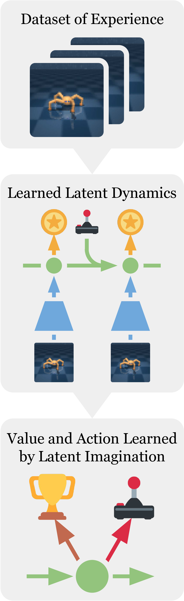
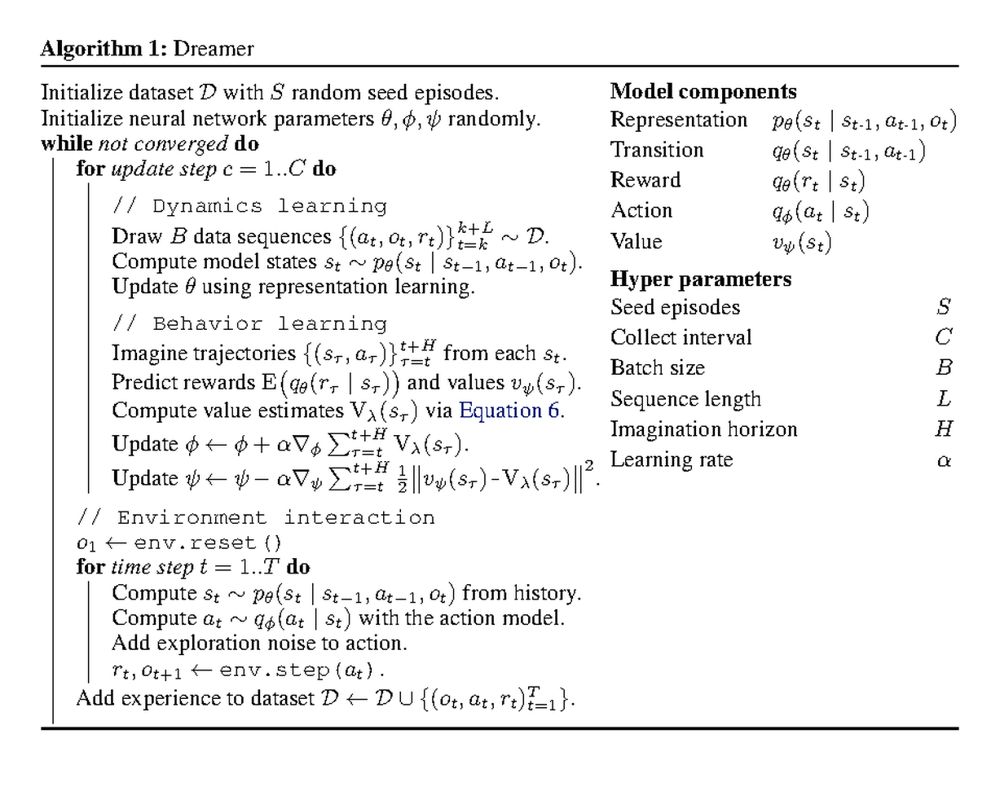
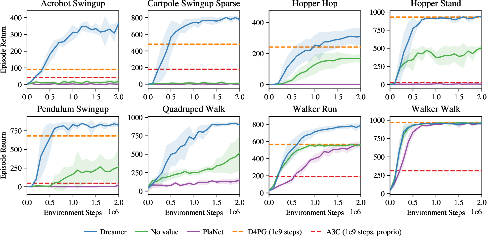
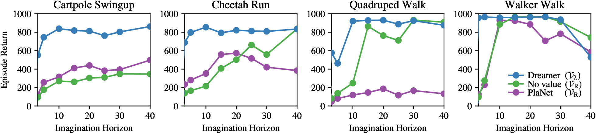
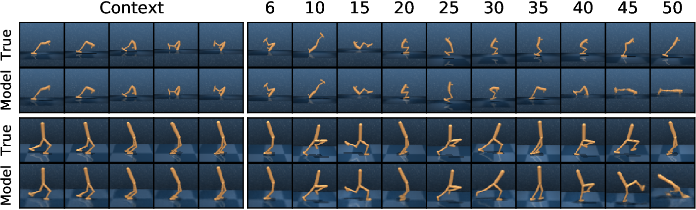
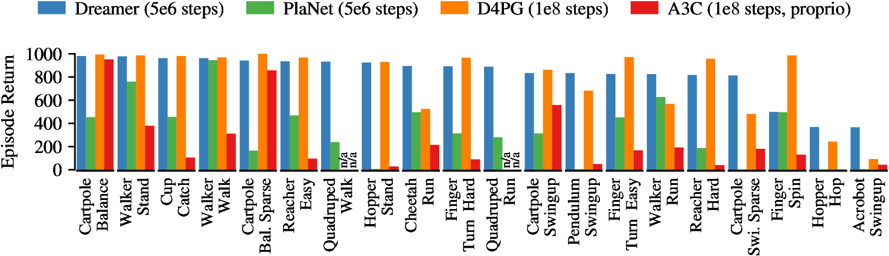

# Dreamer：在 latent imagination 里训练 actor-critic

!!! info "本站判断"
    这页把《Dreamer：在 latent imagination 里训练 actor-critic》当作机制和证据案例来读：先看它真正改变了哪个接口，再看实验、消融、scaling 或失败边界是否支撑这个 claim。

    Checked Date: 2026-06-04；Repro Status: Paper / official materials reviewed, independent reproduction not claimed.

Checked date: 2026-06-03
Repro status: 论文级理解；本站未复现实验，只引用原论文图、项目页和公开论文结果。

Dreamer 要回答的问题不是“能不能生成未来视频”，而是：如果真实环境交互很贵，能不能先从少量真实 episode 学一个 latent world model，再让策略在这个模型想象出的轨迹里学习控制？这篇论文的关键贡献是把四件事接成一条闭环训练链：从像素历史得到 belief state，在 latent space 预测未来，用 reward/value 估计 imagined return，再把这个 return 变成 actor 的更新信号。

把 Dreamer 读成一句话就是：**posterior 用真实观测校正现在，prior 在没有新观测时想象未来，actor/value 不在像素上学，而在 imagined latent rollout 上学。**

## 它为什么不是普通 model-based RL

Model-free RL 直接从真实试错里学策略，缺点是样本效率低。早期 model-based RL 学一个环境模型后，常见做法是在模型里做规划，比如用 CEM 搜索一段动作序列。PlaNet 就是这个方向：它用 RSSM 从图像学 latent dynamics，然后每一步在线规划动作。

Dreamer 的不同之处在于，它不想每次决策都临时搜索动作序列，而是把“在模型里规划”的能力摊销进一个 actor 网络。训练时，Dreamer 在 world model 里生成大量 imagined trajectories；执行时，actor 直接根据 latent state 输出动作。这样做的收益是推理更快、训练时可以并行生成很多短轨迹；代价是 actor 可能学会利用 world model 的错误，所以最终证据必须回到真实环境回报。

```text
真实交互数据
  -> RSSM posterior 编码成 latent state
  -> 训练 transition / observation / reward / continuation
  -> 从 replay state 出发，用 prior + actor 想象未来
  -> 用 imagined reward 和 value 训练 actor-critic
  -> 回真实环境收集新数据
```

## 先跟着一张图看数据流

{ width="860" }

<small>图源：[Dream to Control: Learning Behaviors by Latent Imagination](https://arxiv.org/abs/1912.01603)，Figure 1。原图表达 Dreamer 的三段循环：从真实经验学习世界模型、用世界模型预测的 trajectory 学 actor/value、再用 actor 回环境采集数据。本站读法是顺着箭头看“证据从哪里来”：模型 loss 来自真实 replay，actor/value 的梯度主要来自 imagined rollout，最终验证仍在真实环境。</small>

这张图最容易被误读成“先训练一个视频预测器，再拿它做 RL”。实际更准确的说法是：世界模型的 latent state 是策略学习的工作空间，图像重建只是训练这个工作空间的一个辅助约束。Dreamer 关心的不是把未来每个像素预测到多清楚，而是 latent rollout 是否保留了足够的任务信息，让 reward、value 和 actor 能在其中学习。

## RSSM：posterior 负责看见，prior 负责想象

Dreamer 的 world model 继承了 PlaNet 的 RSSM。RSSM 不是单个向量，而是把历史记忆和随机状态合在一起：

\[
h_t = f_\theta(h_{t-1}, z_{t-1}, a_{t-1})
\]

\[
z_t^{\text{post}} \sim q_\phi(z_t \mid h_t, o_t), \qquad
z_t^{\text{prior}} \sim p_\theta(z_t \mid h_t)
\]

这里的 \(h_t\) 是 deterministic hidden state，它吃前一步 latent state 和动作，因此能记住速度、接触、遮挡这类单帧图像看不全的信息。\(z_t\) 是 stochastic latent state，用来表达不确定性和多种可能的未来。真实观测 \(o_t\) 到来时，posterior \(q_\phi\) 会把图像信息并入当前 state；做未来想象时，模型没有新图像可看，只能用 prior \(p_\theta\) 往前滚。

这个 posterior/prior 的分工是 Dreamer 能从像素控制走向 latent control 的核心。真实 replay 让模型知道“现在到底发生了什么”；prior rollout 让策略在没有真实交互成本的情况下试未来动作。只要 prior 预测的 latent future 足够对任务有用，actor 就不需要每次都等环境反馈才能更新。

{ width="860" }

<small>图源：[Dreamer](https://arxiv.org/abs/1912.01603)，Figure 3。原图把 representation、transition、observation、reward、actor、value 画在同一张计算图里。本站读法是分清两条边：蓝色世界模型边学习“状态如何随动作变化”，绿色行为学习边使用 imagined state sequence 更新 actor/value。</small>

## World model loss：重建图像只是其中一项

训练 RSSM 时，Dreamer 会从 replay buffer 取一段真实序列 \((o_t, a_t, r_t)\)，用 posterior 得到 state，再让 state 同时解释观测、奖励、continuation，并让 posterior 不要偏离 prior 太远。一个简化写法是：

\[
\mathcal{L}_{\text{model}}
=
\sum_t
\Big[
-\log p_\theta(o_t \mid h_t, z_t^{\text{post}})
-\log p_\theta(r_t \mid h_t, z_t^{\text{post}})
-\log p_\theta(\gamma_t \mid h_t, z_t^{\text{post}})
+ \beta\, \mathrm{KL}\big(q_\phi(z_t \mid h_t,o_t)\,\|\,p_\theta(z_t \mid h_t)\big)
\Big]
\]

图像项让 state 保留可观测结构，reward 项让 state 对任务有用，continuation/discount 项告诉模型 episode 是否快结束，KL 项把“看过真实图像后的 posterior state”和“只凭历史往前猜的 prior state”拉到同一个可 rollout 的空间里。

如果只看 reconstruction loss，容易把 Dreamer 误解成自编码器。真正重要的是这些 loss 共同塑造了一个 actor/value 可以消费的 state：它既能解释当前观测，也能在没有新观测时产生下一步状态和奖励预测。

## Imagination：从真实 state 出发，但未来不再看图像

Dreamer 不是从空白开始做梦。它先从 replay 里的真实序列抽取 posterior state，把这个 state 当作 imagined rollout 的起点。之后每一步：

\[
a_\tau \sim \pi_\eta(a_\tau \mid h_\tau, z_\tau), \qquad
z_{\tau+1} \sim p_\theta(z_{\tau+1} \mid h_{\tau+1})
\]

\[
\hat r_\tau = r_\theta(h_\tau,z_\tau), \qquad
\hat\gamma_\tau = \gamma_\theta(h_\tau,z_\tau)
\]

也就是说，想象阶段不再把未来图像喂回模型。actor 根据 latent state 选动作，transition prior 给出下一 latent state，reward/discount head 给出学习信号。图像 decoder 可以把 latent rollout 可视化出来，但 actor 的训练并不依赖“先把图像解出来再识别”。

{ width="780" }

<small>图源：[Dreamer](https://arxiv.org/abs/1912.01603)，Algorithm 1。原图列出 collect experience、learn world model、learn actor/value 三个循环。本站读法是注意训练单位的变化：world model 用真实 sequence 训练，actor/value 用 model-imagined sequence 训练，这两类 sequence 不能混在一起理解。</small>

这一步解释了 Dreamer 的名字：它不是为了展示一段好看的未来视频，而是在 compact latent state 里“做很多便宜的短期未来试验”。便宜来自两个地方：latent state 比图像小得多；很多 imagined trajectories 可以在 GPU 上并行。

## Actor/value：用 lambda return 把短 horizon 接成长视野

imagined rollout 不能无限长。滚得太短，actor 看不到动作的长期后果；滚得太长，transition error 会累积，模型偏差会污染学习信号。Dreamer 用 value network 在 horizon 末端 bootstrap，并用 lambda return 把短 rollout 和长期价值接起来：

\[
V_t^\lambda
=
\hat r_t
+ \hat\gamma_t
\Big((1-\lambda)v_\psi(s_{t+1}) + \lambda V_{t+1}^\lambda\Big)
\]

这里 \(s_t=(h_t,z_t)\)。value network \(v_\psi\) 学习预测 imagined state 的长期回报；actor 最大化这些 imagined returns。论文强调的“analytic gradients”指的是：reward、value 和 latent dynamics 都在同一张可微计算图里，actor 的动作改变会影响后续 latent state 和 reward 预测，因此梯度可以沿着 imagined trajectory 传回 actor。

这和 model-free actor-critic 的差别很大。model-free 方法主要从真实 trajectory 的采样回报里估计策略好坏；Dreamer 则先用真实数据学出一个可微 surrogate environment，再在这个 surrogate environment 里更新 actor。它减少真实交互，但也把风险转移到了 world model 是否可信。

{ width="760" }

<small>图源：[Dreamer](https://arxiv.org/abs/1912.01603)，Figure 7。原图展示 value learning 对 long-horizon behavior 的影响。本站读法是把 value 看成 horizon 之外的“尾部估计器”：没有它，imagined rollout 很容易只优化短期奖励；有了它，短 rollout 才能服务长期控制。</small>

## Horizon ablation：世界模型不是滚得越远越好

{ width="760" }

<small>图源：[Dreamer](https://arxiv.org/abs/1912.01603)，Figure 4。原图比较不同 imagination horizon 的表现。本站读法是把它当成 bias-control tradeoff：horizon 太短，策略学不到延迟后果；horizon 太长，模型误差沿 prior rollout 累积，actor 可能优化到虚假的高回报。</small>

这张图比视频预测图更能说明 Dreamer 的控制逻辑。世界模型在控制里不是一个越长越好的模拟器，而是一个有限可信区间内的训练器。工程上迁移 Dreamer 思路时，horizon、value bootstrap、模型不确定性和 replay 数据覆盖度必须一起调；只把 rollout length 拉长，通常不会自动得到更强 agent。

## 视频预测图：是诊断，不是最终证据

{ width="860" }

<small>图源：[Dreamer](https://arxiv.org/abs/1912.01603)，Figure 5。原图把 latent rollout 解码成未来画面，用于展示模型是否捕捉到粗略运动和场景结构。本站读法是把它当诊断工具：它能帮人发现模型有没有学到动态，但不能替代真实环境中的闭环控制回报。</small>

这也是读世界模型论文时最常见的误区。视频越清晰，不等于策略越强；视频有些模糊，也不一定意味着控制失败。对 Dreamer 来说，关键是 latent state 是否保留了 reward-relevant dynamics。比如速度、姿态和接触关系可能对奖励很重要，但不一定需要每个纹理像素都预测得精确。

## 实验结果应该看三层证据

{ width="860" }

<small>图源：[Dreamer](https://arxiv.org/abs/1912.01603)，Figure 6。原图比较 Dreamer 和多个 baseline 在 visual control tasks 上的表现。本站读法是先看同样 environment interaction budget 下的样本效率，再看最终真实环境回报，最后回到 ablation 理解哪些组件支撑结果。</small>

第一层证据是任务回报：Dreamer 的 claim 必须落在真实环境中的 episode return，而不是 reconstruction 或 reward prediction loss。第二层证据是样本效率：world model 的价值在于减少真实交互，不只是提高最终分数。第三层证据是组件消融：RSSM、imagination horizon、value bootstrap、actor learning 这些模块分别影响哪一段。

这套读法也适合后来 DreamerV2、DreamerV3 和机器人世界模型论文。凡是声称“学会世界模型即可控制”的工作，都应该问同样的问题：真实交互预算是多少？想象 rollout 的 horizon 多长？world model loss 和下游 reward 是否一致？是否存在模型漏洞被 actor 利用？

## 和 PlaNet、DreamerV2、DreamerV3 的关系

PlaNet 证明了 RSSM 可以从像素学 latent dynamics，并用在线规划解决视觉控制。Dreamer 接在它后面，把“每次规划”改成“训练一个 actor”，因此更像把规划摊销成策略网络。DreamerV2 继续推进到 Atari，重要变化包括离散 latent state 和更适合离散动作/复杂视觉任务的训练细节。DreamerV3 的重点不再只是某个环境上的技巧，而是寻找跨任务更稳的 world-model RL recipe。

这个脉络里最值得记住的不是版本号，而是控制接口的变化：World Models 时代强调 latent dream 的概念展示，PlaNet 强调 latent planning，Dreamer 强调 latent imagination 里的 actor-critic，后续版本强调更广任务和更稳训练。

## 迁移到具身智能时的边界

Dreamer 的思想对机器人和具身智能很有启发，但原论文实验主要还是规整的视觉控制 benchmark。真实机器人会额外遇到多相机标定、动作延迟、接触不可逆、安全约束、稀疏奖励、长时任务、数据分布漂移和 sim-to-real 差距。世界模型在这些场景中不能只证明“能预测未来画面”，还要证明预测能被 planner、actor 或 evaluator 稳定消费。

因此，读 Dreamer 时应该把它当成一个非常清楚的机制范式，而不是直接把所有现实控制问题都宣称已经解决。它教会我们如何把表示学习、动态模型和策略优化接起来；现实系统还要补数据、约束、安全和分布外检测。

## 阅读结论

Dreamer 的核心知识含量在三点。第一，RSSM 把真实观测校正和无观测未来预测分开：posterior 学“现在”，prior 学“未来”。第二，world model loss 同时约束观测、奖励、continuation 和 KL，不是单纯图像重建。第三，actor/value 在 imagined latent trajectories 上学习，lambda return 和 value bootstrap 让有限 horizon 的想象服务长期控制。

读完这篇论文后，再看新的世界模型论文，可以直接追问：它的 state 是什么？未来 rollout 是否真的被控制模块消费？训练目标和下游 reward 是否一致？最终证据是闭环任务成功，还是只展示了 open-loop 预测？

## 外部精读

- [Dreamer paper: Dream to Control](https://arxiv.org/abs/1912.01603)
- [Dreamer project page](https://danijar.com/project/dreamer/)
- [Google Research Blog: Introducing Dreamer](https://research.google/blog/introducing-dreamer-scalable-reinforcement-learning-using-world-models/)
- [PlaNet paper](https://arxiv.org/abs/1811.04551)
- [DreamerV2](https://arxiv.org/abs/2010.02193)
- [DreamerV3](https://arxiv.org/abs/2301.04104)

## 相关阅读与下一步

- 外部材料：[论文标题 arXiv 检索](https://arxiv.org/search/?query=dreamer&searchtype=title)。
- 外部材料：[Semantic Scholar 标题检索](https://www.semanticscholar.org/search?q=dreamer)。
- 外部材料：[Papers with Code 检索](https://paperswithcode.com/search?q=dreamer)。
- 站内下一步：[论文精读专题](../index.md)。
- 站内下一步：[论文专题写作规范](../writing-standard.md)。
- 站内下一步：[外部精读来源台账](../../references/external-reading-ledger.md)。
