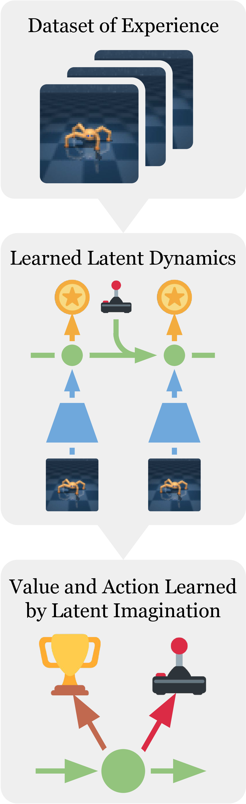
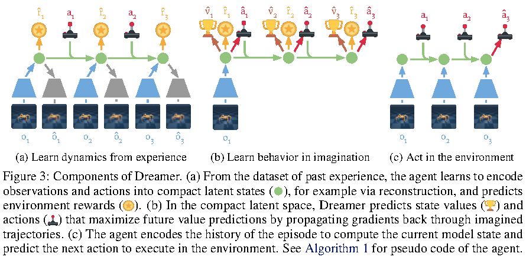
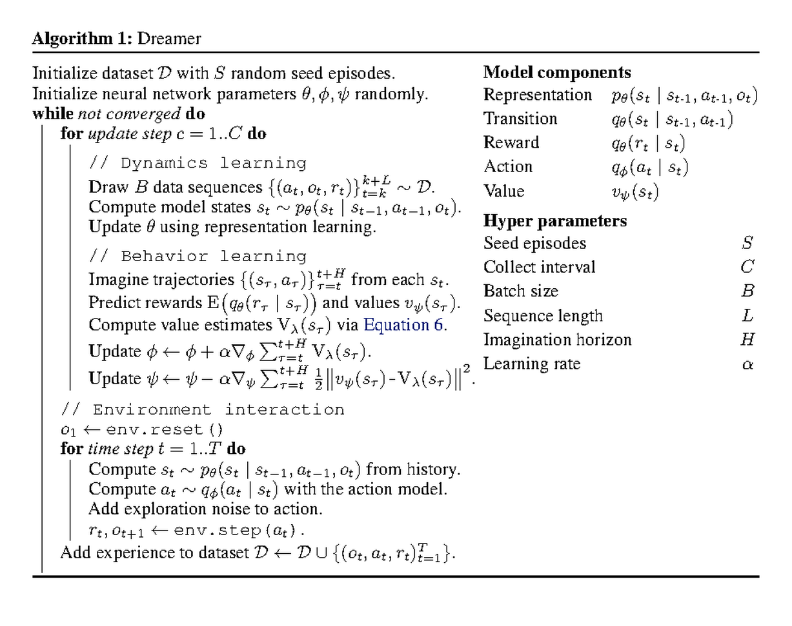
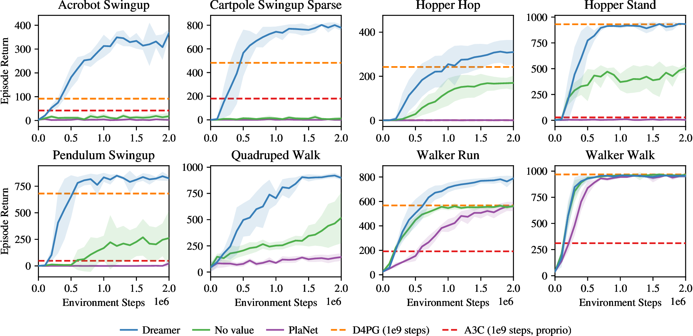
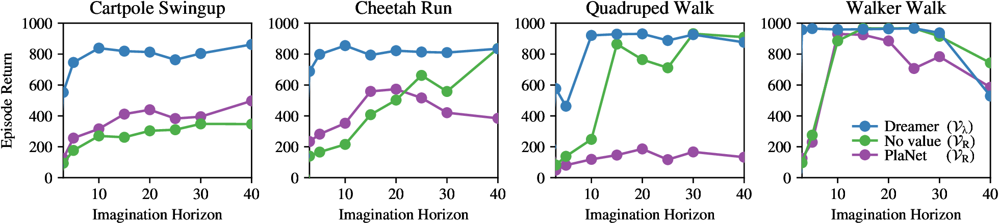
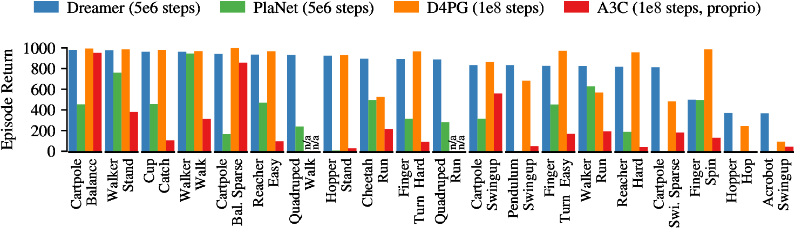
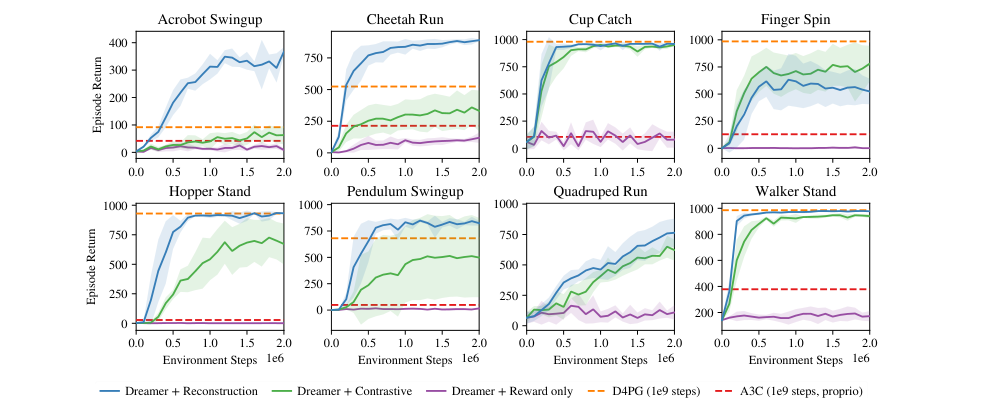
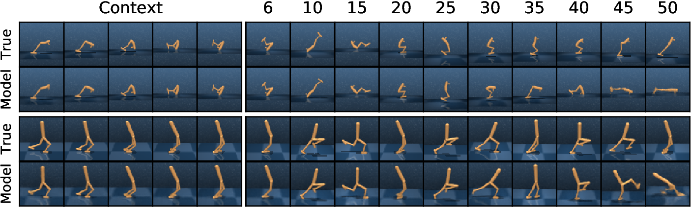

# Dreamer：在 latent imagination 里训练 actor-critic

!!! info "论文信息"
    **论文题名：** Dream to Control: Learning Behaviors by Latent Imagination。 
    **作者：** Danijar Hafner、Timothy Lillicrap、Jimmy Ba、Mohammad Norouzi。 
    **机构：** 未在公开元数据中稳定解析；以 arXiv/PDF 或官方页 affiliation block 为准。 
    **时间 / 主题：** 2019-12；世界模型。 
    **arXiv / 官方报告：** arXiv：[1912.01603](https://arxiv.org/abs/1912.01603)；官方材料：[danijar.com/project/dreamer/](https://danijar.com/project/dreamer/)。 
    **GitHub / 项目：** GitHub：[github.com/danijar/dreamer](https://github.com/danijar/dreamer)；项目页：[danijar.com/project/dreamer/](https://danijar.com/project/dreamer/)。 
    **元数据来源与核验口径：** 来源：[arXiv](https://arxiv.org/abs/1912.01603)；[GitHub API / repo](https://github.com/danijar/dreamer)；[官方 / 项目材料](https://danijar.com/project/dreamer/)；Checked Date：2026-06-15；Repro Status：Paper / official materials reviewed, independent reproduction not claimed。

## 看见未来十五步，怎样学会更远的动作后果

假设世界模型已经能在 latent 里向前滚动十五步。现在要训练一个动作策略，应该只把这十五步的奖励相加，还是要估计更远的结果？PlaNet 在每次决策时搜索候选动作序列，Dreamer 则尝试在同一个模型里直接训练 actor。两种做法都会遇到有限视野的问题，准备动作的价值可能要过一段时间才显现。

摆杆要先向看似错误的方向运动才能积累动能，hopper 要先调整姿态才有机会持续跳跃。一小段轨迹内的奖励不一定能区分这些准备动作；无限加长模拟又会让模型误差和计算量一起上升。Dreamer 的取舍是学习一个 value，把想象窗口以外的回报接回来，再让多步价值的梯度沿着潜在动力学传给 actor。[↗](https://arxiv.org/pdf/1912.01603v3#page=1)

下图的三个部分应连起来读。经验先变成可微的 latent dynamics；actor 与 value 随后在这个模型里学习；得到的 actor 再回真实环境收集新经验。价值函数让模型无需真的模拟到所有遥远奖励出现的位置。

{ width="860" }

*原论文 Figure 1。最后一层加入 action 和 value prediction，承接前面已经学到的潜在动力学。*

论文的主要创新因此落在行为学习上。它采用已有 RSSM 学习潜在状态，而后展示，利用这个模型的解析梯度和多步价值，可以在 20 个视觉控制任务中获得比只做有限窗口规划更强的行为。世界模型、价值学习和策略更新在这里各有明确分工。

## 真实观察与想象轨迹使用不同的状态更新路径

环境被建模为部分可观测过程。agent 看到图像 $o_t$，执行动作 $a_t$，收到奖励 $r_t$，却没有直接得到完整物理状态。单张图像通常也无法唯一确定速度等信息，所以表示必须结合历史。

原文式（1）将模型接口写成

$$
\begin{aligned}
\text{Representation: }&p_\theta(s_t\mid s_{t-1},a_{t-1},o_t),\\
\text{Transition: }&q_\theta(s_t\mid s_{t-1},a_{t-1}),\\
\text{Reward: }&q_\theta(r_t\mid s_t).
\end{aligned}
$$

这里沿用论文的符号，$p$ 是利用真实观察推断状态的 representation model，$q$ 是用于想象的近似模型。阅读后续 Dreamer 论文时不能仅凭 $p$、$q$ 的字母判断 prior 或 posterior，应该看分布是否接收当前观察。

representation model 把新图像与历史结合，形成当前状态；transition model 则在没有新图像的情况下预测状态。RSSM 将确定性的循环记忆与随机潜变量结合，本文随机部分使用 30 维对角高斯分布。循环路径保留过去的信息，随机部分描述当前状态中不能仅由历史确定的内容。模型还可以从状态解码图像，为表示学习提供监督，但 actor 在想象时不需要每一步把 latent 还原为像素。[↗](https://arxiv.org/pdf/1912.01603v3#page=2) [↗](https://arxiv.org/pdf/1912.01603v3#page=14)

Figure 3 把训练与执行的差别画得很清楚。先读左图中持续进入模型的观察，再看中图只有起点使用真实观察，最后看右图如何在真实交互时重新获得观察纠正。

{ width="860" }

*原论文 Figure 3。左侧学表示和动力学，中间学 actor 与 value，右侧执行已学策略。三者共享状态接口，使用的监督和更新对象不同。*

模型训练从经验池取连续片段，用真实观察推断各个状态，并拟合图像、奖励及状态转移。行为训练以这些推断出的状态为起点，让当前 actor 产生动作，再由 transition model 生成后续状态。由于起点来自已经历的轨迹，想象被连接到实际访问过的状态分布；随后生成的动作与未来则来自当前模型和策略。

部署时，agent 根据新观察更新状态，直接调用动作模型。它没有在每个环境时刻重新搜索一大批动作序列。训练阶段已把许多想象轨迹中的比较结果写进 actor 参数，因此环境交互可以采用较短的决策路径。[↗](https://arxiv.org/pdf/1912.01603v3#page=3)

## 策略梯度怎样穿过动作采样与世界模型

Dreamer 使用的 actor 是 tanh-transformed Gaussian。网络根据状态输出高斯参数，再通过重参数化采样

$$
a_\tau=\tanh\!\left(\mu_\phi(s_\tau)+\sigma_\phi(s_\tau)\epsilon\right),
\qquad \epsilon\sim\mathcal N(0,I).
$$

$\tau$ 表示想象轨迹中的时间，$\phi$ 是 actor 参数。随机性被集中在外部噪声 $\epsilon$ 上。对一次固定的噪声采样，动作仍是网络输出的可微函数；连续高斯 latent 同样可以重参数化。这使得“采样了一条随机轨迹”与“沿这条轨迹反向传播”能够同时成立。[↗](https://arxiv.org/pdf/1912.01603v3#page=4)

梯度的路径是，价值和奖励依赖想象状态，想象状态依赖之前动作，动作又依赖 actor 参数。作为链式法则的示意，其中一段可以写成

$$
\frac{\partial v(s_{\tau+1})}{\partial\phi}
=\frac{\partial v}{\partial s_{\tau+1}}
\frac{\partial s_{\tau+1}}{\partial a_\tau}
\frac{\partial a_\tau}{\partial\phi}
+\text{其他跨时间依赖项}.
$$

这条示意式突出动力学提供的 $\partial s_{\tau+1}/\partial a_\tau$。actor 得到的反馈不只是“这次动作回报高，所以提高它的概率”，还包括模型给出的局部方向，动作怎样改变后续状态，后续状态怎样改变奖励和价值。实际更新通过整个展开图计算这些依赖。

行为学习时世界模型参数 $\theta$ 固定。固定参数并不意味着切断模型对输入的梯度，actor 仍需要通过模型的动作与状态 Jacobian 获得反馈。反过来，不能让 actor 为了提高预测回报直接修改奖励模型，否则它可能通过改变评判标准来提高目标值。

critic 的用法也与 REINFORCE 中单纯降低方差的 baseline 不同。Dreamer 在 actor 更新中穿过 value model 求导，让 value 对状态的梯度参与选择动作；在训练 value model 自身时，则停止目标回报的梯度，只让当前预测靠近目标。两条梯度路径处理的是不同问题。[↗](https://arxiv.org/pdf/1912.01603v3#page=5)

## 短期奖励、bootstrap 与 λ-return 如何接起来

设一条想象轨迹从 $t$ 展开到 $t+H$。最简单的目标只累加窗口内奖励，论文式（4）记为

$$
V_R(s_\tau)=\mathbb E_{q_\theta,q_\phi}
\left[\sum_{n=\tau}^{t+H}r_n\right].
$$

这正是“不学习 value”的对照。只要关键奖励出现在窗口外，动作模型就看不到它。窗口末端的一个状态即使很有前途，也可能与一个走入死路的状态得到近似评价。

引入 value 后，可以先模拟 $k$ 步，再让 $v_\psi$ 估计剩余回报。原文式（5）为

$$
V_N^k(s_\tau)=\mathbb E_{q_\theta,q_\phi}\!\left[
\sum_{n=\tau}^{h-1}\gamma^{n-\tau}r_n
+\gamma^{h-\tau}v_\psi(s_h)
\right],
\qquad h=\min(\tau+k,t+H).
$$

$\gamma$ 是折扣系数，$h$ 保证不超过当前想象片段的末端。第一项保留实际生成的短期奖励，第二项在截断状态上接入价值。若用很小的 $k$，目标较依赖当前 critic；若用很大的 $k$，更多地依赖多步模型预测与轨迹采样。两者的误差来源不同。

Dreamer 将多个 $k$ 步估计做指数加权，得到式（6）

$$
V_\lambda(s_\tau)
=(1-\lambda)\sum_{n=1}^{H-1}\lambda^{n-1}V_N^n(s_\tau)
+\lambda^{H-1}V_N^H(s_\tau).
$$

最后一项吸收剩余权重，因此这些权重合计为 1。$\lambda$ 较小更依赖短 bootstrap，较大更依赖较长的预测回报。本文默认 $\lambda=0.95$、$\gamma=0.99$、$H=15$。这个 value 学的是当前策略在世界模型中预计能获得的未来奖励，它会随 actor 改善而更新，并非一个外部提供的正确答案。[↗](https://arxiv.org/pdf/1912.01603v3#page=4)

actor 与 critic 随后使用同一批想象轨迹，分别优化

$$
\max_\phi\ \mathbb E_{q_\theta,q_\phi}
\left[\sum_{\tau=t}^{t+H}V_\lambda(s_\tau)\right],
$$

$$
\min_\psi\ \mathbb E_{q_\theta,q_\phi}
\left[\sum_{\tau=t}^{t+H}\frac12
\left(v_\psi(s_\tau)-\operatorname{sg}(V_\lambda(s_\tau))\right)^2\right].
$$

actor 通过动力学提高估计回报，critic 则拟合这些新回报目标。这种交替改善可以把短片段中的奖励信息逐步传向更早的状态，使 actor 不必等到一次想象覆盖完整任务才获得方向。

遇到提前终止的环境，还要防止模型把死亡或结束之后的虚构回报算进去。论文增加从 latent state 预测 discount 的分类器，目标为 0 或 $\gamma$，并用预测折扣的累积乘积加权 actor 与 critic 的各时刻目标。越可能已经终止的轨迹，其后续项权重越小。[↗](https://arxiv.org/pdf/1912.01603v3#page=5)

## 世界模型为什么需要学习奖励以外的信息

行为学习要求模型能预测动作后果，但模型本身怎样学出足够好的状态，仍是独立的选择。Dreamer 比较了图像重建、对比估计与仅奖励预测三种方法，并没有将某一种表示目标当作算法定义的一部分。

使用重建时，模型额外预测 $q_\theta(o_t\mid s_t)$。原文式（10）最大化的目标为

$$
\mathcal J_{\mathrm{REC}}
=\mathbb E_p\sum_t\left[
\ln q_\theta(o_t\mid s_t)
+\ln q_\theta(r_t\mid s_t)
-\beta\operatorname{KL}\!\left(
 p_\theta(s_t\mid s_{t-1},a_{t-1},o_t)
 \Vert q_\theta(s_t\mid s_{t-1},a_{t-1})
\right)\right].
$$

图像项要求状态能解释观察，奖励项使状态保留任务价值，KL 则让真实观察推断出的状态与仅靠历史预测的状态兼容。否则，训练时 encoder 得到一套很丰富的状态，想象时 transition model 却只能生成另一套分布，actor 就会在不相容的模型状态上学习。

本文使用 $\beta=1$，并把 KL 损失设为不低于 3 free nats。KL 小于阈值时不再继续推动压缩，给模型保留表达信息的空间；这与把过大的 KL 限制在某个上限不同。这里尚没有后续 DreamerV2、V3 的 KL balancing 或离散 latent 配置。[↗](https://arxiv.org/pdf/1912.01603v3#page=6) [↗](https://arxiv.org/pdf/1912.01603v3#page=14)

附录从 information bottleneck 解释这一目标。表示既要包含足以预测观察与奖励的信息，又限制每一步从当前样本额外取入的信息。当历史已经能预测一部分观察时，模型应尽量复用历史，必要时才从新图像补充信息。这使 KL 正则同时参与时间结构的学习，而不仅是对单张图像做压缩。[↗](https://arxiv.org/pdf/1912.01603v3#page=15)

重建的代价是模型要花容量预测大量像素。论文因此尝试用 state model $q_\theta(s_t\mid o_t)$ 替换图像 decoder，并采用对比项

$$
\mathcal J_S^t
=\ln q_\theta(s_t\mid o_t)
-\ln\!\left(\sum_{o'}q_\theta(s_t\mid o')\right).
$$

其中 $o'$ 来自当前 sequence batch。第一项鼓励当前图像预测对应状态，分母项比较其他图像，防止所有图像与状态都坍缩到同一个表示。完整目标仍包含奖励预测和相同的 KL 项，只替换图像学习信号。仅奖励预测则进一步去掉观察辅助目标。[↗](https://arxiv.org/pdf/1912.01603v3#page=6)

仅预测奖励看起来最贴近任务，但在线数据有限时，它可能提供过少监督。没有奖励的许多帧包含不同的位置、速度和接触关系，如果模型只需把它们都预测成零奖励，就缺少把这些状态区分开的动力。图像重建或对比目标给这些时刻提供更密集的信息，之后策略才有可能利用它们解释未来奖励。

## 一次完整训练迭代的更新顺序

原论文 Algorithm 1 可以作为实现时的流程检查。先看 dynamics learning 更新 $\theta$，再看 behavior learning 更新 $\phi$、$\psi$，最后才是真实环境采集。把三类参数混成一次没有边界的联合更新，就失去了前面所说的梯度分工。

{ width="780" }

*原论文 Algorithm 1。想象从 replay 推断出的状态开始，actor 与 value 使用相同轨迹，真实交互再扩充数据集。*

连续控制的配置相当具体。初始化时收集 5 个随机 episode，随后交替执行 100 个训练更新和 1 个真实 episode。采集时使用 actor 预测的 mode action，并加入标准差 0.3 的高斯探索噪声；想象训练中的动作则通过前述分布采样得到。二者不能简单合并成“始终执行随机 actor 样本”。

| Component / setting | Value |
| --- | --- |
| Batch size × sequence length | 50 × 50 |
| Stochastic latent | 30-dimensional diagonal Gaussian |
| Dense networks | 3 layers × 300 units, ELU |
| World model learning rate | $6\times10^{-4}$ |
| Actor / value learning rate | $8\times10^{-5}$ / $8\times10^{-5}$ |
| Optimizer | Adam |
| Gradient norm clipping | 100 |
| KL scale / free nats | 1 / 3 |
| Imagination horizon | 15 |
| Discount / return lambda | 0.99 / 0.95 |
| Action repeat | 2 |

图像 encoder 与 decoder 使用卷积网络，RSSM 承担转移，其余函数使用上述 MLP。actor 在高斯参数化内部将 tanh mean 乘以 5，标准差经 softplus，再对采样结果做 tanh，使策略有能力接近动作边界。论文报告，在这组连续任务中没有发现必须使用 latent overshooting、actor entropy bonus 或 value target networks。[↗](https://arxiv.org/pdf/1912.01603v3#page=14)

这些选择不要与后续版本混用。V1 连续控制主要靠解析动力学梯度和高斯潜变量，既没有 V3 的 twohot value，也没有跨任务 return normalization；将这些后来的配置写回本文，会掩盖原论文究竟验证了什么。

## 相同世界模型下，value 真正改变了哪些任务

最直接的消融保持世界模型采用图像重建，比较三种行为获取方式。Dreamer 学 actor 与 value；No value 学 actor，但只最大化想象窗口内的奖励；PlaNet 在线规划，也只看有限窗口奖励。这比单独与 model-free 方法比平均成绩更能定位 value 的作用。

先看 Acrobot Swingup 与 Cartpole Swingup Sparse，再看 Walker Walk。前两者需要先经过没有立即好处的准备过程，后者更容易从短期奖励中找到有效运动。

{ width="760" }

*原论文 Figure 7。蓝色为 Dreamer，绿色为 No value，紫色为 PlaNet；横轴是环境步数，阴影表现种子间差异。水平虚线是文献基线参考。*

Acrobot 和稀疏 Cartpole 中，Dreamer 能明显上升，而另外两种模型方法长时间停留在低回报。Hopper Stand 中 No value 能获得部分行为，仍明显落后；Walker Walk 中几种方法却都能达到较高回报。这说明 value 最有价值的地方，是窗口内奖励不足以解释好动作的任务，而不是给所有控制问题都增加同样幅度的收益。[↗](https://arxiv.org/pdf/1912.01603v3#page=7)

进一步的 horizon sweep 改变想象长度，检验收益是否只是 Dreamer 看得更多。应沿横轴比较同一个任务内三条曲线，再看小 horizon 是否已经能产生高回报。

{ width="760" }

*原论文 Figure 4。Dreamer 使用 $V_\lambda$，No value 和 PlaNet 使用窗口内奖励 $V_R$；action repeat 固定为 2。*

Cartpole Swingup 与 Cheetah Run 中，Dreamer 在较短长度就能达到较高分数；Quadruped Walk 中 No value 需要更长窗口才接近它。value 由此减少了对“大 horizon 正好覆盖关键事件”的依赖。

图中也有重要反例，Walker Walk 在 horizon 40 时，Dreamer 的成绩明显下降，没有呈现“想象越长越好”。长展开增加计算与模型误差，value 学习本身也可能不稳定，因此论文支持的是较短想象配合价值学习的有效性。对新任务盲目加长 horizon，并不能替代对动力学误差和 critic 的检查。[↗](https://arxiv.org/pdf/1912.01603v3#page=4)

## 20 个视觉控制任务的成绩与预算

主实验使用 DeepMind Control Suite 中 20 个任务，观察为 $64\times64\times3$ 图像，动作维度为 1 到 12，奖励在 0 到 1 之间，episode 长度为 1,000 环境步，初始状态随机。任务选择依据是此前参考报告中已经从像素取得非零成绩的任务，不能把结果理解成对控制套件所有可能困难的穷举。

下图在固定训练预算下比较最终成绩。首先注意图例，Dreamer 与重跑的 PlaNet 使用 5M 环境步，D4PG 与 A3C 使用 100M；A3C 还使用 proprioceptive state，而非像素输入。

{ width="860" }

*原论文 Figure 6。比较同一任务的柱形时，同时保留输入模态与预算；quadruped 两项缺少 D4PG、A3C 参考结果。*

附录数值表报告 Dreamer 平均 823.39，PlaNet 332.97，D4PG 786.32，A3C 243.70。Dreamer 与 PlaNet 有 20 个任务，D4PG 和 A3C 缺少两个 quadruped 结果，其平均值覆盖 18 个任务。100M 与 5M 的预算相差 20 倍，这是环境交互量的比值，并非所有任务统一达到同一目标分数的加速倍数。

| Task | PlaNet, 5M steps | Dreamer, 5M steps | D4PG, 100M steps |
| --- | ---: | ---: | ---: |
| Acrobot Swingup | 3.21 | 365.26 | 91.70 |
| Cartpole Swingup Sparse | 0.64 | 812.22 | 482.00 |
| Cheetah Run | 496.12 | 894.56 | 523.80 |
| Hopper Hop | 0.37 | 368.97 | 242.00 |
| Hopper Stand | 5.96 | 923.72 | 929.90 |
| Pendulum Swingup | 3.27 | 833.00 | 680.90 |
| Finger Spin | 495.25 | 498.88 | 985.70 |
| Reacher Hard | 187.02 | 817.05 | 957.10 |
| Walker Walk | 944.70 | 961.67 | 968.30 |

这些行让总体优势与剩余困难同时可见。稀疏 Cartpole 和 Pendulum 的大幅提升符合长时价值的机制解释；Finger Spin 上 Dreamer 仍只有 D4PG 大约一半成绩，Reacher Hard 也落后。Hopper Stand、Walker Walk 则接近 D4PG 水平，不能把平均分超过 D4PG 简化成所有任务都超过它。[↗](https://arxiv.org/pdf/1912.01603v3#page=20)

PlaNet 在这篇论文中统一重跑为 action repeat 2，没有沿用原论文对不同任务选择 repeat 的配置，所以它的分数与 PlaNet 原始报告不同。这项对照便于比较固定控制频率下的行为学习，但其较低成绩不能被拿去直接改写 PlaNet 原论文结论。

计算成本也需要区分口径。每个 Dreamer run 使用一张 V100 与 10 个 CPU cores，在 Control Suite 上约每 1M 环境步训练 3 小时；PlaNet 约需 11 小时。论文另报告 D4PG 用约 24 小时达到相似表现，后者是达到表现的时间，不是每 1M 步的时间。Dreamer 的优势来自将搜索工作分摊到策略学习，并在紧凑 latent 中批量计算想象，而不是取消了模型训练成本。[↗](https://arxiv.org/pdf/1912.01603v3#page=8)

## 重建、对比学习和仅奖励预测的对照

有了行为学习的证据，还需要知道模型从哪里得到可用表示。Figure 8 保持 Dreamer 行为学习方式，替换世界模型中的观察学习目标。先看 Acrobot 与 Cheetah，再看 Cup Catch 和 Finger Spin，可以避免只盯着汇总趋势。

*原论文 Figure 8。蓝线使用 Reconstruction，绿线使用 Contrastive，紫线使用 Reward only；奖励预测和潜在动力学仍是共同部分。*

重建在大多数任务上提供最强学习信号。Acrobot、Cheetah 中对比目标明显落后，reward only 更接近停滞。Cup Catch、Walker Stand 中对比学习也能达到较高水平，Finger Spin 的对比版本甚至高于重建版本。因此不能把实验总结成“对比学习不能控制”或“重建在每个任务都最好”。

作者概括，对比目标能解决约一半任务，仅预测奖励在这批有限数据实验中不足以形成有效模型。实验同时改变了观察目标所提供的信息和优化难度，没有单独证明某个表征家族必然优越。它更具体地提示，actor 学习即使保持不变，表示目标仍会决定哪些状态信息能进入想象，进而改变最终行为。[↗](https://arxiv.org/pdf/1912.01603v3#page=8)

这也解释了 Dreamer 的扩展接口。若能在保持可微、动作条件转移和奖励预测的前提下，找到更好的表示学习方式，actor-critic 的核心更新可以保留。论文将表示学习作为可替换部分，是对系统结构的划分，不能解读成任意 encoder 都会得到同样的成绩。

## 预测图、离散动作与控制频率还说明了什么

原论文用两条留出轨迹可视化模型预测。给前 5 帧观察和整段动作序列，之后 45 步只用 transition model 向前生成，再通过 decoder 显示预测画面。

{ width="860" }

*原论文 Figure 5。True 与 Model 对照展示姿态和运动趋势，后段预测未再接收真实图像。*

模型能保留主要运动结构，但后段身体姿态、位置与接触并不总是准确。特别是 hopper 的较远预测与真实轨迹出现明显偏离。这解释了为什么用短想象加 bootstrap 有实际意义，策略需要有用的局部动力学与价值，不必要求模型对任意长的像素轨迹都精确。图片也没有证明模型能在训练分布之外充当可靠的物理模拟器。[↗](https://arxiv.org/pdf/1912.01603v3#page=5)

离散控制被放在附录中，测试的是部分 Atari 游戏和两个 DMLab levels，尚不是完整 Atari 57 游戏的竞争性结果。观察仍为 $64\times64\times3$，动作在 3 到 18 个类别之间，Atari 使用 sticky actions。actor 改为 categorical distribution，并用 straight-through 梯度穿过动作采样；探索采用 epsilon-greedy，在前 200,000 个梯度更新中将 $\epsilon$ 从 0.4 降到 0.1。

离散配置还把 horizon 改为 10、KL 系数改为 0.1、奖励经 tanh 限幅，并加入终止折扣预测。这意味着本文是在连续任务内部固定一套配置、离散任务内部固定另一套配置，不能提前赋予它 V3 那种跨领域共用全部算法超参数的结论。附录展示了若干 Atari 行为与 DMLab object collection 的成功，也明确将更高视觉复杂度下的竞争性表示学习留作后续问题。[↗](https://arxiv.org/pdf/1912.01603v3#page=14) [↗](https://arxiv.org/pdf/1912.01603v3#page=16)

action repeat 也不是无关细节。相同动作重复更多环境步，会改变控制精细程度，以及一个固定 imagination horizon 覆盖的物理时间。附录比较 repeat 1、2、4，作者选择 2 作为总体较好的折中，但 Finger Spin 等任务的曲线排序与其他任务不同。该实验只有两个种子，并使用较早的超参数设置，支持的是存在一个可复用折中值，不能说算法对控制频率完全不敏感。[↗](https://arxiv.org/pdf/1912.01603v3#page=19)

## 怎样把本文的做法迁移到一个控制实验

Dreamer 提供的可复用核心，是把真实经验中的状态作为想象起点，在一个可微、动作条件的模型中短期展开，再通过 value 接上更远回报。若环境交互昂贵、动作连续、训练阶段可以批量计算，而执行阶段希望直接调用策略，这种分工有明确吸引力。

迁移到新环境时，可以把论文的机制拆成四个小对照。每个对照只改变一件事，结果更容易解释。

| 对照 | 固定 | 观察什么 | 能回答的问题 |
| --- | --- | --- | --- |
| 无 value bootstrap | 世界模型、actor、总想象步数 | 真实回报与学习速度 | 任务是否需要窗口外的后果 |
| 不同 imagination horizon | 其他训练设置 | imagined return、真实 episode 回报、模型漂移 | 长展开的收益是否被模型误差抵消 |
| reward-only 表示 | 动力学、策略更新和数据 | 状态预测、真实成功率 | 表示是否保留了奖励之外的状态信息 |
| actor 更新模型参数 | 仅作为故障注入 | 模型损失、回报和梯度范数 | 是否出现策略利用模型漏洞 |

图像重建看起来不错，却不代表动作 Jacobian 准确。至少保留不同起点的开放环预测，并把模型预测的奖励与真实 episode 回报放在同一张图上。只提高 imagined return，不能证明环境行为改善。

实现时还要把三条梯度路径分开记录。世界模型从真实轨迹更新；actor 沿固定模型的状态梯度提高 \(V_\lambda\)；critic 对停止梯度的回报目标回归。把 `stop_gradient` 错放到 actor 路径，会切断 Dreamer 的主要学习信号；让 actor 反过来更新奖励和动力学模型，则把评判标准也放进了优化对象。

预算记录也要分开。环境 frame、agent action、模型 update、想象 token 和墙钟时间不是同一个计数单位。报告时把成功率或回报作为主结果，把开放环预测误差、horizon sweep、seed 数和总交互量作为解释结果。Dreamer 说明短想象、value bootstrap 与可微策略更新可以组合工作；它的失败任务与离散配置提醒我们，表示质量、探索和模型误差仍需在新环境中单独测量。

想把这条路线接到后续方法，可以先读[世界模型基础](../../world-models/beginner-world-models-primer.md)，确认 observation、latent state 和 transition 的接口；再看[DreamerV3](dreamerv3.md)，比较离散 latent、symlog 和 value 学习怎样处理跨任务尺度。若关心模型生成数据是否可信，接着读[模拟器、反事实与合成 rollout](../../world-models/simulators-counterfactuals-and-synthetic-rollouts.md)，把想象回报和真实环境验证分开。
