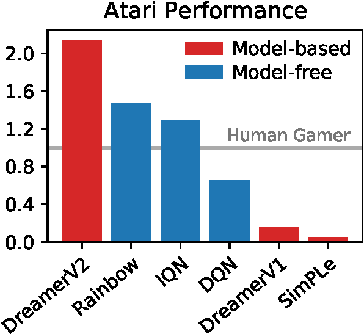
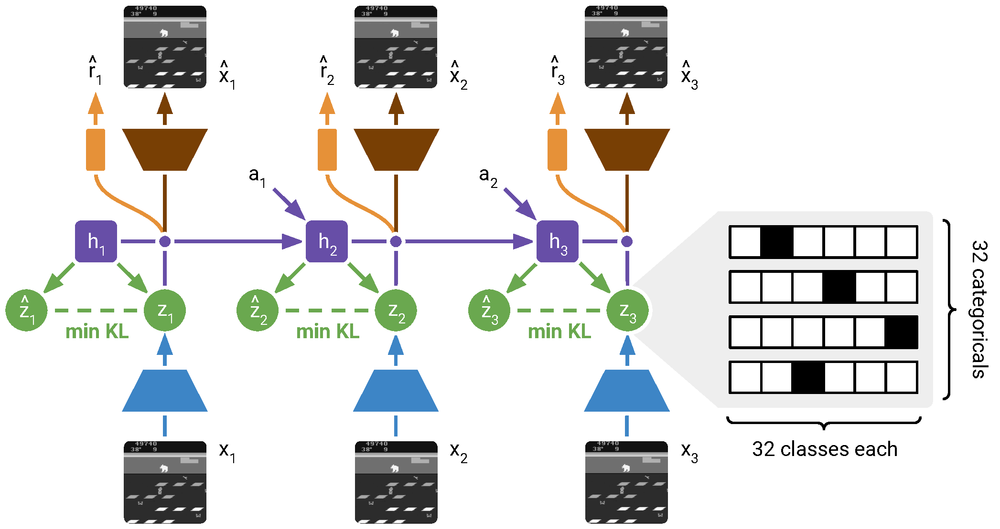
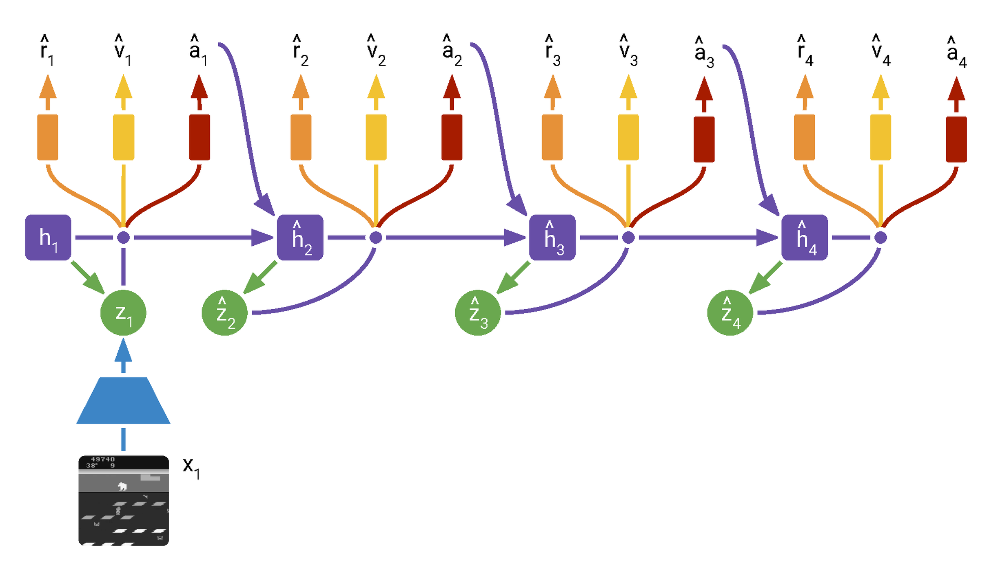
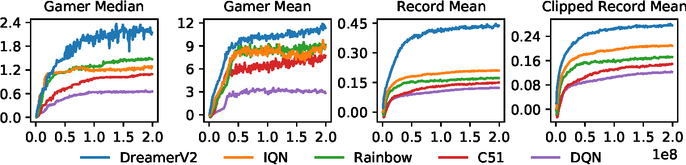
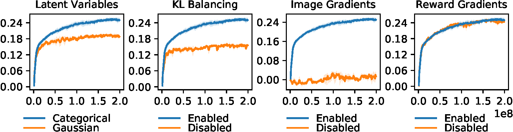
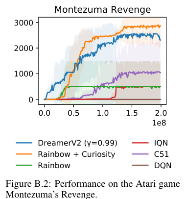
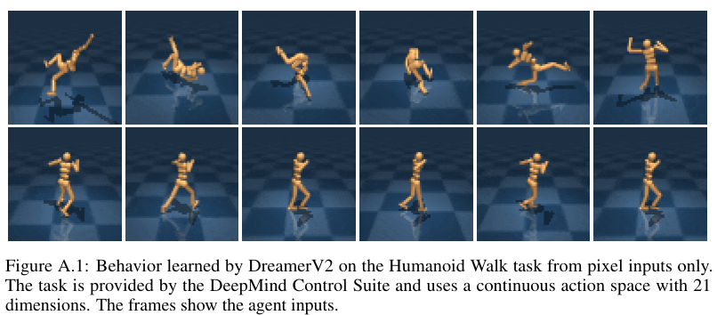

# DreamerV2：离散世界模型玩 Atari

!!! info "论文信息"
    **论文题名：** Mastering Atari with Discrete World Models。 
    **作者：** Danijar Hafner、Timothy Lillicrap、Mohammad Norouzi、Jimmy Ba。 
    **机构：** 未在公开元数据中稳定解析；以 arXiv/PDF 或官方页 affiliation block 为准。 
    **时间 / 主题：** 2020-10；世界模型。 
    **arXiv / 官方报告：** arXiv：[2010.02193](https://arxiv.org/abs/2010.02193)。 
    **GitHub / 项目：** GitHub：[github.com/danijar/dreamerv2](https://github.com/danijar/dreamerv2)。 
    **元数据来源与核验口径：** 来源：[arXiv](https://arxiv.org/abs/2010.02193)；[GitHub API / repo](https://github.com/danijar/dreamerv2)；Checked Date：2026-06-04；Repro Status：Paper / official materials reviewed, independent reproduction not claimed。

## 在 Atari 上，世界模型终于足以承担策略训练

DreamerV1 已证明，在潜在空间中想象轨迹，再沿多步价值学习策略，可以解决一批视觉连续控制任务。但 Atari 对模型提出了不同要求。物体可能突然消失、房间切换改变整个画面，奖励和动作后果并不总是平滑变化；一张图像中很小的对象，又可能决定整局游戏。一个看起来能重建画面的模型，未必能产生足够可靠的轨迹来训练策略。

DreamerV2 将问题集中到潜在状态与训练目标。它把 RSSM 的高斯随机变量换成多个类别变量，用 straight-through 梯度训练离散表示，并通过 KL balancing 让动力学 prior 更积极地追赶包含真实观察的 posterior。策略仍然在单独训练好的世界模型中学习，但 Atari 的 actor 改用主要依赖 REINFORCE 的梯度估计。这些变化共同把 imagined policy learning 带到更有竞争力的 Atari 水平。[↗](https://arxiv.org/pdf/2010.02193v4#page=2)

下图的横线是人类 gamer 参考分数，纵轴是跨游戏归一化后的中位数。DreamerV2 达到 2.15，表示这一汇总指标超过参考水平，不代表每个游戏都超过人类。

{ width="520" }

*原论文 Figure 1。主实验使用 55 个 Atari 游戏、sticky actions 与 200M 环境帧；SimPLe 的任务子集和训练预算不同，不能将这张总览视为所有方法完全同协议重跑。*

每个游戏独立训练一个 agent，使用单张 V100 和一个环境实例。论文的“单 GPU”描述单次训练的资源，不是整个 55 游戏研究只消耗十天。它也没有训练一个能在游戏之间直接迁移的统一模型。把这些边界放在前面，后面的机制与成绩才有准确对应。

## 一次观察如何进入离散 RSSM

世界模型仍由确定性循环状态与随机状态共同组成。令 $h_t$ 为 GRU 保存的历史，$z_t$ 为从类别分布采样得到的当前状态，模型状态为二者的拼接。原文式（1）的主要关系为

$$
h_t=f_\phi(h_{t-1},z_{t-1},a_{t-1}),
$$

$$
z_t\sim q_\phi(z_t\mid h_t,x_t),\qquad
\hat z_t\sim p_\phi(\hat z_t\mid h_t).
$$

posterior $q_\phi$ 接收当前图像 $x_t$ 与历史 $h_t$，因此知道真实环境现在呈现了什么；prior $p_\phi$ 只能使用历史，必须预测真实观察会带来怎样的状态。训练时后验为动力学提供目标，想象时先验替代未来观察。

从 $(h_t,z_t)$ 出发，三个头分别重建图像、预测奖励和预测 discount。discount 在 episode 内取某个固定折扣值，在终止处为零，使模型能够估计想象轨迹是否仍然继续。图像经过 CNN 编码，再与 recurrent state 一起进入 MLP；图像解码采用 transposed CNN，其他预测头采用 MLP。[↗](https://arxiv.org/pdf/2010.02193v4#page=3)

Figure 2 应先沿蓝色观察路径读到 $z_t$，再看绿色虚线如何连接 posterior 与 prior，最后看右侧离散变量的具体组织。

{ width="920" }

*原论文 Figure 2。每个随机状态由 32 个 categorical variables 组成，每个变量有 32 个类别；循环状态 $h_t$ 仍然连续，整个模型没有变成纯离散状态机。*

32 个类别变量各采样一个 one-hot，展平后得到长度 1,024、恰有 32 个激活位置的稀疏向量。它可以表达 $32^{32}$ 种组合，这是从表示结构计算出的组合数，不是一个实际存储了这么多条目的 codebook，也不说明训练访问过所有组合。

这种设计与 VQ-VAE 式“先找最近码字，再更新词表”的机制不同。本文直接输出类别概率并采样，没有以最近邻量化作为核心操作。也不能把“离散世界模型”理解成动作只能离散，后面的 Humanoid 实验仍然使用连续动作。

Atari 输入也有一个容易混淆的细节。论文将标准处理得到的 $84\times84$ 灰度图像进一步缩小到 $64\times64$，以沿用卷积架构。这里不是把 Atari 当作 RGB 图像任务，也没有通过 frame stacking 代替状态记忆；时间信息由 RSSM 累积。

## 离散采样怎样获得梯度

从类别分布采样 one-hot 对 logits 不可微，不能直接沿普通导数更新 encoder。DreamerV2 使用 straight-through estimator，将前向离散值与反向连续近似拼在一起。原文 Algorithm 1 等价于

$$
\begin{aligned}
p&=\operatorname{softmax}(\ell),\\
z_{\mathrm{hard}}&=\operatorname{onehot}(\operatorname{sample}(p)),\\
z_{\mathrm{ST}}&=z_{\mathrm{hard}}+p-\operatorname{sg}(p).
\end{aligned}
$$

$\ell$ 是 logits，$\operatorname{sg}$ 表示停止梯度。前向时 $p-\operatorname{sg}(p)=0$，后续网络确实看到一个离散样本；反向时把 $z_{\mathrm{hard}}$ 当作不可微样本，梯度通过 $p$ 的 softmax 路径传播。这不是采样操作真实导数的无偏估计，而是一个实用的替代梯度。[↗](https://arxiv.org/pdf/2010.02193v4#page=3)

离散潜变量为什么更好，论文没有给出唯一确定的原因。作者提出了几种假说。对于一个类别变量，多个后验类别分布的混合仍然可以写成类别分布；单个对角高斯却未必能匹配多个高斯后验形成的多峰分布。one-hot 的稀疏结构也可能有利于泛化，straight-through 的梯度形式可能更容易优化，类别变化还可能适合描述房间切换、物体消失等不连续事件。

这些是对实验现象的解释方向，不能写成已经分别验证的因果机制。特别是“类别混合仍为类别”针对单个变量的分布性质，并不意味着因子化的 32 个类别变量自动表达了任意复杂的联合相关性。实验能直接确认的是，在其余设置受控的消融中，categorical latents 在 42 个任务上优于 Gaussian latents，8 个任务落后，5 个任务在作者定义的 5% 范围内持平。[↗](https://arxiv.org/pdf/2010.02193v4#page=9)

## KL balancing 为什么改变梯度，却不改变前向 KL 数值

世界模型同时优化图像、奖励、discount 与潜在转移。原文式（2）写为

$$
\mathcal L_{\mathrm{WM}}(\phi)=\mathbb E_{q_\phi}\sum_t\left[
-\ln p_\phi(x_t\mid h_t,z_t)
-\ln p_\phi(r_t\mid h_t,z_t)
-\ln p_\phi(\gamma_t\mid h_t,z_t)
+\beta\operatorname{KL}(q_t\Vert p_t)
\right],
$$

其中 $q_t=q_\phi(z_t\mid h_t,x_t)$，$p_t=p_\phi(z_t\mid h_t)$。图像采用单位方差的对角高斯 likelihood，奖励采用单位方差的一维高斯，discount 采用 Bernoulli likelihood。Atari 奖励先经 tanh 变换，KL 总权重为 $\beta=0.1$。这些都是 V2 的具体实现，不能混入 V3 的 symlog、twohot 或 percentile return normalization。[↗](https://arxiv.org/pdf/2010.02193v4#page=4)

KL 项承担两个任务。它要求 prior 学会预测 posterior，又要求 posterior 不要从当前图像抽取太多先验无法预测的信息。问题在于训练早期 prior 还很弱。如果两边同样积极地降低 KL，系统可能通过把 posterior 变得更模糊来迎合 prior，而没有真正学好转移。

V2 因此将 KL 写成两条具有不同梯度路径的项

$$
\mathcal L_{\mathrm{KL-bal}}
=\alpha\operatorname{KL}\!\left(\operatorname{sg}(q_t)\Vert p_t\right)
+(1-\alpha)\operatorname{KL}\!\left(q_t\Vert\operatorname{sg}(p_t)\right),
\qquad\alpha=0.8.
$$

第一项固定 posterior，主要推动 prior 追赶它；第二项固定 prior，推动 posterior 变得更容易预测。前向数值上，两项都是同一个 KL，而 $0.8+0.2=1$，所以加权后仍是原来的 KL 数值。变化发生在反向传播，prior 一侧的权重是 posterior 一侧的四倍。这种“loss 数值一样，参数更新不同”的性质，是理解 KL balancing 的关键。[↗](https://arxiv.org/pdf/2010.02193v4#page=4)

还可以从分解式理解它

$$
\operatorname{KL}(q\Vert p)=\mathcal H(q,p)-\mathcal H(q).
$$

prior 必须通过改善对 posterior 的预测来降低交叉熵；posterior 则还可以改变自身信息量与熵。较强的 prior 更新让模型更多地通过学会预测来改善目标，而不是过早削弱观察表示。$\beta$ 控制整体 KL 与重建之间的权衡，$\alpha$ 控制同一个 KL 中不同分支的更新方向与强度，二者可以独立调整。

附录特别说明，这一版本以 KL balancing 替代之前的 free nats。后续 V3 会把 balancing 与 free bits 结合起来，不能因此在 V2 的原始训练式中擅自加上那一层下限截断。[↗](https://arxiv.org/pdf/2010.02193v4#page=18)

## 在想象中，模型梯度与策略梯度是两件事

世界模型训练完成一个更新后，actor 和 critic 从 replay 的 posterior states 出发，展开长度为 15 的想象轨迹。后续只使用 prior、actor、reward predictor 与 discount predictor。模型参数在行为学习阶段固定，actor 和 value 的优化不会反过来塑造模型表示。

下图应从左下角唯一的真实图像开始，沿 purple recurrent path 和 actor 动作向前读。reward 与 value 在每个状态上计算，图像 decoder 不参与后续策略学习的展开。

{ width="920" }

*原论文 Figure 3。posterior 提供起点，prior 生成后续状态；完整状态包括 $h$ 与 $z$。论文行为学习部分用简写 $\hat z$ 表示紧凑模型状态。*

为避免把完整状态与随机部分混淆，下文统一把想象状态记为 $\hat s_t$。critic 估计从该状态出发、执行当前 actor 所能获得的未来回报。它使用 $\lambda=0.95$ 的多步目标，在 $t<H$ 时递推

$$
V_t^\lambda
=\hat r_t+\hat\gamma_t\left[
(1-\lambda)v_\xi(\hat s_{t+1})+\lambda V_{t+1}^\lambda
\right],
\qquad
V_H^\lambda=v_\xi(\hat s_H).
$$

这里将末端边界单独写出，按原文相邻说明，最后一步 target 等于 critic，因此不对最后一步另设回归损失。预测 discount 还用于累乘加权 actor 与 critic 的时刻损失，减少已经可能终止的轨迹后段对学习的影响。[↗](https://arxiv.org/pdf/2010.02193v4#page=5)

critic 最小化

$$
\mathcal L_{\mathrm{critic}}(\xi)
=\mathbb E\sum_{t=1}^{H-1}\frac12
\left[v_\xi(\hat s_t)-\operatorname{sg}(V_t^\lambda)\right]^2.
$$

V2 还加入 slow target critic，用一个每 100 个梯度更新才复制一次参数的网络计算回报目标，缓解 critic 追逐自身快速变化预测的问题。这是硬更新间隔，不能改写成 V3 的 EMA 正则。[↗](https://arxiv.org/pdf/2010.02193v4#page=6)

actor 的完整形式保留两类梯度。原文式（6）可以写成

$$
\mathcal L_{\mathrm{actor}}(\psi)
=\mathbb E\sum_{t=1}^{H-1}\left[
-\rho\log p_\psi(\hat a_t\mid\hat s_t)
\operatorname{sg}\!\left(V_t^\lambda-v_\xi(\hat s_t)\right)
-(1-\rho)V_t^\lambda
-\eta\mathcal H[p_\psi(\cdot\mid\hat s_t)]
\right].
$$

第一项是 REINFORCE，使用减去 state value 的 advantage 加权动作对数概率。它不要求对离散动作造成的状态变化求精确导数；baseline 用于减小方差。第二项直接提高 $V_t^\lambda$，通过动作与模型状态的 straight-through 路径传播梯度，方差较低，但会受到替代导数偏差影响。最后的 entropy regularizer 鼓励策略保留探索。

主 Atari 配置使用 $\rho=1$、$\eta=10^{-3}$，即只用 REINFORCE 训练 actor。这并没有取消离散 world model 训练中的 straight-through，两个梯度估计器作用于不同位置。反过来，在连续控制中作者发现 dynamics backpropagation 更有效，采用 $\rho=0$。不能把论文的通用混合式直接等同于“所有实验都同时混合两种策略梯度”。

REINFORCE 的“无偏”也有范围。它针对当前想象环境中的策略梯度估计，不会自动消除世界模型对真实环境的预测误差。即便策略优化完全正确，模型如果高估某类动作的后果，真实表现仍可能不佳。[↗](https://arxiv.org/pdf/2010.02193v4#page=6)

## 训练量怎样从真实帧变成数千亿潜在状态

Atari 主协议训练到 200M 环境帧，action repeat 为 4，因此真实策略接收约 50M 个观察。经验池按 FIFO 保留 $2\times10^6$ 个时步；每个训练 batch 为 50 条长度 50 的序列，共 2,500 个 posterior states。每个状态都能作为想象起点，因此一次行为更新可以并行生成 2,500 条紧凑轨迹。

论文报告，整个 200M 帧训练过程中，actor 从模型中学习了约 468B 个 imagined states，相对 50M 真实输入约为 9,360 倍，作者将其概括为约 10,000 倍。这些模型状态并不是同等数量的真实新信息，价值在于把已有经验用于大量当前策略下的动作后果预测。[↗](https://arxiv.org/pdf/2010.02193v4#page=6)

| Setting | Atari configuration |
| --- | --- |
| Replay capacity, FIFO | $2\times10^6$ |
| Batch size / sequence length | 50 / 50 |
| Categorical variables / classes | 32 / 32 |
| RSSM recurrent units | 600 |
| MLP layers / units | 4 / 400 |
| World model parameters | 20M |
| Actor / critic parameters | 1M / 1M |
| World model learning rate | $2\times10^{-4}$ |
| Actor / critic learning rate | $4\times10^{-5}$ / $10^{-4}$ |
| Policy steps per gradient step | 4 |
| Gradient clipping | 100 |
| Adam epsilon | $10^{-5}$ |
| Decoupled weight decay | $10^{-6}$ |

序列采样还特意照顾 episode 末尾。先在 episode 中均匀采样起点，再把过晚的起点截到“episode 长度减训练序列长度”。这样末尾片段得到更多机会，discount predictor 才能看到足够的终止例子。它与只在所有合法窗口起点中均匀采样并不等价。[↗](https://arxiv.org/pdf/2010.02193v4#page=2)

折扣系数在论文中有一处配置差异，正文 experience dataset 段写 $\gamma=0.999$，Table D.1 写 0.995；附录给新任务的候选搜索值又包括 0.99 和 0.999。复现时应将所用实现版本与实际配置一起记录，不能假定文中这些位置完全一致。这个参数直接影响稀疏奖励下的 value 学习，后面的 Montezuma 例子会显示它能显著改变表现。[↗](https://arxiv.org/pdf/2010.02193v4#page=19)

单次训练使用一张 V100、一个环境实例，在不到 10 天内达到 200M 帧。以 55 个游戏、5 个种子、每次约 10 天粗算，一轮完整组合就是约 2,750 GPU days，这只是按公开配置计算的量级，不是作者报告的研究总耗时。论文也指出，全套消融每改一个组件就可能需要超过 60,000 GPU hours，所以实际消融使用较早版本及更少种子。资源预算解释了为什么最终结果与所有消融不宜直接混成一张对照表。[↗](https://arxiv.org/pdf/2010.02193v4#page=18)

## 与 SimPLe、MuZero 的分界在于模型监督与搜索位置

同样被归为 model-based RL，模型承担的职责仍可能完全不同。SimPLe 在像素空间预测下一帧，再用生成的图像训练 PPO；连续想象因而需要反复经过高维图像。DreamerV2 用图像重建训练表示，但行为学习只在紧凑潜在状态中展开，训练好的 actor 在真实交互时直接给出动作。图像监督的位置与策略消费模型的位置被分开了，解码器不进入想象轨迹或每一步决策。[↗](https://arxiv.org/pdf/2010.02193v4#page=10)

MuZero 则让隐状态服务于任务相关的奖励和价值预测，Table 3 将这一差别概括为经 value gradients 学出的任务表示。它没有 DreamerV2 的图像重建监督，这不意味着它不接收图像，也不意味着它没有潜在动力学。区别在于模型被要求保留什么信息，以及用什么信号判断状态预测是否有用。DreamerV2 的世界模型独立于 actor–critic 优化，消融中切断奖励梯度后仍能依靠图像获得有用表示；MuZero 的模型与任务价值更紧密地结合。[↗](https://arxiv.org/pdf/2010.02193v4#page=9) [↗](https://arxiv.org/pdf/2010.02193v4#page=11)

搜索位置也随之改变。DreamerV2 在训练阶段通过大量想象轨迹把行为压进 actor，部署时不执行 Monte Carlo Tree Search。MuZero 用 MCTS 组织模型预测与动作选择。训练期间在模型中改善策略，与每次决策时在模型中搜索动作，是两种不同的计算安排。这里的比较不是“有模型就必须在线搜索”。论文明确把 MuZero 的规划组件视为与 DreamerV2 世界模型正交、原则上可结合的部分，同时指出树搜索增加了系统复杂度与并行化难度。

下面保留原论文 Table 3 的列名与预算，用来定位不同方法的工作区间。

| Algorithm | Reward Modeling | Image Modeling | Latent Transitions | Single GPU | Trainable Parameters | Atari Frames | Accelerator Days |
|---|---|---|---|---|---:|---:|---:|
| DreamerV2 | ✓ | ✓ | ✓ | ✓ | 22M | 200M | 10 |
| SimPLe | ✓ | ✓ | ✗ | ✓ | 74M | 4M | 40 |
| MuZero | ✓ | ✗ | ✓ | ✗ | 40M | 20B | 80 |
| MuZero Reanalyze | ✓ | ✗ | ✓ | ✗ | 40M | 200M | 80 |

*原论文 Table 3。这里是论文所汇总的概念与资源比较，不是作者在统一硬件、统一 Atari 协议下重跑四个系统。*

4M、200M 与 20B 都是表中 **Atari Frames** 的口径，不能把环境帧与 action repeat 后的 agent steps 混算。MuZero Reanalyze 的 200M 帧表明它改变了真实数据复用条件；这不自动消除训练搜索的计算成本。最后一列原名是 **Accelerator Days**，DreamerV2 的 10 对应其单张 V100 约 10 GPU-days 的训练配置，SimPLe 的 40 和两个 MuZero 条目的 80 则应保留原表的加速器时间口径。硬件类型、并行规模和实现不同，不能据此宣布同硬件下恰好快 4 倍或 8 倍，也不能把这四行的性能与样本效率直接排名。论文支持的判断是 DreamerV2 把较高 Atari 表现带到了可用单 GPU 运行的独立世界模型训练路径。[↗](https://arxiv.org/pdf/2010.02193v4#page=10)

## 四种汇总指标为什么会改变算法排序

Atari 游戏的原始分数单位不同，不能把 Assault 的几万分直接与 Pong 的二十分相加。论文同时报告 gamer normalization 与 human world record normalization，并讨论中位数、均值和截断均值。

用 $R_g$ 表示算法在游戏 $g$ 的分数，$R_g^{\mathrm{random}}$ 为随机策略分数，$R_g^{\mathrm{ref}}$ 为所选人类参考，归一化可写为

$$
N_g=\frac{R_g-R_g^{\mathrm{random}}}
{R_g^{\mathrm{ref}}-R_g^{\mathrm{random}}}.
$$

gamer median 报告这些数的中位数，容易理解为典型任务表现，但相当一部分低分游戏对中位数没有直接影响。gamer mean 使用所有游戏，却可能被少数参考分数较低、分母很小的游戏支配。换成 world record 可以减轻这种问题，但算法超过纪录很多倍的游戏仍能主导均值。

作者因此推荐 clipped record mean，先将 record-normalized score 的上限截为 1，再对游戏求平均

$$
\operatorname{CRM}
=\frac1G\sum_{g=1}^{G}\min(1,N_g^{\mathrm{record}}).
$$

它让一个已经超过世界纪录很多倍的任务不能无限补偿其他任务的失败。这里是截断高端，不应擅自增加论文未要求的下端零截断。论文还为没有登记世界纪录的两个游戏填入了参考值，所以这组分母并非全都来自实际登记纪录。[↗](https://arxiv.org/pdf/2010.02193v4#page=8)

Figure 4 的四个面板用同样的训练横轴、不同的聚合方式展示结果。先看最右侧是否仍有优势，再回看均值比中位数大多少，可以判断优势是否只是由极少数高分游戏拉动。

{ width="920" }

*原论文 Figure 4。横轴到 200M 环境帧；DreamerV2 在四种汇总中均领先这里的单 GPU model-free 基线。*

| Agent | Gamer Median | Gamer Mean | Record Mean | Clipped Record Mean |
| --- | ---: | ---: | ---: | ---: |
| DreamerV2 | 2.15 | 11.33 | 0.44 | 0.28 |
| DreamerV2 (schedules) | 2.64 | 10.45 | 0.43 | 0.28 |
| IQN | 1.29 | 8.85 | 0.21 | 0.21 |
| Rainbow | 1.47 | 9.12 | 0.17 | 0.17 |
| C51 | 1.09 | 7.70 | 0.15 | 0.15 |
| DQN | 0.65 | 2.84 | 0.12 | 0.12 |

DreamerV2 的 0.28 对 IQN 的 0.21，说明在限制极端高分贡献后优势仍然存在。但 schedules 将 gamer median 从 2.15 提高到 2.64 时，clipped record mean 保持 0.28，gamer mean 反而下降。这展示了只选一种统计量可能遗漏的信息。

IQN 与 Rainbow 的排序也取决于指标。Rainbow 的 gamer median 和 gamer mean 较高，IQN 的 record mean 与 clipped record mean 较高。比较必须落到具体列，不能把“某一种归一化下胜出”扩展成其他所有口径都更好。[↗](https://arxiv.org/pdf/2010.02193v4#page=7)

主结果来自五个种子。附录逐游戏表已经对种子取平均，但涉及中位数和截断的总体统计，应按论文要求先在每个种子的游戏集合上聚合，再跨种子平均；非线性操作通常不能交换次序。直接从逐游戏均值表重新算出一个不同数字，并不自动说明主表错误。[↗](https://arxiv.org/pdf/2010.02193v4#page=26)

## 汇总领先没有消除逐游戏失败

Table K.1 能看见 DreamerV2 与 model-free 方法的能力轮廓很不一样。下面选取强项与弱项，均为 200M 环境帧的逐游戏原始分数。

| Task | Rainbow | IQN | DreamerV2 |
| --- | ---: | ---: | ---: |
| Assault | 3229 | 4885 | 23625 |
| James Bond | 1097 | 3166 | 40445 |
| Up N Down | 34888 | 59944 | 653662 |
| Video Pinball | 466895 | 415833 | 41860 |
| Star Gunner | 57909 | 80003 | 7800 |
| Chopper Command | 12338 | 9282 | 2861 |
| Seaquest | 9903 | 17039 | 7480 |
| Venture | 1529 | 1313 | 2 |
| Montezuma Revenge | 500 | 500 | 81 |

Assault、James Bond 与 Up N Down 中，DreamerV2 获得很大的分数优势；Video Pinball 则落后一个数量级左右。作者提出的解释是，球只占一个像素，图像重建损失可能没有足够重视它。这个解释指出了像素平均误差与控制重要性之间的冲突，但论文没有通过改变该像素权重的受控实验确认其因果关系。

Star Gunner、Chopper Command、Venture 也明显落后，不能把失败缩成只有 Video Pinball 一个特例。尤其在难探索任务上，模型有能力模拟访问过的状态，并不保证能迅速发现新的高奖励路径。实际采用时，应保留目标任务分数与训练曲线，避免用总体“人类水平”掩盖具体能力缺口。[↗](https://arxiv.org/pdf/2010.02193v4#page=26)

这些主结果使用 sticky actions、完整动作空间、无 life information、108,000 帧 episode 上限，每个游戏一个 agent 和一个环境实例。IQN、Rainbow、C51、DQN 来自 Dopamine 的 sticky-action 结果，不是它们原始论文在确定性 Atari 中的所有最高分。结论因此是，在这套协议与单 GPU 参照下，独立世界模型中的策略学习达到了很强的总体水平。[↗](https://arxiv.org/pdf/2010.02193v4#page=7)

## 消融把收益定位到表示、动力学与策略更新

主结果同时改变了多个系统组件，不能仅凭 V2 比 V1 高分就把全部提升归给离散 latent。Figure 5 和 Table 2 分别移除一个组件，观察世界模型表示和行为的退化。应先看 categorical 与 Gaussian 的差别，再看 KL balancing，最后比较图像梯度与奖励梯度。

{ width="920" }

*原论文 Figure 5。纵轴为 clipped record normalized score；这组实验使用较早版本，完整模型基准约为 0.25，不能直接拿最终主结果的 0.28 作为消融起点。*

| Agent variant | Gamer Median | Record Mean | Clipped Record Mean |
| --- | ---: | ---: | ---: |
| DreamerV2, ablation baseline | 1.64 | 0.36 | 0.25 |
| No Layer Norm | 1.66 | 0.38 | 0.25 |
| No Reward Gradients | 1.68 | 0.37 | 0.24 |
| No Discrete Latents | 1.08 | 0.24 | 0.19 |
| No KL Balancing | 0.84 | 0.19 | 0.16 |
| No Policy Reinforce | 0.69 | 0.16 | 0.15 |
| No Image Gradients | 0.04 | 0.01 | 0.01 |

移除离散潜变量使 clipped record mean 从 0.25 降到 0.19，移除 KL balancing 降到 0.16。这两组消融的附录曲线使用两个种子。前者在 42 个游戏改善，后者在 44 个游戏改善，说明结果不只是一个偶然高分游戏造成。KL balancing 仍在 6 个游戏落后、5 个持平，离散表示也有前述 8 个落后任务，因此证据是广泛有效，不能写成无条件更好。[↗](https://arxiv.org/pdf/2010.02193v4#page=9)

最强的退化来自阻断 image reconstruction gradients，clipped record mean 降到 0.01；逐任务统计中 51 个任务下降。只阻断 reward gradients 则基本保留总体水平，0.24 对 0.25，其中 15 个任务提高、22 个下降、18 个持平。

这里的操作是让相应梯度不能进入模型状态，并未取消奖励预测头，也没有让 actor 在无奖励目标下学习。实验说明，表示主要依赖图像信号建立，奖励预测不必始终直接塑造表示才能得到有效策略。作者由此提出“不局限于已见奖励的表示可能更有泛化能力”的解释，但没有把这项消融扩展成独立的跨任务迁移验证。

策略梯度的消融也有版本条件。较早版本允许混合 REINFORCE 与 straight-through dynamics gradients，仅使用后者时，44 个游戏下降、5 个提高、6 个持平；保留 REINFORCE 而去掉 dynamics gradients，绝大多数总体收益仍在。混合在 James Bond、Seaquest 等少数任务上的提升能拉高 gamer mean，但最终主配置采用更简单的 $\rho=1$。因此“V2 通过 straight-through 玩好 Atari”需要拆开说，离散世界模型确实依赖它训练，主 Atari actor 的成功则主要依赖 REINFORCE。[↗](https://arxiv.org/pdf/2010.02193v4#page=10) [↗](https://arxiv.org/pdf/2010.02193v4#page=24)

附录还列出尝试后没有稳定收益的改变。更多二值 latent 比 categorical 更差；把未来策略熵纳入 value target、调度学习率或 KL 系数、GRU layer normalization 等没有显示普遍的大幅提升。完整模型从 V1 的 13M 扩大到 22M 也被列为有帮助的工程变化，但并没有对所有改动完成同等规模的消融。不能把未隔离的参数量影响全部归到某一条理论解释上。[↗](https://arxiv.org/pdf/2010.02193v4#page=18)

## Montezuma 的成功演示为何不能替换主表的 81 分

主表中 Montezuma Revenge 得分 81，显然不足以支持“统一默认设置已解决探索”。附录另做了一个实验，仅将 discount 改为 $\gamma=0.99$，其他设置保持默认，学习曲线显著改善。

先看蓝线标签中的折扣值，再把它与橙色 Rainbow + Curiosity 比较，而不是直接与主表的一行互换。

*原论文 Figure B.2。DreamerV2 使用 $\gamma=0.99$，没有额外加入显式 curiosity 机制；图中的设置与主结果表不同。*

按图中曲线读数，DreamerV2 在训练后期达到约两千多分，接近图中的 curiosity 参照量级。作者猜测较短折扣可能稳定稀疏奖励下的价值学习，也讨论模型泛化、更多 actor-critic 更新或 reward predictor 平滑奖励等可能因素。这些解释并未被逐项控制验证。

它对实际工作的启发很具体，critic 的远期目标与探索表现可能强烈耦合，调小 discount 有时比单纯扩大模型更有效。但这属于任务配置敏感性的证据，不能用附录调参后的表现替换统一配置的 81 分，再声称默认算法已经具备同样能力。[↗](https://arxiv.org/pdf/2010.02193v4#page=17)

## 离散世界模型也能控制连续动作的人形机器人

另一项补充实验选择 Humanoid Walk，从图像学习先起身、再行走。动作是 21 维连续向量，因此 actor 改为 truncated normal distribution，策略更新采用 dynamics backpropagation，即 $\rho=0$。离散的是世界模型的随机表示，而不是所有对外接口。

下图是 agent 观察到的行为画面，先看前半段起身，再看后半段连续行走。它不是模型预测帧，也不是现实机器人实验。

*原论文 Figure A.1。任务来自 DeepMind Control Suite，图像输入与 21 维连续动作共同检验表示和策略接口的适用性。*

附录该实验使用 $\beta=2$、$\eta=10^{-5}$，与主文一般连续控制描述中的系数不同。Figure A.2 在约 40M 步附近达到接近 800 的回报，这是曲线读数；它展示较复杂连续控制的可行性，但没有把 Atari 的原封不动配置直接搬过来。

这项结果与 Atari 策略梯度消融放在一起，有助于理解一个设计选择。离散动作下，straight-through 动作梯度的偏差可能伤害策略学习；连续动作可用更合适的重参数化路径，沿模型求导仍然很有价值。V2 没有用一个梯度估计器统一压过所有动作类型。[↗](https://arxiv.org/pdf/2010.02193v4#page=16)

## 采用这套模型时，最应保留的接口与比较条件

DreamerV2 的可复用部分是一个能从图像构建离散状态、学习动作条件 prior，并在紧凑状态中产生大量训练轨迹的系统。图像重建为表示提供主要监督，KL balancing 优先改善 prior，actor 再利用模型预测学习行为。对新任务，首先应检查这三个环节是否分别工作，不能只看重建图像是否好看。

模型训练中的 straight-through、Atari actor 的 REINFORCE、连续 actor 的 dynamics backpropagation 必须分开实现和记录。主结果采用的 slow critic 硬更新、tanh 奖励、类别 latent，也不能与后来 V3 的配置混在一起后仍称为同一个实验。

论文给新任务的优先搜索项包括 KL scale $\beta\in\{0.1,0.3,1,3\}$、actor entropy scale $\eta\in\{3\times10^{-5},10^{-4},3\times10^{-4},10^{-3}\}$ 与 discount $\gamma\in\{0.99,0.999\}$。提高训练频率可以争取更高数据效率，但需要额外计算。这些建议与模型的实际瓶颈对应，分别控制表示压缩、探索和远期价值估计。[↗](https://arxiv.org/pdf/2010.02193v4#page=19)

评估时应同时保留逐任务成绩、至少一种不会被少数极端高分主导的汇总指标，以及训练预算和随机种子。DreamerV2 的价值在于证明了独立学习的世界模型能够承担大部分策略训练，并在明确的 Atari 协议下超过强单 GPU 基线；Venture、Video Pinball 与 Montezuma 的结果也提醒读者，表示、重要小对象和探索仍可能成为新任务的主要障碍。
