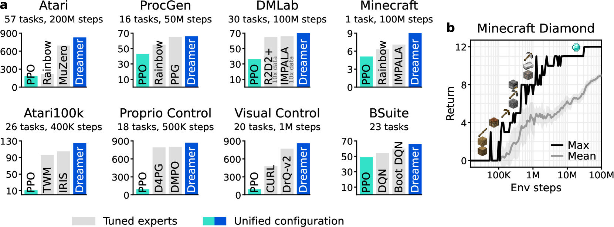
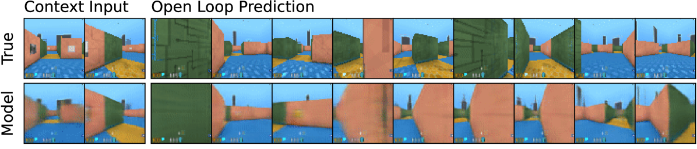
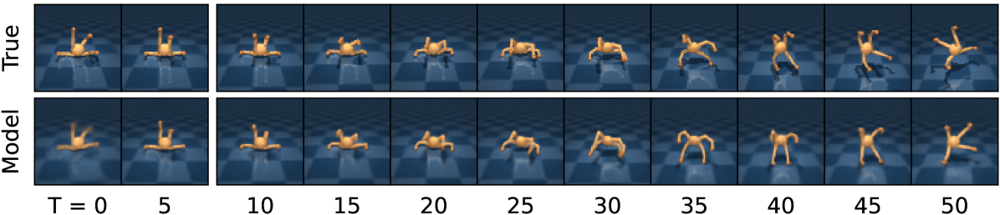
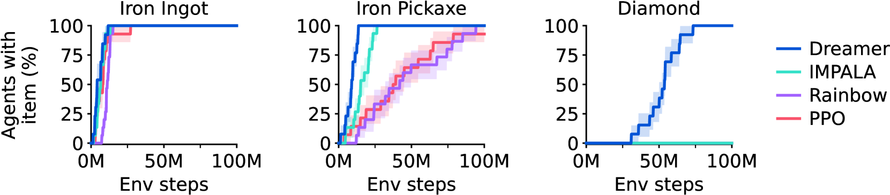
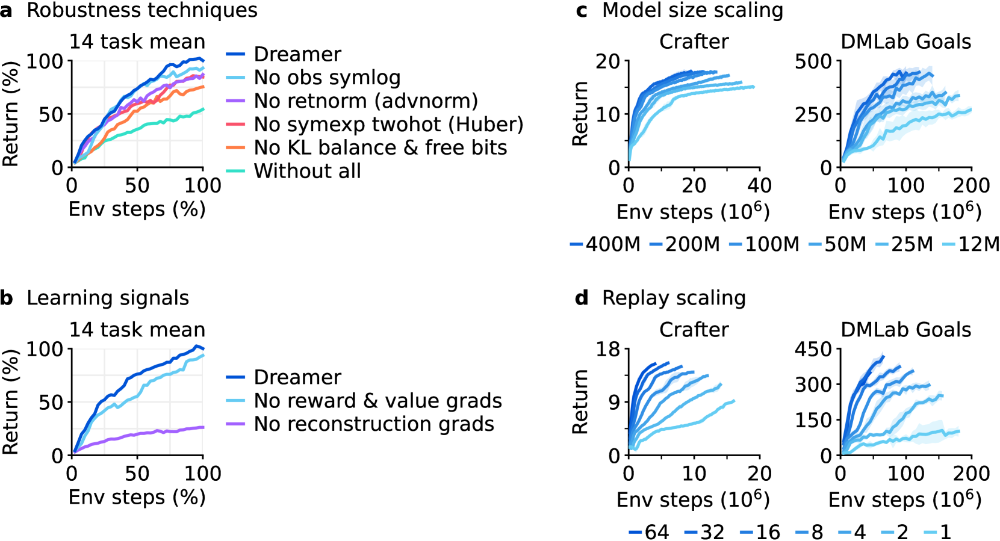

# DreamerV3：世界模型怎样在 latent 里训练策略

!!! info "论文信息"
    **论文题名：** Mastering Diverse Domains through World Models。 
    **作者：** Danijar Hafner、Jurgis Pasukonis、Jimmy Ba、Timothy Lillicrap。 
    **机构：** 未在公开元数据中稳定解析；以 arXiv/PDF 或官方页 affiliation block 为准。 
    **时间 / 主题：** 2023-01；世界模型。 
    **arXiv / 官方报告：** arXiv：[2301.04104](https://arxiv.org/abs/2301.04104)；官方材料：[danijar.com/project/dreamerv3/](https://danijar.com/project/dreamerv3/)。 
    **GitHub / 项目：** GitHub：[github.com/danijar/dreamerv3](https://github.com/danijar/dreamerv3)；项目页：[danijar.com/project/dreamerv3/](https://danijar.com/project/dreamerv3/)。 
    **元数据来源与核验口径：** 来源：[arXiv](https://arxiv.org/abs/2301.04104)；[GitHub API / repo](https://github.com/danijar/dreamerv3)；[官方 / 项目材料](https://danijar.com/project/dreamerv3/)；Checked Date：2026-06-15；Repro Status：Paper / official materials reviewed, independent reproduction not claimed。

## 原论文故事线

### 研究背景

DreamerV3 继续 DreamerV1/V2 的 latent world model RL 路线，但目标从“在某类任务上有效”变成“用同一套超参数跨差异很大的任务工作”。强化学习长期有一个问题：算法常在单个 benchmark 上强，但换到不同观测、动作、奖励尺度或探索难度时，需要大量手工调参。DreamerV3 想证明 model-based RL 可以形成更通用的 recipe。

它覆盖的任务类型很杂：Atari、DMLab、连续控制、Crafter、Minecraft 等，包含像素输入、低维输入、离散动作、连续动作、稀疏奖励、长时探索和不同奖励尺度。论文因此不只是比较分数，而是在检验世界模型训练、value 标定、reward 变换和 actor-critic 更新是否足够稳定。

### 问题（Challenge）

论文要解决的问题是：**如何让一个 latent world model agent 在无需按任务重调大量超参数的情况下，跨视觉控制、游戏、探索和长期规划任务学习？** 挑战来自三个方面。第一，reward/value 尺度在不同环境中差异很大，critic 和 actor 容易因为尺度不稳而崩。第二，world model 的 posterior 必须保留足够信息，prior 又必须能在 imagination 中可靠 rollout。第三，稀疏奖励和长期探索任务需要 agent 在模型偏差存在时仍能学到有效行为。

这个问题的价值在于，如果 world model RL 只能靠任务级调参，它就很难成为通用 agent 的训练范式。DreamerV3 试图把算法工程上的稳定性本身变成贡献。

### Finding

作者的 finding 是：**跨域稳定性来自一整套尺度鲁棒的 world-model actor-critic recipe，而不只是更大的模型或更长 rollout。** 这个洞见把 DreamerV3 的贡献从“又一个 RSSM agent”转成“让 latent imagination 在不同 reward、动作和观测分布下保持可训练”。

这个 finding 解释了 symlog、two-hot value、free bits、KL 分解、return normalization 等设计的组合意义。它们分别处理不同的不稳定源：数值尺度、value 分布、posterior 信息量、prior 可预测性和 actor 更新幅度。只有这些环节一起稳定，想象轨迹才能成为跨域训练数据，而不是某个任务上的模型漏洞。

### 方法

DreamerV3 仍使用 RSSM world model。输入是真实环境中的 observation、action、reward 和 continuation；模型把 observation 编码成 discrete latent representation，并用 recurrent dynamics 在动作条件下预测未来 latent。world model 训练目标包括 observation prediction、reward prediction、continuation prediction，以及分成 dynamics loss 和 representation loss 的 KL 项。

行为学习在 imagination 中完成。模型从 replay 编码状态出发，用 actor 采样动作，用 prior rollout 未来 latent，用 reward/continuation/value 估计 lambda-return。critic 学 imagined return，actor 学最大化 critic 估计。为了跨域稳定，DreamerV3 使用 symlog 处理大范围 reward/value，two-hot representation 表示 value 分布，return normalization 控制 actor 更新尺度，并尽量保持固定超参数。

### 结论

实验显示，DreamerV3 用同一套超参数在多个 domain 上取得强结果，覆盖 Atari、DMLab、连续控制、Crafter 和 Minecraft 等任务。论文最有代表性的结论不是单项最高分，而是固定 recipe 能在奖励稀疏、长期探索和视觉输入任务中都保持训练。Minecraft diamond 结果尤其说明，latent world model imagination 可以帮助长时任务中的行为学习。

同时，论文也没有证明 world model 偏差被彻底解决。DreamerV3 的成功依赖模拟环境和大量环境交互，world model 仍可能在更开放的真实环境中出现分布外错误。它的贡献边界是：给出一套足够稳定的 model-based RL recipe，使 latent imagination 从连续控制/Atari 扩展到更广泛任务。

### 关键术语

- **Symlog（对称对数变换）**：对正负大数都压缩尺度的变换，用来稳定 reward 和 value 学习。
- **Two-hot Encoding（双热编码）**：把连续 value 表示成相邻两个离散 bin 的分布，提高 value 学习稳定性。
- **Free Bits（自由比特）**：给 KL 项设置最小信息预算，避免 latent 被过度压缩。
- **Dynamics Loss（动力学损失）**：推动 prior 追上 posterior，使想象 rollout 更可靠。
- **Representation Loss（表示损失）**：约束 posterior 表示，让它既有信息又能被 prior 学到。
- **Fixed Hyperparameters（固定超参数）**：同一套训练配置跨多个任务使用，是 DreamerV3 的主要稳定性主张。

DreamerV3 要回答的问题很窄，也很重要：如果真实环境交互很贵，能不能先学一个动作条件的 latent dynamics，再让策略在这个内部模型里反复“想象”未来，从而减少真实试错。

它不是一个视频生成模型。它不会先生成一段漂亮未来画面，再让策略看画面行动。DreamerV3 的世界模型更像一个给 actor 和 critic 用的内部环境：输入当前 latent state 和动作，输出下一个 latent state、奖励和 episode 是否继续。只要这个内部环境对决策足够准，策略就可以在里面训练很多步，再回到真实环境收集新数据。

论文的强主张是：同一套超参数，在 Atari、DMLab、连续控制、Crafter、Minecraft 等差异很大的任务上都能工作。这个“固定配置跨域”比单个 benchmark 分数更关键，因为它说明 DreamerV3 的贡献不只是调参，而是一套相对稳定的 model-based RL recipe。

{ width="920" }

<small>Figure source: `Mastering Diverse Domains through World Models`, Figure 1。原图汇总 DreamerV3 在多个 domain 上的结果，重点不是某个单项分数，而是固定超参数覆盖视觉输入、低维输入、离散动作、连续动作、稀疏奖励和长期探索任务。本站读法：先看它是否真的跨域稳定，再看 Minecraft diamond 这种长时稀疏奖励是否说明 imagined rollout 对探索有帮助。</small>

## 训练循环

DreamerV3 的训练可以拆成四步。

第一步，agent 用当前 actor 和真实环境交互，把观测 \(x_t\)、动作 \(a_t\)、奖励 \(r_t\)、是否继续 \(c_t\) 写入 replay buffer。这里的 \(c_t\) 是 continuation flag，如果 episode 终止，它会阻止未来回报继续累加。

第二步，从 replay buffer 采样短序列训练 world model。模型要把真实观测编码成 latent state，并学会在动作条件下预测未来 latent、奖励、continuation 和观测重建。

第三步，从 replay 中某个 encoded state 出发，不再看未来真实观测，让 world model 用自己的 prior 往前 rollout。actor 在每个 imagined state 上采样动作，world model 预测下一个 state、奖励和 continuation。

第四步，用这些 imagined trajectories 训练 critic 和 actor。critic 学 imagined return，actor 选择能让 imagined return 变大的动作。然后 agent 再回真实环境，用更新后的 actor 收集下一批数据。

{ width="920" }

<small>Figure source: `Mastering Diverse Domains through World Models`, Figure 3(a)。原图展示 world model learning：观测被编码成离散 latent representation，recurrent dynamics 在动作条件下预测未来 latent。本站读法：图里的 reconstruction 不是为了生成好看的视频，而是为了防止 latent 丢掉对奖励、终止和未来状态有用的信息。</small>

{ width="920" }

<small>Figure source: `Mastering Diverse Domains through World Models`, Figure 3(b)。原图展示 actor-critic learning：actor 和 critic 只在 world model 产生的 imagined latent trajectory 上更新。本站读法：策略学习的训练样本来自内部模型，因此 world model 的偏差会直接进入 policy gradient。</small>

## RSSM 真正在建模什么

DreamerV3 使用 RSSM, Recurrent State-Space Model。它把状态拆成两部分：确定性记忆 \(h_t\) 和随机 latent \(z_t\)。确定性记忆负责压缩历史轨迹，随机 latent 负责表达当前观测里和未来相关、但不确定的部分。

递归状态先由上一时刻的信息更新：

$$
h_t = f_\phi(h_{t-1}, z_{t-1}, a_{t-1})
$$

这里 \(h_t\) 是当前 recurrent state，\(h_{t-1}\) 和 \(z_{t-1}\) 来自上一时刻，\(a_{t-1}\) 是上一动作，\(f_\phi\) 是 world model 的 recurrent dynamics。直觉上，这一步在说：只要知道过去压缩记忆、上一 latent 和上一动作，就能先得到一个“当前应该处在什么状态”的预测性记忆。

然后模型有两条 latent 路径：

$$
z_t \sim q_\phi(z_t \mid h_t, x_t),
\qquad
\hat z_t \sim p_\phi(\hat z_t \mid h_t)
$$

其中 \(q_\phi\) 是 posterior，它在训练时能看到真实观测 \(x_t\)，因此可以把当前画面里的关键信息编码进 \(z_t\)。\(p_\phi\) 是 prior，它看不到当前观测，只能根据 \(h_t\) 预测 latent。DreamerV3 的关键就在这里：训练时 posterior 能借助真实观测，想象时 prior 必须独自往前滚。

给定 \(h_t,z_t\)，world model 还要预测观测、奖励和 continuation：

$$
\hat x_t \sim p_\phi(\hat x_t \mid h_t, z_t), \qquad
\hat r_t \sim p_\phi(\hat r_t \mid h_t, z_t), \qquad
\hat c_t \sim p_\phi(\hat c_t \mid h_t, z_t)
$$

这三个 head 的作用不同。观测重建逼 latent 保留环境结构；奖励预测让 latent 对任务目标敏感；continuation 预测让模型知道 episode 是否已经结束。DreamerV3 的 state 因此不是纯视觉表示，而是一个服务决策的 compact state。

## 为什么 KL 要拆成 dyn 和 rep

如果只让 posterior 尽力重建观测，它可能编码大量 prior 预测不出来的细节；如果只让 prior 变得容易预测，latent 又可能太贫瘠，无法支撑奖励和策略学习。DreamerV3 用两个 KL 项把这件事拆开。

prediction loss 先负责把信息放进 latent：

$$
\mathcal L_{\mathrm{pred}}
=
-\log p_\phi(x_t \mid h_t,z_t)
-\log p_\phi(r_t \mid h_t,z_t)
-\log p_\phi(c_t \mid h_t,z_t)
$$

这项表示 prediction loss：给定 latent state，模型要解释真实观测、奖励和 continuation。负对数概率越小，说明这些预测分布越支持真实数据。

dynamics loss 让 prior 追上 posterior：

$$
\mathcal L_{\mathrm{dyn}}
=
\max\left(1,
\mathrm{KL}\left[
\mathrm{sg}(q_\phi(z_t \mid h_t,x_t))
\;\|\;
p_\phi(z_t \mid h_t)
\right]\right)
$$

其中 \(\mathrm{sg}\) 是 stop-gradient。它把 posterior 当成固定目标，让 prior 学会在不看当前观测的情况下预测 posterior。这里的重点是训练 dynamics，而不是让 encoder 为了迁就 prior 退化。

representation loss 反过来约束 posterior 不要跑太远：

$$
\mathcal L_{\mathrm{rep}}
=
\max\left(1,
\mathrm{KL}\left[
q_\phi(z_t \mid h_t,x_t)
\;\|\;
\mathrm{sg}(p_\phi(z_t \mid h_t))
\right]\right)
$$

这项把 prior 当成固定参照，让 posterior 不要编码成一个 prior 永远追不上的任意表示。两个 KL 方向看起来相似，但梯度方向不同：dyn 主要训练 prior，rep 主要约束 posterior。

这里的 \(\max(1,\cdot)\) 是 free bits。它不是把 KL 压到越小越好，而是给 latent 留出至少约 1 nat 的信息容量。直觉上，如果 posterior 和 prior 已经足够接近，就不要继续把表示压扁；否则模型可能得到一个很好预测、但对任务没什么用的 latent。

## symlog 为什么不是小技巧

DreamerV3 想在不同 domain 上使用同一套超参数，最大的麻烦之一是数值尺度。不同任务的观测范围、奖励大小、return 分布差异很大，直接回归会让大数值任务主导梯度。

论文使用 symlog 压缩正负大数：

$$
\mathrm{symlog}(x)=\mathrm{sign}(x)\log(|x|+1),
\qquad
\mathrm{symexp}(y)=\mathrm{sign}(y)(\exp(|y|)-1)
$$

其中 symlog 把原始数值压到近似对数尺度，symexp 把压缩后的尺度还原。这个变换在 0 附近近似线性，在大数值区域近似对数，因此既保留小奖励的分辨率，也不让极端回报把训练冲垮。

奖励和 critic return 还使用 symexp twohot loss。做法不是让网络直接输出一个标量，而是把目标值落到相邻两个 bins 上，用分类交叉熵训练分布。这样梯度主要来自“分布放错了哪里”，而不是目标数值本身有多大。对跨域 RL 来说，这类尺度处理往往决定算法能否脱离手调。

## imagined rollout 怎样训练 actor-critic

World model 更新完后，DreamerV3 从 replay 里取一个 encoded state 作为起点，然后在 latent space 里 rollout。每一步 actor 根据当前 latent 采样动作，RSSM prior 预测下一个 latent，reward head 和 continuation head 给出 imagined reward 与是否继续。

critic 的目标是 \(\lambda\)-return：

$$
R^\lambda_t
=
r_t
+ \gamma c_t
\left((1-\lambda)v_t + \lambda R^\lambda_{t+1}\right),
\qquad
R^\lambda_T=v_T
$$

其中 \(R^\lambda_t\) 是从 imagined step \(t\) 开始的 bootstrapped return，\(r_t\) 是 world model 预测的奖励，\(\gamma\) 是折扣因子，\(c_t\) 是 continuation，\(v_t\) 是 critic 对当前 latent 的价值估计，\(\lambda\) 控制更相信短期 bootstrap 还是更长 rollout。\(R^\lambda_T=v_T\) 表示 rollout 到 horizon 末尾后，用 critic value 收尾。

这个公式的要点不是数学形式，而是 \(c_t\) 和 imagined dynamics。只要模型认为 episode 已经结束，后面的 return 就会被截断；只要 prior 在关键状态上预测错，critic 和 actor 就会在错误未来上被训练。DreamerV3 的效率来自“内部 rollout 多、真实交互少”，风险也来自同一个地方。

actor 用 imagined return 更新策略，并加入 entropy regularization。为了让 entropy scale 在不同任务上不需要重调，DreamerV3 用 batch 中 return 的高低分位差估计 return range，再用 EMA 平滑。这个设计和 symlog 的出发点一样：先把跨域尺度差异压住，再谈固定超参数。

## 它学到的是决策状态，不是单纯视频预测

论文展示了 long-term video prediction，但这些图不能被误读成“DreamerV3 的核心目标是视频生成”。这些预测只是证明 latent 里确实保留了一部分环境结构。

{ width="820" }

{ width="820" }

<small>Figure source: `Mastering Diverse Domains through World Models`, Figure 4。原图在给定 5 张上下文图像和动作序列后预测未来 45 帧。本站读法：它说明 world model 能保留迷宫结构、机器人姿态等可视动态，但 DreamerV3 训练策略时使用的是 latent trajectory、reward 和 continuation，不是把生成帧作为策略输入。</small>

如果用一句话区分 DreamerV3 和视频世界模型：DreamerV3 优先学习

$$
s_t, a_t \rightarrow s_{t+1}, r_{t+1}, c_{t+1}
$$

这里 \(s_t=(h_t,z_t)\) 是 latent state。它关心动作后的状态、奖励和终止，而不只是画面 \(x_{t+1}\) 是否逼真。视频路线更常见的问题是 \(o_{\le t},a_{\le t}\rightarrow o_{t+1:t+H}\)，强调可视未来；DreamerV3 则强调可训练策略的内部动力学。

## 实验证据怎么读

DreamerV3 的实验主要支撑三件事。

第一，固定超参数跨域有效。论文在 150 多个任务上比较，覆盖离散和连续控制、低维和视觉观测、稠密和稀疏奖励。读这组结果时，不要只看平均分，而要看它是否减少了每个 benchmark 单独调 recipe 的需要。

第二，Minecraft diamond 说明 learned world model 可以支撑长时稀疏奖励探索。Minecraft 从零获得钻石需要一长串前置操作，随机探索很难撞到完整链条。DreamerV3 不使用人类数据和课程学习，仍能在论文设定下学到这一目标，说明 imagined rollout 和 reconstruction-shaped latent 对长期信用分配有帮助。

{ width="920" }

<small>Figure source: `Mastering Diverse Domains through World Models`, Figure 5。原图统计 Minecraft Diamond 任务中不同 agent 发现关键物品的比例。本站读法：不要把它理解成“DreamerV3 已解决开放世界游戏”，而应理解成在像素输入、稀疏奖励和长链条任务中，model-based RL 的样本效率确实有优势。</small>

第三，ablation 支持这些稳健化设计不是装饰。KL objective、return normalization、symexp twohot regression、unsupervised reconstruction loss、模型规模和 replay ratio 都影响最终表现。尤其是 reconstruction loss：它说明即使最终目标是奖励最大化，world model 仍需要自监督信号来塑造有信息量的 state。

{ width="920" }

<small>Figure source: `Mastering Diverse Domains through World Models`, Figure 6。原图展示稳健化技巧、无监督重建损失、模型规模和 replay ratio 的消融与 scaling。本站读法：环境交互贵时，可以用更大的 world model 和更高 replay ratio 换数据效率，但代价是训练算力和 model bias 风险。</small>

## 边界与误解

DreamerV3 需要 agent-environment interaction trajectories，也需要 reward 和 continuation 信号。它不能像开放视频预训练那样直接吃互联网视频，然后自动变成可控世界模型。

它的 rollout 发生在 latent space，优点是紧凑、可训练、直接服务 policy；缺点是可解释性弱，视觉真实感不是目标。如果要做机器人或开放世界模拟器，还需要更强的感知表示、动作接口、失败回流和安全约束。

另一个常见误解是“world model 越准，policy 越好”。在 model-based RL 里，更危险的情况是局部很准、关键状态很错：actor 会专门找到模型漏洞并在 imagined future 里获得虚假高回报。DreamerV3 用短 horizon、replay 更新、reward/continue head 和稳健化目标缓解这个问题，但没有从根上消除 model bias。

## 和 DreamZero、视频世界模型的关系

DreamerV3 是 dynamics-first：先学 \(s_t,a_t\rightarrow s_{t+1},r_{t+1},c_{t+1}\)，再用 imagined latent dynamics 训练策略。DreamZero 一类方法更接近 WAM/policy 融合：模型联合预测未来视频和动作，把 video-action model 直接部署成策略。

所以两条路线适合回答不同问题。DreamerV3 适合解释“怎样把世界模型变成内部训练环境”；视频世界模型适合解释“怎样生成可视、可交互、长时一致的未来场景”。前者对 RL 样本效率非常关键，后者对机器人数据生成、仿真和人类可检查性更关键。

## 阅读结论

DreamerV3 的主要内容是把 Dreamer 系列整理成跨域更稳的 world-model RL recipe：RSSM 建模 latent dynamics，KL balance、symlog/symexp、two-hot regression、return normalization 和 reconstruction loss 稳定训练，actor/value 在 imagined rollout 里学习策略。实验要连读跨 benchmark 结果、Minecraft Diamond、ablation 和 scaling，而不是只看某个任务分数。

它的可复用机制是“决策状态优先”的 latent world model：目标不是生成漂亮视频，而是让 state 能预测 reward、continue 并支撑 actor-critic。不可外推项是它仍需要交互轨迹和 reward，不是互联网视频预训练模型；迁移到机器人还要补动作接口、真实延迟、安全约束和 model bias 监控。

## 外部精读

- [DreamerV3 paper: Mastering Diverse Domains through World Models](https://arxiv.org/abs/2301.04104)：主要读方法里的 RSSM、loss decomposition 和 actor-critic learning。
- [DreamerV3 project page](https://danijar.com/project/dreamerv3/)：适合先看 benchmark、视频和高层结论，再回论文读细节。
- [DreamerV3 GitHub](https://github.com/danijar/dreamerv3)：实现里能看到 replay、imagined rollout、loss 和配置如何落地。
- [VITALab DreamerV3 reading note](https://vitalab.github.io/article/2023/01/19/DreamerV3.html)：适合用作第二视角，帮助把论文里的 Dreamer 系列背景补齐。

## 相关阅读与下一步

- 外部材料：[论文标题 arXiv 检索](https://arxiv.org/search/?query=Mastering+Diverse+Domains+through+World+Models&searchtype=title)。
- 外部材料：[Semantic Scholar 标题检索](https://www.semanticscholar.org/search?q=Mastering+Diverse+Domains+through+World+Models)。
- 外部材料：[Papers with Code 检索](https://paperswithcode.com/search?q=Mastering+Diverse+Domains+through+World+Models)。
- 站内下一步：[论文精读专题](../index.md)。
