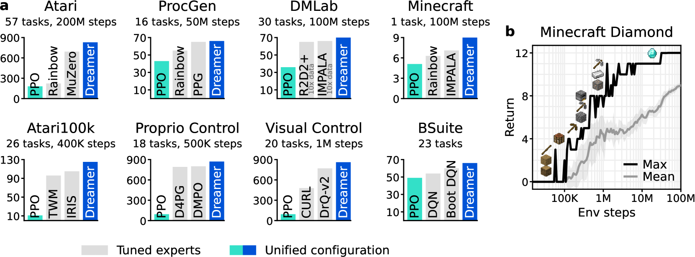
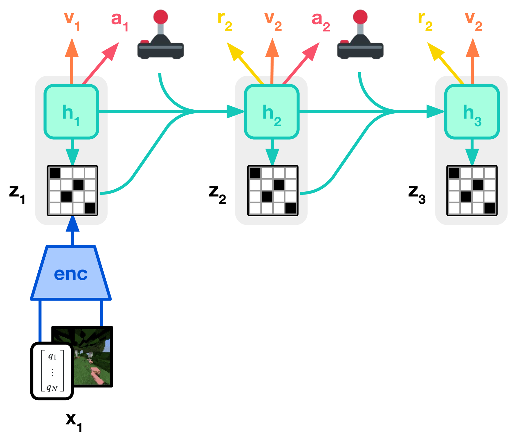
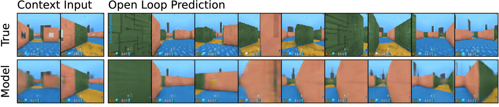
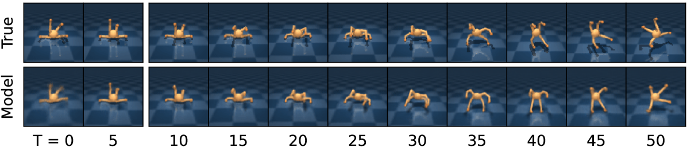
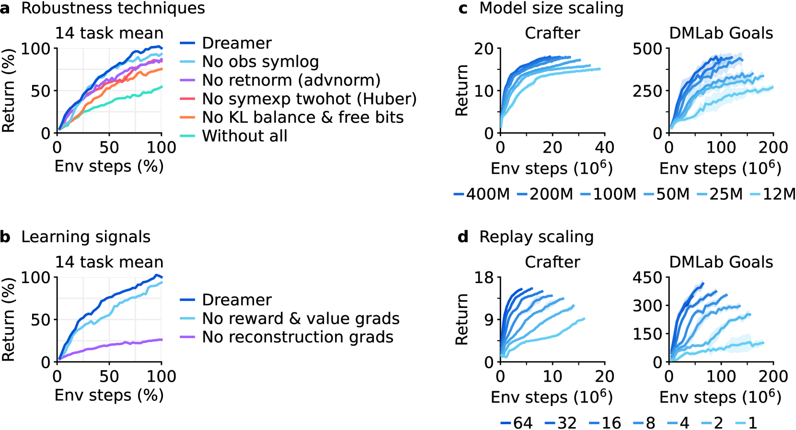
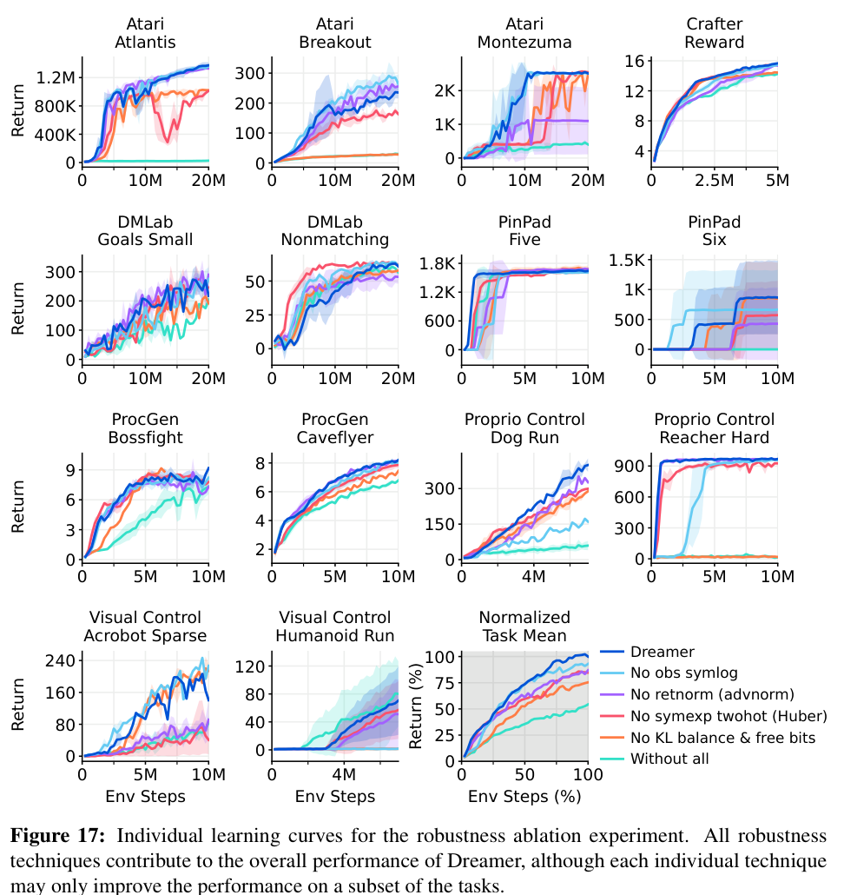
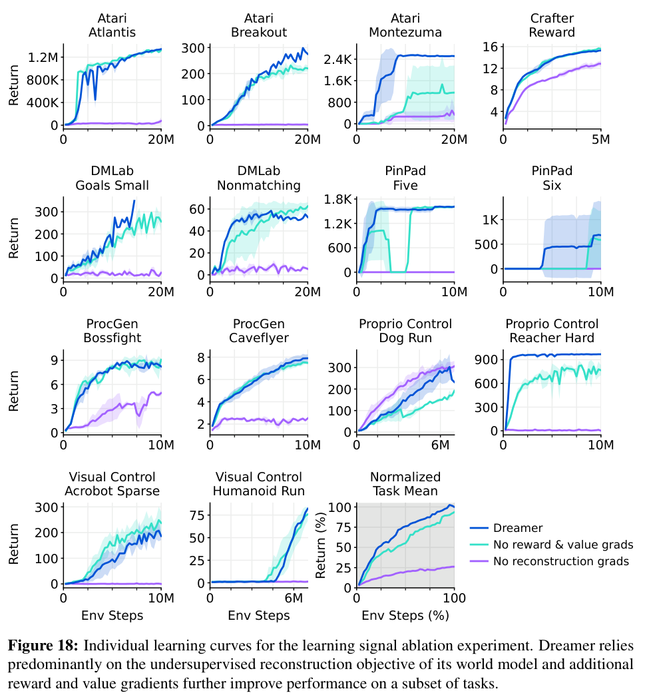
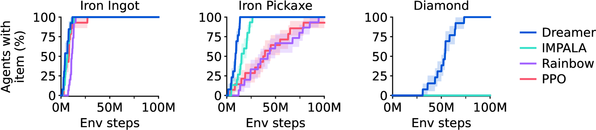
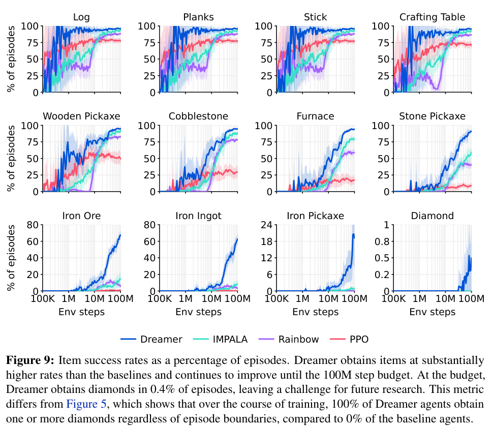

# DreamerV3：世界模型怎样在 latent 里训练策略

!!! info "论文信息"
    **论文题名：** Mastering Diverse Domains through World Models。 
    **作者：** Danijar Hafner、Jurgis Pasukonis、Jimmy Ba、Timothy Lillicrap。 
    **机构：** 未在公开元数据中稳定解析；以 arXiv/PDF 或官方页 affiliation block 为准。 
    **时间 / 主题：** 2023-01；世界模型。 
    **arXiv / 官方报告：** arXiv：[2301.04104](https://arxiv.org/abs/2301.04104)；官方材料：[danijar.com/project/dreamerv3/](https://danijar.com/project/dreamerv3/)。 
    **GitHub / 项目：** GitHub：[github.com/danijar/dreamerv3](https://github.com/danijar/dreamerv3)；项目页：[danijar.com/project/dreamerv3/](https://danijar.com/project/dreamerv3/)。 
    **元数据来源与核验口径：** 来源：[arXiv](https://arxiv.org/abs/2301.04104)；[GitHub API / repo](https://github.com/danijar/dreamerv3)；[官方 / 项目材料](https://danijar.com/project/dreamerv3/)；Checked Date：2026-06-15；Repro Status：Paper / official materials reviewed, independent reproduction not claimed。

## 跨领域复用的难处，藏在学习信号的尺度里

DreamerV3 要解决的是一个很实际的问题。一个强化学习算法在 Atari 上学得很好，换到三维迷宫，重建损失和表示压缩的平衡可能就不合适；把奖励放大一百倍，价值网络的梯度可能失控；换成很久才出现一次奖励的任务，原本正常的 advantage normalization 又可能把估计噪声放大，压过探索。每个领域都能单独调出一个能用的配置，但这样的算法还不能让研究者拿到新任务就开始训练。

论文保留了 Dreamer 系列的主干。先从真实交互中学习世界模型，再在模型的潜在状态中训练 actor 和 critic。DreamerV1 主要面向连续控制，DreamerV2 把这条路线带到 Atari，V3 则围绕表示、数值范围、策略梯度和训练实现，补上一套能跨领域工作的稳定机制。它的主要证据是，在超过 150 个任务、8 类领域中使用同一套算法超参数，既能处理图像与向量观察，也能处理离散与连续动作。[↗](https://arxiv.org/pdf/2301.04104v2#page=2)

这里需要先分清两件事。每个任务都独立训练自己的 agent，论文没有训练一个能零样本切换所有任务的共享模型。固定的也是损失权重、学习率、网络训练方式等算法配置，模型大小、replay ratio 和环境并行数仍会随计算预算调整。理解这一点，才能看清 V3 提供的是怎样一套可复用的学习方法。[↗](https://arxiv.org/pdf/2301.04104v2#page=19)

下图先给出这套方法需要覆盖的跨度。应当在每个小图内部比较算法，再去看不同领域是否都能工作。不同面板的回报定义和训练预算不同，柱高不能跨面板直接比较。

{ width="920" }

*原论文 Figure 1。图像游戏、三维导航、连续控制、低数据学习与 Minecraft 共同检验配置的适用范围。各领域的精确预算和对照条件在后文展开。*

## 一条真实轨迹怎样变成想象中的训练数据

世界模型的输入来自 agent 已经执行过的轨迹，包括观察 $x_t$、动作 $a_t$、奖励 $r_t$，以及表示 episode 是否继续的标记 $c_t\in\{0,1\}$。Dreamer 用 **Recurrent State-Space Model，循环状态空间模型**，把过去经历压成两部分。一部分是确定性的循环记忆 $h_t$，另一部分是从类别分布采样得到的随机状态 $z_t$。actor 和 critic 使用的状态为 $s_t=(h_t,z_t)$。

原文式（1）的核心关系是

$$
h_t=f_\phi(h_{t-1},z_{t-1},a_{t-1}),
$$

$$
z_t\sim q_\phi(z_t\mid h_t,x_t),\qquad
\hat z_t\sim p_\phi(\hat z_t\mid h_t).
$$

第一式把前一时刻的状态和已执行动作写入记忆。第二行的两个分布承担不同工作。encoder $q_\phi$ 能看到当前真实观察，因此负责回答“现在实际上处于什么状态”；dynamics predictor $p_\phi$ 只能看到由历史形成的 $h_t$，负责回答“执行了这些动作以后，下一状态应该是什么”。有真实数据时用前者校正模型，离开真实环境进行想象时用后者继续生成状态。这就是 posterior 与 prior 在整个流程中的接口差异。

$z_t$ 由一组 softmax 类别分布采样，前向传播得到离散表示，反向传播使用 straight-through 梯度穿过采样步骤。这样既保留了离散潜变量，也能把重建和预测误差传回 encoder。$h_t$ 负责跨时间的记忆，$z_t$ 则使模型不必把所有当前观察与不确定性都塞进一个确定性向量。[↗](https://arxiv.org/pdf/2301.04104v2#page=4)

训练世界模型时，先沿下图的 encoder 路径看每一帧如何进入 $z_t$，再看上方循环路径如何把动作和状态串起来。每个 $(h_t,z_t)$ 都连接三个预测头，分别重建观察、预测奖励和预测继续标记。

{ width="920" }

*原论文 Figure 3a。真实观察在各时刻持续提供监督；表示既要解释当前输入，也要能被只掌握历史的动力学模型预测。*

这三个预测头并非等价。观察重建要求状态保留环境信息，奖励预测告诉 agent 哪些后果有价值，continue predictor 则告诉回报计算什么时候应该停止。只预测奖励很容易丢失当下无奖励、以后却有用的信息；只重建图像又不足以产生选择动作的标准。后续消融会直接检查这些学习信号对表示的影响。

策略学习从 replay 中某个真实状态的表示开始。actor 采样动作，循环模型更新 $h$，prior 采样新的 $z$，奖励头和继续头预测后果，critic 评估后续回报；把这个过程重复，就得到一条想象轨迹。此时没有后续真实图像输入，也不必先生成完整图像再把图像编码回去。

{ width="920" }

*原论文 Figure 3b。沿动作箭头和 latent state 的递推读图，后续奖励、继续标记与价值都来自模型。它们构成策略的训练数据。*

当 agent 真正与环境交互时，它根据新观察更新状态，然后直接从 actor 采样动作。论文明确不在每一步做额外的 lookahead planning。世界模型的主要计算价值发生在训练阶段，它让策略能从想象的后果中学习；部署路径仍然是状态更新加一次策略决策。[↗](https://arxiv.org/pdf/2301.04104v2#page=5)

## 两个 KL 损失怎样让表示既可预测，又不丢掉任务信息

RSSM 不能只要求 prior 与 posterior 一致。最容易预测的表示可能是一个几乎不含信息的常数，而能完整重建复杂画面的表示又可能非常难预测。DreamerV3 把这个冲突拆成三个损失，并分别控制梯度流向。

将 $q_t=q_\phi(z_t\mid h_t,x_t)$、$p_t=p_\phi(z_t\mid h_t)$ 作为简写，世界模型的目标为

$$
\mathcal L_{\mathrm{WM}}(\phi)
=\mathbb E_{q_\phi}\!\left[
\sum_t\left(
\mathcal L_{\mathrm{pred}}
+\mathcal L_{\mathrm{dyn}}
+0.1\mathcal L_{\mathrm{rep}}
\right)\right],
$$

$$
\mathcal L_{\mathrm{pred}}
=-\ln p_\phi(x_t\mid h_t,z_t)
-\ln p_\phi(r_t\mid h_t,z_t)
-\ln p_\phi(c_t\mid h_t,z_t),
$$

$$
\mathcal L_{\mathrm{dyn}}
=\max\!\left(1,\operatorname{KL}[\operatorname{sg}(q_t)\Vert p_t]\right),
\qquad
\mathcal L_{\mathrm{rep}}
=\max\!\left(1,\operatorname{KL}[q_t\Vert\operatorname{sg}(p_t)]\right).
$$

$\operatorname{sg}$ 表示 stop-gradient，数值照常参与计算，但梯度不再穿过这一分支。两个 KL 的方向相同，差异在谁被当作学习目标。dynamics loss 把 posterior 暂时视为目标，让 prior 学会预测它；representation loss 把 prior 暂时视为目标，让 encoder 形成更容易被预测的表示。后者只有前者十分之一的权重，因此模型不会一上来就要求 encoder 为了迁就还很弱的动力学而放弃大量信息。[↗](https://arxiv.org/pdf/2301.04104v2#page=5)

式中的 $\max(1,\cdot)$ 是 **free bits** 机制。这里的 1 是 1 nat，约等于 1.44 bits。当 KL 已小于这一阈值时，损失取常数，KL 分支就停止继续施压；大于阈值时仍照常优化。它是损失的下限，绝不能理解成“把过大的 KL 截断到 1”。这让模型在已经足够可预测时，把更多学习能力用于重建与任务预测。

这组设计对应了跨领域中的具体矛盾。三维场景有纹理、光照和大量控制无关细节，压缩得强一些有助于动力学学习；一些 Atari 游戏里，一个很小的对象甚至少数像素就可能决定下一步应当做什么，强压缩又会造成信息丢失。单独给所有领域设一个很大的 representation 权重很难兼顾。较小的表示损失权重配合 free bits，使同一套配置允许任务保留自己需要的细节。

另一个稳定点在类别概率本身。encoder 与 dynamics predictor 都使用

$$
p_{\mathrm{mix}}=0.99p_{\mathrm{network}}+0.01p_{\mathrm{uniform}}.
$$

对 $K$ 类分布，每一类的概率因此至少有 $0.01/K$。这避免某一分支把另一个分支可能出现的类别压成零概率，降低 KL 突然产生尖峰的机会。Methods 中还将同样的 1% uniform mixture 用于类别 actor。对类别 actor，这确实相当于在采样分布中混入均匀动作概率；而同一机制还用于 encoder 与 dynamics predictor 的内部类别分布，所以它的作用同时覆盖探索与模型训练的数值稳定。[↗](https://arxiv.org/pdf/2301.04104v2#page=18)

## symlog 与 twohot 分别解决哪个数值问题

不同领域的状态坐标、库存计数、奖励与回报可能相差几个数量级。对很大的目标直接做平方误差，误差和梯度都会变大；用运行均值与方差不断归一化，目标坐标系又会随训练改变。论文先引入一个固定、可逆、允许负值的变换

$$
\operatorname{symlog}(x)=\operatorname{sign}(x)\ln(1+|x|),
\qquad
\operatorname{symexp}(x)=\operatorname{sign}(x)(\exp(|x|)-1).
$$

symlog 在零附近接近恒等映射，对大幅度正值和负值都做对数压缩。与截断不同，大数仍然保持可区分，只是相邻大数之间的距离被压小。对于确定性回归，论文式（8）写成

$$
\mathcal L(\theta)
=\frac12\bigl(f(x,\theta)-\operatorname{symlog}(y)\bigr)^2,
\qquad
\hat y=\operatorname{symexp}(f(x,\theta)).
$$

网络在压缩后的坐标中学习，读出时再恢复原来的量纲。DreamerV3 对向量观察的 encoder 输入和 decoder 目标都使用 symlog。例如，库存中某类物品数量很大时，它不应仅凭数值大就主导表示训练。图像仍走卷积编码与图像解码路径，不能把“向量观察做 symlog”推广为所有 RGB 像素都采用同一变换。[↗](https://arxiv.org/pdf/2301.04104v2#page=7)

奖励和未来回报还有另一层困难。相同状态下的后果可能随机，单一回归值会把分布压成一个点。因此最终的 reward predictor 与 critic 使用 **symexp twohot** 分布预测。设网络输出 logits，经 softmax 得到概率向量 $p$；把 $[-20,+20]$ 区间中的支撑点通过 symexp 映射，得到原始数值空间中的指数间隔 bins $B$。读出与训练目标是

$$
p=\operatorname{softmax}(f(x,\theta)),\qquad
B=\operatorname{symexp}([-20,\ldots,+20]),\qquad
\hat y=p^\top B,
$$

$$
\mathcal L_{\mathrm{twohot}}(\theta)
=-\operatorname{twohot}(y)^\top\log p.
$$

其中的 twohot 不是把目标硬分到最近的一个桶。若 $b_k\le y\le b_{k+1}$，目标分布只有相邻两项非零

$$
q_k=\frac{b_{k+1}-y}{b_{k+1}-b_k},\qquad
q_{k+1}=\frac{y-b_k}{b_{k+1}-b_k}.
$$

这两个权重之和为 1，并满足 $q_kb_k+q_{k+1}b_{k+1}=y$。作为解释性例子，假设两个相邻桶位于 0 和 10，目标是 3，那么目标概率就是 0.7 和 0.3。这个例子只展示插值，0 与 10 并非论文指定的相邻 bins。[↗](https://arxiv.org/pdf/2301.04104v2#page=18)

读出公式也容易抄错。这里先把支撑点变回原始空间，再计算 $p^\top B$；它与先求 symlog 空间的期望、再整体做一次 symexp 通常不相等。由于最终取的是 bin 位置的加权平均，预测结果仍能落在桶与桶之间，并没有变成只能输出有限几个离散数值的分类器。

这种写法为什么能缓解大目标带来的梯度问题，可以直接从交叉熵理解。若 logits 为 $\ell_i$，对 soft target $q_i$ 有

$$
\frac{\partial\mathcal L_{\mathrm{twohot}}}{\partial\ell_i}=p_i-q_i.
$$

这是由交叉熵得到的解释性推导。梯度在这一层取决于概率误差，不会像原始空间平方误差那样直接乘上巨大的目标差。指数间隔 bins 负责覆盖宽数值范围，twohot 负责连续目标，分类损失负责稳定输出层的学习尺度。三者共同起作用，只说“用了 symlog”会漏掉实际实现的一半。

实现中还要处理两个容易忽略的细节。reward 与 critic 的输出权重初始化为零，以免随机初始化阶段就预测出巨大的虚假奖励和价值。由于 bins 可以横跨多个数量级，正负大数求期望时还可能相消；Methods 要求正负部分分别按从小到大的顺序累加，再合并，以减小数值误差。[↗](https://arxiv.org/pdf/2301.04104v2#page=18)

## critic 怎样把短想象接到长回报上

在潜在空间中无限向前模拟既昂贵，也会积累模型误差。Dreamer 的超参数表采用 imagination horizon $H=15$，而奖励折扣 $\gamma=0.997$ 对应约 $1/(1-\gamma)=333$ 步的有效折扣长度。这意味着 actor 关心的后果可能远超单次想象长度，必须由 critic 估计截断之后的价值。[↗](https://arxiv.org/pdf/2301.04104v2#page=21)

critic 输出当前状态下未来 return 的分布 $v_\psi(R_t\mid s_t)$，从中取期望得到标量 $v_t$。它的训练目标不是只回归想象片段内的奖励和，而是使用结合模型奖励与 bootstrap value 的 $\lambda$-return。沿用原文式（5）的下标

$$
R_t^\lambda
=r_t+\gamma c_t\left((1-\lambda)v_t+\lambda R_{t+1}^\lambda\right),
\qquad R_T^\lambda=v_T.
$$

这里 $r_t$ 是预测奖励，$c_t$ 是继续标记，终止时不应再把后面的价值累加进去；$\lambda=0.95$ 控制短 bootstrap 与向后递推回报的混合。末端以 critic 的估值作为边界条件，再从后往前计算。因此有限想象中既能用到即将发生的奖励，也能让超出片段的后果影响当前状态。

原文这一公式将 bootstrap 项印作 $v_t$；主文使用 $T=16$ 描述预测序列，超参数表使用 $H=15$。将这组式子搬到实现时，应先统一状态序号、转移序号和起点的计数方式，特别核对奖励、continue 与下一状态价值的对应位置，不能仅凭变量名拼接张量。[↗](https://arxiv.org/pdf/2301.04104v2#page=5)

critic 再最大化这些 return targets 的概率，论文记为

$$
\mathcal L_{\mathrm{critic}}(\psi)
=-\sum_t\ln p_\psi(R_t^\lambda\mid s_t).
$$

实际目标通过前面的 twohot 编码输入分布损失。这让 critic 同时处理目标范围很大和回报具有随机性的问题。它并不是先把奖励全部裁成统一小区间，再丢掉任务原有的数值关系。

只使用模型预测奖励仍有一个弱点，某些任务的奖励很难预测。V3 因此额外在真实 replay 轨迹上训练 critic。具体做法是，把每个 imagination 起点的 on-policy return 作为 replay 状态的价值标注，然后沿 replay 中真实发生的奖励重新构造 $\lambda$-returns。这项损失权重为 0.3，想象轨迹上的 critic loss 权重为 1。真实奖励由此能修正价值学习，却不要求 actor 直接在旧策略采集的轨迹上做同一套更新。

价值目标又依赖 critic 自己的预测，容易出现双方一起快速移动的问题。论文维护一个参数的指数移动平均版本，要求当前 critic 的输出不要偏离这个较慢版本太快，EMA decay 为 0.98，正则权重为 1。当前 critic 仍参与 return 计算；EMA 在这里承担稳定输出的参照作用。它与后面用于统计 return 尺度的 EMA 是两套不同机制。[↗](https://arxiv.org/pdf/2301.04104v2#page=6)

## actor 为什么只缩小大回报，不放大小回报

actor 从同一批想象状态中采样动作，利用 critic 的回报估计判断哪些选择更好。DreamerV3 对连续与离散动作都采用 REINFORCE。将论文的更新写成要最大化的 surrogate objective，可以清楚看到收益项与熵项的方向

$$
J_{\mathrm{actor}}(\theta)
=\sum_t\left[
\operatorname{sg}\!\left(
\frac{R_t^\lambda-v_t}{\max(1,S)}
\right)\log\pi_\theta(a_t\mid s_t)
+\eta\,\mathcal H[\pi_\theta(\cdot\mid s_t)]
\right],
$$

$$
S=\operatorname{EMA}\!\left(
\operatorname{Per}(R_t^\lambda,95)
-\operatorname{Per}(R_t^\lambda,5),\ 0.99
\right),\qquad
\eta=3\times10^{-4}.
$$

$R_t^\lambda-v_t$ 是减去 baseline 后的 advantage。正值提高该动作的对数概率，负值降低它；stop-gradient 表示 actor 把这份评估作为权重使用，而不是沿它继续求导。熵项鼓励策略保留动作多样性。难点在于，要在奖励大小和出现频率不同的任务上，都使用同一个 $\eta$。[↗](https://arxiv.org/pdf/2301.04104v2#page=6)

如果直接把奖励乘上一个大常数，收益项会压过相同的熵正则，策略就可能过早变得确定。除以 return 的尺度，可以抑制这种纯粹由单位造成的变化。为什么不用观测到的最大值减最小值？因为随机环境中少量特别高回报或特别低回报的 episode 会把这个区间撑得很大，使普通轨迹的学习信号被过度缩小。V3 使用第 5 到第 95 百分位的跨度，再以 0.99 的 EMA 平滑。

更关键的是分母下限 $\max(1,S)$。在长期没有奖励的阶段，value prediction 与 return 都可能只在零附近小幅波动。如果像常见 advantage standardization 那样除以一个接近零的标准差，这些主要来自函数逼近误差的波动会被放大成强策略更新。策略开始认真追逐噪声，熵项反而不足以维持探索。

把分母限制在至少 1，就只对大回报做缩小，不把小回报及其噪声放大。稀疏奖励阶段，真正可利用的信号仍然弱，固定熵项可以继续发挥作用；随着可达奖励变多，收益项自然获得更大影响。论文因此强调保留奖励频率的信息。这个设计提供了更稳健的探索与利用平衡，但后面的 BSuite 结果也会显示，它没有因此解决所有需要深度探索的任务。

## 从公式到训练循环，还需要哪些实现选择

这些损失是在一个反复“采集真实数据、拟合世界模型、生成想象轨迹、更新策略”的循环里工作的。Methods 对 replay 的处理值得单独读，因为它同时影响模型是否看到新行为，以及循环状态能否正确接上旧轨迹。

经验池容量为 $5\times10^6$。每个 minibatch 先放入 online queue 中不重叠的新轨迹，再从 replay buffer 均匀采样补齐。新数据不会因为经验池很大就迟迟轮不到训练，旧数据仍能反复利用。采集时将 latent state 一起存入 replay，用来初始化训练序列；训练得到更新后的 latent，再回写经验池。这样取一段轨迹训练时，不必从整个 episode 的开头重新推一遍循环状态，也能逐渐刷新过时的表示。[↗](https://arxiv.org/pdf/2301.04104v2#page=18)

默认 batch 为 16 条、每条 64 步，即每次梯度更新处理 1,024 个训练时步。论文定义的 **replay ratio** 是训练时步数与采集的 agent 时步数之比，其中不计 action repeat。它不是“每收集一帧就做多少次梯度更新”。以 Atari 的 ratio 32、action repeat 4 为例

$$
\frac{\text{gradient updates}}{\text{raw environment steps}}
=\frac{32}{16\times64\times4}
=\frac1{128}.
$$

所以 200M 环境帧约对应 1.56M 次梯度更新，这是按论文参数计算得到的值，原文约写作 1.5M。把 environment frame、agent action 和 gradient step 混为一谈，会严重误估训练量。

优化器也在减少损失尺度变化带来的连锁反应。**Adaptive Gradient Clipping，AGC** 按每个参数张量自身的 L2 范数设定裁剪阈值，本文取 30%，避免不同大小的层共用一个绝对裁剪阈值。裁剪后采用 LaProp，它先做 RMSProp 式梯度归一化，再累积动量；与 Adam 直接从原始梯度分别估计动量和归一化统计不同。配置为学习率 $4\times10^{-5}$、$\beta_1=0.9$、$\beta_2=0.99$、$\epsilon=10^{-20}$。作者将这一选择与其观察到的 Adam 偶发不稳定联系起来。[↗](https://arxiv.org/pdf/2301.04104v2#page=18)

网络使用 RMSNorm 与 SiLU。图像经 stride-2 卷积降到 $6\times6$ 或 $4\times4$ 后展平，decoder 用转置卷积恢复图像，并以 sigmoid 输出。向量的 encoder、decoder 和 actor、critic 都使用三层 MLP，reward、continue predictor 使用一层 MLP。循环模型采用分成 8 块的 block-diagonal GRU recurrent weights，以降低扩大记忆容量时的参数和计算开销；每步输入还包含 latent、action 和 recurrent state 的线性嵌入，使不同块之间仍能交换信息。

以默认 200M 参数配置为例，MLP hidden size 为 1,024，recurrent units 为 8,192，base CNN channels 为 64，每个 latent 的 codes 数为 64。论文另测试 12M 到 400M 的六个规模，保持层数、latent 数、学习率和 batch size 等不变。两组 Control 实验使用更快的 12M 模型，因为作者发现它能达到相同水平的表现。[↗](https://arxiv.org/pdf/2301.04104v2#page=20)

整套配置没有使用超参数退火、优先经验回放、weight decay 或 dropout。这里的简洁有明确价值，读者可以先复现一个固定训练循环，再单独研究环境与算力的影响；但模型规模与 replay ratio 仍然是实际预算中需要选择的量。[↗](https://arxiv.org/pdf/2301.04104v2#page=21)

## 开放环预测图检验了什么

模型是否学到了有用的动力学，可以先从预测图做诊断。下图的协议是给 5 张 context images 和完整动作序列，再连续预测 45 帧，过程中不再接收中间真实图像。阅读重点是，模型能否在缺少视觉纠正时仍跟随动作维持场景结构。

{ width="820" }

*原论文 Figure 4 的 DMLab 部分。对照 True 与 Model，观察走廊延伸、视角转向和遮挡变化，而非只看某一帧是否清晰。*

DMLab 的预测能大致保留走廊和转弯后的结构，说明 latent dynamics 学到了一部分动作引起的观察变化。随着展开变长，细节会模糊，局部纹理也不完全一致。这种重建质量足以成为表示诊断，却不能单凭画面推断策略一定选对路径。

{ width="820" }

*原论文 Figure 4 的四足机器人部分。同样先看跨时间的姿态与运动方向，再看关节细节。*

机器人图中模型能跟随较大的姿态和方向变化，但预测与真实肢体位置并非处处一致。更重要的是，这里事先提供了整段动作序列，图像展示的是条件预测能力。策略能否自己找到好动作，还要由实际环境中的回报、成功率和失败任务来检验。[↗](https://arxiv.org/pdf/2301.04104v2#page=4)

## 跨领域比较之前，先把数据与计算预算放到一起

论文同时比较两类对象。一类是同样跨领域使用固定配置的 PPO，另一类是各领域文献中的专用算法。PPO 使用 Acme 实现与 IMPALA 网络，作者调整过学习率、熵系数和 batch 设置，并在 ProcGen 上确认其表现匹配或略高于 PPO 原作者的参考实现。因此它是对“固定跨域配置能做到什么”的实际对照。[↗](https://arxiv.org/pdf/2301.04104v2#page=17)

下面保留 Table 2 中决定成本判断的字段。Env steps 按论文环境步数口径给出，action repeat 之后的 agent 决策次数通常更少。GPU days 对应一个 agent 的训练配置，每个 agent 各使用一张 Nvidia A100。

| Benchmark | Tasks | Env steps | Action repeat | Replay ratio | Model size | GPU days |
| --- | ---: | ---: | ---: | ---: | ---: | ---: |
| Minecraft | 1 | 100M | 1 | 32 | 200M | 8.9 |
| DMLab | 30 | 100M | 4 | 32 | 200M | 2.9 |
| ProcGen | 16 | 50M | 1 | 64 | 200M | 16.1 |
| Atari | 57 | 200M | 4 | 32 | 200M | 7.7 |
| Atari100K | 26 | 400K | 4 | 128 | 200M | 0.1 |
| BSuite | 23 | Varies | 1 | 1024 | 200M | 0.5 |
| Proprio Control | 18 | 500K | 2 | 512 | 12M | 0.3 |
| Visual Control | 20 | 1M | 2 | 512 | 12M | 0.1 |

这里最容易低估的是 ProcGen。50M 步没有 action repeat，replay ratio 又较高，一个训练配置需要 16.1 GPU days，远非所有领域都能在几个小时内完成。“单 GPU 训练”说的是每个 agent 的设备规模，整项研究包含很多任务与种子。

默认每个任务运行 5 个种子；BSuite 与 Minecraft 使用 10 个，ProcGen 因算力限制只有 1 个。论文曲线阴影为一个标准差。Atari 使用 sticky actions，ProcGen 使用 hard difficulty 与 unlimited level set；这些条件会改变任务难度和比较含义，不能把这里的 ProcGen 结果套进另一种固定训练关卡的协议。[↗](https://arxiv.org/pdf/2301.04104v2#page=19)

## Atari、ProcGen 与 DMLab 分别支持了什么判断

Atari 检验离散控制和多样游戏机制。Table 6 中，各算法都使用 200M 环境帧，Dreamer 的 gamer-normalized median 为 830%，MuZero 为 693%，PPO 为 180%；相应 mean 为 3,381%、3,054% 和 892%。中位数说明典型游戏上的水平，均值则还会被少数特别高分游戏拉高。

| Atari metric, 200M env steps | PPO | MuZero | Dreamer |
| --- | ---: | ---: | ---: |
| Gamer median (%) | 180 | 693 | 830 |
| Gamer mean (%) | 892 | 3054 | 3381 |
| Record mean (%) | 21 | 66 | 74 |
| Record mean capped (%) | 21 | 34 | 38 |

这一结果说明，不做在线搜索也可以从想象训练中获得很强的游戏策略。但逐项结果还保留了探索与特殊任务的失败。Montezuma’s Revenge 上 Dreamer 为 1,852，PPO 为 2,368；Venture 上 Dreamer 为 0，PPO 为 953；Skiing 的 −29,965 甚至低于表中的 random reference −17,098。跨游戏汇总成绩很高，不能替代对目标游戏本身的验证。[↗](https://arxiv.org/pdf/2301.04104v2#page=26)

ProcGen 进一步加入程序生成关卡。50M 步的 normalized mean 为 Dreamer 66.01、PPG 64.89、本文 PPO 42.80、原 PPO 参考 41.16。它支持固定配置接近或超过专用方法总体水平的判断，但 66.01 与 64.89 的差距不大，又只有一个 Dreamer seed，不能据此宣称稳定显著优势。

| ProcGen task, 50M env steps | PPG | Dreamer |
| --- | ---: | ---: |
| Bigfish | 31.26 | 8.62 |
| Fruitbot | 24.32 | 11.04 |
| Heist | 3.77 | 8.51 |
| Plunder | 13.44 | 23.81 |

这四行比一句“ProcGen 最优”更有解释力。Dreamer 在 Heist、Plunder 中优势明显，在 Bigfish、Fruitbot 中落后很多。总体分数是这些不同能力的聚合，并未把任务之间的困难消除。[↗](https://arxiv.org/pdf/2301.04104v2#page=28)

DMLab 的 30 个任务涉及三维导航、记忆与视觉理解。这里应把数据预算与 human capped mean 一起看

| DMLab method | Env steps | Human capped mean (%) |
| --- | ---: | ---: |
| PPO | 100M | 35.9 |
| IMPALA | 100M | 31.0 |
| Dreamer | 100M | 71.4 |
| IMPALA | 1B | 66.3 |
| IMPALA | 10B | 85.1 |
| R2D2+ | 10B | 85.4 |

Dreamer 用 100M 步超过同预算 PPO、IMPALA，也超过 1B 步的 IMPALA，这给出了有分量的数据效率证据。10B 步的 IMPALA 和 R2D2+ 仍高于 Dreamer，所以结论应落在明确的预算对照上。不能把“少十倍数据超过某个对照”扩展成超过所有长时间训练的 DMLab 系统。[↗](https://arxiv.org/pdf/2301.04104v2#page=30)

## Atari100k 的优势为什么要连着协议一起读

Atari100k 限制为 400K 环境帧，在 action repeat 4 下即 100K 次 agent action。这一预算迫使模型在很少的真实交互后形成有用预测，因此很适合检验 world model 是否提高数据利用率。

| Method | Gamer mean (%) | Gamer median (%) | A100 GPU days |
| --- | ---: | ---: | ---: |
| SimPLe | 33 | 13 | 5.0 |
| SPR | 62 | 40 | 0.1 |
| TWM | 96 | 51 | 0.4 |
| IRIS | 105 | 29 | 3.5 |
| Dreamer | 125 | 49 | 0.1 |
| EffMuZero | 190 | 109 | 0.6 |

Dreamer 的 mean 达到 125%，高于 IRIS 的 105% 和 TWM 的 96%，但 median 49% 低于 TWM 的 51%。即使只看同一套游戏，平均优势也没有变成所有统计量的一致优势。Freeway 更是清楚的失败例子，Dreamer 得分 0，IRIS 得分 31，而 IRIS 对该游戏使用了单独的探索强度超参数。

表中的 EffMuZero 分数更高，但 Table 10 同时列出它使用在线规划、非均匀 replay、更高观察分辨率、life information 和 early resets 等设置。Dreamer 在这里不使用这些额外设置，也没有单独为 Atari100k 更换算法超参数。论文把这些差别列出来，是为了让成绩有可解释的比较条件，不能只取第一列数字排出一个无条件名次。

计算上，作者换算的 Dreamer 成本为 0.1 A100 GPU day，IRIS 为 3.5，TWM 为 0.4。这个结果说明潜在空间想象在低数据训练中也可以保持较低的训练成本；这些 GPU days 是文献资源的换算，读者不应把它当成所有实现都在同一机器、同一代码环境下重跑的严格吞吐测试。[↗](https://arxiv.org/pdf/2301.04104v2#page=32)

## 连续控制与 BSuite 暴露了哪些能力差异

控制实验检查另一组变化。动作变为连续值，观察既可能是本体状态向量，也可能是图像，Dreamer 使用 12M 模型。Proprio Control 包含 18 个任务、500K 环境步，Visual Control 包含 20 个任务、1M 步；本体状态版本缺少两个 quadruped 任务，是由于可用基线的覆盖限制。

下表直接比较原论文中的逐任务行。它们说明相同算法可以跨输入模态工作，同时也能看见优势并不均匀。

| Input / task | Comparison method | Comparison return | Dreamer return |
| --- | --- | ---: | ---: |
| Proprio / Finger Turn Hard | D4PG | 421 | 889 |
| Proprio / Cartpole Swingup Sparse | D4PG | 752 | 491 |
| Visual / Finger Turn Hard | DrQ-v2 | 247 | 904 |
| Visual / Finger Spin | DrQ-v2 | 862 | 589 |

例如视觉 Finger Turn Hard 上，Dreamer 的 904 远高于 DrQ-v2 的 247；换成 Finger Spin，则是 589 对 862。前者支持模型在复杂控制关系中有效利用表示的判断，后者提醒读者不能因一个相关任务成功就省掉自己的任务验证。[↗](https://arxiv.org/pdf/2301.04104v2#page=34) [↗](https://arxiv.org/pdf/2301.04104v2#page=36)

BSuite 把测试拆得更细，23 类任务覆盖 468 个配置，分别考察 noise、scale、memory、exploration 等能力。Dreamer 的 task mean 为 66%，Bootstrapped DQN 为 60%，DQN 为 54%，PPO 为 49%。但更值得读的是分类分数

| BSuite category | PPO | DQN | Boot DQN | Dreamer |
| --- | ---: | ---: | ---: | ---: |
| Memory | 0.32 | 0.02 | 0.02 | 0.62 |
| Scale | 0.60 | 0.73 | 0.60 | 0.82 |
| Exploration | 0.00 | 0.00 | 0.68 | 0.01 |

Memory 与 Scale 的结果和前面的循环记忆、尺度稳定化设计相吻合；这里的表格本身并未单独隔离每项设计，因此还不能把类别提升全部归于某一个组件。Exploration 则暴露了更尖锐的边界，Dreamer 在 Deep Sea 和 Deep Sea Stochastic 都为 0，Boot DQN 分别为 1.00 和 0.90。

这说明把数值优化稳定下来、让稀疏奖励时不被噪声带偏，仍不足以解决所有深探索问题。世界模型可以更有效地利用已经到达过的状态，但 agent 仍可能很难第一次到达那些能揭示高奖励的状态。是否具备世界模型，与是否已经解决探索，是两个需要分别测量的问题。[↗](https://arxiv.org/pdf/2301.04104v2#page=38)

## 消融怎样把总体提升拆回具体机制

跨领域成绩回答了配置能否工作，还留下一个疑问，收益究竟来自稳定化设计、世界模型的监督信号，还是单纯更大的模型与训练量。Figure 6 将这些问题分成四组实验。先看左边两组，分别改变鲁棒性组件与流向表示的梯度；右边两组才讨论模型和 replay 扩大。

{ width="920" }

*原论文 Figure 6。左两组在任务汇总后比较机制，右两组以环境步数为横轴比较模型大小与 replay ratio，不能把后两组直接读成等计算成本比较。*

鲁棒性消融选了 14 个任务，包括 Atari、Crafter、DMLab、PinPad、ProcGen 和两类 Control。对照分别去掉 observation symlog、把 return normalization 换成 advantage normalization、把 symexp twohot 换成 Huber loss，以及同时去掉 KL balancing 和 free bits。全部去掉时，汇总归一化回报大约只有完整方法的一半；单独替换各组设计，也会降低整体结果。[↗](https://arxiv.org/pdf/2301.04104v2#page=9)

但是，汇总曲线还不能回答每个机制在哪类失败上有用。下面的逐任务曲线给出了更具体的证据。先看 Breakout 和 Proprio Reacher Hard 中去掉 KL balance 与 free bits 的橙线，再对照 Crafter 中彼此接近的曲线。

*原论文 Figure 17。各子图使用自己的回报坐标，最后一个面板才是归一化任务均值；图例中的 KL balance 与 free bits 是联合去除。*

Breakout 和 Reacher Hard 对这组 KL 机制很敏感，移除后学习接近停滞；Crafter 中几种配置仍能学到相近水平。Visual Acrobot Sparse 对 twohot 与 return normalization 的替换更敏感。Visual Humanoid Run 又给出一个反例，without all 曲线在这组实验的末端反而更高。因而合适的结论是，多种稳定机制覆盖了不同任务中的失败来源，组合后提高了总体可靠性。实验没有说明每个组件在每个任务上都会加分，也没有把 KL balancing 与 free bits 的贡献单独拆开。[↗](https://arxiv.org/pdf/2301.04104v2#page=39)

学习信号消融问的是另一个问题，世界模型的表示主要靠什么学出来。Figure 18 比较阻断 reward/value gradients 流向表示，以及阻断 reconstruction gradients 流向表示。应先看最后一个汇总面板，再看 Montezuma、Reacher Hard 与 Dog Run 的差异。

*原论文 Figure 18。紫线阻断重建梯度后，许多任务的表示失去有效学习信号；绿色阻断奖励与价值梯度后，部分任务仍接近完整模型。*

阻断 reconstruction gradients 后，汇总成绩大致降至完整模型的四分之一，Atari、DMLab 和多个控制任务都明显受损。只阻断 reward/value gradients 的总体影响较小，但 Montezuma、Reacher Hard 等任务仍有下降。Dog Run 则没有遵循“重建梯度必定更好”的简单排序。

这里最重要的语义是“流向表示的梯度”。reward predictor、critic 与 actor 仍然需要奖励学习和选择行为，实验并未删除奖励或取消价值训练。它支持的判断是，在这套系统中，观察重建提供了表示学习的主要基础，任务相关梯度在部分任务上进一步改善表示；不能将它转述成“没有奖励也能学会同样的任务”。[↗](https://arxiv.org/pdf/2301.04104v2#page=40)

## 更大模型与更多 replay 买到的是环境样本效率

Figure 6 的右半部分在 Crafter 与 DMLab Goals Small 上测试 12M、25M、50M、100M、200M、400M 六种模型。随着容量增加，模型通常更早达到较高回报，最终成绩也更高。训练使用相同的学习率、batch size 和算法损失配置，因此扩模型没有重新引入一整套按规模调参的流程。

另一组实验固定方法，改变 replay ratio，从 1 到 64。更高 replay ratio 让同一条真实经验被用于更多训练，同样能降低达到某个回报所需的环境步数。这是世界模型方法的一个实际吸引力，真实交互贵、模型内计算相对便宜时，可以用额外训练换取更少的环境试错。[↗](https://arxiv.org/pdf/2301.04104v2#page=10)

两个结果都应连着成本理解。更大模型使每次更新更贵，更高 replay ratio 增加更新总量，曲线横轴却仍是环境步数。因此实验支持样本效率提升，不支持“更大总是更快完成训练”，也没有给出等 FLOPs 下的最优规模。缩放实验只有这两个任务，选择新任务配置时仍要测量自己的环境吞吐、更新吞吐和学习进展。

## Minecraft 找到钻石，成功指标必须分两层看

Minecraft 是整篇论文中最容易被一句宣传式结论掩盖细节的部分。取得钻石需要逐步完成工具链，从木材、工作台、木镐、圆石、石镐，到铁矿、熔炉、铁锭、铁镐，再进入地下取得钻石。早期错误可能在很久以后才显现，途中还要维持生存。这使它同时考验长时依赖、探索和许多局部技能的组合。

但实验接口也参与定义了这个难题。环境建立在 MineRL 0.4.4 与 Minecraft 1.11.2 上，采用扁平的类别动作空间，并包含抽象 crafting actions。论文还沿用此前工作的 block breaking 设置，以降低随机策略必须长时间保持按键才能破坏方块的困难。观察除了 $64\times64\times3$ 第一人称图像，还包括超过 400 类物品的库存计数、各物品在当前 episode 中的最大库存计数、装备物品 one-hot，以及 health、hunger、breath。最大库存计数让 agent 能知道某个里程碑是否曾经完成，即使对应材料已经被消耗。

奖励也有明确的结构。每个 episode 首次获得 log、plank、stick、crafting table、wooden pickaxe、cobblestone、stone pickaxe、iron ore、furnace、iron ingot、iron pickaxe、diamond 这 12 个物品时，各得 +1。某些材料必须重复采集才能推进，但重复取得不再给相同里程碑奖励。另有每失去一颗心 −0.01、恢复一颗心 +0.01 的奖励，作者没有单独检验这一项是否有帮助。因此准确的任务描述是稀疏里程碑奖励下从头学习，不能写成只有最终钻石奖励的纯像素任务。[↗](https://arxiv.org/pdf/2301.04104v2#page=22)

环境实现还修复了会影响成功测量的问题。原环境打碎钻石矿石就终止，但掉落物有时尚未进入库存，agent 可能已经做对挖掘动作却没有收到奖励；论文移除了这一提前结束条件。jump 动作需要持续一段时间才能生效，于是将按键保持 200ms。episode 在死亡或 36,000 个控制步后结束，20Hz 下相当于 30 分钟。这些改动说明，学习曲线的可靠性也依赖环境接口能否正确表达动作和结果。

主结果图中，纵轴统计的是“截至当前训练时刻，曾经获得过该物品的 agent 比例”。先看最后的 diamond 面板，再看前面两个铁制品里程碑。

{ width="920" }

*原论文 Figure 5。10 个 Dreamer 训练种子都在 100M 步内至少获得过一次钻石；这里的 100% 是跨训练运行的累计成功比例。*

这确实是一个有力结果。相同实验中的 PPO、IMPALA 与 Rainbow 没有任何种子取得钻石，Dreamer 的 10 个种子则全部达到这一终点。100M 步约对应 100 天游戏时间，每个 agent 使用一张 A100 训练 8.9 天，配合 64 个并行环境与远程 CPU workers。它展示了不依赖人类示范或额外课程训练，也能从头推进到这条技术链末端的可行性。[↗](https://arxiv.org/pdf/2301.04104v2#page=19)

然而，“训练过程中终于成功过”与“训练好的策略能经常成功”是不同指标。补充 Figure 9 把纵轴换成获得物品的 episode 比例。读最后一行时尤其要注意，Diamond 的纵轴最高只有 1%，与上面早期物品接近 100% 的尺度完全不同。

*原论文 Figure 9。临近训练预算结束时，早期材料已能经常取得，越往后的铁制品与钻石越不稳定。Diamond 为 episode 成功率，不能与 Figure 5 的累计 agent 成功率混用。*

作者明确报告，100M 步预算结束时，Dreamer 只在约 **0.4% 的 episodes** 中取得钻石。Table 5 的平均 return 为 Dreamer 9.1、IMPALA 7.1、Rainbow 6.3、PPO 5.1，说明 Dreamer 平均推进得更远；这一回报与“能更常推进到后期阶段，但完整流程仍常失败”的现象一致。回报还包含健康变化的小奖励，9.1 不应直接解释成精确完成了多少个里程碑，更不能当作钻石成功率。[↗](https://arxiv.org/pdf/2301.04104v2#page=24)

这两个指标同时保留，才能准确理解贡献。V3 让每个训练运行都有机会发现完整解法，训练末端的稳定执行却仍是开放问题。对于需要部署的长流程任务，除了是否出现过一次成功，还应追踪每次任务的成功率、在哪个子阶段中断，以及随着预算增加是否真的持续改善。

## 把 DreamerV3 用到自己的任务时，先固定哪些条件

这篇论文最适合被用作一套从头训练的通用起点。任务需要能够持续收集交互数据，提供奖励和终止信号；输入可以组合图像与向量，动作可以离散或连续。若部署端不适合每一步做搜索，训练后直接运行 actor 的路径尤其值得考虑。代价主要落在训练侧的世界模型拟合、想象轨迹和反复 replay 上。

初次迁移时，应把 KL balancing、free bits、unimix、symlog/twohot 和带下限的 return normalization 作为一套互相配合的配置保留。只摘出某一个名称，很容易破坏原本的尺度关系。例如，保留固定熵系数却恢复无下限的 advantage 标准化，就改变了论文处理稀疏奖励噪声的方式；把 twohot 的期望读出改成先平均再 symexp，又改变了预测值的含义。

资源选择应围绕模型大小和 replay ratio 做显式实验。论文的 Control 结果给出一个 12M 模型的起点，复杂视觉游戏与 Minecraft 使用 200M；提高 replay 前先确认环境数据是否昂贵、GPU 是否有余量，再同时记录环境步数与墙钟时间。样本更省并不自动意味着项目更快完成。

最后，评估应对准真正需要的行为。短想象的图像预测可以检查动力学是否明显失真，KL 和分布输出可以检查训练是否失稳，真实 episode 的成功率与分阶段回报才决定任务是否学会。Minecraft 的 100% 累计种子成功与 0.4% episode 成功率，正好说明为什么这些检查要共同存在。
