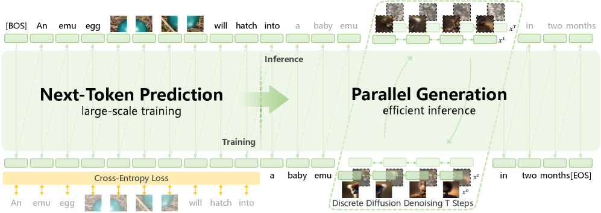
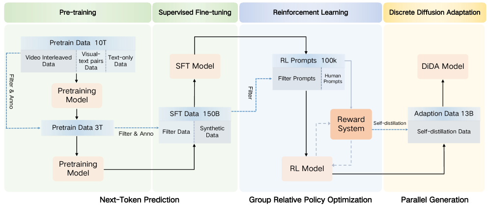
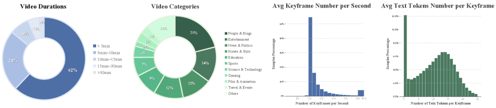
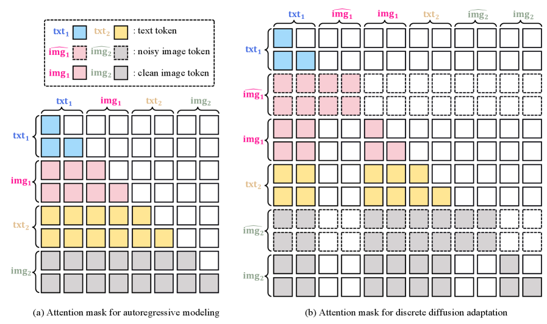
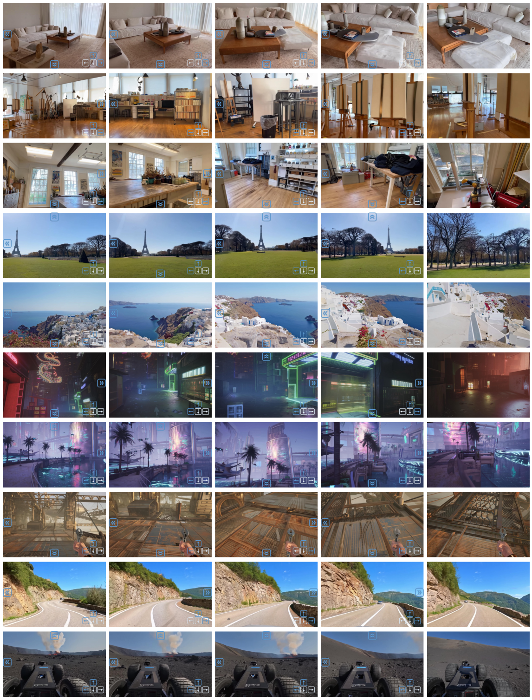
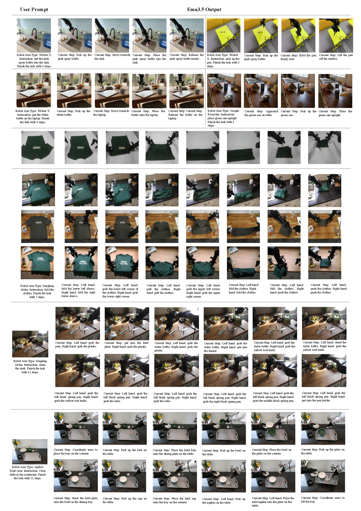

# Emu3.5：原生多模态模型如何变成世界学习器

| Checked Date | Repro Status | 本页证据口径 |
| --- | --- | --- |
| 2026-06-02 | Author code / model release reported | 以 arXiv HTML、官方仓库与论文图表为主；world exploration、long-horizon generation、embodied manipulation 按生成式 next-state evidence 解读。 |

Emu3.5 是四篇里最直接把 unified multimodal model 称为 world model 的论文。它的关键判断是：如果模型在大规模长视频帧和 transcript 交错序列上做端到端 next-token prediction，它学到的就不只是图文映射，而是跨视觉和语言的下一状态预测。

## 论文信息

| 维度 | 贡献 |
| --- | --- |
| 节省的成本 | 用统一 next-token prediction 建模视觉与语言，推理时再用 DiDA 把图像 token 逐 token 解码改成并行预测 |
| 核心机制 | 32B decoder-only backbone、离散视觉 tokenizer、13T pretraining、150B SFT samples、multi-task RL、DiDA hybrid inference |
| 对世界模型主线的意义 | 把 internet video 的 sequential frames + transcripts 变成视觉语言 next-state prediction 训练信号 |
| 主要风险 | 世界探索和 embodied manipulation 多为生成式 keyframe / interleaved output，不能直接等同真实动作控制 |
| 应接到本站哪里 | [BAGEL](bagel.md)、[LingBot-World](lingbot-world.md)、[VLA 数据、模型与评测路线](../../embodied-ai/vla-data-model-and-evaluation-roadmap.md) |

## 论文位置

前一代 unified models 常把图像生成、图像理解和文本生成作为并列任务。Emu3.5 更进一步，把长视频里的帧和 transcript 组织成长时序数据，让模型在视觉和语言之间预测下一状态。

这带来两个变化：

| 旧读法 | Emu3.5 的读法 |
| --- | --- |
| 图像是单次输入或输出 | 图像帧是长序列世界状态的一部分 |
| 文字主要是 prompt 或 answer | transcript、instruction、CoT 和 subtask text 都是状态转移条件 |
| 生成质量是核心指标 | 长时一致、交互探索、任务分解和 keyframe prediction 也进入目标 |
| 视觉 token 解码逐 token 很慢 | 训练仍用 NTP，推理用 DiDA 并行化视觉 token |

## 核心问题

| Question | Emu3.5 的回答 | 证据边界 |
| --- | --- | --- |
| native multimodal NTP 能否学世界状态？ | 把视频帧、transcript、instruction 和视觉 token 都作为统一序列预测下一 token | 支撑 next-state generation，不等同低层物理状态估计 |
| 长视频数据是否是关键？ | 13T+ pretraining 里大量使用 sequential video frames + transcripts | 说明视频可提供世界流，但不能证明动作因果 |
| 后训练如何显式世界化？ | SFT 设置 World Exploration、Visual Guidance、Embodied Manipulation 等任务 | 更接近规划和 keyframe proposal，不是闭环控制 |
| 推理延迟如何处理？ | DiDA 把视觉块改成并行预测，论文报告 per-image 约 20x 加速 | 加速视觉输出，不保证状态预测更正确 |

## 方法结构

{ width="920" }

<small>图源：`Emu3.5: Native Multimodal Models are World Learners`，Figure 3。原论文图意：Emu3.5 在大规模训练中用统一 next-token prediction；推理时通过 Discrete Diffusion Adaptation 加速单图视觉 token 生成。</small>

!!! note "这张图怎么读"
    左侧是训练逻辑：文本 token 和视觉 token 都进入 decoder-only Transformer，用标准 next-token prediction 学习下一状态。右侧是推理逻辑：文本仍然适合自回归，但图像 token 数量太大，逐 token 生成成本高，所以 DiDA 把视觉块改成 bidirectional parallel generation。

    对世界模型来说，这张图的核心是“训练目标统一，推理解码分工”。统一目标给模型一个共同状态空间；推理阶段再按模态特性优化成本。

### 模型配置与视觉 token

| Item | Emu3.5 |
| --- | --- |
| Parameters | 34.1B total |
| Transformer layers | 64 |
| Hidden size | 5120 |
| Intermediate size | 25600 |
| Attention heads | 64 Q heads / 8 KV heads |
| Vocabulary | 282,926 tokens |
| Text vocabulary | 151,854 tokens |
| Vision vocabulary | 131,072 tokens |
| Context length | 32,768 tokens |

<small>表源：`Emu3.5`，Table 1。表格保留原论文英文配置名并压缩为站内读法。</small>

视觉 tokenizer 使用离散视觉 codebook。论文披露的关键点是：视觉 codebook 扩到 131,072，tokenizer 使用 \(f=16\) 下采样；图像 decoder 可以走 vanilla decoder，也可以走 diffusion-based decoder；后者通过 LoRA distillation 从 50 steps 加速到 4 steps。视频 decoder 则用 keyframe tokens 加 diffusion-based video decoder 生成连续视频。

这说明 Emu3.5 的“native”不是把像素直接塞进 LLM，而是把视觉离散化成可预测 token，再用 decoder 把 token 还原成高质量视觉输出。

## 训练细节

{ width="920" }

<small>图源：`Emu3.5`，Figure 4。原论文图意：展示 Emu3.5 从大规模 pre-training，到 SFT、RL，再到 DiDA inference adaptation 的整体训练 pipeline。</small>

!!! note "这张训练图怎么读"
    先看 pre-training：模型在约 13T multimodal tokens 上学习视觉语言下一状态，其中核心来源是长视频帧和 transcript。再看 SFT：它把统一接口扩成 General Tasks、Any-to-Image、Visual Narrative、Visual Guidance、World Exploration 和 Embodied Manipulation。最后看 RL 与 DiDA：一个优化多任务生成/推理质量，一个优化推理速度。

    这张图支撑的是“world learner 的训练链路”，不是单个 benchmark 分数。

### Pre-training：视频帧与 transcript 是主燃料

Emu3.5 的 pre-training 数据超过 13T multimodal tokens，分为四类：

| Component | Role |
| --- | --- |
| Interleaved vision-language data | 从 sequential video frames 和 temporally aligned audio transcripts 学长时上下文 |
| Vision-text pairs | 补充通用图文对齐和视觉语义 |
| Any-to-image data | 支撑多图输入、编辑和开放式 X2I |
| Text-only data | 保持语言建模与推理能力 |

{ width="920" }

<small>图源：`Emu3.5`，Figure 5。原论文图意：统计 video interleaved data 的时长分布、类别分布和关键帧抽取密度。</small>

!!! note "这张数据图怎么读"
    论文收集约 63M videos，平均时长约 6.5 minutes，总量约等于 790 years of continuous footage。预处理时先做 scene detection，再按场景取 middle frame 或按间隔采样 keyframes，同时用 Whisper-large-v2 抽取 transcript。

    这里的训练信号不是“视频 caption”，而是长时 visual frames 与 speech/text 的共同序列。它比孤立 image-text pair 更接近世界模型需要的状态流。

### SFT：把世界任务显式化

| Task | # Tokens (B) | Question Type | Output Type |
| --- | --- | --- | --- |
| General Tasks | 29.7 | Language / VL / T2I | Text / Image |
| Any-to-Image | 56.2 | Multimodal Generation | Image |
| Visual Narrative | 10.1 | Story Generation | Interleaved Narrative |
| Visual Guidance | 22.5 | Procedural Reasoning | Interleaved Guidance |
| World Exploration | 17.5 | Scene Navigation | Interleaved Scene Synthesis |
| Embodied Manipulation | 14.1 | Action Planning | Interleaved Action Plan |

<small>表源：`Emu3.5`，Table 3。原表英文列名保留；数值用于说明 SFT 任务配比。</small>

这张表是 Emu3.5 最值得细读的训练细节。它把统一多模态模型的后训练任务分成普通能力和世界能力：

| World-oriented task | 训练目标 | 边界 |
| --- | --- | --- |
| Visual Guidance | 用图像/视频帧指导步骤化过程 | 更像过程说明和视觉计划，不等于真实执行 |
| World Exploration | 生成交互式 scene observations 与 narrations | 有空间一致性目标，但仍是生成式探索 |
| Embodied Manipulation | 预测 subtask instructions 和 keyframe states | 是 keyframe/subtask world modeling，不是连续低层控制 |

### RL：增强统一接口，不是物理 reward

SFT 之后，Emu3.5 做 large-scale multi-task RL。论文展示 reward 从约 4.5 上升到大于 7.1，说明统一后训练可以提升多任务生成和推理表现。

但它和 Dreamer/PlaNet 那类 model-based RL 不同。这里的 reward 主要来自 multimodal generation / reasoning 的评价信号，不是机器人环境里的稀疏成功奖励、碰撞惩罚或物理代价。因此本站把它读成“统一多模态后训练”，而不是“已解决闭环控制”。

### DiDA：把视觉块从逐 token 改成并行预测

{ width="860" }

<small>图源：`Emu3.5`，Figure 9。原论文图意：训练阶段用标准 next-token prediction；DiDA 阶段复制图像并随机 mask token，让模型学习双向并行预测，从而加速图像生成。</small>

!!! note "这张图怎么读"
    NTP 适合语言，因为句子天然有顺序；但图像 token 数量很大，逐 token 生成会很慢。DiDA 的核心是把同一张图复制成条件/目标形式，随机 mask 目标视觉 token，让模型在视觉块内部做 bidirectional parallel prediction。

    论文声称 per-image inference 大约 20x 加速。对世界模型部署来说，这类加速很关键：交互式 world rollout 的瓶颈往往不是模型会不会生成，而是能不能足够低延迟地生成下一观察。

## 实验结论

{ width="920" }

<small>图源：`Emu3.5`，Figure 18。原论文图意：展示 world exploration 结果；图中按钮表示 camera movement 或 viewpoint change instructions。</small>

!!! note "这张图支撑什么"
    这张图说明 Emu3.5 可以在用户给定世界或场景后，以 interleaved vision-language 输出方式做多步探索。它支撑的是 spatiotemporal consistency 和 controllable viewpoint change 的生成能力。

    它不能单独证明真实机器人导航，因为没有真实传感器闭环、地图误差、碰撞约束或执行反馈。

{ width="920" }

<small>图源：`Emu3.5`，Figure 19。原论文图意：展示 embodied manipulation 结果，用 interleaved subtask instructions 和 keyframe states 表示长时程操作过程。</small>

!!! note "这张图怎么读"
    读这张图时不要把它当 action policy。它更像“任务分解 + 关键状态预测”：模型把长任务拆成若干语义子任务，并为每个子任务生成完成状态 keyframe。

    对 VLA 项目来说，它可以作为 planner 或 world-state proposal 的候选模块；低层控制、轨迹跟踪、夹爪力控和失败恢复仍需要另外的系统。

## 消融诊断

| Diagnostic | Observation | 训练/推理含义 |
| --- | --- | --- |
| Video data statistics | 约 63M videos，平均约 6.5 minutes，配合 scene detection 与 Whisper transcript | world learner 的主要燃料是长时视觉语言状态流，不只是 image-text pairs |
| SFT task mix | World Exploration 17.5B tokens、Embodied Manipulation 14.1B tokens | 世界能力需要在后训练中显式变成任务接口 |
| RL post-training | 多任务 reward 从约 4.5 提升到大于 7.1 | RL 强化统一接口质量，但 reward 不是物理环境 reward |
| DiDA inference | 随机 mask 视觉 token 后做 bidirectional parallel prediction，报告约 20x per-image acceleration | 适合交互式 rollout 的延迟优化，但不是能力本身 |

### 和 BAGEL、LingBot-World 的关系

| Dimension | BAGEL | Emu3.5 | LingBot-World |
| --- | --- | --- | --- |
| Training objective | CE + Rectified Flow | unified next-token prediction | video generation objective + action conditioning |
| Core data | text / image / video / web interleaved | long video frames + transcripts + task SFT | videos, interaction trajectories, action/camera controls |
| World modeling signal | navigation / manipulation demos from interleaved pretraining | next-state vision-language prediction, exploration and keyframes | action-conditioned rollout simulator |
| Inference focus | generalized causal attention + KV cache | DiDA parallel visual prediction | causal rollout + KV cache + few-step distillation |
| Missing proof | closed-loop action causality | real execution and physical feedback | independent downstream policy improvement |

Emu3.5 最适合和 LingBot-World 对读。Emu3.5 从 native multimodal NTP 出发，强调视觉语言下一状态；LingBot-World 从视频生成器出发，强调动作条件和实时交互模拟。前者更像“统一状态序列底座”，后者更像“动作可控模拟器”。

## 局限风险

1. **离散视觉 token 不是连续物理状态**：token 级 next-state prediction 可以生成连贯图像，但不保证几何、接触和动力学精确。
2. **world exploration 仍是生成式展示**：没有地图误差、真实传感器噪声、执行器延迟和安全约束。
3. **embodied manipulation 是 keyframe/subtask 级别**：它预测关键状态和语义步骤，不输出可执行低层轨迹。
4. **数据治理成本极高**：63M 视频、ASR、scene detection、keyframe 抽取、SFT 多任务标注和 RL 都不是轻量流程。
5. **DiDA 是推理加速，不是能力本身**：它让视觉输出更快，但 world-state 正确性仍要靠数据、训练和评测保证。

## 阅读结论

Emu3.5 的核心启发是：如果把长视频帧、transcript、instruction、reasoning 和 keyframe 状态组织成统一序列，next-token prediction 可以被解释为视觉语言世界状态的下一步预测。它把统一多模态模型向 world model 推了一步。

但从工程角度看，它还不是可以直接部署到机器人或交互环境的完整世界模型。它更适合作为高层世界状态生成器、可视化 planner、长时 narrative simulator 或 embodied task proposal 模块；真实闭环还需要 action-conditioned dynamics、低层控制和失败反馈。

!!! info "本站判断"
    Emu3.5 是统一多模态世界模型路线的重要样本。强证据在于 13T+ multimodal pretraining、long video interleaved data、SFT 世界任务和 DiDA 推理加速；弱证据在于 world exploration 与 embodied manipulation 仍主要是生成式视觉语言输出，尚未证明真实闭环控制收益。
