# Emu3.5：原生多模态模型如何变成世界学习器

!!! info "论文信息"
    **论文题名：** Emu3.5: Native Multimodal Models are World Learners。 
    **作者：** Yufeng Cui、Honghao Chen、Haoge Deng、Xu Huang、Xinghang Li、Jirong Liu、Yang Liu、Zhuoyan Luo、Jinsheng Wang、Wenxuan Wang 等（共 23 人）。 
    **机构：** 未在公开元数据中稳定解析；以 arXiv/PDF 或官方页 affiliation block 为准。 
    **时间 / 主题：** 2025-10；世界模型。 
    **arXiv / 官方报告：** arXiv：[2510.26583](https://arxiv.org/abs/2510.26583)；官方材料：[huggingface.co/BAAI/Emu3.5](https://huggingface.co/BAAI/Emu3.5)。 
    **GitHub / 项目：** GitHub：[github.com/baaivision/Emu3.5](https://github.com/baaivision/Emu3.5)；项目页：[huggingface.co/BAAI/Emu3.5](https://huggingface.co/BAAI/Emu3.5)。 
    **元数据来源与核验口径：** 来源：[arXiv](https://arxiv.org/abs/2510.26583)；[GitHub API / repo](https://github.com/baaivision/Emu3.5)；[官方 / 项目材料](https://huggingface.co/BAAI/Emu3.5)；Checked Date：2026-06-15；Repro Status：Paper / official materials reviewed, independent reproduction not claimed。

| Checked Date | Repro Status | 本页证据口径 |
| --- | --- | --- |
| 2026-06-02 | Author code / model release reported | 以 arXiv HTML、官方仓库与论文图表为主；world exploration、long-horizon generation、embodied manipulation 按生成式 next-state evidence 解读。 |

## 先学会连续的图文状态，再解决图像生成太慢的问题

Emu3.5 的主线可以从一个实际困难讲起。一个模型若要逐步讲故事、演示操作、根据指令探索环境，不能只会独立生成漂亮图片。它需要理解前面已经出现的人物、物体和场景，决定下一步文字应该说什么，再生成与这段文字以及历史画面都相容的视觉状态。输入与输出因此都是图文交错序列，图片承担了过程状态，文字承担描述、意图与步骤关系。

论文用同一套离散 token 的 next-token prediction 训练这种接口。大规模视频关键帧与语音转录提供连续过程，SFT 把它们组织成可调用的任务格式，RL 再用多种质量反馈改善生成。由于图像被编码成数千个视觉 token，逐 token 解码又成为明显瓶颈，作者最后引入 Discrete Diffusion Adaptation，简称 DiDA，让一张图中的 token 在多个去噪轮次中并行更新。预训练目标和推理时的图内解码顺序由此被分开设计。[↗](https://arxiv.org/pdf/2510.26583v1#page=5)

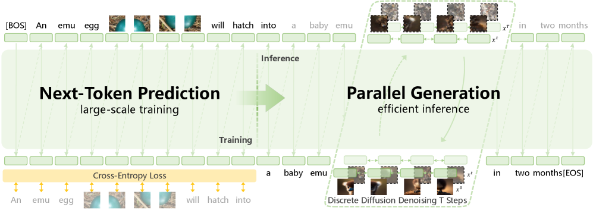{ width="820" }

*原论文 Figure 3。左侧是大规模训练时的逐 token 预测，右侧是适配后的一张图内部并行去噪。文字与图片之间的顺序仍保留，改变的是视觉块内部的生成方式。*

这里的 world learner 更适合理解为学习图文状态转移的生成模型。模型能够输出多步操作说明及相应关键帧，也能根据探索指令生成新视角；实验主要检验这些生成内容的质量和偏好，尚未把生成关键帧转换成机器人可执行的关节动作。把这一点放在开头，后面的训练设计和评测指标才不会被误读成已经完成实机控制。

与从零训练统一主干的研究不同，Emu3.5 明确从 Qwen3 初始化。论文的重点是如何继续进行大规模原生多模态训练，以及怎样建立多任务生成与高效推理流程，并不用于隔离模型已有语言知识与本轮视觉训练的贡献。[↗](https://arxiv.org/pdf/2510.26583v1#page=9)

## 四个层次不能混为同一种“扩散模型”

Emu3.5 同时涉及自回归、离散扩散和连续扩散，几个名词指向的对象并不相同。视觉 tokenizer 先把图像变成离散编号，统一 Transformer 再学习这些编号与文本如何接续。DiDA 只改动图像编号的生成方式，让图内 token 可以并行更新；图像或视频 decoder 负责把编号还原成连续像素。后两个环节都可能出现 diffusion，但前者处理的是视觉 token 的生成顺序，后者处理的是像素细节和视频运动。

| Component | Input | Output | Main role |
| --- | --- | --- | --- |
| Visual tokenizer | Image / video keyframe | Discrete visual tokens | 把视觉内容放入可预测的词表 |
| Native multimodal Transformer | Interleaved text and visual tokens | Next text / visual tokens | 学习上下文、任务关系与下一状态 |
| DiDA | Clean history + noisy visual-token block | Refined discrete visual tokens | 缩短图内逐 token 解码的串行路径 |
| Image / video decoder | Quantized embeddings, optional text / keyframe conditions | Pixels / continuous video | 重建细节、提高分辨率或补充帧间运动 |

这一区分也关系到效率结论。DiDA 的加速对应模型生成一张图的视觉 tokens；图像 decoder 从 50 步蒸馏到 4 步，则是另一个像素还原环节。不能把这两个数字拼成“DiDA 只需 4 步”，也不能仅凭主干采用离散自回归训练，就断言系统没有任何 diffusion 组件。

### 主干参数与词表怎样组织

模型实际总参数为约 34.1B，其中 Transformer layers 约 31.2B，embedding layers 约 2.9B。论文有时称它为 32B 模型，若用于资源估算，应以详细配置为准。主干采用 64 层、hidden size 5120、intermediate size 25600，64 个 query heads 与 8 个 key-value heads 的 GQA。RMSNorm 采用 pre-normalization，query/key projection 使用 QK-Norm，激活函数为 SwiGLU，位置编码使用 RoPE，并设置 0.1 dropout。[↗](https://arxiv.org/pdf/2510.26583v1#page=5)

| Configuration | Value |
| --- | ---: |
| Total parameters | 34.1B |
| Transformer / embedding parameters | 31.2B / 2.9B |
| Layers | 64 |
| Hidden size | 5120 |
| Intermediate size | 25600 |
| Heads, Q / KV | 64 / 8 |
| Vocabulary size | 282926 |
| Text / vision vocabulary | 151854 / 131072 |
| Maximum context length | 32768 |

文本部分复用 QwenTokenizer，视觉部分来自专门训练的 codebook。两类 token 最后都以离散编号进入同一预测问题，这使图像、文字和多个图文回合可以自然组成一个序列。统一目标并不意味着视觉与文本在训练中必须拥有完全相同权重，预训练实际将视觉 token 的损失乘以 0.5，文本权重为 1.0，以降低大量视觉位置对优化的支配。

用等价数学形式解释这一目标，可以写为

$$
\mathcal L_{\mathrm{NTP}}
=-\sum_{i=1}^{L}w_i\log p_\theta(s_i\mid s_{<i}),
\qquad
w_i=\begin{cases}0.5,&s_i\text{ is visual},\\1.0,&s_i\text{ is text}.\end{cases}
$$

这里 $s_i$ 是统一序列第 $i$ 个 token，$L$ 为序列长度。此式是对论文文字目标的解释性表达，不是原文编号公式。它强调的是，图像预测与文字预测都使用交叉熵，历史图像也可以成为后续文本和图像的条件。损失系数还会随 SFT 阶段改变，不能将这组预训练系数套用到整个训练流程。

### token 更少，才有空间放入更多状态

视觉 tokenizer 基于 IBQ，下采样因子为 16，code dimension 为 256，codebook 包含 131072 个编码。通过宽度扩展，tokenizer 模型约有 455M 参数；训练时还将 SigLIP 的语义特征蒸馏到 decoder 中间层，尝试使离散编码同时保留可重建细节与语义信息。

对于可被网格整除的图像，视觉 token 数可按下面的几何关系估计

$$
N_{\mathrm{visual}}=\frac{H}{16}\frac{W}{16}=\frac{HW}{256}.
$$

因此 512×512 图像需要 1024 个视觉 tokens，1024×1024 图像需要 4096 个。论文称同尺寸图像的 token 数约为 Emu3 的四分之一，这是降低长序列负担的重要改变。可是 32768 context 仍然有限，仅考虑视觉位置，最多约容纳 32 张 512×512 图或 8 张 1024×1024 图；实际还要给文字、格式标记和输出空间留预算。这是由配置计算的上限，不能把平均 6.5 分钟的视频来源等同于模型每个样本都完整读取 6.5 分钟视频。

## 预训练数据的关键，是保存过程而非只收集独立图片

### 视频与语音转录怎样变成文档式序列

论文收集约 6300 万段视频，平均长度约 6.5 分钟，总时长约 790 年，来源包括公开数据、互联网视频与合作渠道。内容覆盖教学、科学、手工、娱乐、运动、游戏、旅行和动画。长视频的价值在于它天然包含先后关系，同一个物体在不同阶段的状态、讲解与画面的联系，以及一段过程如何完成。

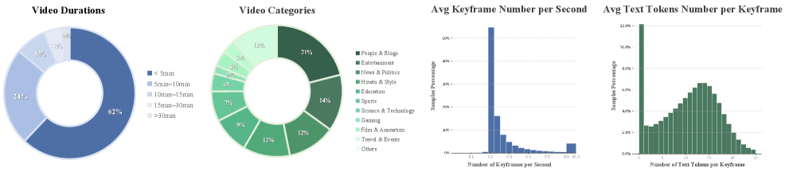{ width="820" .atlas-figure-compact }

*原论文 Figure 5。左侧显示视频长度与类别，右侧显示关键帧密度和每帧对应文字量。62% 视频短于 5 分钟，24% 为 5—10 分钟；关键帧与文字的密度并不恒定，静默视频也需要专门平衡。*

视觉预处理先用 PySceneDetect 分割场景。若一个场景短于阈值 $t$ 秒，取中间帧；否则按每 $t$ 秒抽取帧，并保留时间戳。论文没有给出这个阈值的具体取值，报告的平均密度约为每秒 0.27 个关键帧。它强调按场景结构减少冗余，避免只靠固定频率抽帧破坏内容边界。[↗](https://arxiv.org/pdf/2510.26583v1#page=7)

声音经过 Whisper-large-v2 转录，由 Faster-Whisper 加速，保留词级时间戳，再由 spaCy 结合时间停顿和语法结构划分连贯文本。最后按时间顺序把关键帧与对应文字交错排列。这样训练序列既有画面变化，也有与过程同步的说明。视频没有语音时会产生大量无文字段落，因此数据过滤还需平衡静默视频比例和语言分布。

第一阶段采用基础过滤，包括时长与分辨率、结合人脸检测与 Qwen-VL 的 talking-head 筛除，以及语言和静默内容平衡。第二阶段进一步引入 DeQA 视觉质量评分、DINO 与 FG-CLIP 特征去重、LLM 转录文本质量评分。第一阶段的视频交错数据仅使用关键帧与 ASR，不再增加额外标注；第二阶段则用 LLM 对转录进行语义分段和总结，用 Qwen2.5-VL-7B 为场景生成详细 captions，再将这些信息合成总体摘要。[↗](https://arxiv.org/pdf/2510.26583v1#page=8)

这个顺序有明确用途。先让主干接触大量真实时间序列，再提高画面质量与监督密度。后阶段同时改变数据、分辨率与标注，因此最终改善不能仅归因于某一项更精细 caption。它是一套组合训练方案，论文没有逐一消融每种过滤器或标注的贡献。

### 其他数据补足哪些能力

视觉文本配对数据包括约 500M image-text pairs 和 30M video-text pairs。大部分视觉内容延续 Emu3 数据来源，文字由 Qwen2.5-VL-7B 重新标注；另加入生成式模型合成的图文，以及 InfinityMM、LLaVA-OV 等理解数据。视频配对部分按运动程度过滤，并以约 1 FPS 采样；同一视频的多个片段按时间顺序打包，保留跨片段的过程联系。

Any-to-Image 数据约 27.35M samples，包含公开编辑、多参考图和私有构造的数据。纯文本语料池约 3T tokens，覆盖中英文。这里的“语料池”规模、一次采样的比例和训练实际看过的 tokens 是不同计量，不能直接相加后当作完整训练预算。尤其纯文本池为 3T，并不表示训练过程中一定恰好消耗这 3T 一次。

## 两阶段预训练怎样扩规模与分辨率

训练流程图把预训练概括为 10T+3T tokens；详细 Table 2 则报告实际 seen tokens 为 10.3T 和 3.5T，合计约 13.8T。描述规模时可以使用“约 13T”这一论文概括，但复核训练预算应保留详细表中的数值。[↗](https://arxiv.org/pdf/2510.26583v1#page=10)

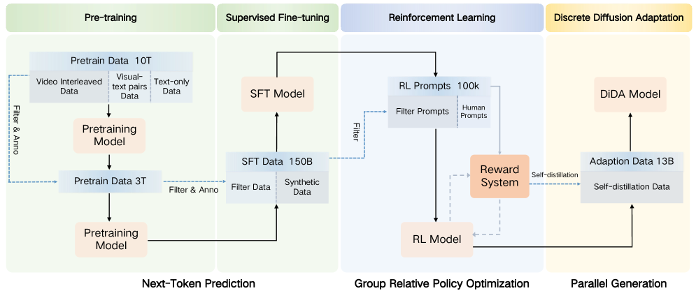{ width="820" }

*原论文 Figure 4。预训练建立连续图文分布，SFT 建立任务接口，RL 优化质量偏好，最后 DiDA 适配图内并行预测。图中的 150B SFT 与 13B adaptation 应按 token 数据规模理解。*

| Hyperparameters | Stage 1 | Stage 2 |
| --- | ---: | ---: |
| Learning rate | $5\times10^{-4}$ | $1\times10^{-5}$ |
| LR scheduler | Cosine | Cosine |
| Weight decay | 0.1 | 0.1 |
| Gradient norm clip | 5.0 | 5.0 |
| Loss weight, visual : text | 0.5 : 1.0 | 0.5 : 1.0 |
| Warm-up steps | 700 | 700 |
| Training steps | 700k | 240k |
| Sequence length | 32768 | 32768 |
| Batch size | 448 | 448 |
| Image resolution range | 512px | 512—1024px |
| Training seen tokens | 10.3T | 3.5T |

两阶段都使用 FlagScale，TP=8、CP=2，AdamW 的 $\beta_1=0.9$、$\beta_2=0.95$、$\epsilon=10^{-8}$。第一阶段在线 packing 到最大上下文，每图最多 1024 个视觉 tokens，对应不超过 512×512 的像素面积，同时保留原始纵横比。第二阶段对丰富标注后的交错数据离线 pre-pack 并 padding，动态使用 1024—4096 个视觉 tokens，对应约 512×512 至 1024×1024 的面积范围。

| Data sampling ratio | Stage 1 | Stage 2 |
| --- | ---: | ---: |
| Text | 0.20 | 0.18 |
| Image-text pair | 0.20 | 0.16 |
| Video-text pair | 0.05 | 0.08 |
| Any-to-image Data | 0.00 | 0.03 |
| Video interleaved data | 0.55 | 0.55 |

视频交错数据始终占主要采样比例，后阶段加入 Any-to-Image 并提高 video-text 比重，同时显著降低学习率。这个安排将大规模通用学习与后段质量精修分开，也使编辑式状态变化在预训练末段开始进入模型。表中的采样比例与不同数据的平均长度并不自动等同，不能不加条件地把 0.55 解释成每一步恰有 55% 的视觉 tokens。

### 验证损失降低说明了什么

Figure 7 展示第一阶段从训练初期到 10T tokens 左右的曲线。总体训练损失持续下降，但早期有明显尖峰，因此不能将“稳定优化”写成从未出现波动。更有价值的是九组验证集同时改善，其中既包括训练分布内的 T2I、I2T、video interleaved，也包括其他任务格式。

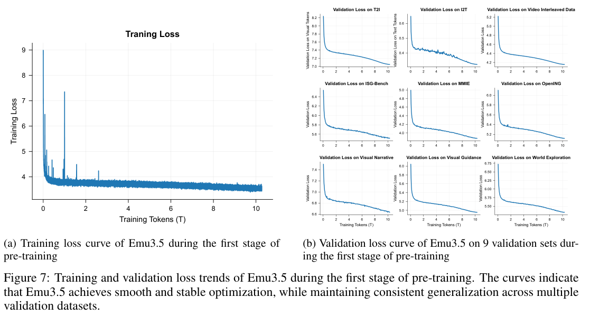

*原论文 Figure 7。左侧观察总体收敛与早期尖峰，右侧分别观察不同验证分布。各图纵轴范围不同，下降幅度不能跨面板直接作能力排名。*

T2I 只算视觉 token loss，I2T 只算文字 token loss；ISG-Bench、OpenING、MMIE 的问题与参考答案被拼成验证序列，用于计算预测损失。另三组来自未进入预训练的早期 SFT 数据，覆盖 visual narrative、visual guidance 和 world exploration。它们说明统一预训练的 token 预测在多种格式上改善，支持一定的跨任务迁移潜力。[↗](https://arxiv.org/pdf/2510.26583v1#page=9)

不过这仍然是 likelihood 证据。它没有直接测量长期闭环控制、物理守恒，也没有通过打乱视频顺序等单变量对照来证明改善全部来自时序结构。把这张图理解为后训练的底座越来越适应复杂图文分布，会比直接称其证明“世界理解能力持续增长”更准确。

## SFT 把连续分布变成六类可调用任务

### 一张输出图片，与一串过程状态

SFT 中的 X2I 接口非常明确，输入是一条文字指令与零张、一张或多张参考图，输出严格为一张图片。无图输入就是文本生成，有图输入可以是编辑、主体保持、多参考图合成或 in-context generation。其他四类交错任务则需要连续输出文字与图像，区别在于序列应满足怎样的约束。

Visual Narrative 关心故事结构、人物与画风连续；Visual Guidance 关心步骤顺序、文字可操作性与对应画面；World Exploration 关心视角变化、场景布局和探索指令；Embodied Manipulation 关心语义子任务与完成状态。它们共用预测接口，却需要不同训练内容，不能仅给同一类图文对换个任务名称。

| Task | # Tokens (B) | Question Type | Output Type |
| --- | ---: | --- | --- |
| General Tasks | 29.7 | Language / VL / T2I | Text / Image |
| Any-to-Image | 56.2 | Multimodal Generation | Image |
| Visual Narrative | 10.1 | Story Generation | Interleaved Narrative |
| Visual Guidance | 22.5 | Procedural Reasoning | Interleaved Guidance |
| World Exploration | 17.5 | Scene Navigation | Interleaved Scene Synthesis |
| Embodied Manipulation | 14.1 | Action Planning | Interleaved Action Plan |

Table 3 的六类合计 150.1B tokens，论文概括为约 150B。原文总览一处将其写成 150 billion samples，与这里的明确表头不一致，不能据此说有 1500 亿个独立训练样本。General Tasks 中可见的样本规模包括约 5M T2I、8.9M Infinity-Instruct 文本指令和 3.7M LLaVA-OV 问答。[↗](https://arxiv.org/pdf/2510.26583v1#page=12)

### 长序列任务的数据不是现成的视频 caption

叙事数据需要先找到故事边界。处理流水线先分场景、做 ASR，提取视觉特征和质量分数，删除重复或低质量帧；再为每个关键帧生成 dense caption，将这些 captions 与 ASR 交给 Qwen3 分割短故事，并检查是否具有完整的起点、发展和结尾。之后生成用户问题、global CoT 和 image-level CoT，得到约 430K 中英文叙事样本。

指导数据则来自烹饪、DIY、手工等教程，通过字幕与关键帧对齐建立步骤，过滤不足两步或超过十步的样本，并删除格式异常、文本重复和图片质量问题。global CoT 提供整体过程安排，image-level CoT 为每一步补充视觉解释，再由 Qwen2.5-VL 对相关性、清晰度、图文对齐和视觉信息量等评分，最后保留约 960K 中英文样本。[↗](https://arxiv.org/pdf/2510.26583v1#page=13)

这些 CoT 是数据构造中的教师标注，目的是给模型显式的组织线索。它们不自动证明生成时的文字忠实反映内部计算，也没有单独的 CoT 消融足以量化每一种标注的贡献。对于重建类似流程的人，关键是同时处理序列边界、样本完整性与帧间语义关系，单独增加每帧 caption 长度并不能替代这些工作。

World Exploration 使用 Sekai 与 OpenDV，覆盖行走、驾驶、真实场景与游戏引擎内容。DeQA 过滤后重新标注相机轨迹，再用 Qwen3 和 Qwen2.5-VL 生成提示、图像级 CoT 及视角变化指令。训练覆盖纯文本或首帧图像两种初始化，以及 User-Interactive 和 Free-Exploration 两种模式，最终约 200K 样本。前者每条用户指令触发一次视觉更新，后者由模型继续产生连贯观察和描述。

操作数据约 973K，包含 920K OXE、40K Agi-world Alpha 和 13K Songling Aloha。Aloha 轨迹使用人工在线标注分割语义阶段；OXE 先依据运动和夹爪状态变化选择候选关键帧，再由 Qwen2.5-VL 合并相邻片段、生成说明并过滤低质量结果。训练还随机从中间步骤开始，让模型学会从部分完成的状态继续推演，而不只记住从起点开始的一条固定流程。[↗](https://arxiv.org/pdf/2510.26583v1#page=14)

### 操作输出到底是什么

论文把观察序列 $O=\{o_1,\ldots,o_T\}$ 分解成语义子任务。第 $i$ 个子任务为

$$
\mathrm{Sub}_i=(l_i,O_{[t_{i-1}:t_i]}),
\qquad \text{target keyframe}=o_{t_i}.
$$

$l_i$ 是子任务文字，例如拿起杯子、移动到水槽上方；$o_{t_i}$ 是该步骤完成时的视觉状态。因此模型预测的是 $l_1,o_{t_1},l_2,o_{t_2},\ldots$ 这样的交错过程。语义步骤可以承载较长时段的行为，但它跳过了许多瞬时运动细节，也没有输出电机、关节或末端执行器的连续控制量。这是高层视觉计划或未来状态模型，接入实体系统时仍需要把目标状态转换成可执行动作的接口。[↗](https://arxiv.org/pdf/2510.26583v1#page=12)

### 两阶段 SFT 如何适应更多视觉 tokens

| Setting | SFT Stage 1 | SFT Stage 2 |
| --- | --- | --- |
| X2I resolution | 768px | 1024px |
| Narrative / Guidance / Manipulation | 512px | 720px |
| World Exploration | 720px | 720px |
| Visual loss weight | 1.0 | 0.5 |
| Maximum sequence length | 16384 | 32768 |
| TP / CP | 8 / 1 | 8 / 2 |
| Batch size | 1024 | 1024 |
| Learning rate | $6\times10^{-6}$ | $6\times10^{-6}$ |
| Training iterations | 3000 | 3000 |

两阶段都使用 AdamW，$\beta_1=0.9$、$\beta_2=0.95$ 和 cosine schedule。先用较低分辨率学习任务形式，再提高分辨率并扩大上下文；随着视觉 token 数增加，将其损失权重从 1.0 降到 0.5，避免增加的视觉位置改变两类模态的优化平衡。General Tasks 的输入会预先打包并 padding 到最大长度。数据集的 150B-token 规模与每个训练 batch 中真正有效、未被 padding 的 tokens 仍须区分。[↗](https://arxiv.org/pdf/2510.26583v1#page=14)

## RL 把多种生成质量放到同一个优化流程里

SFT 让模型学习如何按格式输出，但一条参考答案不能覆盖所有可接受的图片和过程。RL 则让模型生成多个候选，再依据质量反馈调整生成分布。Emu3.5 使用 GRPO，global batch size 为 640、learning rate 为 $10^{-6}$，每个提示产生 8 个 rollouts。采样由集成在 VeRL 中的 vLLM engine 完成。联合多任务阶段对收集的 prompts 完成一轮训练，每个 batch 混合任务；之后再做单独的 X2I、T2I RL，以增强单图生成与编辑一致性。除 DiDA 等特别注明的实验外，论文定量结果默认来自 RL 模型。[↗](https://arxiv.org/pdf/2510.26583v1#page=15)

在直观机制上，8 个候选为同一提示提供相对好坏的比较，奖励更高的输出获得更有利的更新方向。论文给出 GRPO 算法名称和主要训练设置，但没有完整列出奖励聚合权重、裁剪系数等所有实现细节，因此不宜凭通用 GRPO 模板补出一套声称来自本文的精确公式。

奖励体系分成通用与任务专用两部分。通用部分包括 CLIP 图文相似度、VLM 对齐准确性和美学评分；文字绘制再加入 OCR 与布局 fidelity，人像编辑加入人脸检测和身份相似度，叙事与推理任务加入 VLM 一致性评分。每种 reward 先规范到 [1,10]，再组合使用，使不同评分器的量纲更容易放在同一优化流程中。

这比只优化一个美学分数更贴近任务。例如一幅修改后的人像可能很漂亮，却改变了身份；一段教程每张图都清晰，却没有展示正确步骤。不同奖励分别为这些问题提供反馈。但多种 reward 并不能从逻辑上保证不发生 reward hacking，评分器也可能共同忽略某类错误。论文关于避免单一奖励投机的解释应视为设计动机，不能只凭平均 reward 上升就宣布已经消除投机。

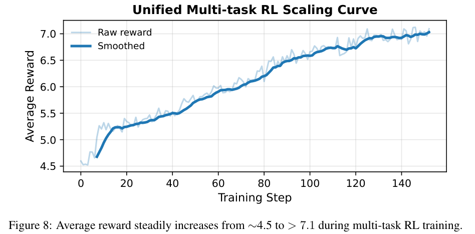

*原论文 Figure 8。平均训练 reward 从约 4.5 提高到超过 7.1。浅线是原始值、深线是平滑值，说明模型越来越符合当前奖励系统，尚不能代替逐任务、独立评估的改进幅度。*

RL prompts 来自 SFT 子集、用户反馈和针对性构造，每个下游任务筛选约 10K 高质量 prompts，并加入约 1K human-feedback samples；针对单图阶段又补充 58K X2I 指令与 50K T2I 样本。流程图用约 100K RL prompts 作概括，正文描述则包含后续专门阶段，不能将二者无条件当成一个精确的去重总数。

对于“任务之间相互促进”的判断，论文提出高质量 T2I 与编辑能力可以转移到叙事、指导任务，训练结果与这个解释相容。但它没有给出完整的逐任务单独 RL、联合 RL、去掉某个奖励后的成组对照，因此读者能复用的是多任务奖励设计和训练流程，不能从 Figure 8 推导每个任务贡献了多少可量化的迁移收益。

## DiDA 怎样缩短串行解码，又保持跨图因果关系

### 问题出在一张图片内部也需要几千次串行预测

1024×1024 图像对应 4096 个视觉 tokens。如果仍然逐个生成，哪怕有 KV cache，也存在很长的串行调用链。图文交错输出包含多张图，这种延迟会逐步累积。DiDA 的目标是复用已经学好的离散生成模型，让一整张图的视觉位置同时进入计算，再通过多轮离散去噪得到最终编码。

它是后续适配阶段，不需要把前面的十几万亿 token 训练全部改成扩散目标。使用的数据包括 SFT 和模型自蒸馏产生的 image-text pairs、interleaved image-text sequences。Figure 4 标出约 13B adaptation tokens，与 13.8T 预训练相比约为千分之一量级。这个比例说明新增训练相对预训练很小，仍然是数十亿 tokens 的实质训练，并非只改一个 attention mask 就能直接获得相同结果。

### noisy copy 为什么不能读到自己的 clean copy

训练时为每张图保留一份 clean image tokens，再构造对应 noisy copy。带噪图像需要看到此前已经确定的文字和图片，才能预测当前图；图内又需要双向 attention，才能联合协调各个视觉位置。可是若它可以读取自己的 clean copy，任务就退化成直接复制正确答案。因此 attention mask 是这个适配的关键约束。[↗](https://arxiv.org/pdf/2510.26583v1#page=16)

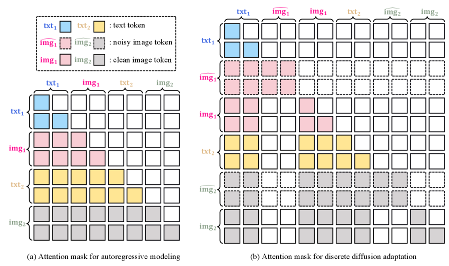{ width="780" }

*原论文 Figure 9。右图虚线框是 noisy visual tokens，彩色实框是 clean image 或 text。读任意 noisy image 的行时，应同时检查它能否看历史 clean context，以及当前 clean image 对应的列是否被阻断。*

以“文字一、图像一、文字二、图像二”为例，带噪图像一能够读取文字一，并双向读取带噪图像一的其他位置；它不能看到干净图像一，也不能看到后面的文字二或图像二。带噪图像二则可以读取此前的文字一、干净图像一与文字二，并在自身 noisy block 中双向交互。已经干净的图像和文字继续遵循原本的因果顺序，只读取前面的 clean tokens，不读取插入的 noisy copies。

这种安排同时完成两件事。它把当前图像内部从单向预测改成全图联合建模，又让后续文字与图像的历史条件仍保持干净、确定。适配由此尽可能保留原模型的文图依赖关系，而不是把整段交错序列都改为无方向的双向注意。后续图像仍需要建立在之前生成的状态上，DiDA 没有取消跨图序列的先后关系。

推理时先按自回归方式生成文字，到图像阶段一次初始化整块视觉 tokens，再迭代修正，得到完整图像编码之后继续下一段。这里的“并行”指图内位置共同更新，仍然存在多个去噪步骤。报告没有完整给出 DiDA 的噪声转移核、具体采样步数和适配损失公式，因此不能将常见 masked diffusion 或 uniform diffusion 的某个默认配置直接当成论文已说明的算法细节。

### 调度框架也参与了速度提升

FlagScale 使用 FlexAttention 的按行 block mask 表达因果、双向和特定区域可见性，避免显式存储完整四维 attention mask。训练结合 TP、PP、SP、ZeRO-1 DP 和 activation recomputation，处理复杂 attention 与较长序列的内存压力。

推理采用有限状态机调度器，在文字生成与图片生成之间切换，同时预分配资源；异步请求处理、运行状态复用和 FP8 quantization 共同降低开销。论文报告四设备设置下框架改进达到至少 50% 加速，但这并未单独量化每项工程技巧的贡献，也没有为所有性能表完整列明具体 GPU 型号、batch 与精度条件。[↗](https://arxiv.org/pdf/2510.26583v1#page=17)

| Model | # Params | Resolution | # Gen Tokens | Gen Method | Naive time (s) | FlagScale time (s) | GenEval ↑ | DPG-Bench ↑ | GEdit-EN G_O ↑ |
| --- | --- | --- | ---: | --- | ---: | ---: | ---: | ---: | ---: |
| Emu3 | 8B | 720×720 | 8100 | AR | 260 | 68 | 0.66 | 80.60 | — |
| Emu3.5 | 34B | 1024×1024 | 4096 | AR | 512 | 120 | 0.86 | 88.26 | 7.59 |
| Emu3.5 | 34B | 1024×1024 | 4096 | DiDA | 22 | 10 | 0.86 | 87.46 | 7.56 |

Table 16 的时间测量针对 text-to-image。若在相同实现中计算，naive 从 512 秒到 22 秒，约加速 $512/22\approx23.3$ 倍；FlagScale 从 120 秒到 10 秒，加速 12 倍。论文概括的“约 20 倍”与前一种量级相符，不能直接套在 FlagScale 的 10 秒结果上，更不能用 512/10 把算法与实现两类改善混成一个倍率。[↗](https://arxiv.org/pdf/2510.26583v1#page=26)

质量也需要按数值表述。GenEval 保持 0.86，DPG-Bench 下降 0.80 分，GEdit overall 下降 0.03，整体相近但并非所有分数完全无损。Emu3 与 Emu3.5 的主干大小、分辨率、tokenizer、训练规模都不同，因此两者的代际比较展示系统整体进步，不能作为只改变参数量或只改变 tokenizer 的单变量实验。

## 像素 decoder 决定输出怎样从编号变成可见细节

### tokenizer 本身还需要独立训练

离散 token 能否描述细小文字、面部和纹理，会限制整个模型的输出上限。tokenizer 训练使用 reconstruction、quantization、LPIPS perceptual、PatchGAN adversarial、entropy 和 SigLIP semantic distillation 等目标。Adam 的 $\beta_1=0.5$、$\beta_2=0.9$，learning rate 为 $10^{-4}$，warmup 15K steps，总训练 500K steps、batch size 256。[↗](https://arxiv.org/pdf/2510.26583v1#page=18)

数据除一般图像和高美学图片外，还专门加入文字密集与人脸数据。分辨率低于 512×512 的图像被过滤，还进行图像质量、美学与水印筛选。这样的来源说明文字绘制收益不只是统一主干规模增长，视觉编码器自身的数据分布与重建训练也发生了针对性改变。

默认 vanilla decoder 可以直接还原图像；可选的 diffusion image decoder 则以相同 quantized tokens 为条件，输出相对更高分辨率的图像。它从 Stable Diffusion 3.5 Medium 初始化，使用 flow matching 训练。先在 512px 上训练 200K steps，batch size 512、learning rate $5\times10^{-5}$；再对 512—1024px 多分辨率与纵横比做 balanced bucket sampling，训练 50K steps；最后以 6K steps、batch size 128、learning rate $10^{-5}$ 做 LoRA-based distillation，将去噪从 50 步减少到 4 步。

论文用相同视觉 tokens 生成约两倍空间分辨率的图像，最终支持最高约 2K 输出。因此“2K 图像输出”不等于统一主干必然预测了 2K 分辨率对应的 16384 个原生视觉 tokens，它还包含 decoder 的提升分辨率能力。此处蒸馏带来的约 10 倍解码加速，与 DiDA 的离散 token 生成加速是两项不同改进。

### 更清晰的文字，并不等于所有重建指标更好

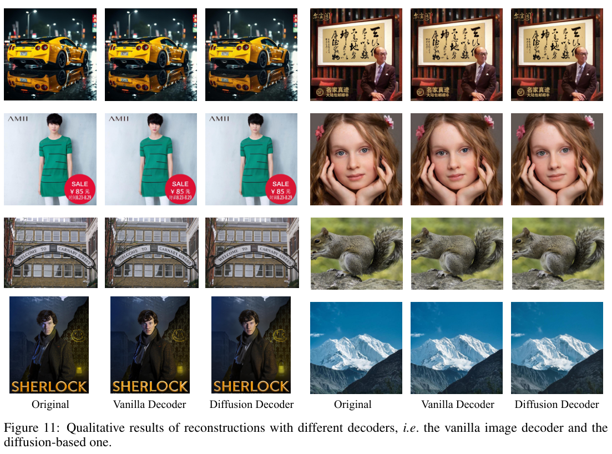

*原论文 Figure 11。每组三列分别为原图、vanilla decoder、diffusion decoder。应优先检查招牌与海报文字、人脸和局部纹理是否更清楚，同时留意重建内容是否发生变化。*

Table 15 在 512×512 分辨率比较 tokenizer，文字和人脸使用 TokBench，一般重建还使用作者收集的约 60K 评测集。下面保留能看清 decoder 取舍的部分列。

| Method | T-ACC_s ↑ | T-ACC_me ↑ | T-ACC_l ↑ | T-ACC_m ↑ | T-NED_m ↑ | F-Sim_m ↑ | rFID ↓ | LPIPS ↓ |
| --- | ---: | ---: | ---: | ---: | ---: | ---: | ---: | ---: |
| VQGAN | 0.15 | 0.76 | 17.45 | 6.12 | 17.32 | 0.11 | 1.19 | 0.13 |
| VAR | 3.71 | 20.59 | 63.62 | 29.32 | 50.00 | 0.24 | 0.60 | 0.09 |
| O-MAGVIT2 (pretrain) | 3.02 | 16.25 | 62.72 | 27.33 | 47.28 | 0.22 | 0.45 | 0.08 |
| Emu3.5-Vanilla Decoder | 12.99 | 39.59 | 71.97 | 41.52 | 65.39 | 0.22 | 0.42 | 0.08 |
| Emu3.5-Diffusion Decoder | 18.61 | 53.22 | 81.50 | 51.11 | 70.52 | 0.22 | 0.49 | 0.10 |

文字列按原表使用百分数口径，s、me、l 分别对应 small、medium、large instances，m 是跨尺度平均。Diffusion decoder 将平均文字准确率从 41.52 提高到 51.11，中等文字从 39.59 提高到 53.22，说明它确实补足了一部分文字细节。小文字准确率仍只有 18.61，距离稳定无误还有很大空间。

另一方面，平均 face similarity 两种 decoder 都是 0.22，且低于表中 VAR 的 0.24；一般重建 rFID 从 0.42 变为 0.49、LPIPS 从 0.08 变为 0.10，按指标方向反而更差。因此“视觉看起来更精细”与“重建结果在所有指标上更接近原图”必须分开。Decoder 可以让局部内容更清晰，同时改变原图细节或分布，不能把文本收益推广成所有重建任务全面改进。[↗](https://arxiv.org/pdf/2510.26583v1#page=25)

### 连续视频由另外的 decoder 补足

主干输出关键帧以后，视频 decoder 用这些 quantized embeddings 提供细节，可选的帧间文字提供语义指导，额外 4-channel mask 指示哪些位置已有关键帧条件。训练时还随机用干净图像 latent 替换第一关键帧条件，以适应不同的长程条件组合。这个模块从 Wan2.2 5B 初始化，采用 DiT 结构。

其训练先使用 720px/480px 的一秒片段，约 80K steps、batch size 1024、learning rate $5\times10^{-5}$，image:video=4:1；再对 2—5 秒片段做动态 bucket sampling，训练约 80K steps、learning rate $3\times10^{-5}$、image:video=1:1；最后用 1080px 数据微调。视频来源包括 Koala、Sekai、Agibot、内部高质量 stock videos，并通过镜头、光流与适训性过滤。[↗](https://arxiv.org/pdf/2510.26583v1#page=18)

这使离散关键帧可以被转换为更连续的视觉过程，但连续运动部分也继承了专门 video diffusion decoder 的能力。讨论整个系统的世界建模表现时，应区分主干决定的语义步骤与关键状态，以及 decoder 生成的帧间运动；后者不能全部归功于 34B 主干的 next-token prediction。

## 单图生成的强项，首先体现在文字与指令细节

### 综合生成分数不是每个维度都领先

TIIF-Bench testmini 同时测量短、长指令以及属性、关系、推理和设计类任务。Emu3.5 的 Overall short 为 89.48，GPT-Image-1 为 89.15；Overall long 则是 88.18，略低于 GPT-Image-1 的 88.29。它在短指令整体分数上较强，长指令也接近领先，但不能将论文“best avg”的概括展开为长、短和各子项全部第一。Basic Following 的短、长平均分 87.05/88.41，也低于 GPT-Image-1 的 90.75/89.66。[↗](https://arxiv.org/pdf/2510.26583v1#page=19)

OneIG 的拆分更能看出优势来源。Overall 是 Alignment、Text、Reasoning、Style、Diversity 五项的平均。

| Model | Alignment | Text | Reasoning | Style | Diversity | Overall ↑ |
| --- | ---: | ---: | ---: | ---: | ---: | ---: |
| GPT-Image-1, EN | 0.851 | 0.857 | 0.345 | 0.462 | 0.151 | 0.533 |
| Qwen-Image, EN | 0.882 | 0.891 | 0.306 | 0.418 | 0.197 | 0.539 |
| Gemini 2.5 Flash Image, EN | 0.878 | 0.894 | 0.346 | 0.450 | 0.182 | 0.550 |
| Emu3.5, EN | 0.902 | 0.994 | 0.345 | 0.427 | 0.151 | 0.564 |
| Qwen-Image, ZH | 0.825 | 0.963 | 0.267 | 0.405 | 0.279 | 0.548 |
| Emu3.5, ZH | 0.853 | 0.941 | 0.300 | 0.386 | 0.166 | 0.529 |

英文 overall 0.564 领先所列对照，最明显的优势来自文字与对齐。Style 没有超过 GPT-Image-1 或 Gemini，Diversity 也较低；中文 overall 0.529 低于 Qwen-Image 的 0.548。因此这些结果支持 Emu3.5 善于把具体文字要求落实到画面，但不能据此认为它在审美风格、输出多样性和所有语言上都更好。[↗](https://arxiv.org/pdf/2510.26583v1#page=20)

### 长文字、多文字区域的结果更具辨识度

LeX-Bench 包含 1310 条不同难度、字体和风格的英文提示。Emu3.5 在 Hard 类别的 pned 为 4.39、recall 为 0.87，分别优于 Qwen-Image 的 5.56/0.74、GPT-Image-1 的 5.52/0.70 和 Gemini 的 7.61/0.74。这里 pned 越低越好、recall 越高越好。它的 Easy recall 也达到 0.98，但 Easy pned=0.43 仍高于 Seedream 3.0 的 0.34，并非所有难度的每项指标都最好。

LongText-Bench 直接测长文本绘制，结果为

| Model | English ↑ | Chinese ↑ | Average ↑ |
| --- | ---: | ---: | ---: |
| GPT-Image-1 | 0.956 | 0.619 | 0.788 |
| Gemini 2.5 Flash Image | 0.869 | 0.326 | 0.598 |
| Seedream 3.0 | 0.896 | 0.878 | 0.887 |
| Qwen-Image | 0.943 | 0.946 | 0.944 |
| Emu3.5 | 0.976 | 0.928 | 0.952 |

Emu3.5 的英文与平均分最高，中文仍以 Qwen-Image 更高。这与 OneIG 中文结果共同提醒我们，中英文文字绘制需要分别看，不能用总体分数掩盖语言差异。[↗](https://arxiv.org/pdf/2510.26583v1#page=21)

CVTG-2K 包含 2000 条英文提示，每张图要求 2—5 个独立文字区域。Emu3.5 的 2、3、4、5 区域 Word Accuracy 分别为 0.9133、0.9088、0.9155、0.9120，平均 0.9123，高于 GPT-Image-1 的 0.8569、Qwen-Image 的 0.8288 和 Gemini 的 0.7364。区域数增加后分数保持相近，说明它在这组提示上较能处理多处文字。其 NED 报告为 0.9656，原表将这一项标为越高越好，解读时应遵循该评测的得分方向，不能仅因名字包含 edit distance 就反转箭头。[↗](https://arxiv.org/pdf/2510.26583v1#page=22)

这些实验使“擅长文字”成为有多个协议支持的具体结论，同时不保证任意长文本都能逐字无误。模型在 tokenizer 的小字重建上仍有明显限制，真实文档、海报或产品图片若要求精确字符串，仍需要逐字检查最终输出。

## X2I 既测修改指令，也测未修改内容是否保留下来

### 单图编辑的整体收益与局部弱项

X2I 的定量推理分辨率约为 1024×1024。ImgEdit 含 737 个样本，由 GPT-4.1 评估指令服从、编辑质量与细节保留；GEdit-Bench 的 606 个样本则由 GPT-4o 评估 semantic consistency、perceptual quality 和 overall。它们都是自动评分，分数差异应放在对应 judge 与协议下理解。

| Model | ImgEdit Overall ↑ | GEdit G_SC ↑ | GEdit G_PQ ↑ | GEdit G_O ↑ |
| --- | ---: | ---: | ---: | ---: |
| GPT-Image-1 [High] | 4.20 | 7.85 | 7.62 | 7.53 |
| Gemini 2.5 Flash Image | 4.28 | 7.41 | 7.96 | 7.10 |
| Qwen-Image-Edit-2509 | 4.35 | 8.15 | 7.86 | 7.54 |
| Emu3.5 | 4.41 | 8.11 | 7.70 | 7.59 |

Emu3.5 两项 overall 较高，ImgEdit 的 Replace 子任务达到 4.84，表明它对替换等编辑要求有较强表现。但 Action=4.57 低于 GPT-Image-1 的 4.89 和 Qwen-Image-Edit-2509 的 4.71；GEdit 感知质量也低于 Gemini 的 7.96。它的优势是综合编辑表现，不能写成每个动作修改和画质维度都领先。

GEdit 的 $G_O$ 是每个样本 overall score 再求平均，并非把表中 $G_{SC}$ 与 $G_{PQ}$ 相加除以二。Emu3.5 的 7.59 与 Qwen-Image-Edit 的 7.56、2509 版的 7.54 很接近，论文没有在这里给出置信区间，适合描述为表内领先，不能据此断言实际用户偏好有稳定的大幅差距。[↗](https://arxiv.org/pdf/2510.26583v1#page=23)

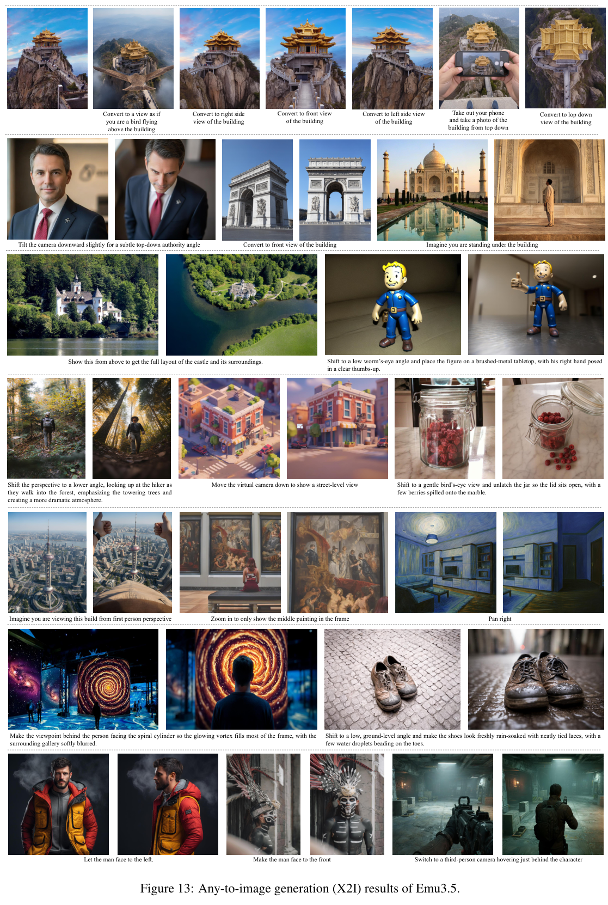

*原论文 Figure 13。先看山顶建筑的多种视角，再看俯视、街景视角与人物朝向等编辑。示例展示可用的语言控制方式，但多个新视角看起来合理并不等于已测得一致的三维结构。*

这些示例的意义是扩展接口。从一张建筑图要求正视、侧视、俯视，或在改变视角的同时改变物体状态，都能使用相同 X2I 输入格式。但没有相机标定、三维 ground truth 或往返一致性测试时，视觉上合理的“新视角”仍可能重新生成了部分结构，不能直接视为准确重建出的可导航三维场景。

### 多参考主体与更广任务集合

OmniContext 包含 400 个样本，涵盖单个人物或物体、多个主体，以及场景和主体组合，使用 GPT-4.1 与原 benchmark 的评分权重。Emu3.5 average=8.82，GPT-4o=8.80，Gemini 2.5 Flash Image=7.84，Qwen-Image-Edit-2509=7.69。两个最高分只差 0.02，细分结果比总体名次更能说明特点。

| OmniContext category | Emu3.5 | GPT-4o |
| --- | ---: | ---: |
| SINGLE — Character | 8.72 | 8.90 |
| SINGLE — Object | 9.46 | 9.01 |
| MULTIPLE — Character | 8.65 | 9.07 |
| MULTIPLE — Object | 9.09 | 8.95 |
| MULTIPLE — Character + Object | 8.78 | 8.54 |
| SCENE — Character | 8.78 | 8.90 |
| SCENE — Object | 8.89 | 8.44 |
| SCENE — Character + Object | 8.15 | 8.60 |

物体相关类别是 Emu3.5 更突出的部分，人物身份和复杂人物场景组合则仍有落后。这个差别与 tokenizer 的人脸重建结果相呼应，但论文没有做因果消融证明前者直接由后者决定，因此更适合作为需要进一步检查的共同短板。

ICE-Bench 用 6538 个样本覆盖 31 个任务，结合美学预测器、MUSIQ、CLIP、Qwen2-VL-72B、DINO、人脸相似度、L1、SSIM 等评分方式。Emu3.5 overall=0.637，高于 Gemini 的 0.631 和 Qwen-Image-Edit-2509 的 0.616；但 face reference generation 为 0.573，低于 Gemini 的 0.617，style reference generation 为 0.522 对 0.596，face swap 为 0.528 对 0.595。控制生成类 Task 23—27 则是 0.662 对 0.624，style reference editing 的 Task 28 为 0.606 对 0.496。[↗](https://arxiv.org/pdf/2510.26583v1#page=24)

因此综合任务覆盖确实较强，具体选择仍取决于任务。还需保留一个输入条件，ICE 的 Task 1 测 Qwen-Image-Edit-2509 时使用空白 1024×1024 图片加文字，因为它本身是编辑接口；这与直接文本生成的输入形式不同。跨模型比较若忽略接口适配，会掩盖评测所做的额外选择。

## 多步输出怎样评价，偏好胜率与任务成功率的区别

单图 benchmark 主要检查一次输入对应一张图，长序列还需要检查步骤、状态和文字之间能否持续一致。论文为四种交错任务使用 ChatGPT 自动比较 Emu3.5 与 Gemini 2.5 Flash Image，得到下面的结果。

| Task | Win (%) | Tie (%) | Lose (%) |
| --- | ---: | ---: | ---: |
| Visual Narrative | 49.2 | 10.3 | 40.5 |
| Visual Guidance | 51.5 | 9.5 | 39.0 |
| World Exploration | 65.5 | 0.0 | 34.5 |
| Embodied Manipulation | 67.1 | 2.4 | 30.5 |

这是相对偏好分布，不能把 67.1% 解释成机器人完成操作的概率，也不能把 65.5% 解释成导航成功率。Visual Narrative 的直接 win 还低于 50%，只是高于 loss；它支持接近且略占优势的比较，而非所有交错任务都大幅超过对照。论文没有完整列出这些偏好实验的 judge 具体版本、交换顺序策略及人类复核一致率，因此较小差值尤其需要谨慎解释。[↗](https://arxiv.org/pdf/2510.26583v1#page=24)

### 故事与教程，共享形式但评价重点不同

Visual Narrative 的自动比较同时考虑视觉、文本与跨模态指标。原图例子覆盖虚构角色故事、历史事件说明、种植过程和图像条件下的续写，体现模型能从同一输入继续生成多段文字与画面。这里最值得观察的是角色外观、叙事阶段与对应图片是否连续，而不是仅凭某张图好看就判断整段故事好。

Visual Guidance 更强调七项要求，即步骤相关性与完整性、指令清晰度、图文对齐、过程连贯性、视觉信息量、任务完成程度和图片质量。这些维度使它比多图叙事更接近过程说明，但“任务完成”仍由生成内容的 judge 评估，没有实际执行教程来检查是否成功。

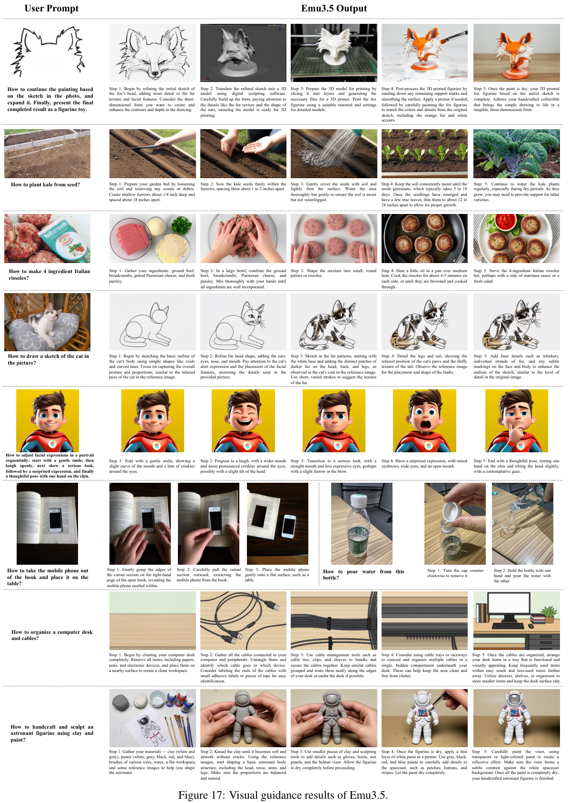

*原论文 Figure 17。狐狸草图到模型、种植、烹饪和物品取放等示例都采用逐步图文输出。应沿一行比较阶段变化与文字对应，不能把每个步骤孤立地看作图像生成样本。*

例如首行从草图细化，到三维模型、打印、上色，再到成品，每个画面承担不同过程节点。这展示了把用户目标分解成可视化步骤的能力，也提示它适合草拟教程、视觉沟通和过程规划。可是画面并未输出可直接制造的 CAD 文件或打印参数，文字中提到的实际工序也没有被机器执行。生成过程的语义完整性，仍需与真实任务的可执行细节区分。

### 世界探索测的是生成的路径与场景是否可信

World Exploration 评测同时包含内部场景和额外收集的分布外场景，覆盖纯文本或图文初始化，以及用户逐步控制和自由探索两种模式。ChatGPT 从八个维度作偏好判断，包括 Path Plausibility、Spatial Consistency、Global Coherence、Environmental Richness、Visual-Text Alignment、Image Quality、Text Quality 与 Task Completion。[↗](https://arxiv.org/pdf/2510.26583v1#page=24)

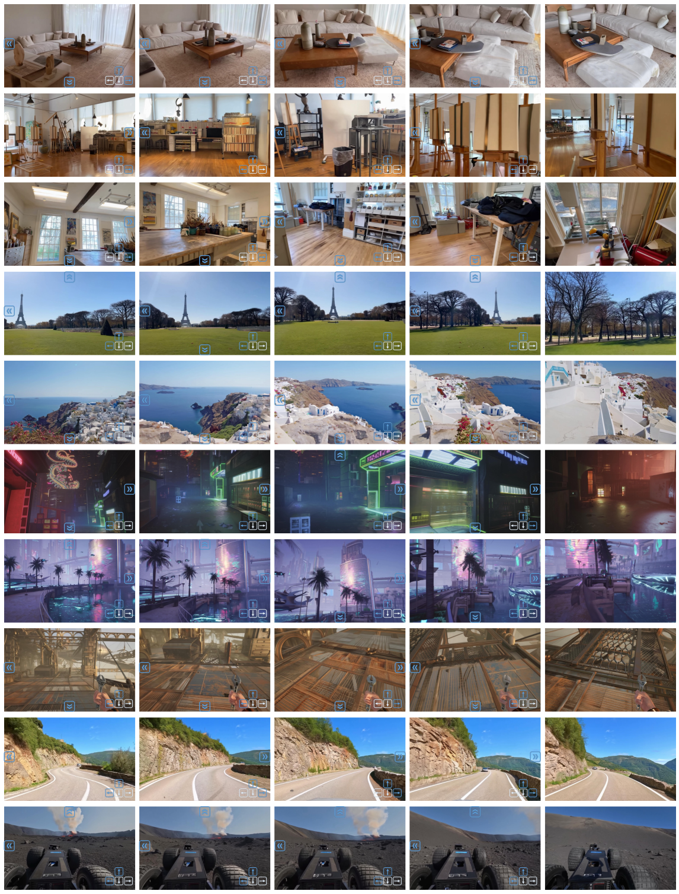{ width="920" }

*原论文 Figure 18。每帧叠加的按键表示从当前帧到下一帧的运动或视角指令。可沿室内、建筑外景、街道和游戏画面分别追踪场景连续性，图示本身并不提供可测量的真实相机轨迹误差。*

图中既有围绕沙发、茶几的局部移动，也有海岸建筑、科幻街道和驾驶视角，说明控制接口可用于多种真实或想象场景。模型需要保留一部分历史布局，同时生成新出现的内容。它很适合用来探索交互式场景生成，但仍缺少坐标级、几何级的长期一致性测量，例如绕一圈回到起点时结构是否相同、连续转向后的相机位置是否闭合。

论文正文分别强调 in-domain 与 OOD 优势，Table 14 却只提供汇总的 win/tie/lose。不能把同一个 65.5% 复制成两个独立分布的胜率，也不能据此推导某个特定游戏或真实场景的成功率。能够得出的直接判断是，在作者构造的混合评测中，生成探索过程更常被自动 judge 偏好。

### 具身操作的评测包含合成初始场景

论文将操作评测集总量写为 331 个样本，同时列出 109 个验证集样本、192 个合成样本和 10 张真实拍摄图片；三项相加为 311，与报告总量存在 20 个样本的差异，原文未解释这一不一致。该评测覆盖五种机器人形态、超过 50 类任务，每条过程为 3—13 步。合成部分使用 Gemini 2.5 Flash Image 改变机械臂起始位置、光照、物体外观、布局、相机视角和背景，以检验从新初始图像继续生成操作过程的能力。[↗](https://arxiv.org/pdf/2510.26583v1#page=25)

Judge 检查 Subtask Skill Clarity、Text-Image Alignment、Task Execution Progress、Image Quality、Background Consistency 和 Physical Law Consistency。这些标准确实比只看单图清晰度更接近操作需求，但其“物理一致性”来自图文内容的自动判断，不能替代动力学仿真、碰撞检查、接触力验证或真实执行。

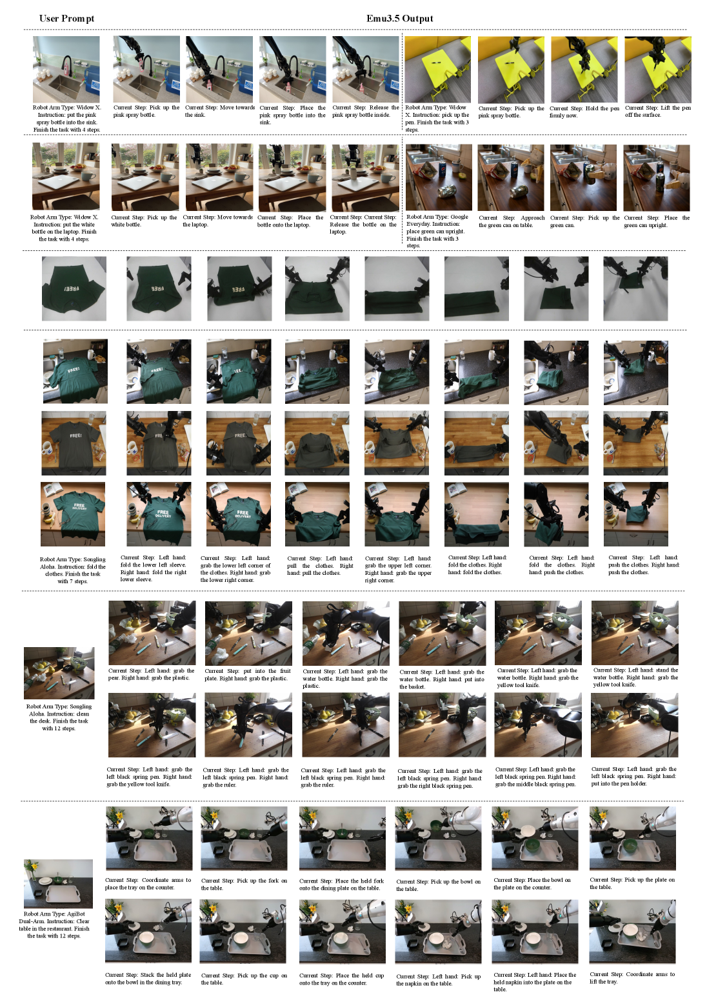{ width="920" }

*原论文 Figure 19。每行从用户给定初始状态开始，随后生成子任务描述和完成关键帧。除第一组衣物折叠参考行外，论文说明这些初始图大多由 Gemini 2.5 Flash Image 构造，应按生成的操作过程解读。*

衣物折叠示例尤其直观。训练中的 T 恤领口朝向桌子较近侧，评测把方向翻转，并改变背景与视角；模型仍尝试按照袖子、衣角等语义部位安排折叠。这支持生成式计划对对象语义布局具有一定适应性，而不只复用固定像素轨迹。

同时，图中还可以看到文字细节不完全可靠。右上角任务要求拿起笔，但其第一步说明仍出现“Pick up the pink spray bottle”的表述，与当前任务不符。这个局部例子不足以估计整体错误率，却足以说明漂亮的连贯图片和自动偏好优势不能保证每一步文字都正确。若要将此类模型用于实际行动，必须逐步检查任务对象、目标状态和可执行动作是否一致。

因此它最直接的能力是生成高层子任务和未来关键状态。要成为具身 agent，还需要 inverse dynamics、动作策略或其他控制接口，并在真实观测反馈下重新规划。论文也将与物理世界交互的 embodied agents 列为后续方向，而非已经由这组关键帧展示完成的结果。

## 怎样使用这篇论文的训练经验

这份报告提供的最完整经验是分层设计。连续视频与转录负责提供时间关系；任务化数据把这种分布能力接到叙事、指导、探索和操作接口；联合 RL 用多维质量反馈调整输出；DiDA 缩短图内串行生成路径；可选 decoder 再改善像素细节和帧间连续性。各层解决不同瓶颈，也带来不同成本，复现或迁移时应分别验证。

若目标是多步视觉说明，最有价值的部分是叙事边界、教程步骤与关键帧的标注流水线，以及从中间状态继续生成的操作样本。若目标是加速离散视觉模型，关键是 DiDA 的 clean/noisy 双路径与严格的历史可见性，不能让当前 noisy target 读取自己的 clean 答案。若目标是高质量文字绘制，则需同时关注 tokenizer 的文本数据、重建能力、主干训练和 OCR 类 reward，不能把最终分数只归因于一个更大的语言模型。

成本也没有因为“统一”消失。512px 图像仍需 1024 个视觉 tokens，context 预算随图片数量快速消耗；即便采用 FlagScale 的 DiDA 配置，表内 1024px 单图仍需约 10 秒，这与高频机器人控制不是同一种延迟要求。视频连续化还依赖另一个 decoder，公开报告的部分数据来自内部渠道，精确复现实验需要的不只是主干权重。

Emu3.5 证明了一条有实际结果支撑的路线，离散 next-token prediction 可以在大规模图文过程数据上建立多任务生成能力，再用较小规模的适配改变视觉生成的计算顺序。它最强的公开证据集中在文字绘制、综合编辑和自动评估下的多步视觉生成；关于长期物理一致性、真实执行与系统实时性，还需要独立的任务验证。把模型当作可以提出和呈现未来状态的组件，才便于继续补齐行动接口与反馈闭环。

## 继续阅读

原生多模态模型的世界学习能力要和[视频表征与记忆](../../vlm/video-representation-and-memory.md)对照；若关心行动和规划，再接[RSSM、Dreamer 与规划](../../world-models/rssm-dreamer-and-planning.md)。
