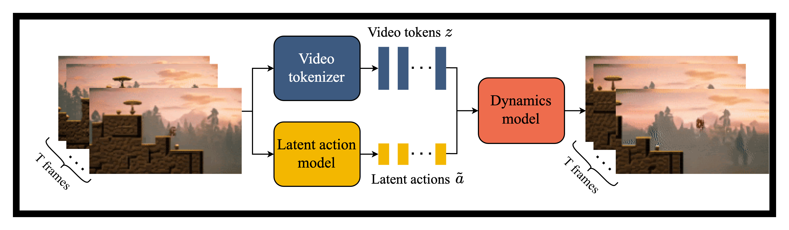
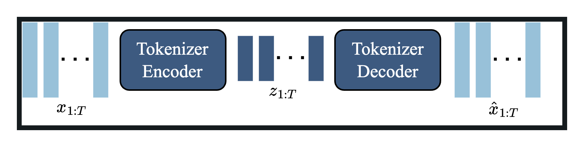
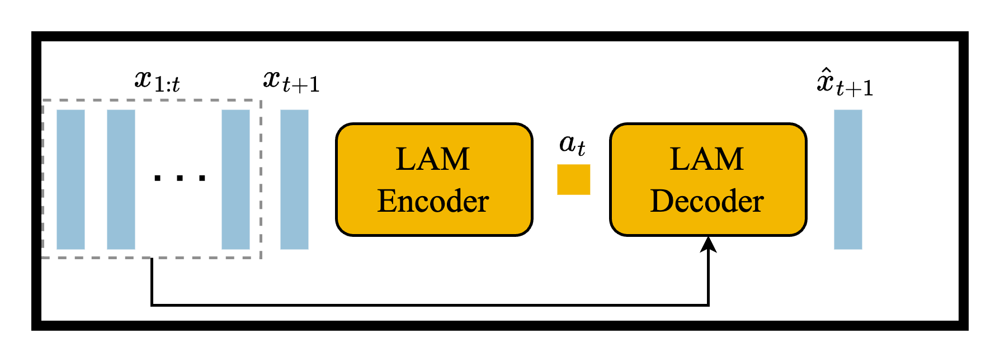
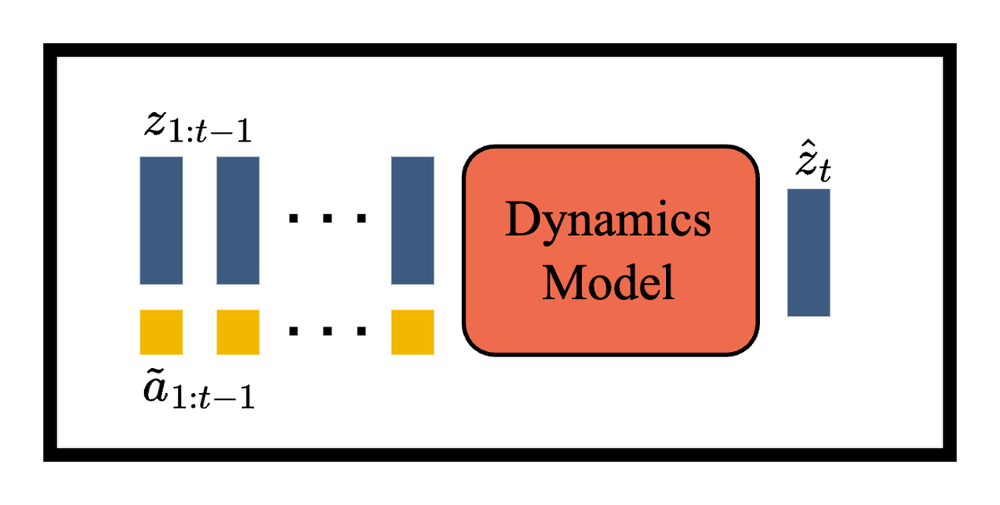
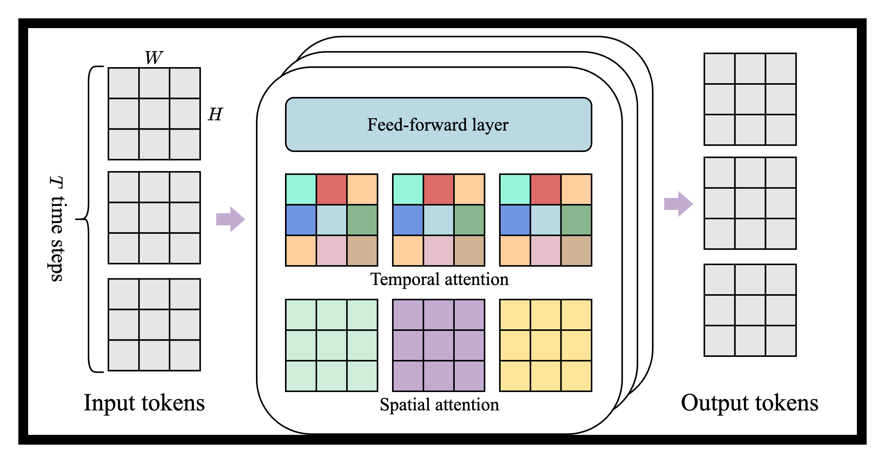
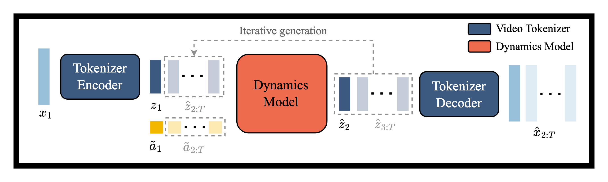
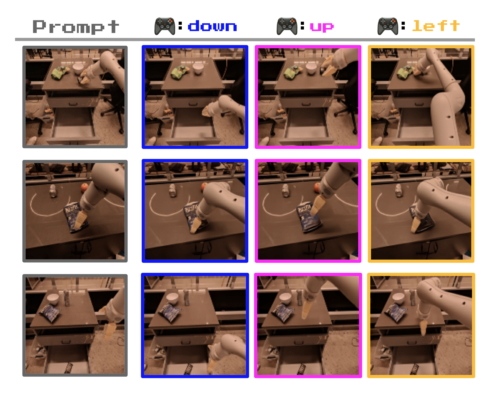

# Genie：没有动作标签，怎样学出可交互环境

!!! info "论文信息"
    **论文题名：** Genie: Generative Interactive Environments。<br>
    **作者：** Jake Bruce、Michael Dennis、Ashley Edwards、Jack Parker-Holder、Yuge Shi、Edward Hughes、Matthew Lai、Aditi Mavalankar、Richie Steigerwald、Chris Apps 等（共 25 人）。<br>
    **机构：** Google DeepMind、University of British Columbia。<br>
    **时间 / 主题：** 2024-02；世界模型。<br>
    **arXiv / 官方报告：** arXiv：[2402.15391](https://arxiv.org/abs/2402.15391)；官方材料：[deepmind.google/research/publications/60474/](https://deepmind.google/research/publications/60474/)。<br>
    **GitHub / 项目：** GitHub：未找到官方链接；项目页：[deepmind.google/research/publications/60474/](https://deepmind.google/research/publications/60474/)。<br>
    **元数据来源与核验口径：** 来源：[arXiv](https://arxiv.org/abs/2402.15391)；[官方 / 项目材料](https://deepmind.google/research/publications/60474/)；Checked Date：2026-06-15；Repro Status：Paper / official materials reviewed, independent reproduction not claimed。

## 原论文故事线

### 研究背景

Genie 处在视频生成模型和世界模型的交叉点上。普通视频模型可以根据文本、图像或过去帧生成合理未来，但通常只做到 video-level control；传统 world model 可以根据动作预测未来，但训练往往需要 action labels。互联网上有海量游戏视频、机器人视频和第一视角视频，却大多没有逐帧动作标注。Genie 的问题正是：能不能从无标签视频里学出可交互环境。

论文把这种模型称为 generative interactive environment。它不是只生成一段固定视频，而是要让用户或 agent 每一步选择一个 latent action，然后模型生成对应下一帧。这样，一个草图、照片或文本生成的初始场景可以被“走进去”交互。

### 问题（Challenge）

论文要解决的问题是：**没有真实动作标签时，如何从 Internet videos 中学出 frame-level controllability？** 难点在于视频里只观察到状态变化，不知道导致变化的动作。如果模型只学 \(p(x_{t+1}\mid x_{\le t})\)，它会续写最可能未来，却不能被控制；如果动作 latent 太自由，它可能只是把未来帧信息偷塞进 action code，不能形成可探索的动作空间。

这个问题的价值很大：真实世界和游戏世界的视频数据远多于带动作标签的交互数据。如果 latent action 可以从视频变化中无监督发现，就能把大量公开视频转化为可交互世界模型训练信号。

### Finding

作者的 finding 是：**动作可以先作为解释相邻帧变化的离散潜变量被发现出来；只要这个 latent action bottleneck 足够受限，模型就会把可控变化压缩成类似手柄输入的 action codes。** 这个洞见把“没有动作标签”从硬性缺口变成了表示学习问题。

这个 finding 解释了 Genie 的 Latent Action Model。LAM encoder 可以看到过去帧和下一帧，推断发生了什么变化；但 decoder 只能通过离散 action code 和历史帧重建下一帧。这个瓶颈迫使 action code 表示可复用的变化因素。随后 dynamics model 用历史 video tokens 和 latent actions 预测未来 tokens，就可以在推理时让人选择 action code 来控制环境。

### 方法

Genie 有三个主要组件。第一是 video tokenizer，用带 spatiotemporal Transformer 的 VQ-VAE 将视频压成离散 video tokens，保留空间和时间结构。第二是 Latent Action Model，从相邻帧变化中推断离散 latent action；主实验中使用较小 action codebook，以获得可探索控制。第三是 autoregressive dynamics model，输入历史 video tokens 和 latent actions，预测下一帧 video tokens，再由 tokenizer decoder 还原成图像帧。

训练数据主要是公开 Internet gameplay videos。论文构建了大规模游戏视频数据，按 clip 训练 tokenizer、LAM 和 dynamics model。推理时，模型可以从文本、合成图像、照片或草图等 prompt 得到初始帧，再反复接受 latent action 输入，逐帧生成可玩的环境。论文还探索把学到的 latent action 用于 unseen videos 的行为模仿，说明 latent action space 可作为低层控制接口。

### 结论

实验显示，Genie 可以从无动作标签视频中生成可控、可交互的 2D 游戏式环境，并且模型规模扩大后视频 fidelity 和 controllability 变好。论文通过 FVD、动作影响度、tokenizer/dynamics 消融和定性例子评估模型；ST-tokenizer 相比仅空间 tokenizer 更能保留时序动态，latent actions 对未来帧有可测影响。它还展示从草图、照片和生成图像初始化环境并交互的结果。

边界也要说清楚：Genie 的动作是 latent action，不等同于真实游戏引擎或机器人控制命令；生成环境仍可能漂移，也没有真实物理约束或 reward。论文的贡献是证明“无标签视频 -> latent actions -> controllable world model”这条路线可行，而不是证明已解决开放世界真实交互。

### 关键术语

- **Generative Interactive Environment（生成式交互环境）**：可以根据用户逐步输入生成下一状态的环境模型，不只是一次性生成视频。
- **Latent Action Model, LAM（潜在动作模型）**：从相邻帧变化中无监督推断离散动作 code 的模块。
- **Video Tokenizer（视频分词器）**：把连续视频帧压缩成离散 tokens，作为 dynamics model 的状态空间。
- **Spatiotemporal Transformer（时空 Transformer）**：同时建模空间 token 和时间 token 的 Transformer，用于视频 tokenizer 和 dynamics。
- **Controllability（可控性）**：用户改变 action code 时，未来生成帧能产生稳定且可解释变化的能力。
- **Foundation World Model（基础世界模型）**：论文对 11B Genie 的定位，指可从多种 prompt 生成并交互的通用环境模型底座。

> **这篇回答的问题。** 如何理解“Genie”背后的核心机制、适用边界和下一步阅读路径。

Genie 最值得读的地方不是画质，而是问题设定：**只有互联网视频，没有动作标签，模型却要学出可以逐帧控制的环境。** 这让它和普通视频生成模型、Dreamer 式世界模型都不一样。

普通视频模型通常学：

\[
p(x_{t+1:T}\mid x_{\le t}, c)
\]

这里 \(x_{\le t}\) 是过去帧，\(c\) 是文本或其他条件。公式读法是：给定过去和条件，生成一个合理未来。世界模型用于交互时还要学：

\[
p(x_{t+1:T}\mid x_{\le t}, a_{t:T-1})
\]

这里 \(a_t\) 是动作。未来必须随动作改变，否则模型只能“续写视频”，不能被用户或 agent 控制。Genie 的困难在于训练数据没有真实 \(a_t\)，所以它引入离散潜在动作 \(\tilde a_t\)：先从相邻帧变化中反推出一套 action codes，再用这些 codes 驱动未来帧生成。

## 论文的核心位置

Genie 论文把模型类别分成三类：

| Model class | Training data | Controllability |
| --- | --- | --- |
| World models | Video + actions | Frame-level |
| Video models | Video + text | Video-level |
| Genie | Video | Frame-level |

<small>表源：[Genie: Generative Interactive Environments](https://arxiv.org/abs/2402.15391)，Table 1。原表表达：传统 world model 依赖视频和动作，video model 通常只做到视频级控制；Genie 的主张是只用 video data 学出 frame-level latent action control。本站读法：这张表不是说 Genie 已经是完整机器人世界模型，而是说它把“动作标签缺失”这个瓶颈单独拿出来解决。</small>

所以读 Genie 时要抓住一句话：**动作可以先作为解释状态变化的潜变量被学出来。** 如果这组 latent action 在不同场景里都能稳定表示“左、右、跳、下压、上移”这类变化，它就像一套从视频里学出来的新手柄。

{ width="920" }

<small>图源：[Genie](https://arxiv.org/abs/2402.15391)，Figure 2。原图表达：视频帧经 tokenizer 变成离散 video tokens；latent action model 从相邻帧推断 latent actions；dynamics model 用历史 tokens 和 latent actions 预测未来 tokens。本站读法：蓝线负责“把视频变成状态”，黄线负责“从变化里找动作”，橙色模块负责“动作条件下预测下一帧”。</small>

## 三个组件各自解决什么

Genie 不是一个单块视频模型，而是三个组件串起来。

| 组件 | 输入 | 输出 | 它解决的问题 |
| --- | --- | --- | --- |
| Video tokenizer | 原始视频帧 \(x_{1:T}\) | 离散 video tokens \(z_{1:T}\) | 把高维像素压成可预测状态 |
| Latent Action Model | 历史帧和下一帧 | 离散 latent action \(\tilde a_t\) | 从无动作视频里发现“发生了什么变化” |
| Dynamics model | 历史 tokens 和 latent actions | 未来 frame tokens | 学动作条件下的未来演化 |

Video tokenizer 的关系可以写成：

\[
x_{1:T}\rightarrow z_{1:T}
\]

这里 \(z_t\) 不是语义标签，而是离散视觉状态。Genie 使用带 ST-transformer 的 VQ-VAE 风格 tokenizer，重点不是把每帧压得最漂亮，而是给 dynamics model 一个稳定、可预测、能保留时序信息的状态空间。

{ width="820" }

<small>图源：[Genie](https://arxiv.org/abs/2402.15391)，Figure 5。原图表达：带 ST-transformer 的 video tokenizer 把视频编码到离散 codebook，再由 decoder 还原。本站读法：tokenizer 是世界模型的状态接口，状态压缩得太粗会伤 dynamics，状态太细又会让未来预测成本过高。</small>

Latent Action Model 是论文的核心。它的 encoder 可以看到 \(x_{1:t}\) 和 \(x_{t+1}\)，推断连续 latent action；VQ codebook 把它离散成少量 action codes；decoder 只能看历史帧和这个 latent action 来重建下一帧。这个限制迫使 action code 携带“从过去到未来发生了什么变化”。

{ width="860" }

<small>图源：[Genie](https://arxiv.org/abs/2402.15391)，Figure 4。原图表达：LAM encoder 从相邻帧推断 latent action，经 VQ codebook 离散化；decoder 用历史帧和 latent action 预测下一帧。本站读法：LAM 不是最终控制器，它是训练阶段的“动作发现器”。</small>

主实验里 LAM 使用 8 个 latent actions。这个数字小很重要：action codebook 太大，重建可能更容易，但人或 agent 很难探索；codebook 太小，动作表达又不够。Genie 的 8-action 设置是在重建能力和可交互性之间取折中。

Dynamics model 的训练目标是预测未来 video tokens：

\[
\mathcal L_{\text{dyn}}
=
\operatorname{CE}\left(\hat z_{2:T}, z_{2:T}\right)
\]

这里 \(\hat z_{2:T}\) 是模型预测的未来 tokens，\(z_{2:T}\) 是 tokenizer 给出的真实未来 tokens，CE 是 token-level cross entropy。公式读法是：给定过去状态和 latent actions，下一帧 token 预测得越准，loss 越小。训练时随机 mask future tokens，并用 MaskGIT 风格逐步补全；推理时，用户选择 latent action，模型一步步生成下一帧。

{ width="820" }

<small>图源：[Genie](https://arxiv.org/abs/2402.15391)，Figure 6。原图表达：dynamics model 接收 video tokens 和 action embeddings，预测 masked future video tokens。本站读法：这一步才把 latent action 变成可操作的未来预测。</small>

## 为什么用 ST-transformer

视频 token 数是 \(T\times H\times W\)。如果对所有时空 token 做全局 self-attention，计算量会很快爆炸。Genie 的 ST-transformer 把注意力拆成两部分：同一帧内做 spatial attention，相同空间位置跨帧做 temporal attention。

{ width="860" }

<small>图源：[Genie](https://arxiv.org/abs/2402.15391)，Figure 3。原图表达：spatiotemporal block 由 spatial attention、temporal attention 和 feed-forward layer 组成。本站读法：spatial attention 看懂单帧结构，temporal attention 保留运动方向；这比纯空间 tokenizer 更适合后续动作条件预测。</small>

这个设计的意义是：世界模型既要知道单帧里角色、平台、障碍物、机械臂的位置，也要知道它们怎样随时间移动。Genie 还让 temporal layer 使用 causal mask，使每个编码只汇聚过去信息，更贴近交互式 rollout 的因果顺序。

## 推理时像按一个新手柄

推理流程可以读成一个闭环：

```text
初始图像 x_1
  -> tokenizer encoder 得到 z_1
  -> 用户选择 latent action
  -> dynamics model 预测下一帧 token
  -> tokenizer decoder 解码成下一帧
  -> 新帧进入下一轮
```

{ width="920" }

<small>图源：[Genie](https://arxiv.org/abs/2402.15391)，Figure 7。原图表达：prompt frame 被编码成 token，用户输入 latent action，dynamics model 迭代预测下一帧 token，再由 tokenizer decoder 解码回图像。本站读法：交互性来自“每一步都能换 latent action”，不是一次性生成整段视频。</small>

一开始用户并不知道 action 0 到 7 分别是什么。像玩一个新手柄一样，试几次后会发现某些 code 在多种场景里稳定对应左移、右移、跳跃、停止或机械臂上下移动。这个性质才是 Genie 与普通 video continuation 的分界。

## 数据质量为什么是关键

Genie 的 Platformer 数据来自公开视频，先用关键词抓取 55M clips，约 244k 小时；再经过 learned filtering 得到 6.8M clips，超过 30k 小时。论文用 10k 手工标注视频训练一个小分类器筛掉菜单、主播、剪辑、非玩法等低质量内容。Table 4 显示，筛选后数据更少，但 FVD 更好：原始 55M videos 为 61.4，curated 6.8M videos 为 54.8。

这里的启发很强：交互世界模型需要的是清晰的状态变化，不只是好看的画面。如果视频里大量混入菜单、剪辑、静态图、无关人脸，LAM 会把“画面变化来源”学乱，latent action 就不稳定。

## 怎样评估“可控”

只看 FVD 不够，因为 FVD 主要看视频分布质量。Genie 还用了 \(\Delta_t\mathrm{PSNR}\) 来检查 latent action 是否影响未来：

\[
\Delta_t \mathrm{PSNR}
=
\mathrm{PSNR}(x_t,\hat x_t)
-
\mathrm{PSNR}(x_t,\hat x'_t)
\]

这里 \(\hat x_t\) 是使用从真实视频推断出的 latent actions 生成的帧，\(\hat x'_t\) 是使用随机 latent actions 生成的帧。读这个公式时，重点是比较：如果 inferred action 生成的帧更接近真实帧，而随机 action 明显偏离，说明 action 对未来有作用。

但这个指标仍然有限。它能说明“换 action 会影响短期未来”，不能证明 action 语义完全正确，也不能证明长时 rollout 稳定，更不能证明它可用于真实机器人安全规划。

{ width="900" }

<small>图源：[Genie](https://arxiv.org/abs/2402.15391)，Figure 12。原图表达：Robotics 数据上，同一 latent action 在不同起始帧里产生相似方向变化，例如 down、up、left。本站读法：按列看 action code 是否有一致语义；注意这仍是视频 latent action，不等价于真实机器人控制器动作。</small>

Robotics 结果说明 Genie 不只是在 2D 平台游戏里移动贴图。论文把 RT-1、仿真数据和真实 robot episodes 当作视频使用，不用动作标签，仍能学出某些机械臂方向语义。这是它对具身世界模型最有价值的一点。

## 对 agent 的意义：imitation from observation

Genie 还展示了一个 proof of concept：用冻结 LAM 给没有动作标签的专家视频打 latent action 标签，再训练 policy 预测 latent actions；最后用少量真实动作标签把 latent action 映射到环境动作。

```text
expert video without actions
  -> frozen LAM labels latent actions
  -> train policy pi(latent_action | observation)
  -> small action-labeled set maps latent actions to real actions
  -> execute in environment
```

这个实验说明 latent action 不只是给人玩 demo 的按钮，也可能成为 imitation-from-observation 的中间表示。它还没有证明所有环境都能靠少量标签完成动作映射，但证明了“无动作视频”可以变成一种可训练的行为数据。

## 边界

Genie 的边界要说清楚。

第一，它只有短上下文。主模型使用 16 frames、10 FPS，大约 1.6 秒记忆，远不够长时地图、一致物理状态和长期任务规划。

第二，它很慢。论文报告约 1 FPS，并且每帧需要多步 MaskGIT sampling，所以它更像研究原型，而不是实时游戏引擎或机器人闭环控制器。

第三，latent action 不是 grounded real action。平台游戏里可以人工解释成左、右、跳；复杂机器人、多关节控制和自动驾驶里，latent-to-real mapping 会更难。

第四，评测仍偏短期和 open-loop。FVD、\(\Delta_t\mathrm{PSNR}\)、定性图和 CoinRun proof of concept 很有价值，但距离“用世界模型提升真实策略收益”还有明显距离。

## 证据链快照

| 论文主张 | 主要证据 | 读数边界 |
| --- | --- | --- |
| 无动作标签视频可以学出 latent action | latent action model、robotics latent actions 图 | latent action 不是真实机器人控制量 |
| action-conditioned dynamics 支持交互 | ST-transformer、interactive demo、CoinRun proof | 主要是短期像素/游戏交互证据 |
| 数据质量决定可控性 | 数据过滤、视频 tokenization、定性样例 | 视频分布偏差会直接影响 learned environment |
| 世界模型可做 imitation from observation | 从公开视频学可交互环境 | 还没证明真实策略收益或长时规划 |

## 外部精读

- [Genie 论文](https://arxiv.org/abs/2402.15391)：看完整架构、训练细节和消融。
- [Google DeepMind publication page](https://deepmind.google/research/publications/60474/)：官方定位和项目入口。
- [Genie project page](https://sites.google.com/view/genie-2024/)：看交互 demo 和 qualitative examples。
- [Genie 2 blog](https://deepmind.google/discover/blog/genie-2-a-large-scale-foundation-world-model/)：对比后来 3D foundation world model 的方向变化。

## 阅读结论

Genie 的核心贡献是把“没有动作标签的视频”变成“有 latent action 接口的可交互环境”。它的训练范式可以概括为：

```text
unlabelled videos
  -> discover discrete latent actions
  -> train action-conditioned video token dynamics
  -> expose latent action interface for humans / agents
```

如果你在做游戏、机器人或视频世界模型，而手里有大量无动作视频，Genie 是必须读的一篇。它提醒我们：动作不一定一开始就来自真实控制器，也可以先作为解释相邻状态变化的离散潜变量被学出来；真正部署时，再把这套潜在动作接口接到真实动作、策略、规划器或交互 UI。

## 相关阅读与下一步

- 外部材料：[论文标题 arXiv 检索](https://arxiv.org/search/?query=Genie%3A+Generative+Interactive+Environments&searchtype=title)。
- 外部材料：[Semantic Scholar 标题检索](https://www.semanticscholar.org/search?q=Genie%3A+Generative+Interactive+Environments)。
- 外部材料：[Papers with Code 检索](https://paperswithcode.com/search?q=Genie%3A+Generative+Interactive+Environments)。
- 站内下一步：[论文精读专题](../index.md)。
