# Genie：没有动作标签，怎样学出可交互环境

!!! info "论文信息"
    **论文题名：** Genie: Generative Interactive Environments。 
    **作者：** Jake Bruce、Michael Dennis、Ashley Edwards、Jack Parker-Holder、Yuge Shi、Edward Hughes、Matthew Lai、Aditi Mavalankar、Richie Steigerwald、Chris Apps 等（共 25 人）。 
    **机构：** Google DeepMind、University of British Columbia。 
    **时间 / 主题：** 2024-02；世界模型。 
    **arXiv / 官方报告：** arXiv：[2402.15391](https://arxiv.org/abs/2402.15391)；官方材料：[deepmind.google/research/publications/60474/](https://deepmind.google/research/publications/60474/)。 
    **GitHub / 项目：** GitHub：未找到官方链接；项目页：[deepmind.google/research/publications/60474/](https://deepmind.google/research/publications/60474/)。 
    **元数据来源与核验口径：** 来源：[arXiv](https://arxiv.org/abs/2402.15391)；[官方 / 项目材料](https://deepmind.google/research/publications/60474/)；Checked Date：2026-06-15；Repro Status：Paper / official materials reviewed, independent reproduction not claimed。

## 视频能学会变化，还能学会把变化交给人控制吗

Genie 把一个通常附着在数据上的条件，变成了需要从数据中学习的对象。传统动作条件世界模型拿到的是“画面、动作、下一幅画面”，可以直接训练某个动作之后会发生什么。互联网游戏录像只留下画面，玩家按过哪个键、按了多久、怎样组合按键，通常已经丢失。直接预测视频仍然可行，但模型很可能只会继续播放某条看起来合理的轨迹。用户在中途选择另一个动作时，系统还需要一个能改变未来的接口。

这篇论文的核心办法，是在训练时把帧间变化压进一个非常小的离散码本，再要求视频模型根据这个码生成未来。这样，动作可以先由录像反推出来；到了交互阶段，人直接选择码本中的一项，就接替了训练时的动作推断器。Genie 的主要贡献因此包含两个相互依赖的部分。一部分是从没有真实动作标签的视频中学习控制接口，另一部分是把这个接口与能扩展到约 11B 参数的视频生成模型连接起来。[↗](https://arxiv.org/pdf/2402.15391v1#page=3)

这里的“环境”有一个具体含义。模型接收当前视觉历史和用户选择的动作，生成下一帧，随后允许用户再次输入动作。环境状态主要保存在生成的视觉 token 与有限历史中；论文没有为它提供一套可查询的物体状态、碰撞引擎、奖励函数或任务规则。它能让一幅图像变成可以逐帧操纵的视觉过程，是否遵守稳定的游戏规则、是否适合训练高可靠控制器，还需要分别检验。

主实验使用互联网 2D 平台游戏录像。机器人部分则重新训练一个独立模型，检查同一种动作学习方法能否跨数据领域成立。另一个 CoinRun 实验把学到的动作表示用于模仿学习，进一步测试这种表示能否帮助真实仿真环境中的策略执行。三个实验共享技术思想，承担的证据作用并不相同。

## 两种压缩共同搭起生成环境

理解 Genie，先区分它要压缩的两种信息。视频 tokenizer 压缩“到目前为止看到了什么”，latent action model 压缩“下一步发生了哪一种变化”。前者需要保留丰富的场景内容，后者故意只允许极少的选择。Dynamics model 再把视觉状态和动作连接起来，学习有条件地推进视频。

下面的训练图可以沿两条支路阅读。同一段视频向上进入 tokenizer，变成大量视觉 token；向下进入动作模型，变成每个帧间转换对应的少量动作信息。二者在右侧汇合，决定下一帧的预测。这里最重要的结构约束，是视觉内容与变化代码没有使用同样的容量。

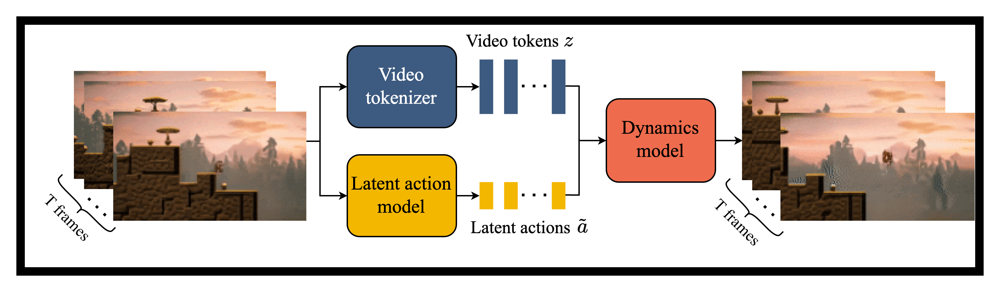{ width="920" }

*原论文 Figure 3。上方支路学习离散视觉表示，下方支路从相邻时刻推断 latent actions，dynamics 根据历史视觉 token 与动作预测后续画面。*

| Component | Training input | Training target | Role during interaction |
| --- | --- | --- | --- |
| Video tokenizer | Video frames | Reconstruct video frames | Encode prompt frames; decode predicted tokens |
| Latent action model | Past frames and next frame | Reconstruct next frame through a small action codebook | Keep only the action codebook |
| Dynamics model | Past video tokens and action embeddings | Predict next-frame video tokens | Generate the next frame conditioned on user actions |

训练分两阶段进行。第一阶段先训练视频 tokenizer。第二阶段使用固定的视觉编码，把 LAM 与 dynamics 一起训练，LAM 直接读像素，dynamics 读视觉 token。论文明确写出 dynamics 接收的是经过 stop-gradient 的动作 embedding。这意味着“一起训练”不应理解为 dynamics 的预测损失沿动作路径端到端塑造 LAM；LAM 仍主要依靠自己的下一帧重建任务学习动作瓶颈。[↗](https://arxiv.org/pdf/2402.15391v1#page=5)

这一分工有实际意义。如果只让动作表示服务于大视频模型，它可能学成一个难以解释的辅助条件，或者被生成器忽略。独立的 LAM 重建任务先建立“历史加一个短代码足以解释未来变化”的约束，dynamics 再学习怎样利用这个代码生成更高质量的画面。不过，这种设计提供的是一个可用的学习偏置，并没有从理论上保证代码必然对应玩家的真实按键。

## 一个只有八项的码本，怎样从未来帧中提取动作

### 训练时先看见结果，再提炼造成差异的短代码

设历史帧为 $x_{1:t}$，下一帧为 $x_{t+1}$。LAM encoder 可以同时看到这两部分，输出连续动作表示；它经过向量量化后，落到一个离散动作码上。LAM decoder 只能接收历史与量化后的动作，不能直接读取下一帧。它的任务是重建 $x_{t+1}$。

用下面的示意记号可以把训练接口写清楚。这是对原文信息流的整理，$E_A$、$Q_A$ 和 $D_A$ 分别表示动作编码、动作量化和动作解码，$e_{a_t}$ 是码本中第 $a_t$ 项的 embedding。

$$
\widetilde a_t=E_A(x_{1:t+1}),\qquad
 a_t=Q_A(\widetilde a_t),\qquad
 \widehat x_{t+1}=D_A(x_{1:t},e_{a_t}).
$$

图中右侧 decoder 的两条输入尤其关键。较长的下方连线传递已知历史，黄色短代码传递关于未来变化的补充信息。未来帧进入 encoder，却没有一条直接通往 decoder 的旁路。训练由 VQ-VAE 式的重建与量化目标驱动，论文没有展开各项损失权重，理解其效果时应抓住这个可见的信息瓶颈。[↗](https://arxiv.org/pdf/2402.15391v1#page=3)

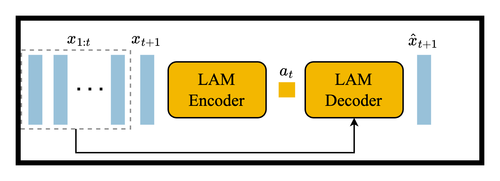{ width="860" }

*原论文 Figure 5。encoder 观察历史与未来帧；decoder 只能根据历史和动作码重建未来。动作模型的 decoder 用于提供训练信号。*

主模型的动作码本只有 8 项，每项 embedding 的维度为 32。32 维是代码被查表后如何表达的内部空间，用户能够选择的仍然只有 8 种离散输入。若只计算单步离散索引的信息容量，$log_2 8=3$ bit。这是根据码本大小得到的解释性计算，它说明动作通道不可能逐像素转移一整张未来画面。

于是，重建器必须从历史中获得静态外观、场景布局与已有运动趋势，把有限的动作容量用于解释那些仍然不确定的重要变化。在平台游戏中，角色继续向左、向右、起跳或不动，是适合反复使用的变化模式；把这些模式编码成少量代码，能够同时帮助许多视频片段的重建。这就是跨场景动作语义可能出现的原因。

但“重要变化”与“真实控制动作”之间还有距离。录像中的敌人运动、镜头变化、随机事件也会影响下一帧。小码本限制了信息量，却没有告诉模型哪些变化来自玩家、哪些来自环境。Genie 学到的更准确说法是可供控制使用的 latent actions，论文用后续的一致性演示与迁移实验检查其用途，没有证明隐变量已经唯一恢复了真实游戏按键。

### Causal attention 与训练时看下一帧并不矛盾

LAM 使用 causal temporal attention，但动作 $a_t$ 正是通过包含 $x_{t+1}$ 的视频前缀推断出来的。这里的“因果”约束，是每个位置不能访问更晚的帧；它没有把动作推断改成只看 $x_t$ 的预测。训练时要先观察一段转换，才能判断这段转换属于哪种变化类型。

真正生成下一帧时，系统不会要求一个尚未发生的 $x_{t+1}$。LAM encoder 和 decoder 都被移除，用户输入一个整数 $a_t\in\{0,\ldots,7\}$，系统查表得到 $e_{a_t}$，直接交给 dynamics。因此，训练时使用未来帧是在为视频建立伪动作标签；交互时由用户提供动作，接口被自然替换。[↗](https://arxiv.org/pdf/2402.15391v1#page=5)

动作名也没有在训练前写入码本。某个索引后来可以被理解为“向左”，是因为它在多个输入下产生了相近行为。用户第一次玩时需要探索这些代码，类似熟悉一个新控制器。作者也讨论了码本容量的折中，更多动作有助于表达视频变化，但会降低人工操作的直观性；论文没有给出足以确定普遍最优动作数的完整定量比较。

### 一致性要跨初始画面看

Figure 17 将四个不同起始画面放在行上，将同一动作放在列上。每个结果都连续执行相应 latent action 五次。先纵向比较蓝色、粉色和黄色列，可以看到作者标注为 left、right、jump 的代码在不同关卡外观下保留了相近含义；再横向比较同一行，可以看到选择不同代码确实改变了轨迹。

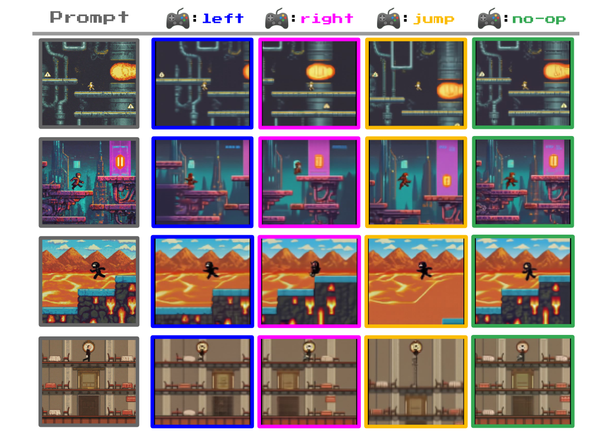

*原论文 Figure 17。四个初始状态分别重复执行同一 latent action 五次。left、right、jump 和 no-op 是学成后用于解释行为的语义标签。*

这张图比“一个角色在动”提供了更多信息，因为它同时改变初始场景、保持动作索引，检查代码能否跨状态复用。不过，它仍是选取示例的可视化，没有提供每个代码在全部关卡上的语义混淆矩阵。后面的 CoinRun 映射实验会用一个更严格的接口，进一步检验这种一致性是否有实际价值。

## 视频 tokenizer 保留历史，ST-transformer 控制计算成本

### 同一帧的表示可以包含前面发生过的事

Genie 的视觉 tokenizer 也是 VQ-VAE，但它编码的单位是因果视频序列。与逐帧独立压缩相比，当前视觉表示 $z_t$ 可以利用 $x_{1:t}$ 的历史。例如两帧中的角色外观相近，但此前运动方向不同，时间信息可能帮助保留对未来预测有用的差异。Encoder 与 decoder 都使用时空结构，让编码和重建过程利用过去帧。

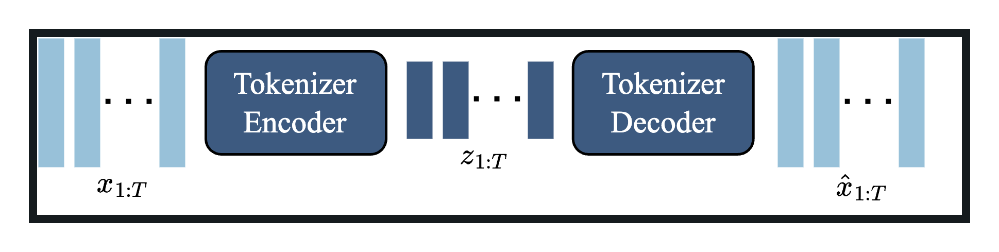{ width="820" }

*原论文 Figure 6。视频编码器产生离散 token，视频解码器重建帧序列。时间注意力具有因果约束，当前 token 不读取尚未出现的帧。*

这一约束对于交互很重要。训练时如果 $z_t$ 偷看未来，dynamics 可能从当前 token 中间接拿到下一帧信息；交互时只有过去画面，训练与部署接口就会不一致。Genie 的 causal tokenizer 使“已经看到的画面”与“将要生成的画面”保持明确边界。

主模型使用 1,024 项视觉码本、32 维码本 embedding 和 patch size 4。它与动作码本共享向量量化思想，但用途、容量和粒度完全不同。视觉 token 用来保留一帧内众多位置的内容，动作码用来区分相邻帧之间的一次变化。把这两类离散表示混在一起，就很容易误解模型为什么既需要大型视频表示，又需要一个极小动作集合。

### 空间与时间分别做 attention

视频的 token 数随时间和空间同时增长。如果把 $T$ 帧、每帧 $N$ 个空间位置直接展平，完整 attention 的配对数会达到 $O(T^2N^2)$。Genie 在所有组件中采用 ST-transformer，每个 block 先在一帧内部做空间 attention，再沿相同空间位置做时间 attention，最后通过一个前馈层。

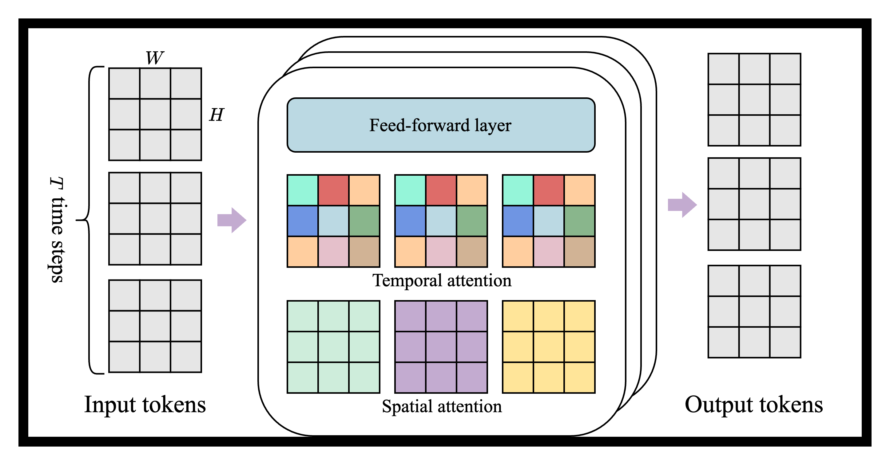{ width="860" }

*原论文 Figure 4。相同颜色表示一个注意力范围。空间层连接同一帧的各位置，时间层连接不同帧的同一位置，随后使用共享于该 block 的一个 FFN。*

根据这种连接方式，可以写出注意力配对数量的示意比较。它只用于说明架构的计算来源，不是论文给出的完整 FLOPs 公式，投影层、FFN、隐藏维度等成本没有包含在内。

$$
\text{Full attention}: O(T^2N^2),\qquad
\text{Factorized ST attention}: O(TN^2+NT^2).
$$

第一项来自每帧内部的空间配对，第二项来自每个位置沿时间的配对。当空间项主导时，增加帧数只会让主导成本近似线性增长。论文据此解释视频扩展的效率优势，但时间 attention 本身仍然带有 $T^2$ 项，不能把结论简化成“视频长度增加没有二次成本”。

单个时间层只连接同一空间位置，也不等于模型无法跟踪跨位置运动。前面的空间层已经在帧内混合信息，随后时间层传播这些表示，多层交替能够逐步连接空间与时间变化。作者还省去空间 attention 后单独的 FFN，只在空间与时间层之后保留一个 FFN，将省出的容量分配给其他模型部分。这个结构选择同时服务于视觉 tokenizer、LAM 与 dynamics，使整个系统可以沿同一种计算框架扩大规模。[↗](https://arxiv.org/pdf/2402.15391v1#page=3)

## Dynamics 怎样把动作变成下一帧

### 时间上逐帧生成，帧内使用 MaskGIT

Dynamics 是 decoder-only MaskGIT transformer。给定已经生成或观察到的视觉 token，以及相应动作 embedding，它预测下一帧的视觉 token。这里有两个不同的生成顺序。沿时间轴，模型先生成下一帧，再把它加入历史；在一帧内部，MaskGIT 通过多轮迭代处理一组被遮蔽的 token，而不必严格逐个空间位置顺序生成。

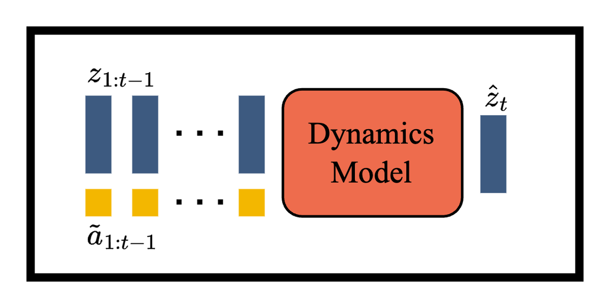{ width="820" }

*原论文 Figure 7。蓝色表示视觉历史，黄色表示动作条件，输出为目标帧的 token 预测。时间上的自回归与帧内的迭代生成是两个层次。*

训练时，模型对 $z_{2:T}$ 的预测与真实视觉 token 计算 cross-entropy。原文还说明，会对输入中的 $z_{2:T-1}$ 随机遮蔽，Bernoulli masking rate 从 $[0.5,1]$ 均匀采样。它让模型在不完整的视觉 token 条件下学习补全，而不是只适应一个固定的遮蔽比例。论文没有在正文展开每种 mask 下的损失位置选择，因此不应仅凭 MaskGIT 名称补出一套未经说明的训练细节。[↗](https://arxiv.org/pdf/2402.15391v1#page=5)

动作 embedding 采用相加方式注入 LAM 与 dynamics。作者报告，相较于把动作作为一个单独 token 拼到对应帧后面，这样做能提高 controllability。一个直观解释是，动作可以直接影响相关的视觉表示，模型不必先学会从一个稀疏动作位置读取控制信息；这是对设计的理解，原文没有给出该比较的独立数值表。

推理时，每生成一帧执行 25 个 MaskGIT steps，采样 temperature 为 2。这里的 25 次是每帧内部的迭代次数，不是一次交互向前预测 25 帧。主模型训练使用 bfloat16 与 QK normalization，后者用于提高大模型训练稳定性。[↗](https://arxiv.org/pdf/2402.15391v1#page=6)

### 用户每次只需给一个动作

运行时先把初始图像编码成 $z_1$，用户选择动作索引，系统从动作码本查出 embedding，dynamics 生成 $z_2$，tokenizer decoder 把它解码成可见画面。下一轮继续接收用户动作，逐步扩展轨迹。论文以单帧 prompt 说明流程，也允许使用多个起始帧。

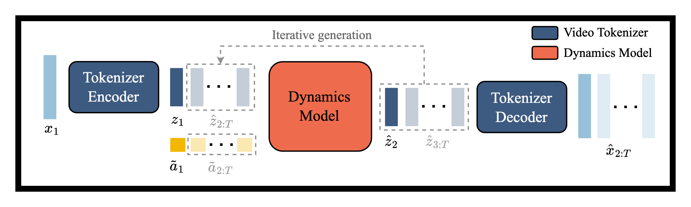{ width="920" }

*原论文 Figure 8。只在开始时编码视觉 prompt，随后不断接收用户动作、预测后续视觉 token 并解码成画面。LAM 的训练重建器不参与这条交互路径。*

同一个起始图像可以产生不同未来，因为用户接管了每一步的动作序列。如果使用从真实录像推断的动作，模型可以尝试重建原视频；如果改换动作，就生成另一条轨迹。与一次性视频生成相比，这种接口把选择未来的机会留到了每一个时间步。

但实现成本也藏在这里。每一步都要执行大型 dynamics 与多轮帧内采样，论文系统约以 1 FPS 运行。训练视频以 10 FPS 采样，是描述数据时间间隔；约 1 FPS 则是系统产生新帧的实际速度。两个数字不能混用，更不能据训练帧率推断已达到实时游戏交互。[↗](https://arxiv.org/pdf/2402.15391v1#page=11)

## 数据量很大，真正进入训练的内容经过了筛选

### 16 秒源片段与 16 帧训练序列是两回事

Platformers 数据来自公开互联网游戏视频。初步检索要求标题含 2D 平台游戏相关词，标题或描述含 speedrun、playthrough 等动作词，同时排除 movie、unboxing 等词。随后把视频切成 16 秒片段，以 10 FPS、160×90 分辨率处理，得到约 55M 个片段，每段 160 帧，总时长约 244k 小时。引言中的“超过 200k 小时”对应这个收集规模。

最终训练集经过筛选，缩减为 6.8M 个 16 秒片段、约 30k 小时。模型组件使用的训练 sequence length 则是 16 帧，在 10 FPS 下对应约 1.6 秒的采样长度。数据文件保存多长的视频，与一次模型训练看到多长的历史，是不同层面的预算。[↗](https://arxiv.org/pdf/2402.15391v1#page=21)

| Stage / setting | Reported value | Meaning |
| --- | ---: | --- |
| Initial clips | 55M | Keyword-filtered 16-second clips |
| Initial duration | Approximately 244k hours | Source video volume |
| Curated clips | 6.8M | Clips retained for the final dataset |
| Curated duration | Approximately 30k hours | Training data after quality filtering |
| Source clip | 16 seconds at 10 FPS | 160 frames per stored clip |
| Training sequence | 16 frames | Context used by model components |
| Input resolution | 160×90 | Main low-resolution video setting |

由 6.8M/55M 计算，最终保留约 12.4% 的初始片段。这个比例说明论文的可行性并不只依赖“拿到足够多的任何视频”，还依赖把训练分布收窄到可学习的游戏过程。

### 无动作标签，仍然有人工质量判断

优质片段要求游戏过程清楚可见，并尽量排除菜单画面、主播人脸等干扰。筛选流程先由人给约 10k 个视频片段打 1—5 分，论文报告这一步约花费 10 小时。随后训练约 11M 参数的 ResNet18 分类器，只使用最低与最高质量的 1 分、5 分样本，舍弃中间分数，最后保留高置信度的优质视频。人工主要在这里定义何种录像适合学习，而没有逐帧标注角色动作。

作者用一个 580M 参数模型检查筛选效果。在相同模型规模下，原始数据的 FVD 为 61.4，筛选数据为 54.8。这个对照支持数据质量确实影响生成结果，也提醒读者“unlabelled”在本文中主要指不依赖真实动作或文本标注，不能推导成完全没有人工监督参与数据处理。[↗](https://arxiv.org/pdf/2402.15391v1#page=22)

机器人模型使用另一套数据，包括 RT1 的约 130k 条机器人演示、模拟数据，以及先前工作中的 209k 条真实机器人 episode。实验丢弃这些数据中的动作，只把它们当作视频。这一做法刻意隔离了研究问题，检查在本来可以取得动作标签的领域，把动作去掉以后，同一种 latent action 学习方法是否仍然成立。

## 训练配方揭示了哪些成本与可复用选择

主论文给出的 tokenizer 与 LAM 规模约为 200M、300M，最终 dynamics 为 10.1B，全部组件合计约 10.7B，因此对外简称 11B。组件规模采用近似值，不能用两个取整的小模型参数量反推精确的总和。

附录的结构细节把“一个视频模型”拆成了几个成本不同的部分。Tokenizer 的 decoder 比 encoder 更大，作者在初步实验中发现扩大解码器比扩大编码器更有帮助。这符合 tokenizer 的用途，编码器要提供紧凑表示，解码器承担从压缩代码恢复丰富画面的工作。

| Component | num_layers | d_model | num_heads | Other settings |
| --- | ---: | ---: | ---: | --- |
| Video tokenizer encoder | 12 | 512 | 8 | k/q size 64 |
| Video tokenizer decoder | 20 | 1,024 | 16 | k/q size 64 |
| Latent action encoder | 20 | 1,024 | 16 | patch size 16 |
| Latent action decoder | 20 | 1,024 | 16 | normalized pixels and sigmoid output |
| Final dynamics model | 48 | 5,120 | 36 | k/q size 128; 10.1B parameters |

*结构来自附录 Tables 5、7、12。视觉 tokenizer 使用 patch size 4、1,024 项码本；主 LAM 使用 8 项码本。两个码本的 embedding dimension 均为 32。*

Tokenizer 训练 300k steps，使用 AdamW，两个动量系数均为 0.9，weight decay 为 $10^{-4}$，warmup 10k steps。附录 Table 8 把 `max_lr` 和 `min_lr` 都列为 $3\times10^{-4}$，但紧邻文字又说使用 cosine decay。两处没有给出一个唯一、明确的衰减终点，复用配方时需要把这一原文不一致保留下来，不能自行补成常见的十倍学习率衰减。

Dynamics 的优化器表则明确列出最大、最小学习率 $3\times10^{-5}$ 与 $3\times10^{-6}$，AdamW 两个动量系数为 0.9，weight decay 为 $10^{-4}$，warmup 5k steps。大模型训练使用 ZeRO-3、数据并行，并在更大模型中使用 tensor parallelism。[↗](https://arxiv.org/pdf/2402.15391v1#page=23)

| Video tokenizer experiment | Batch size | Hardware | FLOPs | PSNR ↑ |
| --- | ---: | --- | ---: | ---: |
| Smaller batch | 64 | 64 TPUv2 | 4.22 × 10²⁰ | 35.7 |
| Larger batch | 384 | 64 TPUv3 | 2.57 × 10²¹ | 36.5 |

*原论文 Table 6。更大 batch 的 tokenizer 达到更高 PSNR，同时硬件与总计算量也改变。*

这组结果说明重建质量还有通过计算投入改善的空间，但无法单独分离 batch size、更多处理样本与硬件配置各自的贡献。类似的条件区别也会出现在后面的 dynamics scaling 实验中。

最终 dynamics 的训练使用 batch size 512、125k steps、256 TPUv5p，处理约 942B tokens，附录报告 $6.6\times10^{22}$ FLOPs。网站展示的 360p 视频还使用一个更大的视觉 decoder，带来额外参数；因此网页演示分辨率不能直接当成基础训练视频的 160×90 分辨率，也不能认为同一 11B 配置已经覆盖所有展示成本。[↗](https://arxiv.org/pdf/2402.15391v1#page=7)

## 怎样分别衡量好看的视频与起作用的动作

### FVD 不告诉我们按钮有没有被使用

如果一个模型不理会用户输入，却总能生成自然的视频，FVD 仍可能很好。Genie 因而把评价分成 video fidelity 与 controllability 两条轴。FVD 用于衡量生成视频分布的质量，数值越低越好；动作是否影响预测，则用一个基于 PSNR 的差值来观察。

论文定义

$$
\Delta_t\operatorname{PSNR}
=\operatorname{PSNR}(x_t,\widehat x_t)
-\operatorname{PSNR}(x_t,\widehat x'_t).
$$

$x_t$ 是真实目标帧，$\widehat x_t$ 是使用从真实视频反推的动作序列生成的帧，$\widehat x'_t$ 则使用从 categorical distribution 随机采样的动作序列。实验统一报告 $t=4$。如果正确对应录像的动作能让生成更接近真实帧，而替换动作会使轨迹偏离，差值就会增加。[↗](https://arxiv.org/pdf/2402.15391v1#page=6)

这个指标把“模型是否使用动作”转成了一个可计算的问题，但它也有边界。高差值表示动作改变对重建有影响，并没有直接评估“按跳跃键是否跳到指定平台”。一个随机动作分支如果严重破坏画面，也可能拉大差值。因此，controllability 应与 FVD 和可解释的轨迹观察一起读，不能只追求差值最大。

### LAM 读像素还是读视觉 token

最自然的省计算做法，是让 LAM 复用已经压缩好的视觉 token。作者专门比较了这个方案，因为高质量重建所保留的信息，未必完全等于识别动作变化所需的信息。

| LAM input | Dataset | #Params | FVD ↓ | ΔtPSNR ↑ |
| --- | --- | ---: | ---: | ---: |
| Token-input | Platformers | 2.3B | **38.8** | 1.33 |
| Pixel-input (Genie) | Platformers | 2.5B | 40.1 | **1.91** |
| Token-input | Robotics | 1B | 257.8 | 1.65 |
| Pixel-input (Genie) | Robotics | 1B | **136.4** | **2.07** |

*原论文 Table 2。两个数据领域分别比较 LAM 的输入；Platformers 两行的模型参数量并不完全相同。*

Platformers 的结果最有解释价值。Pixel-input 的 FVD 从 38.8 变为 40.1，画面分布指标略差，但动作差值从 1.33 增至 1.91。它直接说明“更好的视频分数”与“更强的动作影响”不总是同一方向。Robotics 在相同 1B 参数规模下，pixel-input 同时改善两项指标，FVD 从 257.8 降到 136.4，动作差值从 1.65 升至 2.07。

作者据此选择让 LAM 直接处理像素，认为视觉 tokenizer 可能丢弃部分运动细节。这个解释与结果一致，但表格没有单独测量哪类运动信息被丢弃；尤其 Platformers 参数量有差别，不能把两行差异完全归因于输入格式。实际可复用的判断是，把动作推断器独立于生成 tokenizer 设计，并用动作相关指标验证，值得付出额外计算。

### ST-ViViT 的收益是否只是参数更多

Tokenizer 架构消融控制了 patch size 10、batch size 128 和 sequence length 16，并使用相近的参数规模，然后训练相同类型的 LAM 与 dynamics。这里的 patch size 是消融专用设置，与主模型的 patch size 4 不同。

| Tokenizer | #Params | Memory | FVD ↓ | ΔtPSNR ↑ |
| --- | ---: | ---: | ---: | ---: |
| ViT | 230M | 0.3 GB | 114.5 | 1.39 |
| C-ViViT | 225M | 1.6 GB | 272.7 | 1.37 |
| ST-ViViT (ours) | 205M | 0.9 GB | **81.4** | **1.66** |

*原论文 Table 3。Memory 是这项 tokenizer 比较中的报告值，不能当成完整 11B 系统的运行显存。*

逐帧 ViT 需要的 memory 最少，但没有显式利用视频历史。ST-ViViT 在略少的参数量下，取得更低 FVD 与更高动作差值，说明时空压缩的收益可以传到最终生成与控制指标。C-ViViT 在该实验中的结果反而较差，作者提出可能存在过拟合、需要额外正则化；这属于对本次实验的解释，不构成任何 temporal tokenizer 都不如 ST-ViViT 的普遍结论。[↗](https://arxiv.org/pdf/2402.15391v1#page=9)

## 扩大模型确实降低了损失，但 scaling 实验控制了什么

### 固定训练 token 预算，扩大 dynamics

参数规模实验固定视频 tokenizer 与 LAM 的架构，只改变 dynamics，从 41M 扩大到 2.7B。每个模型训练 200k steps、batch size 256，约 750B tokens。这样可以比较在相似数据暴露量下，较大的 dynamics 是否更能拟合视频变化。

下面 Figure 9 的左图显示完整训练曲线，中图将最后 300 次更新的平均损失汇总到各自计算量上。参数越大的模型在训练结束时取得更低损失，同时也消耗更多 FLOPs。右图则是另一组 batch size 实验，应单独解释。

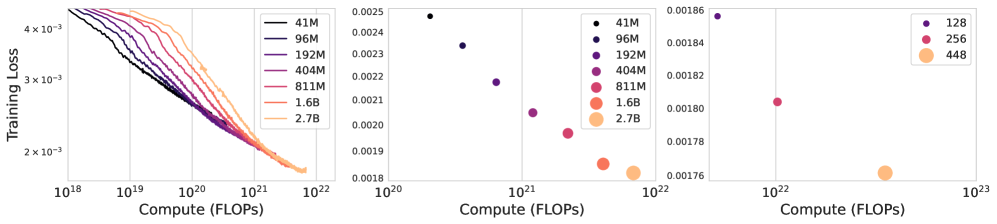

*原论文 Figure 9。左、中图比较 dynamics 参数规模，右图比较 2.3B 模型的不同 batch size。横轴均为 compute，指标是 training loss。*

| Parameters | Training hardware | Training time | FLOPs |
| --- | --- | --- | ---: |
| 41M | 64 TPUv2 | 3 days | 2.05 × 10²⁰ |
| 96M | 64 TPUv2 | 6 days | 3.58 × 10²⁰ |
| 192M | 64 TPUv2 | 9 days | 6.4 × 10²⁰ |
| 404M | 64 TPUv2 | 18 days | 1.2 × 10²¹ |
| 811M | 128 TPUv3 | 7 days | 2.2 × 10²¹ |
| 1.6B | 128 TPUv3 | 12 days | 4.04 × 10²¹ |
| 2.7B | 256 TPUv3 | 16 days | 6.91 × 10²¹ |

*原论文 Table 10 的参数、资源与训练时长列。所有行使用 200k steps、batch size 256。不同硬件下的 days 不能直接当作架构效率排名。*

这组实验支持该架构具有扩大规模的潜力，但它没有在固定 FLOPs 下为每个规模搜索最佳 token 数，因此不是完整的 compute-optimal scaling law。纵轴又是训练损失，也不能直接据此推断控制语义、真实物理一致性或关卡成功率都遵循同一增长关系。它回答的是较窄、也更基础的问题，给更多参数与计算后，视频预测是否仍能继续获益。[↗](https://arxiv.org/pdf/2402.15391v1#page=24)

### 更大 batch 也意味着看过更多数据

第二组实验固定 2.3B dynamics，使用 34 层、20 heads、$d_{model}=2560$，训练同样的 200k steps，改变 batch size 为 128、256、448，每步分别约处理 1.9M、3.8M、6.6M tokens。Figure 9 右图的最终损失随 batch 增大而降低。

关键条件是步数相同而非总 token 数相同。Batch 从 128 增到 448，每步看到的样本更多，总训练 token 与计算也随之增长；硬件还分别使用 64 TPUv3、128 TPUv3 与 64 TPUv5p。它表明这个系统能够利用更大的训练吞吐与数据投入，不足以单独证明在相同总数据和 FLOPs 下，大 batch 的优化效率更高。

论文最后选择扩大参数与 batch 来构建 10.1B dynamics，这个工程决策有上述损失曲线支撑。理解时应把“可以继续从更大投入获益”与“已经找到了最省计算的训练比例”分开，前者是这篇论文给出的有效结论。

## 从一幅陌生图像开始，泛化的是什么

Figure 10 的 prompt 来自 Imagen2 生成图、手绘草图和真实照片。每组展示初始图像，以及连续四次执行同一个 latent action 后的画面。先看角色相对平台或背景的位置，再看图像风格是否保留，可以同时观察动作变化和外观迁移。

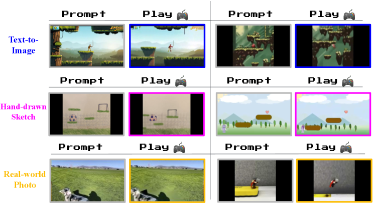

*原论文 Figure 10。不同图像来源成为环境起点，结果展示同一动作重复四次后的状态。文字到图像的步骤由外部 Imagen2 完成。*

这里最容易夸大的表述是“Genie 原生理解文字并生成世界”。实际接口先由外部 text-to-image 模型把文字变成图像，再由 Genie 接管逐帧生成。Genie 的平台游戏训练不使用文本标注，图中的 text-to-image 表示初始图像的来源。

这些例子说明模型可以把平台游戏中学习的运动模式迁移到视觉上不同的起始场景，包括手绘角色与照片中的对象。它不需要该初始图像已经是一款可执行游戏的截图。不过，模型会依据训练中学到的先验把场景推进成类似游戏的过程；一个真实照片中的物体能被“操纵着跳起来”，并不能证明模型已恢复该真实场景的物理规律。论文的 OOD 展示是一组定性案例，没有给出覆盖所有草图、照片和复杂相机视角的成功率。[↗](https://arxiv.org/pdf/2402.15391v1#page=7)

机器人实验补充了另一个问题。同样的 latent action 设计是否只能利用平台游戏的明显左右运动，还是也能在机械臂视频里发现可操作的变化。单独训练的 Robotics 模型规模为 2.5B，报告 FVD 82.7。下面每一列重复同一个动作五次，每一行从不同初始机械臂位置开始，作者观察到相近的 down、up、left 行为。

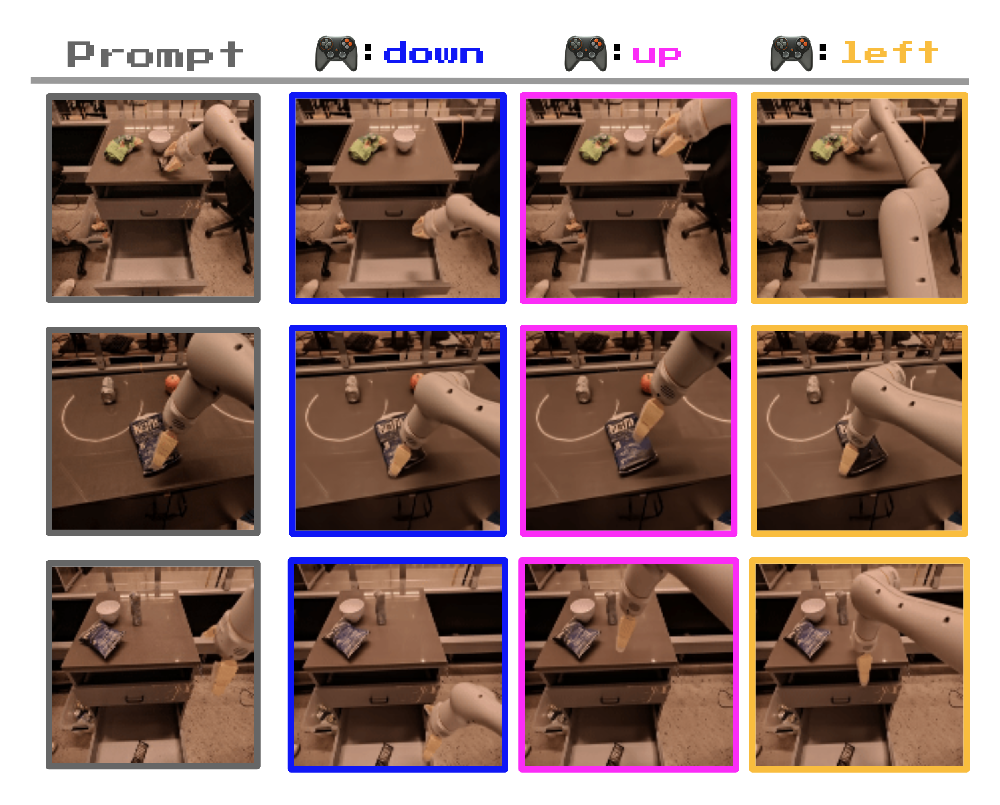{ width="900" }

*原论文 Figure 13。三个起始状态分别执行相同 latent actions，检查机械臂运动方向的跨状态一致性。这个模型在机器人视频上单独训练。*

这张图支持动作发现方法可以迁移到另一类视频分布，但动作仍作用在生成画面上。论文没有把这些代码直接变成真实机械臂的关节指令，也没有通过物理执行测量运动误差或抓取成功率。机器人视频中一个代码表现为向左，和现实系统里有一个安全、稳定的“向左移动”控制原语，是两个需要连接的接口。

另一个演示让机械臂与可变形袋子交互，连续展示十步。它说明模型能够生成超出刚体平移的外观变化，也同时提醒读者视频合理性与物理验证的区别。袋子看起来在变形，是视觉模型学到相关动态的证据；是否守恒、是否接触一致、是否能够复现真实受力过程，并未由这组图给出定量答案。[↗](https://arxiv.org/pdf/2402.15391v1#page=8)

## CoinRun 实验把 latent action 接到真实环境动作

### 先从无动作录像学策略，再用少量标签建立翻译表

前面的实验都在生成视频中检查控制。CoinRun 的 behavioral cloning 实验更进一步，使用一个已有的仿真环境，让策略真正执行环境提供的动作。它要检验的是，互联网视频学到的 latent actions 能否帮助利用另一个环境中的无动作专家录像。

实验先取得 R2D2 专家在 CoinRun 中的行为视频。来自互联网平台游戏训练的 LAM 保持冻结，逐段观察专家帧转换，为它们分配 latent action。随后训练一个独立策略，给定当前视觉历史，预测专家应该采取哪个 latent action，目标是分类 cross-entropy。这里没有在 Genie 生成的环境里运行强化学习来训练这条策略。[↗](https://arxiv.org/pdf/2402.15391v1#page=24)

策略输出的仍然是抽象代码，CoinRun 却要求真实动作 $u_t$。作者因此取一个很小的带真实动作标签的专家集合，每条数据为 $(x_t,u_t,x_{t+1})$。冻结 LAM 对同一个转换产生 $a_t$，然后把 $u_t$ 放入该 latent code 对应的动作列表。可以把附录中的映射过程整理成

$$
D[a]=\{u_i\mid \operatorname{LAM}(x_i,x_{i+1})=a\},\qquad
 a_t\sim\pi(\cdot\mid x_{1:t}),\qquad
 u_t\sim D[a_t].
$$

$D$ 是字典，不是另一个需要观察当前图像的神经控制器。策略先从自身 logits 采样一个 latent action，再从这个代码对应的真实动作列表采样实际输入。观测用于策略决策，但 latent-to-real 这一步不再根据当前画面重新判断含义。

这个限制让实验有了更强的解释力。如果某个 latent code 在一个场景表示“左”，在另一个场景表示“右”，单一字典很难同时工作。只需很少标注就能建立有用映射，说明这些代码具有一定跨状态一致性。它检验了前面 Figure 17 的可视化结论能否用于动作迁移，而不只是观察一组看起来相近的图片。

### 约 200 个标签究竟替代了什么

Figure 15 横轴是用于建立映射的专家样本数量，纵轴是完成关卡的比例。曲线比较 Genie LAM 方案、可直接使用真实专家动作训练的 oracle BC，以及随机策略。每个结果在 100 个评估样本上测量，平均 5 个随机种子，并给出 95% 置信区间。

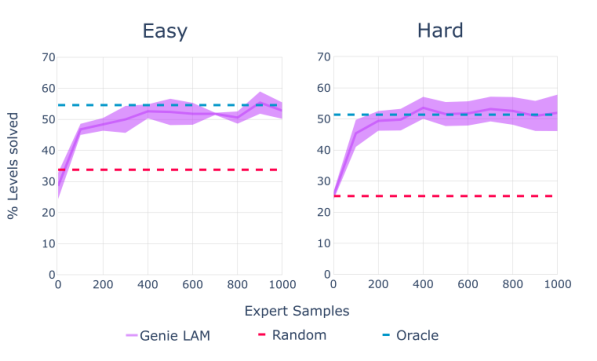

*原论文 Figure 15。Easy 与 Hard 分别评估；横轴增加的是构建 latent-to-real action 映射的专家标签。阴影表示 95% 置信区间。*

从曲线大致读数看，Easy 的 oracle 约在 55% 附近，Genie LAM 在约 200 个映射样本时达到约 50%，随后进入接近 oracle 的范围；Hard 的 oracle 约在 51%，Genie LAM 在约 200 个样本时也接近 50%。随机策略分别约在 34% 与 25%。这些是根据图形的近似读数，论文重点是少量动作标签已经使 latent policy 接近直接用真实动作训练的 BC 参照，而非给出一个 100% 成功的策略。[↗](https://arxiv.org/pdf/2402.15391v1#page=9)

“200 个标签”不能理解为整个学习过程只使用 200 个训练样本。大量专家视频先用于学习 latent-action policy，互联网视频先用于训练冻结 LAM，这些都是前置资源。少量真实动作替代的是把抽象动作接口连接到具体环境所需的标注量。它也不等于端到端完全不需要动作标签，部署到真实 CoinRun 动作空间时仍有一个有监督校准步骤。

Oracle BC 在这里是实验参照，不是数学上不可超越的上界。两种策略都使用 ST-ViViT 视觉编码器，12 层、宽度 512、patch size 4，加一个宽度 512 的线性策略头，序列长度 4、batch size 16。过去动作经过 one-hot 编码后作为 additive embedding 加入相应视觉表示。附录还说明 oracle 在推理时有 10% 概率随机取动作会表现更好，因此图中的比较也包含这一具体策略设置。

优化器最大、最小学习率分别为 $3\times10^{-5}$、$3\times10^{-6}$，动量系数为 0.9、0.96，weight decay 为 $10^{-4}$，warmup 5k steps。与前面的 dynamics 相比，这里的第二动量系数不同，复用时不能把所有训练配置统一成一张泛化配方。[↗](https://arxiv.org/pdf/2402.15391v1#page=25)

作者将 CoinRun 描述为 LAM 很可能没有见过的环境。这个迁移设定与结果值得重视，但原文措辞是 almost certainly，没有提供互联网训练数据对 CoinRun 的严格去重审计。最稳妥的结论是，在未为目标环境专门训练的 LAM 上，少量动作映射可以支持有效迁移，而不是据此断言目标环境与全部预训练视频已被证明完全不重叠。

## 附录给出的单设备实验，怎样缩小到可研究的规模

完整 11B Genie 所需的资源很大，但论文没有把方法只留在这个规模上。Appendix F 给出一个独立的 CoinRun case study，目标是在单个中档 TPU/GPU、一周以内完成训练。它和上一节的模仿学习不是同一个实验。上一节使用已在互联网视频上训练的 LAM，为专家视频提供动作标签；这里从小规模 CoinRun 视频开始，重新训练 tokenizer、LAM 与 dynamics，检验生成环境本身能否以较低预算跑通。[↗](https://arxiv.org/pdf/2402.15391v1#page=26)

数据由随机策略采集。作者在 CoinRun Hard 模式下，从 0—10,000 的 level seed 范围采样，每关收集 1,000 步，总计约 10M transitions，不使用 action repeats。环境原本可以给出动作，但训练世界模型时只保留视觉序列。这是一个可重复制造“无动作录像”数据的办法，能够把数据收集与算法验证从互联网抓取质量中分离出来。

| Stage | Model / data setting | Batch and training |
| --- | --- | --- |
| Video tokenizer | 8-layer encoder and decoder; d_model 512; 8 heads; 1,024 codes; patch size 4; latent_dim 32 | 48 sequences × 16 frames; 300k steps |
| Latent action model | 8-layer encoder and decoder; d_model 512; 8 heads; **6** action codes; latent_dim 32 | Jointly trained with dynamics |
| Dynamics + LAM | d_model 512; Table 9 optimizer | 36 sequences × 16 frames; 200k steps |
| Sampling | temperature 1.0; 25 MaskGIT steps | Generate one frame per interaction step |

*原论文 Tables 15—17 与 Appendix F。这里使用 6 个动作码，与主实验的 8 个码不同。*

Tokenizer 每个 batch 包含 768 帧，作者报告它能够放入一块 16 GB TPU，300k steps 约训练三天。联合训练阶段每个 batch 包含 576 帧，同样以 16 GB 内存目标配置，使用 200k steps。论文提出整个流程可在单个中档 TPU/GPU 上一周内完成，但具体给出的三天测量对应 TPU，不能直接换算成任意消费级 GPU 的保证时间。

这个附录还有一个会影响复现的排版问题。Table 17 在 dynamics 结构中两次列出 `num_layers`，值分别为 12 和 8，夹在中间的是 `d_model=512`。原文没有明确说明第二个 8 是否应为 heads，因此不能静默把表格修正成“12 layers、8 heads”并当成已确认配置。温度 1.0 与 25 个 MaskGIT steps 则在表中明确给出。[↗](https://arxiv.org/pdf/2402.15391v1#page=27)

尽管有这类实现细节需要澄清，小实验仍给出了可复用的研究切口。先在可生成、可控的数据上训练视觉 tokenizer，再加入小动作瓶颈与 dynamics，观察改变代码是否稳定改变轨迹；最后同时评价视频质量与动作影响。这个流程保留了 Genie 的关键机制，同时把互联网数据工程、大规模 TPU 集群与未知训练分布暂时移出最初验证。

## 哪些认识值得带到下一个世界模型实验

Genie 最有价值的结果，是证明缺失动作标签并不必然阻止交互接口的学习。把未来变化限制在一个很小的离散通道中，再让生成器使用它，可以从视频中得到跨场景重复使用的动作代码。Pixel-input LAM 的消融说明，变化表征未必应该完全服从视觉压缩器的选择；CoinRun 的字典映射则说明，一部分视频中学到的变化结构能够帮助减少接入具体动作空间的标注成本。

这条路线的困难也由接口本身暴露出来。八个代码便于人操作，却只能表达粗粒度变化；没有显式物理状态，长轨迹一致性主要依赖视觉历史与生成模型；16 帧上下文难以长期记住已经离开画面的布局。论文明确指出模型会产生不现实的未来，长时间交互的一致性仍有限，约 1 FPS 的生成速度也使细致实时控制受限。[↗](https://arxiv.org/pdf/2402.15391v1#page=11)

因此，后续研究可以沿着一个很具体的问题推进。当动作代码在更复杂场景里混合了角色运动、相机运动与外部事件时，怎样增加表达能力，同时保持跨状态语义稳定、低标注映射和可操作性。Genie 已经给出可以测试这些取舍的基本接口，也给出质量与动作效果分开测量的范例。决定这种接口能走多远的，将是长期状态、细粒度控制和真实执行之间能否建立同样清晰的证据连接。

## 关键术语

**Latent Action Model（潜在动作模型）** 根据观察到的帧转换推断离散变化代码，训练时为无动作录像提供伪动作标签。

**Vector Quantization（向量量化）** 把连续表示映射到有限码本条目。视觉码本承担内容压缩，动作码本承担变化压缩，二者的容量与用途不同。

**ST-transformer（时空 Transformer）** 将帧内空间 attention 与跨帧时间 attention 分开计算的结构。Genie 使用因果时间 attention，并在两类 attention 后保留一个 FFN。

**MaskGIT（掩码生成式图像 Transformer）** 通过迭代预测被遮蔽的离散视觉 token 生成图像。Genie 在帧内使用这一机制，在时间上逐帧自回归。

**Controllability（可控性）** 本文主要通过动作替换引起的 PSNR 差异与定性轨迹衡量，强调动作条件是否影响生成；它不等同于目标任务成功率。

**Behavioral Cloning（行为克隆）** 从专家示范学习动作预测。Genie 的迁移实验先学习 latent action policy，再用少量真实动作样本构建执行映射。

入门时可先读[世界模型基础](../../world-models/beginner-world-models-primer.md)，明确状态、观测、动力学和读出各自的含义；再看[模拟器、反事实与合成 rollout](../../world-models/simulators-counterfactuals-and-synthetic-rollouts.md)，区分“能生成视频”和“能作为训练环境”。如果要评估动作代码是否真的可用，接着读[世界模型评测与失败模式](../../world-models/evaluation-and-failure-modes.md)，把可控性、长期一致性和任务结果分开记录。
