# H-JEPA：层级 JEPA 与潜变量 EBM

!!! info "论文信息"
    **论文题名：** Introduction to Latent Variable Energy-Based Models: A Path Towards Autonomous Machine Intelligence。 
    **作者：** Anna Dawid、Yann LeCun。 
    **机构：** 未在公开元数据中稳定解析；以 arXiv/PDF 或官方页 affiliation block 为准。 
    **时间 / 主题：** 2023-06；世界模型。 
    **arXiv / 官方报告：** arXiv：[2306.02572](https://arxiv.org/abs/2306.02572)。 
    **GitHub / 项目：** GitHub：未找到官方链接。 
    **元数据来源与核验口径：** 来源：[arXiv](https://arxiv.org/abs/2306.02572)；Checked Date：2026-06-15；Repro Status：Paper / official materials reviewed, independent reproduction not claimed。

## 长期预测为什么需要改变预测对象

这篇讲义要解决的起点，并不是如何生成更清晰的视频，而是一个自主系统怎样利用观察，形成能够支持决策的世界模型。看到道路上的行人，系统既不知道对方下一秒会走向哪边，也没有必要精确预测其衣服每个像素的变化；如果任务是提前决定是否减速，预测行人可能进入哪片区域比重建服装纹理更有用。到了更长时间尺度，系统又需要处理路线、目的地和中间任务，当前一步的细节不足以直接组织整个计划。

作者把这个问题拆成三层。第一层是容许多个未来同时成立，不能强迫模型只输出一个折中的答案。第二层是学习合适的表示，把对任务无关的细节移出预测目标。第三层是让不同层级在不同时间跨度上预测，从而为复杂行动提供逐步细化的中间目标。Energy-Based Model、latent variable、JEPA 和 H-JEPA 分别围绕这些困难展开。[↗](https://arxiv.org/pdf/2306.02572v1#page=5)

文章整理自 2022 年 Les Houches 暑期学校讲座，于 2023 年发布，解释的是 LeCun 的自主智能架构设想。它的贡献是把能量推断、潜变量、训练塌缩和层级预测串成一条可理解的技术路线。H-JEPA 在这里是一种设计框架，没有一套通过统一 benchmark、硬件预算和训练配方验证完毕的新系统。理解这点，才能把文中的数学恒等式、示意例子与未来架构主张放在各自合适的位置。

## 世界模型只是感知、规划与行动循环中的一部分

Figure 1 先给出全系统分工。Perception 将观测转换成当前状态估计；actor 提出动作或动作序列；world model 预测这些动作可能引出的未来；cost module 评价未来状态的代价。短期记忆保存当前与预测的状态、相关代价，configurator 则根据任务配置其他模块。

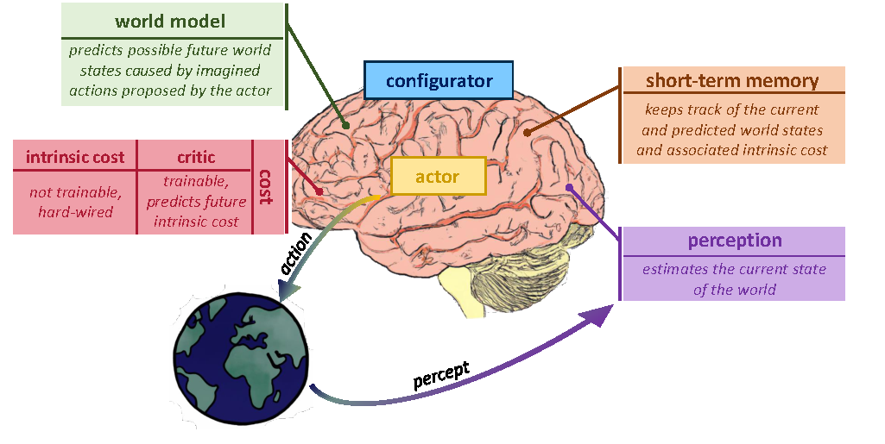{ width="850" }

*原文 Figure 1。沿外界观测进入 perception、再经规划产生 action 的闭环阅读。World model 负责预测可能发生什么，cost 模块决定哪些结果值得追求或避免。*

这套结构接近 learned model-predictive control。系统先在内部比较动作后果，再执行选择的动作，接收新的观测，继续调整计划。作者希望感知、世界模型与评价模块能够支持可微计算，使动作搜索可以利用梯度或其他优化过程，而不必把每种可能行动都在现实里尝试一遍。[↗](https://arxiv.org/pdf/2306.02572v1#page=7)

Cost 又分成两部分。Intrinsic cost 被设定为不可训练的基本代价，critic 则学习预测未来的 intrinsic cost。这是该架构提案对目标来源与长期评价的分工，不等于本文已给出能自动学习全部人类目标的算法。Configurator、短期记忆与 actor 也主要以模块职责呈现，具体如何实现仍需要额外设计。

这里必须区分两种经常都被叫作“能量”的量。世界模型中的低能量表示某个未来与条件相容，任务代价较低表示这个未来更符合目标。车撞上障碍物可能是当前高速动作下非常相容的后果，却具有很高的任务代价。一个预测模型不能仅因为自己偏好某种结果，就把不可能的未来评为好解。后文的 EBM 首先讨论相容性，规划还需要把这种相容性与任务评价连接起来。

## 从输出一个答案，转向给候选答案分配能量

### EBM 的接口是评分与搜索

普通前馈预测器把 $x$ 映射到一个输出 $\bar y$。EBM 则接收条件 $x$ 和候选 $y$，给出标量 $F_w(x,y)$，其中 $w$ 是模型参数。与 $x$ 相容的 $y$ 应有较低能量，不相容的候选应有较高能量。推断时固定模型，搜索低能量输出。

$$
\check y\in\operatorname*{argmin}_y F_w(x,y).
$$

这里用“属于”表示可能有多个最优解。若同一个观测对应多种合理未来，能量函数可以在多个区域都保持低值，而无须在它们之间产生一个平均画面。对于连续候选，如果能量函数平滑可微，可以沿 $y$ 的梯度搜索；离散或结构化候选则需要适合其结构的搜索方法。选择 EBM 并不会让一个困难搜索问题自动变简单。

Figure 3 左侧将“预测后与目标比较”改成“同时输入条件和候选，计算相容性”。右侧用 $y=x^2$ 的训练点展示一种可行能量曲面。蓝色数据点附近形成低能量区域，但有限的数据不能唯一决定整个曲面在未观测区域的形状，这正是学习规则与正则化需要介入的地方。

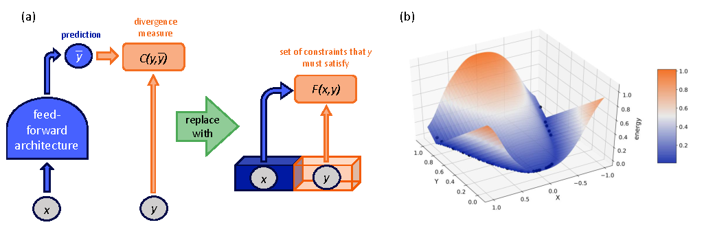{ width="850" }

*原文 Figure 3。左图强调模型接口改变，右图展示训练数据与低能量区域的关系。它是教学示意，并非 H-JEPA 的实测性能曲线。*

### 推断优化候选，训练优化参数

两个优化过程很容易因为都出现“最小化”而混在一起。推断时 $w$ 固定，寻找合适的 $y$；训练时数据给定，调整 $w$，让整个能量曲面能够区分相容与不相容的配置。一般情况下，训练损失不只是数据点上的能量相加，否则最容易的做法可能是把所有能量一起压低。

| Operation | Fixed quantities | Optimized quantity | Desired result |
| --- | --- | --- | --- |
| Inference | Trained parameters and input | Candidate output, sometimes latent variables | Find compatible outputs |
| Learning | Training observations and learning rule | Model parameters | Shape a useful energy landscape |
| Planning | Learned dynamics, current observations and objective | Action sequence or intermediate goals | Find feasible actions with low task cost |

讲义特别强调能量与学习损失的区别。这个原则应理解为“能量函数不自动给出正确的训练目标”，不能理解成能量绝不能出现在训练损失中。后面回归模型和 Hopfield network 都会用数据能量参与学习，只是它们的结构约束、失败模式和适用范围不同。[↗](https://arxiv.org/pdf/2306.02572v1#page=9)

## 放弃显式归一化省掉什么，又失去什么

### 由能量得到概率，需要一个全局分母

如果确实需要概率，讲义使用 Gibbs–Boltzmann 形式把能量转成条件分布。

$$
P_w(y\mid x)
=\frac{\exp[-\beta F_w(x,y)]}{Z_w(x)},\qquad
Z_w(x)=\int \exp[-\beta F_w(x,y')]\,dy'.
$$

$\beta>0$ 是 inverse temperature，控制能量差异如何转成概率集中程度；$Z_w(x)$ 是 partition function，负责把所有候选的总概率归一为 1。离散空间把积分改成求和。这个表达式也要求分母存在且有限，任意一个在无限空间上定义的能量函数都不能未经检查就当成正规概率密度。

当候选是高维连续对象时，困难通常出现在全空间求和或积分，以及训练所需的相关估计。若任务只需要比较候选、寻找相容解，模型可以直接使用未归一化能量，不必先求出 $Z_w(x)$。这是 EBM 提供的接口自由度。[↗](https://arxiv.org/pdf/2306.02572v1#page=10)

但“使用未归一化评分”与“高维概率模型普遍不可计算”是不同强度的结论。讲义对连续概率建模作出了较强的批评，属于这条研究路线的动机；它没有证明所有具有特殊结构、分解方式或近似算法的概率模型都会失败。对具体系统，应分别检查归一化、采样与推断的成本，不能由一个困难积分推广成所有概率方法的不可行性。

### 低能量的绝对数值没有统一标尺

放弃归一化也放弃了部分方便性质。两个独立训练的模型，能量 0.1 和 10 不一定可以直接比较，数值低不自动意味着置信度高。固定输入后，把所有候选能量加上同一个常数，不会改变排序；乘以正数也不会改变最优候选。两种变换都保留搜索结果。加常数会在 Gibbs 归一化时抵消，概率不变；正比例缩放则会改变能量差，在固定温度下改变概率分布。

因此，若要把多个 EBM 的输出组合成一个总目标，就必须关注各自尺度与含义。世界模型、任务代价和约束项随意相加，可能让数值较大的模块支配决策，而不是让最重要的约束发挥作用。原文直接把缺乏校准、跨模型难比较列为 EBM 的代价，建议在架构设计中避免不加处理地交换这种数值。[↗](https://arxiv.org/pdf/2306.02572v1#page=10)

另一个代价是对不确定性的解释变弱。多个低能量区域告诉我们有多个相容答案，未必告诉我们每个答案发生的概率。对于只需要找可行解的问题，这可能够用；对于需要计算期望损失或比较低概率高代价事件的规划，概率、集合范围或其他明确的不确定性规则仍然重要。

## 潜变量为同一个条件保留多个解释

### 缺失信息不必全部变成随机噪声

Latent variable $z$ 表示观测中没有直接提供、却影响预测的因素。讲义列举了对象姿态、照明、图像分割、句法结构、语音分段、手写字符边界等例子。它们有的连续，有的离散，有的本身具有复杂结构，因此潜变量不应一律理解成一串高斯噪声。

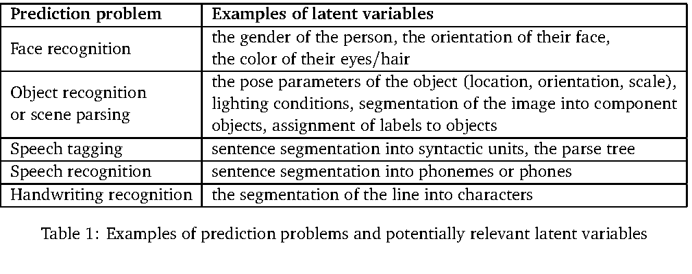{ width="840" }

*原文 Table 1。对照预测任务与可能缺失的结构因素阅读。分割、姿态与边界都可以成为 latent variables，其形式取决于问题。*

结构化预测很适合说明这一点。识别一行手写文字时，模型不仅要判断每个字符是什么，还要决定字符边界在哪里。边界没有给出，就需要把可能的切分方式纳入推断；一旦选定某个切分，字符识别又会对它提出约束。潜变量让这些未观察到的结构因素能够与输出一起被评估。[↗](https://arxiv.org/pdf/2306.02572v1#page=11)

将能量扩展成 $E_w(x,y,z)$ 后，同一个 $x$ 可以在不同 $z$ 下对应不同 $y$。如果 $z$ 从一个指定分布采样，可以诱导输出分布；如果只是从可行集合中选择 $z$，得到的是一组可能预测。后者具有多解性，但没有因此自动获得概率解释。

### 最好的潜变量与最低能量值是两个对象

给定 $x,y$，第一种办法是寻找最能解释它们的潜变量。

$$
z^*(x,y)\in\operatorname*{argmin}_z E_w(x,y,z),\qquad
F_w(x,y)=\min_z E_w(x,y,z).
$$

$z^*$ 是一个配置，$F_w$ 是一个标量。原文第 11 页在这里把 $F_w$ 写成了 `argmin`，与其“能量值”的语义不一致；上式按上下文区分了最优参数与最小值。随后再对 $y$ 最小化 $F_w$，才得到最终输出候选。

第二种办法是把各种潜变量解释的贡献累加起来，形成 free energy。

$$
F_w(x,y)
=-\frac{1}{\beta}\log\int
\exp[-\beta E_w(x,y,z)]\,dz.
$$

这就是 marginalization。低能量的 $z$ 贡献较大，高能量的 $z$ 贡献较小，但没有只留下单个最佳点。附录 A 从联合分布 $P_w(y,z\mid x)$ 出发，对 $z$ 积分，再将结果改写成使用这个 $F_w(x,y)$ 的 Gibbs 分布，说明它不是凭空增加的定义。[↗](https://arxiv.org/pdf/2306.02572v1#page=25)

两种方法回答不同问题。最小化关注“是否存在一个很好的解释”，边缘化还关注“有多少解释以多大权重支持这个输出”。一个简单的离散示意是，若某个候选有 $k$ 个能量同为 $E_0$ 的潜变量解释，而且只考虑这些解释，那么 free energy 为 $E_0-\log(k)/\beta$，最小能量却始终是 $E_0$。这个由上式得到的计算展示了边缘化如何保留解释数量的信息，不是论文中的实验结果。

从计算上说，优化一个最优解释有时比准确积分更容易，但仍可能遇到局部极小点；边缘化也可能需要昂贵采样。引入潜变量扩大了表达能力，同时把一部分难度移到内层推断中。

### 椭圆例子把抽象公式变成几何操作

讲义用二维椭圆解释上述区别。参数 $w=\{r_1,r_2\}$ 控制椭圆的两个尺度，角度 $z$ 指定椭圆上的位置，候选点为 $y=(y_1,y_2)$。

$$
E_{r_1,r_2}(y,z)
=(y_1-r_1\sin z)^2+(y_2-r_2\cos z)^2.
$$

固定绿色查询点 $y$，改变 $z$，相当于沿椭圆移动一个解释点，比较它与查询点的平方距离。使距离最小的角度是 $z^*$，最小能量是查询点到椭圆的平方距离。角度、椭圆上的点、平方距离是三个不同对象，不能因为都由同一次优化得到就混为一谈。

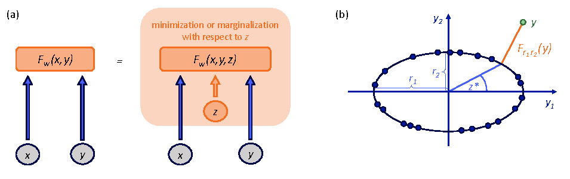{ width="790" }

*原文 Figure 4。右图蓝点示意训练流形，绿色点是待解释查询。优化 $z$ 找最近的椭圆位置；边缘化则累计全部角度的贡献。*

如果换成边缘化，积分覆盖 $0$ 到 $2\pi$ 的角度，查询点附近的椭圆片段提供较大贡献，较远片段贡献较小。这个例子说明了 latent variable 的功能，也说明模型需要一个受限制的可行流形。如果任由潜变量把解释点放到空间任意位置，所有查询都能零误差匹配，模型就不再区分数据流形与其他区域。[↗](https://arxiv.org/pdf/2306.02572v1#page=12)

## 低训练能量为什么可能意味着模型什么都没学到

### 三种不同的捷径

Figure 5 比较一个确定性回归结构与 joint embedding 结构。左边计算预测 $f_w(x)$ 与原始目标 $y$ 的距离，模型不能同时把所有不同的原始 $y$ 都移动到同一个位置。右边的两侧都经过可训练编码器，如果只最小化表示距离，两侧就可以共同输出常数。

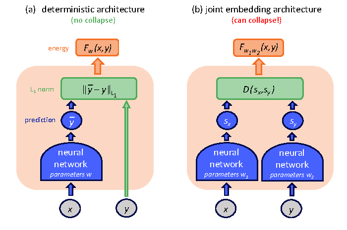{ width="620" }

*原文 Figure 5。右侧 encoder 可以一起把所有输入映成同一点，使比较误差为零。左侧目标保留为原始数据，缺少这种共同移动目标的自由度。*

设 $\operatorname{Enc}_x(x)=\operatorname{Enc}_y(y)=c$，那么所有配对的距离都是 $D(c,c)=0$。训练样本的误差看起来完美，但不相容的输入也得到同样的低能量。这里的塌缩是表示失去信息。

潜变量模型有第二种捷径。如果 $z$ 的容量足够大，可以把全部目标信息藏入 $z$，预测器只需从 $z$ 恢复 $y$，完全忽略 $x$。这次表示未必是常数，输出甚至可以非常准确，但条件预测关系仍然没有建立。观察良好的重建质量，不能自动证明模型使用了条件输入。

自编码器有第三种捷径。如果 encoder 与 decoder 可以实现任意输入上的恒等映射，那么任何 $y$ 都能被完美重建，重建误差作为能量时在整个空间都为零。它保留了信息，却没有学出“哪些输入属于合理数据”的能量结构。三种现象在信息层面不同，最终都损害了相容性判断。[↗](https://arxiv.org/pdf/2306.02572v1#page=13)

| Failure mode | Easy solution | What the training objective misses |
| --- | --- | --- |
| Joint embedding collapse | Both encoders output a constant | Representation information |
| Latent-variable shortcut | Target information passes through $z$ | Dependence on the conditioning input |
| Identity autoencoder | Reconstruct every possible input | Separation of data and non-data regions |

### 训练必须限制低能量区域

需要的不是让能量越低越好，而是让低能量出现在合适的位置。Figure 6 用一条弯曲数据流形展示两条路线。Contrastive 方法显式寻找应提高能量的点；regularized 或 architectural 方法限制低能量区域能够占据的范围，让模型无法无代价地把整个空间变成低能量区域。

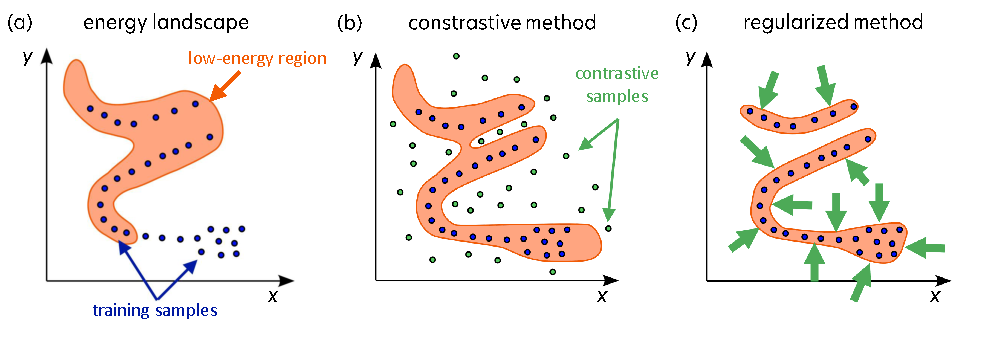{ width="820" }

*原文 Figure 6。蓝点是数据，绿色点示意 contrastive samples。中图通过样本向外推高能量，右图通过整体容量约束压缩低能量区域。*

两条路线的目标相同，代价发生的位置不同。显式负样本路线要为寻找错误低能量区域付费，正则路线则要承担表示容量选择和约束设计的责任。后一条路线没有负样本生成器，也不等于无需防止塌缩；它只是把“哪些解不能被接受”的要求写进了架构或损失。

## Contrastive learning 怎样把错误候选推开

### Margin 决定“只比一点点好”够不够

讲义给出的 pairwise hinge loss 是

$$
L_{\mathrm{hinge}}(x,y,\widehat y,w)
=\left[F_w(x,y)-F_w(x,\widehat y)+m(y,\widehat y)\right]_+.
$$

$y$ 是相容目标，$\widehat y$ 是不相容候选，$m$ 是希望保留的正 margin，$[u]_+=\max(0,u)$。当错误候选的能量至少比正确候选高一个 margin，损失变为零；否则训练会推动两者拉开差距。

如果所有能量相同，正 margin 使损失仍然大于零，因此常数能量无法作为零损失解。若只要求正确候选“不高于”错误候选却不保留间隔，全体相等就可能逃过训练约束。这个公式把防塌缩的需求表达得很直接。[↗](https://arxiv.org/pdf/2306.02572v1#page=14)

真正困难的部分是取得有效的 $\widehat y$。有限离散空间可以枚举，复杂连续空间可能需要 Monte Carlo；也可以专门搜索模型错误赋予低能量的候选，或利用数据中已知的不相容配对。图像中的不同对象、损坏后的样本、生成器制造的困难样本，都可以成为不同方法构造对照的来源。

一个随手随机生成、离数据流形极远的候选，通常很容易区分，对修正模型错误帮助有限。真正有价值的候选往往在当前模型认为合理、实际却不成立的区域。随着维度增加，发现这些区域可能越来越昂贵，这也是作者倾向 regularized 路线的主要动机。讲义没有给出所有 contrastive 算法都必须指数复杂度的统一下界，应把这部分理解为针对高维负样本搜索的论证，而非实验确立的普遍禁令。

### Maximum likelihood 也包含正负两股作用

把 Gibbs 分布代入负对数似然，论文得到一个按 $1/\beta$ 缩放的目标。

$$
L_{\mathrm{NLL}}(x,y,w)
=-\frac{1}{\beta}\log P_w(y\mid x)
=F_w(x,y)+\frac{1}{\beta}\log Z_w(x).
$$

第一项压低真实样本能量，第二项来自归一化。对参数求导，利用原文 Eq. (5)，可以把两项合并为

$$
\nabla_w L_{\mathrm{NLL}}
=\nabla_w F_w(x,y)
-\mathbb E_{y'\sim P_w(\cdot\mid x)}
\left[\nabla_w F_w(x,y')\right].
$$

这个写法是对原文两条公式的整理。梯度下降沿第一项降低数据能量，沿第二项对模型自身容易产生的配置施加相反作用。于是 maximum likelihood 可以被解释为一种 contrastive 学习，正样本来自数据，负阶段的候选来自当前模型分布。[↗](https://arxiv.org/pdf/2306.02572v1#page=15)

需要注意“来自模型分布”这几个字。若仅用任意噪声替代，通常就不再是原来的最大似然梯度。Monte Carlo 可以避免显式求出 partition function，却可能在获得充分混合的样本上花费大量计算。省掉精确积分，未必就省掉相关的统计估计难度。

由于网络参数共享，实际一次参数更新也不是把每个负点的能量独立抬高；梯度公式描述的是模型分布下的整体作用方向。讲义还批评过度灵活、缺乏正则的连续密度模型可能形成极窄的高密度峰。这说明模型容量和正则不可忽略，不能推广成所有最大似然估计都会产生同一种病态。

## Regularization 把限制放到表示本身

### 不给模型重建任意输入的自由度

对自编码问题，原文用下面的形式概括 regularized training。

$$
L_{\mathrm{reg}}(y,w)
=D\!\left(y,\operatorname{Dec}(\operatorname{Enc}(y))\right)
+R(\operatorname{Enc}(y)).
$$

第一项保留重建或匹配要求，第二项限制编码。某些限制不必显式写成额外损失，也可以直接来自架构。例如 PCA 只保留有限秩线性子空间，k-means 只允许有限个中心，bottleneck autoencoder 让所有重建通过受限通道。它们都不能毫无代价地把任意输入映回自身。

| Method | Capacity restriction | What it prevents |
| --- | --- | --- |
| PCA | Low-rank linear representation | Arbitrary full-space reconstruction |
| Bottleneck autoencoder | Restricted intermediate representation | Unrestricted identity mapping |
| k-means | A finite set of prototypes | A separate unrestricted code for every input |
| Sparse coding | Penalty on active coefficients | Using all explanatory factors freely |
| Stochastic latent variable | Noisy coding and distribution regularization | Encoding arbitrary target-specific detail without cost |

*依据原文第 4.2 节整理。表格比较的是限制方式，不是精度、效率或性能排名。*

Sparse coding 是一个具体例子。给定字典 $W$，通过重建误差与系数稀疏性共同选择 $z$。

$$
\min_z\ \lVert y-Wz\rVert_2^2+\lambda\lVert z\rVert_1.
$$

如果只看第一项，使用越来越多的字典元素往往可以降低误差；第二项让这种做法付出代价。模型需要用较少的解释因素覆盖数据。这与小潜变量瓶颈的思路相通，但稀疏、离散、低维、随机各自限制的性质不同，不应视为完全等价。尤其一个低维连续变量并不天然等于严格有限的 bit 容量，实际限制还取决于精度、噪声、正则与解码器能力。[↗](https://arxiv.org/pdf/2306.02572v1#page=16)

容量约束也有另一面。压缩太弱，模型可能仍然绕过任务；压缩太强，会丢失原本重要的信息。Regularized 方法把难题从全空间负样本搜索转成了“哪些信息应该保留、通过哪条通道保留”的设计问题，JEPA 后面正是沿着这条线继续展开。

### 随机潜变量与 KL 在控制什么

讲义还介绍了一个变分视角。让潜变量按 $q(z\mid y)$ 取值，训练关注该分布下的期望能量；同时使用 $\mathrm{KL}(q(z\mid y)\Vert p(z))$ 衡量不同输入的潜变量分布偏离公共分布的程度。

$$
\mathbb E_{z\sim q(\cdot\mid y)}[E(y,z)]
=\int q(z\mid y)E(y,z)\,dz.
$$

只有期望能量项时，编码器仍可能为每个 $y$ 准备一个特定、几乎无噪声的代码。KL 约束则要求这些代码分布不能无限制地区分所有目标。原文这里将 $p(z)$ 写成 $\mathbb E_y[q(z\mid y)]$，即汇总各输入后得到的边缘分布，不应未经说明就替换成某个固定标准高斯先验。[↗](https://arxiv.org/pdf/2306.02572v1#page=17)

在这个 $p$ 的定义下，按数据分布平均的 KL 正好对应 $Y$ 与 $Z$ 的 mutual information。这是相应信息量定义的直接关系，也解释了作者为什么把 KL 与潜变量携带多少目标信息联系起来。它没有直接指定一套完整 VAE 实现，更没有给出某个固定权重、采样次数或训练参数；读者应带走的是容量控制的作用位置。

## 三个历史例子说明训练规则会留下什么后果

### Hopfield network 学到记忆，也会出现伪记忆

讲义首先讨论具有对称连接与二值状态的 Hopfield network。对称权重满足 $w_{ij}=w_{ji}$，状态为 $y_i\in\{-1,1\}$，能量写成

$$
F_w(y)=-\sum_{ij}y_iw_{ij}y_j.
$$

其目标是把记忆模式放到低能量位置。推断时保持权重不变，反复根据其他节点更新状态，使系统进入局部稳定配置。在标准的适当异步更新条件下，可以用能量下降解释这种收敛；这不意味着任意同步更新都保证收敛，更不保证找到全局最小值。

学习时，Hebbian rule 根据训练模式中节点的共同活动强化连接。按照讲义的求和与更新约定，它写成 $w_{ij}\leftarrow w_{ij}+y_i^{\mathrm{train}}y_j^{\mathrm{train}}$。这个规则只直接奖励已有模式，没有显式负阶段清除其他不希望出现的低能量配置，于是可能产生 spurious minima，也就是没有作为训练记忆输入的伪记忆。[↗](https://arxiv.org/pdf/2306.02572v1#page=17)

这个例子让“只压低数据点还不够”变得具体。训练的确把想要的模式变得稳定，但同时可能让其他组合也变得稳定。模型容量再大，也不能替代训练规则对非数据区域的约束。

### Boltzmann machine 用负阶段补上分布约束

Boltzmann machine 在可见状态 $y$ 之外引入隐藏状态 $z$。Figure 7 中间图包含 visible-visible、hidden-hidden 和 visible-hidden 连接；右侧 restricted Boltzmann machine 则只保留两类节点之间的连接。

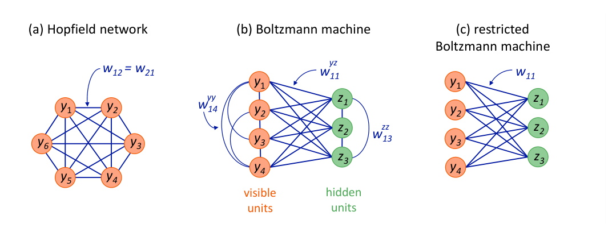

*原文 Figure 7。从左到右观察隐藏变量与连接约束如何改变模型。RBM 去掉同层连接，使条件推断更容易处理，但模型分布的学习仍需要负阶段。*

隐藏节点未被观测到，评价一个可见配置时需要把它们边缘化。原文设这里 $\beta=1$，得到

$$
F_w(y)=-\log\sum_z\exp[-E_w(y,z)].
$$

训练梯度因此包含两种不同的期望。Positive phase 固定训练数据 $y$，从条件分布 $P_w(z\mid y)$ 估计与数据相容的隐藏状态；negative phase 从模型联合分布 $P_w(y',z')$ 估计模型自己偏好的配置。对 visible-hidden 权重，原文的采样更新可整理为下面的期望形式。

$$
\Delta w_{ij}\propto
\mathbb E_{\mathrm{data},\,P_w(z\mid y)}[y_i z_j]
-\mathbb E_{P_w(y,z)}[y_i z_j].
$$

第一项鼓励数据与潜变量的相关结构，第二项抑制模型过度产生的相关结构。这里的“负”是梯度作用方向，不意味着联合分布样本全部都是肉眼可见的错误图像。Positive phase 和 negative phase 都可能需要采样，而第二阶段还要探索完整联合空间，带来较高成本。[↗](https://arxiv.org/pdf/2306.02572v1#page=18)

原文 Eq. (10) 将 Boltzmann loss 中 partition 项写成 $\log\sum_{y'}\exp[+F_w(y')]$，与同页概率定义和 Eq. (11) 的梯度符号不一致。按前面的 Eq. (4) 与附录 A，负对数似然中的该项应使用 $\exp[-F_w(y')]$。理解正负阶段应依照这些一致的推导关系，避免把这一处符号问题带入实现。

### Denoising autoencoder 仍可能面对多个正确恢复结果

Denoising autoencoder 先把干净数据 $y$ 损坏成 $x$，再通过 encoder 与 decoder 产生恢复结果 $\bar y$，训练比较 $\bar y$ 与干净目标 $y$。Figure 8 左图明确把损失标为 $C(y,\bar y)$。若只比较已经给定的损坏输入 $x$ 与原始目标 $y$，误差就与网络输出无关，无法提供正确的训练信号。

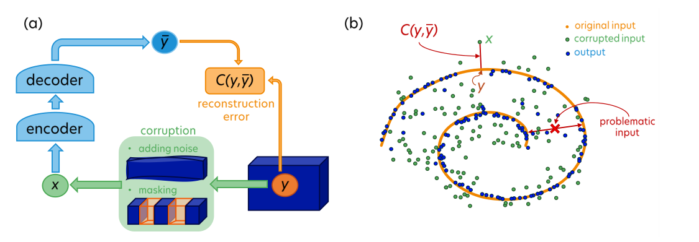

*原文 Figure 8。左图展示从干净数据制造损坏输入的过程；右图橙色螺旋是原始流形，绿色为受噪声扰动的输入，蓝色为恢复结果。*

右图最值得看的点位于两段螺旋之间。它距离两条分支相近，单凭受损坐标无法确定最初来自哪条分支。如果训练使用一个确定性点预测和平方误差，最优答案可能落在两种恢复结果的平均位置；该位置未必在原始流形上。这是“多种合理解释却只允许一个输出”的问题，潜变量可以用来区分不同分支。[↗](https://arxiv.org/pdf/2306.02572v1#page=19)

Masked autoencoder 将加噪替换为遮挡，具有相似的信息缺失结构。讲义以这类方法在连续图像上的多解困难引出 JEPA，但它没有据此证明所有图像自监督、所有去噪模型或所有多步生成方法都会模糊。导致平均化的具体条件是目标多解、点估计与相应损失的组合。多步生成、分布建模和表示预测针对的是不同环节，不能被一张二维示意图统一否定。

## JEPA 把预测误差搬到可学习表示之间

### 两个 encoder 先决定什么值得比较

Joint Embedding Predictive Architecture 将输入 $x,y$ 分别编码成 $s_x,s_y$，然后用 predictor 根据 $s_x$ 与潜变量 $z$ 预测目标表示。为避免原图中预测结果沿用带横线的 $s_x$ 记号造成混淆，下面将它记为 $\widehat s_y$。这是对 Figure 9 接口的重写。

$$
s_x=\operatorname{Enc}_{w_1}(x),\qquad
s_y=\operatorname{Enc}_{w_2}(y),\qquad
\widehat s_y=\operatorname{Pred}_{w_3}(s_x,z),\qquad
E_w(x,y,z)=D(\widehat s_y,s_y).
$$

原始目标 $y$ 不直接参与像素距离，而是通过一个可以学习的 encoder 进入比较。这样，多种在任务上等价、只在无关细节上不同的 $y$ 可以被映到相近的 $s_y$。Predictor 不必承担那些细节的恢复，也就有机会集中学习对后续判断更有用的规律。

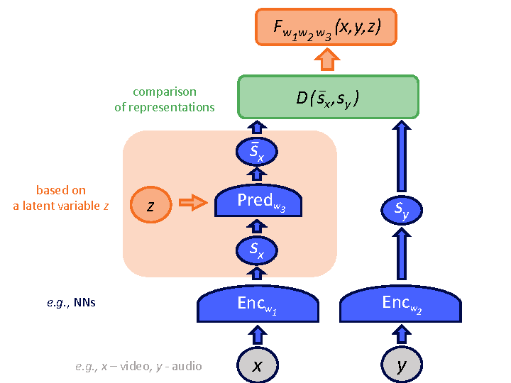{ width="620" }

*原文 Figure 9。右侧目标经过 encoder 变成 $s_y$，左侧 predictor 从 $s_x$ 与 $z$ 产生待比较表示。能量来自表示距离，图中没有要求输出原始目标的 decoder。*

两个 encoder 在这份框架中可以结构不同、参数不共享，因而 $x$ 与 $y$ 也可以属于不同数据形式，例如视频与音频。“Joint embedding”强调它们最终进入可以比较的表示关系，不意味着所有输入都必须由同一个网络编码。[↗](https://arxiv.org/pdf/2306.02572v1#page=20)

### 表示不变性与潜变量分工处理两类差异

JEPA 对多解性的处理分成两步。对于不需要保留的差异，encoder 学习 invariance，把不同外观映成相近表示；对于仍然影响任务、又无法由 $x$ 决定的差异，latent variable 保留多个预测分支。前者减少预测对象中的无关变化，后者表达剩余的相关不确定性。

以前面的道路例子作解释，服装纹理可以在某种规划表示中被弱化，行人向左或向右移动则需要保持区分。这个例子只是说明两条通道应承担什么职责，讲义没有给出自动驾驶上的对应实验。真正困难的是模型怎样学会这种分工，而不误删以后会用到的信息。

这也解释了为什么“让表示容易预测”不能成为唯一目标。如果删除全部信息，表示当然最容易预测。JEPA 引入可学习目标之后，训练必须同时限制这种自由度，否则它比固定像素目标更容易找到无意义的捷径。

## 训练 JEPA 要同时管住三条信息通道

### 表示应该有信息，潜变量应该受限制

Figure 10 把三种要求放在同一张图上。顶端的预测误差需要降低，两侧的 $s_x,s_y$ 应保留关于各自输入的信息，而 $z$ 的容量必须受限。它们分别对应前面三类捷径中的不同风险。

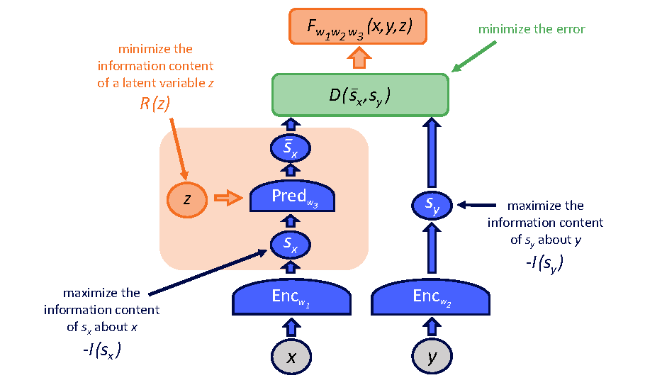{ width="760" }

*原文 Figure 10。蓝色约束防止 encoder 丢掉全部输入信息，橙色约束限制潜变量捷径，绿色箭头要求预测表示与目标表示匹配。*

两侧保信息，是为了防止常数表示；潜变量限容量，是为了防止目标直接绕过 $x$ 传给 predictor；预测匹配则让保留下来的信息建立关系。若只做第一项，模型未必学会预测；若只做第二项，可能使有用的不确定性无法表示；若只做第三项，两侧共同变常数就能完成任务。

原图中的 $-I(s_x)$、$-I(s_y)$ 和 $R(z)$ 是设计层面的信息约束符号，没有给出一套通用的可直接计算 mutual-information estimator，也没有规定损失权重。它们应被理解为训练目标需要满足的性质。讲义随后用 VICReg 说明其中一种实现方式，而不是宣布所有 JEPA 都要使用同一组具体训练技巧。[↗](https://arxiv.org/pdf/2306.02572v1#page=21)

这里也存在一个需要平衡的目标。Encoder 一方面要过滤不可预测或不相关细节，另一方面又要避免信息损失过度。所谓“尽量保留信息”不是要求目标表示原封不动保存每个像素，而是阻止学习退化为一个没有区分能力的编码。最终保留什么，需要由数据关系、预测时间尺度和训练约束共同决定。

### VICReg 的三个部分分别堵住什么漏洞

讲义介绍 variance-invariance-covariance regularization，先讨论 across-batch variance。把一个 batch 的表示按维度观察，如果所有样本在某一维上都接近常数，这一维就没有承载区分样本的信息。原文用下面的 hinge 项示意标准差下限。

$$
\left[1-\sqrt{\operatorname{Var}(v_i)}\right]_+.
$$

$v_i$ 在这里表示第 $i$ 个表示分量在 batch 样本上的取值，方差跨样本计算。当标准差低于阈值 1 时产生惩罚，达到阈值后这一项不再继续要求无限增大方差。它针对的是表示收缩到常数，而不是要求每张图片内部所有特征都彼此不同。

仅有方差还不够。模型可能把同一个有变化的标量复制到所有维度，每维方差都很大，实际却只携带一份信息。Covariance regularization 因而约束不同分量之间的非对角协方差，减少线性冗余。Invariance 或匹配项则把对应输入的表示联系起来，防止模型仅为分散输出而学习无关变化。

| Term | Quantity being controlled | Degenerate solution it addresses |
| --- | --- | --- |
| Variance | Per-dimension variation across a batch | Constant representations |
| Covariance | Off-diagonal feature covariance | Repeated linearly redundant features |
| Invariance / prediction | Agreement of related representations | Unrelated representations that do not predict each other |

去相关不等于统计独立。两个变量即使协方差为零，也可能存在强非线性关系。原文进一步讨论在预训练中使用非线性 expander，把表示映到更高维空间以帮助处理这些依赖。它提供一种增强训练约束的思路，没有证明任意 expander 都能保证所有分量独立，也没有给出本文专属的高维规模或权重配方。

讲义同时提到 BYOL、SimSiam、Barlow Twins 等相关方向，说明防止联合表示塌缩存在不同路径。它没有在同一实验协议下比较这些方法，因此这里能得到的是设计选择之间的关系，而不是哪种方法在所有视频预测任务上更好的排名。

## H-JEPA 让不同层级预测不同时间尺度

### 上一层需要改变抽象，也需要改变时间跨度

只有单层 JEPA，还不能自然解决长期规划。近期变化常常依赖细节，例如速度、位置与接触；长期目标则可能只需要知道物体是否已经移动到某个区域，或者某个子任务是否完成。若让最高层仍承担每一时刻的全部细节，长程预测会被大量不确定因素拖累。

Figure 11 将两个 JEPA 叠起来。底层 JEPA-1 从 $x_0$ 的表示预测短期 $x_1$ 的表示；上层先对底层表示再次编码，再从更抽象的当前状态预测更远的 $x_2$。上下层各自拥有 latent variable，图中分别为 $z$ 与 $z'$，用于表达相应粒度的未定因素。

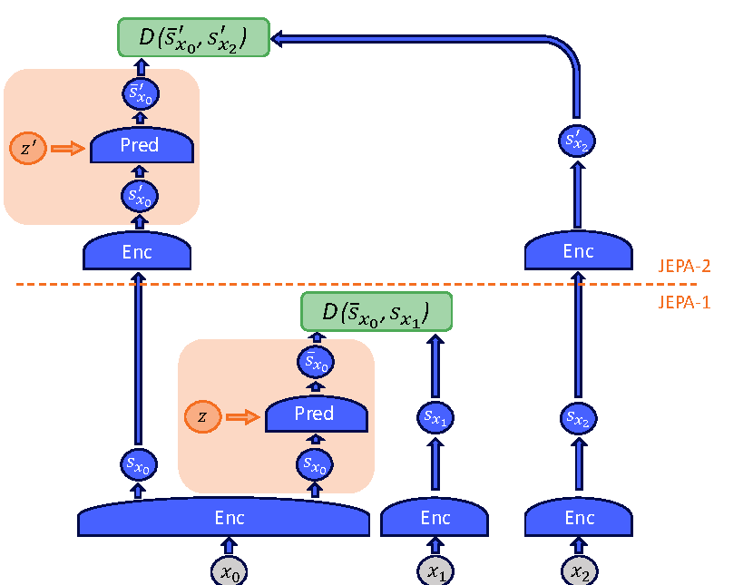{ width="690" }

*原文 Figure 11。先沿下半图读 $x_0\rightarrow x_1$ 的短期表示预测，再沿上半图读跨到 $x_2$ 的高层预测。两个比较目标跨越不同时间范围、使用不同抽象表示。*

层间可以借助 CNN 与 pooling 做 coarse-graining，进一步过滤细节、汇总更大范围的信息。于是“层级”包含两个变化，表示更加抽象，预测跨度也更长。单纯把同一网络堆得更深，或让低层模型多滚动若干步，并没有自动得到这种高层接口。[↗](https://arxiv.org/pdf/2306.02572v1#page=22)

这份图没有规定 $x_1$ 和 $x_2$ 相隔多少帧、每层使用多少参数，也没有定义具体的训练采样比例。它说明每层应该承担不同预测职责，具体时间尺度必须结合系统任务选择。若任务的高层状态仍需要较精确的几何信息，上层也不能因为“抽象”就把它全部丢掉。

### 从多尺度预测到层级规划，还需要接口

作者希望把复杂任务拆成较粗的子目标，再由下层逐步落实，并随着新观测不断更新。高层先给出较长时间范围内需要达到的状态，低层利用更精细的世界模型寻找短期行动。这种规划方向与前面的多尺度表示自然相接。

一个解释性的例子是把“拿到某件物品”拆成到达相应区域、接近物体、完成抓取。高层关心物品与位置关系，低层关心当前可执行的运动细节。这个分解并不来自本文机器人演示，它只用于说明 H-JEPA 设想中的抽象层次。

把设想变成系统时，至少需要明确高层状态怎样表达子目标、下层如何判断目标已实现、动作如何进入世界模型、预测误差怎样触发重新规划。仅有两层表示预测损失还不能自动生成这些接口。原文提出层级结构能够支持这类规划，没有在本篇中给出完整搜索算法或成功率来验证其闭环效果。

还有一个与潜变量有关的边界。如果 $z$ 表示其他行动者的不确定行为，规划器不能随意选择最有利的 $z$，再把它当作自己的可控动作。变量到底由 agent 控制、由环境决定，还是只用于补充未观察的信息，必须在接口里分开。EBM 能表示多种相容未来，并不自动给出在这些未来之间进行稳健决策的规则。

## 这套框架最适合怎样用

这篇讲义提供了一组能够定位模型问题的判断方法。看到预测很准确，先检查目标是否能被编码成常数、输入条件是否被潜变量绕过；看到生成了多种未来，再检查这些未来只是一个集合还是带有可解释的概率；看到模型层数很多，再检查不同层是否真的承担不同时间尺度的预测。

| Design question | Useful mechanism in the lecture | What still needs a task-specific decision |
| --- | --- | --- |
| Are multiple futures compatible with the input? | Energy landscape and latent variables | Which alternatives matter and how to search them |
| Does the representation contain useful information? | Variance and redundancy constraints | Which distinctions must survive abstraction |
| Is the predictor actually using its input? | Limited latent capacity | How much uncertainty the latent channel should carry |
| Can the model reason across different horizons? | Stacked JEPAs and coarse-graining | Time scales, subgoal semantics and cross-level interfaces |
| Can predictions guide actions? | Perception-planning-action cycle | Action conditioning, costs and replanning procedure |

这些方法的价值在于把“世界模型学得好不好”拆成可检查的问题。训练损失很低但表示方差接近零，说明目标已经退化；改变输入而保持潜变量不变，输出几乎不动，可能提示条件被绕过；长程表示仍然需要恢复大量不可预测纹理，则说明预测对象与时间尺度可能没有匹配。这些是根据讲义机制提出的检查方式，不是本文报告过的新实验结论。

读完这篇文章，最值得保留的是三条彼此制约的设计关系。能量提供相容性表达，仍需要有效推断与训练规则；潜变量表达缺失信息，仍需要容量约束和来源划分；层级表示减少长期预测的细节负担，仍需要把抽象状态接到可执行动作。H-JEPA 的意义在于把这些关系放进同一个框架，让后续实验能够分别检验它们，而不是用一项最终性能数字掩盖中间接口的问题。

## 关键术语

**Energy-Based Model（能量模型）** 为条件与候选的组合分配标量相容性评分，通过低能量区域表示可能解。

**Partition Function（配分函数）** 将未归一化权重转换成概率所需的全空间求和或积分，其计算成本可能成为训练瓶颈。

**Latent Variable（潜变量）** 未直接观测、却影响输出的解释因素，可以是连续、离散或结构化变量。

**Free Energy（自由能）** 将潜变量按指数能量权重边缘化后得到的有效能量，与只取最低能量的操作不同。

**Energy Collapse（能量塌缩）** 本来应区分相容与不相容配置的能量失去区分能力，常见原因包括常数表示、无限制潜变量与恒等重建。

**Positive / Negative Phase（正阶段与负阶段）** Boltzmann 类学习中，分别强化数据条件下的统计结构、抑制模型自身分布中过度表达的统计结构。

**JEPA（联合嵌入预测架构）** 在可学习表示之间进行预测，通过表示抽象与受限潜变量处理不同来源的不确定性。

**H-JEPA（层级联合嵌入预测架构）** 在不同抽象层级与时间跨度上组织 JEPA，目标是支持多尺度预测与层级规划。
