# JEPA：预测式表征学习路线

!!! info "论文信息"
    **论文题名：** A Path Towards Autonomous Machine Intelligence。 
    **作者：** Yann LeCun。 
    **机构：** Meta AI。 
    **时间 / 主题：** 2022-06；世界模型。 
    **arXiv / 官方报告：** arXiv：未找到专门条目；官方材料：[openreview.net/forum?id=BZ5a1r-kVsf](https://openreview.net/forum?id=BZ5a1r-kVsf)。 
    **GitHub / 项目：** GitHub：未找到官方链接；项目页：[openreview.net/forum?id=BZ5a1r-kVsf](https://openreview.net/forum?id=BZ5a1r-kVsf)。 
    **元数据来源与核验口径：** 来源：[官方 / 项目材料](https://openreview.net/forum?id=BZ5a1r-kVsf)；Checked Date：2026-06-04；Repro Status：Paper / official materials reviewed, independent reproduction not claimed。

## 从预测未来到选择行动，中间还缺哪些接口

一辆车看见前车驶向岔路，可以预测对方可能左转，也可能右转。但它还需要决定自己是否减速，记住刚才被遮挡的行人，并把“安全到达目的地”分解为当前车道和下一路口的行动。这些能力涉及不同的计算。预测得准，并不会自动给出应该采取的动作；动作看起来有利，也不代表其预测后果可信。

《A Path Towards Autonomous Machine Intelligence》把这些问题组织成一套自主智能架构。本文采用的版本是 2022 年 6 月 27 日的 Version 0.9.2。它是一份 position paper，核心成果是模块分工、表示学习原则与规划接口，全文没有报告一个已实现全部模块的统一系统及其 benchmark 成绩。因此，读这篇文章最有价值的方式，是沿着“观察怎样变成状态、状态怎样产生预测、预测怎样进入行动选择、行动结果怎样反过来训练模块”追踪信息流。[原文摘要与 §1](https://openreview.net/pdf?id=BZ5a1r-kVsf#page=1)

JEPA 在这套架构中承担一个具体任务。它让世界模型预测未来的表示，并允许表示丢弃一部分难以预测的细节，从而为跨时间推演留下可操作的状态。H-JEPA 进一步使不同层级处理不同时间跨度。与它们配合的 actor、cost、memory 和 configurator，则回答如何使用这些状态。把 JEPA 单独理解成一种两路编码器损失，会漏掉论文大半的设计动机。

全文还有一个贯穿始终的张力。表示必须足够丰富，才能区分需要不同动作的情境；它又必须有所舍弃，才能在未来仍然可预测。后文的非对比学习、潜变量约束、时间层级和任务相关预测头，分别从不同位置处理这个张力。[原文 §4.4–4.7](https://openreview.net/pdf?id=BZ5a1r-kVsf#page=24)

## 六个模块如何组成一次决策

Figure 2 把模块画在脑部示意图上，但阅读时应先看连接关系。感知送出当前状态，世界模型提供可能的后果，cost 评价这些后果，actor 调整动作。短期记忆与 configurator 横跨这个循环，为各模块提供历史和当前任务条件。

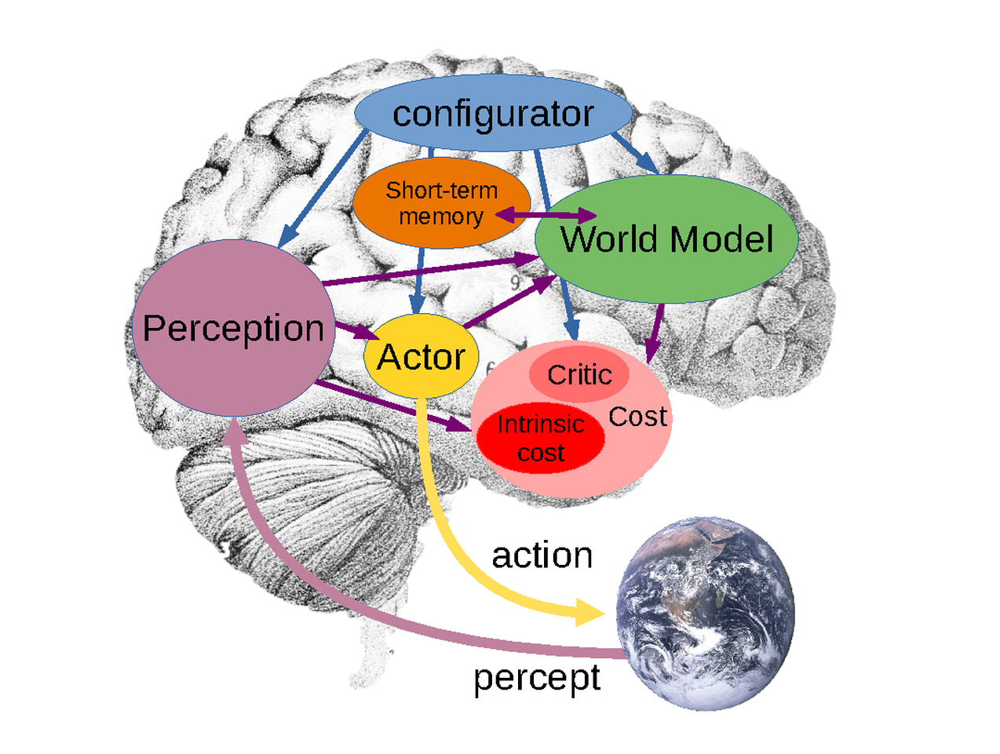{ width="860" }

*原文 Figure 2。图中的脑区位置是架构类比；后续可操作的内容来自模块输入、输出与训练关系，不能由这幅图推导出神经科学上的定位结论。*

| Module | 输入与输出 | 在决策中的职责 |
|---|---|---|
| Perception | 当前传感器观测、可能的历史与配置 → 状态表示 | 提取可供预测与行动使用的当前状态 |
| World Model | 已知状态、动作或其他条件 → 缺失信息与可能的未来状态 | 对当前未观测部分进行推断，并预测行动后果 |
| Actor | 状态、目标与预测结果 → 动作或动作序列 | 直接调用策略，或通过优化选择行动 |
| Cost | 真实或预测状态 → 标量代价 | 将即时驱动、未来后果与子目标纳入行动选择 |
| Short-Term Memory | 近期状态、代价等 → 可检索的历史信息 | 补充当前观测，支持 critic 学习与状态维护 |
| Configurator | 情境、目标及其他模块信息 → 模块配置 | 调整注意、计算通路和目标权重 |

这张表对应作者在 §3 的职责划分。世界模型的范围比“预测下一帧”宽，既包括未来，也包括当前缺失的信息。一个被遮挡的物体没有出现在当前图像里，系统仍可能需要根据历史推断它的位置；同一个世界模型则可以进一步判断某个动作之后它会怎样变化。[原文 §3](https://openreview.net/pdf?id=BZ5a1r-kVsf#page=7)

**世界是否可能如此，与这种结果是否值得追求，是两个不同的问题。**前者由世界模型及其相容性关系处理，后者由 cost 决定。错误地把它们合成一个“好坏分数”，会让规划器无法区分现实中不可能但很合意的结果，以及很可能发生但必须避免的结果。

作者假定这些内部模块大体可微，因而可以传递训练梯度，也可以对动作变量求优化梯度。这个条件只覆盖内部计算图。外部世界不会因为接上神经网络就变成可微函数，世界模型给出的动作梯度也只是学习到的局部近似。感知误差、模型误差和真实接触中的不连续性，都可能使预测方向与实际变化不一致。这也是后面必须不断重新观察、重新规划的原因。[原文 §3.1](https://openreview.net/pdf?id=BZ5a1r-kVsf#page=9)

## Mode-1 与 Mode-2 分别在什么时候支付计算成本

### 快速策略直接输出动作

Mode-1 的基本接口很短。观测 $x$ 经 encoder 得到 $s[0]$，策略模块 $A$ 输出当前动作。

$$
s[0]=\operatorname{Enc}(x),\qquad a[0]=A(s[0]).
$$

策略也可以结合记忆。关键在于，这一次动作选择不需要在线展开世界模型、比较完整的未来轨迹。已经学会的技能通过一次前向计算调用，因而适合反复出现的熟悉情境。

这不等于 Mode-1 运行期间停止学习。实际状态及其 intrinsic cost 仍可进入记忆；世界模型也可以在后台作出下一状态预测，等下一次观测到来后接受误差反馈。应分开“当前动作由谁决定”与“这一条交互后来训练哪些模块”。前者可以只使用策略，后者仍能更新感知、动力学与代价预测。[原文 §3.1.1](https://openreview.net/pdf?id=BZ5a1r-kVsf#page=9)

### 复杂情境先在模型中试行动

Mode-2 则把计算花在当前问题上。Figure 4 中，黄色 Actor 区域包含一串待优化动作，绿色模块反复使用同一个预测器，红色 cost 模块评价沿途状态。应先沿水平方向看一次 rollout，再想象 actor 如何重复改变下面的动作序列。

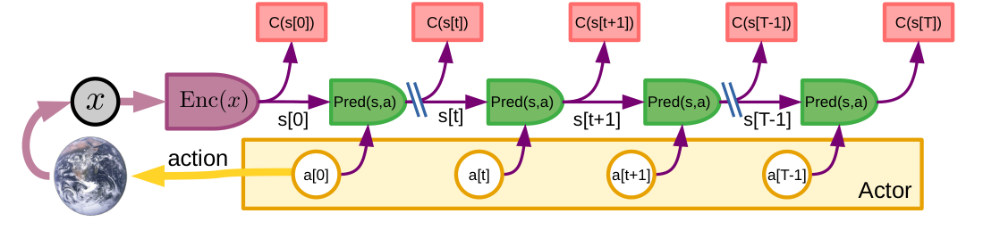

*原文 Figure 4。预测轨迹连接了动作与未来代价。图中多个 Pred 方块表示时间展开，不能据此理解为每个时间点各有一个独立训练的世界模型。*

为使时间索引清楚，可以把原文流程统一写成下面的形式。设预测范围为 $T$ 次状态转移，动作序列为 $a[0],\ldots,a[T-1]$，则

$$
s[t+1]=\operatorname{Pred}(s[t],a[t]),\qquad
\mathcal J(a[0:T-1])=\sum_{t=0}^{T}C(s[t]).
$$

这是对原文操作步骤的索引整理。$\mathcal J$ 是在当前世界模型下计算的轨迹代价，$C(s[0])$ 对当前动作优化通常为常数，未来各项才随候选动作改变。actor 给出初始序列，世界模型推演，cost 打分，优化器据此更新动作；循环若干次后只执行第一个或前几个动作，再从真实观测重新估计状态并规划。[原文 §3.1.2](https://openreview.net/pdf?id=BZ5a1r-kVsf#page=10)

这里容易混淆两个迭代。一个是模型内部的“修改候选动作，再预测一次”，期间真实世界没有执行这些候选动作。另一个是外部的“执行一小段，再接收新观测”。前者用于搜索，后者用于纠偏。若把整个预测序列一口气执行到底，就丢掉了 receding-horizon / MPC 式反馈最重要的校正机会。

可微模型允许计算 $\partial\mathcal J/\partial a[t]$，从未来代价经过状态转移传回较早动作。梯度给出了当前模型局部认为能降低代价的方向，但不保证全局最优，也不保证真实环境必然改善。论文明确允许在离散、不光滑或复杂多峰问题中使用搜索、动态规划、beam search、MCTS 等方法。它的主张是用学习到的世界模型评价动作后果，具体求解器仍需服从动作空间和模型性质。[原文 §3.1.2 与 §5](https://openreview.net/pdf?id=BZ5a1r-kVsf#page=11)

### 慢规划怎样变成可重复调用的技能

如果每次遇到同类问题都重新搜索，Mode-2 的成本会重复支付。Figure 5 在规划回路里加入策略模块 $A(s[t])$，用优化后的动作作为监督，让策略学会近似规划结果。

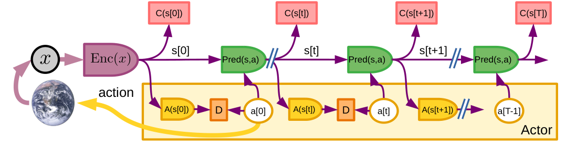

*原文 Figure 5。橙色的距离项比较策略输出与经过 Mode-2 优化的动作；它们是策略学习信号，顶部红色 cost 才是规划原本优化的任务目标。*

记规划器得到的动作是 $\check a[t]$，策略参数通过减小 $D(\check a[t],A(s[t]))$ 更新。训练好后，策略既可直接用于 Mode-1，也可作为 Mode-2 的初始化器。后一种用法先由 $A(s[0])$ 提出动作，再由世界模型预测 $s[1]$，继续调用 $A(s[1])$，如此快速构造整段初始轨迹，然后交给更昂贵的优化器细化。[原文 §3.1.3](https://openreview.net/pdf?id=BZ5a1r-kVsf#page=12)

这就是本文的第一种 amortized inference。一次次针对具体状态求解的结果被积累到网络参数里，今后通过前向计算近似求解。它改变的是成本出现的位置，训练时需要规划数据，执行时可以省去部分搜索。策略的质量依赖规划器及其世界模型，因此这里的“最优动作”应理解为优化过程得到的解，论文没有给出它接近真实全局最优的保证，也没有报告技能编译的实际速度提升。

## Cost 如何表达目标，又如何学到延迟后果

### 固定驱动与可训练预测承担不同职责

世界模型可以预测“碰撞即将发生”，但为何要避免碰撞，需要由 cost 表达。原文 Eq. 1–3 将总成本分成两部分。

$$
C(s)=\operatorname{IC}(s)+\operatorname{TC}(s),\qquad
\operatorname{IC}(s)=\sum_{i=1}^{k}u_i\operatorname{IC}_i(s),\qquad
\operatorname{TC}(s)=\sum_{j=1}^{l}v_j\operatorname{TC}_j(s).
$$

$\operatorname{IC}$ 是 intrinsic cost，给出系统的基本驱动；$\operatorname{TC}$ 是 trainable cost，也称 critic，用来预测未来 intrinsic cost，或表达当前任务中的子目标。$u_i,v_j$ 由 configurator 调节，使系统在不同阶段关注不同目标。[原文 §3.2](https://openreview.net/pdf?id=BZ5a1r-kVsf#page=13)

“不可变”具体指 $\operatorname{IC}_i$ 这些基础模块的定义不随常规学习而改变，不意味着每个情境下组合权重、注意重点以及总 cost 都固定。作者希望基本驱动长期存在，又允许阶段性的目标组合改变。这种设计仍需要人为选择基本驱动及其表示，不能读成系统无须目标先验。

一个即时安全信号只能在危险发生或已经接近时给出高代价。critic 的用途是提前看到远期后果，使规划不必一直展开到危险真正发生的时间点。类似地，高层目标可以通过可训练代价转换成较早的中间目标。代价模块因此连接了任务定义和有限预测范围，但代价估计本身的错误也会影响动作选择。

作者还区分了几类行为来源。直接编写行为规则是在规定“怎样做”；行为克隆利用专家动作训练策略；逆强化学习试图从专家行为推断目标；这里的目标驱动架构则在给定代价下推演后果并选择动作。它们能够组合，不能因为系统使用预测规划，就推断它不再需要行为先验、示范或人工目标设计。[原文 §3.2 与 §7](https://openreview.net/pdf?id=BZ5a1r-kVsf#page=14)

### Critic 从记忆里取出时间错开的监督

Figure 7 回答了 critic 的目标值从哪里来。先看下半部分，系统不断记录时间、状态与 intrinsic cost；再看上半部分，训练时读出较早状态，以及较晚时刻的 intrinsic cost，把二者配成预测任务。

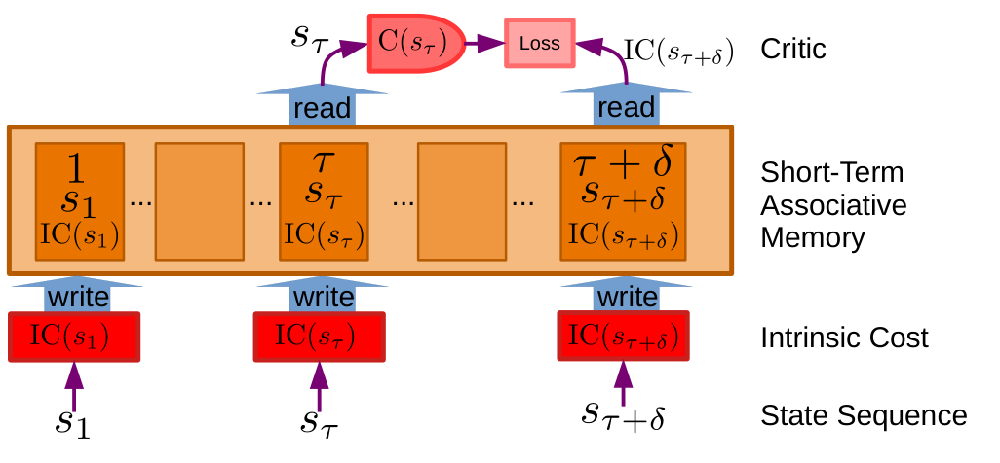

*原文 Figure 7。底部写入 $(\tau,s_\tau,\operatorname{IC}(s_\tau))$，顶部比较较早状态的预测与未来代价。图中用 $C$ 泛指预测模块，正文 §3.3 将其明确写为可训练的 $\operatorname{TC}$。*

在最简单的例子里，记忆提供 $s_\tau$ 与 $\operatorname{IC}(s_{\tau+\delta})$，训练误差为

$$
\mathcal L_{\text{critic}}
=\left\|\operatorname{IC}(s_{\tau+\delta})-\operatorname{TC}(s_\tau)\right\|^2.
$$

$\delta$ 表示未来时间偏移，critic 学习从较早状态估计那个未来时刻的代价。这是一个具体的监督接口。原文还提出预测未来折扣代价的组合或分布，但没有把所有可能方案固定为一个完整的 Bellman 更新算法；不能把上式自动替换成常见 actor-critic 实现中的特定 TD loss。[原文 §3.3](https://openreview.net/pdf?id=BZ5a1r-kVsf#page=15)

被存储的状态既可以来自真实感知，也可以来自 Mode-2 中的想象；状态向量还可以包含已采取或计划采取的动作信息。这让 critic 能利用模型内经验，但两类标签的意义不同。真实后果可以校正预测偏差，想象后果则仍受世界模型支配。如果只在模型自己想象的状态上拟合，就可能把世界模型的偏差进一步写进 critic。论文给出了模块间的数据通路，实际系统仍需决定怎样组织和校准这两类经验。

## JEPA 用能量表达相容性，用表示控制预测内容

### 一个输入可以对应多种合理结果

从一个观察 $x$ 到另一个观察 $y$，关系通常有歧义。两张图可能来自同一场景的不同视角，未来车辆可能沿不同岔路行驶。确定性地回归唯一像素目标，会把这些差异挤到一个输出里。原文先用 energy-based model 描述更一般的相容关系，让真实相容的 $(x,y)$ 获得低能量，不相容的组合获得高能量。

对于含潜变量的能量函数 $E_w(x,y,z)$，推断一个已观测样本对的关系，需要找到最能解释它的 $z$，再读出相应能量。

$$
\check z=\arg\min_{z\in\mathcal Z}E_w(x,y,z),\qquad
F_w(x,y)=\min_{z\in\mathcal Z}E_w(x,y,z)=E_w(x,y,\check z).
$$

$w$ 是模型参数，$z$ 是这个样本对的未观测关系。相机位移、车辆的转弯分支，都可作为 $z$ 的解释性例子。$\check z$ 是一个潜变量取值，$F_w$ 则是一个标量能量，二者在类型和用途上不同。推断时优化样本变量，学习时更新模型参数，也需要分开。[原文 Eq. 4–5](https://openreview.net/pdf?id=BZ5a1r-kVsf#page=19)

这里的 $F_w$ 与前面的 $C(s)$ 都能画成红色能量模块，却不承担同一个语义。$F_w$ 判断数据关系是否符合世界规律，$C$ 衡量状态是否符合行为目标。危险的未来完全可能具有低相容性能量和高任务代价。后面规划器需要同时尊重“能发生”和“值得发生”两种约束。

### 预测器只对表示负责

Figure 12 在右侧加入目标 encoder。先沿左侧从 $x$ 到 $s_x$，再经 predictor 得到 $\tilde s_y$；右侧把真实 $y$ 编码为 $s_y$，距离模块在两个表示之间计算误差。图中没有从 $\tilde s_y$ 还原完整 $y$ 的 decoder。

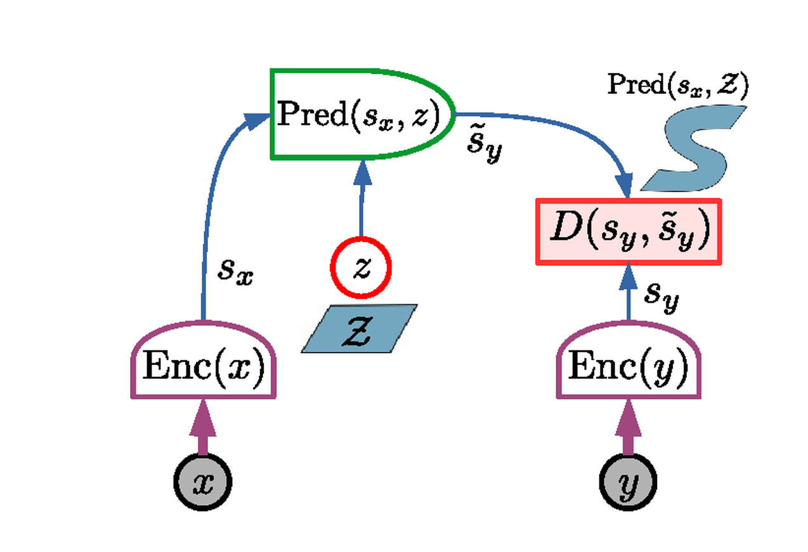{ width="760" }

*原文 Figure 12。右上角蓝色区域示意潜变量变化时 predictor 能产生的表示集合。预测目标是 $s_y$，不是图像像素本身。*

原文 Eq. 10–12 写为

$$
s_x=\operatorname{Enc}_x(x),\qquad s_y=\operatorname{Enc}_y(y),\qquad
\tilde s_y=\operatorname{Pred}(s_x,z),
$$

$$
E_w(x,y,z)=D(s_y,\tilde s_y),\qquad
F_w(x,y)=\min_z D\!\left(s_y,\operatorname{Pred}(s_x,z)\right).
$$

两侧 encoder 不必共享参数，甚至不必采用同一种架构，因此 $x,y$ 可以是不同模态。$D$ 是表示间的不相容度或预测距离。训练时右侧能够看到目标观测；做未来推演时 predictor 只拥有当前表示和选定的条件，未来真实 $s_y$ 要等观测到达才可用于比较。[原文 §4.4](https://openreview.net/pdf?id=BZ5a1r-kVsf#page=24)

由此产生两种不同的多解来源。第一种来自 encoder 的不变性。不同纹理、光照或细小扰动可以被映射到同一个 $s_y$，世界模型无须为它们逐一生成分支。第二种来自 $z$。如果前车左转和右转会改变本车决策，就不能把它们都丢掉；predictor 应允许不同的 $z$ 产生不同的未来表示。

以岔路场景为例，路面某块纹理在未来怎样投影，可能与当前驾驶决策关系不大，适合被表示舍弃；前车的位置、速度、朝向与所选道路，却可能必须保留。这只是作者阐述原则的例子，真正哪些细节会被保留，仍取决于数据、时间跨度、架构和训练约束。论文并没有证明任何 JEPA 都会自动学到恰好合适的物理状态。[原文 §4.4](https://openreview.net/pdf?id=BZ5a1r-kVsf#page=25)

此外，$z$ 是可选接口。原文允许无潜变量的 predictor，也允许 predictor 退化成恒等映射。恒等映射适合学习不同视图之间的不变表示；更复杂的 predictor 则可以承担状态变化预测。因此，“JEPA”描述了一类联合表示预测架构，不能从名称直接推断它一定包含某种固定维度、固定分布的随机 latent。

## 零预测误差可能来自两条完全不同的捷径

### 表示变成常数，或者潜变量复制答案

如果只最小化 $D(s_y,\tilde s_y)$，系统存在明显的平凡解。两侧 encoder 都输出同一常数，predictor 也输出该常数，损失就可很小。另一个平凡解发生在潜变量过强时。如果 $z$ 可以直接携带完整 $s_y$，predictor 只需复制 $z$，便无须利用 $s_x$ 学习输入与目标之间的关系。

这两条捷径破坏的是不同位置。第一条使表示没有信息；第二条保留了目标信息，却让它绕过了需要学习的预测关系。Figure 13 的四个方向正是为同时封住这两处漏洞而设。

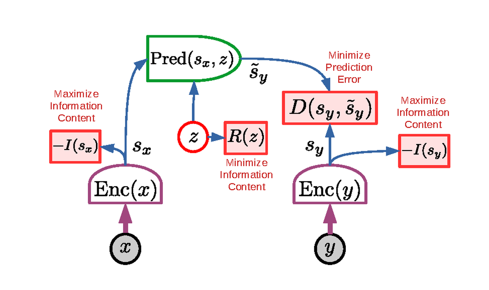{ width="840" }

*原文 Figure 13。左右两侧要求表示保留信息，中间要求低预测误差，潜变量旁的 $R(z)$ 则限制答案通过 latent 旁路直接进入预测器。四项必须联合理解。*

作者提出的四项原则是让 $s_x$ 对 $x$ 信息丰富、$s_y$ 对 $y$ 信息丰富、$s_y$ 能够从 $s_x$ 预测，以及让 $z$ 所携带的额外信息尽量少。它们共同决定一个折中。如果 encoder 完全可逆，所有原始细节都保留，预测仍可能非常困难；如果过度压缩，又会丢掉有用差异。这里“最大化信息”是设计目标，原文后续使用可训练的统计替代项，并没有要求实际精确计算高维互信息。[原文 §4.5](https://openreview.net/pdf?id=BZ5a1r-kVsf#page=26)

### 限制潜变量究竟限制了什么

原文列举离散化、低维约束、稀疏化和噪声等途径。每一种约束都在减少 predictor 借助 $z$ 随意解释目标的自由度，但它们产生的几何结构不同。[原文 §4.5](https://openreview.net/pdf?id=BZ5a1r-kVsf#page=27)

| Latent constraint | 如何限制预测集合 | 解释时需要保留的条件 |
|---|---|---|
| Discrete latent | 固定输入时，有限个 code 对应有限个预测表示 | $K$ 个 code 至多产生 $K$ 个不同预测表示，不意味着原始观测只允许 $K$ 种 |
| Low-dimensional latent | 连续 predictor 把低维 latent 映射为表示空间中的受限集合 | 对光滑映射可讨论局部维数，低维实数本身不等于严格的有限比特容量 |
| Sparse latent | 每次只使用少数活动分量 | 可形成多个低维分支，活动模式本身也携带信息 |
| Noisy / stochastic latent | 通过噪声或分布正则限制可靠传递的信息 | 效果依赖噪声与训练目标，不能只因使用随机变量便断言不存在旁路 |

离散情形尤其能看出表示空间与原始空间的差别。给定 $s_x$，$K$ 个 $z$ 值最多产生 $K$ 个 predictor 输出；但 encoder 可以把大量不同的 $y$ 都映射到同一个输出，所以这些零距离表示的原始输入集合仍可能非常大。把“至多 $K$ 个点”的说法直接搬到 JEPA 的原始图像空间，会漏掉 encoder 不变性这条通路。

稀疏约束的一个原文例子是

$$
R(z)=\alpha\sum_i|z_i|.
$$

它惩罚较大的绝对值，鼓励仅用少数活动分量解释不可预测部分。$\alpha$ 控制这项正则的力度。若限制太弱，$z$ 可能代替当前状态；若限制过强，不同的合理未来又可能被压成一个不恰当的预测。论文将“哪一种约束最适合复杂世界模型”保留为开放问题，并未提供统一的最优 latent 配方。

### 对比训练与正则训练怎样避免平坦能量

原文先用四类架构说明塌缩来源，再区分两种训练方式。对比方法把真实样本能量压低，同时把选出的不相容样本能量抬高；正则方法则一面压低数据能量，一面限制低能量区域任意扩张。它们可以组合，论文的倾向并不构成互斥定义。[原文 §4.3](https://openreview.net/pdf?id=BZ5a1r-kVsf#page=20)

一个距离相关的 hinge loss 为

$$
\mathcal L=\left[F_w(x,y)-F_w(x,\hat y)+\mu\|y-\hat y\|^2\right]_+.
$$

$\hat y$ 是对比样本，$[u]_+=\max(u,0)$。当负样本能量还没有高到满足 margin 时，损失推动正样本更低、负样本更高；达到间隔后，这个样本对不再贡献梯度。负样本离真目标越远，式中的距离项要求的间隔越大。[原文 Eq. 7](https://openreview.net/pdf?id=BZ5a1r-kVsf#page=22)

InfoNCE 则在一个正样本与若干对比样本之间进行竞争。

$$
\mathcal L=F_w(x,y)+\log\left[
\exp\bigl(-F_w(x,y)\bigr)+\sum_{k=1}^{K}\exp\bigl(-F_w(x,\hat y[k])\bigr)
\right].
$$

减小正样本能量会提高它在这组候选中的相对权重，较低能量的负样本会施加较强压力。这是有限候选集合上的归一化，不能直接当成整个连续输出空间的精确概率归一化。[原文 Eq. 9](https://openreview.net/pdf?id=BZ5a1r-kVsf#page=23)

作者担心，高维空间中的不合适低能量区域太多，有限负样本很难覆盖，因此主张探索非对比的体积约束。这是一个关于训练难度和架构选择的论证，并非证明所有对比学习都必须付出相同的指数成本。表示维度、能量函数的结构以及负样本选择，都会改变实际情况。

附录把多种方法按“怎样获得对比信息”放到同一框架。这个分类有助于理解作者所用的 contrastive 是广义概念，范围比图像表征学习里常见的 batch 内负样本更广。

| Method family | 对比或归一化信息从哪里来 | 与 JEPA 讨论的关系 |
|---|---|---|
| Exact maximum likelihood | 枚举离散输出，或利用可解析积分 | 对整个可处理输出空间进行归一化 |
| Monte Carlo / MCMC | 从模型相关分布采样 | 用样本估计归一化梯度，混合质量与采样成本影响效果 |
| Contrastive Divergence | 运行较短采样链 | 用更便宜但近似的负相位更新替代充分混合 |
| Hard-negative hinge | 寻找能量较低、却与真样本不相容的候选 | 把学习压力集中在当前容易混淆的位置 |
| GAN-style training | 由可训练 generator 提供样本 | 通过生成器搜索能量模型当前难以区分的区域 |
| Denoising Auto-Encoder | 对干净目标作破坏，再训练恢复 | 作者将 corruption 视为构造对比邻域的一种方式 |

表中沿用附录的解释口径。尤其是 MCMC 下类似“正样本能量减采样能量”的表达，应放回梯度估计过程理解，不能脱离采样机制就把它说成精确 negative log-likelihood 的数值。JEPA 的核心取舍由此更清楚，作者希望以表示统计约束和 latent 限制减少对显式负样本探索的依赖。[原文附录 Table 1](https://openreview.net/pdf?id=BZ5a1r-kVsf#page=62)

## VICReg 把抽象的信息要求变成可计算约束

Figure 14 给出了一个训练接口实例。注意绿色 predictor 的误差仍在 $s_y$ 与 $\tilde s_y$ 之间计算；两边的 expander 将表示映射到更高维的 $v_x,v_y$，为统计约束提供另一条路径。

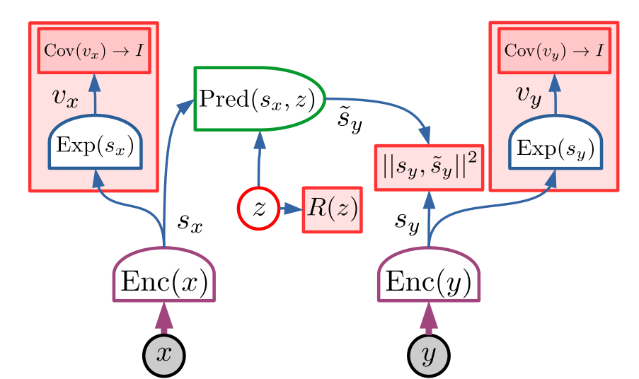

*原文 Figure 14。上方的 $\operatorname{Cov}(v)\to I$ 表示减少塌缩与冗余的方向。结合正文的 hinge variance 定义，它不能被逐字解释成每一个对角元都被精确固定为 1。*

variance 项在 batch 内检查各分量是否还有变化。原文讨论对 $s_y,v_y$ 的分量标准差施加下限，并在 $x$ 一侧施加相同原则。如果所有样本都被编码成一个常数，标准差接近零，便会受到惩罚。hinge 的特点是标准差超过阈值后不再为这一项受罚，因此它提供的是下界，没有单独规定方差必须等于某个唯一值。[原文 §4.5.1](https://openreview.net/pdf?id=BZ5a1r-kVsf#page=29)

covariance 项则压低 $v_y$ 不同分量之间的非对角协方差，并对 $v_x$ 做同样处理。单有 variance 下限还不够，所有维度都复制同一个变化信号，也能各自具有非零方差。去相关约束鼓励不同分量提供更多不同的线性信息。非线性 expander 使约束作用在更丰富的变换空间，但零协方差仍不等于一般意义上的统计独立，也不能据此保证原表示无冗余。

第三部分是预测距离 $D(s_y,\tilde s_y)$。当 predictor 是恒等函数时，它就是不同视图表示之间的距离，例如 $\|s_y-s_x\|^2$；当 predictor 学习时间变化时，系统允许表示改变，只要求这种改变能由当前状态与必要条件预测。若 predictor 使用自由度较高的 $z$，还需要前一节的信息限制。[原文 §4.5.1](https://openreview.net/pdf?id=BZ5a1r-kVsf#page=29)

因此 VICReg 风格训练同时处理“不同样本不能全相同”“不同分量不要全重复”“关联观察之间要可预测”。论文把它称为对分量而非对样本作对比，意在强调统计约束的位置。它不是只剩一个 L2 loss，也没有让负样本缺席自动转化为充分的信息保真保证。

还有一个控制层面的缺口。某个变量在数据中容易预测，不一定对任务最有用；某个关键变量虽然难预测，却可能决定安全。§4.5.2 因此提出附加 prediction heads，从预测表示 $\tilde s_y$ 读取信息，预测由数据可获得、且与任务相关的变量。把头接在预测表示上，能同时要求表示保留这类信息，并让 predictor 在未来状态中传递它。具体监督信号和任务仍需选择，这个接口本身没有证明任务相关性会自然出现。

## H-JEPA 用抽象层级改变可以预测的时间跨度

让同一种详细状态连续预测很久，误差和不确定性会逐步累积。驾驶时，接下来几秒的避让需要精确速度与位置；规划上班路线时，更有用的状态可能只是道路、路口与目的地。后一个任务跨越更长时间，却允许舍弃更细的瞬时运动细节。

Figure 15 以两层示意这种变化。底层从原始输入编码状态并预测相邻时刻，上层继续编码底层状态，跨过更长的时间间隔预测。先看上层 predictor 的两端对应了哪些底层时刻，再看各层自己的预测距离和 latent 约束。

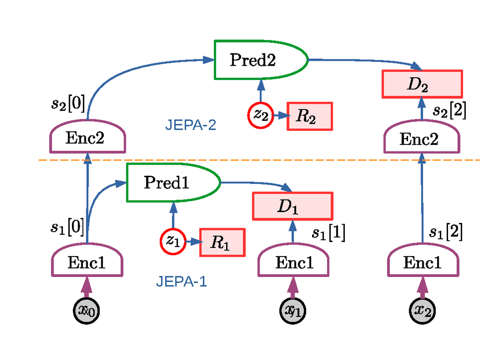{ width="860" }

*原文 Figure 15。每层有自己的表示、预测器和训练关系。图中 0、1、2 是示意时间位置，不能当成一个已实现模型的固定帧间隔或训练预算。*

上层可以通过时间 pooling 汇聚低层的一段过程，使单个高层状态覆盖更长时间。低层处理局部、详细、相对容易短时预测的变化；上层处理较粗、较稳定、适合长程预测的变化。原文允许逐层训练，也允许联合训练，并建议探索卷积等模块以及层间时间 pooling，没有固定具体实现。[原文 §4.6](https://openreview.net/pdf?id=BZ5a1r-kVsf#page=31)

这使“抽象”具有明确的计算作用。只把网络加深，而每层仍被要求恢复相同的细节、跨过相同的时间，并没有获得这里的时间分工。H-JEPA 希望高层状态丢弃那些在较长时间尺度上既不稳定、又不值得保留的变化，让有限次数的预测跨越更长真实过程。

但图中层级的存在还没有解决抽象的质量。如果上层丢掉门是否锁住，路线规划可能认为两个房间可直接穿行；若它保留所有像素细节，又失去长程预测的优势。这正是表示约束、任务相关信号与下层执行反馈必须共同发挥作用的地方。作者提出了层级结构如何连接，尚未给出保证高层状态恰好保留可达性条件的学习定理或实验结果。

## 高层动作怎样变成下层可以执行的条件

Figure 16 把 H-JEPA 接入 Mode-2。它最关键的连接是上层动作通向下层 cost 的箭头。高层先选出抽象条件，下层再寻找能够满足这些条件的具体动作。

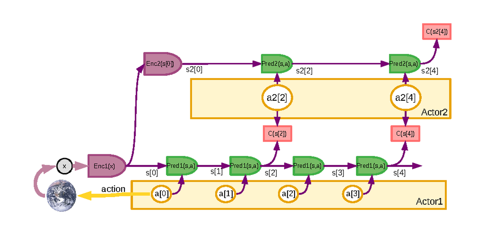{ width="920" }

*原文 Figure 16。上方的 $a_2[2],a_2[4]$ 是低层未来状态应满足的条件；下方的 $a[0],\ldots,a[3]$ 才沿低层动力学影响逐步状态。*

当前观测先变成 $s[0]=\operatorname{Enc}_1(x)$，再变成高层状态 $s_2[0]=\operatorname{Enc}_2(s[0])$。任务以高层终态代价 $C(s_2[4])$ 表达。高层 actor 使用较粗的动力学模型寻找两个抽象动作，使高层未来状态更接近目标。[原文 §4.7](https://openreview.net/pdf?id=BZ5a1r-kVsf#page=31)

高层动作随后成为下层的子目标。图中下层代价简写为 $C(s[2])$ 与 $C(s[4])$，正文明确说这些模块还接收相应高层条件。把省略的参数写出来，可以理解为 $C(s[2],a_2[2])$ 与 $C(s[4],a_2[4])$。它们衡量下层预测状态满足高层条件的程度，低层 actor 再优化 $a[0:3]$，使途中状态与终点符合这些条件。[原文 Figure 16 与 §4.7](https://openreview.net/pdf?id=BZ5a1r-kVsf#page=32)

这个接口避免了要求高层直接描述每个电机控制量。比如高层指定某个可达区域，低层负责选择具体运动；高层指定对象关系，低层寻找满足关系的状态。不过，这些例子说明的是条件接口，不是本文已经训练出的特定机器人技能。

作者指出，只做一遍自上而下的贪心求解并不理想。上层可能给出下层无法达到的子目标，或者不同子目标单独可达、连在一起却不合适。更合理的方式是跨层迭代，使高层计划根据低层可行性调整，低层也根据更新后的高层目标重新求解。这要求高低层之间传递的不只是“去做什么”，还包括计划对预测一致性和执行代价的影响。

这里仍有一个尚未填满的学习接口。图已经说明给定子目标之后如何使用它，却没有完整解决系统怎样自动发现可组合的子目标，以及 configurator 怎样为新任务选出合适的子目标序列。把这条连线称为“自动层级任务分解已经解决”，超出了论文证据。

## 不确定性需要留在规划里，不能被优化器挑掉

### 可控动作与不可控未来具有不同身份

Figure 17 在规划图里增加红色 latent 及其约束 $R$。黄色动作仍由 actor 选择，红色变量表示当前信息不能确定的变化。两种变量虽然都进入预测器，却不能使用同一种优化方向。

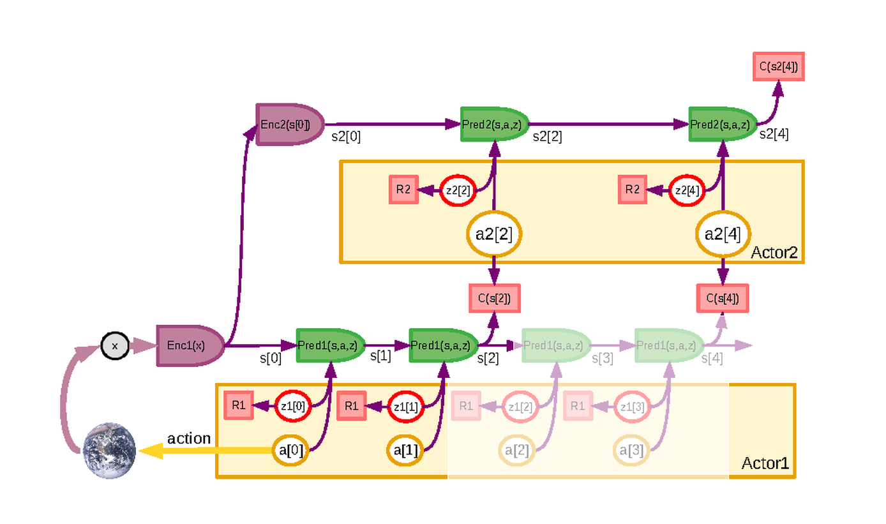{ width="920" }

*原文 Figure 17。各层预测器同时接收动作 $a$ 与潜变量 $z$。红色 $z$ 属于环境不确定性，规划不能假设 actor 能命令它取最便利的值。*

原文列举了多类不确定性来源，包括随机变化、对初始条件敏感的过程、部分可观测性、传感器局限、表示压缩，以及模型容量或训练数据不足。它们提示一个共同事实，同样的当前表示与动作可能不足以唯一决定未来。latent 可以为这部分差异保留条件通道，但不会自动判断某次误差究竟来自世界随机性还是模型知识不足。[原文 §4.8](https://openreview.net/pdf?id=BZ5a1r-kVsf#page=32)

$R(z)$ 约束哪些 latent 更合理。其参数可以固定，也可以依赖当前状态、历史预测、记忆和配置。因而连续时间的 $z$ 不必独立采样。若某个不可见因素会持续影响多步，前后 latent 需要表达这种相关性，否则世界模型可能每一步都随机改变隐含原因，得到局部看似合理、整体却不连贯的轨迹。[原文 §4.8](https://openreview.net/pdf?id=BZ5a1r-kVsf#page=33)

### 先有可行集合，必要时才加概率

附录用 level set 给出了不依赖概率归一化的描述。对确定性函数 $g$，让 $z$ 在低正则能量集合中变化，输出便扫过一组可能结果。

$$
\mathcal Z_h=\{z\mid R(z)<h\},\qquad
\mathcal Y_h=\{g(x,z)\mid z\in\mathcal Z_h\}.
$$

$h$ 控制允许考虑的 latent 范围。这样的接口先回答“哪些结果可以由允许的条件解释”，不必立即回答每种结果的精确概率。如果需要概率，并且归一化积分有限，可以进一步定义

$$
P(z)=\frac{e^{-R(z)}}{\int e^{-R(z')}\,dz'},\qquad
P(y\mid x)=\int\delta\!\left(y-g(x,z)\right)P(z)\,dz.
$$

这里 $\delta$ 是 Dirac delta，第二式表示把 latent 分布经 $g$ 推到输出空间。附录给出的数学构造说明能量表示能够与概率相连，但不能由此推断模型的概率已经对应真实发生频率。使用预期代价规划时，分支权重是否校准，会直接影响动作选择。[原文附录 Eq. 21–24](https://openreview.net/pdf?id=BZ5a1r-kVsf#page=58)

### 正确的未来选择顺序决定是否在幻想

对于一个已经观察到的 $(x,y)$，寻找 $\check z$ 是在解释发生过的结果；对于尚未发生的未来，却不能让规划器同时选择动作和最有利的 $z$，然后把这条好结果当成保证。前车究竟向哪边转，不受本车 actor 控制。

原文讨论了对多种未来计算平均代价、结合平均与方差，以及用对抗方式考虑高代价情形。用统一符号说明这些选择，设 $\mathcal J(a,z)$ 表示动作计划与 latent 轨迹共同产生的代价，那么平均目标可写成 $\min_a\mathbb E_z[\mathcal J(a,z)]$，保守目标可写成 $\min_a\max_z\mathcal J(a,z)$。这些式子是对作者讨论的简化整理，具体分布、约束集合和求解器仍需确定。[原文 Figure 17](https://openreview.net/pdf?id=BZ5a1r-kVsf#page=33) [原文 §5](https://openreview.net/pdf?id=BZ5a1r-kVsf#page=37)

与之相对，直接求 $\min_{a,z}\mathcal J(a,z)$ 会挑选最有利的未来，容易形成愿望式计划。另一种更隐蔽的问题，是分别对每个未来求最优动作，再把这些好成绩平均，却忽略当前还不知道真实分支。动作若必须在分支揭晓前执行，就必须在这些未来之间共享同一个当前决定；新的观测到达以后，后续动作才可以依分支调整。这是从论文的不确定性接口推出的执行要求，决定计划能否在真实时间顺序下成立。

分支计算也有代价。若每一步考虑 $K$ 个 latent 值，完整展开到第 $t$ 步最多形成 $K^t$ 条 latent 序列。原文建议使用剪枝、定向搜索、MCTS，或对连续 latent 采样与优化。它提出了缩减搜索的方向，没有给出适用于所有场景的分支预算或风险系数。抽象层级可以减少必须逐帧展开的步数，但不会消除不确定性搜索本身。

## 两种摊销推断的训练数据不能互换

前面从 Mode-2 学 Mode-1，是把优化后的动作教给策略。附录还提出另一种 amortized inference，用一个 encoder 直接预测潜变量优化的解。Figure 19 中最应注意的是右下角的 $y$，它与 $x$ 一起进入推断网络。

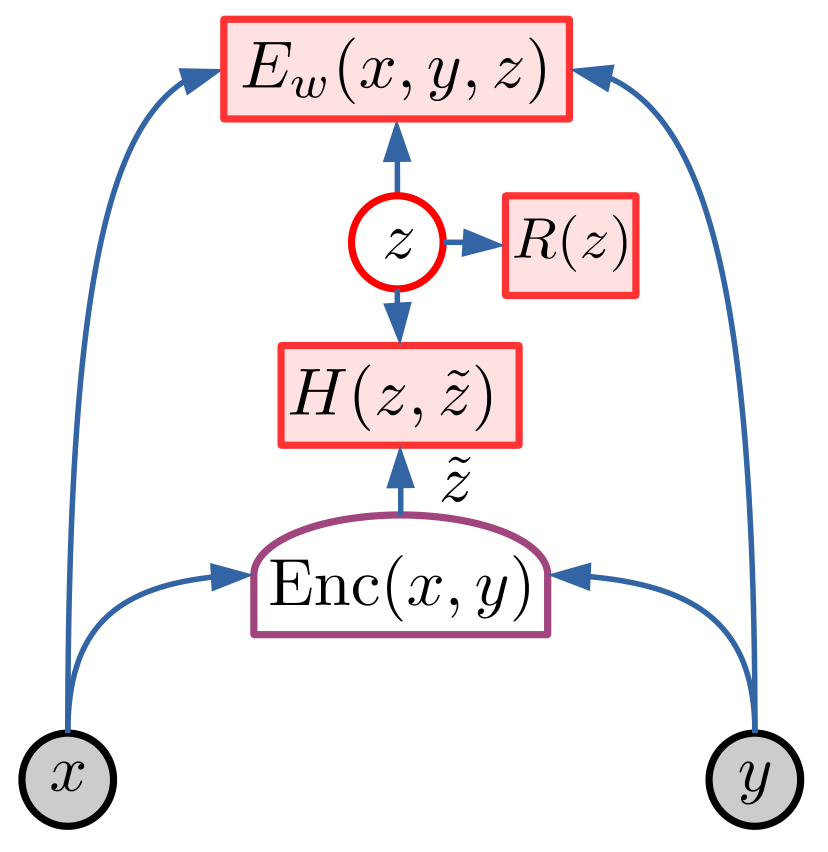

*原文 Figure 19。推断网络能够看到目标 $y$，因此适合解释已观测样本对；它不是不访问未来目标就能预测未来 latent 的先验网络。*

逐样本推断可能需要反复对 $z$ 求梯度，尤其在 predictor 或 decoder 较大时成本很高。作者建议先优化得到 $\check z$，再训练网络 $\tilde z=\operatorname{Enc}(s_x,y)$，使 $H(\check z,\tilde z)$ 减小。这个网络今后可以直接近似输出解，也可以为后续迭代提供更好的起点。[原文附录 Amortized Inference](https://openreview.net/pdf?id=BZ5a1r-kVsf#page=59)

| Amortized inference | 要近似的昂贵计算 | 网络使用的主要信息 | 训练后可以怎样用 |
|---|---|---|---|
| Mode-2 → Mode-1 policy | 给定状态与任务下的动作序列优化 | 当前状态，及相应任务条件 | 快速选择动作，或初始化规划 |
| Latent inference network | 给定 $(x,y)$ 下的 latent 优化 | 输入表示与已观测目标 $y$ | 解释样本对，或初始化 latent 求解 |

第二种网络直接看到 $y$，因此旁路复制答案的风险更强。附录再次强调 $R(z)$ 的信息限制，避免 $\tilde z$ 把完整目标送入生成或预测路径，令任意样本都能得到低能量。[原文附录 Figure 20](https://openreview.net/pdf?id=BZ5a1r-kVsf#page=60)

做未来预测时，真实 $y$ 尚不可用，不能原封不动调用这个接口。此时需要由历史与当前状态约束 latent，或在允许集合中枚举、采样，再让未来真实观测检验结果。把训练中的目标条件推断器误当成推理时可用的未来预测器，会制造信息泄漏，也会让一个本来昂贵的未知问题看起来被廉价解决了。

## 状态记忆要支持局部修改，不能每一步重新描述整个世界

当前图像没有包含整个世界，很多动作也只改变其中一小部分。原文给出的例子是把瓶子从厨房搬到餐厅。需要变化的记录包括瓶子的位置、厨房包含哪些物体，以及餐厅包含哪些物体；其他房间不应被这个动作无故改写。

因此 §4.9 提议把世界状态放入可写的 associative memory。世界模型每一步输出一组 query-value 更新，按地址检索相关条目，修改受影响部分，必要时新增条目。这与 critic 使用记忆保存时间序列的需求相关，但多了一层职责，记忆本身参与维护当前世界状态，而非仅作为训练样本缓存。[原文 §4.9](https://openreview.net/pdf?id=BZ5a1r-kVsf#page=35)

原文 Eq. 15–17 的读操作为

$$
\operatorname{Mem}(q)=\sum_j c_jv_j,\qquad
\tilde c_j=\operatorname{Match}(k_j,q),\qquad
c=\operatorname{Normalize}(\tilde c).
$$

$k_j$ 是条目 key，$v_j$ 是存储值，query $q$ 经匹配和竞争归一化得到权重 $c_j$。写入值 $r$ 时，仍先根据 $q$ 决定更新哪些条目，再通过 $\operatorname{Update}(r,v_j,c_j)$ 更新。作者给出一个简单例子

$$
v_j^{\mathrm{new}}=c_jr+(1-c_j)v_j^{\mathrm{old}}.
$$

权重较高的条目更接近新值，权重较低的条目保留旧状态。如果 query 与所有已有 key 都相距较远，系统可以增加条目，而不是强行覆写一个不相关对象。这些是读写的计算接口，具体 key 表示、匹配机制和新增条件仍需学习或设计。[原文 Eq. 18–20](https://openreview.net/pdf?id=BZ5a1r-kVsf#page=35)

原文还有一个实现时必须辨明的符号细节。文字把 Match 称为 divergence / dissimilarity，却在例子中写出 $c_j=\exp(\tilde c_j)/(\gamma+\sum_k\exp(\tilde c_k))$。正指数会给更大的分数更高权重，因此若 Match 真输出“越大越不相似”的距离，需要相应变换符号；把它定义为“越大越匹配”的相容分数则可直接采用该式。正数 $\gamma$ 为未匹配情况保留权重余量，使所有条目的权重之和可以小于 1。

这套记忆的难点并不止于可微读写。瓶子的位置和两个房间的内容必须一致，不能只更新一个条目却留下互相矛盾的事实；对象被遮挡时还要保持身份，对象消失时又不能永远保留过时状态。原文把世界状态表示、变量绑定与记忆一致性列为仍需解决的问题。因此这个部分提供的是状态维护的结构要求，没有展示一个已通过长期一致性测试的记忆系统。[原文 §8.1](https://openreview.net/pdf?id=BZ5a1r-kVsf#page=43)

## 数据怎样获得，会改变世界模型能学到什么

论文没有把学习数据限定为静态、被动的视频库。§4.10 按观察者是否选择视角、是否移动、是否干预环境，列出五种数据获取方式。它们不是训练成绩的分组，而是世界模型接触不同关系的渠道。

| Data acquisition mode | 观察者在做什么 | 提供的学习关系 |
|---|---|---|
| Passive observation | 被动接收感官信息 | 自然发生的时空关联 |
| Active foveation | 改变关注位置或传感器指向 | 通过选择观察位置补充信息 |
| Passive agency | 观察其他主体行动 | 他人动作与随后变化之间的关联 |
| Active egomotion | 主体移动自身传感器 | 自身运动造成的视角、遮挡与感知变化 |
| Active agency | 执行动作并改变外部世界 | 自身干预与环境后果之间的关系 |

以上顺序遵循原文 §4.10 的明确编号列表。不同渠道可以共同训练模型，但提供的动作条件与可观测信息不同。观察他人搬动瓶子，能够帮助学习物体关系如何改变；自己伸手搬动，还会产生本体感知、控制指令和接触结果。观看他人动作也不会自动消除所有混杂因素，若要把相关关系用于干预预测，仍需考虑动作与环境条件的覆盖。[原文 §4.10](https://openreview.net/pdf?id=BZ5a1r-kVsf#page=36)

数据获取还与 intrinsic cost 相连。好奇、探索等驱动可以使 actor 主动寻找当前模型不充分了解的情境，扩大数据覆盖；任务执行则利用已有知识改善目标代价。作者希望同一个系统在这两种需求之间选择行动，但并未在本文确定一个适用于全部五类数据的探索奖励或混合比例。

世界模型内部也可能采用不同结构。原文建议低层处理特征位移、动态路由或 gating，高层处理对象及其关系，并讨论 transformer 风格的对象交互。这里的动机是让计算与变化形式相适应，例如对象级处理应避免无意义的输入排列决定语义。实际 transformer 是否具有相应的置换性质，还取决于位置编码和输入表示，不能从组件名称直接推出。[原文 §4.8](https://openreview.net/pdf?id=BZ5a1r-kVsf#page=34)

作者另外建议把 ego-model 与外部世界模型区分开。身体动作对本体感知的影响可能比整个外部环境更可预测，因此自我模型可以更简单，某些情况下不需要同样的 latent 结构；它又可能作为理解其他主体的模板。这是模块设计假设，不能据此声称真实机器人自身动力学总是确定的，或外部世界必须使用某一种随机模型。[原文 §4.8 与 §6](https://openreview.net/pdf?id=BZ5a1r-kVsf#page=35)

## Configurator 连接当前任务与通用模块，但它的训练仍是难点

一个可复用世界模型不可能在每次决策中同样详细地处理所有东西。找钥匙时，注意与记忆查询应该集中在物体及其位置；驾驶时，则需要优先处理道路、车辆运动和碰撞风险。configurator 的职责是依据情境和目标，使同一套模块以合适的方式工作。[原文 §6](https://openreview.net/pdf?id=BZ5a1r-kVsf#page=38)

原文给出几类可能的实现方式，包括参数调制、注意控制、选择子网络或计算通路、向 transformer 添加配置 token，以及改变 cost 子模块的组合权重。这些方式分别影响“看什么”“算什么”和“当前优先改善什么”，具有不同的工程含义。它们共同服务于知识与硬件复用，避免为每个任务完整复制一个世界模型。

作者还设想一个较重的世界模型引擎一次集中解决一个复杂任务，而多个已编译的反应策略可以同时运行。这有助于解释 Mode-2 与 Mode-1 的分工，但关于人脑为何以类似方式工作的叙述属于类比与假设。它没有建立每个智能系统都必须只有一个规划引擎的硬性结论。

最难的部分是 configurator 如何学会配置。指定“去某个房间拿物体”之后，何时切换到导航，何时把注意转向目标物体，何时改变安全和进度的权重，涉及子目标发现、状态判断和模块协调。§6 直接把复杂目标如何分解列为开放问题，§8.1 又将 configurator 视为架构中理解最少的部分之一。[原文 §6](https://openreview.net/pdf?id=BZ5a1r-kVsf#page=39) [原文 §8.1](https://openreview.net/pdf?id=BZ5a1r-kVsf#page=44)

所以六模块图中最外层的控制箭头不能被当作已训练好的元控制器。它标明了系统最终需要解决的依赖，也说明只证明 JEPA 表示可学习，还不足以证明整个自主 agent 的目标切换与长期任务能力。

## 这份路线图与已有方法分别接在什么位置

原文的相关工作将很多接口放回既有脉络。预测模型用于控制、规划结果用于策略学习、分层控制和自监督表征，都有各自前史。本文的特点在于把它们组合成一个以可预测抽象表示为中心的架构，并强调世界知识先通过观察积累，再供多类目标使用。[原文 §7](https://openreview.net/pdf?id=BZ5a1r-kVsf#page=39)

| Prior line discussed in the paper | 已有机制 | 本文重新组织的重点 |
|---|---|---|
| Model Predictive Control / learned forward models | 在模型中预测动作后果并重复规划 | 将感知表征、学习世界模型、代价与层级条件接到统一接口 |
| Dyna / World Models / Dreamer | 使用学习到的动力学或想象经验改善控制 | 将不必完整还原观测的预测表示与更广泛的自主架构联系起来 |
| Video prediction with latent generative models | 用 latent 表达多种可能视频或观测 | 允许目标 encoder 舍弃细节，使预测器只承担表示层面的变化 |
| Contrastive Predictive Coding and related SSL | 通过预测关系和对比信息学习表示 | 探索维持表示信息与限制 latent 的非对比训练 |
| Hierarchical control, including Director | 用较高层目标组织较低层动作 | 明确把高层动作解释为低层状态条件，并提出跨层联合优化 |

这些是机制关系，不能据此构造同预算性能排名。本文没有实验表证明某一套 JEPA agent 超过这些前作，也没有给出可直接复刻的统一网络尺寸、训练数据量、训练步数或 GPU 预算。若要实现它，需要在每个接口选择具体方法，并重新验证组合后的行为。

结尾对扩大模型规模、仅靠 reward 学习、符号推理等路线的评价，应放在 2022 年这份研究立场的语境中。它们不是关于所有未来系统能力的已证定理。论文自己允许离散变量、搜索和 MCTS，也允许对比训练与正则训练结合，所以把全文概括为禁止离散表示、搜索或任何符号结构，同样会误读作者实际给出的设计空间。[原文 §8.3](https://openreview.net/pdf?id=BZ5a1r-kVsf#page=45)

关于情绪、意识和认知功能的类比，说明作者希望这套架构解释多广的能力，却没有提供支持这些高层现象已经出现的实验。更稳固的技术内容仍是可以逐一检查的数据接口、目标函数与决策时序。

## 将架构变成研究问题，先验证哪几条连接

这份论文最值得复用的是把世界模型的学习、规划和记忆放到同一个闭环里，同时允许先验证其中较小的一段。下面是依据本文接口整理的实验思路，属于实现时的推导，并非原文已完成的实验。

首先，应确认表示的低预测误差是否对应有用状态。单独看距离下降无法排除信息丢失，需要检查不同场景是否仍可区分、任务相关变量能否从预测表示读出，以及 latent 是否绕过当前状态携带答案。variance、covariance、latent 约束和任务头的变化，应该分别对应这些具体疑问。

其次，应把模型内代价改善和真实执行改善分开记录。规划器可能越来越善于利用世界模型的误差，得到更低的想象代价，却在外部环境表现更差。一个有限范围的闭环实验应同时检查预测偏差、执行后的状态、任务结果，以及重新规划的作用，才能判断 Mode-2 的搜索在改善什么。

再次，层级模型应证明跨层条件具有可执行含义。高层预测可以在统计上准确，却提出低层无法满足的子目标。比较自上而下求解与跨层迭代时，应观察子目标可达性、低层执行成本和长程任务结果，而不只是高层表示误差。

最后，必须让不确定性按真实可用信息进入决策。已观测目标可以训练潜变量推断器，未知未来只能通过当前历史所支持的候选集合或分布考虑。比较平均、风险敏感或保守规划时，计算预算与候选未来覆盖也应一起记录，否则更好的结果可能只是来自更大的搜索量。

原文留下的开放问题正落在这些连接处。H-JEPA 能否从复杂观察中学到合适概念，latent 应怎样限制，规划器与采样器怎样配合，记忆如何维持一致，以及 configurator 怎样发现并组织子目标，都需要进一步证据。[原文 §8.1](https://openreview.net/pdf?id=BZ5a1r-kVsf#page=43)

沿着整套架构看，JEPA 的价值是为世界知识提供一种可用于预测的表示接口，H-JEPA 为不同时间尺度提供不同抽象，actor 与 cost 把预测转成目标驱动的选择，记忆和重新观察则持续修正当前状态。真正决定自主能力的，是这些连接在实际交互中能否同时成立。只有当表示保留了行动需要的信息、计划尊重不可控未来、执行后果又能回到学习中，预测模型才成为持续行动的一部分。
