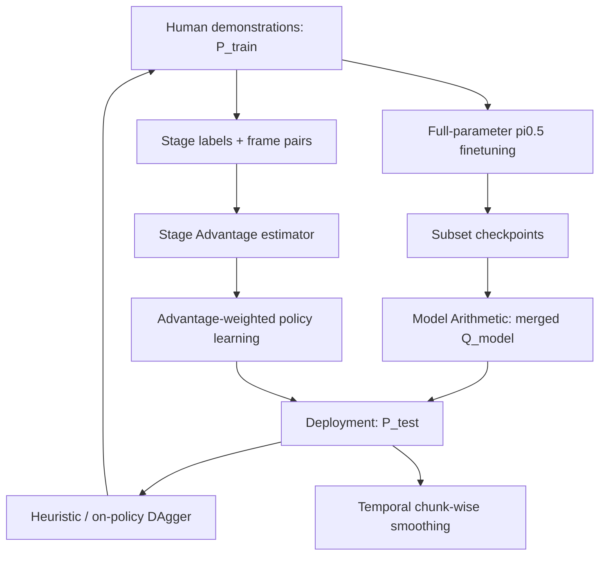
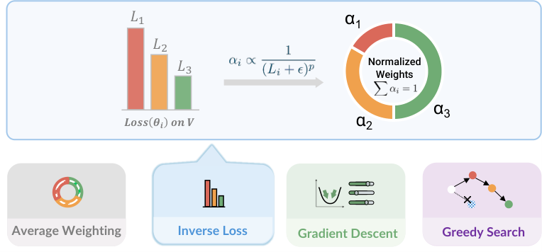
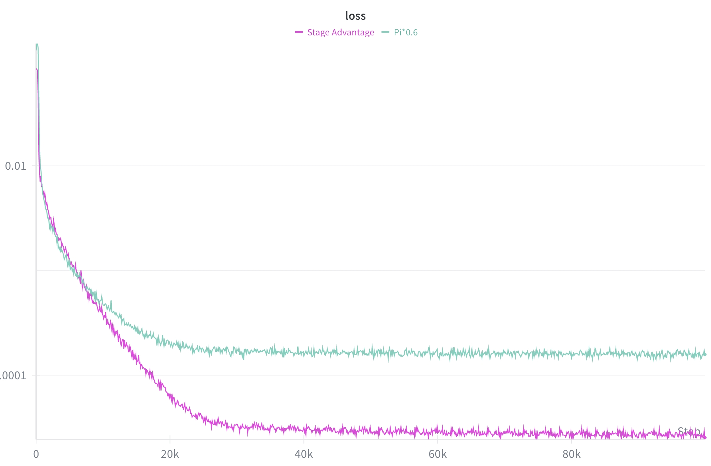
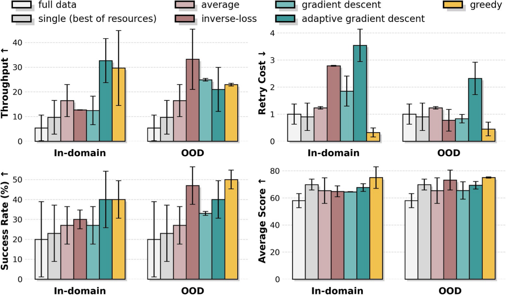
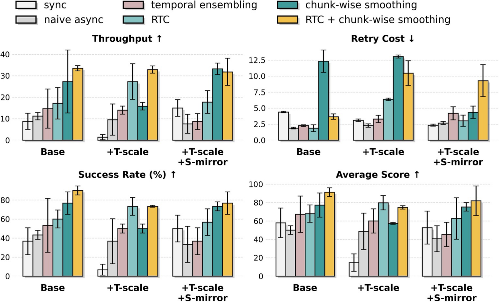

# kai0：资源受限下的高可靠机器人操作

!!! info "论文信息"
    **论文题名：** χ₀: Resource-Aware Robust Manipulation via Taming Distributional Inconsistencies。 
    **作者：** Checheng Yu、Chonghao Sima、Gangcheng Jiang、Hai Zhang、Haoguang Mai、Hongyang Li、Huijie Wang、Jin Chen、Kaiyang Wu、Li Chen、Lirui Zhao、Modi Shi、Ping Luo、Qingwen Bu、Shijia Peng、Tianyu Li、Yibo Yuan。 
    **机构：** HKU MMLab / OpenDriveLab 相关团队；以 arXiv/PDF affiliation block 和官方项目页为准。 
    **时间 / 主题：** 2026-02；世界模型 / 机器人操作 / VLA 后训练。 
    **arXiv / 官方报告：** arXiv：[2602.09021](https://arxiv.org/abs/2602.09021)；项目页：[mmlab.hk/research/kai0](https://mmlab.hk/research/kai0)。 
    **GitHub / 模型：** GitHub：[OpenDriveLab/KAI0](https://github.com/OpenDriveLab/KAI0)；Hugging Face：[OpenDriveLab-org/Kai0](https://huggingface.co/OpenDriveLab-org/Kai0)。 
    **元数据来源与核验口径：** 来源：[arXiv](https://arxiv.org/abs/2602.09021)、[GitHub](https://github.com/OpenDriveLab/KAI0)、[Hugging Face model card](https://huggingface.co/OpenDriveLab-org/Kai0)；Checked Date：2026-06-15；Repro Status：Paper / official repo / official model card reviewed, independent reproduction not claimed。

kai0（论文正式题名写作 χ₀）不是传统意义上“生成未来视频”的世界模型论文。它更像一篇机器人世界模型闭环里的**分布一致性工程论文**：真实机器人要从示教数据学策略，再在有延迟、有接触、有失败恢复的物理环境里执行。论文把这条链拆成 \(P_{\text{train}}\)、\(Q_{\text{model}}\)、\(P_{\text{test}}\) 三个分布，并用 Model Arithmetic、Stage Advantage、Train-Deploy Alignment 去逐一修补它们之间的错位。

放到世界模型专题里读，它回答的不是“世界会怎样生成”，而是另一个同样重要的问题：**如果一个 VLA / policy 已经能预测动作，怎样让训练数据、策略偏置和真实执行轨迹足够一致，避免长时任务中的错误滚雪球。**

## 它的效率贡献是什么

| 维度 | 贡献 |
| --- | --- |
| 节省的成本 | 不靠海量新示教或从零训练大模型，而是在约 20 h / task 数据、8×A100 全参微调条件下，通过 checkpoint 合并、优势重标注和部署侧平滑提高可靠性 |
| 核心机制 | Model Arithmetic 合并不同数据子集训练出的策略；Stage Advantage 给长时任务提供 stage-aware progress signal；Train-Deploy Alignment 用 Heuristic DAgger、时空增强和 temporal chunk-wise smoothing 对齐部署 |
| 对世界模型主线的意义 | 世界模型/VLA 闭环不能只看模型能力，还要管理 \(P_{\text{train}}\)、\(Q_{\text{model}}\)、\(P_{\text{test}}\) 的分布错位、延迟和恢复数据 |
| 主要风险 | 证据集中在双臂衣物操作；不是通用物理世界模型；成功率提升仍依赖任务标注、人工恢复数据和硬件 SOP |
| 应接到本站哪里 | [VLA、WAM 与世界模型系统地图](../../embodied-ai/vla-wam-world-model-system-map.md)、[VLA 数据、模型与评测路线](../../embodied-ai/vla-data-model-and-evaluation-roadmap.md)、[世界模型数据引擎](../../world-models/data-engines-and-self-improvement.md) |

## 证据等级与外推边界

kai0 最容易被误读成“少量数据也能稳定解决机器人长时任务”。更稳的读法是：它证明了在特定硬件、特定任务、特定 π₀.₅ / π₀ 后训练体系下，分布对齐模块可以显著提高可靠性；它还没有证明这些模块能无损迁移到所有机器人、物体和控制接口。

| 论文结论 | 证据来源 | 证据等级 | 可外推到世界模型高效训练 | 不能直接外推 |
| --- | --- | --- | --- | --- |
| \(P_{\text{train}}\)、\(Q_{\text{model}}\)、\(P_{\text{test}}\) 的错位是长时操作的核心瓶颈 | 方法定义、pipeline 图、系统消融 | System design + Ablation | 世界模型/VLA 项目要记录示教、模型输出和实际执行三条分布，而不是只存成功轨迹 | 不能证明所有失败都来自这三类错位 |
| Model Arithmetic 能用少量子模型合并提高覆盖 | Task A/B/C 的 MA 消融，OOD validation 对比 | Ablation | 可以把不同外观、初始状态、恢复数据训练出的 checkpoint 当成低成本多模态策略集合 | 不等于任意 checkpoint 线性合并都有效；OOD validation 质量很关键 |
| Stage Advantage 比 value-diff 更稳定 | SA 曲线、SFR/MSTD、任务成功率对比 | Ablation + Training diagnostic | 长时任务应把 stage / progress 明确进训练信号，减少视觉相似状态的多值歧义 | 不能替代真实 reward，也不保证非单调任务的优势标签正确 |
| Train-Deploy Alignment 提高真实部署表现 | DAgger、Heuristic DAgger、控制策略和时空增强消融 | Closed-loop robot evaluation | 真实执行延迟、动作 chunk 接缝、恢复数据都应进入训练和部署设计 | 不能只看 SR；retry cost、throughput 和硬件差异必须一起看 |
| 24 小时连续运行展示高可靠性 | 官方论文/项目材料中的 stress test 描述 | Official demo / system claim | 可作为生产级机器人评测目标参考 | 不是第三方复现，也不覆盖更多机器人平台 |

## 论文位置

过去很多世界模型论文把重点放在未来状态预测：给定历史观测和动作，预测未来 latent、视频或 reward。kai0 的切入点更靠近部署：即使 VLA 或 policy 能输出动作，真实机器人还会因为三类不一致失败。

| 分布 | 含义 | 典型失败 |
| --- | --- | --- |
| \(P_{\text{train}}\) | 人类示教轨迹分布 | 数据太稀疏，只覆盖少数衣物状态、抓取路径和恢复场景 |
| \(Q_{\text{model}}\) | policy 从示教里学到的归纳偏置 | 模型偏向训练中最常见的动作模式，遇到相似但不同 stage 的状态会套错动作 |
| \(P_{\text{test}}\) | 部署时真实执行轨迹分布 | 推理延迟、控制器限制、接触误差和衣物形变让实际执行偏离模型计划 |

所以这篇论文对本站世界模型主线的意义是：世界模型不只是一段预测网络，还包括数据闭环、部署延迟、失败恢复和 action smoothing。没有这些，模型在 latent 里想得再顺，真机也可能在执行中积累小误差。

{ width="920" }

<small>图源：`χ₀: Resource-Aware Robust Manipulation via Taming Distributional Inconsistencies`，Figure 1。原论文图意：展示 \(P_{\text{train}}\)、\(Q_{\text{model}}\)、\(P_{\text{test}}\) 三阶段中的对齐模块，包括 Heuristic DAgger、spatio-temporal augmentation、stage annotation、Model Arithmetic、Stage Advantage、temporal chunk-wise smoothing 和 on-policy DAgger。</small>

**这张 pipeline 图怎么读。**
左侧是训练分布，论文先用 Heuristic DAgger 和时空增强扩展示教覆盖，再给长时任务打 stage annotation。中间是模型分布，多个数据子集训练出的策略通过 Model Arithmetic 合并，Stage Advantage 作为高质量动作偏好信号参与训练。右侧是真实部署分布，temporal chunk-wise smoothing 处理动作 chunk 接缝和延迟，on-policy DAgger 再把部署失败回流到数据。

这张图支撑的是“分布对齐系统”，不是单个新网络结构。读它时要抓住一个顺序：先让训练数据覆盖更多状态，再让策略吸收多种数据模态，最后让真实执行不因为延迟和失败恢复脱离训练假设。

## 核心问题

论文把机器人操作写成有限时域 MDP。轨迹为

$$
\tau=(s_0,a_0,s_1,a_1,\dots,s_H),
$$

策略诱导的轨迹分布可以写成：

$$
P_{\pi}(\tau)=\mu(s_0)\prod_{t=0}^{H-1}\pi(a_t\mid s_t;\phi)T(s_{t+1}\mid s_t,a_t,\xi).
$$

但部署时真正执行的不是理想动作 \(a_t\)，而是受推理延迟、控制器和物理限制影响后的 \(\tilde a_t\)。所以论文把 test-time 轨迹写成由 \(Q_{\text{model}}\) 和实际执行算子共同诱导的 \(P_{\text{test}}\)。这一步很关键：它承认“模型输出动作”和“机器人真正执行动作”不是一回事。

三类不一致分别对应三类工程痛点：

1. **Coverage Deficiency**：示教分布太稀疏，policy 学到的动作模式覆盖不了真实可行轨迹流形；
2. **Temporal Mismatch**：长时任务不同 stage 视觉上相似，模型会误用动作；推理到控制的延迟也会让 action chunk 接不上；
3. **Failure Cascade**：训练数据缺少失败恢复，部署时一旦偏离成功轨迹，错误会连续放大。

如果把这篇论文和 LingBot-World 对读，LingBot 更关心“视频生成器如何变成可交互模拟器”，kai0 更关心“机器人策略如何在真实执行中保持可恢复、可持续、低重试”。前者偏 world simulator，后者偏 deployment-aligned policy world loop。

## Model Arithmetic：用权重合并补覆盖

Model Arithmetic 解决的是 \(P_{\text{train}}\) 覆盖不足导致的 \(Q_{\text{model}}\) 偏置。论文不是训练一个复杂 MoE，也不是部署多个模型投票，而是把不同数据子集上训练出来的 policy checkpoint 直接在权重空间合并。

{ width="760" }

<small>图源：`kai0`，Figure 2。原论文图意：展示 Model Arithmetic 中的 souping strategies，包括 inverse loss weighting、average weighting、gradient descent 和 greedy search 等 checkpoint 合并方式。</small>

形式上，给定数据子集 \(\{D_1,D_2,\ldots,D_n\}\)，分别训练出策略权重 \(\{\theta_1,\theta_2,\ldots,\theta_n\}\)，然后合并：

$$
\theta_{\text{merged}}=\sum_{i=1}^{n}\alpha_i\theta_i,\quad
\alpha_i\ge 0,\quad \sum_i\alpha_i=1.
$$

关键不是这条公式，而是 \(\alpha_i\) 怎么选。论文比较了四类策略：

| Strategy | Weight selection idea | Why it matters |
| --- | --- | --- |
| Average weighting | Set \(\alpha_i=1/n\) | 最便宜，但默认每个 checkpoint 质量相同 |
| Inverse-loss | \(\alpha_i\propto 1/(L_i+\epsilon)^p\) after normalization | validation loss 低的 checkpoint 获得更高权重 |
| Gradient descent | Optimize softmax coefficients on validation loss | 直接最小化 merged validation loss |
| Greedy search | Iteratively add checkpoints that reduce validation loss | 用搜索方式选择更好的合并组合 |

论文的经验结论是：OOD validation 比 in-domain validation 更有用，尤其是用 DAgger / recovery trajectories 做验证时，更能反映 \(P_{\text{test}}\) 里的失败邻域。对世界模型数据引擎来说，这个点很重要：验证集不应该只像训练集，而应该像部署时会出问题的地方。

## Stage Advantage：把长时任务拆成 stage

Stage Advantage 解决的是长时任务中的 temporal mismatch。普通 value-diff 会先估计两个状态的 value，再相减：

$$
A(s,a)=V(s')-V(s).
$$

问题是两个 value 都有误差，相减会放大噪声；更麻烦的是同一个视觉状态在不同 stage 里含义不同。例如衣物被摊开可能是“flattening 快完成”，也可能是“folding 前的中间状态”。全局 value 容易多值。

kai0 改成直接预测 pairwise progress：

$$
A(s,a)=f_{\theta}(s,s'),
$$

再加入 stage 条件：

$$
A_{\text{stage}}(s,a,g)=f_{\theta}(s,s'\mid g).
$$

其中 \(g\) 是人工标注的 stage 标量，取 \(\{0,\frac{1}{S},\ldots,\frac{S-1}{S}\}\)。附录给出的任务划分是：Task A 两个 stage（flattening、folding），Task B 四个 stage（retrieving、flattening、folding、handover），Task C 三个 stage（retrieving、dressing the rack、hanging）。

{ width="820" }

<small>图源：`kai0`，Figure 3。原论文图意：展示 Task A/B/C 中基于 Stage Advantage 的 cumulative value；绿色/红色区域分别标出正向进展和负向或不稳定片段。</small>

**这张图看什么。**
它不是在展示 policy 直接学会了完整物理规律，而是在展示 advantage signal 是否能沿长时任务给出更平滑的进展判断。Task A 里 cloth slips 后 value 下降，重新抓取并摊平后 value 回升；Task B 里取衣物、放错、拖到右侧这些阶段能被区分；Task C 里遮挡和挂衣阶段会造成振荡。

这说明 SA 更像一个训练用的 progress teacher：它帮助 policy 少学无效重复动作，多学能推进当前 stage 的动作。它不能替代环境 reward，也不能保证所有任务进展都是单调的。

{ width="760" }

<small>图源：`kai0`，Figure 12。原论文图意：比较 SA 和 π₀.₆* style implementation 的训练 loss；SA 曲线下降更稳定，作为数值稳定性证据。</small>

## Train-Deploy Alignment：让动作真正落到机器人上

Train-Deploy Alignment 解决的是 \(Q_{\text{model}}\) 到 \(P_{\text{test}}\) 的落地问题。动作 chunking policy 往往一次输出一段未来动作，但推理耗时和控制器执行会造成旧 chunk 没执行完、新 chunk 已到来的接缝。这个接缝如果处理不好，机器人会出现突变、抖动或重复动作。

{ width="820" }

<small>图源：`kai0`，Figure 4。原论文图意：左侧展示 Heuristic DAgger、spatio-temporal augmentation 和 temporal chunk-wise smoothing 三类对齐策略；右侧用 T-SNE 表示策略分布逐步靠近部署分布。</small>

论文的部署侧核心是 temporal chunk-wise smoothing。设旧动作 buffer 为 \(a^{old}\)，新预测 chunk 为 \(a^{new}\)，执行索引为 \(k\)，先丢掉因延迟变旧的命令，再对旧 buffer 剩余部分和新 chunk 前段做线性插值：

$$
\tilde a_i=w_i a^{old}_i+(1-w_i)a^{new}_{rem,i}.
$$

其中 \(w_i\) 从旧动作侧逐步过渡到新动作侧。这个方法不改模型结构，却能减少 chunk 切换时的执行跳变。

另外两类 TDA 数据策略也很实用：

| Strategy | What it changes | Engineering reading |
| --- | --- | --- |
| Heuristic DAgger | 直接把机器人初始化到人工设计的失败状态，采集恢复示教 | 不必等待策略自然失败，前置收集高价值 recovery data |
| On-policy DAgger | 部署时失败后人工接管并保存 correction | 更真实，但耗时，且依赖人在环 |
| Spatio-temporal Augmentation | 左右翻转并交换左右臂、跳帧模拟速度变化 | 零机器人时间扩展 \(P_{\text{train}}\)，但效果依赖任务和控制接口 |

## 数据与训练细节

这篇的训练细节值得单独看，因为论文的核心 claim 是 resource-aware。它不是靠无限扩数据，而是在比较清楚的资源约束下做后训练。

| Hyperparameter | Value |
| --- | --- |
| *Data & Input* |  |
| Expert demonstration hours | ~20 h per task |
| Action chunk length \(K\) | 50 |
| Execution frequency | 100 Hz |
| *Optimization* |  |
| Training steps | 80,000 |
| Batch size | 128 |
| Optimizer | AdamW |
| Learning rate | \(2.5\times10^{-5}\) |
| Cosine Decay Steps | 10,000 |
| Conditioned noise level \(\sigma\) | [0.001, 1.0] |
| Gradient Clip | 1.0 |
| *Module-Specific* |  |
| MA: Number of checkpoints | 4 |
| SA: Advantage threshold \(\epsilon\) | 0.3 |
| *Infrastructure* |  |
| Training GPUs | 8 × A100 |
| Inference GPUs | RTX 4090 |

<small>表源：`kai0`，Table I。表格保留原论文英文字段；本站只把 LaTeX 表格改写为 Markdown。</small>

训练链路可以拆成四步：

1. **收集任务数据**：论文正文称每个任务约 20 小时 expert demonstrations；附录进一步给出 Task A 2668 episodes、Task B 3519 episodes、Task C 2988 episodes，数据采集频率 30 Hz，并随机化衣物位置、皱褶、尺寸、颜色和光照。
2. **全参微调 π₀.₅**：每个任务独立 fine-tune open-source π₀.₅，使用 Flow Matching objective，8×A100 训练；π₀ 作为补充 baseline。
3. **训练/使用三类模块**：MA 合并 4 个 checkpoint；SA 用同一 episode 中任意时间戳采样的 frame pairs 训练 advantage estimator，并把 top \(\epsilon=0.3\) fraction 标为 positive；TDA 负责数据增强、DAgger 和部署 smoothing。
4. **真实机器人部署**：双臂系统包含 Agilex Piper 和 ARX X5 两类平台；每套系统有两个 6-DoF 机械臂和 1-DoF parallel gripper；三路 Intel RealSense D435i 相机采 640×480 RGB；视觉同步 30 Hz，低层控制器 100-200 Hz，推理用 Ubuntu 20.04 + RTX 4090。

这里有一个边界要注意：正文的“约 20 小时示教”和附录 episode 统计不是一个可以随意相加的精确账本，后者包含更细的 DAgger / intervention 口径。读训练规模时应把它当成“有限资源下的任务级后训练规模”，不要当成完整可复现实验成本。

### 评分标准

论文的 Average Score 来自规则化子目标，下面保留原表英文格式。

| Task | Sub-goals | Score |
| --- | --- | --- |
| Task A (Easy) | Flatten garment | +40 |
| Task A (Easy) | 1st fold | +20 |
| Task A (Easy) | 2nd fold | +20 |
| Task A (Easy) | 3rd fold | +20 |
| Task B -- T-shirt (Medium) | Retrieve & flatten | +40 |
| Task B -- T-shirt (Medium) | 1st fold | +15 |
| Task B -- T-shirt (Medium) | 2nd fold | +15 |
| Task B -- T-shirt (Medium) | 3rd fold | +15 |
| Task B -- T-shirt (Medium) | Stack to top-left | +15 |
| Task B -- Shirt (Medium) | Retrieve from basket | +30 |
| Task B -- Shirt (Medium) | Flatten | +50 |
| Task B -- Shirt (Medium) | Pull to right-side table | +20 |
| Task C (Hard) | Pull garment rightward | +15 |
| Task C (Hard) | Grasp collar | +15 |
| Task C (Hard) | Grasp hanger | +15 |
| Task C (Hard) | Insert hanger into sleeve | +20 |
| Task C (Hard) | Hook left collar on hanger | +20 |
| Task C (Hard) | Hang on standing rack | +15 |

<small>表源：`kai0`，Table II。原表标题为 `Score standard (normalized to 100)`。</small>

## 实验结论

论文评测三个衣物操作任务：Task A 是 T-shirt flattening and folding，Task B 是 conditional retrieval and sorting，Task C 是 garment hanging。指标包括 Success Rate、Throughput、Retry Cost 和 Average Score，每种任务/衣物设置按多次真实机器人 trial 统计。

{ width="840" }

<small>图源：`kai0`，Figure 6。原论文图意：展示 Task A 上单模块、双模块和完整 kai0 系统的效果；完整系统在 success rate、throughput 和 average score 上达到最好，同时 retry cost 更低。</small>

**系统消融怎么读。**
单看某个模块容易误判。TDA 会显著推高成功率，但可能引入更多 retry；SA 对 throughput 更敏感，因为它减少无效动作和停滞；MA 对覆盖和 score 有帮助。完整系统的意义是把三者组合后，策略既愿意恢复，又不至于在失败附近无效重复。

{ width="840" }

<small>图源：`kai0`，Figure 7。原论文图意：展示 Task C 上 MA 变体相对 single-best 和 full-data candidate 的消融；OOD validation 在稳定性和标准误上更好。</small>

MA 的关键证据不是“某个合并方法总是最好”，而是：subset-trained checkpoints 的合并能超过 single-best 和 full-data candidate。这提示一个工程现象：VLA 后训练可能存在大量参数冗余，不同数据子集让模型落到不同可用解，合并能比强行 joint training 更好吸收这些局部模式。

{ width="840" }

<small>图源：`kai0`，Figure 8。原论文图意：左侧用 SFR / MSTD 比较 advantage signal 数值稳定性；右侧展示 SA 相对 π₀.₆* style baseline 的性能收益。</small>

SA 的强证据是“稳定性指标和任务表现一起改善”。这比只看 loss 更有价值，因为它说明 advantage signal 不是仅在训练曲线上更平滑，而是能转成更少停滞、更高 throughput 或更好 score。

{ width="840" }

<small>图源：`kai0`，Figure 11。原论文图意：比较 Task A 上 temporal chunk-wise smoothing、temporal ensembling、RTC 以及时空增强组合；论文结论是 temporal chunk-wise smoothing 多数设置下优于对照，和 RTC 组合还能继续提高表现。</small>

TDA 这组图最适合转成工程 checklist：部署动作 chunk policy 时，不要只盯模型输出，还要验收 chunk 切换、推理延迟、控制器频率和动作表示。论文还显示 spatio-temporal augmentation 有任务依赖性，在 Task A 上没有显著增益，因此增强策略不能脱离控制和任务形态单独吹。

## 和世界模型 / VLA 的关系

| Dimension | LingBot-World | kai0 |
| --- | --- | --- |
| 目标 | 视频基础模型变成可交互世界模拟器 | VLA / robot policy 在真实部署中更可靠 |
| 核心分布 | 历史视频、动作、未来视频 | \(P_{\text{train}}\)、\(Q_{\text{model}}\)、\(P_{\text{test}}\) |
| 训练重点 | 长序列视频训练、动作条件、因果 rollout、蒸馏 | 全参 fine-tuning、checkpoint 合并、stage advantage、DAgger recovery |
| 部署重点 | 因果注意力、KV cache、少步采样 | action chunk smoothing、推理-控制延迟、真实机器人恢复 |
| 最强证据 | 交互生成 demo、系统 pipeline、可视化 | 真实双臂衣物操作、消融、24h stress test |
| 不能证明 | 真实机器人控制收益 | 通用世界模拟或跨任务物理理解 |

对一个真实具身项目来说，这两篇可以互补。LingBot 提醒我们要让模型预测动作后的未来；kai0 提醒我们即使有强 policy，也要把训练数据、模型偏置和实际执行对齐，否则闭环会在边角状态中崩掉。

## 局限风险

1. **严格说不是生成式 world model**：它不显式预测未来视频或 latent dynamics，而是围绕 VLA policy 后训练和部署对齐。
2. **任务域集中在衣物操作**：衣物是接触丰富、形变复杂的好测试，但不能直接推出 rigid-body assembly、移动操作或开放厨房任务都成立。
3. **stage 标注是强先验**：SA 的收益依赖人类定义的语义 stage；如果任务非单调、stage 边界模糊或需要回退，优势标签可能误导训练。
4. **DAgger 和 recovery 数据仍有人工成本**：Heuristic DAgger 降低了等待自然失败的成本，但仍需要人为设计失败状态和采集恢复示教。
5. **资源口径需谨慎**：论文强调 20 h data 和 8×A100，但真实复现实验还包括硬件 SOP、相机布置、低层控制、标注和部署调试。
6. **官方 release 不等于独立复现**：GitHub、HF 和项目页已提供官方材料，但本站没有声明复现实验通过。

## 项目启发

如果把 kai0 落到自己的 VLA / 世界模型项目里，最值得借鉴的不是某一个模块名，而是四条工程习惯。

第一，数据集要单独保留 failure-adjacent states。成功示教只告诉模型“理想路径怎么走”，不能教它从偏差里回来。第二，validation set 要像部署错误，而不是像训练分布；否则 checkpoint 选择会高估顺境能力。第三，长时任务最好显式记录 stage、subtask、progress 和 retry，而不是只存一个 binary success。第四，action chunk policy 必须做真实控制链路验收，包括推理延迟、chunk 接缝、动作表示和低层控制频率。

## 阅读结论

kai0 是一篇很适合工程读者精读的机器人后训练论文。它的价值不在于提出一个更大的 VLA，而在于把真实部署中的分布错位具体化，并给出可操作的补救组合：Model Arithmetic 补训练覆盖，Stage Advantage 稳定长时进展信号，Train-Deploy Alignment 把失败恢复和动作平滑接回部署。

它最能外推到“VLA / 世界模型闭环系统如何收数据、选 checkpoint、标注 progress、处理 action chunk”这些问题；不能外推成“少量数据解决通用机器人操作”。如果后续要复现或迁移，最该优先验证的是：OOD validation 是否真的像你的 \(P_{\text{test}}\)，stage label 是否稳定，temporal smoothing 是否适配你的控制频率，以及 recovery data 是否覆盖最常见失败。

## 外部精读

1. [kai0 arXiv](https://arxiv.org/abs/2602.09021)：读 Figure 1/2/3/4/6/7/8/11、Table I/II 和 appendix training details。
2. [OpenDriveLab/KAI0 GitHub](https://github.com/OpenDriveLab/KAI0)：查看官方代码、模块目录、训练/推理脚本、数据和 checkpoint 下载说明。
3. [OpenDriveLab-org/Kai0 on Hugging Face](https://huggingface.co/OpenDriveLab-org/Kai0)：核对模型卡、许可证和官方性能 claim。
4. [HKU MMLab project page](https://mmlab.hk/research/kai0)：看项目介绍、3D t-SNE 和 demo 口径；demo 仍应回到论文实验验证。
5. [LingBot-World](lingbot-world.md) 与 [π0.5](../embodied-ai/pi05.md)：前者对比世界模拟器路线，后者对比 open-world VLA 基座与数据混合逻辑。
