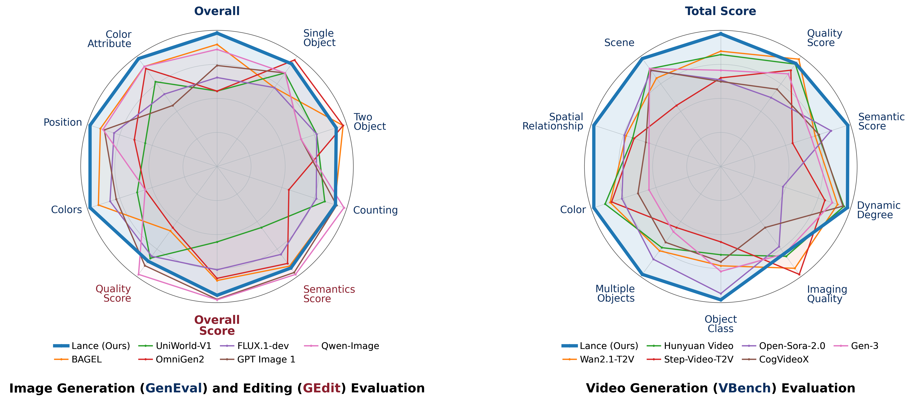
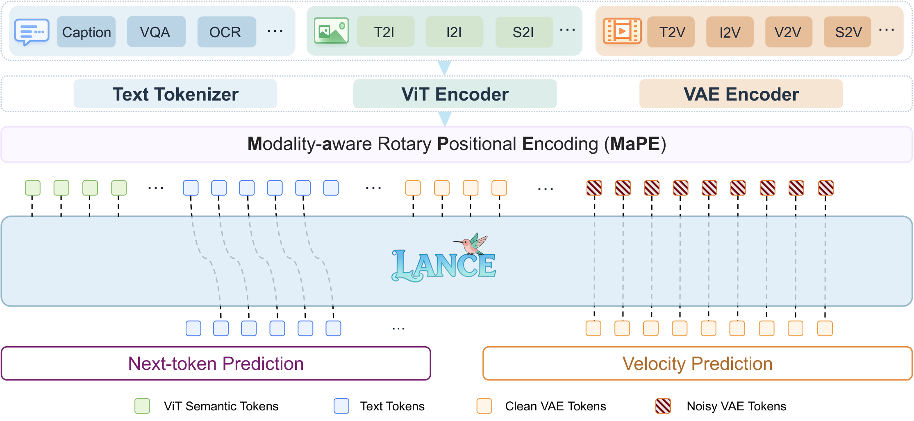
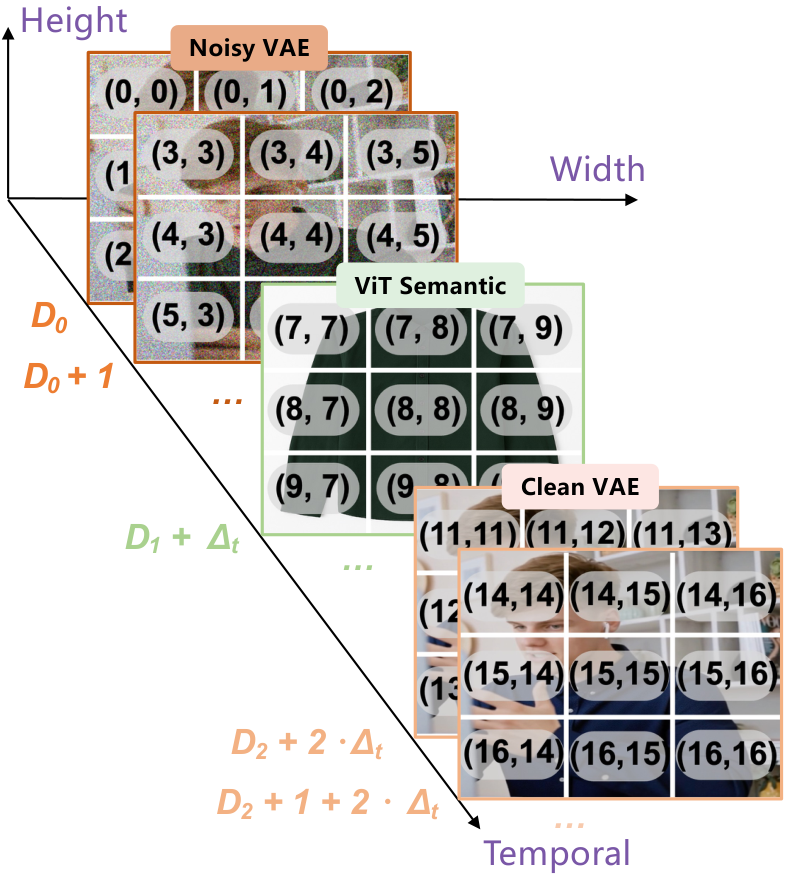
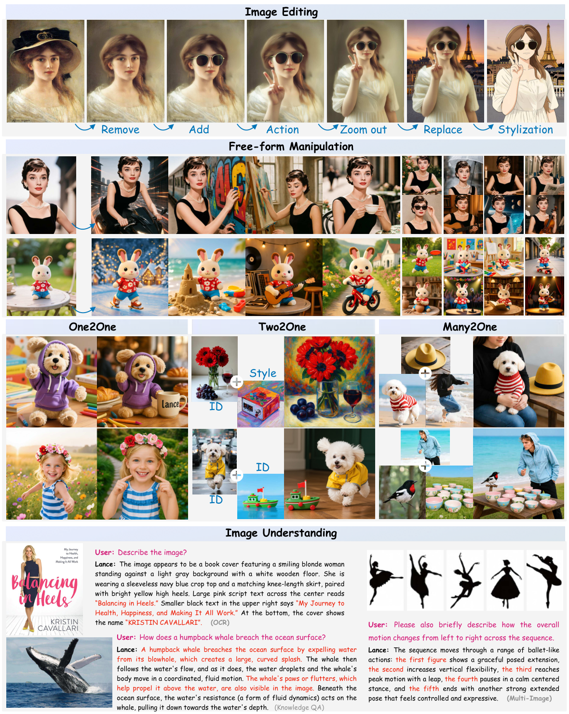
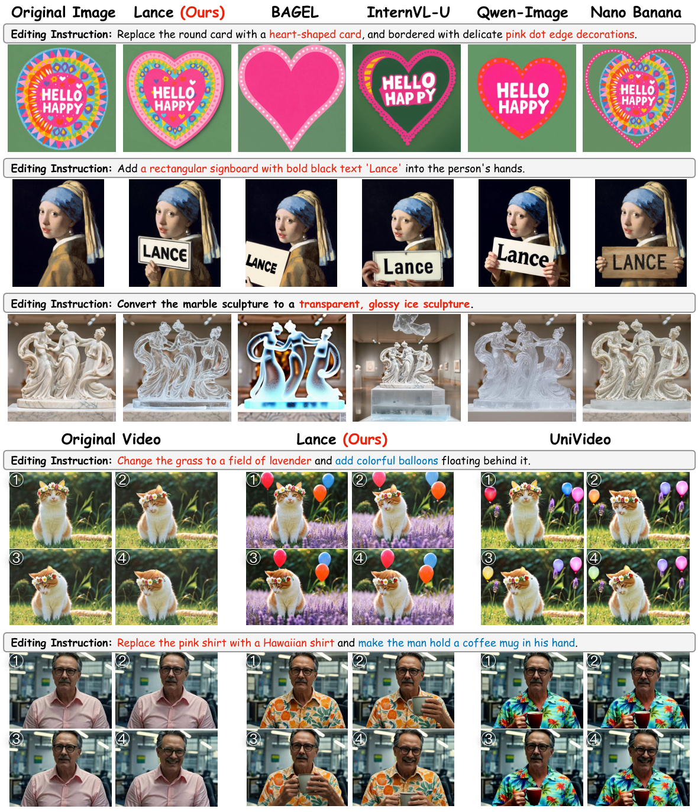
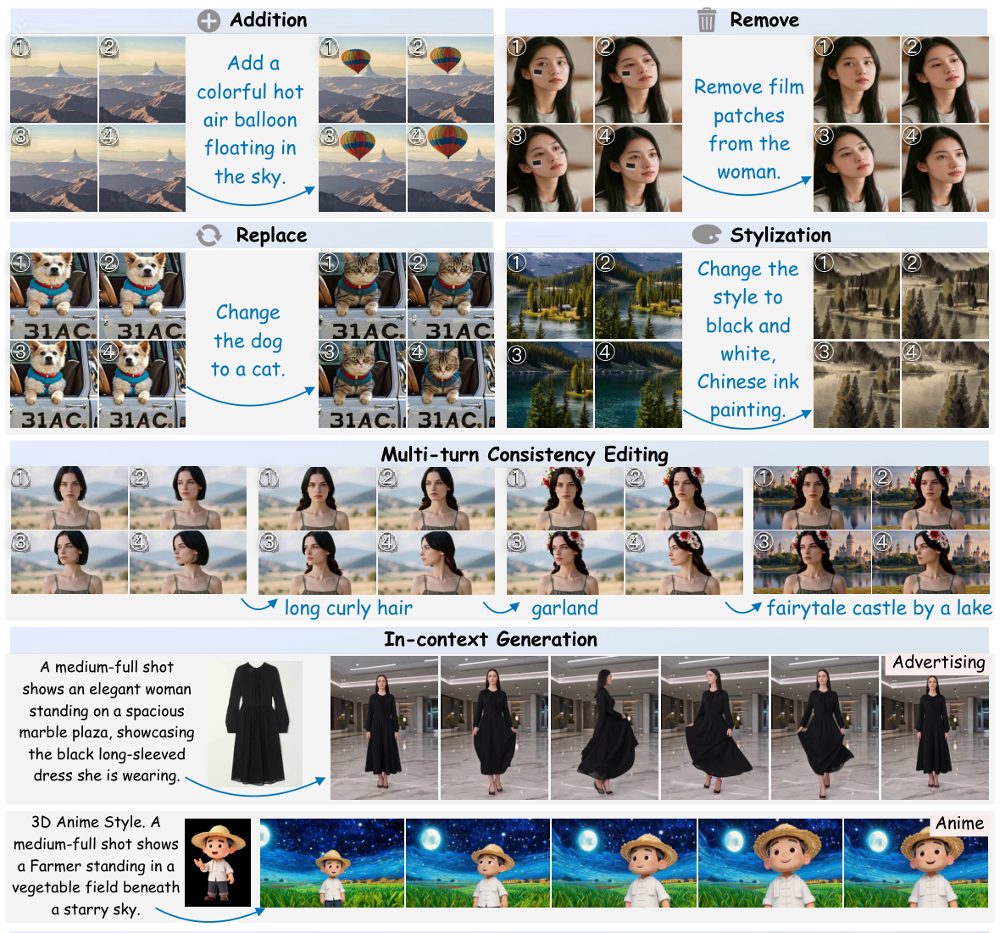
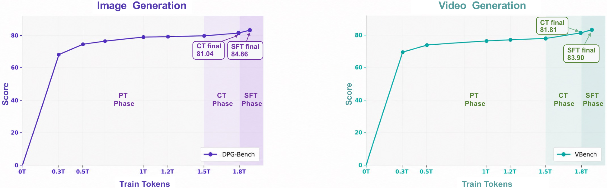
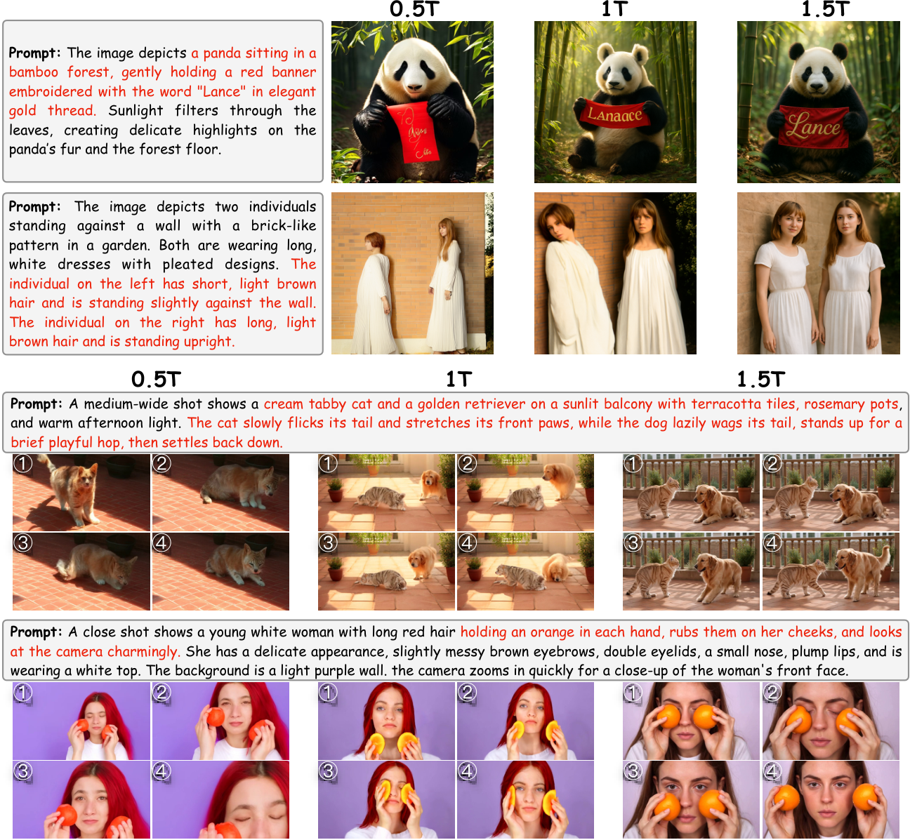
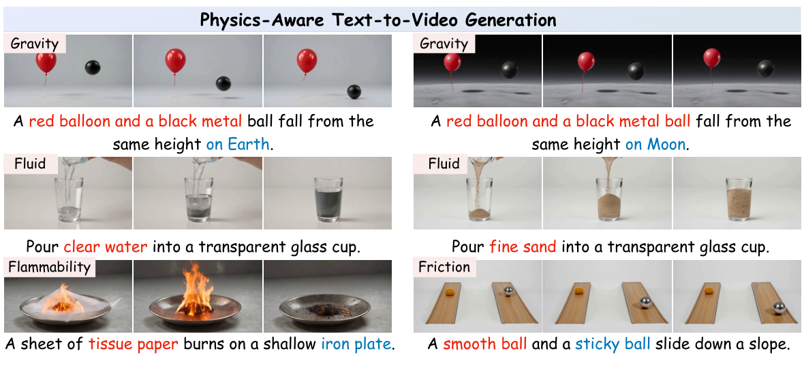

# Lance：统一多模态模型，为什么对世界模型有启发

!!! info "论文信息"
    **论文题名：** Lance: Unified Multimodal Modeling by Multi-Task Synergy。 
    **作者：** Fengyi Fu、Mengqi Huang、Shaojin Wu、Yunsheng Jiang、Yufei Huo、Hao Li、Yinghang Song、Fei Ding、Jianzhu Guo、Qian He 等（共 13 人）。 
    **机构：** 未在公开元数据中稳定解析；以 arXiv/PDF 或官方页 affiliation block 为准。 
    **时间 / 主题：** 2026-05；世界模型。 
    **arXiv / 官方报告：** arXiv：[2605.18678](https://arxiv.org/abs/2605.18678)；官方材料：[lance-project.github.io/](https://lance-project.github.io/)。 
    **GitHub / 项目：** GitHub：未找到官方链接；项目页：[lance-project.github.io/](https://lance-project.github.io/)。 
    **元数据来源与核验口径：** 来源：[arXiv](https://arxiv.org/abs/2605.18678)；[官方 / 项目材料](https://lance-project.github.io/)；Checked Date：2026-06-15；Repro Status：Paper / official materials reviewed, independent reproduction not claimed。

## 多任务到底在共享什么

让模型描述一张图、修改这张图，再把其中的人物变成一段视频，看起来都属于多模态能力，实际却需要保留不同的信息。描述可以忽略衣服的一部分纹理，编辑必须尽量保持未修改区域，主体驱动的视频还要在运动中维持外观。把所有任务放进一个接口，并不会自动消除这些目标之间的冲突。

Lance 的核心设计是让任务共享交错上下文，同时为理解与生成保留各自的表示、参数路径和目标函数。它用文本与语义视觉 token 处理理解，用连续 VAE latent 处理图像和视频生成，再通过多阶段训练加入编辑和主体条件任务。论文真正希望检验的是，这些任务能否相互提供有用监督，连原本的基础生成也因此改善。[原文 §1、§3](https://arxiv.org/pdf/2605.18678#page=7)

主结果显示了这种路线的可行性，也显示它没有抹平能力差异。Lance 在 GenEval 达到 0.90，在本文列出的统一模型中并列最高；VBench 为 85.11，GEdit-Bench 为 7.30，MVBench 为 62.0。但 DPG-Bench 的 84.67 并非表中最高，MVBench 也低于作为初始化来源的 Qwen2.5-VL 3B 所列的 67.0。后文需要分别解释这些成绩，而不能把“统一”当成每种能力都优于专用模型的保证。[原文 Tables 5–8](https://arxiv.org/pdf/2605.18678#page=15)

Figure 1 先给出能力分布。左图混合了图像生成与编辑，右图展示视频生成的多个维度。阅读入口是某一条轴上 Lance 与对照方法的位置，雷达面积本身没有统一量纲，也不能代替具体评测设置。

{ width="920" }

*原文 Figure 1。不同轴来自不同指标，后面的表格保留各自分数和比较条件。*

## 同一段上下文，两类视觉表示，两条能力路径

### 编码器先决定哪些信息能够进入模型

Figure 6 从上到下列出任务、编码器、位置编码、共享上下文与输出头。最值得先区分的是中间四种 token，文本、ViT 语义特征、干净 VAE 条件，以及待去噪的 VAE 目标。它们共同进入上下文，职责却不同。

{ width="920" }

*原文 Figure 6。蓝色 LM 输出用于 next-token prediction，橙色生成输出用于 latent velocity prediction。共享图示中的上下文区域，不表示所有 token 使用同一套表征或同一个预测目标。*

文本使用 Qwen2.5-VL 的 embedding 层。理解侧使用 Qwen2.5-VL ViT，先按 14 倍空间和 2 倍时间尺度做 patching，再进行 $2\times2$ spatial merge，得到较紧凑的语义 token。生成侧使用 Wan2.2 的 causal 3D VAE，对视频做 16 倍空间与 4 倍时间下采样，保留外观和时空结构，再由轻量 MLP connector 投影到生成骨干的 hidden space。[原文 §3.2](https://arxiv.org/pdf/2605.18678#page=10)

| Representation | 主要来源 | 在序列中的作用 |
|---|---|---|
| Text tokens | Qwen2.5-VL text embedding | 指令、描述、问题与语言答案 |
| ViT semantic tokens | Qwen2.5-VL visual encoder | 为理解与跨模态关联提供语义视觉证据 |
| Clean VAE tokens | Wan2.2 VAE 编码的已知图像或视频 | 保存生成、编辑所依赖的视觉条件 |
| Noisy VAE tokens | 目标 latent 与高斯噪声混合 | 表示当前需要预测速度场的生成目标 |

同一张参考图可以提供不同层面的信息，语义路径解释“这是什么”，VAE 路径保留“它具体长什么样”。两类 token 的网格尺度不同，不能假设第几个 ViT token 与第几个 VAE token 天然一一对应。Lance 统一的是上下文建模接口，保留了对不同任务更合适的视觉编码。

### Native unified 不等于随机初始化全部参数

理解专家 $\operatorname{LLM}_{\mathrm{UND}}$ 主要处理文本和语义视觉 token，生成专家 $\operatorname{LLM}_{\mathrm{GEN}}$ 处理 VAE latent。两侧使用同一交错上下文，分别输出语言 hidden states 与生成 hidden states，随后接 LM head 或 LLM-to-VAE connector 和 flow head。[原文 §3.2](https://arxiv.org/pdf/2605.18678#page=10)

这里有一个会改变成本理解的细节。摘要用了 “trained from scratch”，但 §3.2 和 §5.1 明确说 ViT 以及两条多模态骨干都由 Qwen2.5-VL 3B 权重初始化，VAE 也来自 Wan2.2。作者为两个专家的每个 attention block 增加 QK-Norm，再通过后续训练重新适配。因此，这里的 native unified 应理解为统一架构接受联合训练，不能理解成完全没有预训练组件或从随机权重开始。[原文 §5.1](https://arxiv.org/pdf/2605.18678#page=15)

论文反复报告的 3B 是 activated parameters。它有助于描述被激活的模型规模，却不等于整套系统只有 3B 驻留参数，也不足以推导推理显存。两个专家、编码器、长上下文和去噪迭代都参与实际资源消耗。原文没有给出完整总参数与显存拆分，不能简单把它换算为某种确定的单卡部署门槛。

## 交错序列怎样避免条件和目标相互泄露

原文用统一的块结构组织文本与视觉输入。

$$
S=\cdots\oplus B_{\mathrm{text}}(T)\oplus B_{\mathrm{vis}}(V_{\mathrm{vit}})
\oplus B_{\mathrm{vis}}(V^{\mathrm{clean}}_{\mathrm{vae}})
\oplus B_{\mathrm{vis}}(V^{\mathrm{noisy}}_{\mathrm{vae}})
\oplus B_{\mathrm{text}}(T')\oplus\cdots,
$$

$$
B_{\mathrm{text}}(T)=[\mathrm{BOT},T,\mathrm{EOT}],\qquad
B_{\mathrm{vis}}(V)=[\mathrm{BOV},V,\mathrm{EOV}].
$$

$\oplus$ 表示拼接，边界标记提供 segment 范围。不同任务可以有不同数量的输入图像、视频或文字段，但都以这套结构进入上下文。[原文 Eq. 1–2](https://arxiv.org/pdf/2605.18678#page=10)

组织成一串 token 后，还要规定谁能看谁。Lance 使用 generalized 3D causal attention，每个 segment 可以访问此前的 clean segments；文本段内部保持 causal，视觉段内部则采用 bidirectional attention，以建模空间及整段时空关系。

这形成两种尺度的可见性。段与段之间按上下文顺序读取已知条件，段内部则按照输出类型决定是否允许双向交互。图像编辑时，源图条件必须可见，目标视觉块内部也需要各位置协同去噪；语言答案则继续逐 token 预测。这里的 causal 主要约束序列分段依赖，不表示视觉块中的每帧都只能看过去帧。因此，该架构本身不能推出严格流式视频生成能力。[原文 §3.2](https://arxiv.org/pdf/2605.18678#page=10)

可以用三个任务观察这个接口如何复用。图像问答把图像语义和问题作为条件，预测答案文本；文本生视频把文字作为条件，更新一块 noisy video latent；视频编辑则增加 clean visual context，使模型既知道修改要求，也能读取需要保留的原视频结构。这些是对论文共同接口的展开，具体样本不必都包含 Eq. 1 中每一种块。

任务专用 system prompts 进一步区分输出要求。理解侧分别提示详细描述或回答问题，生成侧要求表达颜色、数量、纹理、空间关系与运动，编辑侧还要求在修改指定内容时维持适当的一致性。它们为同一上下文系统提供任务先验，但提示词中出现“先描述”不等于论文已经证明每次推理都运行一个独立、显式的 CoT 阶段。[原文 Figures 8–9](https://arxiv.org/pdf/2605.18678#page=13)

## 文本预测与视觉流匹配如何共同训练

### 语言侧仍然逐 token 学条件概率

理解路径的目标为

$$
\mathcal L_{\mathrm{UND}}=-\sum_i\log p_{\theta_{\mathrm{UND}}}(y_i\mid y_{<i},S).
$$

$y_i$ 是目标文本第 $i$ 个 token，$S$ 是可见多模态上下文，$y_{<i}$ 是此前的目标文本。模型通过 cross-entropy 学习在图像、视频与问题条件下产生合适答案。这个目标覆盖 captioning、VQA、OCR 等语言输出任务。[原文 Eq. 3](https://arxiv.org/pdf/2605.18678#page=10)

### 视觉侧学习连续 latent 的更新方向

生成路径令 $x_1$ 表示干净目标 VAE latent，$x_0\sim\mathcal N(0,I)$ 表示噪声，采样 $t\sim U(0,1)$ 构造

$$
x_t=t x_1+(1-t)x_0,
$$

$$
\mathcal L_{\mathrm{GEN}}=
\mathbb E_{x_0,x_1,t}\left[
\left\|v_{\theta_{\mathrm{GEN}}}(x_t,S,t)-(x_1-x_0)\right\|_2^2
\right].
$$

这里 $t=0$ 是噪声端，$t=1$ 是干净数据端，速度目标 $x_1-x_0$ 指向这条线性插值路径的变化方向。$t$ 是 flow 的插值时间，不是视频里某一帧的物理时刻。训练让网络在不同噪声程度下，依据上下文预测更新方向；推理时再用速度场逐步把噪声 latent 移向数据 latent，最后经 VAE 解码为图像或视频。[原文 Eq. 4](https://arxiv.org/pdf/2605.18678#page=10)

这避免了把每个视觉 latent 强制转成语言式的离散 next-token 问题，也意味着视觉生成仍有多次网络计算。3B 激活规模并不能单独说明一段视频多久生成，实际还受采样步数、分辨率、帧数和上下文长度影响。

两部分通过加权目标组合。

$$
\mathcal L=\lambda_u\mathcal L_{\mathrm{UND}}+\lambda_g\mathcal L_{\mathrm{GEN}}.
$$

$\theta_{\mathrm{UND}}$ 与 $\theta_{\mathrm{GEN}}$ 包含对应 expert backbone 和输出头。共享上下文允许跨任务条件交互，专用参数路径缓解不同输出目标直接争夺同一容量的问题。这里没有要求两个 loss 具有相同数值尺度，后面的训练阶段实际调整了 CE:MSE 权重。[原文 Eq. 5](https://arxiv.org/pdf/2605.18678#page=11)

## MaPE 给视觉 token 增加角色信息

同一序列可能既有语义视觉证据，又有干净生成条件，还有带噪的生成目标。如果位置编码只说明“在第几帧、第几行、第几列”，就没有显式表达这些不同职责。Lance 的 MaPE 把 token 组别也写入位置坐标。

Figure 7 将三组视觉 token 在时间位置轴上错开。应先比较每一组内部的相邻帧，再比较不同组的起点。组内间距没有改变，跨组位置差异增加了角色信息。

{ width="620" }

*原文 Figure 7。三组依次是 Noisy VAE、ViT Semantic、Clean VAE。每组都有自身起点 $D_i$，MaPE 额外施加不同幅度的时间坐标偏移。*

标准 3D 位置写为 $\hat p^{\mathrm{vis}}_{t,h,w}=[D+t,D+h,D+w]$。MaPE 在原坐标上增加

$$
p^{(m_i)}_{t,h,w}=\hat p^{(m_i)}_{t,h,w}+[i\Delta_t,0,0],
\qquad i\in\{0,1,2\}.
$$

$\Delta_t$ 是固定偏移步长，本文设为 1000。这个数字是位置索引偏移，既没有增加 1000 帧视频，也没有增加 1000 个实际 token。高度和宽度坐标保持原值；同组所有时间坐标增加同一常数，所以组内先后顺序和相对时间距离保持不变。[原文 §3.3](https://arxiv.org/pdf/2605.18678#page=11) [原文 §5.1](https://arxiv.org/pdf/2605.18678#page=16)

RoPE 会使相对位置进入 query-key 相互作用，因此跨组偏移能够为网络区分“语义证据”“干净条件”“待生成目标”提供线索。它不负责重新采样不同 encoder 的网格，也不改变 attention mask 规定的可见性。相应地，验证它是否有用，应看同时存在多类视觉 token 的任务，特别是需要对照源条件与生成目标的编辑；后面的直接消融正检验这一点。

## 训练日程先建立基础生成，再扩大任务组合

### 四个阶段分别改变了什么

Lance 使用 PT、CT、SFT、RL 四个阶段。它们不仅是训练继续了多久，也改变了任务、数据质量、损失权重和分辨率安排。Table 2 中最影响复现理解的设置如下。

| Setting | PT | CT | SFT | RL |
|---|---:|---:|---:|---:|
| Seen training tokens | 1.5T | 300B | 72B | 0.5B |
| Training steps | 350K | 80K | 15K | 800 |
| Learning rate | $1.0\times10^{-4}$ | $1.0\times10^{-4}$ | $2.5\times10^{-5}$ | $2.0\times10^{-6}$ |
| LR scheduler | Constant | Constant | Cosine | Constant |
| Loss weight, CE:MSE | 0.25:1 | 0.5:1 | 0.25:1 | — |
| Warm-up steps | 2,500 | 2,500 | 500 | 50 |
| Max context window | 40K | 70K | 70K | 70K |
| Diffusion timestep shift | 1.0 | 4.0 | 4.0 | 4.0 |

*原文 Table 2。token 数是训练期间看到的累计 token，不能当作去重后的原始数据量；RL 不使用表中相同的 CE:MSE 配比。*

共同优化器设置为 AdamW，$\beta_1=0.9$、$\beta_2=0.95$、$\epsilon=10^{-15}$，weight decay 为 0，gradient norm clip 为 1。表中还有单 rank 序列长度范围，PT 为 44K–50K，后续为 74K–80K；这是与 max context window 分开列出的配置，不能把两行都称为同一个窗口长度。[原文 Table 2](https://arxiv.org/pdf/2605.18678#page=12)

PT 冻结 VAE 与 ViT，训练多模态骨干、QK-Norm 和 connectors。数据包括约 1B 图文对与 140M 视频文本对，用 captioning 和条件生成建立基础关联。分辨率按 192p、360p、480p 逐渐增加，各阶段启用动态分辨率。图像与视频采样约为 1:4，让视频获得更大比例。[原文 §4.1](https://arxiv.org/pdf/2605.18678#page=12)

CT 把简单成对监督扩展为更丰富的交错任务。理解侧加入 2.73M 样本，生成侧加入数百万级编辑与主体条件数据。SFT 则降低学习率，使用规模更小但质量更高的数据，重点改善指令执行、外观一致性、编辑精度与身份保持。[原文 §4.2–4.3](https://arxiv.org/pdf/2605.18678#page=13)

| Data type | CT / general data | High-quality SFT data |
|---|---:|---:|
| Interleaved multimodal understanding | 2.73M | 继续使用 2.73M |
| Image captioning | 基础图文对约 1B | 190K |
| Video captioning | 基础视频文本对约 140M | 5K |
| Image generation | 基础图文对约 1B | 190K |
| Image editing | 2.8M | 84K |
| Subject-driven image generation | 3.6M | 未单列对应高质量条目 |
| Video generation | 基础视频文本对约 140M | 5K |
| Video editing | 2.6M | 9K |
| Subject-driven video generation | 1M | 5.5K |

*根据原文 Table 4 整理。同一批图文或视频文本数据可服务于两个输出方向，不能把 captioning 与 generation 两行直接相加，当作两倍的独立原始素材。*

从规模上看，3B 激活参数并没有免去大规模数据训练。四阶段所报 token 相加约为 1.8725T，这是按 Table 2 计算的训练量。最大 128-GPU 的说法描述同时使用的设备规模，缺少设备型号、持续时间与 GPU-hours 时，无法转换成完整训练费用，也不足以证明各对照模型是在相同计算预算下比较。

### 困难任务比例逐步上升，SFT 又重新平衡

Table 3 的全局比例在 PT 到 SFT 间保持不变。

$$
\text{Vid.-Gen.}:\text{Vid.-Und.}:\text{Img.-Gen.}:\text{Img.-Und.}
=64:16:16:4.
$$

按这个数据配比，视频约占 80%，生成约占 80%。这描述数据混合，不能自动换成 80% 的 token、运行时间或 FLOPs，因为视频长度和不同任务开销并不相同。

变化发生在生成任务内部。图片侧从纯 T2I 开始，逐步增加编辑和主体驱动；视频侧增加 I2V、视频编辑与主体驱动视频。CT 被划为三个子阶段。

| Mixture | PT | CT-I | CT-II | CT-III | SFT |
|---|---|---|---|---|---|
| T2I : I-Edit : S2I | 100:0:0 | 70:15:15 | 60:20:20 | 50:25:25 | 60:20:20 |
| T2V : I2V : V-Edit : S2V | 100:0:0:0 | 60:10:15:15 | 40:20:20:20 | 25:25:25:25 | 60:10:15:15 |

先学从文字产生视觉内容，再逐步加入“保留什么、改变什么、参考谁”的条件，会改变模型需要协调的信息。编辑要求同时识别指令涉及的对象与未修改内容，主体条件生成要求把身份外观迁移到新场景。这些任务比纯 caption-conditioned generation 提供了更直接的对应约束，也为后面的协同假设提供了动机。[原文 Table 3](https://arxiv.org/pdf/2605.18678#page=12)

SFT 的任务比例又回到更偏基础生成的配置，所以这个课程没有一直单调提高复杂任务占比。“adaptive scheduling”在论文中主要落实为明确的分阶段配比，不能据名称推断它已经使用某个依据实时指标自动调整采样的控制算法。

### RL 针对图像文字，不能代替所有后训练

最后的 RL 阶段用 GRPO，在 20K 图像生成 prompts 上以 PaddleOCR 提供奖励，关注文字呈现、图文一致与细粒度约束。Table 2 给出的预算是 800 steps、约 0.5B tokens，学习率 $2\times10^{-6}$。[原文 §4.4](https://arxiv.org/pdf/2605.18678#page=15)

这是一项有明确方向的后训练，并没有覆盖视频的运动质量或机器人动作。原文没有给出 group size、完整奖励公式与各项权重，也没有单独的 RL 前后受控实验，因此不能把最终榜单的所有提升都归因于 GRPO。它还指出 PT 与 CT 没有专门的文字渲染数据，文本准确性与排版一致性仍然不足。后面 GEdit 的文字修改分数正说明，面向文字的图像生成奖励没有把所有编辑问题一起解决。[原文 §7](https://arxiv.org/pdf/2605.18678#page=24)

## 推理条件也属于结果的一部分

为了使用 classifier-free guidance，PT 的 T2I 样本以 10% 概率丢弃文本条件；CT、SFT 的多模态条件训练以 5% 概率丢弃全部条件，另有 5% 概率只丢弃文本、保留视觉条件。这让模型接触不同条件组合，为推理时调节条件引导提供基础。[原文 §5.1](https://arxiv.org/pdf/2605.18678#page=16)

推理时，论文将文本条件 CFG scale 设为 4。除非另有说明，图像输入分辨率为 $768\times768$，视频按 480p、12 fps 采样。12 fps 描述视频的帧率，不能解读成模型每秒生成 12 帧的实测吞吐；论文也没有给出去噪步数和端到端延迟，使“轻量”还不能直接换算为实时能力。[原文 §5.1](https://arxiv.org/pdf/2605.18678#page=17)

输入参考图、交错上下文、输出片段长度与条件 guidance 都会影响开销。理解问答以语言自回归为主，视觉生成则多次调用速度预测，同一个模型在两类任务上的运行时间可能相差很大。因此后面的性能判断主要落在各项质量指标，部署速度需要独立测量。

## 图像生成的优势集中在哪里

Table 5 用 GenEval 检查对象、数量、颜色、空间位置和属性绑定，用 DPG-Bench 检查更复杂提示中的细粒度一致性。两个分数的量纲不同，GenEval 在主表采用 0–1，DPG-Bench 使用约百分制的分数。

| Model | Params. as reported | DPG-Bench Overall ↑ | GenEval Overall ↑ |
|---|---:|---:|---:|
| Show-o2 | 7B | 86.14 | 0.76 |
| BAGEL† | 7B | 85.07 | 0.88 |
| Mogao | 7B | 84.33 | 0.89 |
| InternVL-U | 1.7B | 85.18 | 0.85 |
| TUNA | 7B | 86.76 | 0.90 |
| TUNA-2 | 7B | 86.54 | 0.87 |
| Qwen-Image, generation-only | 20B | 88.32 | 0.87 |
| Lance | 3B activated | 84.67 | 0.90 |

*原文 Table 5 的代表行。† 表示 GenEval 使用 LLM rewriter；Lance 在这张表中没有该标记。不同模型的参数列与完整训练成本并未被统一匹配。*

Lance 与 TUNA 的 GenEval 总分同为 0.90，说明在这组组合约束任务上达到较强水平。Lance 的 Single Object、Two Object、Counting、Colors、Position、Color Attribute 分别为 1.00、0.94、0.84、0.97、0.87、0.81。颜色表现突出，数量与位置也较强，但部分子项仍低于另一模型，例如 TUNA 的 Two Object 为 0.97、Position 为 0.88、Color Attribute 为 0.83。[原文 Table 5](https://arxiv.org/pdf/2605.18678#page=15)

DPG-Bench 呈现另一种分布。Lance 的 Relation 为 93.38，较好地处理关系描述，Overall 却只有 84.67，低于 TUNA 的 86.76 和 Qwen-Image 的 88.32。它在 Global 与 Other 上分别为 83.89 和 80.80。因此“组合生成强”有具体指标支持，“复杂提示所有维度都最佳”则没有。

跨输入的图像任务还展示了更广泛的条件接口。Figure 3 上方逐次去帽、加墨镜、改变动作与风格，中间的 Two2One、Many2One 则把身份、风格和多个参考物体组合成输出。应观察哪些来源特征进入最终图，而非只把每一张结果当成独立 T2I 样例。

*原文 Figure 3。One2One、Two2One、Many2One 展示不同数量参考输入，底部附有图像理解示例。这些是定性案例，没有提供所有参考组合的平均身份保持率。*

这张图有助于理解多任务训练在增加什么能力，模型需要从输入中抽取应保留的特征，再依据指令迁移或修改。它与 GenEval 的约束遵循有关，但两者证据形式不同，单个多参考演示不能转化成未见任务的量化泛化结论。

## 视频生成总分提升，部分连续性指标仍有代价

Table 6 的 VBench 结果中，Lance 的 Total Score 为 85.11，超过表内统一模型 TUNA 的 84.06 与 Show-o2 的 81.34。必须同时保留脚注，Lance 的这一行使用了 LLM rewriter，生成结果包含 prompt 改写所提供的支持；这与 Table 5 中 Lance 的标记情况不同。[原文 Table 6](https://arxiv.org/pdf/2605.18678#page=18)

| VBench metric ↑ | Show-o2, 2B | TUNA, 1.5B | Lance, 3B activated† |
|---|---:|---:|---:|
| Quality Score | 82.10 | 84.32 | 85.14 |
| Semantic Score | 78.31 | 83.04 | 84.96 |
| Total Score | 81.34 | 84.06 | 85.11 |
| Multi. Objects | 76.01 | 92.31 | 93.86 |
| Spatial Relation | 62.61 | 78.12 | 93.61 |
| Color | 80.89 | 87.67 | 92.61 |
| Subject Consistency | 97.28 | 95.99 | 94.52 |
| Background Consistency | 96.78 | 96.72 | 94.28 |
| Motion Smoothness | 98.25 | 98.33 | 95.93 |
| Aesthetic Quality | 65.15 | 65.88 | 64.33 |

*原文 Table 6 的代表指标，† 表示使用 LLM rewriter。它们不是同一质量维度的重复度量，不能用总分覆盖所有子项。*

Lance 比 TUNA 高 1.05 个总分点，语义指标中的空间关系差异尤其明显，93.61 对 78.12；颜色和多对象也更好。这与论文强调的理解、生成和条件任务互补方向一致，模型在“画出哪些东西、彼此怎样排列”上获得较强表现。

但 Subject Consistency、Background Consistency、Motion Smoothness 和 Aesthetic Quality 都低于 TUNA。整体 Quality Score 更高，并不意味着每个质量子指标都提高。这样的分布提醒实际使用者，复杂提示的完成度与主体外观连续性需要分别检查，不能因为总分第一就省去后者。

论文 Figure 11 用拥抱、镜头逐渐推近等例子展示对动作与镜头描述的遵循。这些案例支持特定片段能够呈现所需变化，未给出同预算、多随机种子下的失败率。VBench 也没有把视频直接变成可以受动作控制、持续返回真实环境后果的模拟器。

## 编辑既要完成修改，也要保住其余内容

### GEdit 的整体优势与文字短板

编辑任务比纯生成多了一项约束，目标应执行指令，同时保留源输入中不该改变的内容。GEdit-Bench 逐类评估背景、颜色、材质、动作、人像等修改。Table 7 中 Lance 的 Avg/G_O 为 7.30，在所列统一模型中最高，但低于专用 Qwen-Image-Edit 的 8.01 和 GPT Image 1 的 7.49。[原文 Table 7](https://arxiv.org/pdf/2605.18678#page=20)

| Model | Avg/G_O ↑ | MM ↑ | MC ↑ | TM ↑ |
|---|---:|---:|---:|---:|
| BAGEL | 6.52 | 6.38 | 4.75 | 7.32 |
| InternVL-U | 6.66 | 6.38 | 7.02 | 6.59 |
| InternVL-U, w/ CoT | 6.88 | 6.50 | 6.99 | 7.36 |
| GPT Image 1 | 7.49 | 7.10 | 5.41 | 8.45 |
| Qwen-Image-Edit | 8.01 | 7.33 | 8.05 | 8.48 |
| Lance | 7.30 | 7.28 | 7.83 | 4.46 |

*保留原表缩写，MM 为 material modification，MC 为 motion change，TM 为 text modification。它们分别检查不同操作，不是同一成绩的不同写法。*

材质与动作修改是 Lance 的强项。材质 7.28 接近 Qwen-Image-Edit 的 7.33，动作 7.83 也接近其 8.05。文字修改却只有 4.46，明显低于 BAGEL 的 7.32 和 InternVL-U w/ CoT 的 7.36。模型在生成新图中写出文字，与在既有图上准确替换文字、维持排版和其他区域，是不同的条件任务。RL 阶段的文字奖励不能直接证明后一个问题已经解决。

Figure 12 把修改与保留放在同一张图里。第一行的圆卡片要变成心形，还需保留内容并添加粉色点状边缘；第三行要求雕塑变为透明冰质。阅读视频编辑部分时，则要同时检查新增属性和四帧之间的持续存在。

*原文 Figure 12。下面两组视频分别修改草地并添加气球，以及替换衬衫并让人物持杯。展示帧能说明操作出现在这些时刻，完整视频的所有中间帧仍需另外检查。*

Lance 的卡片保留了内部文字和装饰结构，冰雕也保留了原来的人物群像轮廓。视频中的薰衣草与气球、花衬衫与杯子，展示了同时修改多个属性的可能性。与此同时，第二行标牌指令写的是 “Lance”，Lance 示例呈现的是 “LANCE”，所以这张图不能被解读为大小写也完全精确的文字渲染证据。

这类具体观察比笼统地说“编辑更真实”更有用。它显示模型正在协调指令、源视觉条件与目标结构，也解释了为何 clean VAE 条件和 noisy VAE 目标之间的角色区分重要。

### 多轮与主体条件视频展示了接口组合

Figure 5 的上部展示添加、删除、替换与风格化，中间依次改变发型、头饰和背景，底部则用衣服或角色参考生成视频。它们扩展了单次文本生视频的使用方式。

*原文 Figure 5 的编辑与条件生成部分。多轮结果需要检查先前修改是否保留，参考条件生成则需要检查参考外观在新运动与场景中是否持续。*

这种条件组合与多任务训练相符，但训练数据已经包含视频编辑和 subject-driven video generation，因此不能把图中的所有能力都称为零样本涌现。论文的任务覆盖表标记了 unseen-task generalization，定性案例也显示组合空间较广，却没有提供足够细分的留出任务协议和统一的泛化成功率。合理的结论是接口支持多种组合，并出现了相应演示；更强的未见组合泛化程度仍需单独测量。

## 视频理解保留到什么程度

多任务模型不能只检查能否生成视频，还要检查原来的理解能力是否仍有竞争力。Table 8 用 MVBench 的多选任务评价时间感知与视频理解。

| Model | Type | Params. as reported | MVBench Avg. ↑ |
|---|---|---:|---:|
| Show-o2 | Unified | 7B | 55.7 |
| TUNA | Unified | 1.5B | 54.4 |
| UniVideo | Unified | 7B | 46.3 |
| Lance | Unified | 3B activated | 62.0 |
| PLLaVA | Understanding-only | 34B | 58.1 |
| Video-CCAM | Understanding-only | 9B | 64.6 |
| Qwen2.5-VL | Understanding-only | 3B | 67.0 |
| InternVideo2 | Understanding-only | 7B | 67.3 |
| TimeMarker | Understanding-only | 8B | 67.4 |

Lance 比表内次优统一模型 Show-o2 7B 高 6.3 个百分点，按 $6.3/55.7$ 计算，约为 11.3% 相对提升。这个相对比例对应论文正文的表述，不能写成提高了 11.3 个百分点。[原文 Table 8 与 §5.2.4](https://arxiv.org/pdf/2605.18678#page=20)

但 62.0 仍低于 Qwen2.5-VL 3B 的 67.0。后者虽然是初始化来源，这两行并不是作者在同一训练链上给出的严格 before/after 受控消融，不能把 5.0 的差值全部归因于某一种结构修改；它至少足以排除“统一后理解能力全面超越初始化模型”的说法。

子任务也不均衡。原表中 Lance 的 OE 为 96.0、MA 为 97.5、MC 为 82.0，表现突出；OS 只有 33.0、SC 为 43.0、CO 为 47.5、ER 为 40.0，对应 Show-o2 7B 则是 44.5、52.0、64.0、60.0。这说明总平均的改善没有消除各类时序理解难点。选择模型时，应继续查看实际任务更接近哪一类判断。

图像 OCR、知识问答与多图分析在 Figure 3 中主要以示例呈现。本文的主要理解量化结果集中在 MVBench，不能把视频多选成绩进一步转换为所有图像理解、开放式事实问答都同样可靠。

## 随训练增长的曲线，哪些变化可以归因于 token

Figure 13 将 PT、CT、SFT 标在横轴上，左图是 DPG-Bench，右图是 VBench。先看 PT 前期的陡增，再看 CT 与 SFT 的阶段变化，才能分清基础能力形成和后期改进。

{ width="920" }

*原文 Figure 13。图像曲线的 CT final 为 81.04，SFT final 为 84.86；视频曲线对应 81.81 与 83.90。这些是图中标注，不能替换为主表最终数值。*

两条曲线都在早期 PT 快速增长，然后逐渐变平。后续 CT 加入更多编辑、指令和主体条件任务时，基础图像与视频生成指标仍继续改善。这与任务共享信息的解释相容，但阶段切换还伴随数据、任务混合与训练设置变化，因此整张图不能被视为仅改变训练 token、其他变量全部固定的 scaling law 实验。[原文 §6.1](https://arxiv.org/pdf/2605.18678#page=22)

图中的 SFT 终值和主表也不一致。DPG 的图中终值为 84.86，Table 5 为 84.67；VBench 的图中终值为 83.90，Table 6 为 85.11。原文没有把 checkpoint、评测条件与后训练贡献逐项对齐，因而不应直接相减后宣称“RL 使视频增加 1.21”，尤其 RL 明确针对图像生成。

Figure 14 补充了 PT 内部 0.5T、1T、1.5T 三个 token 预算的视觉变化。读熊猫横幅时可检查字母形状，读人物图时可检查左右人物属性，读猫狗视频时则要同时检查对象是否都出现以及动作关系。

*原文 Figure 14。1.5T 示例中的横幅文字和双对象内容更接近指令；这是选定样例的趋势展示，平均改善由对应定量评测支撑。*

这些图解释了继续训练在改善哪些可见错误，而不只是把抽象分数向上推。不过，若要分离模型容量、数据质量和 token 量的独立贡献，还需要更严格的控制。本文更直接的协同证据来自下一张任务配比表。

## 多任务协同应对照哪一行

Table 9 先问理解数据能否帮助生成，再问编辑与主体生成数据能否进一步帮助基础任务。这两个问题的基线不同，比较时不能任意跨行挑差值。

| Setting | GenEval ↑ | VBench ↑ | MVBench ↑ |
|---|---:|---:|---:|
| Gen. only | 80.88 | 81.25 | — |
| Gen.:Und. = 8:2 | 81.65 | 82.91 | 58.06 |
| Gen.:Und. = 9:1, MT-Gen. Base | 80.93 | 81.47 | 57.99 |
| 9:1, Gen.:MT-Gen. = 8:2 | 81.89 | 82.88 | 59.18 |
| 9:1, Gen.:MT-Gen. = 6:4 | 82.06 | 83.05 | 58.95 |

*原文 Table 9。Gen. 是基础生成数据，Und. 是理解数据，MT-Gen. 包括编辑、主体驱动生成等。这里 GenEval 使用约百分制的数值，与主结果中的 0–1 表示需要区分。*

第一组比较应看 Gen. only 与 Gen.:Und.=8:2。加入理解数据后，GenEval 从 80.88 到 81.65，VBench 从 81.25 到 82.91，按原数值计算分别增加 0.77 和 1.66。与此同时还获得了 58.06 的 MVBench 成绩。这支持理解监督能够为生成提供有用信息，而不是只能消耗生成训练的容量。[原文 §6.2](https://arxiv.org/pdf/2605.18678#page=23)

但理解数据比例也有影响。9:1 时 GenEval 为 80.93、VBench 为 81.47，虽然略高于纯生成，却明显低于 8:2。不能由这一张表归纳“少量理解数据总是同样有效”，更不能说任意混合都自然产生最优协同。

第二组比较的起点是标明 MT-Gen. Base 的 9:1 行。加入 Gen.:MT-Gen.=8:2 后，GenEval、VBench、MVBench 分别增加 0.96、1.41、1.19。把多任务生成比例进一步改到 6:4，相对同一基线分别增加 1.13、1.58、0.96。这里较有价值的观察是，编辑与主体条件生成也改善了视频理解，收益越过了任务的输出类型边界。[原文 Table 9](https://arxiv.org/pdf/2605.18678#page=22)

然而 6:4 的 MVBench 58.95 低于 8:2 的 59.18。更高多任务比例在两个生成指标上更好，在理解指标上却未取得最好值。这说明实际配比需要依目标选择，不能把 6:4 称为三个指标共同的最优点。

这些消融支持“任务组合可以带来正迁移”，比单纯列出模型支持多少任务更接近论文的核心主张。原文没有在这部分报告完整的等计算预算细节、多随机种子误差或显著性检验，因此对于很小的差异，应保持在所报告配置的观察范围内，也不宜把表中的提升完全归到某一个内部机制。

## MaPE 的消融更接近直接检验设计动机

Table 10 比较有无 MaPE，其他维度仍分别报告。编辑任务最适合检验它的动机，因为需要在同一上下文中持续区分源视觉条件与生成目标。

| Setting | GenEval ↑ | GEdit ↑ | VBench ↑ | MVBench ↑ |
|---|---:|---:|---:|---:|
| w/ MaPE | 80.94 | 6.86 | 81.81 | 59.16 |
| w/o MaPE | 80.56 | 6.30 | 80.95 | 59.02 |
| Difference, calculated | +0.38 | +0.56 | +0.86 | +0.14 |

*原文 Table 10，最后一行为按原表计算的差值。四项分数尺度不同，不能仅比较差值大小就判断哪种任务改善最大。*

四个方向都为正。GEdit 从 6.30 到 6.86，增加 0.56，相对原值约为 8.9%；MVBench 的 0.14 则较小。结果与“显式角色区分有助于条件编辑”的动机一致，支持 MaPE 在这套统一上下文里发挥作用。[原文 §6.3](https://arxiv.org/pdf/2605.18678#page=24)

它仍不是对内部干扰的直接测量。表格没有显示 attention 到底减少了多少错误跨组关联，也没有对不同偏移量作系统扫描。因此可以说该组件带来可观察收益，不能从四个分数进一步推导 1000 是普适最优偏移，或者它已经完全解决异构 token 的对齐。

同样，论文没有单独给出完整 dense single-stream 与 dual-expert 在等预算条件下的结构消融。双专家的设计动机与相关工作相连，任务配比和 MaPE 有本文直接实验支持，三者的证据强度应保持区别。

## 这项统一建模对世界模型有什么用

Lance 提供了可组合的视觉条件接口。理解把观察转换为文字判断，编辑把一个视觉状态变成另一个满足指令的状态，主体条件视频在身份约束下产生变化。这些能力有助于研究以视觉内容组织状态转换、用同一上下文保存条件和目标的系统。

Figure 4 的下半部分进一步展示了重力、流体、燃烧和摩擦相关提示。阅读时应观察同类内容在不同文字条件下发生了什么变化，例如 Earth 与 Moon、清水与细沙，不能只因为图例标为 Physics-Aware 就把它当成物理正确率评测。

*原文 Figure 4 的 Physics-Aware 部分。它展示模型可以对物理语义相关提示产生不同片段，未提供轨迹误差、守恒约束或可重复干预下的物理一致性量化。*

视频外观符合某类物理过程，与模型能预测真实动作后果之间仍有具体距离。后者需要动作定义、状态追踪、反事实干预与外部环境验证。Lance 的实验集中于生成、编辑和理解，没有机器人闭环控制成功率，也没有经过动作干预校准的仿真误差。§7 还把 streaming multimodal interaction 和 closed-loop agents 列为未来工作，这为它当前的研究位置划出了清楚边界。[原文 §7](https://arxiv.org/pdf/2605.18678#page=25)

与相关路线比较，Lance 采用 AR 文本加 flow 视觉的混合形式，区别于把所有视觉内容都离散化后逐 token 生成的路线；它保留语义与生成表示的分工，与 BAGEL 等专家专用化方向相近。本文进一步强调图像、视频、编辑和主体条件任务一起训练，以及这些任务之间的双向收益。双专家、VAE 或 flow matching 本身并非本文首创，新的判断主要来自这种组合的覆盖范围、训练配比和实验表现。[原文 §2–3](https://arxiv.org/pdf/2605.18678#page=8)

实际借鉴可以从数据与接口开始。先明确文本、语义证据、干净视觉条件和带噪目标各自的角色，再设计 segment 可见性与位置编码；随后用基础任务建立能力，逐步加入编辑和身份保持数据，分别观察基础生成与理解是否改善。这个顺序比单纯增加一个任务名更接近本文验证过的做法。

评估时则应保留三组分离，主结果与消融使用不同 checkpoint 时不要混算，激活参数与总资源不要混算，视频帧率与生成吞吐不要混算。对本论文而言，最有力的结论是多任务在适当配比下能够互相补充，同时明确的 token 角色有助于条件编辑。至于更长时程的一致性、可靠的文字修改、实时交互以及真实动作后果，还需要各自对应的数据与评价接口。

## 继续阅读

Lance 的统一多模态表示适合接[世界模型基础](../../world-models/beginner-world-models-primer.md)；数据与未来消费者的接口见[世界模型数据引擎](../../world-models/data-engines-and-self-improvement.md)。
