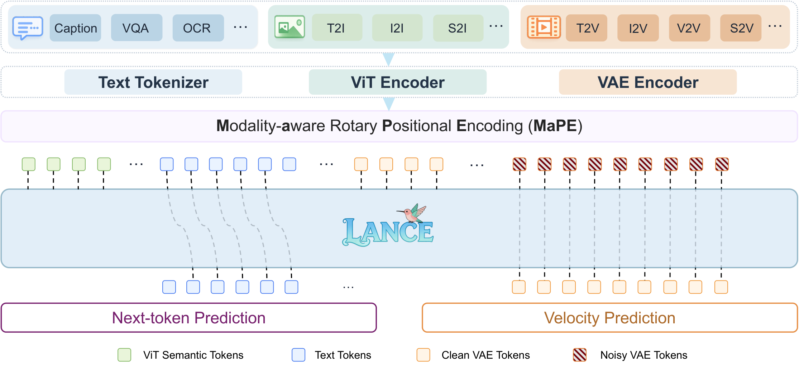
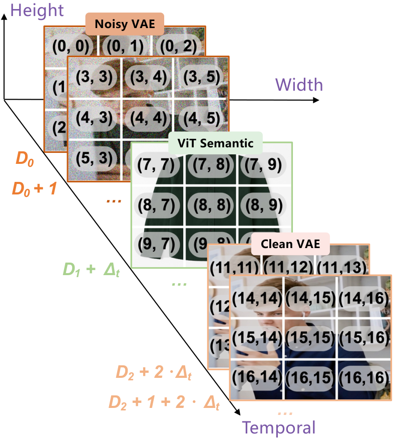
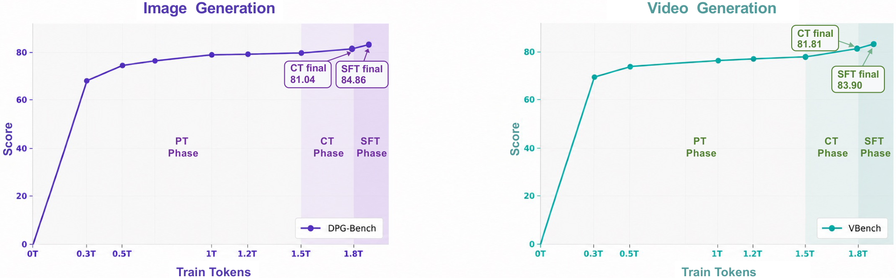
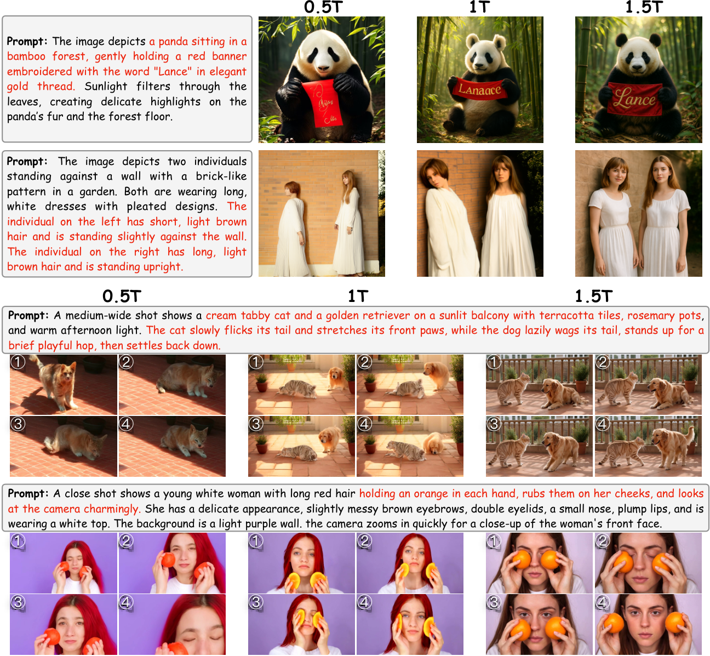
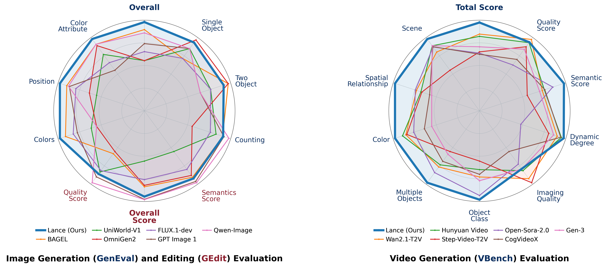

# Lance：多任务协同的统一多模态世界建模

| 读者 | 建议读法 | 工程落点 |
| --- | --- | --- |
| 初学者 | 先抓 Lance 为什么要同时做图像/视频理解、生成和编辑；公式只看输入、token 和 loss 的流向。 | 能区分“统一多模态模型”和“动作条件世界模型”。 |
| 工程师 | 重点看 dual-stream MoE、MaPE、PT/CT/SFT/RL 四阶段训练和 ablation。 | 落到 token 组织、数据混合、训练预算、生成/理解互相增益和评测边界。 |

!!! note "读法定位"
    **论文信息**

    - 论文：`Lance: Unified Multimodal Modeling by Multi-Task Synergy`
    - 链接：[arXiv:2605.18678](https://arxiv.org/abs/2605.18678)
    - 项目页：[Lance Project](https://lance-project.github.io/)
    - 代码：[GitHub](https://github.com/bytedance/Lance)
    - 模型：[Hugging Face](https://huggingface.co/bytedance-research/Lance)
    - 时间：2026-05-18 首次提交，2026-05-20 更新到 v2
    - 关键词：unified multimodal model、image/video understanding、image/video generation、editing、dual-stream MoE、MaPE、flow matching、multi-task training

Lance 不是 Dreamer 那类带 reward 的 model-based RL 世界模型，也不是 LingBot-World 那类动作条件交互模拟器。它更适合被放在世界模型专题里的原因是：**它展示了如何把文本、图像、视频理解 token、干净 VAE latent 和带噪 VAE latent 放进一个统一上下文里训练，并用不同 expert 分开承载语义理解和视觉生成。**

如果未来要做“能看、能想象、能编辑、能解释自身 rollout”的视频世界模型，Lance 提供的是一个很有用的中间层范式：世界状态不只是一串像素 latent，也不只是语言语义，而是多种视觉 token 在同一个上下文里协同。

## 它的效率贡献是什么

| 维度 | 贡献 |
| --- | --- |
| 节省的成本 | 用 3B activated parameters 和最多 128 A100 预算探索统一图像/视频理解、生成、编辑，而不是直接靠更大模型容量堆能力 |
| 核心机制 | shared interleaved multimodal sequence + dual expert pathways + MaPE + staged multi-task training |
| 对世界模型主线的意义 | 给“语义状态”和“生成状态”如何共存提供了结构模板；视频世界模型不一定要把理解和生成塞进同一类 token |
| 主要风险 | 没有显式 action-conditioned dynamics、reward/risk head 或 closed-loop control 评测；它更像世界模型底座组件，不是完整交互世界模型 |
| 应接到本站哪里 | [LWM](lwm.md)、[LingBot-World](lingbot-world.md)、[Towards Video World Models](towards-video-world-models.md)、[VLA / WAM 与世界模型地图](../../embodied-ai/vla-wam-world-model-system-map.md) |

## 证据等级与外推边界

更稳的读法是把 Lance 的 claim 拆成三层：论文强证据支持“统一多模态训练可以互相增益”；中等证据支持“统一上下文 + 分离 expert 是可行结构”；弱证据才是“它已经能当世界模型做闭环决策”。

| 论文结论 | 证据来源 | 证据等级 | 可外推到世界模型高效训练 | 不能直接外推 |
| --- | --- | --- | --- | --- |
| 统一上下文能同时组织理解、生成和编辑任务 | Figure 6、Table 2/3/4、主实验 | Architecture + Benchmark | 世界模型可以把语言、语义视觉 token 和 VAE latent 放进同一个上下文，而不是硬拆成多个系统 | 不能证明统一上下文天然拥有动作因果或物理状态 |
| decoupled capability pathways 降低异构目标干扰 | dual-stream MoE、LLMUND/LLMGEN、ablation | System design + Ablation | 语义理解和视觉生成可以共享上下文但分开参数路径，适合世界模型里的 state encoder / future generator 分工 | 不能说明所有任务都该双 expert；也不能替代真实系统成本测试 |
| MaPE 有助于区分异构视觉 token | Table 10 的 MaPE 消融 | Ablation | 对多视觉 token 组训练很关键，尤其是 clean condition / noisy target / semantic token 同时出现时 | 指标增益不等于解决长时记忆或动作分叉 |
| multi-task data 对生成和理解有正迁移 | Table 9 cross-task data ablation | Ablation | 编辑、subject-driven generation、understanding data 可作为世界模型训练的辅助信号 | 数据比例依赖任务分布，不能照搬到机器人或自动驾驶 |
| 3B 模型能覆盖图像/视频理解、生成和编辑 | VBench、GenEval、GEdit、MVBench、定性图 | Benchmark + Demo | 小模型统一训练路线值得做 baseline | benchmark 不是 closed-loop rollout，也不是安全物理仿真 |

## 论文位置

Lance 的核心问题是：多模态模型经常被分成两条路线。理解模型偏语义、问答、推理；生成模型偏连续 latent、细节、运动和编辑。简单把它们接起来会出现两个问题：

1. 语义理解需要高层视觉特征，视觉生成需要低层连续 latent；
2. 语言 next-token objective 和视觉 flow/diffusion objective 优化动态不同，放进一个 dense backbone 里容易互相干扰。

Lance 的回答不是“所有模态都离散成同一种 token”，也不是“理解模型调用外部生成器”。它选择：

```text
shared interleaved multimodal context
  + semantic ViT tokens for understanding
  + clean/noisy VAE latents for generation
  + LLMUND expert for text/understanding
  + LLMGEN expert for visual generation
  + LM head and flow head with different objectives
```

这和世界模型的关系很直接。一个有用的世界模型往往也要同时保留两类状态：

| State type | Lance 对应组件 | 世界模型里的意义 |
| --- | --- | --- |
| semantic state | ViT semantic tokens + text tokens + LLMUND | 让模型知道对象、事件、任务、指令和可解释语义 |
| generative state | clean/noisy VAE tokens + LLMGEN + flow head | 让模型能生成未来观测、细节和时空变化 |
| shared context | interleaved sequence + generalized 3D causal attention | 让理解信号和生成信号互相对齐 |
| token role separation | MaPE | 防止同一时空位置的不同 token 组在位置编码里混淆 |

因此，Lance 更像“世界模型底座里的统一多模态状态层”，而不是“可以直接替代环境的模拟器”。

## 总体架构

{ width="920" }

<small>图源：`Lance: Unified Multimodal Modeling by Multi-Task Synergy`，Figure 6。原论文图注要点：多任务输入 X2T、X2I、X2V 被编码到 MaPE 增强的统一多模态上下文序列；dual-expert backbone 在共享上下文上做 generalized 3D causal attention，并分别通过 LM head 做 next-token prediction、通过 flow head 做视觉 latent velocity prediction。</small>

!!! note "这张图怎么读"
    上半部分先看任务族：caption、VQA、OCR 属于理解；T2I/I2I/S2I 属于图像生成/编辑；T2V/I2V/V2V/S2V 属于视频生成/编辑。中间的关键不是某个任务，而是三类 token 进入同一条上下文：ViT semantic tokens、text tokens、clean VAE tokens 和 noisy VAE tokens。

    下半部分才是 Lance 的关键判断：理解走 next-token prediction，生成走 velocity prediction。它们共享上下文，但不共享同一条能力路径。对世界模型来说，这相当于把“解释世界”和“生成世界”拆成两个 expert，又让二者在同一个状态序列里通信。

### 统一上下文序列

Lance 把一个样本组织成 interleaved multimodal sequence：

$$
\mathcal{S}
=
\cdots \oplus
\mathcal{B}_{\mathrm{text}}(\mathbf{T})
\oplus
\mathcal{B}_{\mathrm{vis}}(\mathbf{V}_{\mathrm{vit}})
\oplus
\mathcal{B}_{\mathrm{vis}}(\mathbf{V}_{\mathrm{vae}}^{\mathrm{clean}})
\oplus
\mathcal{B}_{\mathrm{vis}}(\mathbf{V}_{\mathrm{vae}}^{\mathrm{noisy}})
\oplus
\mathcal{B}_{\mathrm{text}}(\mathbf{T}')
\oplus \cdots
$$

<!-- [补充：符号说明] -->
| 符号 | 含义 | 取值范围 / 常见值 |
| --- | --- | --- |
| \(\mathcal{S}\) | 一个样本的统一多模态上下文序列 | 文本、ViT 语义 token、clean VAE latent、noisy VAE latent 交错组成 |
| \(\oplus\) | 序列拼接 | 按上下文顺序连接不同模态块 |
| \(\mathcal{B}_{\mathrm{text}}\)、\(\mathcal{B}_{\mathrm{vis}}\) | 文本块和视觉块的封装函数 | 分别加入文本或视觉边界 token |
| \(\mathbf{T}\)、\(\mathbf{T}'\) | 文本 token 序列 | prompt、问题、回答或说明文字 |
| \(\mathbf{V}_{\mathrm{vit}}\) | ViT 语义视觉 token | 来自 Qwen2.5-VL ViT encoder |
| \(\mathbf{V}_{\mathrm{vae}}^{\mathrm{clean}}\)、\(\mathbf{V}_{\mathrm{vae}}^{\mathrm{noisy}}\) | 干净和带噪的 VAE latent | 生成条件或 flow matching 目标 |

其中：

$$
\mathcal{B}_{\mathrm{text}}(\mathbf{T})=[\texttt{BOT}, \mathbf{T}, \texttt{EOT}],
\quad
\mathcal{B}_{\mathrm{vis}}(\mathbf{V})=[\texttt{BOV}, \mathbf{V}, \texttt{EOV}].
$$

<!-- [补充：符号说明] -->
| 符号 | 含义 | 取值范围 / 常见值 |
| --- | --- | --- |
| \(\mathcal{B}_{\mathrm{text}}(\mathbf{T})\) | 文本块的边界封装 | \(\texttt{BOT}\) 到 \(\texttt{EOT}\) |
| \(\mathcal{B}_{\mathrm{vis}}(\mathbf{V})\) | 视觉块的边界封装 | \(\texttt{BOV}\) 到 \(\texttt{EOV}\) |
| \(\mathbf{T}\) | 文本 token 序列 | 任意长度的文本输入或输出 |
| \(\mathbf{V}\) | 视觉 token 或视觉 latent 序列 | ViT token、clean VAE latent 或 noisy VAE latent |
| \(\texttt{BOT}\)、\(\texttt{EOT}\) | 文本块起止标记 | begin/end of text |
| \(\texttt{BOV}\)、\(\texttt{EOV}\) | 视觉块起止标记 | begin/end of vision |

| Token group | 来源 | 作用 |
| --- | --- | --- |
| text tokens | Qwen2.5-VL language embedding | 指令、问题、回答和生成 prompt |
| ViT semantic tokens | Qwen2.5-VL ViT encoder | 图像/视频理解、语义推理、VQA、caption |
| clean VAE tokens | Wan2.2 3D causal VAE encoder | 生成或编辑时的视觉条件 |
| noisy VAE tokens | flow matching 中的 noisy latent | 视觉生成目标，交给 flow head 预测 velocity |

这里和 LWM 的差别很有意思。LWM 更偏“所有东西都变成离散 token，用一个自回归 Transformer 预测下一个 token”；Lance 则保留了连续视觉 latent 的生成优势，用 flow matching 承担高保真图像/视频生成。

### 双 expert 与两个 loss

Lance 用两个 expert 处理同一个上下文：

| Pathway | 输入重点 | 输出 | Objective |
| --- | --- | --- | --- |
| \(\mathrm{LLM}_{\mathrm{UND}}\) | text tokens + ViT semantic tokens | text tokens | autoregressive next-token prediction |
| \(\mathrm{LLM}_{\mathrm{GEN}}\) | VAE latent tokens + shared context | visual latent velocity | flow matching / velocity prediction |

理解侧 loss：

$$
\mathcal{L}_{\mathrm{UND}}
= - \sum_i \log p_{\theta_{\mathrm{UND}}}(y_i \mid y_{<i}, \mathcal{S}).
$$

<!-- [补充：符号说明] -->
| 符号 | 含义 | 取值范围 / 常见值 |
| --- | --- | --- |
| \(\mathcal{L}_{\mathrm{UND}}\) | 理解路径的语言建模损失 | 非负标量 |
| \(i\) | 当前文本 token 位置 | 正整数索引 |
| \(y_i\) | 第 \(i\) 个目标文本 token | 词表中的一个 token |
| \(y_{<i}\) | 第 \(i\) 个 token 之前的文本上下文 | 已生成或已给定的前缀 token |
| \(p_{\theta_{\mathrm{UND}}}\) | 理解 expert 给出的条件概率 | \(0\) 到 \(1\) |
| \(\theta_{\mathrm{UND}}\) | 理解路径参数 | \(\mathrm{LLM}_{\mathrm{UND}}\) 相关参数 |
| \(\mathcal{S}\) | 统一多模态上下文序列 | 当前样本的交错上下文 |

生成侧把 clean latent \(x_1\) 和 Gaussian noise \(x_0\) 插值成：

$$
x_t = t x_1 + (1-t)x_0,\quad t \sim \mathcal{U}(0,1),
$$

<!-- [补充：符号说明] -->
| 符号 | 含义 | 取值范围 / 常见值 |
| --- | --- | --- |
| \(x_t\) | 时间 \(t\) 上的插值 latent | 从噪声逐步靠近干净 latent |
| \(x_1\) | 干净视觉 latent | VAE encoder 输出的目标 latent |
| \(x_0\) | 高斯噪声 latent | 通常从标准高斯分布采样 |
| \(t\) | flow matching 的连续时间 | \(0\) 到 \(1\) |
| \(\mathcal{U}(0,1)\) | 均匀分布 | 在 \(0\) 到 \(1\) 之间采样 |

然后优化 velocity：

$$
\mathcal{L}_{\mathrm{GEN}} =
\mathbb{E}_{x_0, x_1, t}
\left[
\left\|
v_{\theta_{\mathrm{GEN}}}(x_t, \mathcal{S}, t) - (x_1 - x_0)
\right\|_2^2
\right].
$$

<!-- [补充：符号说明] -->
| 符号 | 含义 | 取值范围 / 常见值 |
| --- | --- | --- |
| \(\mathcal{L}_{\mathrm{GEN}}\) | 生成路径的 velocity prediction 损失 | 非负标量 |
| \(\mathbb{E}_{x_0,x_1,t}\) | 对噪声、目标 latent 和时间的期望 | 训练 batch 上的平均 |
| \(v_{\theta_{\mathrm{GEN}}}\) | 生成 expert 预测的 latent velocity | 与 \(x_1-x_0\) 同形状 |
| \(\theta_{\mathrm{GEN}}\) | 生成路径参数 | \(\mathrm{LLM}_{\mathrm{GEN}}\) 和 flow head 相关参数 |
| \(x_t\) | 当前带噪 latent | 由 \(x_0\)、\(x_1\)、\(t\) 插值得到 |
| \(\mathcal{S}\) | 条件上下文 | 文本、语义视觉 token 和视觉 latent 的统一序列 |
| \(x_1-x_0\) | 目标 velocity | 从噪声指向干净 latent 的方向 |
| \(\|\cdot\|_2^2\) | 平方 \(L_2\) 误差 | 按 latent 维度求和或平均 |

总目标是：

$$
\mathcal{L}
= \lambda_u \mathcal{L}_{\mathrm{UND}}
+ \lambda_g \mathcal{L}_{\mathrm{GEN}}.
$$

<!-- [补充：符号说明] -->
| 符号 | 含义 | 取值范围 / 常见值 |
| --- | --- | --- |
| \(\mathcal{L}\) | Lance 的联合训练目标 | 理解损失和生成损失的加权和 |
| \(\lambda_u\) | 理解损失权重 | 论文训练表里用 CE : MSE 比例控制 |
| \(\lambda_g\) | 生成损失权重 | 论文训练表里通常把 MSE 侧作为主要权重 |
| \(\mathcal{L}_{\mathrm{UND}}\) | 语言理解损失 | next-token prediction |
| \(\mathcal{L}_{\mathrm{GEN}}\) | 视觉生成损失 | flow matching velocity prediction |

这个设计的工程含义是：不要强行让语义理解和像素生成共用同一组视觉表示。世界模型也常遇到类似冲突：给 planner 用的 state 要抽象、稳定、可判别；给 simulator 用的 future observation 又要保留细节、运动和视觉一致性。Lance 的双路径结构可以作为这个冲突的参考解。

### Generalized 3D causal attention

Lance 的 attention 不是简单全 causal 或全 bidirectional。它先把序列切成 modality-specific segments：

1. segment 之间保持 causal dependency，当前 segment 可以看前面 clean segments；
2. text segment 内部用 causal attention；
3. visual segment 内部用 bidirectional attention，保留图像/视频空间和时空结构。

这和交互式视频世界模型里的 causal rollout 不是一回事。Lance 的 causal 主要服务 interleaved multimodal context 的条件组织；LingBot-World 那类 causal adaptation 则服务“用户动作逐步进来，模型不能看未来”的在线模拟。二者方向相近，但验收指标不同。

## MaPE：让不同视觉 token 组不要互相串台

{ width="620" }

<small>图源：`Lance`，Figure 7。原论文图注要点：MaPE 给不同 modality token group 在 temporal dimension 上加入固定 offset，使 noisy VAE、ViT semantic 和 clean VAE token 在全局位置空间中可区分，同时保持各自空间布局和时间相对关系。</small>

普通 3D-RoPE 会按 \((t,h,w)\) 给视觉 token 分配位置。但 Lance 的同一个上下文里可能同时有：

```text
ViT semantic tokens
clean VAE condition tokens
noisy VAE target tokens
```

它们可能来自同一张图或同一段视频，时空位置相近，但角色完全不同。如果只靠普通 \((t,h,w)\) 位置，模型可能不知道一个 token 是语义条件、干净视觉条件，还是正在被 denoise 的生成目标。

MaPE 的做法是在 temporal dimension 加 group offset：

$$
\mathbf{p}^{(m_i)}_{t,h,w}
=
\hat{\mathbf{p}}^{(m_i)}_{t,h,w}
+
[i \cdot \Delta_t, 0, 0].
$$

<!-- [补充：符号说明] -->
| 符号 | 含义 | 取值范围 / 常见值 |
| --- | --- | --- |
| \(\mathbf{p}^{(m_i)}_{t,h,w}\) | 加入模态偏移后的 3D 位置 | 用于第 \(i\) 个视觉 token 组 |
| \(\hat{\mathbf{p}}^{(m_i)}_{t,h,w}\) | 原始 3D 位置 | 由时间、高度、宽度坐标给出 |
| \(m_i\) | 第 \(i\) 个视觉 token 组的模态标识 | noisy VAE、ViT semantic、clean VAE 等 |
| \(t,h,w\) | 时间、高度、宽度索引 | 视频或图像 token 网格坐标 |
| \(i\) | token group 序号 | 非负或正整数，取决于实现编号 |
| \(\Delta_t\) | 时间维上的组间偏移量 | 论文实验使用 \(1000\) |
| \([i\cdot\Delta_t,0,0]\) | 只沿时间维加入的偏移向量 | 区分不同视觉 token 角色 |

论文实验里 \(\Delta_t=1000\)。这个改动很小，但对世界模型训练有启发：如果你在同一上下文里放 `state token`、`observation token`、`action-conditioned target token`、`risk token`，最好显式告诉模型它们的角色边界。否则模型可能把“观测”和“预测目标”混成同一种视觉块。

## 训练路线总览

Lance 的训练分四阶段：PT、CT、SFT、RL。它不是只做图文预训练后接一点微调，而是逐步扩大任务空间，再用高质量数据和 reward 优化收口。

| Hyperparameters | PT | CT | SFT | RL |
| --- | --- | --- | --- | --- |
| Learning rate | \(1.0\times10^{-4}\) | \(1.0\times10^{-4}\) | \(2.5\times10^{-5}\) | \(2.0\times10^{-6}\) |
| LR scheduler | Constant | Constant | Cosine | Constant |
| Weight decay | 0.0 | 0.0 | 0.0 | 0.0 |
| Gradient norm clip | 1.0 | 1.0 | 1.0 | 1.0 |
| Optimizer | AdamW \((\beta_1=0.9,\ \beta_2=0.95,\ \epsilon=1.0\times10^{-15})\) | AdamW \((\beta_1=0.9,\ \beta_2=0.95,\ \epsilon=1.0\times10^{-15})\) | AdamW \((\beta_1=0.9,\ \beta_2=0.95,\ \epsilon=1.0\times10^{-15})\) | AdamW \((\beta_1=0.9,\ \beta_2=0.95,\ \epsilon=1.0\times10^{-15})\) |
| Loss weight (CE : MSE) | 0.25 : 1 | 0.5 : 1 | 0.25 : 1 | - |
| Warm-up steps | 2500 | 2500 | 500 | 50 |
| Training steps | 350k | 80k | 15k | 800 |
| Sequence length per rank (min, max) | (44K, 50K) | (74K, 80K) | (74K, 80K) | (74K, 80K) |
| # Seen training tokens | 1.5T | 300B | 72B | 0.5B |
| Max context window | 40k | 70k | 70k | 70k |
| Gen resolution (min short side, max long side) | (192, 848) | (480, 848) | (480, 848) | (480, 848) |
| Und resolution (min short side, max long side) | (168, 826) | (462, 826) | (462, 826) | (462, 826) |
| Diffusion timestep shift | 1.0 | 4.0 | 4.0 | 4.0 |

<small>表源：`Lance`，Table 2。表格保留原论文英文列名和关键数值。</small>

### PT：先建立图像/视频理解和生成底座

PT 阶段冻结 VAE 和 ViT encoders，优化剩余组件，包括 multimodal backbone、QK-Norm modules 和 MLP connectors。数据是大规模 image-text 与 video-text pairs：

| Data | Scale | Role |
| --- | --- | --- |
| image-text pairs | about 1B | natural scenes、human-centric、object-centric、knowledge-oriented、stylized content |
| video-text pairs | about 140M | actions、events、scene transitions、long-range temporal processes |

训练采用 progressive resolution curriculum：\(192p \rightarrow 360p \rightarrow 480p\)，并启用 dynamic resolution。论文还使用大约 \(1:4\) 的 image:video sampling ratio，把更多采样预算给视频，因为视频建模更难、时序推理压力更大。

### CT：把 paired supervision 扩成统一多任务学习

CT 阶段开始引入 interleaved multimodal understanding 和 any-to-image/video generation/editing。这个阶段对世界模型读者尤其重要，因为它不是只加“更多视频”，而是加入更丰富的输入输出映射。

| Mixture | Ratio Type | PT | CT-I | CT-II | CT-III | SFT |
| --- | --- | --- | --- | --- | --- | --- |
| Global | Vid.-Gen. : Vid.-Und. : Img.-Gen. : Img.-Und. | 64:16:16:4 | 64:16:16:4 | 64:16:16:4 | 64:16:16:4 | 64:16:16:4 |
| Generation | T2I : I-Edit : S2I | 100:0:0 | 70:15:15 | 60:20:20 | 50:25:25 | 60:20:20 |
| Generation | T2V : I2V : V-Edit : S2V | 100:0:0:0 | 60:10:15:15 | 40:20:20:20 | 25:25:25:25 | 60:10:15:15 |

<small>表源：`Lance`，Table 3。Img., Vid., Gen., and Und. denote image, video, generation, and understanding, respectively.</small>

CT 里的 understanding data 有 2.73M interleaved multimodal understanding samples，覆盖 T2T、captioning、classification、conversation、grounding、reasoning、VQA 和 OCR。generation 侧则引入 2.8M image editing、2.6M video editing、3.6M subject-driven image generation 和 1M subject-driven video generation。总训练量约 300B tokens。

### SFT：用高质量数据对齐指令、编辑和一致性

SFT 阶段学习率降到 \(2.5\times10^{-5}\)，重点从“扩大任务空间”转成“提高任务对齐质量”。它使用 curated high-quality data，强调 instruction fidelity、visual consistency、editing accuracy 和 identity preservation。

| Output Type | Notation | Task | # Samples | Phases |
| --- | --- | --- | --- | --- |
| Text | I2T | General image captioning | 1B | PT, CT |
| Text | V2T | General video captioning | 140M | PT, CT |
| Text | I2T | High-quality image captioning | 190K | SFT |
| Text | V2T | High-quality video captioning | 5K | SFT |
| Text | X2T | Interleaved multimodal understanding | 2.73M | CT, SFT |
| Image | T2I | General image generation | 1B | PT, CT |
| Image | X2I | General image editing | 2.8M | CT |
| Image | X2I | General subject-driven image generation | 3.6M | CT |
| Image | T2I | High-quality image generation | 190K | SFT |
| Image | X2I | High-quality image editing | 84K | SFT |
| Video | T2V/I2V | General video generation | 140M | PT, CT |
| Video | X2V | General video editing | 2.6M | CT |
| Video | X2V | General subject-driven video generation | 1M | CT |
| Video | T2V/I2V | High-quality video generation | 5K | SFT |
| Video | X2V | High-quality video editing | 9K | SFT |
| Video | X2V | High-quality subject-driven video generation | 5.5K | SFT |

<small>表源：`Lance`，Table 4。表格保留原论文英文列名和任务名。</small>

### RL：只针对图像生成做细粒度文本约束优化

RL 阶段用 GRPO 优化 image generation，数据是 20K prompts，重点是 text rendering accuracy、image-text correspondence 和 prompt compositional adherence。reward model 使用 PaddleOCR 来检查生成图像和 prompt 里的文字约束是否一致。

这里要注意边界：Lance 的 RL 不是世界模型里的环境 reward，也不是视频物理 reward。它主要服务图像中文字渲染和图文对齐。对世界模型来说，这说明 reward-based optimization 可以接入统一多模态生成，但 Lance 还没有把 reward 扩展到视频动力学、动作后果、风险或闭环成功率。

### 实现细节里的一个小心点

论文摘要说 Lance is trained from scratch；但实验设置里又说明 Lance is implemented upon Qwen2.5-VL 3B，使用其 weights 初始化 visual understanding encoder 和 \(\mathrm{LLM}_{\mathrm{UND}}\)、\(\mathrm{LLM}_{\mathrm{GEN}}\)，视觉生成 encoder 使用 Wan2.2 3D causal VAE。论文同时强调 QK-Norm 改变了 initialized backbone 的 query-key activation distribution，因此不是直接复用 Qwen2.5-VL，而是通过 staged recipe 做了显著重适配。

本站的读法是：**不要把它理解成从随机初始化训练所有组件，也不要把它理解成简单微调现成 VLM。它的核心贡献在于统一多模态训练 recipe 和结构组织。**

## 训练动态：token 越多，视频收益更慢更久

{ width="920" }

<small>图源：`Lance`，Figure 13。原论文图注要点：展示 image generation 的 DPG-Bench 和 video generation 的 VBench 随训练 token 增加的 scaling behavior，并标出 CT final 与 SFT final。</small>

这张图对世界模型训练很有启发。图像生成在早期 token budget 下上升很快，后面进入慢增长；视频生成也类似，但因为时序一致性和动态建模更难，收益持续得更久。论文给出的读法是：大规模 paired training 先建立 core generation capability，后续 CT/SFT 主要提升 prompt alignment、visual fidelity 和 temporal consistency。

{ width="900" }

<small>图源：`Lance`，Figure 14。原论文图注要点：比较 0.5T、1T 和 1.5T token 训练预算下的 text-to-image 与 video generation 定性结果；训练预算增加后，prompt alignment、visual fidelity 和 temporal consistency 改善。</small>

!!! note "这张图在看什么"
    上半部分看图像生成里的文字、属性和多对象布局。0.5T 阶段能抓粗语义，但文字和细节容易错；1.5T 阶段更接近 prompt。下半部分看视频生成里的动作顺序和主体一致性，训练 token 增加后，猫狗交互、手部动作和镜头推进更连贯。

    对世界模型来说，这说明“视频能力”不是只靠模型结构给出来的。长期一致、动作顺序和对象身份需要更多 token、更丰富任务和更细的数据 schedule。

## 实验结果怎么读

Lance 的主实验覆盖图像生成、视频生成、图像/视频编辑和视频理解。这里不把所有 benchmark 表完整搬过来，只抓和世界模型专题最相关的指标：

{ width="920" }

<small>图源：`Lance`，Figure 1。原图用 radar charts 横向比较 Lance 与代表性统一模型和专用模型在 image generation、image editing、video generation 与 video understanding 上的相对表现。</small>

| Benchmark | Task | Lance result | 读法 |
| --- | --- | --- | --- |
| GenEval | image generation | 0.90 Overall | 说明 3B 统一模型在图像组合生成上能接近强 unified baselines |
| DPG-Bench | image generation | 84.67 Overall | relation 维度强，但 overall 不是所有模型第一 |
| VBench | video generation | 85.11 Total Score | 在 unified models 中报告最好 total score，说明视频生成质量和语义对齐较强 |
| GEdit-Bench | image editing | 7.30 Avg/G_O | 统一上下文对编辑任务有效 |
| MVBench | video understanding | 62.0 Avg. | 在 unified models 中强，但仍低于部分专门 video understanding 模型 |

<!-- [补充：一句话实验结论] -->
> **一句话实验结论**：Lance 的实验说明，统一上下文和多任务数据能让理解、生成、编辑互相提供信号，但这些分数还不能替代动作条件和闭环评测。

最需要警惕的是：这些指标主要测视觉质量、语义对齐、编辑能力和视频理解，不测动作反事实。一个模型能生成高分视频，不等于它能回答：

```text
同一段历史下，左转、右转、停止、加速会造成怎样不同的未来？
```

这也是 Lance 和 LingBot-World 的边界。

## Cross-task data synergy

论文最有价值的 ablation 是 cross-task data。它验证了一个世界模型训练里经常出现的问题：理解数据和编辑数据会不会帮助生成？答案在 Lance 的设置里是会，但比例很重要。

| Ablation Type | Setting | Image Generation GenEval ↑ | Video Generation VBench ↑ | Video Understanding MVBench ↑ |
| --- | --- | --- | --- | --- |
| Base | Gen. only | 80.88 | 81.25 | -- |
| + Understanding data | Gen.:Und. = 8:2 | 81.65 | 82.91 | 58.06 |
| + Understanding data | Gen.:Und. = 9:1 (MT-Gen. Base) | 80.93 | 81.47 | 57.99 |
| + Multi-task data | Gen.:Und. = 9:1, Gen.:MT-Gen. = 8:2 | 81.89 | 82.88 | 59.18 |
| + Multi-task data | Gen.:Und. = 9:1, Gen.:MT-Gen. = 6:4 | 82.06 | 83.05 | 58.95 |

<small>表源：`Lance`，Table 9。Gen. denotes base generation data, Und. denotes understanding data, and MT-Gen. denotes multi-task generation data, including editing, subject-driven generation, etc.</small>

这张表的重点不是“混越多任务越好”，而是：适当理解数据能给生成提供语义 grounding；multi-task generation data 不只增强编辑和 subject-driven generation，也能回流改善 base generation 和部分 video understanding。

对世界模型训练来说，这支持一个很实际的工程判断：只喂未来帧预测可能不够。把 caption、VQA、OCR、grounding、editing、subject consistency 放进辅助任务，可能会提升模型对对象、关系、身份和指令的保持能力。但比例必须通过 ablation 定，不能按直觉硬塞。

## MaPE ablation

| Setting | Image Generation GenEval ↑ | Image Editing GEdit ↑ | Video Generation VBench ↑ | Video Understanding MVBench ↑ |
| --- | --- | --- | --- | --- |
| w/ MaPE | 80.94 | 6.86 | 81.81 | 59.16 |
| w/o MaPE | 80.56 | 6.30 | 80.95 | 59.02 |

<small>表源：`Lance`，Table 10。该表报告移除 Modality-Aware Rotary Positional Encoding 后，generation、editing 和 understanding 指标均下降。</small>

MaPE 对 image editing 的提升尤其明显，因为编辑任务同时依赖输入视觉条件、文本指令和生成目标。这个现象可以类比到世界模型：如果训练样本里同时有 `past observation`、`current state`、`candidate action`、`future target`，模型必须知道每组 token 的角色。只给它们普通时间位置，容易导致条件和目标混淆。

## 和 LingBot-World 的关系

| Dimension | LingBot-World | Lance | 本站判断 |
| --- | --- | --- | --- |
| Primary goal | interactive world simulator | unified multimodal understanding/generation/editing | 二者都靠视频生成能力，但目标不同 |
| Control signal | user action / camera / interaction | text, image, video conditions | Lance 缺少显式动作条件分叉 |
| Architecture focus | video generator to causal rollout simulator | shared context + dual expert pathways | Lance 更像统一状态层，LingBot 更像环境模拟器 |
| Training focus | long-horizon world training, action conditioning, causal adaptation, distillation | PT/CT/SFT/RL staged multi-task recipe | Lance 的训练细节更像通用多模态底座配方 |
| Evaluation focus | dynamic degree, memory, demos, interactive behavior | GenEval, DPG, VBench, GEdit, MVBench | Lance 证据强在跨任务协同，弱在闭环控制 |

如果做视频世界模型项目，可以把二者组合起来读：

```text
Lance:
  如何把理解 token、生成 latent、编辑目标放进统一上下文

LingBot-World:
  如何把视频生成底座改造成动作条件、因果、实时的交互模拟器
```

换句话说，Lance 解决的是“统一多模态状态如何建模”；LingBot-World 更接近“这个状态如何在动作下滚动成可交互未来”。

## 对世界模型项目的启发

1. **不要把所有视觉信息压成一种 token**：语义理解和视觉生成需要不同表示，强行统一可能伤害双方。
2. **共享上下文比分离系统更有价值**：理解和生成分 expert，但要在同一 interleaved context 中通信，否则编辑、解释和生成会割裂。
3. **给 token role 显式位置偏置**：MaPE 的思想可以推广到 state/action/target/reward token，避免异构 token 组位置混淆。
4. **数据 schedule 是能力的一部分**：PT 先打底，CT 加任务多样性，SFT 收质量，RL 优化细粒度约束；世界模型也需要类似阶段，而不是一次性混所有数据。
5. **辅助任务可能改善 world state**：caption、VQA、grounding、editing 和 subject-driven generation 可以提高对象身份、关系和语义约束。
6. **视频生成指标不能替代世界模型评测**：还要补 fixed history + varied action、long-horizon drift、risk calibration 和 closed-loop success。

## 如果把 Lance 改成更强世界模型，还缺什么

Lance 目前缺的不是“更多 benchmark”，而是世界模型特有的变量：

| 缺口 | 为什么重要 | 可以怎么补 |
| --- | --- | --- |
| action-conditioned dynamics | 世界模型要预测动作后果，而不只是按 prompt 生成视频 | 加 action tokens、camera/robot controls、latent action discovery 和 fixed-history action-branching eval |
| causal online rollout | 交互系统不能依赖未来 chunk | 把 generalized 3D causal attention 扩成 streaming rollout、KV cache 或 recurrent memory |
| persistent memory | 长任务里对象离开视野后仍要存在 | 加 scene memory、3D/4D state、long video revisit data 和 object identity eval |
| reward/risk heads | planner 需要可比较的风险和价值，不只是视频 | 加 collision/success/risk/reward labels 或 verifier reward |
| video RL / physics reward | RL 目前主要优化图像文字约束 | 用视频一致性、动作响应、物理规则或任务 success 做 reward |
| closed-loop validation | benchmark 高分不保证 agent 成功 | 接入 planner/VLA，评测任务成功率、失败恢复和安全边界 |

## 局限与风险

1. **不是动作条件世界模型**：论文没有证明同一历史下不同动作会产生可验证的未来分叉。
2. **video generation 仍是 benchmark 证据**：VBench 和定性图不能替代交互环境里的 closed-loop rollout。
3. **RL 范围较窄**：GRPO 主要针对图像中文字渲染和图文对齐，没有覆盖视频、物理或任务 reward。
4. **训练初始化表述要谨慎**：摘要说 trained from scratch，但实验实现使用 Qwen2.5-VL 3B 初始化和 Wan2.2 VAE；读工程细节时要以方法和实验设置为准。
5. **模型卡也提示它是 research artifact**：官方说明 released checkpoint 不是 polished product model，输出质量会随 prompt、分辨率、时长、motion complexity 和 editing scenario 波动。
6. **text rendering 仍是限制**：论文 conclusion 提到 pre-training / continued-training 没有 dedicated text-rendering data，布局一致文本生成还有提升空间。

## 阅读结论

Lance 值得放进世界模型专题，是因为它把“统一多模态世界状态”这件事讲得很具体：语义视觉 token、VAE latent、文本指令和生成目标可以进入同一个上下文；理解和生成可以共享上下文但走不同 expert；训练可以用 PT/CT/SFT/RL 分阶段让任务互相增强。

但它还不是完整世界模型。真正的世界模型需要动作条件、因果 rollout、长期记忆、风险/奖励和闭环验证。Lance 给的是底座结构和训练配方：如果后续把 action、state、reward 和 online rollout 接进去，它会是一条很值得参考的统一多模态路线。

!!! note "合并提示"
    **info · 本站判断**

    Lance 要按统一多模态世界状态底座读，而不是按完整交互世界模拟器读。它的强证据是 shared interleaved context、dual expert pathways、MaPE 和 staged multi-task training 能让理解、生成、编辑互相增益；它的弱点是没有动作条件分叉、视频物理 reward 和 closed-loop control 评测。

!!! tip "下一站"
    - 如果想看长上下文多模态世界模型，继续读 [LWM](lwm.md)。
    - 如果想看视频生成器如何变成交互世界模拟器，继续读 [LingBot-World](lingbot-world.md)。
    - 如果想先建立视频世界模型验收框架，回到 [Towards Video World Models](towards-video-world-models.md)。
