# LingBot-VA 2.0：原生视频-动作预训练

!!! info "论文信息"
    **论文题名：** Native Video-Action Pretraining for Generalizable Robot Control。 
    **作者：** Qihang Zhang、Lin Li、Luyao Zhang、Shuai Yang、Yiming Luo、Shuaiting Li、Ruilin Wang、Junke Wang、Jiahao Shao、Gangwei Xu、Jiaming Zhou、Yishu Shen、Yudong Jin、Fangyi Xu、Shuailei Ma、Jiaqi Liao、Guanxing Lu、Zifan Shi、Yongkun Wen、Yujie Zhao、Weixuan Tang、Xinyang Wang、Chaojian Li、Jiapeng Zhu、Ka Leong Cheng、Nan Xue、Xing Zhu、Yujun Shen、Yinghao Xu。 
    **机构：** PDF title page 未列机构；GitHub 归属 Robbyant，README 标注 `[RSS 2026] Causal video-action world model for generalist robot control`。 
    **时间 / 主题：** 2026-07（GitHub PDF metadata 生成时间）；世界模型、视频-动作预训练、机器人控制。 
    **arXiv / 官方报告：** 用户提供 PDF：[GitHub PDF](https://github.com/Robbyant/lingbot-va/blob/main/LingBot_VA2_paper.pdf)；项目页：[technology.robbyant.com/lingbot-va-v2](https://technology.robbyant.com/lingbot-va-v2)；相关 arXiv：[2601.21998](https://arxiv.org/abs/2601.21998)，题名为 `Causal World Modeling for Robot Control`，与 GitHub VA2 PDF 标题不同。 
    **GitHub / 项目：** GitHub：[github.com/Robbyant/lingbot-va](https://github.com/Robbyant/lingbot-va)。 
    **元数据来源与核验口径：** 来源：GitHub PDF `LingBot_VA2_paper.pdf`、GitHub README、arXiv metadata；Checked Date：2026-07-31；Repro Status：Paper / official GitHub reviewed, independent reproduction not claimed。

## 视频会继续播放，机器人却必须不断接受现实纠正

机器人正在把一个物体放入抽屉时，下一动作既取决于目标，也取决于抽屉是否真的打开、物体是否仍在夹爪中，以及前一动作执行到了哪里。视频生成模型擅长延续画面，但画面连贯不保证动作可执行；一个短暂的抓取失败，也可能让原本顺畅的想象轨迹彻底偏离现场。

LingBot-VA 2.0 因而把问题放到整条链路上。视觉 tokenizer 是否保留语义与变化，预训练是否遵守控制所需的时间顺序，无动作标签的视频能否提供动作相关信息，预测能否赶上执行，以及新观测到来时如何纠正想象。这篇《Native Video-Action Pretraining for Generalizable Robot Control》讨论的就是这些接口的联合设计。[原文 §1](https://github.com/Robbyant/lingbot-va/blob/main/LingBot_VA2_paper.pdf#page=1)

与第一代 LingBot-VA 相比，2.0 重新训练面向控制的 semantic visual-action tokenizer 与因果 DiT，使用稀疏 MoE 视频流扩展容量，以 multi-chunk prediction 加强远期监督，并用 Foresight Reasoning 将预测与执行重叠。主结果给出 RoboTwin 平均成功率 93.6%，四项真实任务上的共享策略也优于报告中的对照；这些系统结果之外，tokenizer 与 MCP 的消融分别检验了表示和时间监督的作用。[原文 §4](https://github.com/Robbyant/lingbot-va/blob/main/LingBot_VA2_paper.pdf#page=17)

“原生”指 tokenizer 和因果视频动作骨干从控制需求出发训练。系统仍使用预训练的视觉语义教师、文本编码器和高层 VLM planner，因此不能把它理解为所有知识都由机器人交互从零学得。少样本适配也是建立在这些先验、大规模视频与机器人数据上的下游能力。

## 一次控制循环里，哪些模块真的在运行

Figure 1 可以先从底部读起。当前图像与可选的人类示范视频经 SemVAE 编码，任务目标经 planner 转成当前子任务，语言模型提供文本条件。中间的 video model 提出未来状态，action model 根据状态转移生成动作。顶部 MCP 提供额外未来监督，标准部署时可以移除。

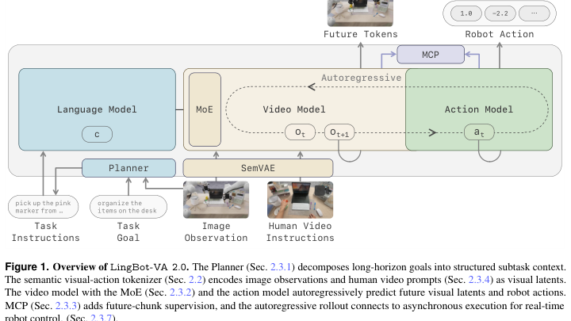{ width="900" }

*原文 Figure 1。图中的 MoE 位于视频流内，视频与动作两条流之间采用 MoT 分工。人类示范是可选上下文，不能把它和当前机器人未来观测混为一谈。*

整个系统有三种时间尺度。高层 planner 约以 2 Hz 更新子任务上下文；低层视频动作模型按 chunk 预测；机器人在一个动作 chunk 中执行多个低层控制步。后面报告的 225 Hz 属于最后一层的动作供应能力，既不等于 planner 频率，也不等于完整视觉闭环每秒重算 225 次。

数据训练又分成两层。首先学习 tokenizer，将观测变成语义视觉 latent，并从无标签视频提取紧凑的潜在动作；随后在这些表示上训练因果视频动作模型，混合图像、视频、控制、人类示范条件与人机共训练任务。部署使用模型学到的预测和控制能力，不需要重新对每个输入训练 tokenizer。[原文 §2](https://github.com/Robbyant/lingbot-va/blob/main/LingBot_VA2_paper.pdf#page=3)

## 为什么下一状态与当前动作要分两步预测

### 动作变量首先是一整块控制命令

视频 tokenizer 会压缩时间，而机器人动作通常在更高频率记录。原文先用时间压缩因子 $f_t$ 把原始动作 $u$ 对齐到相邻视觉 latent 之间。

$$
a_t=u_{t f_t:(t+1)f_t-1}.
$$

这里 $a_t$ 是使状态从 $z_t$ 变化到 $z_{t+1}$ 的动作块，不是单个电机命令。后续网络按 chunk 生成时，$t$ 也指 chunk 索引。这个定义很重要，因为视觉帧率、latent 帧率、动作块频率与低层执行频率不相同。[原文 Eq. 3](https://github.com/Robbyant/lingbot-va/blob/main/LingBot_VA2_paper.pdf#page=4)

常规视频动作建模采用以下分解。

$$
p_\theta(z_{1:N},a_{0:N-1}\mid z_0)=
\prod_{t=0}^{N-1}
 p_\theta(z_{t+1}\mid z_{\le t},a_{<t})
 p_\theta(a_t\mid z_{\le t},a_{<t},z_{t+1}).
$$

第一项从过去状态与过去动作提出下一视觉状态，第二项根据这次状态转移推断当前应执行的动作。语言等条件在这个简写中省略。模型先形成“任务接下来应如何展开”的视觉预测，再用 inverse dynamics 路径把它转成控制。[原文 Eq. 5](https://github.com/Robbyant/lingbot-va/blob/main/LingBot_VA2_paper.pdf#page=4)

第一项没有读取当前 $a_t$。因此它不能直接被解释成“已经决定动作 $a_t$，现在预测这个动作的物理后果”。它更接近受任务和历史约束的未来提议。后面的异步执行需要另一种条件形式，当前动作已经在执行，模型必须知道它会把机器人带到哪里，那时才显式把 $a_t$ 输入视频预测。

### 两条流都用 flow matching，但生成顺序不同

令流匹配时间为 $s$，避免与控制时间 $t$ 混淆。视频目标 $z_{t+1}$ 和动作目标 $a_t$ 分别与各自噪声插值，例如 $z_{t+1}^{(s)}=(1-s)\epsilon_z+s z_{t+1}$。视频与动作损失分别拟合速度目标。

$$
\mathcal L_{\mathrm{vid}}=
\mathbb E\left\|v^{\mathrm{vid}}_\theta
(z_{t+1}^{(s)},s\mid z_{\le t},a_{<t})-(z_{t+1}-\epsilon_z)\right\|_2^2,
$$

$$
\mathcal L_{\mathrm{act}}=
\mathbb E\left\|v^{\mathrm{act}}_\theta
(a_t^{(s)},s\mid z_{\le t},a_{<t},z_{t+1})-(a_t-\epsilon_a)\right\|_2^2,
\qquad
\mathcal L_{\mathrm{VA}}=\mathcal L_{\mathrm{vid}}+\lambda_{\mathrm{act}}\mathcal L_{\mathrm{act}}.
$$

训练时历史通常来自真实数据，动作路径可以使用对应的目标转移；推理时则使用视频流生成的 $\hat z_{t+1}$，再生成 $\hat a_t$。这引入了训练与推理的差异，真实目标与模型预测不会总是一致，所以后文加入历史噪声增强并依靠执行后的真实反馈纠正。[原文 Eq. 6–8](https://github.com/Robbyant/lingbot-va/blob/main/LingBot_VA2_paper.pdf#page=4)

原文有时用 $v^{\mathrm{vid}}$ 或 $v^{\mathrm{act}}$ 简写完整采样结果。严格地说，网络输出的是速度场，状态和动作要通过相应的流积分获得，不能把一次速度预测直接等同于最终控制命令。

## Tokenizer 同时保留可重建的细节和可用于控制的变化

### 语义监督没有取消重建

普通视频 VAE 主要压缩并重建像素。它可以很好地保存纹理，却未必把目标对象、任务语义与动作相关变化组织在容易利用的位置。LingBot-VA 2.0 沿用 RepWAM 的思路，把语义对齐加入视觉 tokenizer，再在视觉 latent 上学习潜在动作。

Figure 2 左半部分是视觉编码和重建，冻结的 vision foundation model 为 latent 提供语义目标；右半部分从相邻状态提取变化，再通过正向和反向预测验证这个变化描述是否有用。

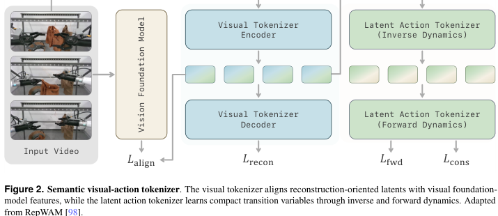{ width="900" }

*原文 Figure 2。训练先建立视觉表示，再冻结视觉 tokenizer 学习潜在动作。图中 forward dynamics 位于 tokenizer 阶段，后面的在线 FDM 使用的是另一个模型接口。*

视觉 tokenizer 是 ViT autoencoder。首帧采用 $16\times16$ 空间 patch，后续帧采用 $4\times16\times16$ 时空 tubelet；帧内允许完整空间注意力，时间上保持因果注意力。对称 decoder 将 latent 还原为视频。

重建目标包含三种约束。

$$
\mathcal L_{\mathrm{rec}}=
\lambda_1\|o-\hat o\|_1+\lambda_{\mathrm{perc}}\mathcal L_{\mathrm{perc}}(o,\hat o)
+\lambda_{\mathrm{gan}}\mathcal L_{\mathrm{gan}}(\hat o).
$$

像素项约束数值误差，感知项比较更高层的视觉特征，对抗项改善生成外观。语义项则使用冻结的 Perception Encoder $G$，先由 $W_{\mathrm{align}}$ 将 tokenizer latent 映射到教师特征维度，再比较时间平均后的表示。

$$
\mathcal L_{\mathrm{align}}=
\left\|\operatorname{avg}(W_{\mathrm{align}}z)-\operatorname{avg}(G(o))\right\|_2^2,
\qquad
\mathcal L_{\mathrm{vis}}=\mathcal L_{\mathrm{rec}}+\lambda_{\mathrm{align}}\mathcal L_{\mathrm{align}}.
$$

$\operatorname{avg}$ 是 temporal average pooling，因此对齐发生在片段语义层面，不等于逐帧每个特征都与教师精确一致。重建继续迫使 latent 保留帧级细节，语义对齐则把表示拉向更有利于语言与对象理解的空间。[原文 §2.2.1](https://github.com/Robbyant/lingbot-va/blob/main/LingBot_VA2_paper.pdf#page=5)

### 从两帧的差异提取潜在动作

视觉 tokenizer 固定之后，inverse dynamics model $q_\phi$ 接收相邻视觉状态，输出低维转移变量。

$$
\ell_t=q_\phi(z_t,z_{t+1})\in\mathbb R^{d_\ell},\qquad d_\ell\ll\dim(z_t).
$$

接着 forward dynamics model 将 $\ell_t$ 解码为 transport map $K_t$ 与 residual $\delta_t$。

$$
\hat z_{t+1}=f_\psi(z_t,\ell_t)=K_tz_t+\delta_t.
$$

$K_t$ 把空间 latent token 中的信息从一个位置传到另一个位置，$\delta_t$ 补充单靠搬移不能解释的变化。反向预测器 $\bar f_\psi$ 则从 $(z_{t+1},\ell_t)$ 恢复 $z_t$。训练同时减小两端误差。

$$
\mathcal L_\ell=\sum_t\left(
\|\hat z_{t+1}-z_{t+1}\|_2^2+\|\hat z_t-z_t\|_2^2
\right).
$$

低维瓶颈要求用紧凑变化描述连接两个视觉状态，减少直接复制整幅未来状态的机会。正反两个方向使这个描述不仅能解释终点，也能与起点保持相容。[原文 Eq. 12–14](https://github.com/Robbyant/lingbot-va/blob/main/LingBot_VA2_paper.pdf#page=5)

这种监督不需要人工动作标签，所以普通视频也能形成 $(z_t,\ell_t,z_{t+1})$。但 $\ell_t$ 还不是机器人关节指令。无标签视频中的变化可能包括相机运动、物体自主运动和其他主体的行为，低维约束也不自动给出因果可控性保证。真实机器人控制仍依赖机器人动作数据及对应编码解码接口。

原文在预训练公式中令 $a_t\equiv\ell_t$，复用“动作”记号；在真实机器人实现中又使用统一的 30 维动作布局。二者表达不同来源的转移信息，不能把潜在动作维度直接说成 30，也不能把“共享视觉动作空间”误解为每个视觉 token 与动作 token 拥有相同张量形状。

## MoT 分开模态，MoE 扩展视频流容量

### 两种专家结构处在不同层级

MoT 指视频与动作各有一条专家流，它们共享因果 self-attention，拥有自己的前馈路径。MoE 则发生在视频流的 FFN 内部，把这一路的计算分配给较小的专家子集；动作流仍使用 dense FFN。论文让视觉动力学承担更多容量，让动作路径保持较窄。[原文 §2.3.2](https://github.com/Robbyant/lingbot-va/blob/main/LingBot_VA2_paper.pdf#page=7)

| Component | Configuration |
|---|---|
| Video backbone | 30 transformer blocks，hidden size 2048 |
| Shared self-attention space | 3072 维，24 heads，每 head 128 维 |
| Video MoE FFN | 128 routed experts，每 token top-8，另有 1 个 shared expert |
| Routed expert | SwiGLU，intermediate dimension 512 |
| Action stream | hidden size 768，dense FFN dimension 3072 |
| Visual latent | 96 channels，DiT 前再按 $1\times2\times2$ patchify |
| Robot action layout | 30 维，按数据集做 quantile normalization，缺失通道补零并 mask |
| Text conditioning | dense UMT，4096 维 token embeddings，最多 512 tokens |

视频 Q/K/V 从 2048 投影到共享的 3072 维，动作 Q/K/V 从 768 提升到 3072 维，注意力结果再返回各自宽度。cross-attention 中动作流有自己的 query 和 output projections，但共享文本 key/value projections。LayerNorm、AdaLN、时间条件与输出头仍按模态区分。[原文 §4.1.1](https://github.com/Robbyant/lingbot-va/blob/main/LingBot_VA2_paper.pdf#page=16)

这解释了为何能交流信息又不强迫两种模态使用一样的计算。视频状态提供转移结构，动作 token 可以通过共享注意力读取这些结构；各自的 FFN 和输出头则处理不同数值分布。768 是共享注意力宽度 3072 的四分之一，并非视频 hidden size 2048 的四分之一。

### Router 的选择偏置不等于混合权重

对 hidden token $h$，router 先计算 sigmoid 分数 $r_i(h)=\sigma(g_i^\top h)$。group-limited top-k 先限制候选专家组，再选出最终 8 个专家。选择时使用分数加负载校正偏置 $b$，真正组合输出时则用原始分数归一化。

$$
\mathcal R(h)=\operatorname{TopK}_{\mathrm{group}}(r(h)+b,k),\qquad
\alpha_i(h)=\gamma\frac{r_i(h)}{\sum_{j\in\mathcal R(h)}r_j(h)},
$$

$$
\operatorname{MoE}(h)=E_{\mathrm{shared}}(h)+
\sum_{i\in\mathcal R(h)}\alpha_i(h)E_i(h).
$$

$\gamma$ 是 routed scaling factor。偏置 $b$ 影响谁被选中，却没有直接加入 $\alpha_i$ 的分子分母。shared expert 捕获通用变换，routed experts 则在不同 token 上分工。[原文 Eq. 15–18](https://github.com/Robbyant/lingbot-va/blob/main/LingBot_VA2_paper.pdf#page=8)

负载平衡按每步分到各专家的 token 数更新偏置，过载专家降低被选中的倾向，低负载专家提高倾向，并对更新作中心化。作者采用 auxiliary-loss-free 的主要负载调整方式，但还保留轻量 sequence-wise router regularizer。因此这里的“aux-free”不能扩大为训练中完全没有路由正则。

模型报告视频骨干约 13.0B 总参数、1.9B 激活参数，动作专家约 0.6B，MCP 头约 1.7B，总训练参数约 15.3B，推理激活约 2.5B。稀疏激活降低每步计算，没有令未激活权重从存储和加载需求中消失。[原文 §4.1.1](https://github.com/Robbyant/lingbot-va/blob/main/LingBot_VA2_paper.pdf#page=17)

Figure 4 提供了这项结构的直接优化检查。左边按 step 对齐，右边按实际训练时间对齐，比较 MoE-13B-A1.9B 与 Dense-5B。

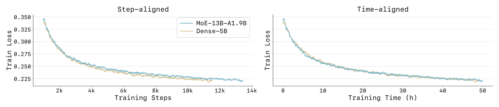

*原文 Figure 4。按 step 看 dense 的 loss 略低，按训练时间看最终 loss 接近。图支持稀疏结构在这组预算下没有明显优化损失，不支持宣称 MoE 在所有指标上压倒 dense。*

这也限制了成本归因。论文后面的 6.5 倍端到端加速来自多个部署优化累积，不能把整个倍数归给这里的 MoE 设计。

## MCP 把监督推向更远未来，但没有把未来当历史

### 相邻片段太像，下一块误差可能掩盖动力学缺失

teacher forcing 用真实历史监督下一视觉块。在较高帧率下，相邻块的外观变化很小，模型可能仅靠维持当前形状与纹理就得到不差的损失。这种局部连续性不一定包含完成整段动作所需的运动变化。

MCP 借鉴 Next Forcing，让骨干特征同时承担更远的未来预测。Figure 5 左侧是主模型的当前目标，右侧三个辅助模块预测依次更远的块。观察每个辅助模块底部的 noisy chunk 和模块之间的隐藏特征连线，可以看清监督如何进入模型。

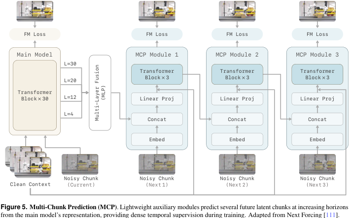{ width="900" }

*原文 Figure 5。辅助模块各自看到带噪目标，同时读取骨干融合特征及前一辅助模块的内部状态。它们没有把干净未来观测直接塞进当前历史条件。*

实现从骨干零基索引 $\{3,11,19,29\}$ 取 hidden states，对应图中的第 4、12、20、30 层。拼接后由两层 SiLU MLP 按 $4\times2048\to2048\to2048$ 融合，再送入三个深度组，每组包含 3 个额外 transformer blocks。更深的辅助模块还接收前一个模块的特征。[原文 §4.1.1](https://github.com/Robbyant/lingbot-va/blob/main/LingBot_VA2_paper.pdf#page=17)

这里需留意索引。§2.3.3 用 $t+k$ 写通用多未来条件，Figure 5 与实现描述则把三个辅助块称为主预测块之后的 next1、next2、next3。按实现口径理解，主头预测下一块，辅助头再额外看远 1–3 块，不能将三个辅助头误算成包含主头的三个输出。

### 辅助 head 的损失仍是未来块去噪

用 $k$ 表示某个辅助预测跨度，原文形式为

$$
\mathcal L_k^{\mathrm{MCP}}=
\mathbb E\left\|
 v_{\theta,k}^{\mathrm{MCP}}(z_{t+k}^{(s)},s\mid h_t^{(k-1)})
 -(z_{t+k}-\epsilon_t^k)
\right\|_2^2,
$$

$$
\mathcal L_{\mathrm{MCP}}=\sum_{k=1}^{3}w_k\mathcal L_k^{\mathrm{MCP}},
\qquad(w_1,w_2,w_3)=(0.5,0.2,0.1).
$$

$h_t^{(k-1)}$ 是骨干或前一辅助模块传来的内部特征，不是某个已经生成或干净的未来观测。每个 head 的 $z_{t+k}^{(s)}$ 则是自己要去噪的带噪目标。不能将“条件不读取干净未来”写成“训练时完全没有未来信息”，因为 supervised flow matching 本来就使用未来目标构造噪声输入和监督。[原文 Eq. 21–23](https://github.com/Robbyant/lingbot-va/blob/main/LingBot_VA2_paper.pdf#page=9)

MCP 分支使用更大的 timestep shift，本文配置为 10，以减弱单靠其自身带噪输入恢复答案的捷径，鼓励依赖骨干里的动态特征。远期去噪梯度因此回到主模型，要求它预先组织较长轨迹的信息。MCP 的直接损失位于视觉预测，动作路径通过共享注意力与逆动力学接口间接受益，而非每个辅助 head 都增加一个独立机器人动作监督。[原文 §2.3.3](https://github.com/Robbyant/lingbot-va/blob/main/LingBot_VA2_paper.pdf#page=10)

标准推理去掉 MCP heads，额外开销主要发生在训练，部署收益来自改进后的骨干表示。报告也讨论保留 MCP 用于并行未来预测的可选模式。Foresight Reasoning 是另一项异步执行机制，两者能够分别启用，不能因为都涉及未来预测就把它们当成同一个模块。

## 高层 planner 的关键是与低层训练接口一致

长任务还需要知道当前应该完成哪一步。Figure 3 中，高层 VLM 使用任务目标和近期视觉观察产生子任务上下文，低层 VA 再结合机器人状态执行。新的观测返回高层和低层，使任务进度与运动控制可以在不同频率上更新。

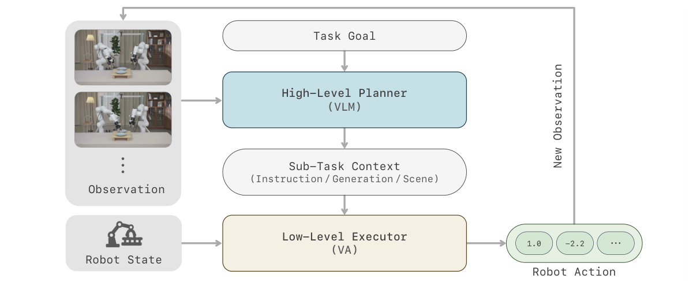

*原文 Figure 3。高层输出当前局部任务条件，低层输出动作；它们通过固定格式连接，并分别训练。*

planner 约 2 Hz 在后台运行，写入异步共享 buffer。低层在每个动作块边界读取最新条件，因此不必每次等高层重新推理。它输出四个字段。

| Field | 内容 | 谁使用 |
|---|---|---|
| `done` | 当前子任务是否结束、是否切换 | 高层 scheduler |
| `instruction` | 简短执行指令 | 低层主要文本条件 |
| `generation_instruction` | 预期运动与物体交互的详细描述 | 低层附加动作语义条件 |
| `local_scene_description` | 根据观察描述当前布局与对象状态 | 低层局部场景条件 |

`done` 不直接作为低层动作条件。三个文本字段的格式需要与训练数据一致，否则部署时即便高层说得通顺，也可能给低层送来未见过的输入分布。[原文 §2.3.1](https://github.com/Robbyant/lingbot-va/blob/main/LingBot_VA2_paper.pdf#page=7)

planner 的训练样本围绕子任务边界构造。观察仍位于当前 segment 时，目标是 `done=false` 和当前任务；刚跨过边界时，目标是 `done=true` 和下一子任务。输入包括 $t^*-2\,\mathrm{s}$、$t^*-1\,\mathrm{s}$、$t^*$ 三帧、整体目标、已完成步骤的文字历史；只有 `done=false` 样本另外带当前子任务描述。这使下一步预测不能只靠复述当前指令完成。

数据按任务平衡，planner 通过 LoRA 调整预训练 VLM，同时冻结 vision tower。它被视为提供条件的接口模块，报告没有给出 planner 与低层策略端到端联合优化的实验。结论部分将更紧密的联合训练列为未来方向，说明长程一致性还受这条固定接口限制。

## 人类视频的两条通路，一条给提示，一条给训练数据

### ICL 用完整示范告诉机器人程序应怎样展开

语言可以说“把物体放进盘子”，但未必完整指定对象关系和动作顺序。视频 ICL 将另一段人类示范编码为 $z_{\mathrm{icl}}$，让每个机器人预测块都读取它。常规因果分解变成

$$
\prod_t p_\theta(z_{t+1}\mid z_{\le t},a_{<t},z_{\mathrm{icl}})
\,p_\theta(a_t\mid z_{\le t},a_{<t},z_{t+1},z_{\mathrm{icl}}).
$$

完整人类示范是执行前已经提供的外部任务上下文，机器人侧仍不能读取自己未来的真实轨迹。这就是它能够查看示范后半段、又不破坏机器人时间因果性的原因。参考示范可以采用不同物体实例、视角与场景布局，要求主要落在操作语义的一致性。[原文 §2.3.4](https://github.com/Robbyant/lingbot-va/blob/main/LingBot_VA2_paper.pdf#page=10)

这条能力的训练需要人机配对样本。Figure 7 展示作者如何从机器人视频出发合成人类示范，而不是要求每个任务都真实拍摄一对人类和机器人执行。

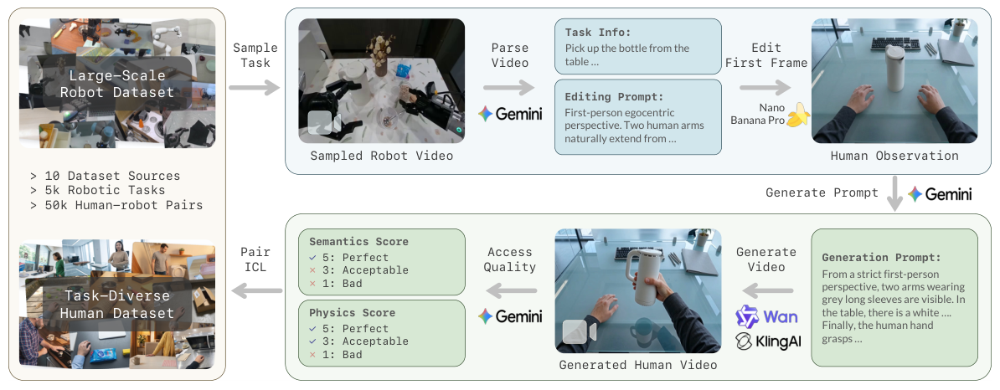

*原文 Figure 7。机器人视频经过任务解析、首帧人类化编辑、视频生成与质量筛选，最终与原机器人轨迹配对。筛选评估任务语义与物理合理性，不能把生成样本数量理解成同等数量的真实人类动作采集。*

具体流程先由 VLM 分析机器人任务，生成首帧编辑提示；编辑后保留任务语义，可以改变视角、布局和物体实例。随后 VLM 生成视频提示，视频模型合成人类操作，再由 VLM 评估语义保留和物理合理性。报告给出的规模来自超过 10 个机器人数据源，包含超过 5,000 个任务、50,000 个人机配对样本。[原文 §3.4](https://github.com/Robbyant/lingbot-va/blob/main/LingBot_VA2_paper.pdf#page=15)

生成与自动筛选提高了覆盖范围，也让训练条件依赖合成演示质量。语义相符并不自动保证每一帧都具备真实动力学，因此后面的 ICL 实机演示需要单独承担迁移可行性的证据。

### HCT 把真实人手动作映射到机器人兼容接口

human-robot co-training 使用另一类数据。内部第一视角人类操作语料包含 65.4K episodes、超过 600 名操作者、3.0K 以上场景任务组合，覆盖厨房、餐桌、梳妆台、办公桌和工作台。每帧除 RGB 之外，还有双手在世界坐标系下的 6-DoF 根部位姿，以及每只手 22 个指关节角。[原文 §3.3](https://github.com/Robbyant/lingbot-va/blob/main/LingBot_VA2_paper.pdf#page=15)

这些标签不能原样当作机器人夹爪动作。论文保留双手根部的 6-DoF 轨迹，把手指姿态压缩成一个平行夹爪开合量，放入统一动作布局中的双臂末端执行器部分；其他不适用通道补零并 mask。

开合量也有具体构造。把拇指作为一侧夹爪，其他四指作为另一侧，先用 forward kinematics 恢复指尖位置，再测量沿闭合方向的两侧距离。使用整个手指包络，可以减少只依赖拇指与食指时某个手指跟踪错误造成的波动。所得 metric aperture 再像机器人夹爪通道一样，按数据集做 quantile normalization。[原文 §2.3.5](https://github.com/Robbyant/lingbot-va/blob/main/LingBot_VA2_paper.pdf#page=11)

动作表示相同不意味着运动分布和物理意义完全相同。因此每个 domain 使用自己的动作 encoder $E_d$ 和 decoder $P_d$，视频专家、动作专家及因果注意力共享。

$$
\hat a_t^{(d)}=P_d\!\left(
 v^{\mathrm{act}}(z_{\le t},E_d(a_{<t}),\hat z_{t+1})
\right),\qquad d\in\{R,H\}.
$$

两个 domain 的视频与动作损失共同更新共享模型，domain heads 吸收低层参数化差异。人类动作头由机器人动作头初始化；部署只保留机器人分支，所以不会额外运行人类分支来生成机器人命令。[原文 Eq. 26–27](https://github.com/Robbyant/lingbot-va/blob/main/LingBot_VA2_paper.pdf#page=11)

ICL 与 HCT 的区别由此清楚。ICL 在推理时提供另一个任务示范作为上下文，HCT 在训练时用人类动作经验更新共享模型。前者可以在不更新参数的情况下指导新组合，后者改善的知识已经进入权重，两者不能用同一份“人类视频”笼统解释。

## 预训练持续混合五类任务，因果性也需要防止分布偏移

论文的训练组织不是先彻底停止图像，再彻底停止视频，最后只训练机器人。五类任务共同存在，仅采样权重随进度改变。

| Task | 输入与监督重点 | 提供什么能力 |
|---|---|---|
| T2I | 文本条件单帧 flow matching | 外观与语言语义对齐 |
| T2V | 文本条件多帧 flow matching | 一般运动与时间动态 |
| TI2VA | 指令、视觉历史 → 视频与动作，附加 MCP | 控制相关状态转移 |
| ICL | 外部示范视频加当前观察 → 视频动作 rollout | 从示范读取程序线索 |
| HCT | 人类与机器人数据，经 domain action heads | 跨主体动作经验共享 |

设训练进度为 $\tau$，原文使用 $\mathcal L(\tau)=\sum_i\pi_i(\tau)\mathcal L_i$，其中 $\pi_i\ge0$、$\sum_i\pi_i=1$。早期更偏 T2I，中期提高 T2V，后期集中于 TI2VA、ICL、HCT，但早期任务仍保留小而非零的权重。目的是减少任务逐渐变窄造成的先验遗忘，报告没有公布每个时段的完整数值配比。[原文 §2.3.6](https://github.com/Robbyant/lingbot-va/blob/main/LingBot_VA2_paper.pdf#page=12)

图像与视频语料沿用 LingBot-Video 的数据。机器人语料保留 AgiBot、RoboMind、InternData-A1、OXE/DROID、UMI 类数据和 RoboCOIN 等来源，再增加数千小时内部示范。长轨迹被切成原子动作片段，由 Qwen3.5-397B 补充局部语言提示和全局任务指令，修复缺失或过泛的标注。这说明“减少机器人标签依赖”并非不再需要大量机器人数据，改变的是无标签视频也能提供额外的转移训练信号。[原文 §3](https://github.com/Robbyant/lingbot-va/blob/main/LingBot_VA2_paper.pdf#page=15)

因果 DiT 按块进行 autoregressive generation。训练每步随机选择 1–4 个 latent frames 的 chunk size，以及 1–64 chunks 的历史窗口；评测采用 2 latent frames 一块、64 chunks 的窗口。历史还以 0.5 概率加入较小随机噪声，以减轻部署时生成历史偏离干净训练历史的问题。它保持块间因果关系，不意味着一个生成块内部也必须逐帧执行完全相同的因果遮罩。[原文 §4.1.1](https://github.com/Robbyant/lingbot-va/blob/main/LingBot_VA2_paper.pdf#page=16)

视频和动作独立采样 flow 时间。timestep shift 分别为图像 2、网络视频 2、机器人视频 5、MCP 10、动作 1，文本条件以 0.1 概率 dropout。独立噪声条件让两种模态不必处于同一去噪进度，但也要求准确维护各自 timestep embedding 和 AdaLN 条件。

优化采用 Muon 与 AdamW 混合。Transformer 内的二维矩阵，包括注意力、动作 FFN 与 routed expert projections，由 Muon 更新，学习率 $2\times10^{-3}$、momentum 0.95、weight decay 0.1；其余 embedding、归一化、AdaLN、bias 与输出头使用 AdamW，学习率 $10^{-4}$、$\beta=(0.9,0.95)$、$\epsilon=10^{-8}$、weight decay 0.01。前 2,000 steps 线性 warm-up，之后常数学习率，全局梯度范数裁到 1。[原文 §4.1.2](https://github.com/Robbyant/lingbot-va/blob/main/LingBot_VA2_paper.pdf#page=17)

训练系统用 FSDP 全参数分片、BF16 mixed precision、FP32 梯度归约与完整 activation checkpointing，每个 rank 每步处理一条 packed sequence，留出 1% 验证数据。这些细节说明了大模型训练如何组织，但报告没有提供完整训练步数、硬件型号及 GPU-hours，不能只用激活参数量推断总训练成本。

## Foresight Reasoning 把推理藏进运动，但每一轮都要回到真实观察

### 先补上正在执行的转移，再准备下一块动作

同步控制中，机器人执行完一块动作，等待新观察，再等待模型完成去噪，才开始下一块。只要模型耗时明显，机械臂就会在块边界停顿。Foresight Reasoning 把预测与执行拆成两条异步流，让机器人运动时，模型提前计算下一块。

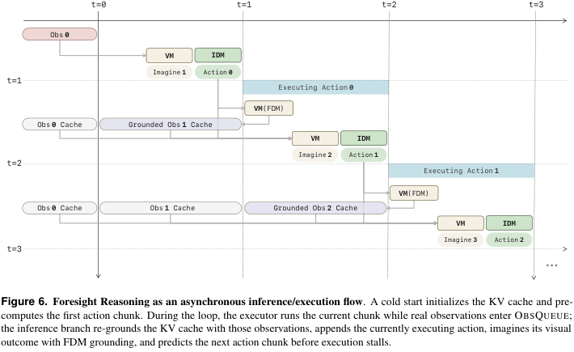{ width="900" }

*原文 Figure 6。冷启动先得到第一块动作；之后执行当前动作、预测下一块与接收真实观察重叠进行。图中的 VM(FDM)、普通 VM 和 IDM 分别承担执行结果桥接、下一段视觉预测和动作解码。*

这里最容易漏掉一个时间关系。最新真实缓存 $C_t$ 对应历史 $(z_{\le t},a_{<t})$，机器人此时已经开始执行 $a_t$，但它的终点观察 $z_{t+1}$ 还没有返回。如果直接拿旧观察准备下一动作，策略就在从过时状态出发。作者先将正在执行的动作追加到临时上下文，再预测它将产生什么结果。

$$
C_{\mathrm{tmp}}=C_t\cup\{a_t\},\qquad
\hat z_{t+1}=\operatorname{FDM}_{\theta}(C_{\mathrm{tmp}})
=v^{\mathrm{vid}}_{\theta}(z_{\le t},a_{\le t}).
$$

这个 FDM 是在线运行的策略视频专家，不能与 tokenizer 学习潜在动作时的冻结网络 $f_\psi$ 混为一谈。前者要替控制循环补上正在发生的真实状态转移，后者用于表示学习。

得到 $\hat z_{t+1}$ 后，还需要准备从这个预计状态出发的下一段行为。Figure 6 画出普通 VM 继续生成后续视觉目标，再由 IDM 解码下一动作 $a_{t+1}$。因此，FDM 在这条时间线上是跨过当前执行延迟的桥接步骤；它不会凭空省去常规的视觉提议和逆动力学动作生成。[原文 §2.3.7、Figure 6](https://github.com/Robbyant/lingbot-va/blob/main/LingBot_VA2_paper.pdf#page=13)

新观察一旦到达，就经过 tokenizer 得到真实 $z_{t+1}$，用实际观察和已执行动作覆盖 KV cache 中过期的想象内容。下一轮从更新后的 $C_{t+1}$ 开始。预测可以跑在执行前面，但不能一直把自己的预测当成反馈。原文明确指出，若反复回灌想象视觉，视频模型对时间平滑的偏好会让它沿着自洽轨迹继续滚动，最终忽视物理反馈并漂移。

闭环在这里有具体含义。机器人根据预估状态提前备好动作，真实观察随后纠正缓存；它并不要求所有推理都在最新观察之后才开始，也不意味着预测错误已经消失。误差仍可能影响当前准备中的动作，只是不会无期限地积累为完全脱离现场的想象历史。

### 为什么还要增加一个动作条件视频损失

常规视频分支的任务是从历史提出未来，条件动作只有 $a_{<t}$。异步 FDM 却需要回答“当前已经执行 $a_t$ 后会怎样”，两者条件不同。post-training 因此加入

$$
\mathcal L_{\mathrm{FDM}}=
\mathbb E_{t,s,\epsilon}
\left\|v^{\mathrm{vid}}_\theta
\left(z_{t+1}^{(s)},s\mid z_{\le t},a_{\le t}\right)
-(z_{t+1}-\epsilon)\right\|_2^2.
$$

目标速度仍来自相同 flow matching 构造，区别在于当前动作进入条件。这使同一个视频专家既能提出未来视觉，也能在另一种条件模式下预测已选动作的结果。[原文 Eq. 30](https://github.com/Robbyant/lingbot-va/blob/main/LingBot_VA2_paper.pdf#page=13)

MCP 训练远期表示，Foresight 安排在线推理与执行，两者可以独立启用。论文展示完整系统的部署效果，但没有单独开关 Foresight 的成功率消融，因此不能从最终任务成绩中算出它独自贡献了多少百分点。

## 少步蒸馏降低模型调用数，部署优化处理每次调用的实际成本

### Consistency distillation 学习同一条轨迹的共同终点

原始采样器每块需要视频专家 5 步、动作专家 10 步。作者冻结 post-trained flow 模型作为教师，把两个专家各自蒸馏成 2 步 consistency sampler。它要学习的是，同一条 probability-flow ODE 轨迹上的不同噪声状态应当映射到同一个干净终点。

沿用 $s=0$ 为噪声、$s=1$ 为数据的方向，学生满足 $f_\xi(x^{(s)},s)\approx f_\xi(x^{(s')},s')$，边界条件为 $f_\xi(x^{(1)},1)=x^{(1)}$。这里 $x$ 可以是视觉 latent 或动作块，两种专家保留各自正常的因果条件。

教师先从相邻时间网格上的输入做一个 Euler 步。

$$
\hat x^{(s_{n+1})}=x^{(s_n)}+
(s_{n+1}-s_n)v_\theta(x^{(s_n)},s_n).
$$

随后约束学生在当前点的终点预测，与 EMA 目标网络在教师下一点的终点预测一致。

$$
\mathcal L_{\mathrm{CD}}=
\mathbb E_{x,\epsilon,n}
\left\|f_\xi(x^{(s_n)},s_n)-
\operatorname{stopgrad}\!\left[
 f_{\xi^-}(\hat x^{(s_{n+1})},s_{n+1})
\right]\right\|_2^2.
$$

$\xi^-$ 表示学生参数的 EMA target。训练不需要让学生重新走完教师的每一个去噪步骤，而是压缩沿轨迹到终点的映射。论文明确给出的部署设置是视频与动作各 2 步；不能把这一句扩展成包括 FDM 桥接、视频分支和动作分支的完整控制循环总共只有两次网络前向。[原文 §2.4.1](https://github.com/Robbyant/lingbot-va/blob/main/LingBot_VA2_paper.pdf#page=14)

### 三层加速分别处理算子、历史和运行时

编译层通过 ONNX 构建 TensorRT engine，将 KV cache 改为显式输入输出，使容量和执行 profile 在构建时可见。NVIDIA Model Optimizer 插入 FP8 节点，Transformer 内部线性层使用 FP8，首尾层保留 BF16。这里同时包含低精度、编译与 kernel fusion，后面的测量无法只归因于 FP8 位宽变化。

序列层采用 paged/ragged KV cache，在预分配 buffer 中原位更新，显式维护有效长度、位置与页面元数据。容量由 sliding window 限定，不需要为了每次历史长度变化重新 padding 和打包。FlashInfer attention plugin 直接处理紧凑缓存，避免构造填充后的稠密历史张量。

运行时层继续缓存 TensorRT bindings、shape 配置、tensor 和 layer views；预计算 cross-attention KV，复用 frame-id 和 scheduler-step 元数据，并在状态未变时跳过重复缓存更新。去掉多余 CPU–GPU 同步后，模型之外的小开销也不再在每块、每步反复支付。[原文 §2.4.2](https://github.com/Robbyant/lingbot-va/blob/main/LingBot_VA2_paper.pdf#page=14)

这些设计需要一起看。蒸馏减少调用次数，编译降低单次前向成本，缓存与运行时复用避免历史越长或循环越频繁时附加开销吞掉收益。

## 四项实机任务的结果，来自同一个经过微调的多任务模型

实机主实验每个任务收集 20 条遥操作示范，总共四类任务，通过 multi-task supervised fine-tuning 得到一个 generalist checkpoint。评测时同一个模型完成所有任务，没有为每项任务单独训练一个策略。[原文 §4.2.1](https://github.com/Robbyant/lingbot-va/blob/main/LingBot_VA2_paper.pdf#page=17)

四项任务的步骤不同。Pen Collection 要依次将桌上的三支笔放入杯子；Fruit Sorting 将苹果、梨和橙子放入篮子；Drawer Tidying 先打开抽屉再收纳桌面物品；Plate Handover 先把盘子推到中央，拿起纸垫放上盘子，再将目标物体放到纸垫上。后两项尤其要求前面产生的对象状态能够延续到后面。

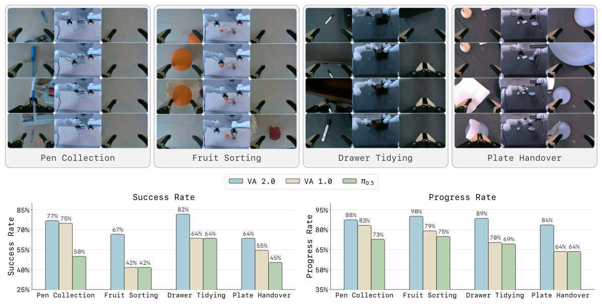

*原文 Figure 8。上图是完整成功率，下图是平均任务进度。二者应分别读取，部分完成不能计入最终成功。*

| Model | Pen Collection | Fruit Sorting | Drawer Tidying | Plate Handover |
|---|---:|---:|---:|---:|
| LingBot-VA 2.0 — Success Rate (%) | 77 | 67 | 82 | 64 |
| LingBot-VA 1.0 — Success Rate (%) | 75 | 42 | 64 | 55 |
| π0.5 — Success Rate (%) | 50 | 42 | 64 | 45 |
| LingBot-VA 2.0 — Progress Rate (%) | 88 | 90 | 89 | 84 |
| LingBot-VA 1.0 — Progress Rate (%) | 83 | 79 | 70 | 64 |
| π0.5 — Progress Rate (%) | 73 | 75 | 69 | 64 |

新模型在四项成功率和四项进度上均高于两条基线，但优势并不均匀。相对上一代，Pen Collection 成功率只增加 2 个百分点，Fruit Sorting 增加 25 个百分点。任务进度与成功率的差距，也显示失败回合中可能已经完成部分步骤，不能将 90% 的水果整理进度写成 90% 完整成功。

原文未给出每项测试的 rollout 数量、置信区间及进度分数的详细加权规则。整数百分比不代表每项一定做了 100 次测试，2 个百分点的差异也不能直接宣布统计显著。更大的预训练、tokenizer、架构与部署机制同时变化，因此这里证明的是整套系统在这组设置中的表现，不能用来独立验证某一个组件的因果贡献。

## 视频 ICL 展示了新组合迁移，但它是一组单独的定性实验

ICL 实验另设桌面场景，包含绿、白、银三个盘子以及七个物体。作者仅采集四项训练任务，每项 15 条示范，共 60 条，用来微调预训练模型。它与上一节每项 20 条示范的四任务主实验不是同一个评测协议。

| Seen task used for fine-tuning | Unseen composition shown at test time |
|---|---|
| White paper cup → white plate | Calabash → green plate |
| Silver coffee cup → silver plate | White paper cup → silver plate |
| Middle green pear → green plate | Silver coffee cup → white plate |
| Left silver mug → white plate | Green pear beside the silver mug → white plate |

两列列举各自的训练与测试集合，不表示每一行是一一配对的迁移。测试给定人类 reference video 和当前机器人观察，模型无需更新参数，尝试将示范里的操作程序迁移到新对象、目标盘子或空间指代上。[原文 §4.2.2](https://github.com/Robbyant/lingbot-va/blob/main/LingBot_VA2_paper.pdf#page=18)

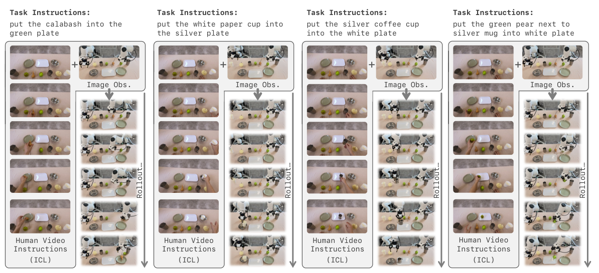

*原文 Figure 9。每行展示参考人类视频与机器人执行新组合。测试时无需更新权重，但模型此前已做四项 seen tasks 的微调。*

这组例子支持模型能够在特定桌面分布内，从视频提示提取可迁移的程序线索。它没有公布跨任务汇总成功率、尝试次数或与纯文本条件的对照，因而还不足以量化视频 ICL 相比其他提示方式的优势。把“测试无参数更新”直接写成“完全没有下游训练”也会遗漏这里的 60 条微调示范。

## RoboTwin 的整体优势，以及原文两处数字口径问题

模拟实验使用 RoboTwin 2.0 双臂操控任务。训练共覆盖 50 项任务，每项 50 条 clean demonstrations 和 500 条 heavily randomized demonstrations，总计 2,500 加 25,000 条。所有比较模型采用多任务设置，结果分别报告 clean 与 domain-randomized 成功率。[原文 §4.3、Table 1](https://github.com/Robbyant/lingbot-va/blob/main/LingBot_VA2_paper.pdf#page=19)

| Method | Clean | Randomized | Avg. |
|---|---:|---:|---:|
| X-VLA | 72.9 | 72.8 | 72.9 |
| π0.5 | 82.7 | 76.8 | 79.8 |
| Motus | 88.7 | 87.0 | 87.9 |
| LingBot-VA | 92.9 | 91.6 | 92.2 |
| **LingBot-VA 2.0 (Ours)** | **93.8** | **93.4** | **93.6** |

*原文 Table 1，Success Rate (%)；Clean/Randomized 对应上一代报告中的 Easy/Hard。*

2.0 的平均值比 π0.5 高 $93.6-79.8=13.8$ 个百分点，比上一代高 $93.6-92.2=1.4$ 个百分点；其 clean 与 randomized 差距为 $93.8-93.4=0.4$ 个百分点。原文紧随表格的文字分别写成相对 π0.5 提升 14.0、两种设置差距 0.6，与表格值不一致。这里保留表格原数，并显式采用可复算的 13.8 和 0.4，不静默沿用错误差值。

较小的 clean/randomized 差距支持模型在这一组随机化设置下表现稳定，但不能推广为任意真实场景变化都不会下降。该表也不把预训练数据量、native causal 架构、表示和 MCP 的影响单独分离；论文将结果与整体设计联系起来是合理解释，独立归因仍需要受控实验。

## Tokenizer 和 MCP 的消融各自回答一个更窄的问题

### 更适合控制的表示，在匹配下游训练时是否有帮助

Tokenizer 消融各训练一个 1.3B video-action model，保持 token 数量、下游架构和 RoboTwin post-training 一致，对比 WAN2.2 VAE 与作者的 semantic visual-action tokenizer。

| Metric | WAN2.2 VAE — Easy | WAN2.2 VAE — Hard | Our tokenizer — Easy | Our tokenizer — Hard |
|---|---:|---:|---:|---:|
| Average, hor=1 | 81.1 | 78.4 | 86.2 | 83.1 |
| Average, hor=2 | 75.5 | 73.9 | 85.7 | 84.0 |
| Average, hor=3 | 67.2 | 68.0 | 92.0 | 85.4 |
| Average, 50 Tasks | 78.0 | 76.0 | 86.6 | 83.1 |

*原文 Table 2，Success Rate (%)，保留原来的 horizon 分组标签。*

50 任务平均在 Easy、Hard 上分别增加 8.6、7.1 个百分点。hor=3 那行的 Easy 提升 24.8 个百分点，比 hor=1 的 5.1 更大，与作者“控制相关状态信息在较长预测跨度更有用”的解释一致。[原文 §4.4、Table 2](https://github.com/Robbyant/lingbot-va/blob/main/LingBot_VA2_paper.pdf#page=20)

不过，报告没有充分展开 horizon 分组怎样对应任务集合与具体执行长度，不能自行补成每行都在相同 50 项任务上做固定数量的闭环动作块。这个实验比较的也是 tokenizer 整套方案，不能独立算出语义对齐、重建损失和潜在动作训练各自贡献多少。

### MCP 改善的是训练步数效率，额外训练计算并未消失

MCP 消融先训练一个 5B baseline，再以相同数据与优化设置做 RoboTwin post-training，一条分支启用 MCP，另一条不启用。Figure 10 分别画出 12 FPS、50 FPS 在 clean 与 randomized 条件下随训练步数变化的成功率。

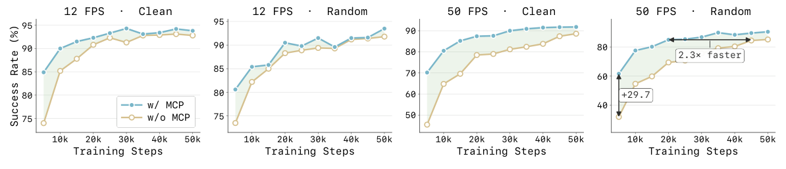

*原文 Figure 10。横轴为 Training Steps；右下角 2.3× 标注比较达到同一成绩所需的训练步数，不是部署速度。*

最明确的数值来自 50 FPS randomized 设置。训练 5K steps 时，MCP 分支高出 29.7 个百分点；它用 20K steps 达到 baseline 45K steps 的精度，对应 $45/20=2.25$，约为 2.3 倍的训练步数效率。其他曲线也支持 MCP 更快改善、最终成绩更高，但不应从没有标数字的曲线末端编造精确分数。[原文 §4.4](https://github.com/Robbyant/lingbot-va/blob/main/LingBot_VA2_paper.pdf#page=20)

每个 MCP step 还要计算额外 heads，报告没有给出它们带来的单步耗时或 GPU-hours。因此“训练步数减少约 2.3 倍”有直接证据，“训练总耗时或算力成本减少约 2.3 倍”则还需要测量。推理时移除这些 heads，说明这部分训练计算不会原样成为标准部署成本，但也不能把 2.3 倍写成推理加速。

## 225 Hz 的分母是低层命令，闭环视觉更新另有节奏

原文 Table 3 的加速是累积实验，每一行在上一行基础上继续增加措施。起点已经是异步 BF16 PyTorch rollout，不能将最后 6.5 倍收益全部归给“改成异步”。

| Acceleration technique | Inference time (ms/chunk) ↓ | Async Hz ↑ |
|---|---:|---:|
| BF16 PyTorch async rollout baseline | 927 | 35 |
| + Consistency distillation | 466 | 69 |
| + Low-precision compiled execution | 369 | 87 |
| + Long-horizon attention optimization | 272 | 118 |
| + Runtime overhead reduction | 142 | 225 |

这个 Hz 的计算公式是

$$
\operatorname{AsyncHz}=\frac{1000}{t_{\mathrm{chunk}}}\,K,
\qquad K=32.
$$

$K$ 是每个生成动作块包含的低层控制命令数，不是 visual latent frames 数。$t_{\mathrm{chunk}}=142\,\mathrm{ms}$ 对应约 $7.04$ 块每秒，再乘每块 32 个命令得到约 225 个命令每秒的供给能力。它不表示每秒处理 225 次新视觉观察并重新规划，也不等于所有机械系统都以这个频率获取真实反馈。[原文 §4.4、Table 3](https://github.com/Robbyant/lingbot-va/blob/main/LingBot_VA2_paper.pdf#page=21)

总时延比为 $927/142\approx6.53$，与报告的 6.5× 相符。数值还显示，蒸馏后仍有接近一半以上的剩余优化空间来自编译、attention 和 runtime；最后一步从 272 ms 降到 142 ms，说明模型外围开销在该实现中非常明显。

报告没有在这张表给出可直接复现测量的部署 GPU 型号，也没有逐行列出对应的控制成功率。因而不能假定其他硬件上也能得到 225 Hz，更不能由时延表单独断言 FP8 与少步蒸馏完全没有精度代价。能够确认的是作者实现中这套累积优化的端到端时间变化及其计算口径。

## 四段展示覆盖更多行为，但仍应留在定性证据的位置

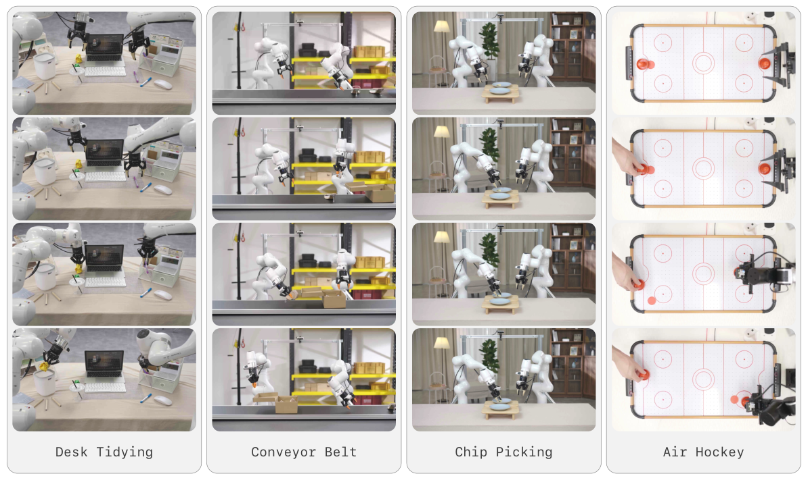

*原文 Figure 11。Desk Tidying、Conveyor Belt、Chip Picking 与 Air Hockey 是额外定性展示，和 Figure 8 的四项量化任务不同。*

桌面整理强调在杂乱场景中维持对象状态并串联收纳步骤；传送带要求预测移动物体并协调动作时机；薯片抓取展示无触觉传感器下的视觉精细操作；空气曲棍球展示对快速运动的预测和反应。[原文 §4.5](https://github.com/Robbyant/lingbot-va/blob/main/LingBot_VA2_paper.pdf#page=20)

这些演示给出了系统能够运行的行为范围，但论文没有报告传送带最高速度、空气曲棍球胜率、薯片破损率或接触力误差。尤其“没有触觉传感器”只说明该展示所用信息通道，不能据此推断视觉已经替代所有精细接触反馈需求。

## 这篇工作的可复用经验落在表示与控制接口上

LingBot-VA 2.0 把几条常被分开处理的链路接到一起。视觉 tokenizer 既保留重建能力又加入语义约束，潜在动作让无标签视频参与转移学习；因果视频动作模型用未来视觉作为动作生成的中间状态；MCP 在训练时迫使骨干考虑更远轨迹；真实机器人与人类数据通过 domain action heads 共享主体；Foresight 用真实观察不断修正提前推理的缓存；最后，少步蒸馏和完整运行时工程决定这些机制能否赶上执行节奏。

这些接口也给实际复现者更明确的排错路径。若视觉预测顺畅而控制失败，应检查 latent state 是否保留控制所需信息，以及逆动力学是否能从目标状态得到可执行动作。若离线评测不错而长程执行漂移，应检查缓存里真实观察与想象观察的替换关系。若单次模型调用够快但机械臂仍停顿，应区分块推理时延、低层命令供给率与反馈更新频率，而不是只优化一个标称 Hz。

仍未解决的边界同样具体。被动视频学到的低维转移不保证自动成为可识别、可干预的物理动作；planner 与 policy 分别训练，依赖固定接口连接；主要控制证据集中在双臂操控，跨更多 embodiment 的泛化仍需验证。原文也将交互或强化信号、更紧密的高低层联合训练和更广主体覆盖列为后续方向。[原文 §6](https://github.com/Robbyant/lingbot-va/blob/main/LingBot_VA2_paper.pdf#page=22)

本文最扎实的结论，是这套原生视频动作设计在报告的机器人任务、tokenizer 对照、MCP 训练曲线及累积部署测量中取得了相互呼应的结果。每个结论的强度仍取决于对应实验，完整系统的领先、单组件的作用和可迁移的工程经验应分别保留各自的证据边界。
