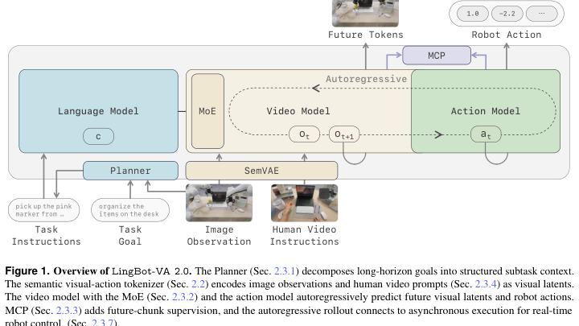
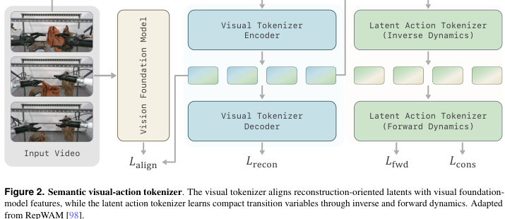
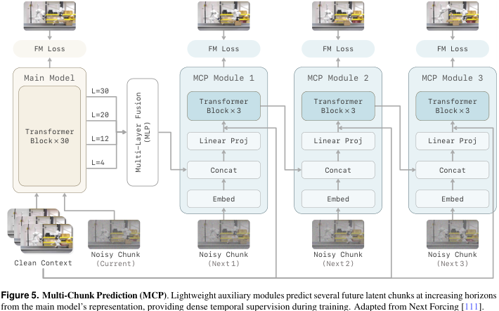
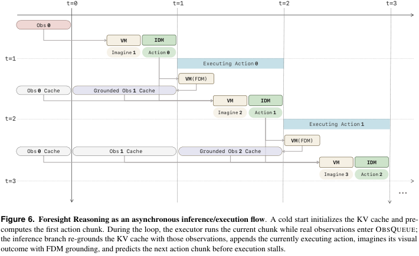

# LingBot-VA 2.0：原生视频-动作预训练

!!! info "论文信息"
    **论文题名：** Native Video-Action Pretraining for Generalizable Robot Control。 
    **作者：** Qihang Zhang、Lin Li、Luyao Zhang、Shuai Yang、Yiming Luo、Shuaiting Li、Ruilin Wang、Junke Wang、Jiahao Shao、Gangwei Xu、Jiaming Zhou、Yishu Shen、Yudong Jin、Fangyi Xu、Shuailei Ma、Jiaqi Liao、Guanxing Lu、Zifan Shi、Yongkun Wen、Yujie Zhao、Weixuan Tang、Xinyang Wang、Chaojian Li、Jiapeng Zhu、Ka Leong Cheng、Nan Xue、Xing Zhu、Yujun Shen、Yinghao Xu。 
    **机构：** PDF title page 未列机构；GitHub 归属 Robbyant，README 标注 `[RSS 2026] Causal video-action world model for generalist robot control`。 
    **时间 / 主题：** 2026-07（GitHub PDF metadata 生成时间）；世界模型、视频-动作预训练、机器人控制。 
    **arXiv / 官方报告：** 用户提供 PDF：[GitHub PDF](https://github.com/Robbyant/lingbot-va/blob/main/LingBot_VA2_paper.pdf)；项目页：[technology.robbyant.com/lingbot-va-v2](https://technology.robbyant.com/lingbot-va-v2)；相关 arXiv：[2601.21998](https://arxiv.org/abs/2601.21998)，题名为 `Causal World Modeling for Robot Control`，与 GitHub VA2 PDF 标题不同。 
    **GitHub / 项目：** GitHub：[github.com/Robbyant/lingbot-va](https://github.com/Robbyant/lingbot-va)。 
    **元数据来源与核验口径：** 来源：GitHub PDF `LingBot_VA2_paper.pdf`、GitHub README、arXiv metadata；Checked Date：2026-07-31；Repro Status：Paper / official GitHub reviewed, independent reproduction not claimed。

## 原论文故事线

### 研究背景

LingBot-VA 2.0 接在 [LingBot-World](lingbot-world.md)、[DreamZero](../embodied-ai/dreamzero.md) 和第一代 LingBot-VA 之后，关注的问题更靠近机器人控制：视频世界模型不只要预测未来画面，还要同时预测能执行这些未来的动作。第一代视频-动作模型通常复用通用视频生成组件：重建导向 VAE 负责压缩视频，双向 video diffusion backbone 负责生成，再额外挂一个 action module。这样做能借到视频生成先验，但它从一开始就不是为闭环控制设计的。

论文指出这个路线有三个结构性问题。第一，VAE latent 更偏外观重建，不一定保留动作相关语义和物理状态。第二，bidirectional video backbone 与机器人闭环控制的因果时间结构冲突。第三，真实控制需要高频推理，视频扩散的高维 token 和多步 denoising 会把模型延迟直接变成控制延迟。

### 问题（Challenge）

论文要解决的问题是：如何从头构建一个面向 embodiment 的 video-action foundation model，而不是把通用视频生成器事后改造成机器人策略。难点在于，模型要同时满足五个约束：视觉 latent 要有语义和动作信息；动作和世界状态要在同一 latent space 中可对齐；主干必须严格 causal；模型容量要足够大但推理不能太慢；真实部署时还要边执行动作边预测未来，并在新观测到来时重新 grounded。

这和普通 VLA 的难点不同。VLA 直接从观察和语言回归动作，世界动态通常隐含在策略里；LingBot-VA 2.0 要显式预测未来视觉 latent，再通过 inverse dynamics 预测 action chunk。它更像把“想象未来”和“执行动作”放进同一个自回归扩散系统。

### Finding

LingBot-VA 2.0 的 finding 是：**机器人世界模型的 foundation 不应该只是视频生成 foundation，而应该是原生 video-action foundation。** 也就是说，控制能力不能只靠下游 robot demonstrations 微调出来，而要在预训练阶段就把视觉状态、潜在动作、因果动态和多步未来监督绑定在一起。

这个 finding 解释了论文的四个核心设计。Semantic visual-action tokenizer 让 world states 和 latent actions 共享语义空间；causal DiT 从头预训练，避免 bidirectional-to-causal retrofit 的遗忘；sparse MoE 给 video stream 扩容量但控制 active compute；Foresight Reasoning 把预测流和执行流异步化，同时用真实观测不断修正 KV cache。

### 方法

方法分两大阶段。第一阶段训练 semantic visual-action tokenizer。视觉侧使用 ViT autoencoder，不只做 pixel/perceptual/GAN reconstruction，还对齐 frozen Perception Encoder 的语义特征；动作侧不依赖 action labels，而是用 inverse dynamics model 从相邻视觉 latent 中抽取 latent action，再用 forward dynamics model 重构下一 latent。这样无标注视频也能给动作相关 transition supervision。

第二阶段训练 causal video-action model。低层策略保留 Mixture-of-Transformers 的双 stream：video expert 预测下一视觉 latent，action expert 根据状态转移预测 action chunk；二者共享 causal self-attention。video expert 的 FFN 换成 sparse MoE，主配置包含 128 routed experts、top-8 routing。训练目标包括 next-chunk flow matching、action inverse dynamics loss、Multi-Chunk Prediction（MCP）、in-context human demonstration conditioning 和 human-robot co-training。推理时，Foresight Reasoning 在机器人执行当前 action chunk 时提前预测下一个 chunk，并在真实 observation 返回后覆盖 stale imagined latent，保持闭环。

### 结论

论文报告 LingBot-VA 2.0 在 RoboTwin 2.0 上达到 93.6% 平均成功率，高于 LingBot-VA 的 92.2% 和 π0.5 的 79.8%；真实机器人任务上，LingBot-VA 2.0 在 Fruit Sorting、Pen Collection、Drawer Tidying、Plate Handover 上总体优于 π0.5 和 VA 1.0；tokenizer ablation 显示 semantic visual-action tokenizer 比 WAN2.2 VAE 更适合下游控制；MCP 在 50 FPS randomized setting 早期训练有 29.7 percentage points 优势，并用 20k steps 追上 baseline 45k steps；加速 pipeline 把异步控制频率从 35 Hz 提到 225 Hz。

证据边界也要保留：PDF 中大量数据来自作者内部机器人与 egocentric human corpus，独立复现成本高；真实机器人评测是 in-house benchmark，样本量和任务范围仍有限；planner 和 policy 仍是固定接口耦合，不是端到端联合训练。

### 关键术语

- **Video-Action Foundation Model（视频-动作基础模型）**：同时建模未来视觉状态和对应动作的 foundation model，而不是只生成视频或只回归动作。
- **Semantic Visual-Action Tokenizer（语义视频-动作 tokenizer）**：把视觉 latent 对齐语义 foundation features，并从无标注视频中学习 latent action。
- **Latent Action（潜在动作）**：从相邻 observation latent 的变化中推断出的 compact transition variable。
- **Mixture-of-Transformers / MoT（混合 Transformer）**：video 和 action 走不同 expert stream，但共享 causal attention。
- **Sparse MoE（稀疏专家混合）**：每个 token 只激活部分 experts，在增加总参数容量时控制 active compute。
- **Multi-Chunk Prediction / MCP（多块未来预测）**：训练时同时监督多个未来 chunk，缓解只预测 next chunk 的短视复制。
- **Foresight Reasoning（前瞻推理）**：预测流提前准备下一动作，执行流在真实世界执行当前动作，并用最新观测重新 grounding。

## 论文位置

第一代 [LingBot-World](lingbot-world.md) 更像“开放视频模型如何改造成可交互世界模拟器”的路线图。LingBot-VA 2.0 更进一步：它认为机器人控制不应该从通用视频生成器开始，而应该从 tokenizer、因果主干和动作空间开始就按 video-action 建模。

它和几条相邻路线的区别如下：

| Method line | Main question | LingBot-VA 2.0 的回答 |
| --- | --- | --- |
| VLA / reactive policy | 如何从视觉和语言直接输出动作 | 显式预测未来视觉 latent，再通过 inverse dynamics 得到动作 |
| 通用视频生成模型 | 如何生成高质量未来视频 | 视频 latent 必须语义化、动作化、因果化，才能服务控制 |
| LingBot-VA 1.0 / DreamZero | 如何把视频模型接到动作 | 不再事后改造 bidirectional backbone，而是原生 causal video-action pretraining |
| Genie / latent action line | 如何从视频学可控动作变量 | 把 latent action 接入机器人 action chunk、MoT 和真实闭环执行 |

这篇论文值得放在世界模型部分，是因为它明确把“世界模型”定义为控制中的中间层：预测世界如何变化，并用这个预测来产生动作。它不是单纯机器人 benchmark paper，也不是纯 video generation paper。

## 总体方案

{ width="900" }

<small>图源：`Native Video-Action Pretraining for Generalizable Robot Control`，Figure 1。原图展示 Planner、SemVAE、Video Model、Action Model、MoE、MCP 与异步控制接口。</small>

**这张图怎么读：先看两个闭环。**
上层是语言规划闭环：Language Model / Planner 把长时任务拆成 task instructions 和 subtask context。下层是 video-action 闭环：SemVAE 把当前 image observation 和 human video instructions 编到 latent space，Video Model 自回归预测 future tokens，Action Model 输出 robot action，MCP 在训练期补多步未来监督。

图里最关键的是 video 和 action 不是两个独立系统。Action Model 不是单纯根据当前图像回归动作，而是依赖 Video Model 预测出来的转移；Video Model 也不是只做视觉续写，而是在动作历史条件下预测未来状态。这就是 video-action world model 和 reactive VLA 的结构差异。

## 核心问题：为什么通用 VAE 不够

普通视频生成模型的 VAE 优化的是：

\[
z = E(o), \qquad \hat{o}=D(z)\approx o.
\]

它关心的是视频重建是否像原图。机器人控制还需要 latent 里保留“能影响动作选择的状态”：物体可抓取姿态、接触关系、局部几何、任务语义、动作后果。重建好不等于控制好。

LingBot-VA 2.0 的 tokenizer 因此加了两个额外约束：

\[
\mathcal{L}_{\text{vis}}
=
\mathcal{L}_{\text{rec}}
+
\lambda_{\text{align}}\mathcal{L}_{\text{align}},
\]

其中 \(\mathcal{L}_{\text{align}}\) 把视觉 latent 对齐 frozen Perception Encoder 的 clip-level semantic features。

动作侧从相邻视觉 latent 学 latent action：

\[
\ell_t = q_\phi(z_t,z_{t+1}),
\qquad
\hat z_{t+1}=f_\psi(z_t,\ell_t)=K_tz_t+\delta_t.
\]

这里 \(\ell_t\) 是 bottleneck transition variable，不能完整复制视觉状态，只能保留解释 \(z_t\rightarrow z_{t+1}\) 的变化。这个设计让 web video 也能提供动作相关监督，而不是只有昂贵 robot action labels 才能训练动作表示。

{ width="900" }

<small>图源：`Native Video-Action Pretraining for Generalizable Robot Control`，Figure 2。原图展示视觉 tokenizer 的 semantic alignment 与 latent action tokenizer 的 inverse / forward dynamics。</small>

**这张图怎么读：tokenizer 同时服务语义和动力学。**
左边的 visual tokenizer 仍然重建视频，但多了一条向 vision foundation model 对齐的路径；右边的 latent action tokenizer 不用人工动作标签，而是从两帧 latent 的变化中学习可压缩的 transition。这样得到的 latent space 同时能说“这是什么”和“它怎么变”。

## Video-Action Objective

论文把 video-action model 写成一个因果分解：

\[
p_\theta(z_{1:N},a_{0:N-1}\mid z_0)
=
\prod_{t=0}^{N-1}
p_\theta(z_{t+1}\mid z_{\le t},a_{<t})
p_\theta(a_t\mid z_{\le t},a_{<t},z_{t+1}).
\]

第一项是 video generation：给历史状态和历史动作，预测下一视觉 latent。第二项是 inverse dynamics：知道这次状态转移后，预测对应 action chunk。

训练时用 flow matching 分别监督 video 和 action：

\[
\mathcal{L}_{\text{VA}}
=
\mathcal{L}_{\text{vid}}
+
\lambda_{\text{act}}\mathcal{L}_{\text{act}}.
\]

这个 objective 的重点是顺序：先有未来 latent，再解动作。它使动作不只是 observation-to-action regression，而是依附在“什么未来会发生”这个动力学结构上。

## Sparse MoE 与 MoT

低层策略保留 MoT：video tokens 和 action tokens 通过共享 causal attention 交互，但拥有不同 FFN / expert path。Video stream 承担更重的动态建模，因此使用 sparse MoE；action stream 保持 dense FFN。

论文主配置：

| Component | Setting |
| --- | --- |
| Visual latent channels | 96 |
| Video backbone | 30 transformer blocks |
| Video hidden dim | 2048 |
| Attention space | 3072 dim, 24 heads x 128 |
| Video FFN | sparse MoE, 128 routed SwiGLU experts, top-8 routing, one shared expert |
| Action hidden dim | 768 |
| Unified raw action space | 30 dims, missing dimensions zero-padded and masked |
| Active parameters | about 2.5B per token at inference |

MoE 的目标不是让机器人控制“更炫”，而是解决容量和控制频率的矛盾。视频动态需要大容量表示，但每个控制 chunk 不能激活全部参数。稀疏路由让模型有 13B 级 video backbone 总容量，同时每个 token 只走部分 experts。

## MCP：避免只学短期复制

Teacher forcing 只预测 next chunk 时，模型可能利用相邻帧高度相似的事实，靠复制外观降低 loss，而不是学习轨迹级动态。MCP 把监督扩展到未来多个 chunk：

\[
p_\theta(z_{t+1:t+K}\mid z_{\le t},a_{<t})
\approx
\prod_{k=1}^{K}
p_{\theta,k}(z_{t+k}\mid h_t^{(k-1)}).
\]

论文采用 \(K=3\)，loss weights 为 \(0.5,0.2,0.1\)。

{ width="900" }

<small>图源：`Native Video-Action Pretraining for Generalizable Robot Control`，Figure 5。原图展示 Main Model 旁的三个 MCP modules 如何预测 next1 / next2 / next3 future chunks。</small>

**这张图怎么读：MCP 是训练期的动态压力。**
图里 main model 仍然预测当前 noisy chunk，MCP modules 则从中间层融合特征出发预测更远的 future chunks。它们在标准推理时可以丢掉，因此主要作用是训练期给 backbone 施加“你要理解未来轨迹”的压力。

论文的 ablation 支持这个解释：MCP 在 RoboTwin post-training 中收敛更快，特别是 50 FPS randomized setting 里，5k steps 时领先 baseline 29.7 percentage points，并用 20k steps 达到 baseline 45k steps 的水平。

## 数据与训练配方

LingBot-VA 2.0 的数据配方分三层：

| Data source | Role |
| --- | --- |
| General image/video data | 来自 LingBot-Video 的 web-scale image/video corpus，提供外观和一般动态先验 |
| Robot data | AgiBot、RoboMind、InternData-A1、Open X-Embodiment/OXE、DROID、UMI-style datasets、RoboCOIN，以及内部机器人 demonstrations |
| Egocentric human data | 内部第一人称人类操作视频，65.4k episodes，600+ operators，3.0k+ scene-task combinations |
| ICL data | 通过 VLM 将机器人任务转换成人类演示视频，构造 50k+ human-robot pairs |

训练任务不是完全分阶段切换，而是在统一 latent space 和同一个 causal DiT 上做 co-training：

| Task | Purpose |
| --- | --- |
| T2I | 建立视觉语义 grounding |
| T2V | 学一般时间动态和运动先验 |
| TI2VA | 核心控制任务，联合 future latent prediction 和 inverse dynamics |
| ICL | 用 human demonstration video 作为 visual task prompt |
| HCT | human-robot co-training，把人类操作视频迁移到机器人动作空间 |

优化细节也值得保留：rectified-flow objective；hybrid Muon + AdamW；2000 steps warm-up 后 constant LR；FSDP full-parameter sharding；bf16 mixed precision 和 FP32 gradient reduction；full activation checkpointing。论文没有把这些写成主要贡献，但它们决定了 15B 级 video-action stack 能否训练。

## Foresight Reasoning：预测流与执行流分离

同步执行的问题很直接：模型先算下一动作，机器人等；机器人执行动作，模型再等新 observation。模型延迟会直接变成控制延迟。

Foresight Reasoning 把闭环 rollout 拆成两个 causally coupled streams：

1. execution stream：机器人执行当前 action chunk \(a_t\)；
2. prediction stream：模型基于最新 grounded cache 和当前 action chunk，提前预测 \(\hat z_{t+1}\) 与下一动作 \(a_{t+1}\)。

关键不是单纯“提前想一步”，而是每次真实观测回来后重新 grounding：

\[
\hat z_{t+1}
=
\mathrm{FDM}_\theta(C_t\cup \{a_t\})
=
v^{\text{vid}}_\theta(z_{\le t},a_{\le t}).
\]

当真实 observation 到来，它会被编码成 \(z_{t+1}\)，并覆盖 KV cache 中旧的 \(\hat z_{t+1}\)。这样 rollout 是 predict-then-correct，而不是一直吃自己想象出来的 latent。

{ width="900" }

<small>图源：`Native Video-Action Pretraining for Generalizable Robot Control`，Figure 6。原图展示执行当前 action chunk 时，推理分支如何用 grounded observation cache、FDM imagination 和 IDM action prediction 提前准备下一动作。</small>

**这张图怎么读：异步不等于开环。**
图中 VM/IDM 提前生成下一步，但每一行都回到 `Grounded Obs Cache`。如果没有这个覆盖步骤，模型会沿着 hallucinated trajectory 漂移；有了真实 observation 覆盖，前瞻只是隐藏 latency，而不是放弃反馈。

## 后训练与推理加速

后训练把 video expert 和 action expert 都蒸馏成 few-step consistency model。原始采样默认 video expert 5 steps、action expert 10 steps；蒸馏后两个 expert 都变成 2 steps。

推理加速分三层：

| Level | Technique |
| --- | --- |
| Model level | ONNX/TensorRT compiled execution；linear layers FP8，head/tail BF16 |
| Sequence level | paged/ragged KV-cache；FlashInfer attention plugin |
| System level | cache TensorRT bindings、shape configs、runtime tensors、cross-attention KV、scheduler metadata，并减少 CPU-GPU sync |

这和视频生成系统里的优化很接近，但机器人控制更敏感：不是“更快生成完整视频”，而是“每个 action chunk 是否能及时交给执行器”。

## 实验与结论

### RoboTwin 2.0

| Method | Clean | Randomized | Avg. |
| --- | ---: | ---: | ---: |
| X-VLA | 72.9 | 72.8 | 72.9 |
| π0.5 | 82.7 | 76.8 | 79.8 |
| Motus | 88.7 | 87.0 | 87.9 |
| LingBot-VA | 92.9 | 91.6 | 92.2 |
| LingBot-VA 2.0 | 93.8 | 93.4 | 93.6 |

表源为论文 Table 1。它说明 VA 2.0 在 clean 和 randomized 两个设置下都略高于第一代 LingBot-VA；和 π0.5 的差距更大。更关键的是 clean/randomized 差距只有 0.4 percentage points，说明该 benchmark 下 domain randomization 没有明显击穿模型。

### Tokenizer ablation

| Tokenizer | Average hor=1 Easy | Average hor=1 Hard | Average hor=3 Easy | Average hor=3 Hard | Average 50 Tasks Easy | Average 50 Tasks Hard |
| --- | ---: | ---: | ---: | ---: | ---: | ---: |
| WAN2.2 VAE | 81.1 | 78.4 | 67.2 | 68.0 | 78.0 | 76.0 |
| Our tokenizer | 86.2 | 83.1 | 92.0 | 85.4 | 86.6 | 83.1 |

表源为论文 Table 2。最有解释力的是 horizon=3：WAN2.2 VAE 的 Easy/Hard 为 67.2/68.0，而 semantic visual-action tokenizer 为 92.0/85.4。这个差异支撑论文的核心判断：控制用 latent 不能只追求像素重建。

### Inference acceleration

| Acceleration technique | Inference time (ms/chunk) ↓ | Async Hz ↑ |
| --- | ---: | ---: |
| BF16 PyTorch async rollout baseline | 927 | 35 |
| + Consistency distillation | 466 | 69 |
| + Low-precision compiled execution | 369 | 87 |
| + Long-horizon attention optimization | 272 | 118 |
| + Runtime overhead reduction | 142 | 225 |

表源为论文 Table 3。这里的 225 Hz 是 asynchronous control frequency，计算方式依赖每 chunk 包含的 low-level control steps。它不能简单等同于机器人实际机械频响，但能说明系统 pipeline 已经把模型 chunk latency 大幅压下去。

### Real-world deployment

论文在四个 in-house real-world tasks 上比较 LingBot-VA 2.0、LingBot-VA 1.0 和 π0.5：Fruit Sorting、Pen Collection、Drawer Tidying、Plate Handover。报告中 VA 2.0 在 success rate 与 task progress rate 上总体领先，尤其在需要多步视觉 grounding 的持续操作中更明显。

这组结果的证据等级比 RoboTwin 更贴近真实部署，但外推边界也更窄：任务是内部 benchmark，示范数量和机器人平台没有完全开放；论文说每个任务收集 20 teleoperated demonstrations，并训练一个 multi-task generalist policy，而不是每任务单独模型。

## 和第一代 LingBot-VA / LingBot-World 的关系

| Dimension | LingBot-World / VA 1.0 路线 | LingBot-VA 2.0 |
| --- | --- | --- |
| Foundation | 复用视频生成模型或继续训练 | 从 tokenizer 到 causal DiT 原生为 video-action 训练 |
| Latent | reconstruction-oriented video latent | semantic visual-action latent |
| Action | 后接或与 video stream 联合建模 | latent action tokenizer + action expert + inverse dynamics |
| Attention | 从 bidirectional 改成 causal 有遗忘风险 | 从头 causal pretraining |
| Runtime | causal rollout、KV cache、少步化 | Foresight Reasoning + consistency distillation + TensorRT/FlashInfer |
| Evidence | 开放域交互世界模拟 / robot control 原型 | RoboTwin、真实机器人任务、tokenizer/MCP/acceleration ablation |

可以把 VA 2.0 看成“视频世界模型路线向机器人 foundation model 的一次收束”：它不再满足于让模型生成可交互视频，而是把生成未来状态、推断动作、执行闭环和真实观测 correction 写进同一个系统。

## 主要贡献

1. 提出原生 video-action pretraining：不是把通用视频模型事后改造成 robot policy，而是从表示、主干和目标函数上按闭环控制设计。
2. 用 semantic visual-action tokenizer 把视觉状态和潜在动作放进同一语义 latent space，使无标注视频也能贡献 action-relevant transition supervision。
3. 用 causal DiT + MoT + sparse MoE 同时建模 future visual latents 与 action chunks，在容量和实时性之间折中。
4. 用 MCP 增加未来多块监督，减少 next-chunk teacher forcing 的短视复制。
5. 用 Foresight Reasoning 将预测和执行异步化，并通过真实观测重写 cache 保持闭环。
6. 给出 RoboTwin、真实机器人、tokenizer、MCP 和加速 pipeline 的实验与消融证据。

## 局限与风险

第一，数据闭源程度高。内部 robot demonstrations、egocentric human corpus、in-house real-world benchmark 都对结果很关键，外部复现不能只依赖公开代码。

第二，planner 和 low-level policy 仍通过固定 JSON/schema 接口耦合。论文结论也承认，二者目前分开训练，未来联合训练可能进一步改善长时一致性。

第三，latent action 从 passive video 学来，虽然能扩大监督来源，但它是否完全等价于交互控制中的因果 action，还需要更多 intervention / reinforcement signals 检验。

第四，真实机器人结果虽然有价值，但任务仍集中在 bimanual tabletop manipulation。能否扩展到移动机器人、接触丰富装配、工具使用和跨平台动态任务，还不能由当前实验直接推出。

第五，225 Hz 是系统异步频率，不应被误读成机器人每个物理环节都以 225 Hz 完整闭环。最终控制稳定性仍取决于执行器、相机延迟、低层控制器和安全机制。

## 关键术语

| English Name（中文翻译） | Explanation |
| --- | --- |
| **Native Video-Action Pretraining（原生视频-动作预训练）** | 从 tokenizer、因果主干和目标函数阶段就联合训练视觉状态与动作，而不是事后给视频生成模型接动作头。 |
| **Semantic Alignment（语义对齐）** | 让视觉 latent 匹配 frozen vision foundation model 的语义特征，减少纯重建 latent 对控制状态的遗漏。 |
| **Inverse Dynamics Model（逆动力学模型）** | 根据当前状态和下一状态推断产生该转移的动作或 latent action。 |
| **Forward Dynamics Model（正向动力学模型）** | 根据当前状态和动作预测下一状态，是 Foresight Reasoning 中提前想象的核心。 |
| **Action Chunk（动作块）** | 与一个视觉 latent transition 对齐的一段低层动作序列，而不是单个控制命令。 |
| **In-Context Learning（上下文学习）** | 给模型一段人类示范视频作为动态任务提示，不更新参数也能迁移到新任务组合。 |
| **Paged / Ragged KV Cache（分页 / 不齐长 KV 缓存）** | 长时自回归推理中管理历史 token 的缓存布局，避免反复 padding 和 repacking。 |

## 阅读结论

LingBot-VA 2.0 最值得记住的不是某个单独分数，而是它把“世界模型用于控制”拆成了一条更硬的工程链：**语义化状态表示、潜在动作、因果动态、多步未来监督、异步闭环 correction、系统级低延迟推理。** 这条链比“视频生成模型 + action head”更接近真实机器人部署。

读这篇时可以用三个问题检查迁移价值：你的 latent 是否保留控制相关状态，而不只是重建像素；你的模型是否在训练时见过多步未来和动作导致的状态变化；你的部署是否能在预测未来的同时持续用真实 observation 纠偏。只有这三点同时成立，video-action model 才更像控制用世界模型，而不是好看的视频预测器。

## 外部精读

1. Zhang et al. [LingBot_VA2_paper.pdf](https://github.com/Robbyant/lingbot-va/blob/main/LingBot_VA2_paper.pdf). GitHub PDF, `Native Video-Action Pretraining for Generalizable Robot Control`.
2. GitHub repository：[Robbyant/lingbot-va](https://github.com/Robbyant/lingbot-va).
3. Project page：[LingBot-VA v2](https://technology.robbyant.com/lingbot-va-v2).
4. Related arXiv record：[Causal World Modeling for Robot Control](https://arxiv.org/abs/2601.21998), arXiv:2601.21998v2.
