# LingBot-World：视频基础模型到世界模拟器

!!! info "论文信息"
    **论文题名：** Advancing Open-source World Models。 
    **作者：** Robbyant Team、Zelin Gao、Qiuyu Wang、Yanhong Zeng、Jiapeng Zhu、Ka Leong Cheng、Yixuan Li、Hanlin Wang、Yinghao Xu、Shuailei Ma 等（共 24 人）。 
    **机构：** 未在公开元数据中稳定解析；以 arXiv/PDF 或官方页 affiliation block 为准。 
    **时间 / 主题：** 2026-01；世界模型。 
    **arXiv / 官方报告：** arXiv：[2601.20540](https://arxiv.org/abs/2601.20540)。 
    **GitHub / 项目：** GitHub：[github.com/robbyant/lingbot-world](https://github.com/robbyant/lingbot-world)。 
    **元数据来源与核验口径：** 来源：[arXiv](https://arxiv.org/abs/2601.20540)；[GitHub API / repo](https://github.com/robbyant/lingbot-world)；Checked Date：2026-06-04；Repro Status：Paper / official materials reviewed, independent reproduction not claimed。

## 从能看的视频，走到能持续操作的环境

假设一段视频已经生成了走廊、门和远处的雕像。用户此时按下后退键，再转身、绕一圈回来。一个可交互世界至少要同时完成几件事。后退应当改变视角而非任意改写场景，转身后看不见的雕像仍应保留，返回时空间关系应与先前相容，等待下一段画面的时间还必须足够短。这些要求比单次生成一段漂亮视频更接近持续运行的环境。

LingBot-World 的贡献围绕这条完整链路展开。它继承 Wan2.2 的视觉生成能力，通过带动作和重访轨迹的数据扩展长时一致性，再将双向视频模型改造成能够边生成边接收控制的因果模型。报告中的主要结果包括跨场景视频展示、视野外状态延续示例、VBench 指标，以及 Fast 版本在 480p 下达到 16 FPS 的运行设置。[原文 §1、§4](https://arxiv.org/pdf/2601.20540#page=2)

这是一份从数据到部署的系统报告。理解它时，应分别追踪三个问题。世界是否看起来稳定，由视觉质量与长视频例子回答；动作是否能够改变后续生成，由动作接口和交互示例回答；生成能否跟上用户，由因果注意力、蒸馏与推理设置回答。这几条证据相互配合，但视频质量得分本身不会自动证明精确物理因果或永久记忆。

## 整体路线先建立强教师，再把它变成流式学生

Figure 4 可以看成一张依赖关系图。下一阶段继承前一阶段已经学会的能力，再补上新的约束，避免实时学生从头同时解决外观、动态、控制和长程生成。

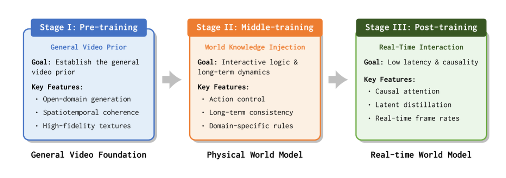{ width="920" }

*原文 Figure 4。Pre-training 提供一般视频先验，middle-training 扩展长时一致性与动作控制，post-training 处理因果生成和低延迟。*

| Stage | 起点与主要变化 | 得到的能力 | 仍要解决的问题 |
|---|---|---|---|
| Pre-training | 采用已预训练的 Wan2.2 image-to-video 模型 | 纹理、场景、一般时空动态 | 片段较短，缺少用户动作接口 |
| Middle-training | 延长视频训练；随后增加动作 adapter | 长时视频与动作条件轨迹，形成 Base | 双向注意力与多步去噪不适合即时交互 |
| Post-training | 高噪声专家初始化；块因果适配、自生成训练、少步蒸馏和对抗目标 | 面向实时 rollout 的 Fast | 长程漂移、算力需求和精细交互仍有限 |

这里的 pre-training 阶段并不表示 LingBot-World 自己从随机参数训练了一个新的视频基础模型。作者明确选择已有 Wan2.2 作为起点；主要新增工作发生在后续的数据、middle-training 和 post-training。[原文 §3.1–3.2](https://arxiv.org/pdf/2601.20540#page=9)

报告用下面的条件轨迹目标统一描述任务。

$$
\max_\theta\;\mathbb E\left[
\log p_\theta(x_{t:t+L}\mid x_{<t},a_{t:t+L})
\right].
$$

$x_t\in\mathbb R^{H\times W\times C}$ 是可见视频帧，$a_t$ 是控制信号，$x_{<t}$ 提供历史，$L\ge1$ 是预测跨度。预测可以覆盖未来片段，不限于单帧。这个式子定义了环境模型的条件接口，实际网络仍在视频 latent 上执行扩散去噪，不能把它解读为对每个像素进行离散 next-token prediction。[原文 Eq. 1](https://arxiv.org/pdf/2601.20540#page=7)

对双向 Base，动作序列与整个待生成片段可以一起输入；对 Fast，已经生成的历史逐块增长，新动作只进入后续生成。这也解释了为什么“有动作条件”与“可以实时交互”是两个阶段的问题。离线模型能够按照预先给定的轨迹制作视频，并不意味着生成过程中能低延迟接住新的按键。

## 数据引擎首先需要改变相机曾经去过哪里

### 三类数据承担不同的监督责任

一般视频提供开放场景中的人、动物、车辆和各种移动方式，涵盖第一、第三人称视角。它能扩大视觉和动态分布，但通常没有同步的键盘动作，也没有可信的相机真值。

游戏录制提供更直接的动作条件监督。平台记录 RGB、用户控制与相机信息，控制信号使用高精度时间戳，与视频帧对齐；采集时去掉界面覆盖，减少模型把 HUD 或固定 UI 当作世界组成部分的机会。动作与画面是否同步非常重要，因为时间错位会让模型学到错误的动作后果。[原文 §2.1.2](https://arxiv.org/pdf/2601.20540#page=4)

Unreal Engine 合成数据进一步提供准确的相机内外参和可设计轨迹。先在场景里选择有语义意义的初始位置与朝向，再生成候选路径、进行碰撞检测，最后渲染视频并输出同步相机位姿。它的价值不仅是数量扩张，还在于可以主动采集自然视频中较少出现的返回、后退和反复观察。

| Data source | 提供什么 | 在本系统中的直接用途 |
|---|---|---|
| General videos | 丰富外观、主体、场景和自然运动 | 扩大生成域，提供一般动态先验 |
| Game recordings | 画面、按键、相机信息同步 | 学习动作与视觉变化的对应 |
| UE synthetic videos | 可设计轨迹、无碰撞路径、相机真值 | 补足重访、回看和几何覆盖 |

论文没有公布三类数据的精确规模与混合比例，因此不能从这条流程推出某一种数据已经足以单独训练完整模型。更可靠的理解是，各来源补上了另一来源缺失的监督。

### 重访轨迹使记忆需求出现在训练样本里

如果视频几乎总是向前走，模型即使不断发明新场景，也可能得到不错的局部预测损失。要学习“刚才见过的东西回来时还在那里”，训练轨迹本身就要让相机返回旧区域。

游戏采集因此细分为四类。Navigation 包括自由游览、闭环绕行与跨室内外场景切换；Sightseeing 包括观察细节和围绕地标运动；Long-tail scenarios 包括静止凝视、原地 360° 旋转与后退；World interaction 则包括拾取、开门以及会触发明显状态变化的事件。[原文 §2.1.2](https://arxiv.org/pdf/2601.20540#page=4)

合成轨迹也按这个目标设计。规则矩形路径、多圈旋转与不同角速度补充有规律的空间覆盖；随机路点之间加入 reciprocal look-back，使模型再次看见先前区域；还可以导入真实设备记录的浏览路径，保留手持抖动和不规则速度变化。前者便于控制重访结构，后者避免所有运动都过于机械。[原文 §2.1.3](https://arxiv.org/pdf/2601.20540#page=5)

这给出了一个可复用的数据设计原则。想改善对象重现和空间关系，不能只增加互不相干的短视频；需要让训练片段包含离开、变化、返回的完整过程。报告提出了这样的采集策略，但没有单独改变重访数据比例的量化消融，所以其独立贡献还不能从最终成绩中分离。

## 筛选与分层文字标注共同决定模型怎样使用控制

Figure 3 应沿着 Raw Data、Video Clips、Final Data 的方向阅读。基础筛选先保证片段可用，语义和几何分析再建立可选择的属性，最后补充不同用途的文字条件。

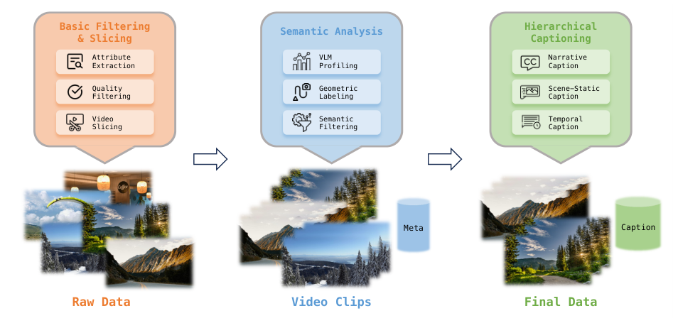

*原文 Figure 3。几何标注与语义筛选发生在层次化 caption 之前；最终样本同时携带视频、元数据和文字。*

基础层记录时长、分辨率、文件大小，去掉过短或分辨率不足的素材，再通过 Koala 与 TransNet v2 相关切分方法形成训练片段。语义层由内部 VLM 分析亮度、清晰度、运动幅度、场景类型和视角。缺少几何标签的真实视频由 MegaSAM 估计相机位姿，而 UE 数据带有渲染得到的真值。这两种相机标签的来源和可信度不能合并成“全部是真实相机轨迹”。[原文 §2.2](https://arxiv.org/pdf/2601.20540#page=5)

文字标注有三个层次，重点在于它们给模型提供的信息不同。

| Caption type | 主要内容 | 对生成条件的作用 |
|---|---|---|
| Comprehensive narrative | 全片的环境、相机路线和事件发展 | 提供整体语义叙述 |
| Scene-static | 场景、材质、光照和美术外观；设计上排除动作与镜头运动 | 减少文字条件与动作条件竞争运动控制 |
| Dense temporal | 带起止时间的局部事件、行为和变化 | 对齐特定时段应出现的内容 |

原文寺庙场景例子很好地说明这一点。Narrative 串起接近屏风、左转看到柱子与雕像、沿走廊移动、最后返回屏风的全过程；static caption 保留石墙、彩绘屏风、红门与光照；temporal caption 则把 0–5 秒接近屏风、5–10 秒左转等分别列出。[原文 §2.3](https://arxiv.org/pdf/2601.20540#page=6)

如果动作已经由键盘与相机信号给定，而文字又完整规定了“向前、左转、再向前”，模型可能依赖文字里的路线，弱化对控制信号的使用。scene-static 标注的作用正是减少这条捷径。它是一种条件分工设计，不等于严格证明文本和运动在统计上已经独立；也不能推断三个 caption 在每次训练中总是同时拼接，报告没有公开完整的采样配方。

## Base 如何学长视频，两个专家又怎样分工

### 这里的 MoE 按噪声阶段分工

LingBot-World 继承 Wan2.2 的两个专家，每个约 14B 参数，总计约 28B。高噪声专家负责去噪早期的整体结构、粗布局和动态；低噪声专家在后期修饰细节。每个去噪时间步激活其中一个专家。[原文 §3.3.1](https://arxiv.org/pdf/2601.20540#page=10)

这与逐 token 选择多个 FFN 专家的稀疏 MoE 不同。这里的分工依据是 diffusion timestep，同一次去噪迭代使用对应噪声区间的网络。因而 28B 是两位专家合计的模型规模，不能当作每步同时激活 28B；反过来，单步计算接近一位 14B 专家，也不能自动推出部署只需存储一份专家权重。实际显存仍取决于权重驻留、切换与缓存配置。

两位专家的知识并不完全可替代。高噪声阶段首先决定世界的粗结构及运动方向，低噪声阶段更专注视觉细节。这为后面的选择提供了理由，Fast 从高噪声专家启动以继承动态能力，但随后必须补上低噪声条件和干净 latent 的处理能力。

### 从 5 秒逐渐扩展到 60 秒

Fundamental world model 先使用 5 秒片段拓宽生成分布，再把训练视频逐渐延长到 60 秒。随着片段变长，作者增大 flow shift，提高高噪声时间步的采样侧重，因为长视频首先需要维持更大时间范围内的场景结构。训练延长与噪声调度因此一起变化，并非只把输入张量加长。[原文 §3.3.1](https://arxiv.org/pdf/2601.20540#page=10)

模型同时训练 image-to-video 和 video continuation。单帧只有外观与当前布局，需要模型补出可能动态；历史视频还包含运动趋势，要求未来延续已经发生的变化。两类条件共同训练，支持从单张图启动或从已有片段继续生成。

一分钟上下文的代价也更高。FSDP2 分片参数、梯度与 optimizer states，解决大模型状态占用；Ulysses context parallel 将长序列分布到多卡，在 attention 中通过 all-to-all 重排所需激活，处理长 token 序列的显存压力。前者主要分摊模型状态，后者主要分摊序列与 attention 中间量，两种并行解决的是不同瓶颈。[原文 §3.3.3](https://arxiv.org/pdf/2601.20540#page=11)

报告描述了并行方案，但没有给出完整 GPU 数量、训练 GPU-hours、batch size 或逐阶段优化器设置。这使其训练路线可理解，完整预算仍无法仅靠 28B 参数和 60 秒上下文复算。

## 控制通过 adapter 调制视频特征，主干在这一阶段冻结

Figure 5 的左侧展示外部接口，右侧展示一个 DiT block。输入图像或视频提供已有世界，noisy latents 是待生成未来，动作给出控制，文本给出语义条件。

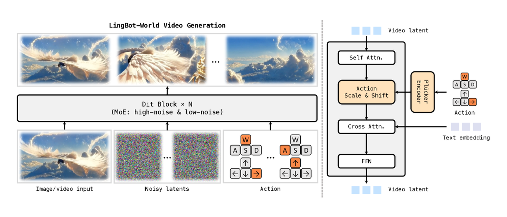{ width="920" }

*原文 Figure 5。视频 self-attention 建立时空联系，动作经 Scale & Shift 调制特征，文字经 cross-attention 输入。*

动作由连续相机旋转和离散键盘输入组合。旋转使用 Plücker embedding 表达，W、A、S、D 等按键使用 multi-hot 向量，允许同时按多个键；两者沿通道维拼接，再经过投影与 AdaLN 产生调制信号。相机方向与平移操作因此不用全部挤进一段自然语言提示。[原文 §3.3.2](https://arxiv.org/pdf/2601.20540#page=10)

从机制上看，AdaLN 让相同视频历史在不同动作下采用不同的特征缩放与偏移，进而改变去噪输出。动作并不只附在网络末端决定一张画面的后处理结果，它进入 DiT 内部并影响未来 latent 的生成；文本 cross-attention 则继续控制环境语义和事件。

这一阶段的训练范围尤其重要。作者先得到具有长时一致性的 fundamental model，再冻结主 DiT blocks，只微调新增 action adapters，包括动作 embedding projections 与 AdaLN 参数。动作标注数据较少且部分来自合成环境，全量微调可能使模型过度偏向这些分布；冻结主干让已有视觉先验在学习控制时得到保留。[原文 §3.3.2](https://arxiv.org/pdf/2601.20540#page=10)

这个冻结规则只对应 action-conditioned fine-tuning，不能扩大成整套 middle-training 和 post-training 都不更新主干。反过来，报告也没有单列冻结与全量微调的数字对照，不能把最终质量提升全部归给 parameter-efficient adaptation。

系统内部的状态主要由视频上下文与网络特征承载。它没有在这条生成路径旁边维护一个显式物体表、可查询坐标图或持久 3D 地图。这种选择容易复用视频先验，也使后面的记忆稳定性依赖上下文与生成过程。

## Fast 的第一步是改变时间依赖，随后才减少去噪步数

### 块内双向，块间因果

双向 Base 可以在同一片段内联合利用前后帧，适合完整轨迹生成，却不适合等待未知的未来用户输入。Fast 从 middle-trained 高噪声专家初始化，将时间 attention 改为 block causal。

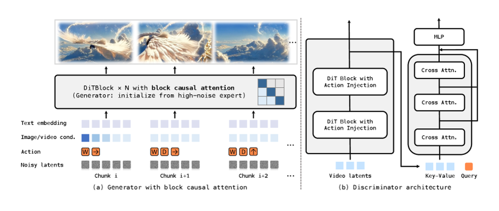{ width="790" }

*原文 Figure 6。左侧为块因果生成器，右侧为接在 fake score 网络特征上的判别头。应先区分生成时的时序依赖，再看训练时增加的判别路径。*

同一 chunk 内允许双向 attention，以共同确定一小段视频的局部动态；不同 chunk 之间只允许当前块读取自己及过去，不能读取未来块。因果单位因此是块，不是每一帧都完全禁止访问块内的后续帧。[原文 §3.4.1](https://arxiv.org/pdf/2601.20540#page=11)

历史块的 K、V 可以缓存，生成新块时复用旧表示。这样，流式推理不必每次把整个历史重新处理一次。它支持持续向后追加，但“可以不断生成”是执行结构的能力，不能自动等价于无限长度都保持准确世界状态。

作者选择高噪声专家，是因为它更擅长动态与全局结构；文本声称这比低噪声专家初始化有利，但没有报告对应的量化消融表。能够确认的是实际初始化选择与设计动机，不能补造两种初始化之间的收益幅度。

### 独立块噪声让学生适应混合条件

因果适配采用 diffusion forcing 思路，把训练视频分成若干块，每块分配独立的 noise timestep。历史可以接近干净，新块可以高度带噪，网络需要在这种不同噪声状态共同存在的上下文中去噪。

作者只采样少量选定的目标时间步 $\{t_1,\ldots,t_m\}$，这些位置也用于后续蒸馏；另外包含 timestep 0 的干净帧监督，补上高噪声专家此前欠缺的低噪声和 clean latent 编码能力。这里的 $t=0$ 指扩散噪声时间，不是视频的第一帧。

$$
\mathcal L=
\mathbb E_{x^i\sim p(x),\;t\in\{t_1,\ldots,t_m\}}
\left\|G_\theta(x_t^i,t,a)-x_0^i\right\|_2^2.
$$

$G_\theta$ 是学生，$x_t^i$ 是带噪训练输入，$x_0^i$ 是干净目标，$a$ 是控制条件。损失要求学生在保留动作条件的同时恢复正确视觉。注意力因果化改变了信息可见性，干净帧和多噪声训练则帮助网络适应新的输入分布，两者不能相互替代。[原文 Eq. 2](https://arxiv.org/pdf/2601.20540#page=12)

论文没有公开这个时间网格的具体数值，也没有给出最终 chunk size 的完整配置。因而适配流程可以按机制理解，不能凭“few-step”自行填成固定的 1、2 或 4 步实现。

## 自生成 rollout 让训练面对部署时真正出现的历史

因果化之后，模型仍可能只会在真实训练帧后续写。一旦推理中上一块已经出现轻微错位，下一块面对的就不是训练时的干净条件，错误会沿生成历史累积。

Self-rollout extended horizon training 让学生在训练时也读取自己先前生成的片段。这些片段进入 rolling KV cache，后面的生成必须接着它们继续。这样，训练遇到的历史不再全由数据集提供，也包含当前模型会产生的偏差。[原文 §3.4.2](https://arxiv.org/pdf/2601.20540#page=12)

长 rollout 的反向图很昂贵，因此作者只让梯度穿过最近 $K$ 次 generation steps，前向仍维持上下文。这里要区分两件事，截断梯度表示更早的生成过程不再为当前损失建立完整反向路径；它不表示前向只能看最近 $K$ 帧，也不意味着 KV 的容量就等于 $K$。

它同样不属于真实机器人式的反馈校正。当前系统继续使用自己生成的视觉，训练并没有在每块结束后获得一个真实物理世界的观测来覆盖预测。Self-rollout 可以让模型更适应自身误差，但持久世界的一致性仍要由学到的动态和上下文承担。

这也解释了 self-forcing 与 KV cache 的分工。前者改变训练分布，后者降低历史复用成本；缓存一个错误不会使它自动正确，但没有高效缓存，长历史自生成训练与实时 rollout 又会更加昂贵。

## DMD 用两个 score 网络告诉学生分布应该怎样移动

### 教师保持固定，fake score 跟随学生

只降低去噪步数会损失细节和动态。DMD 的目标是让少步学生产生的视频分布接近强教师所描述的分布，而非要求每个噪声种子精确复刻教师的一条采样轨迹。

训练里有三个主要网络角色。学生生成干净视频 $\tilde x\sim p_\theta(\tilde x\mid a)$；将它前向加噪得到 $\hat x_t$ 后，real score 和 fake score 在同一个带噪样本及动作条件上给出估计。

| Network | 初始化与数据 | 更新方式 |
|---|---|---|
| Student generator $G_\theta$ | 高噪声专家经因果适配 | DMD 提供分布更新信号，另有质量改进目标 |
| Real score | Middle-trained MoE teacher | 保持固定 |
| Fake score $\mu^\phi_{\mathrm{fake}}$ | 同一 MoE teacher 初始化，学习学生生成样本 | 对生成视频做标准 diffusion training；每次学生更新前可多次更新 |

real score 描述目标分布在当前位置的方向，fake score 描述学生自身分布的方向。原文给出的 action-conditioned reverse-KL 梯度为

$$
\nabla_\theta\mathbb E_t
D_{\mathrm{KL}}(p_{\theta,t}\Vert p_{\mathrm{data},t})
=-\mathbb E\left[
\big(s_{\mathrm{real}}(\hat x_t,t,a)-s_{\mathrm{fake}}(\hat x_t,t,a)\big)
\frac{\partial\hat x}{\partial\theta}
\right].
$$

期待中的样本来自学生，评价方向则来自两种 score 的差异；这是它与单纯训练一个视频去噪器不同的地方。fake score 必须持续追踪学生分布，否则更新方向中就混入一个已经过时的学生估计。two-time-scale updates 正是为此让 fake score 在一次学生更新之间多做几次更新。[原文 Eq. 3、§3.4.2](https://arxiv.org/pdf/2601.20540#page=13)

原文还把这条更新写成 stop-gradient surrogate objective。

$$
\mathcal L_{\mathrm{DMD}}(\theta)=
\mathbb E\left[\frac12
\left\|\hat x-\operatorname{sg}\left[
\hat x-\big(\mu_{\mathrm{real}}(\hat x_t,t,a)
-\mu^\phi_{\mathrm{fake}}(\hat x_t,t,a)\big)
\right]\right\|_2^2\right].
$$

这保留了原文 Eq. 4 的符号。$\operatorname{sg}$ 将方括号内的量当作当前更新的固定目标，让学生通过外侧 $\hat x$ 接收梯度，而不是同时把这条梯度送去更新目标构造。原文在 Eq. 3 使用 score $s$，在 Eq. 4 使用 $\mu$，没有在此展开二者参数化与噪声权重转换；实现时不能只看两个式子的正负号，就擅自将 score、噪声预测和干净样本预测当成同一个量。

“real score”也不等于每次学生更新都直接读取真实视频监督。这里的 real 网络是冻结教师，DMD 仍可能把教师的偏差传给学生。这正是下一条训练路径的动机。

### 对抗分支把真实视频重新引入质量学习

Fast 只继承高噪声专家初始化，又更改了 attention mask、减少了采样步数。它既可能缺少低噪声专家的细节能力，也可能在压缩后继承教师的错误。作者于是将判别头接到 fake score 网络特征上，利用真实视频和生成视频提供额外质量信号。

Figure 6 右侧的 discriminator 使用 cross-attention 汇集特征，最终 MLP 输出判别结果。它沿用 APT 类设计，可以复用已有网络的视觉表征，不必另建一个同规模的视频 backbone。[原文 Figure 6、§3.4.2](https://arxiv.org/pdf/2601.20540#page=12)

原文将生成器与判别器目标写为

$$
\mathcal L_G=\mathbb E_{p(\tilde x)}
\left[f\left(1-D(\mu_{\mathrm{fake}}(\tilde x_t,t,a))\right)\right],
$$

$$
\mathcal L_D=\mathbb E_{p(x)}
\left[f\left(D(\mu_{\mathrm{fake}}(x_t,t,a))\right)\right]
-\mathbb E_{p(\tilde x)}
\left[f\left(1-D(\mu_{\mathrm{fake}}(\tilde x_t,t,a))\right)\right],
$$

其中 $f$ 是 softplus，$p(x)$ 为真实视频分布，$p(\tilde x)$ 为生成视频分布。这里按原文 Eq. 5–6 保留形式，包括 $\mathcal L_D$ 两项间的减号；它不是可以直接替换成常见二元交叉熵形式的公式。报告没有在这段完整展开判别分数方向与实现优化约定，因此不能凭习惯静默改写成另一套 GAN 损失。[原文 Eq. 5–6](https://arxiv.org/pdf/2601.20540#page=13)

参数更新的分工比损失名称更重要。作者明确说，对 fake score 网络及所接判别头而言，对抗损失更新头部 $D$，fake score backbone 保持由 DMD 相关 diffusion 训练更新。生成器则通过自己的目标改善生成质量。不能把“判别支路不更新 fake backbone 权重”理解成生成器完全得不到经过该特征路径的训练信号，也不能将它写成整个 fake score 网络都做对抗微调。

作者没有使用 R1 或 R2 正则，称当前训练足够稳定，但未给出独立开关对抗分支的结果表。它提供了具体的实训方案与合理动机，报告的最终视觉效果不能用来精确量化这一项单独带来的收益。

## Base 与 Fast 的视觉展示说明了什么

报告将 Base 的结果放在 Figures 7–9，将 Fast 的结果放在 Figures 10–11。阅读这些图时，同一行是一个时间序列，不同行是不同场景。首先看同一场景中的主体与布局怎样随时间变化，再看跨行覆盖了哪些风格。

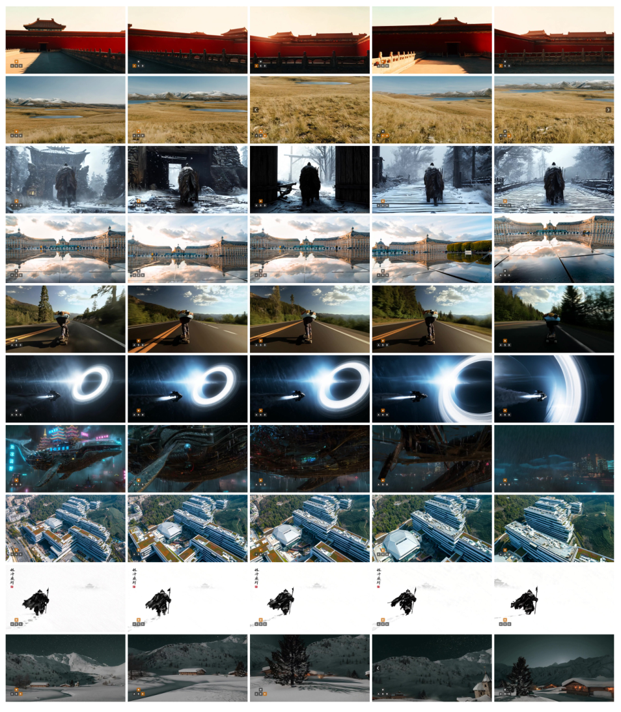

*原文 Figure 7。Base 覆盖建筑、自然环境、人物运动和科幻视觉等场景。它展示的是较强教师的生成范围。*

这张图中，场景既有常见的草原、道路和建筑，也有非写实视觉与复杂城市结构。它说明训练没有把模型限制到某一款游戏或固定世界，基础视频先验仍能支持多样环境。不过，不同美术风格都能生成，并不等于每种环境都具有同样精确的动力学规律。

接着看 Fast。图中叠加的控制图标与逐帧视野变化一起说明，学生在流式动作条件下仍能生成场景转换。

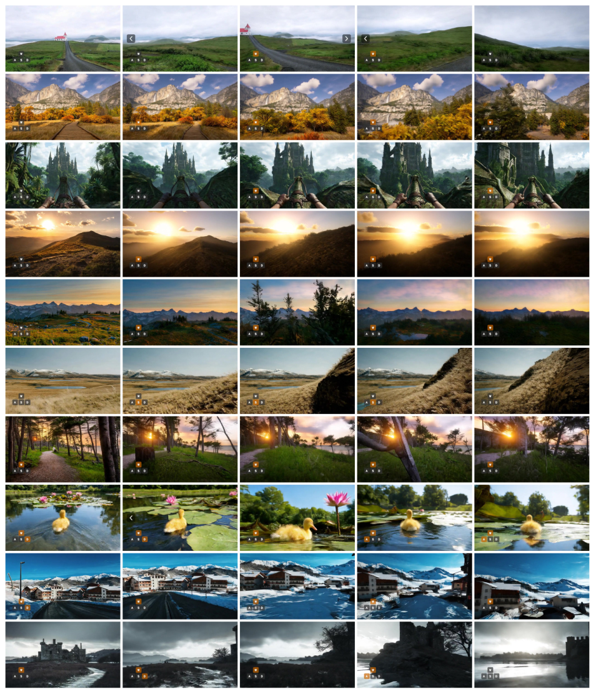

*原文 Figure 10。Fast 展示自然、建筑和动态场景中的连续生成；这些示例与 Base 图不是严格逐样本配对的质量对照。*

报告认为蒸馏后的视觉退化较小，图中也能观察到连贯布局和明显动态。但没有同一组输入、同一控制、同一随机种子下的 Base/Fast 量化对照，也没有把采样步数、质量与速度画成一条曲线。因此更准确的结论是，Fast 保留了多类场景中的可用生成能力，而不是已证明加速对所有质量指标都没有代价。[原文 §4.1.1](https://arxiv.org/pdf/2601.20540#page=19)

## 记忆最有说服力的时刻，是离开视野以后再次返回

Figure 12 的前三行应比较开始与返回时被标出的地标。模型先看到它们，随后视角移开，一段时间后再次朝向原区域。雕像和巨石阵等结构在最长约 60 秒不直接可见后仍能重新出现，比只检查相邻两帧是否平滑更接近持续世界的要求。

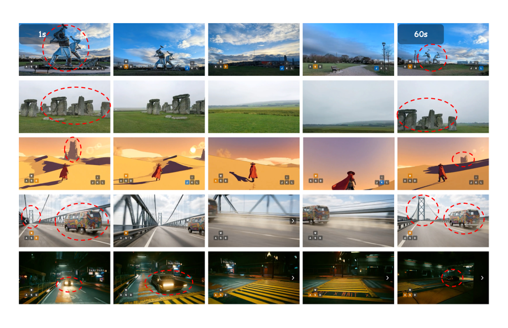{ width="920" }

*原文 Figure 12。前三行为静态地标重现，第四行为前进后桥梁变近，第五行为车辆离开视野后继续运动。*

后三种时间关系值得分开。静态地标返回主要考察布局是否保留；桥梁在向前移动、回头观察后显得更近，要求相机运动与空间距离一致；车辆离开画面后在合理位置重现，则要求不可见对象仍按时间推进。最后一种尤其不能靠简单复制离开前的像素来完成。[原文 §4.1.2](https://arxiv.org/pdf/2601.20540#page=19)

模型没有显式 3D 地图，因此这些行为来自视频上下文与学到的时空模式。作者称之为 emergent memory。这个词在本文中指一种行为能力，不能把它理解成内部已经存在持久物体 ID、精确坐标或可读写的显式数据库。

证据强度也要与形式一致。Figure 12 是挑选的序列，没有给出随机返回测试的成功率、地标相似度分布、轨迹距离误差或物体状态真值。车辆重现支持不可见运动具有合理延续，仍不足以证明它在整个遮挡期间严格积分了真实速度。视觉上的合理未来与唯一正确的物理未来之间，还隔着更强的监督与测量。

作者在局限部分也明确承认，记忆来自 context window 而非存储模块，因此不稳定，长时间会出现不一致。这个限制与成功示例并不矛盾，示例证明某些序列可以做到，系统级可靠性则要求更广泛测试。[原文 §6.2](https://arxiv.org/pdf/2601.20540#page=25)

## 一分钟训练与十分钟生成是两个不同尺度

Figure 13 展示了最长约十分钟的持续生成。图中经历室内外与建筑周边的连续视角变化，说明模型能将有限训练跨度中学到的过渡规律用于更长 rollout。

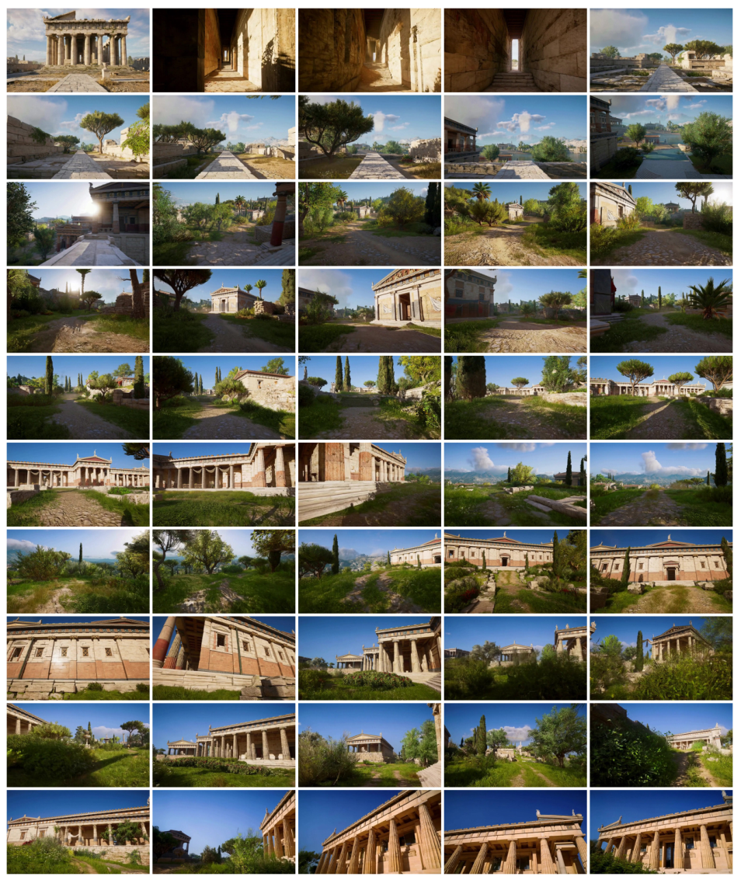

*原文 Figure 13。十分钟指展示序列的生成长度，不是所有训练样本长度，也不是每次运行都保证保持同一世界的时间上限。*

这里有三个容易混淆的数字。60 秒是 curriculum 最终扩展到的训练视频长度；Figure 12 的最长约 60 秒，是地标离开视野后重现的时间跨度；Figure 13 的十分钟是展示的生成长度。它们分别对应训练上下文、特定记忆行为和 rollout 时长，不能互相替代。[原文 §3.3.1、§4.1.2–4.1.3](https://arxiv.org/pdf/2601.20540#page=21)

自回归结构能够继续产生新块，但每块的误差也可能继续传播。报告末尾承认，长生成仍会逐渐失去原有环境结构，足够持久的游戏世界尚未实现。因此“展示了十分钟生成”可以成立，“十分钟内任意回访都精确一致”或“已经具备无限世界记忆”没有相同证据。

## VBench 的六个指标显示四项领先，不等于交互精度排行榜

量化评测使用一个由 100 个生成视频组成的测试集，每个视频超过 30 秒，与 Yume-1.5 和 HY-World 1.5 比较 VBench 指标。表格中模型写作 Ours，相关文字没有明确将这一行单独标为 Base 或 Fast，因此不应将全部数值直接绑定到 Fast 的实时运行设置。[原文 §4.2](https://arxiv.org/pdf/2601.20540#page=21)

| Model | Imaging Quality | Aesthetic Quality | Dynamic Degree | Motion Smooth | Temporal Flickering | Overall Consistency |
|---|---:|---:|---:|---:|---:|---:|
| Yume-1.5 | 0.5838 | 0.5185 | 0.7612 | 0.9709 | 0.9545 | 0.1994 |
| HY-World 1.5 | 0.6512 | 0.5487 | 0.7217 | **0.9897** | **0.9773** | 0.2016 |
| LingBot-World | **0.6683** | **0.5660** | **0.8857** | 0.9895 | 0.9648 | **0.2178** |

*原文 Table 2，保留英文指标与原始分数。加粗表示本表中最高值。*

最明显的差距出现在 Dynamic Degree。LingBot-World 比 Yume-1.5 高 $0.8857-0.7612=0.1245$，比 HY-World 1.5 高 $0.1640$，支持它产生更丰富运动与场景变化的判断。Imaging Quality、Aesthetic Quality 和 Overall Consistency 也最高，说明较多动态没有完全以视觉质量或语义一致性为代价。

它并非所有指标第一。Motion Smooth 比 HY-World 低 0.0002，Temporal Flickering 低 0.0125；与 Yume 相比则两项更高。不同指标的尺度、意义不相同，不能把六列简单相加制造一个原文没有的总分。这里的分数差也不是操控任务成功率百分点。

更关键的是，Dynamic Degree 高只能说明画面动态丰富，不能直接证明每个 W、A、S、D 操作都被准确执行。Overall Consistency 支持视频与语义条件的一致性，也不是地标永久性成功率。表中没有动作跟踪误差、真实相机轨迹对照、接触物理精度或机器人任务成功率；这些具体能力仍需专门协议评估。

报告引言还给出一张模型定位表，把 Matrix-Game 2.0、Yume-1.5、HY-World 1.5、Mirage 2、Genie 3 与本方法按 Domain、Generation Horizon、Dynamic Degree、Resolution、Real-time 和 Open-source 分类。Short、Medium、Long 等标签是作者的粗粒度归类，不是统一环境、统一预算下的测量；尤其不能据此得出对闭源模型的严格质量排名。[原文 Table 1](https://arxiv.org/pdf/2601.20540#page=3)

## 实时结果的适用条件必须与模型版本一起读

Fast 的明确运行描述是 480p、一个 GPU node、16 FPS；摘要报告延迟低于 1 秒。引言总览表给 Ours 写的是 720p，但没有说明 720p 与这一 Fast 速度结果采用相同配置。因此，应保留 480p 的实时证据，不能拼成“720p、16 FPS、亚秒延迟”的单一性能承诺。[原文摘要、§4.1.1](https://arxiv.org/pdf/2601.20540#page=19)

| Quantity | 报告明确支持的说法 | 不能据此推出 |
|---|---|---|
| Fast throughput | 480p 下 16 frames/s | 720p 同速或任意场景同速 |
| Latency | 摘要报告 under 1 second | 每帧端到端交互延迟等于 $1/16$ 秒 |
| Hardware | 一个 GPU 节点；局限提到 enterprise-grade GPUs | 单张消费级显卡可达到同样性能 |
| Base size | 两个约 14B 专家，合计 28B | Fast 每次仍同时调用两个专家 |
| Few-step inference | 经 DMD 等压缩为少步生成 | 未公开的确定步数或完整成本预算 |

吞吐与延迟是不同量。16 FPS 描述持续产生帧的速率；交互延迟还受块大小、排队、生成、解码和呈现方式影响，不能简单取倒数当作按键到屏幕反馈的时间。一个 GPU 节点也可能包含多张卡，论文此处没有给出足够的硬件细节来复算消费级部署需求。

作者承认推理成本仍高，依赖企业级 GPU。开源权重与代码使研究者能检查和改进系统，降低的是访问与实验门槛，不等于已经消除了硬件门槛。[原文 §6.2](https://arxiv.org/pdf/2601.20540#page=25)

## 文本事件为同一初始世界提供不同未来

动作接口负责移动和转向，文本条件还可以在推理期间修改环境与事件。Figure 14 左侧保持相同初始场景，右侧每行采用不同事件提示，观察未来如何分叉。

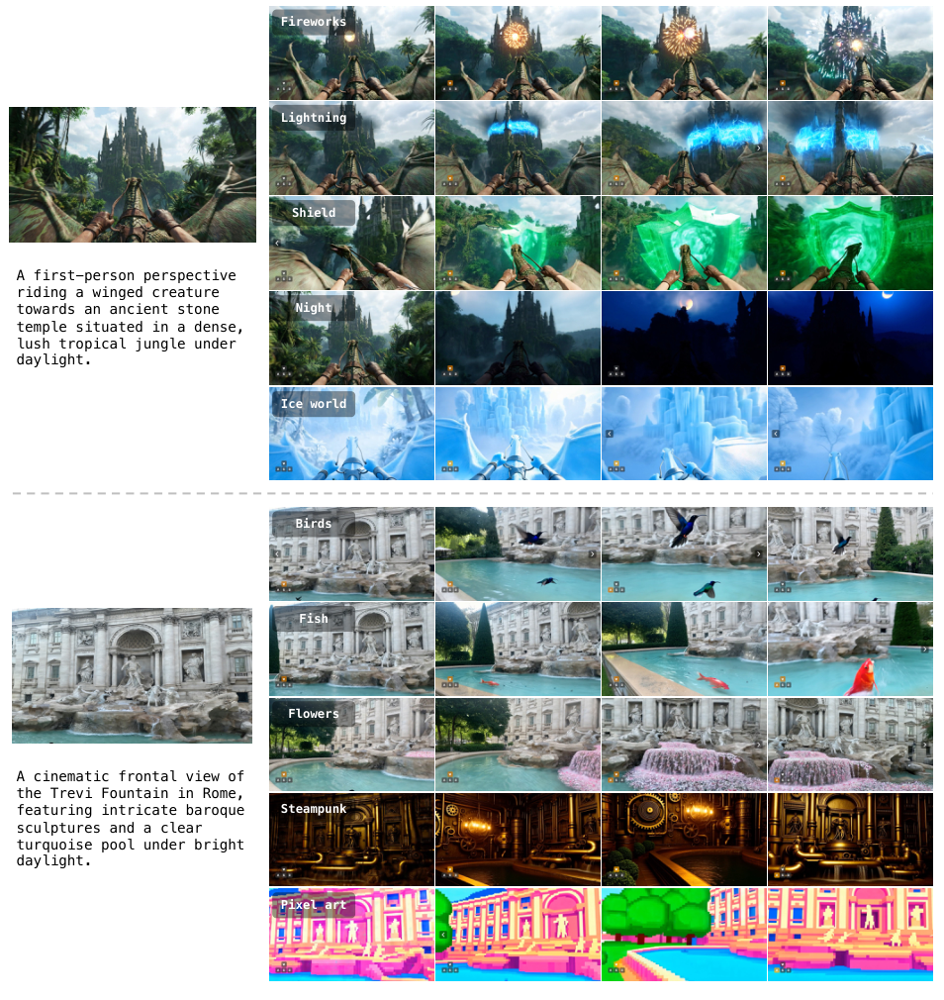

*原文 Figure 14。上半部为奇幻场景，下半部为喷泉场景；同一个初始上下文可以由不同文本引向不同事件或风格。*

Global events 改变天气、光照或整体美术风格，例如 night、ice world、pixel art 和 steampunk。Local events 则引入烟花、鸟、鱼、花等局部内容。作者利用基础模型的 text conditioning 与 Ditto 的一个变体，在已有历史之后调整未来生成。[原文 §5.1](https://arxiv.org/pdf/2601.20540#page=23)

这条接口的实际价值在于，用户无需重新初始化整段世界，就可以改变后续情境。对内容制作而言，它支持边探索边编辑；对测试环境而言，它提供插入不同事件的可能。

不过，局部语义干预与精确对象操作仍不同。提示“出现鱼”并没有规定某条鱼的三维坐标、速度或身份；“场景变成冰雪”也没有给出热力学状态和摩擦系数。Figure 14 展示文本能够改变视觉未来，尚未证明这些变化已经成为可校准的物理干预。报告后面对指定物体拾取困难的说明，恰好界定了这条能力的边界。

## Action agent 是图像到探索动作的监督模型

应用部分还训练了一个 Qwen3-VL-2B action agent，使用与世界模型相关的 image-action pairs。输入是当前视觉观察，输出未来 10 秒的动作序列，包括 W、A、S、D 移动，以及 I、J、K、L 表示的离散鼠标方向；动作再转换为运动轨迹，送入世界模型生成下一段视频。[原文 §5.2](https://arxiv.org/pdf/2601.20540#page=25)

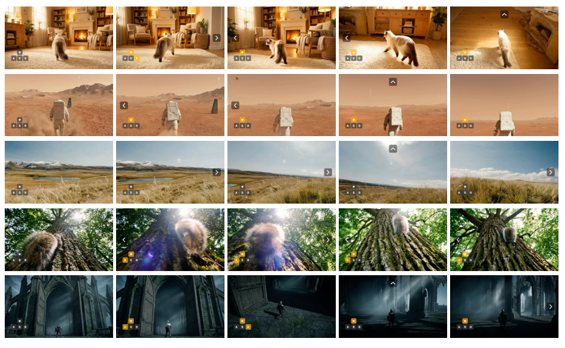

*原文 Figure 15。先由 action agent 预测动作，再将动作转换成相机轨迹来驱动视频生成。*

它使环境可以由模型自动游览，而不必始终由人按键。图中室内、自然与风格化场景显示了这条组合接口的可行性，即视觉观察进入决策模型，决策结果进入生成世界。

训练描述是对 Qwen3-VL-2B 做图像动作监督微调，没有报告奖励函数、在生成世界中的强化学习优化，或世界模型训练使真实机器人成功率提高多少。因此，不能将这个展示写成“已在世界模型里训练出泛化机器人策略”。它直接支持的是视觉条件探索动作生成，以及动作代理与视频环境能够串起来运行。

10 秒也是动作输出跨度，不能理解成 10 秒期间每一帧都重新观察和决策。报告没有进一步给出闭环重规划频率、探索覆盖率或与随机策略的量化比较，所以自动探索的效率仍未被这组示例测定。

## 三维重建是对生成结果的后处理检验

Figure 16 从生成视频重建点云，涵盖室内、科幻和室外环境。先看下方各视角视频帧，再看上方重建出来的结构，重点是不同视角是否能被组合成大体一致的空间。

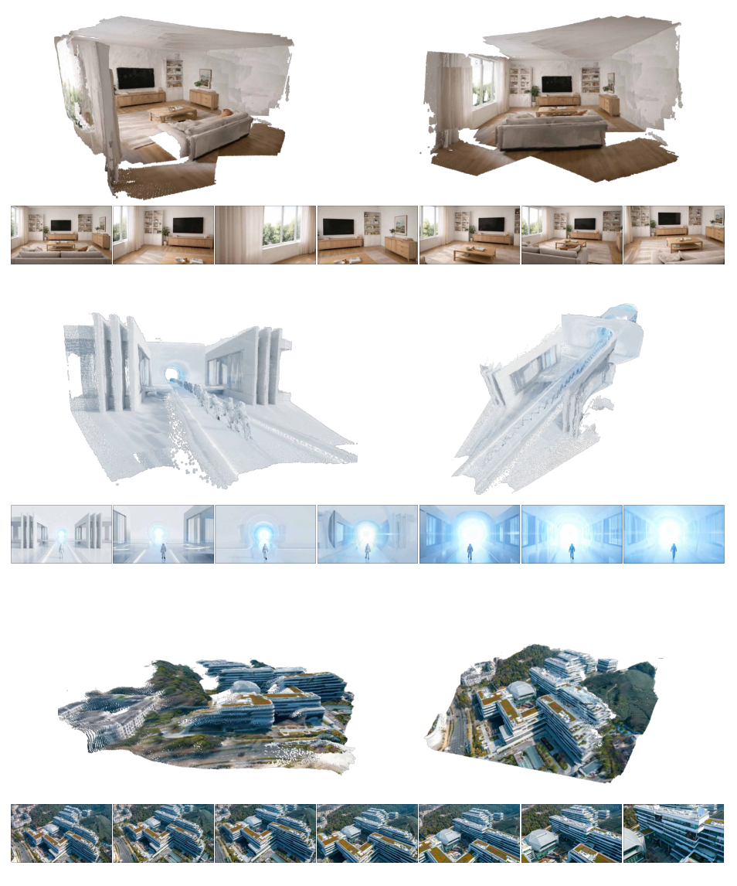

*原文 Figure 16。点云由额外的 3D reconstruction foundation models 从生成序列恢复，并非视频模型内部实时维护的显式世界状态。*

论文引用的重建基础模型包括 Depth Anything 3 和 VGGT。能够得到连贯点云，说明这些生成视角至少具有一定跨视角相容性，足以被已有重建方法解释为一个空间；这比只看单帧纹理多提供了一种结构证据。[原文 §5.3](https://arxiv.org/pdf/2601.20540#page=25)

但图中没有对应真实三维场景的几何误差、尺度误差或统一重建基准。额外模型本身也带有几何先验，因此不能从重建可视化直接推出视频生成器内部已经形成精确三维地图。更不能反过来把这个应用图当作系统使用显式 3D memory 的证据。

它比较直接的用途，是从多样生成视频获得候选三维素材或进一步筛选的合成数据；是否足以用于精确导航、接触和机器人训练，还取决于后续几何验证与任务协议。

## 可复用的是整条训练链路，尚未完成的是持久状态管理

LingBot-World 给出的路径相当具体。先用视频基础模型获得开放外观与动态，再通过重访轨迹和更长片段要求世界记住已见结构；动作 adapter 为既有生成器增加控制；块因果注意力与缓存提供流式运行结构；自生成训练让学生经历自己的历史偏差；DMD 和真实数据判别信号帮助少步模型保留质量。每一步对应一个明确困难，也为其他视频模型改造交互环境提供了可替换的环节。

这条路线对导航、世界游览、互动内容制作最直接。控制信号主要是移动、转向与语义事件，系统能够持续显示其视觉后果。若目标是稳定操纵指定物体，则还缺少精确对象定位、丰富动作空间和可信接触动态；如果目标是长期游戏世界，则还需要比上下文涌现更可靠的状态保存。

报告最后将现有边界列得很清楚。隐式记忆不稳定，长 rollout 会漂移；高算力需求限制部署；动作以导航和基本运动为主；杂乱桌面中拾取指定杯子一类精细交互困难；当前只支持单智能体视角。扩展动作与物理交互、设计显式记忆和改善长期漂移，都还是后续方向。[原文 §6.2–6.3](https://arxiv.org/pdf/2601.20540#page=26)

最值得带走的判断，是把开放视频先验变成可持续操作的视觉环境已经有一条可实现的系统路径，而可靠世界状态仍不能仅靠“视频很连贯”来认定。采用这条路线时，应根据用途分别测量动作响应、离开后的重现、长时结构保持和交互延迟，再决定它适合作为创作环境、探索测试平台，还是进一步训练控制策略的数据来源。
