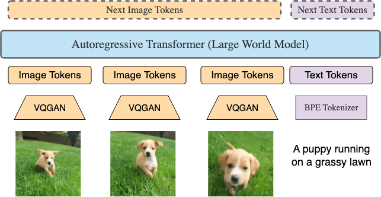
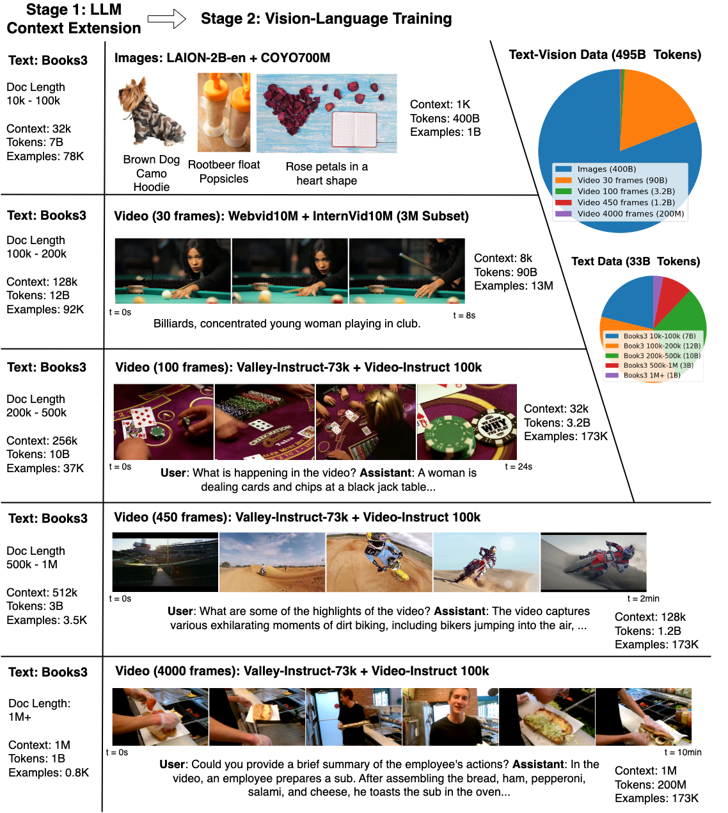
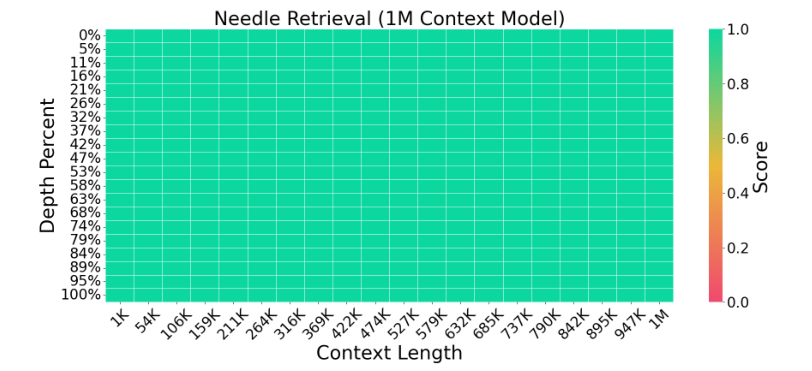
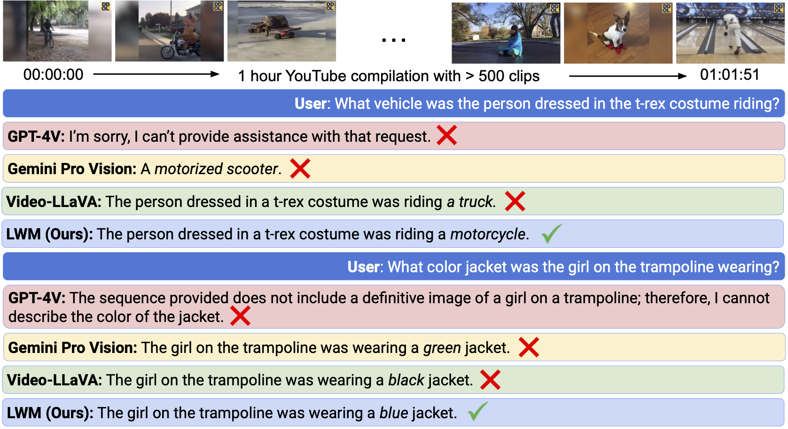
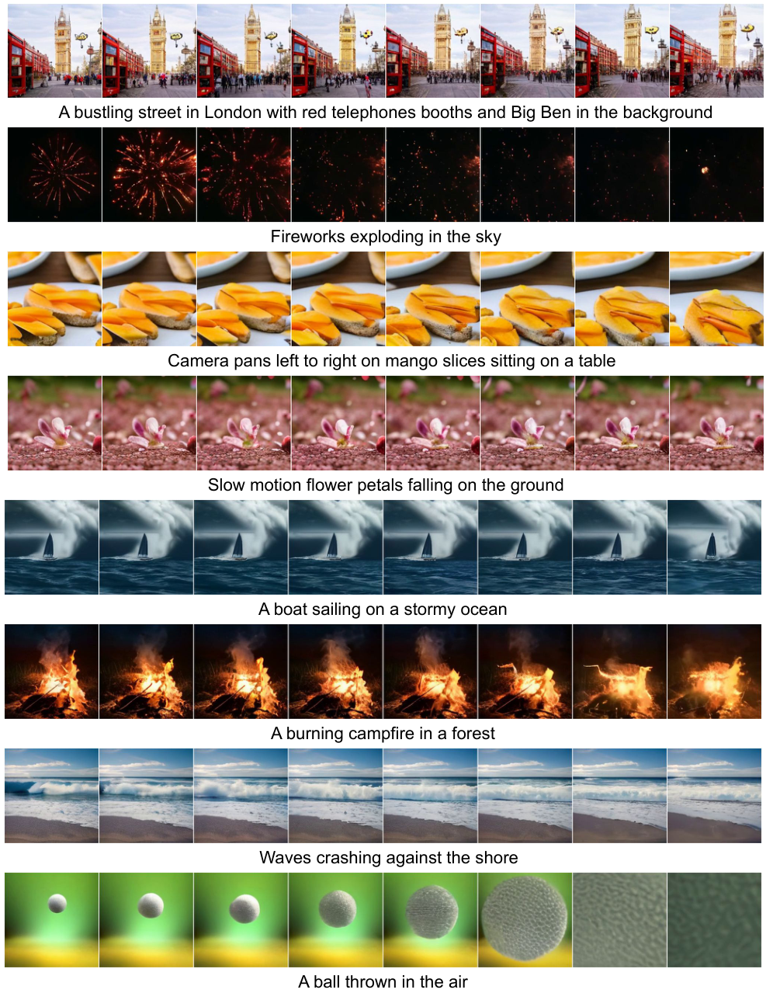
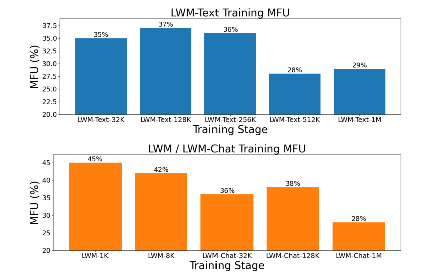

# LWM：百万 token 视频语言世界模型

!!! info "论文信息"
    **论文题名：** World Model on Million-Length Video And Language With Blockwise RingAttention。 
    **作者：** Hao Liu、Wilson Yan、Matei Zaharia、Pieter Abbeel。 
    **机构：** UC Berkeley、Code and models of Large World Model (LWM) are available at largeworldmodel.github.io/lwm/ .。 
    **时间 / 主题：** 2024-02；世界模型。 
    **arXiv / 官方报告：** arXiv：[2402.08268](https://arxiv.org/abs/2402.08268)；官方材料：[largeworldmodel.github.io/lwm/](https://largeworldmodel.github.io/lwm/)。 
    **GitHub / 项目：** GitHub：[github.com/LargeWorldModel/LWM](https://github.com/LargeWorldModel/LWM)；项目页：[largeworldmodel.github.io/lwm/](https://largeworldmodel.github.io/lwm/)。 
    **元数据来源与核验口径：** 来源：[arXiv](https://arxiv.org/abs/2402.08268)；[GitHub API / repo](https://github.com/LargeWorldModel/LWM)；[官方 / 项目材料](https://largeworldmodel.github.io/lwm/)；Checked Date：2026-06-04；Repro Status：Paper / official materials reviewed, independent reproduction not claimed。

## 百万上下文解决的是哪一种世界建模问题

LWM 给出了一条从 Llama-2 7B 训练出百万 token 文本与视频语言模型的完整路径。它的主要贡献落在三个相互依赖的环节。系统要容纳极长的精确注意力计算；训练数据要让模型真正从远处取回信息；多模态训练还要控制短回答、长视频和图像生成之间的优化比例。只解决内存，模型可能看得到远处却不会使用；只加入长样本，短对话的监督又可能在大量视觉 token 中被淹没。[↗](https://arxiv.org/pdf/2402.08268v4#page=2)

论文中的 **Large World Model** 指通过同一个自回归模型学习世界的文本与视觉序列。模型既能读图、读视频并输出文字，也能根据文字生成图像和视频。这里的“世界”主要表现为多模态观测及其序列分布。本文没有给出动作条件状态转移、奖励预测、在线规划或机器人闭环控制实验，因此不能把它与 Dreamer 一类可用于决策的动力学模型直接等同。它最扎实的实证是长文本检索和长视频理解，而生成部分展示的是统一序列接口的可行性。[↗](https://arxiv.org/pdf/2402.08268v4#page=9)

理解这篇工作时，应把三个量分开。**Context capacity** 是模型和系统允许放入多少 token；**effective context** 是模型能否在这些位置上找到并使用相关证据；**temporal coverage** 是视频经抽帧和编码后覆盖了多少真实时间。LWM 通过长窗口、检索式训练和较密的采样同时推进这三件事，后面的实验也分别暴露了它们的限制。

## 先把图像、视频和文字变成同一种预测接口

LWM 保留标准 causal Transformer 的主体。文本用 BPE tokenizer，视觉使用 aMUSEd 的预训练 VQGAN。每张 $256\times256$ 图像压缩为 $16\times16$ 的离散编码网格，展平后得到 256 个视觉 token。视频逐帧通过同一个编码器，再按时间顺序串接；这里没有用一个时空 tokenizer 把多帧联合压缩。[↗](https://arxiv.org/pdf/2402.08268v4#page=7)

原论文 Figure 3 应沿着“单帧编码、视觉与文本拼接、预测下一 token”的方向读。图中视频帧一旦进入 Transformer，就不再以完整图片为基本单位参与计算，而是以离散 token 序列参与同一套注意力。

{ width="640" }

*原论文 Figure 3。每帧 256 个 VQGAN token，与 BPE 文本 token 组成自回归序列；示意图省略了模态与帧边界标记。*

这一设计让任务方向由序列排列决定。文字在前、图像编码在后，训练的目标就是在文字条件下生成图像；图像在前、描述或答案在后，目标变成 captioning 或视觉问答。视频同理，只是视觉片段由更多帧组成。把完整混合序列记作 $z_{1:T}$，作者所用 next-token prediction 可以用以下概率分解表达，式子是对其训练接口的数学整理，并非论文新增的目标函数。

$$
p_\theta(z_{1:T})=\prod_{t=1}^{T}p_\theta(z_t\mid z_{<t}).
$$

其中 $z_t$ 可以是文字、图像编码或边界标记，$\theta$ 是 Transformer 参数。训练时把真实前缀送入模型并预测下一 token；推理时保留用户提供的前缀，逐步采样后续 token。若接下来是文字，就经文本 tokenizer 解码；若是视觉编码，就由 VQGAN decoder 还原图像或逐帧还原视频。这使理解与生成共享主体，也意味着视觉理解必须依赖适合重建的离散编码，后文的短图像理解实验会显示这种选择的代价。

边界 token 对这一接口尤其关键。`<eof>` 表示非末尾视频帧结束；`<eov>` 的全称是 **end of vision**，用在单张图像末尾，或一段视频最后一帧末尾。二者是新增的视觉码本 token。外围的 `<vision>` 与 `</vision>` 则是文本侧标记，用来界定视觉部分。若把 `<eov>` 只解释成“视频结束”，就遗漏了单图生成同样需要结束视觉输出的事实。[↗](https://arxiv.org/pdf/2402.08268v4#page=7)

百万 token 与一小时视频之间可以做一个明确的容量估算。若有 $F$ 帧、每帧 256 个编码，以及 $T_{\mathrm{text}}$ 个文字 token，序列预算近似为

$$
T\approx256F+T_{\mathrm{text}}+T_{\mathrm{boundary}}.
$$

模型实际的 1M 窗口为 $2^{20}$，忽略文字和边界时最多相当于 4096 帧。按 1 FPS 采样，一小时的 3600 帧产生 $3600\times256=921600$ 个视觉 token，因此可以放入百万窗口；若提高到 4 FPS，同样窗口覆盖的时间会缩短到约四分之一。这是根据 tokenizer 得到的预算计算，不是模型在任意帧率、分辨率下都能处理一小时视频的承诺。附录的定性视频问答采用 1 FPS，超过可容纳长度时再均匀抽取最大帧数，并将画面 resize、center crop 到 $256\times256$。[↗](https://arxiv.org/pdf/2402.08268v4#page=22)

## Blockwise RingAttention 让序列装得下，但计算不会免费

普通全注意力若显式存储长度为 $T$ 的注意力矩阵，内存按 $T^2$ 增长。FlashAttention 通过分块和融合避免把整个矩阵写回高带宽内存，但各层激活、Q/K/V 等仍随序列长度增长，单设备仍有容量边界。LWM 使用的 Blockwise RingAttention 在此基础上把序列分到多个设备，并融合 FlashAttention 的块内计算，通过 Pallas 实现相应内核。[↗](https://arxiv.org/pdf/2402.08268v4#page=3)

理解它与模型能力的关系，需要看清哪些计算仍存在。每个设备保留自己的 query 块，key/value 块沿设备环传递；query 依次与各个合法 key/value 块计算注意力，使用在线 softmax 的统计量合并部分结果。分布式过程改变了数据的存放和调度位置，没有把远处 token 删除，也没有把注意力改成近似检索。块内运算与下一块的通信可以重叠，前提是每个设备上有足够多 token，让计算时间覆盖通信时间。论文“没有额外开销”的表述应在这个条件下理解。

长序列仍要支付 dense attention 的算术成本。对固定模型，单序列注意力主项随 $T^2$ 增长；即使固定每个 batch 的总 token 数 $B$，batch 中序列条数约为 $B/T$，总注意力主项仍近似为

$$
\frac{B}{T}\,T^2=BT.
$$

这条比例关系是理解训练课程的解释性计算。它说明同样训练若干 billion tokens，在 1M 窗口里做与在 8K 窗口里做，成本并不相同。因此 LWM 没有从头到尾都用最长序列。它先在短窗口学习局部语言和视觉关系，再把较少预算用于更长的依赖范围。系统可扩展性与渐进训练承担的是两种不同的节省，一种缓解内存和通信瓶颈，另一种减少不必要的长序列运算。

## 文本预训练、文本对话与视觉训练有三条初始化路径

Figure 4 把整个训练过程画成了两个大阶段。读图时先看文本如何扩窗，再看视觉数据如何从图像过渡到短视频、长视频；不要只沿着图片上的总 token 数理解所有实验。

{ width="920" }

*原论文 Figure 4。图中展示训练课程与数据分布。该示意图的一些阶段 token 预算与最终附录 Tables 6–8、12–14 不一致，下文采用详细表格中的训练数值。*

这里容易混淆的地方，是“逐步加长”并不适用于每条模型分支。

| Model family | Initialization and progression | Training purpose |
| --- | --- | --- |
| LWM-Text | Llama-2 7B → Text-32K → 128K → 256K → 512K → 1M | 在长文档上学习 next-token prediction 和长位置范围 |
| LWM-Text-Chat | 每个长度分别从同长度的 LWM-Text 初始化 | 结合长问答与普通对话，学会按问题使用上下文 |
| LWM / LWM-Chat | Text-1M → Visual-1K → 8K → Chat-32K → 128K → 1M | 加入视觉编码，逐步训练理解与生成 |

例如 Text-Chat-1M 从 Text-1M 初始化，而非继承 Text-Chat-512K。视觉分支则确实依次继承前一阶段的视觉权重。这个差别影响训练预算核算，也影响如何理解不同模型长度的结果。[↗](https://arxiv.org/pdf/2402.08268v4#page=5) [↗](https://arxiv.org/pdf/2402.08268v4#page=25)

### 文本扩窗要同时改变位置尺度和文档长度

文本预训练从 Llama-2 7B 出发，按 32K、128K、256K、512K、1M 五个阶段训练。每阶段筛选不同长度的 Books3 文档。长序列中只有无关短文的拼接，未必提供真实的长程叙事或跨章节依赖；因此这里的数据筛选与窗口扩大配套进行。RoPE 的 $\theta$ 也随阶段调整，让位置编码适应更长范围，但实际取值不是严格按窗口倍数同比例放大。[↗](https://arxiv.org/pdf/2402.08268v4#page=3)

| LWM-Text stage | 32K | 128K | 256K | 512K | 1M |
| --- | ---: | ---: | ---: | ---: | ---: |
| Sequence Length | $2^{15}$ | $2^{17}$ | $2^{18}$ | $2^{19}$ | $2^{20}$ |
| RoPE $\theta$ | 1M | 10M | 10M | 25M | 50M |
| Books3 Doc Length | 10K–100K | 100K–200K | 200K–500K | 500K–1M | 1M+ |
| Total Tokens | 4.8B | 12B | 12B | 3B | 1.8B |
| Total Steps | 1200 | 3000 | 3000 | 720 | 450 |
| LR Warmup Steps | 100 | 200 | 200 | 50 | 25 |
| Wall Clock | 8 h | 45 h | 83 h | 47 h | 58 h |

*合并原论文 Tables 6、12。所有阶段均为 7B 参数、float32、4M tokens/batch、TPU v4-512，warmup 后使用 constant learning rate $4\times10^{-5}$。B、M 为表中预算单位，原表 token 总数采用近似值。*

128K 到 256K 时，窗口翻倍而 RoPE $\theta$ 保持 10M，已经说明不能把方法概括成“每扩两倍窗口，就将 RoPE 参数扩大两倍”。真正可以复用的是逐阶段选取位置尺度、配套长文档，并继承上一阶段权重，而不是一个由原文概述推出来的固定比例公式。[↗](https://arxiv.org/pdf/2402.08268v4#page=25)

按详细表格相加，这条文本预训练链累计约 33.6B tokens、241 小时；这些是分阶段数值的加总，不含后面的对话和视觉训练。128K 与 256K 都训练 12B tokens，却分别用 45 与 83 小时；512K 与 1M 的训练 token 数更少，但 wall clock 仍有 47 与 58 小时。这个对照直接体现了“相同 token 数不等于相同长上下文成本”。当然，阶段还改变了文档长度和并行配置，不能据此把时间比当成纯注意力内核的独立测量。

## 长文续写为何还需要专门的问答训练

长文 next-token prediction 能让模型在长位置范围内运行，但训练中绝大多数 token 可能依靠附近上下文就能预测。用户在文末问“开头那个人物做了什么”时，需要的是按问题选择远处证据。LWM 用合成问答为这种行为提供直接监督，而且不要求生成数据的教师本身拥有百万窗口。[↗](https://arxiv.org/pdf/2402.08268v4#page=4)

构造流程有三个步骤。先将 Books3 文档切成 1000-token chunks，逐块交给短上下文模型，生成基于该块内容的问答。再把相邻 chunks 拼成长文，使原本分散在各块里的证据出现在长上下文的不同位置。最后把相应问答以 chat 格式放到长序列后面。学生回答时面对整段长文，需要定位到包含答案的局部片段；教师只负责短片段上的问答生成。

这个过程能够制造远距离证据查找，但任务信号仍主要来自局部 chunk 所生成的问题。它不会自动产生必须联合多个章节、追踪复杂因果关系才能回答的高质量问题。后面的多 needle 下降，与这一训练方式所强调的“找回事实”和更困难的“同时整合信息”之间的距离是一致的观察，但论文没有单独实验把这种下降归因于 chunk 大小。

文本 chat 将 UltraChat 与合成 QA 按约 7:3 混合。这里不能只看样本数量。合成 QA 的大部分输入是长文档，文档 token 不计入 answer loss，真正参与监督的 token 比例可以低于 1%；UltraChat 的短问题、短回答密集打包后，loss token 比例高得多。如果将二者不加区分地混装并按所有监督 token 平均，名义上的 30% QA 很可能不等于 30% 的有效训练贡献。因此作者先把 UltraChat 单独打包到目标长度，并与长 QA 样本保持分离。[↗](https://arxiv.org/pdf/2402.08268v4#page=4)

用 $m_t\in\{0,1\}$ 表示某位置是否承担监督，单个训练序列的常见交叉熵可以写为

$$
\mathcal L=-\frac{1}{\sum_t m_t}\sum_t m_t\log p_\theta(z_t\mid z_{<t}).
$$

这只是解释 loss token 概念的通用表达。对于长文问答，文档提示位置的 $m_t=0$，回答位置才计入 loss。训练时模型仍然读取文档并通过注意力使用它，忽略文档的预测损失并不等于删除文档输入。论文没有给出所有任务的精确 loss 权重，不能从 7:3 的数据比例推断一个未经报告的最终目标函数。

四个 Text-Chat 模型均训练 1.2B tokens、300 steps，使用 4M tokens/batch、float32、TPU v4-512、25 步 warmup 与 $4\times10^{-5}$ constant learning rate。128K、256K、512K、1M 模型分别用约 6、10、20、40 小时。训练 token 总量保持一致时，更长序列意味着更少的完整长样本，也意味着更高计算开销；“每种长度都训练 300 步”并不表示它们经历了同样多的独立问答情境。[↗](https://arxiv.org/pdf/2402.08268v4#page=16) [↗](https://arxiv.org/pdf/2402.08268v4#page=25)

### Chat / QA Mix 消融揭示的是两项能力的取舍

附录 Table 11 改变普通聊天与事实检索问答的混合比例，分别观察 MT-Bench 与 Needle Accuracy。如果长窗口本身就能保证检索能力，去掉合成 QA 后 retrieval 不应出现这么大的下降。

| Chat / QA Mix | MT-Bench | Needle Acc |
| --- | ---: | ---: |
| 0% / 100% | 2.42 | 100% |
| 40% / 60% | 4.14 | 100% |
| 70% / 30% | 4.62 | 96% |
| 90% / 10% | 5.10 | 55% |
| 100% / 0% | 5.80 | 31% |

*原论文 Table 11。MT-Bench 与 Needle Acc 衡量不同目标，不能把其中一列当作整体模型质量。*

从纯 QA 到纯 Chat，MT-Bench 从 2.42 升至 5.80，Needle Accuracy 则从 100% 降到 31%。特别是 70:30 改为 90:10，MT-Bench 增加 0.48，needle 却下降 41 个百分点。7:3 因而是一种兼顾两类任务的经验选择；它没有在这张表上同时最大化两项指标，更不应被推广为所有长上下文模型通用的最优比例。[↗](https://arxiv.org/pdf/2402.08268v4#page=17)

另一张 Table 10 给出不同长度 Text-Chat 的 MT-Bench，128K、256K、512K、1M 分别为 4.62、5.00、4.83、4.19。1M 版本低于中间长度版本，但趋势并非单调下降，因为 256K 高于 128K。作者推测长序列训练使用了更少样本，更充分或更接近日常对话分布的长 chat 数据可能改善这个问题；这是合理解释，论文没有用等样本量、只改变窗口的独立对照把原因确定下来。

## 视觉课程先学图像，再学视频，最后扩展长视觉对话

视觉阶段直接从 LWM-Text-1M 初始化。此时位置编码已经支持百万范围，后续所有视觉阶段的 RoPE $\theta$ 固定为 50M，不再随当前窗口改变。训练重新从 1K 开始，是为了低成本学习新模态和局部视觉预测，不代表把位置能力重新限制为 1K。[↗](https://arxiv.org/pdf/2402.08268v4#page=7)

**LWM-1K** 使用 LAION-2B-en 与 COYO-700M，过滤掉分辨率不足 256 的图像，得到约十亿图文对。训练随机交换文字与图像的顺序，让同一类数据同时支持图像生成、无条件图像生成和图像描述；图文对被打包成 1K 序列。

**LWM-8K** 加入 WebVid10M 和 InternVid10M 的约 3M 子集。视觉数据中的图像、视频按 50:50 混合，图像样本打包到 8K；视频以 4 FPS 取 30 帧。30 帧本身消耗 $30\times256=7680$ 个视觉 token，因而与 8K 窗口相配。这个阶段仍随机交换文字与视觉的顺序，使视频描述与视频生成共享训练。前两个视觉阶段另取 batch 的 16% 为 OpenLLaMA 纯文本数据，以保留语言能力；这个比例不应不加区分地套到后面的全部 chat 阶段。

**LWM-Chat-32K、128K、1M** 依次训练四类 chat 任务，每类占 batch 的 25%。图像生成和视频生成使用前述预训练数据的子集，加上 chat 格式；图像理解使用 ShareGPT4V；视频理解使用 Valley-Instruct-73K 与 Video-ChatGPT-100K。较短的任务样本打包到目标长度，长视频若超出当前窗口，则均匀采样可容纳的最大帧数。因此这些阶段同时包含短任务和长视觉输入，训练目标并非单纯不断延长生成视频。[↗](https://arxiv.org/pdf/2402.08268v4#page=7)

| LWM / LWM-Chat stage | 1K | 8K | Chat-32K | Chat-128K | Chat-1M |
| --- | ---: | ---: | ---: | ---: | ---: |
| Initialize From | Text-1M | 1K | 8K | Chat-32K | Chat-128K |
| Sequence Length | $2^{10}$ | $2^{13}$ | $2^{15}$ | $2^{17}$ | $2^{20}$ |
| Total Tokens | 363B | 107B | 10B | 3.5B | 0.4B |
| Total Steps | 45000 | 14000 | 1200 | 450 | 50 |
| LR Warmup Steps | 1000 | 500 | 100 | 50 | 5 |
| Max LR | $6\times10^{-4}$ | $6\times10^{-4}$ | $8\times10^{-5}$ | $8\times10^{-5}$ | $8\times10^{-5}$ |
| Min LR | $6\times10^{-5}$ | $6\times10^{-5}$ | $8\times10^{-5}$ | $8\times10^{-5}$ | $8\times10^{-5}$ |
| Wall Clock | 83 h | 32 h | 10 h | 6 h | 8 h |

*合并原论文 Tables 8、14。所有阶段为 7B、float32、8M tokens/batch、TPU v4-1024，RoPE $\theta=50$M。原表 LR Schedule 均列为 Cosine；最后三阶段的 max/min LR 相同，warmup 后没有余弦幅度变化。*

按表相加，视觉训练约 483.9B tokens、139 小时，其中约 470B tokens 在 1K 和 8K 两个短窗口阶段完成。最终 1M 阶段只有约 0.4B tokens、50 steps，不能把模型的全部视觉知识归因于这最后 50 步；它继承了大量图像、短视频与中等长度视觉 chat 训练。也不要把这里的 50 steps 与文本 1M 阶段的 450 steps 混用。[↗](https://arxiv.org/pdf/2402.08268v4#page=25)

附录 Figure 10 还有一个与训练实现直接相关的现象。1K 阶段中途出现明显 loss 峰值，图注解释为向视觉码本加入 EOF/EOV token。随后跨阶段的 loss 又明显降低，但各阶段混合的模态损失不同，不能仅凭曲线的绝对高度认定模型在相同测试分布上突然大幅进步。这个细节提醒读者，统一 next-token 接口仍然包含不同 token 类型和监督密度，曲线要连着数据组成一起读。[↗](https://arxiv.org/pdf/2402.08268v4#page=16)

## Masked sequence packing 为什么会改变视觉理解成绩

将许多短样本打包成长序列，首先是为了减少 padding 浪费。例如百万窗口中只放一个几百 token 的图像问答，会让绝大部分位置没有实际训练内容。但“把样本连接起来”同时改变了注意力可见范围与损失归一化方式；若只追求填满序列，模型训练的目标可能已不同于原来独立样本训练。[↗](https://arxiv.org/pdf/2402.08268v4#page=7)

LWM 对独立 text-vision pairs 做注意力隔离。令 $s(i)$ 为第 $i$ 个 token 所属的样本编号，则其所述 causal packing mask 可整理为

$$
M_{ij}=\begin{cases}
0,&s(i)=s(j)\ \text{and}\ j\le i,\\
-\infty,&\text{otherwise}.
\end{cases}
$$

加上这个 mask 后，同一样本内部仍能按因果顺序注意到全部前文；独立样本之间没有连接。它隔离的是被打包到同一个缓冲区里的不同训练样本，保留同一视频中跨帧、跨长距离的交互。若错误地将每一帧也视为独立样本并阻断帧间注意力，就失去了训练视频时间依赖的意义。

第二个变化是 loss reweighting。作者的目标是让 packing 后的计算等价于独立样本加 padding 的训练方式。用一个解释性例子即可看出必要性。设一个视频生成样本有 7680 个视觉预测 token，另一个视觉问答只有 20 个回答 token；若直接在全部监督 token 上平均，在每个 token loss 大致相当时，后者的系数份额约为 $20/(7680+20)\approx0.26\%$。这不等于真实梯度必然只有 0.26%，但说明按 token 平均与按样本平均会给任务非常不同的权重。

例如，若目标是对 $n$ 个样本的平均损失再平均，可以写为

$$
\mathcal L_{\mathrm{example}}=\frac1n\sum_{i=1}^{n}\frac1{L_i}\sum_{t\in\mathcal S_i}\ell_{i,t},
$$

其中 $\mathcal S_i$ 是第 $i$ 个样本的监督位置，$L_i=|\mathcal S_i|$；直接按打包后的 token 平均则是

$$
\mathcal L_{\mathrm{token}}=\frac{\sum_i\sum_{t\in\mathcal S_i}\ell_{i,t}}{\sum_i L_i}.
$$

两式只用于展示归一化差异，不是对 LWM 未公开 loss 系数的补写。真实实现应以原先 non-packed + padding 训练的目标为基准，保留任务权重、监督 mask 与归一化分母。短回答可以依赖很长视觉输入，不能因为回答短就在优化中被自动降权。

Table 9 直接比较普通 packing 与作者的 masked sequence packing。这里的修正同时包括注意力 mask 和 loss reweighting，因果归因应覆盖这个组合。

| Packing mechanism | VQAv2 | SQA | POPE |
| --- | ---: | ---: | ---: |
| Standard independent packing | 48.3 | 34.8 | 62.5 |
| Masked sequence packing (Ours) | 55.8 | 47.7 | 75.2 |

*原论文 Table 9。数值为各任务原表得分，越高越好。*

三项分别提高 7.5、12.9、12.7 个百分点。它说明 packing 细节足以显著改变最终理解能力，不能将它当作只影响吞吐的工程优化。作者认为 naive packing 会降低短文本答案的相对权重，这与损失分析相吻合；但表中没有单独保留 mask、只去掉 reweighting，或反向的两项独立实验，因此不能声称这 12.7 个百分点全部来自其中某一个组件。[↗](https://arxiv.org/pdf/2402.08268v4#page=17)

## 文本实验要从单条检索继续追问多条与真实文档

### 单 needle 证明远处位置可访问

单 needle 任务把随机城市与随机数字的对应关系插入长上下文，再让模型取回该城市的数字。随机数字不能仅靠参数中的常识记忆回答，因此任务主要检验模型有没有从提供的上下文定位并复制信息。Figure 11 横轴改变上下文长度，纵轴改变 needle 所处深度；要观察的正是中间位置、末尾位置以及接近 1M 长度时有没有系统性空洞。

*原论文 Figure 11，LWM-Text-Chat-1M。颜色为 retrieval score，从 0 到 1；在所测长度与插入深度上接近满分。*

图中的近乎全绿色支持“模型能够跨百万 token 找到一条指定事实”。这个结论已经比仅能运行百万长度 forward 更进一步，但仍然不要求比较多个证据、处理冲突或做复杂推理。单 needle 饱和之后，必须增加任务难度才看得出有效上下文的剩余缺口。[↗](https://arxiv.org/pdf/2402.08268v4#page=18)

### 多 needle 暴露容量与可靠利用的差距

作者令 $N$ 表示插入的事实数，$R$ 表示要求返回的事实数，并随机选择需要检索的子集。评测从回答中抽取每个城市对应的数字，用 string matching 检查正确性；它不是另一个语言模型对答案流畅度进行评分。[↗](https://arxiv.org/pdf/2402.08268v4#page=19)

| Context Length | Model | N=2, R=2 | N=4, R=1 | N=4, R=2 |
| --- | --- | ---: | ---: | ---: |
| 32K | Gemini Pro (02/23) | 0.34 | 0.44 | 0.60 |
| 32K | GPT-4-1106 | 0.97 | 0.95 | 0.90 |
| 32K | Llama-3.1-8B-Instruct* | 0.87 | 0.95 | 0.93 |
| 32K | Qwen2.5-7B-Instruct* | 1.00 | 1.00 | 0.97 |
| 32K | Mistral-7B-Instruct-v0.3* | 0.98 | 0.85 | 0.83 |
| 32K | LWM-Text-1M (Ours) | 0.84 | 0.97 | 0.84 |
| 128K | GPT-4-1106 | 0.92 | 0.80 | 0.82 |
| 128K | Llama-3.1-8B-Instruct* | 0.98 | 0.91 | 0.87 |
| 128K | Qwen2.5-7B-Instruct* | 0.98 | 0.80 | 0.90 |
| 128K | Mistral-7B-Instruct-v0.3* | 0.85 | 0.75 | 0.68 |
| 128K | LWM-Text-1M (Ours) | 0.83 | 0.98 | 0.83 |
| 1M | Llama-3.1-8B-Instruct* | 0.27 | 0.32 | 0.18 |
| 1M | Qwen2.5-7B-Instruct* | 0.00 | 0.00 | 0.00 |
| 1M | Mistral-7B-Instruct-v0.3* | 0.05 | 0.13 | 0.10 |
| 1M | LWM-Text-1M (Ours) | 0.67 | 0.84 | 0.69 |

*原论文 Table 2，省去未报告数值的空白行。星号模型是后加入的比较对象；论文说明短上下文基线在更长序列上通过位置外推测试。*

先看同一个 LWM 的纵向变化。在 128K，四条事实中取一条为 0.98，同时取两条为 0.83；到 1M，分别降为 0.84 与 0.69。检索多项所需的可靠性和窗口扩展都形成额外压力，近乎完美的单 needle 结果并没有覆盖这些要求。再横向看 128K，LWM 在 $N=4,R=1$ 上高于 GPT-4-1106 的 0.80，而 $N=2,R=2$ 为 0.83，低于后者的 0.92。它不是在共同长度的每一种检索条件下都最好。[↗](https://arxiv.org/pdf/2402.08268v4#page=6)

1M 行体现了真正训练长上下文的价值，但比较条件同样重要。Llama、Qwen、Mistral 的短窗口版本经位置外推后并不等同于在百万真实序列上完成了相同课程训练。LWM 与它们的巨大差距支持“不能只改位置配置就期待获得同等长程检索”，不能据此断言 LWM 的基础语言模型质量在所有任务上更强。

### LOFT 将测试推进到文档集合

LOFT 的几个任务让模型面对成千上万文档。Quora 涉及重复问题检索，HotPotQA 在本文设定下要求返回相应文档 ID，NQ 则要求利用给定上下文回答问题。因此下表各列分数不能一概叫作普通问答准确率，也不能把 HotPotQA 的 0.72 直接理解为复杂推理正确率 72%。

| Setting: 512K Context | LWM (512K) | GPT-4o (128K) | Claude 3 Opus (200K) |
| --- | ---: | ---: | ---: |
| Quora | 0.38 | 0.23 | 0.37 |
| NQ | 0.37 | 0.22 | 0.37 |
| HotPotQA | 0.72 | 0.21 | 0.32 |

*原论文 Table 3。保留原任务名与得分；模型括号中的上下文容量是会影响解释的实验条件。*

LWM 在 Quora、NQ 上分别为 0.38、0.37，与 Claude 的 0.37、0.37 接近；HotPotQA 文档检索差距更大。这说明长窗口有机会把更多候选资料保留在一次模型调用中，让模型直接做检索或基于上下文作答。不过表中三个模型的窗口上限并不相同，原文也没有充分交代超过基线窗口后的全部处理细节。因此它是大规模上下文应用能力的比较，不能作为相同可见文档、相同推理预算下的纯模型能力排序。[↗](https://arxiv.org/pdf/2402.08268v4#page=6)

### 长窗口保留了多少原本的短任务能力

文本扩窗的另一个问题是会不会破坏已有语言能力。Table 1 将 Llama-2 7B 与各阶段 LWM-Text 放在短任务上比较。

| Task / Metric | Llama-2 7B | 32K | 128K | 256K | 512K | 1M |
| --- | ---: | ---: | ---: | ---: | ---: | ---: |
| arc_challenge/acc | 0.40 | 0.43 | 0.45 | 0.44 | 0.44 | 0.43 |
| arc_challenge/acc_norm | 0.43 | 0.47 | 0.47 | 0.46 | 0.46 | 0.46 |
| hellaswag/acc | 0.57 | 0.57 | 0.57 | 0.57 | 0.56 | 0.57 |
| hellaswag/acc_norm | 0.77 | 0.76 | 0.76 | 0.76 | 0.75 | 0.75 |
| mmlu | 0.39 | 0.40 | 0.41 | 0.41 | 0.36 | 0.35 |
| openbookqa/acc | 0.32 | 0.33 | 0.31 | 0.32 | 0.33 | 0.30 |
| openbookqa/acc_norm | 0.44 | 0.44 | 0.44 | 0.43 | 0.41 | 0.41 |

*原论文 Table 1。acc 与 acc_norm 是不同评测口径，保留其区别。*

HellaSwag accuracy 在基座和 1M 上均为 0.57，ARC accuracy 提高 0.03；同时 MMLU 从 0.39 降到 0.35，OpenBookQA accuracy 从 0.32 降到 0.30。合理判断是大量短任务能力得到保留，但存在任务相关的下降。原文概括为没有负面影响，比这组逐项数值所能直接支持的结论更强；表中也没有多次随机运行的置信区间，不能补写统计显著性的判断。[↗](https://arxiv.org/pdf/2402.08268v4#page=5)

## 长视频理解的收益首先来自更多事件进入了输入

一段一小时视频可能只在几秒内出现目标对象。若全片只抽 8 帧，即便视觉编码器和语言模型都很强，目标事件也可能根本没有进入输入。长上下文允许保留更多帧，首先改善的是证据覆盖率。原论文 Figure 6 使用一小时、超过 500 个短 clips 的拼接视频，问题询问穿霸王龙服装的人骑什么，以及蹦床上女孩外套的颜色。

{ width="920" }

*原论文 Figure 6。LWM 分别回答 motorcycle 与 blue jacket；这些问题依赖长视频中短暂出现的局部细节。*

这个例子清楚展示了长输入的用途，但它是作者选择的定性样例。图里 GPT-4V 的部分输出是拒绝回答，另一些基线则给出了错误物体或颜色；不能把所有失败都统一归因为没有抽到正确帧。也不能用两个成功答案估计一小时视频问答的总体准确率。定量比较需要看 Long Video-MME。[↗](https://arxiv.org/pdf/2402.08268v4#page=8)

| Method | Parameters | Frames | Medium (4min–15min) | Long (30min–60min) |
| --- | --- | ---: | ---: | ---: |
| Gemini 1.5 Pro* | Unknown | ≤1800 | 74.3 | 67.4 |
| GPT-4o* | Unknown | 384 | 70.3 | 65.3 |
| LLaVA-Video* | 72B | 64 | 68.9 | 61.5 |
| VideoLLaMA 2* | 72B | 32 | 59.9 | 57.6 |
| Long-LLaVA* | 7B | 64 | 51.4 | 45.4 |
| Video-LLaVA | 7B | 8 | 38.1 | 36.2 |
| LWM-1M | 7B | ≤1800 | 63.7 | 60.8 |

*原论文 Table 4，星号表示论文完成之后加入的模型。表中的 Frames 是不同方法实际采用的输入预算，不能略去。*

在表列 7B 模型中，LWM 相对 Long-LLaVA 的 Medium、Long 分别提高 12.3、15.4 个百分点，相对 Video-LLaVA 的提升更大。这支持长视频覆盖带来的实际收益。同时 LWM 的 Long 60.8 仍低于 Gemini 的 67.4、GPT-4o 的 65.3 和 LLaVA-Video 72B 的 61.5；“同规模组中较强”与“超过所有模型”是两个不同判断。

这里也没有一个只改变帧数、其余完全相同的对照。64 帧与最多 1800 帧相差很大，模型参数、编码器、预训练数据也不同，因此不能把成绩差全部归因于 RingAttention 或某个训练配方。反过来，更多可见帧本就是长上下文希望购买的能力，预算差异不使结果失去意义，而是把采用问题变得具体了：任务是否频繁询问稀疏采样会漏掉的事件，愿意为保留这些证据支付多少计算。[↗](https://arxiv.org/pdf/2402.08268v4#page=8)

还应区分一小时定性示例与 Video-MME 表中的帧数。1800 帧按每帧 256 token 计算是 460800 个视觉 token，未计文字与边界，也不是每个样本一定填满百万窗口。数据集中的真实视频时长、采样帧数和 token 长度是三个相关但不相同的变量。

## 长时覆盖不能修复每一帧在编码时丢失的信息

LWM 使用同一批离散视觉 token 做理解和生成，这是统一接口的收益，也带来与 CLIP 类连续视觉特征不同的表示取舍。图像被压到 $16\times16$ 编码网格后，某些精细文字和局部辨识信息可能丢失。再扩大时间窗口，只能增加更多帧，无法自动恢复已经被单帧 tokenizer 丢掉的细节。

| Method | Visual Token | VQAv2 | GQA | SQA |
| --- | --- | ---: | ---: | ---: |
| MiniGPT-4 | CLIP | — | 30.8 | 25.4 |
| Otter | CLIP | — | 38.1 | 27.2 |
| InstructBLIP | CLIP | — | 49.2 | 60.5 |
| LLaVA-1.5 | CLIP | 78.5 | 62.0 | 66.8 |
| LWM (ours) | VQGAN | 55.8 | 44.8 | 47.7 |

| Method | MSVD | MSRVTT | TGIF |
| --- | ---: | ---: | ---: |
| VideoChat | 56.3 | 45.0 | 34.4 |
| LLaMA-Adapter | 54.9 | 43.8 | — |
| Video-LLaMA | 51.6 | 29.6 | — |
| Video-ChatGPT | 64.9 | 49.3 | 51.4 |
| LWM (ours) | 55.9 | 44.1 | 40.9 |

*原论文 Table 5 的图像理解与短视频理解两部分。不同任务按原表分别报告，缺失项不补值。*

LWM 的三项图像结果均低于 LLaVA-1.5；短视频上，LWM 高于部分早期方法，但三项又均低于 Video-ChatGPT。这与其长视频优势并不矛盾。长视频问答中一个重要瓶颈是证据是否被采样保留；短图像或短视频任务则可能更依赖单帧表示质量、文本视觉对齐和专门的 instruction 数据。[↗](https://arxiv.org/pdf/2402.08268v4#page=9)

作者用离散 token 的信息损失，尤其 OCR 类信息损失，以及缺少大规模 CLIP 式对齐预训练来解释差距，并提出可以加入 CLIP embedding 作为额外输入。这个解释没有经过保持其他条件一致的 tokenizer 替换消融，因此应作为作者对现象的机制判断。本文实际证明的是该训练方案能兼顾多种输入输出方向并处理长视觉上下文，而不是 VQGAN token 在所有理解任务上都比连续特征更好。

## 自回归生成展示了什么，还没有检验什么

由于图像和视频编码也是预测目标，LWM 能在文字提示后继续生成视觉 token，再还原为图像或帧序列。推理使用施加在 logits 上的 classifier-free guidance，无条件分支以前缀 `<bos><vision>` 开始。这里的引导发生在离散 token 自回归采样中，不是扩散模型的多步去噪过程；论文没有给出可以据此照抄的具体 guidance scale。[↗](https://arxiv.org/pdf/2402.08268v4#page=9)

Figure 7 与附录 Figure 19 展示了黑狗、水下大象、牛仔布立方体、雨林中的公交车等图像，说明模型可以把文字与视觉概念组合映射到输出。视频例子则包括烟花、波浪、火焰等动态场景。下面的 Figure 20 应按每一行从左到右看相邻帧的变化，同时留意它展示的时间跨度与运动复杂度。

*原论文 Figure 20。每行是一段生成视频的取样帧，包含伦敦街景、烟花、芒果、花瓣、帆船、篝火、海浪和球等提示。*

烟花从明亮扩散到逐渐消失，火焰和波浪在帧间变化，表明训练确实产生了视觉序列生成能力。另一方面，最后一行球在画面中逐步变大，并没有仅凭这组帧就证明可量化的抛物运动或重力一致性。论文没有用 FID/FVD 表格比较生成质量，也没有用动作干预、长期物体状态保持或闭环任务评价生成未来的可靠性。更长的可接受输入与已经展示的一小时视频理解，也不等于这里展示了一小时连续生成。[↗](https://arxiv.org/pdf/2402.08268v4#page=24)

因此生成结果最有价值的判断是，理解与生成可以共享一个长上下文自回归系统；对“世界模型”更强的要求，例如从行为预测环境响应、把模拟轨迹用于规划，还需要额外的任务接口与实验。

## 资源边界决定这套方法怎样复用

训练可行性需要连着利用率和硬件看。Figure 8 分别报告文本和视觉分支各阶段的 Model FLOPs Utilization。先比较同一分支中短阶段与 1M 阶段，观察长上下文时硬件仍有多少有效计算利用，而不要把纵轴当成处理速度。

*原论文 Figure 8。上图文本阶段 MFU 为 35%、37%、36%、28%、29%；下图视觉阶段为 45%、42%、36%、38%、28%。*

百万文本和百万视觉阶段分别达到 29% 与 28% MFU，说明这种极长序列的训练没有因通信而完全失去利用率；但短阶段最高达到 45%，也不能把“通信可重叠”读成各长度效率完全一致。MFU 是模型计算占理论峰值的比例，更多运算被有效执行并不表示 tokens/s 更高，更不直接给出端到端问答时延。[↗](https://arxiv.org/pdf/2402.08268v4#page=15)

预算应使用具体分阶段表格。文本预训练和文本 chat 表列 TPU v4-512、4M tokens/batch；视觉表列 v4-1024、8M tokens/batch。附录 A 的概括段落统一写 v4-1024 与 8M，不能用它覆盖更详细的文本配置。两条主链的 wall clock 也运行在不同规模配置上，因此不能简单相加后宣称那是同一集群的总训练时间。

推理同样需要分布式支持。论文实现了用于 decoding 的 RingAttention，并报告纯 FP32 的百万序列推理至少使用 v4-128，mesh 为 32 路 tensor parallelism 与 4 路 sequence parallelism。这个数字描述作者实现的部署规模，不能看成任何精度、任何优化后都不可降低的理论下界；原文也未报告首 token 时延或生成吞吐，因而无法从“能够推理”直接推导出交互式服务体验。[↗](https://arxiv.org/pdf/2402.08268v4#page=15)

对准备训练类似系统的人，最可直接复用的是几项彼此对应的选择。先把注意力内存与分布式计算跑通，再用真实长文档建立长位置范围；用局部教师构造可以放进长上下文的事实问答，明确普通聊天与检索监督的取舍；视觉数据先在短窗口大量学习，再逐步增加长视觉输入；packing 时保持独立样本的可见范围和损失归一化；评测则同时报告单条、多条检索、真实文档任务、长短视频与短文本保留情况。

LWM 最值得带走的认识是，长上下文能力来自系统容量、数据跨度与训练信号的配合。更多 token 让原本会被截断或漏采的证据进入模型，检索式监督教模型使用这些证据，正确的 loss 组织又决定它是否在获得长输入能力后仍能给出好的短答案。只有把这三步分别验证，百万窗口才从配置表上的长度变成可采用的方法。

LWM 的长视频建模问题可以先回到[长上下文与 FlashAttention](../../operators/long-context-and-flashattention-evolution.md)，区分 token 数、attention 计算和缓存成本；再读[视频世界模型训练](../../world-models/action-conditioned-video-world-model-training-case.md)把数据、动作条件和 rollout 评测串起来。长上下文 loss 下降仍不等于长期空间一致性提升。
