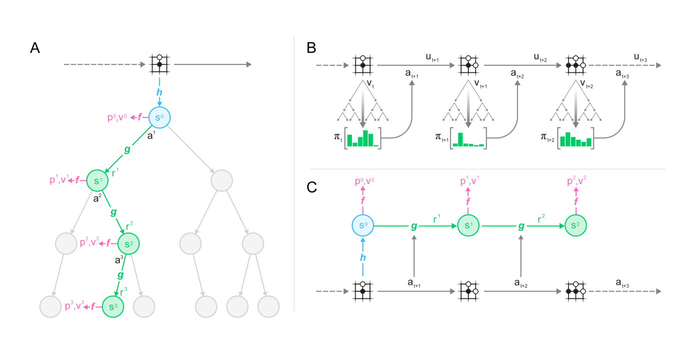
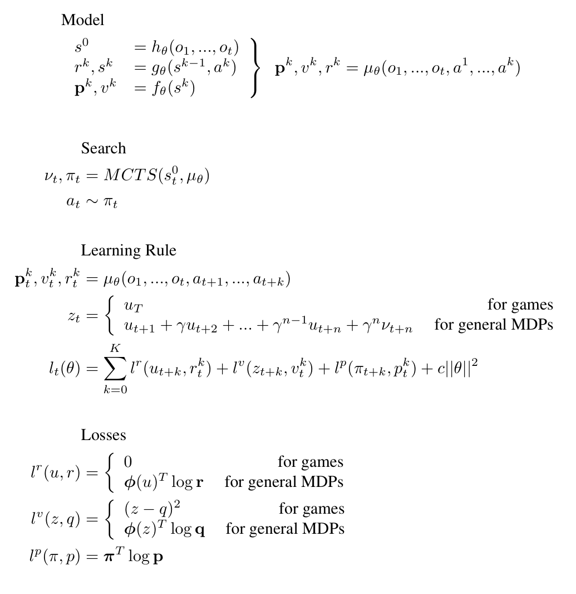
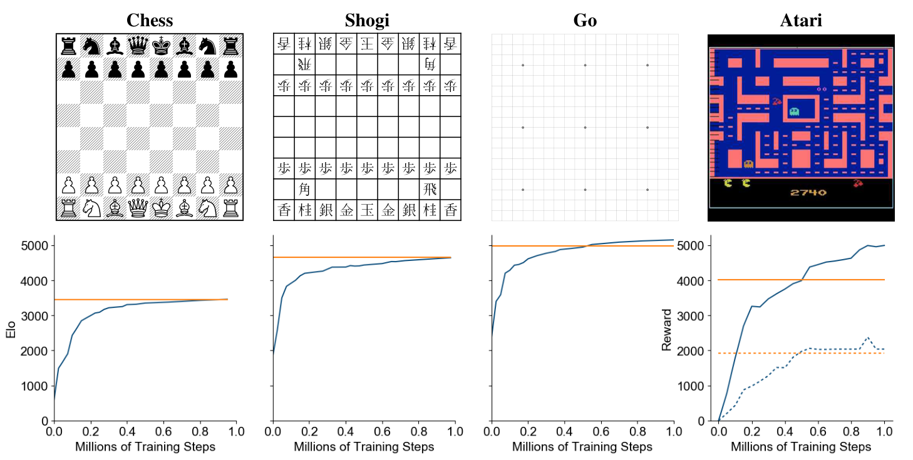
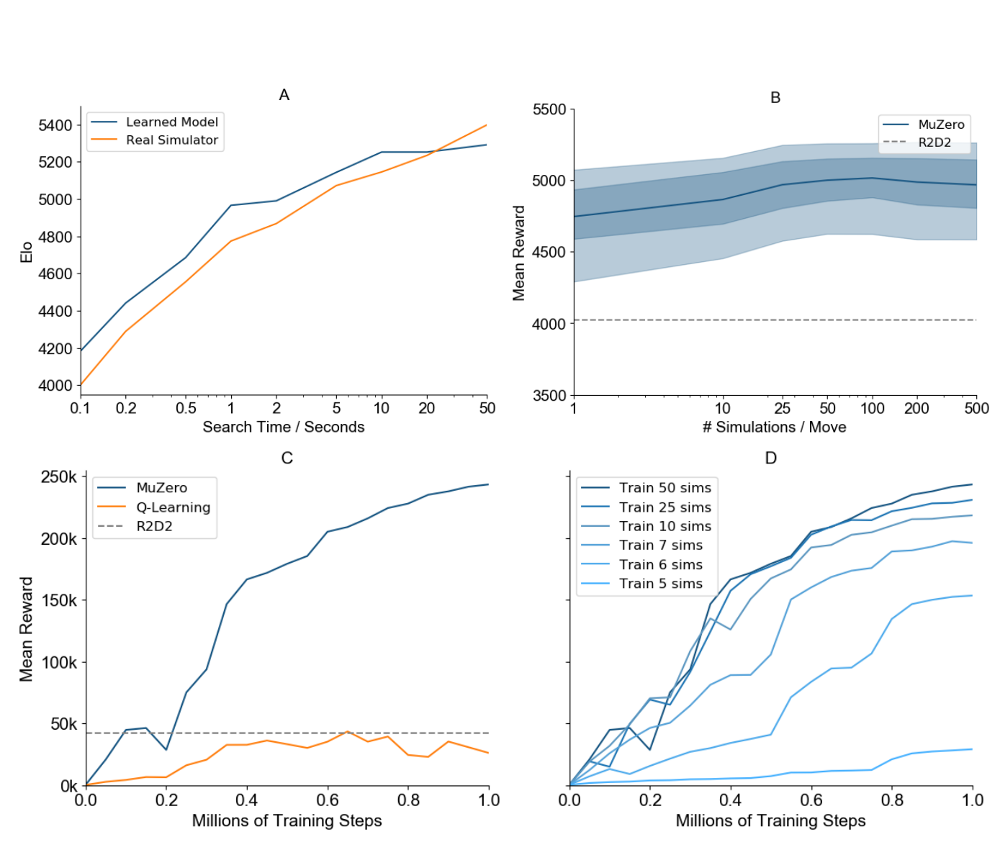
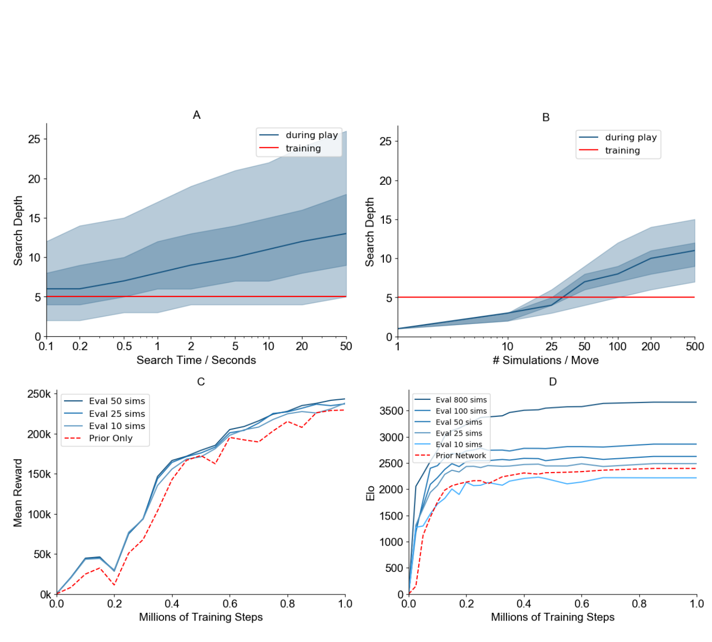
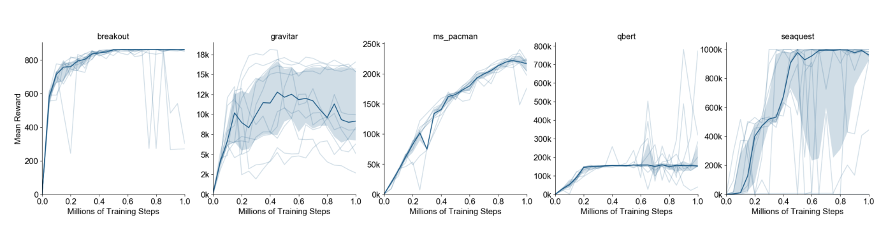

# MuZero：只预测对规划有用的世界模型

!!! info "论文信息"
    **论文题名：** Mastering Atari, Go, Chess and Shogi by Planning with a Learned Model。 
    **作者：** Julian Schrittwieser、Ioannis Antonoglou、Thomas Hubert、Karen Simonyan、Laurent Sifre、Simon Schmitt、Arthur Guez、Edward Lockhart、Demis Hassabis、Thore Graepel、Timothy Lillicrap、David Silver。 
    **机构：** DeepMind；University College London。 
    **时间 / 主题：** arXiv v1：2019-11-19；v2：2020-02-21；世界模型 / planning / model-based RL。 
    **arXiv / 官方报告：** arXiv：[1911.08265](https://arxiv.org/abs/1911.08265)；DOI：[10.48550/arXiv.1911.08265](https://doi.org/10.48550/arXiv.1911.08265)。 
    **GitHub / 项目：** 论文未在 arXiv 元数据中给出官方 GitHub；arXiv ancillary files 包含 pseudocode 和评测 JSON。 
    **元数据来源与核验口径：** 来源：[arXiv](https://arxiv.org/abs/1911.08265)、官方 PDF、arXiv ancillary `pseudocode.py`；Checked Date：2026-07-06；Repro Status：Paper / pseudocode / ancillary data reviewed, independent reproduction not claimed。

## 搜索需要的世界，必须长得像真实世界吗

MuZero 把 AlphaZero 的一个重要前提拿掉了。AlphaZero 在搜索树中调用已知游戏规则，得到下一局面、合法落子和终局结果，再由神经网络估计策略与价值。MuZero 改为学习一个能够响应动作的内部模型，用它代替树内的真实状态转移。在围棋、国际象棋和将棋中，这个模型足以支撑接近 AlphaZero 的搜索能力；在 57 个 Atari 游戏中，它又能处理图像输入和中间奖励。[↗](https://arxiv.org/pdf/1911.08265v2#page=1)

这里最值得理解的变化，是模型不以还原观察为训练目标。一个像素世界模型可能需要预测背景、纹理、物体外观和运动，才能生成下一帧；MuZero 只要求内部状态预测搜索直接需要的三种量，执行动作得到的 reward、之后如何行动的 policy，以及继续行动能得到多少回报的 value。状态可以采用任何有助于这些预测的表示，既不必等同于模拟器状态，也不必能解码回图像。

这种取舍来自 **value-equivalent model（价值等价模型）** 的思路。若一个抽象模型能保留动作序列的回报关系，规划未必需要它复原现实的每个细节。不过，MuZero 的损失和实验并没有证明学到的模型与真实环境在所有动作序列上严格等价。论文提供的是一种以决策目标塑造模型的训练方法，以及它在若干强规划基准上确实可用的证据。

与 PlaNet 的潜在空间规划相比，二者都把搜索移出像素空间，但训练状态的信号不同。PlaNet 要求状态解释图像，MuZero 通过搜索得到的策略与价值目标组织表示学习。与直接输出动作的 model-free 网络相比，MuZero 又保留了逐动作推进状态的接口，允许在当前观察下多想几步。这两端之间的结合，才是论文要检验的对象。[↗](https://arxiv.org/pdf/1911.08265v2#page=2)

## 三个函数怎样接成一个可搜索的模型

MuZero 在每个真实时间步 $t$，先将当前可用的观察历史编码为根状态。随后只给模型假想动作，就能继续展开搜索。论文用三个函数定义这个接口

$$
\begin{aligned}
s_t^0 &= h_\theta(o_1,\ldots,o_t),\\
(r_t^k,s_t^k) &= g_\theta(s_t^{k-1},a_{t+k}),\\
(p_t^k,v_t^k) &= f_\theta(s_t^k).
\end{aligned}
$$

$h_\theta$ 是 **representation function**，把实际观察变成搜索根状态；$g_\theta$ 是 **dynamics function**，接收隐藏状态和动作，预测这一步的奖励及下一个隐藏状态；$f_\theta$ 是 **prediction function**，给出该状态上的策略先验和长期价值。上标 $k$ 表示从当前根节点向前展开了多少步，下标 $t$ 则指出模型从哪个真实时刻启动。

奖励和价值的时间位置需要区分。$r_t^k$ 对应到达 $s_t^k$ 的这次转移奖励，目标是实际环境的 $u_{t+k}$；$v_t^k$ 估计到达这个状态之后的未来回报，从 $u_{t+k+1}$ 开始。搜索回传时要把沿途立即奖励与叶节点的剩余价值接起来，否则会遗漏或重复计算某一步收益。

Figure 1 的三个面板把同一模型的三种用法放在一起。A 中分支是候选动作，模型帮助比较还没有真实执行的未来；B 中搜索完成后，智能体选择一个动作交给环境，得到新观察与真实奖励；C 则从经验池取一条已经发生的轨迹，按其中的真实动作展开模型，用后续实际数据和搜索结果训练输出。

{ width="920" }

*原论文 Figure 1。蓝色 $h$ 只在根节点接收观察，绿色 $g$ 依动作推进状态，粉色 $f$ 输出策略与价值。规划中的候选动作和训练中的真实动作承担不同作用。*

模型转移在本文中是确定性的。每次给定隐藏状态与动作，$g$ 输出同一个下一状态；论文将随机转移扩展留给后续工作。这里也没有要求 $g(h(o_t),a_{t+1})$ 必须与 $h(o_{t+1})$ 在隐藏向量上相等，训练直接比较的是后续 reward、policy、value。因而，控制效果好不能直接推导出内部状态恢复了可解释物理量，或者可以作为一个通用视频模拟器。[↗](https://arxiv.org/pdf/1911.08265v2#page=4)

## MCTS 怎样把网络预测变成更好的动作分布

根节点的 policy 只是网络当前的先验。**Monte Carlo Tree Search（MCTS，蒙特卡洛树搜索）** 利用有限计算，把预算分配给有希望或尚未充分探索的动作，再用后续奖励与价值修正最初判断。MuZero 每次 simulation 并不是从头生成一条完整视频，也不总是把一条轨迹滚动到游戏结束；它沿已有树选择路径，在一个新叶节点调用模型，然后回传估计。

对每个节点 $s$ 的动作边，论文保存访问数 $N(s,a)$、平均回报统计 $Q(s,a)$、策略先验 $P(s,a)$、预测奖励 $R(s,a)$ 和已计算的后继状态 $S(s,a)$。一次 simulation 的过程分为三个环节。

首先是 selection。选择得分兼顾当前价值和由先验引导的探索项，论文 Equation 2 写为

$$
a^*=\arg\max_a\left[
Q(s,a)+P(s,a)\frac{\sqrt{\sum_b N(s,b)}}{1+N(s,a)}
\left(c_1+\log\frac{\sum_bN(s,b)+c_2+1}{c_2}\right)
\right].
$$

其中 $c_1=1.25$、$c_2=19652$。较高 $Q$ 吸引搜索利用当前已知的好动作；较高 $P$ 让网络认为有希望的动作较早得到计算；一个动作被访问越多，分母越大，其额外探索奖励就下降。先验因此影响搜索顺序，却没有完全代替搜索得到的价值判断。

其次是 expansion。已经扩展过的边可以直接读取缓存的奖励和后继隐藏状态；到达尚未扩展的叶节点时，调用一次 $g$ 得到新状态与奖励，再调用一次 $f$ 得到 policy 和 value。一次 simulation 至多新增这样的一个模型节点，因此代价主要由新增节点数控制，而不是把整条路径的神经网络计算重复一遍。隐藏状态的缓存也是 MuZero 能把表征计算留在树中的原因。[↗](https://arxiv.org/pdf/1911.08265v2#page=12)

最后是 backup。从叶节点价值出发，依次把立即奖励和折扣放回去。为明确时间位置，设本次路径深度为 $l$，用 $G_k$ 表示从状态 $s^k$ 开始的剩余回报，则

$$
G_l=v^l,\qquad G_k=r^{k+1}+\gamma G_{k+1}.
$$

这等价于把从 $k+1$ 开始的预测奖励求折扣和，再接上 $\gamma^{l-k}v^l$。节点统计对多次 simulation 的回传结果求平均，并增加访问数。若实现把价值存在子节点上，选择父节点动作时还要计入这条边的立即奖励；官方伪代码正是分别保存 `node.reward` 与节点价值，再按 `reward + discount × value` 向上推进。双人零和游戏还要根据当前玩家切换价值符号，不能把双方收益都当作同一方向累加。[↗](https://arxiv.org/src/1911.08265v2/anc/pseudocode.py)

Atari 的回报尺度跨游戏相差很大，不能未经处理就与策略概率混进同一个选择得分。论文用当前搜索树中出现过的最小和最大价值统计做 min–max 归一化，将用于比较的价值压到 $[0,1]$。官方伪代码在最大值与最小值相等时跳过除法，避免初始化阶段除以零。这个归一化服务于树内动作选择，与后面网络训练时对 reward/value 的数值编码是两个不同层次。

搜索结束后的动作分布由根节点各动作访问数形成。带温度的形式是

$$
\pi_t(a)=\frac{N(s_t^0,a)^{1/T}}{\sum_bN(s_t^0,b)^{1/T}}.
$$

$T$ 较高时保留更多探索，趋近零时倾向于最多访问的动作。Atari 在前 500,000 个训练步使用 $T=1$，接下来 250,000 步用 $0.5$，最后 250,000 步用 $0.25$，且在整局中采样；棋类则在前 30 步保持采样，之后使用最大访问数动作。训练数据生成时，根先验还混入 25% 的 Dirichlet noise，以免每次只走当前网络最熟悉的分支。[↗](https://arxiv.org/pdf/1911.08265v2#page=13)

## “不知道游戏规则”仍然包含哪些接口

MuZero 不调用真实规则推进搜索树，并不意味着它不知道动作集合，也不意味着真实交互时不需要环境判断终局。Appendix A 将与 AlphaZero 的差别拆成三个位置，这比一句“完全没有规则知识”更准确。[↗](https://arxiv.org/pdf/1911.08265v2#page=11)

| Search component | AlphaZero | MuZero |
|---|---|---|
| State transitions | 真实规则产生下一棋局 | 学习的 $g$ 产生下一隐藏状态 |
| Legal actions | 搜索树每个节点调用规则掩码 | 只在根节点使用环境给出的合法动作，内部不再掩码 |
| Terminal nodes | 用规则识别终局并返回终局值 | 树内继续依赖模型价值，训练中处理为吸收状态 |

根节点是当前真实局面，环境可以提供合法动作；内部节点只是隐藏状态，没有对应的真实棋盘规则调用。网络从实际轨迹中学习哪些动作值得赋予概率，但这不是内部动作合法性的形式化保证。真实游戏仍然由环境执行动作、返回奖励并告知何时结束。

树内也不专门停止在一个由规则识别出的终局。训练将真实轨迹末端之后的状态视为 absorbing states，使后续预测保持适当的吸收行为；搜索可以继续扩展这些状态，而不需要真实终局检测器。这把终局处理从手写规则接口转移到了学习目标。由此得到的能力是，在已给定观察、动作和奖励接口的任务中学会有效搜索，并非从零发明游戏的交互协议。

这一范围也解释了论文为何明确不直接处理 Poker 这类不完全信息博弈。围棋、象棋与将棋中的潜在搜索成功，没有自动解决隐藏对手信息、信念更新和策略随机化所带来的全部问题。[↗](https://arxiv.org/pdf/1911.08265v2#page=4)

## 搜索产生的监督如何反过来塑造动力学

MuZero 的学习闭环依靠搜索生成的更好策略。经验池除观察、真实动作和奖励外，还保存每个时间步的根节点搜索分布 $\pi_t$ 与搜索价值 $\nu_t$。训练从某个真实时刻初始化 $s_t^0$，沿这段经验中实际执行过的动作展开 $K=5$ 步。每一个展开状态都需要预测其对应时刻的三种量。

总目标沿用论文 Equation 1 的结构

$$
\ell_t(\theta)=\sum_{k=0}^{K}\left[
\ell^r(u_{t+k},r_t^k)
+\ell^v(z_{t+k},v_t^k)
+\ell^p(\pi_{t+k},p_t^k)
\right]+c\lVert\theta\rVert^2.
$$

reward target $u$ 来自真实环境；policy target $\pi$ 来自对应实际状态上的搜索；value target $z$ 综合真实回报与必要的 bootstrap。三种信号的来源不同，不能把它们都说成模型自己生成的伪标签。真实奖励将动力学预测固定在任务后果上，搜索策略则提供当前网络经过规划后得到的改进方向。统一公式中的 $k=0$ 还包含根节点项；官方伪代码为接口一致性保留了最近已知奖励的预测，而真正随候选动作产生的新奖励从 $r_t^1$ 开始。根节点已知奖励不应再次算入未来规划回报。

在棋类中，$z_t$ 是最终胜负结果，按玩家视角解释。在 Atari 中，原始 MuZero 使用 $n=10$、$\gamma=0.997$ 的目标

$$
z_t=\sum_{i=1}^{n}\gamma^{i-1}u_{t+i}+\gamma^n\nu_{t+n}.
$$

前 $n$ 步是已经发生的真实奖励，末端用未来真实状态上的搜索价值 $\nu_{t+n}$ 补足未观察到的更长回报。这里的 $\nu$ 不是当前训练 unroll 的预测 $v_t^n$，而是经验数据中对应时间位置的搜索估计；两者的角色不能混写。无中间奖励的棋类实验还省略 reward prediction loss，直接学习结果价值。[↗](https://arxiv.org/pdf/1911.08265v2#page=15)

policy loss 按最小化交叉熵写作

$$
\ell^p(\pi,p)=-\sum_a\pi(a)\log p(a).
$$

它推动网络靠近访问计数给出的搜索策略，而不是仅模仿自己原先的 policy prior。更新之后，新的 prior 与 value 又进入下一轮搜索，获得新策略目标。模型学习和 policy improvement 因而相互推进。MCTS 本身不需要被微分，梯度来自这些固定训练目标，经过 prediction、连续的 dynamics unroll，再传到最初的 representation。

原论文的汇总图把这套对应关系集中放在一起。读时应先从 Model 到 Search，再把 Search 输出的 $\pi,\nu$ 接到 Learning Rule，而不是把所有符号都视为同一个网络前向输出。

{ width="760" }

*原论文 Figure S2。图中 categorical loss 的对数项省略了负号；正文按最小化交叉熵的方向书写，与官方伪代码中的 `softmax_cross_entropy_with_logits` 一致。*

recurrent unroll 的作用也不只是增加几个训练样本。第 $k$ 步的误差要穿过前面 $k$ 次动作转移，要求模型在连续使用自己的隐藏状态后，仍然保留预测未来决策量所需的信息。不过，训练只约束经验覆盖的动作及对应目标，没有直接监督搜索树中的每一种反事实动作序列。测试时更深的搜索能否继续改善表现，需要实验而不能靠网络可反复调用这一事实保证。

## 为什么 reward 和 value 使用分类输出

Atari 中，某些游戏的每步奖励很小，某些分数却能达到几十万乃至百万。直接对所有标量使用同一平方误差，训练容易被大尺度目标主导。论文先使用可逆的数值压缩变换，再将压缩后的 reward/value 目标表示为离散支撑上的概率分布，网络通过交叉熵学习这个分布。

支撑集合包含从 $-300$ 到 $300$ 的所有整数，共 601 个位置。若变换后的标量 $x$ 落在相邻整数 $i$ 与 $i+1$ 之间，目标概率只放在这两个位置

$$
\phi(x)_i=i+1-x,\qquad
\phi(x)_{i+1}=x-i.
$$

例如原文的 $3.7$ 被编码为位置 3 上的 0.3 和位置 4 上的 0.7。这是对一个标量做插值编码，不意味着环境真实奖励只可能取这两个整数。network 输出 601 维 softmax，以这个双点目标计算负对数似然。

推理时先在支撑上求期望，再做压缩变换的逆变换。若将数值压缩函数记作 $\psi$，读出方式为

$$
\hat x=\psi^{-1}\left(\sum_{i=-300}^{300}i\,p_i\right).
$$

顺序很重要，先求变换空间的期望再还原，与先逐个还原支撑点再求期望一般不同。恢复出的 reward 和 value 交给搜索算法后，搜索无需再了解分类输出的内部表示。论文的数值压缩采用带小线性项的有符号平方根形式，$\epsilon=0.001$；核心用途是压低大数值的动态范围，而保留可逆读出的接口。[↗](https://arxiv.org/pdf/1911.08265v2#page=14)

棋类的价值范围和终局目标更规整，使用与 AlphaZero 相同的平方误差。因而，MuZero 并非把同一个 loss 原样套到所有任务上；它保留统一的 reward/value/policy 接口，同时根据回报尺度调整输出编码。

## 图像、历史动作与梯度尺度怎样进入实现

Atari representation 的输入不是单帧。它接收最近 32 张 $96\times96$ RGB 图像，以及产生这些图像的最近 32 个动作。三个颜色通道加动作平面，合计 128 个输入平面。历史动作以 $a/18$ 的常量平面编码，因为某个动作不一定在下一张图像上留下可见差别，单靠图像序列可能无法恢复完整的控制历史。

高分辨率输入只在根节点处理。representation 先通过 stride-2 convolution、残差块和 average pooling，将空间从 $96\times96$ 逐步降到 $48\times48$、$24\times24$、$12\times12$，最终得到 $6\times6$ 的隐藏特征。dynamics 一直在这个低分辨率状态上运行，每个候选动作以 one-hot 平面拼接进去。因此，真实观察的编码较贵，树内的大量动作推演相对紧凑。[↗](https://arxiv.org/pdf/1911.08265v2#page=13)

主网络沿用 AlphaZero 的 residual architecture，使用 256 个隐藏通道、$3\times3$ 卷积，并将残差块数量从 20 改为 16。Atari 输入端还有专门的降采样阶段，不能把“16 个 block”理解为从原始图像到所有输出的唯一完整层数。棋类的输入是结构化棋盘历史，Go 与 Shogi 使用最近 8 个局面，Chess 扩展到最近 100 个局面，以支持和棋判断；所以“跨像素与棋类的统一算法”不等于所有任务都使用原始 RGB 输入。[↗](https://arxiv.org/pdf/1911.08265v2#page=14)

| Setting | Board Games | Atari |
|---|---:|---:|
| Training steps | 1M | 1M |
| Batch size | 2048 | 1024 |
| Unroll steps $K$ | 5 | 5 |
| Simulations per search | 800 | 50 |
| Discount | 1 | 0.997 |
| Value bootstrap | Final outcome | 10-step return |
| Replay buffer | Most recent 1M games | Most recent 125k sequences × 200 moves |
| Sampling | Uniform | Prioritized replay |
| Checkpoint interval | 1000 steps | 1000 steps |

*原论文正文与 Appendices C–G。这里的 training steps 是优化器更新次数，不是环境帧；Atari 的一个动作通常重复 4 帧。*

Atari 优先采样的依据是搜索价值与实际 $n$-step target 的差异，$p_i=|\nu_i-z_i|$，采样概率按 $p_i^\alpha$ 归一化，并用 importance weight 修正采样偏差；论文设 $\alpha=\beta=1$。它更频繁重访价值预测误差较大的位置，但没有因此获得新的真实经验，数据覆盖仍由 self-play 或环境交互决定。

模型连续展开会改变梯度总量。作者将 recurrent loss 按展开长度缩放，并在 dynamics 之间把反向梯度乘以 $1/2$，使较远时刻的误差不至于让共享动力学的更新尺度失控。官方伪代码更具体，根节点 loss 的权重为 1，之后每个 recurrent step 的梯度权重为 $1/K$；`scale_gradient` 用 stop-gradient 保持前向数值不变，只改反向导数。它与直接把隐藏状态数值乘以一半不同。隐藏状态本身另做 min–max 缩放，使其范围与动作输入同为 $[0,1]$。[↗](https://arxiv.org/src/1911.08265v2/anc/pseudocode.py)

伪代码还给出 Momentum SGD，momentum 为 0.9、weight decay 为 $10^{-4}$。初始学习率 Go 为 0.01、Chess 与 Shogi 为 0.1、Atari 为 0.05；学习率按指数衰减，棋类以 400,000 步、Atari 以 350,000 步作为下降一个 0.1 倍因子的尺度。这些设置说明论文的统一性主要体现在学习与搜索结构，而非每个优化数值都跨任务完全相同。

## Reanalyze 如何用额外计算减少新交互

标准 MuZero 的经验池里，policy target 来自当时收集数据所用的网络。网络不断变强，旧状态上的策略标签却可能停留在较弱阶段。MuZero Reanalyze 重访这些旧状态，用最新模型重新运行 MCTS，得到更好的策略目标；这样，同一条真实轨迹可以继续为更强网络提供训练信号。[↗](https://arxiv.org/pdf/1911.08265v2#page=15)

但论文的 Reanalyze 结果包含一组同时调整的设置，不能只归因于“重新跑搜索”这一项。

| Component | MuZero | MuZero Reanalyze |
|---|---|---|
| Policy target | Collected search policy | 80% updates use freshly reanalyzed policy |
| Value bootstrap | Stored search value $\nu_{t+n}$ | Recent target-network value $v^-_{t+n}$ |
| Samples per state | 0.1 | 2.0 |
| Value loss weight | 1.0 | 0.25 |
| Policy / reward loss weight | 1.0 / 1.0 | 1.0 / 1.0 |
| $n$-step return | 10 | 5 |

新的价值目标为

$$
z_t=\sum_{i=1}^{n}\gamma^{i-1}u_{t+i}+\gamma^n v^-_{t+n}.
$$

这里 $v^-$ 来自近期参数的 target network，作用是提供较新而稳定的 bootstrap。它不是再分析搜索的根价值 $\nu$，因此不能把 Reanalyze 简写成“所有监督都换成最新 MCTS 输出”。重新搜索主要刷新策略标签，value target 的生成机制也单独改变。

每个状态采样次数从 0.1 增到 2.0，是 20 倍的数据使用率变化；value weight 降到 0.25、bootstrap 从 10 步缩到 5 步，则服务于高复用条件下的训练稳定性和价值过拟合问题。这些调整共同构成了论文中的低数据配置。重新分析没有创造新的真实观察，仍然依赖已有轨迹能否覆盖有价值的区域；它用额外模型计算提高已有数据的可用程度。

## 主结果要先分开 20B 与 200M 两种预算

棋类实验比较的对象是知道真实规则的 AlphaZero。两边在标准比较中都使用每步 800 次 simulation，Figure 2 显示 MuZero 在 Chess、Shogi 接近 AlphaZero，在 Go 略高于它。这个结果支持学习模型能够承担精细规划，但不代表搜索完全不再受模型误差影响。作者关于隐藏状态缓存可能帮助更深理解局面的解释，是对结果的假设，不是单独验证过的机制结论。

{ width="920" }

*原论文 Figure 2。棋类纵轴是 Elo，橙线为 AlphaZero；Atari 实线和虚线分别为 57 游戏上的 human-normalized mean 与 median，橙线为 R2D2。横轴都是百万次训练更新。*

Atari 主表必须拆开读。上组是数十亿帧的训练设置，下组强调较少交互。完整结果保留了训练帧数与时间，避免只摘分数造成比较条件丢失。

| Agent | Median | Mean | Env. Frames | Training Time | Training Steps |
|---|---:|---:|---:|---|---:|
| Ape-X | 434.1% | 1695.6% | 22.8B | 5 days | 8.64M |
| R2D2 | 1920.6% | 4024.9% | 37.5B | 5 days | 2.16M |
| MuZero | 2041.1% | 4999.2% | 20.0B | 12 hours | 1M |
| IMPALA | 191.8% | 957.6% | 200M | — | — |
| Rainbow | 231.1% | — | 200M | 10 days | — |
| UNREAL | 250% | 880% | 250M | — | — |
| LASER | 431% | — | 200M | — | — |
| MuZero Reanalyze | 731.1% | 2168.9% | 200M | 12 hours | 1M |

*原论文 Table 1。前三行属于 large data setting，其余属于 small data setting；UNREAL 的脚注注明逐游戏调参。空白项以原表的“—”保留。*[↗](https://arxiv.org/pdf/1911.08265v2#page=6)

human-normalized score 按每个游戏的随机与人类基线计算

$$
S_{\mathrm{norm}}=100\%\times
\frac{S_{\mathrm{agent}}-S_{\mathrm{random}}}
{S_{\mathrm{human}}-S_{\mathrm{random}}}.
$$

100% 表示达到所用人类参考分数，0% 表示随机基线，负值表示低于随机表现。2041.1% 是归一化分数的中位数，约为这个归一化尺度上的 20.4 倍，不是 2,041% 的胜率，也不是所有游戏都超过人类 20 倍。没有截断的 mean 很容易受少数极高分游戏拉动，因此 mean 与 median 一起报告才有意义。

大数据配置中，MuZero 用每游戏 20B 帧得到 2041.1% median 与 4999.2% mean，高于 R2D2 的 1920.6% 与 4024.9%。论文报告它在 57 个游戏中的 42 个上超过 R2D2；附录表中“37 个 best”则是与该表所有列共同竞争最佳，不是同一种计数。SimPLe 仅有部分游戏结果，不能把可比较子集的领先改写成在全部 57 游戏、同样预算下击败 SimPLe。

低数据配置中，Reanalyze 用 200M 帧获得 731.1% median，明显高于表中 LASER 的 431%。但它也低于 20B 帧标准 MuZero 的 2041.1%，数据使用效率与最终能力上限在这里是两个不同问题。20B 到 200M 是 100 倍真实帧预算差异，不能将两行结果当成只替换一个模块、其余完全相同的消融。

“12 小时”还需要与硬件同时阅读。所有实验使用第三代 Google Cloud TPU；每个棋类任务用 16 个 TPU 训练、1,000 个 TPU 生成 self-play；每个 Atari 游戏用 8 个 TPU 训练、32 个 TPU 生成数据。短 wall-clock time 来自大量并行计算，并不等于低总算力。更不能拿这 12 小时与单 GPU 方法的若干天直接相除，声称得到了等硬件速度倍率。20B 帧同样是每个游戏的设置，完整 57 游戏研究的总资源远大于表中单次运行口径。[↗](https://arxiv.org/pdf/1911.08265v2#page=15)

## 汇总高分没有解决稀疏探索与逐游戏失败

Atari 评估对每个游戏运行 1,000 个 episode，每局最多 30 分钟，即 108,000 环境帧。论文使用两种初始状态协议，一种先执行 0–30 个随机数量的 no-op，另一种从人类游戏轨迹抽取起始状态。Table S1 与 S2 分别对应这两种协议，不能将它们的分数当作同一设置下重复测量；论文这套协议也不应直接并入另一些工作使用的 sticky actions 比较。[↗](https://arxiv.org/pdf/1911.08265v2#page=16)

从 Table S1 选取几个强项和弱项，可以看清全局分数隐藏了什么。

| Game | R2D2 | MuZero | MuZero normalized |
|---|---:|---:|---:|
| alien | 229,496.90 | 741,812.63 | 10,747.5% |
| ms pacman | 42,281.70 | 243,401.10 | 3,658.7% |
| bank heist | 24,235.90 | 1,278.98 | 171.2% |
| qbert | 408,850.00 | 72,276.00 | 542.6% |
| montezuma revenge | 2,061.30 | 0.00 | 0.0% |
| venture | 1,970.70 | 0.40 | 0.0% |
| solaris | 3,787.20 | 56.62 | -10.6% |
| skiing | -30,021.70 | -29,968.36 | -100.9% |

*原论文 Table S1，30 random no-op starts。Venture 的 normalized score 因四舍五入显示为 0.0%，不等于原始分数严格为零。*[↗](https://arxiv.org/pdf/1911.08265v2#page=17)

Ms. Pacman 的差距很大，也因此成为后面搜索消融的重点任务。但 Montezuma 为 0，Venture 接近 0，说明学习模型加深搜索并未自动解决困难探索。若真实经验几乎没有触及有奖励的区域，模型就很难得到可靠监督去判断那些远处状态的价值；在一个缺乏相关经验的模型上继续搜索，不会凭空生成正确的奖励知识。

Bank Heist 与 Q*bert 还表明，低于 R2D2 的任务并不都只属于最极端的稀疏奖励类别。Skiing 的归一化分数低于随机，Solaris 同样为负，应该与高分任务一起保留。论文的结论是跨游戏汇总表现和多数任务比较取得进展，而不是每个任务的决策误差都被世界模型修复。

human starts 也没有消除这些弱项。Table S2 中 Montezuma 为 57.10、normalized 0.8%，Pitfall 为 -801.10、normalized -7.1%，Solaris 为 2108.08、normalized 0.7%。这些值与 no-op starts 可能明显不同，但都不足以支撑“只要给搜索更多时间就能解决探索”的判断。[↗](https://arxiv.org/pdf/1911.08265v2#page=18)

## 测试时多搜索，与训练时学得更好，是两项实验

Figure 3 的四个面板需要按变量分开读。A、B 固定已经训练好的模型，只改变测试时搜索量；C 改变学习算法；D 则分别训练使用不同搜索预算的模型，再把评估搜索量统一起来。这四组结果分别回答推理扩展、学习信号和训练计算的作用，不能混为一条“搜索越多分数越高”的曲线。

{ width="920" }

*原论文 Figure 3。A 为 Go 搜索时间，B 为 Atari 每步 simulation 数；C、D 为 Ms. Pacman 的训练比较。D 中所有模型统一用每步 50 次 simulation 评估。*

Go 中，训练时的标准搜索约为 0.1 秒、800 次 simulation，而测试图延伸到 50 秒。官方附带数据提供了精确值，MuZero 的 Elo 从 0.1 秒时的 4182，上升到 10 秒时的 5252，再到 50 秒时的 5291。对应真实模拟器搜索的 AlphaZero 为 4000、5145、5398。因此，学习模型确实能在远超训练搜索时间的条件下继续获益，但在最长的 50 秒点，真实模拟器又高于学习模型，不能只挑前段宣布 learned model 全面优于精确规则。[↗](https://arxiv.org/src/1911.08265v2/anc/go_scaling.json)

Atari 的情况不同。固定同一个以每步 50 次 simulation 训练的模型，官方数据给出以下均值变化。

| Simulations per Move | Human-normalized Mean | Median Search Depth |
|---:|---:|---:|
| 1 | 4745.37% | 1 |
| 50 | 4999.24% | 7 |
| 100 | 5014.84% | 8 |
| 500 | 4967.13% | 11 |

*由原论文 `atari_scaling.json` 整理，分数保留两位小数；最后一列来自同一数据中的搜索深度分布，不是环境帧数。*

从 1 到 50 次有收益，从 50 加到 100 次则只增加约 15.6 个归一化百分点，500 次时还略有下降。论文把单次 simulation 这一条件解释为基本按照 policy network 行动，结果已经很强，说明训练后的策略吸收了相当一部分搜索收益。更多测试计算没有按比例变成更强行为。作者推测 Atari 的模型不准确性比 Go 更大，但这个实验没有单独控制模型误差，因此应保留为解释而不是确定的因果归因。[↗](https://arxiv.org/src/1911.08265v2/anc/atari_scaling.json)

Figure 3C 检验的则是训练。作者保持网络规模与训练量，将 policy/value 双头替换为 Q head，把目标换成 Q-learning，并在训练与评估中去掉搜索。Ms. Pacman 中，这个版本接近 R2D2 的数万分水平，明显低于 MuZero 的约 24 万分。它支持搜索驱动的 policy improvement 能提供有力学习信号；不过，目标、输出头和搜索同时改变，不能把结果精确归因于某一个 loss，也不能理解成两种系统的所有计算成本完全相等。

Figure 3D 更进一步控制评估过程。分别用每步 5、6、7、10、25、50 次 simulation 训练，最终都用 50 次评估。6 次已经少于 Ms. Pacman 的 8 个可用动作，却仍能学到有效策略；5 次则差得多。这说明搜索不必在每个状态把所有动作完整展开一次，网络先验和跨状态学习可以使少量搜索有用。但“6 次足够”只是这个任务、这套先验与训练过程中的观察，不能转化为通用的最小搜索预算。[↗](https://arxiv.org/pdf/1911.08265v2#page=7)

## 五步训练为什么能支持更深的树

模型训练只展开 $K=5$ 步，并不意味着搜索最多能走 5 步。$g$ 是共享的 recurrent dynamics，可以被重复调用；真正的问题是，超过受监督距离后还能否维持有用的 reward/value/policy 关系。Figure S3 的上排直接给出了搜索实际到达的深度分布。

{ width="920" }

*原论文 Figure S3。A、B 的红线为训练展开长度 5；C、D 固定训练模型，在多个 checkpoint 上比较不同评估搜索量及原始策略。*

Go 搜索 0.1 秒时，深度中位数为 6，第 95 百分位为 12；到 50 秒时，中位数为 13，第 95 百分位为 26。Atari 在标准 50 次 simulation 下，中位深度为 7，第 95 百分位为 9；500 次时则为 11 和 15。它们证明训练过的转移能够在这些评估分布上被连续使用到超过 5 步，而不是证明任意长度 rollout 都准确。深度还取决于树的分支分配，不能把 simulation 数直接当成单条路径长度。

下排回答另一个问题，搜索是在最后才临时拉高分数，还是在整个学习过程中不断产生更好的标签。Ms. Pacman 中，按原始 policy 行动的曲线与使用搜索的曲线都逐渐升高，但搜索通常保持优势；这正是学习算法可以持续追赶的 policy improvement gap。Go 中，这个差距更大，而且贯穿训练，说明精细规划任务对显式搜索更依赖。

这两组现象放在一起才构成完整证据。多步模型并非只在训练损失里存在，它确实被树搜索用到更深处；搜索也并非纯粹的测试技巧，它不断产生高于当前 policy 的监督，帮助网络变强。但收益在任务之间差别显著，Atari 接近收敛时的原始策略已很强，Go 则仍显著受益于较大搜索量。[↗](https://arxiv.org/pdf/1911.08265v2#page=20)

## 重复运行暴露了平均曲线之外的波动

主结果使用每个游戏 1,000 条评估轨迹，不等于全部 57 个游戏都训练了 1,000 次或做了同等数量的随机种子重复。Appendix I 的 Figure S1 另外选择 5 个游戏进行重复性实验，深色线为训练运行之间的中位数，阴影为第 25–75 百分位，浅色线是各次运行。

*原论文 Figure S1。Breakout、Gravitar、Ms. Pacman、Q*bert 和 Seaquest 的重复训练轨迹；图注称 10 次运行，公开 JSON 中 Ms. Pacman 实际列出 8 条，其余四项各 10 条。*

Breakout 中多数运行最终接近 864，但公开数据仍有两次在一百万训练步时约为 271 和 303；Seaquest 多次接近百万分，也存在约 110 分的最终结果。Q*bert 的运行间差异同样很大。这样的图比只报告一条高分曲线更能说明训练稳定性的实际范围，模型、搜索和数据分布之间仍可能形成不同的学习轨迹。[↗](https://arxiv.org/src/1911.08265v2/anc/atari_repeatability.json)

也要区分不同阴影的含义。Figure S1 关注独立训练运行之间的差别，Figure S4 的逐游戏学习曲线则报告 1,000 个评估 episode 的均值与标准差。前者问“重新训练一次会怎样”，后者问“同一个训练状态下，不同游戏过程表现怎样”；二者不能互相替代。[↗](https://arxiv.org/pdf/1911.08265v2#page=21)

## 这套方法最值得保留的设计边界

MuZero 给出的可复用原则，是先定义规划需要的预测接口，再让表示和动力学端到端服务于这个接口。reward 把模型固定在真实任务后果上，value 提供有限搜索之外的长期估计，policy prior 把计算优先给值得考虑的动作；MCTS 把三者组合成更好的行动与训练目标。少了其中一个环节，系统可能仍可运行，但就不再是本文验证的完整学习闭环。

它适合讨论“模型要为决策保留什么”的问题，而不是直接承诺一个通用环境模拟器。论文在每个棋类和 Atari 游戏上分别训练 agent，没有证明同一组参数跨这些任务迁移；没有图像重建也意味着模型不直接提供视频生成能力。对奖励函数或任务目标发生显著变化后的适应，不能仅凭隐藏状态足够抽象就默认成立。

采用时最实际的取舍是计算放在哪里。较大的训练搜索能产生更好的策略标签，Reanalyze 能在不增加真实帧的情况下更新旧经验的用法，测试搜索则是否值得增加，要由具体任务的曲线决定。Go 展示了额外推理计算的明显价值，Atari 展示了接近平台后的有限收益，稀疏探索任务又提醒我们，搜索只能利用模型已经学会的后果关系。MuZero 的进展在于把未知动力学中的强搜索变成可学习的系统，同时把表示目标、数据覆盖和搜索预算紧密绑在了一起。
