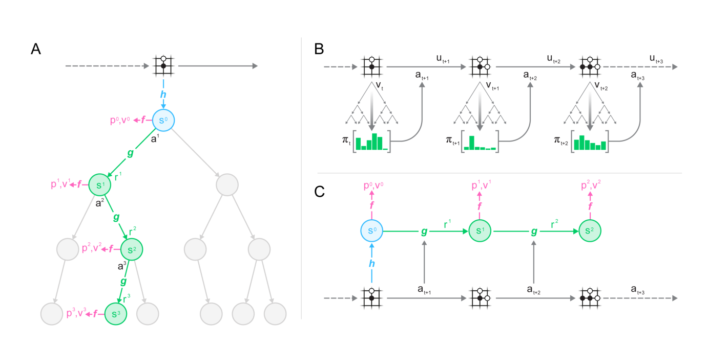
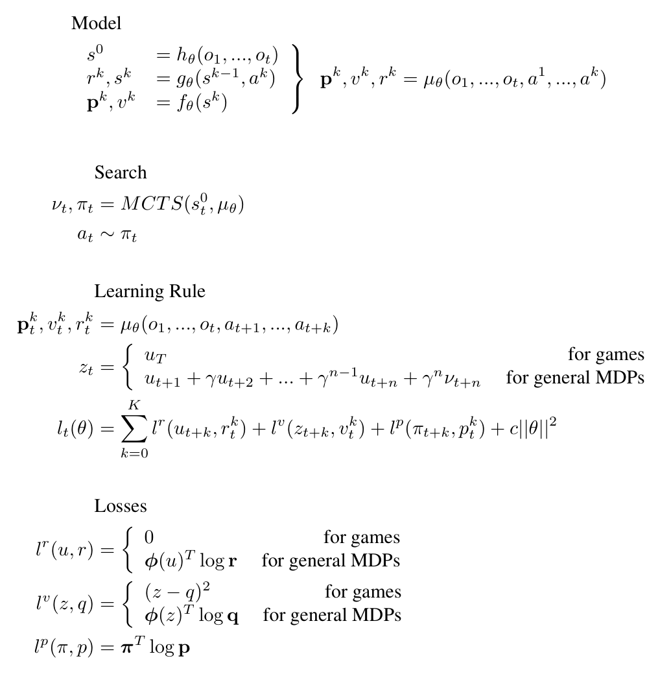
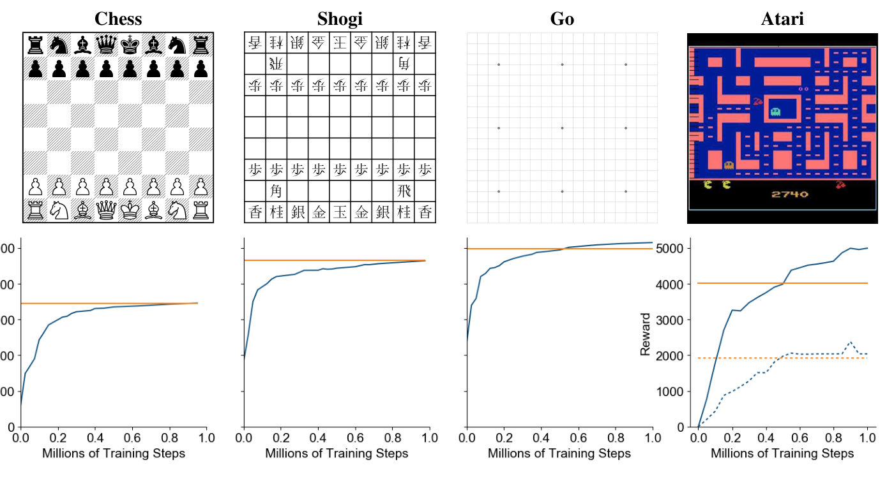
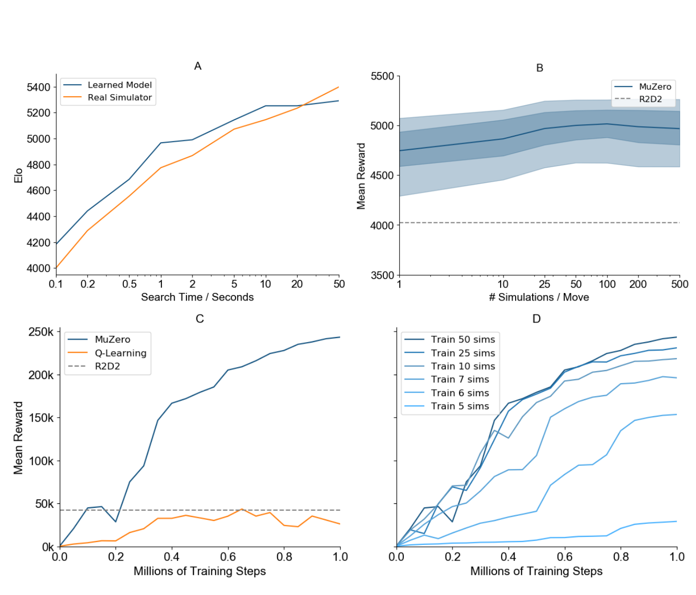
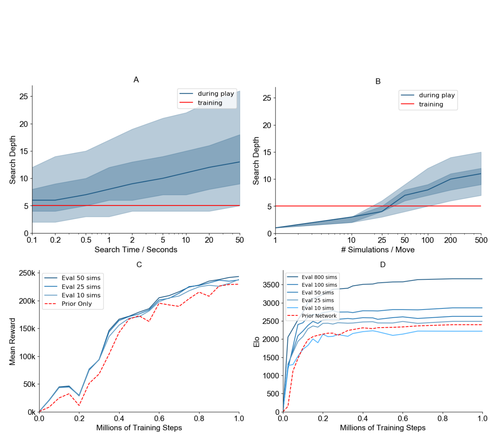

# MuZero：只预测对规划有用的世界模型

!!! info "论文信息"
    **论文题名：** Mastering Atari, Go, Chess and Shogi by Planning with a Learned Model。<br>
    **作者：** Julian Schrittwieser、Ioannis Antonoglou、Thomas Hubert、Karen Simonyan、Laurent Sifre、Simon Schmitt、Arthur Guez、Edward Lockhart、Demis Hassabis、Thore Graepel、Timothy Lillicrap、David Silver。<br>
    **机构：** DeepMind；University College London。<br>
    **时间 / 主题：** arXiv v1：2019-11-19；v2：2020-02-21；世界模型 / planning / model-based RL。<br>
    **arXiv / 官方报告：** arXiv：[1911.08265](https://arxiv.org/abs/1911.08265)；DOI：[10.48550/arXiv.1911.08265](https://doi.org/10.48550/arXiv.1911.08265)。<br>
    **GitHub / 项目：** 论文未在 arXiv 元数据中给出官方 GitHub；arXiv ancillary files 包含 pseudocode 和评测 JSON。<br>
    **元数据来源与核验口径：** 来源：[arXiv](https://arxiv.org/abs/1911.08265)、官方 PDF、arXiv ancillary `pseudocode.py`；Checked Date：2026-07-06；Repro Status：Paper / pseudocode / ancillary data reviewed, independent reproduction not claimed。

MuZero 的核心不是“学一个能重建环境的模型”，而是更锋利的一句话：**世界模型只需要预测规划直接需要的量：reward、policy、value。** 它不要求 hidden state 能重建像素，也不要求 hidden state 对齐真实环境状态；只要这个内部状态能支撑 MCTS 产生更好的 policy/value target，它就可以成为用于 planning 的模型。

这让 MuZero 和 PlaNet/Dreamer 路线形成鲜明对照。PlaNet/Dreamer 用 observation reconstruction、reward、discount 和 latent dynamics 学一个可 rollout 的状态空间；MuZero 则把模型直接训练成搜索树里的抽象状态转移器。它更像“把 AlphaZero 的真实规则模拟器替换成 learned dynamics model”，再把搜索结果反过来训练模型。

## 它的贡献位置

MuZero 站在三条路线的交叉处：

| Route | 典型方法 | 模型预测什么 | 规划 / 控制接口 |
| --- | --- | --- | --- |
| Perfect simulator + search | AlphaZero | 真实游戏规则状态转移 | MCTS 使用规则 simulator 展开树 |
| Reconstruction world model | PlaNet / Dreamer | observation / latent state / reward / discount | latent planning 或 latent actor-critic |
| Value-equivalent model | MuZero | reward / policy / value | MCTS 在 learned hidden states 上搜索 |

MuZero 的大胆之处是放弃“模型必须预测真实世界长什么样”的执念。论文明确强调 hidden state 没有环境状态语义，只需要服务未来 policy、value、reward 预测。换句话说，MuZero 的世界模型不是照片式模拟器，而是 planning interface。

## 总体流程

{ width="920" }

<small>图源：`Mastering Atari, Go, Chess and Shogi by Planning with a Learned Model`，Figure 1。原论文图意：MuZero 用 representation、dynamics、prediction 三个函数进行规划、行动和训练；真实环境轨迹进入 replay buffer，模型在真实动作序列上 recurrent unroll，并预测 policy、value、reward。</small>

**这张图怎么读。**
Figure 1 分成三块。A 是搜索：root hidden state 来自 representation function \(h\)，树内每走一个假设动作就调用 dynamics function \(g\)，再用 prediction function \(f\) 输出 policy/value。B 是行动：每个真实时间步都跑 MCTS，从 visit count policy 采样动作，再把轨迹存进 replay。C 是训练：从 replay 采一段真实轨迹，用真实动作把模型 unroll \(K\) 步，并在每一步对齐搜索 policy、return value 和真实 reward。

这三块形成闭环：

```text
observation history -> h -> root hidden state
root hidden state + candidate actions -> MCTS over learned dynamics
MCTS visit counts/value -> policy/value targets
environment rewards -> reward targets
replay sequence + real actions -> train h, g, f by BPTT
```

## 三个函数：h、g、f

MuZero 模型可以写成：

\[
s^0 = h_\theta(o_1,\ldots,o_t)
\]

\[
r^k, s^k = g_\theta(s^{k-1}, a^k)
\]

\[
p^k, v^k = f_\theta(s^k)
\]

其中 \(h\) 是 representation function，负责把过去观测编码成 root hidden state；\(g\) 是 dynamics function，负责在搜索树内部根据 hidden state 和假设动作生成下一 hidden state 与即时 reward；\(f\) 是 prediction function，负责从任意 hidden state 预测 action-selection policy 和 value。

关键点是：\(s^k\) 不是棋盘状态、Atari RAM 状态，也不是可解码图像 latent。论文把它定义成模型内部状态，只要求对未来 policy/value/reward 有用。这和传统 model-based RL 的“预测下一状态”和 Dreamer 式“预测可重建 latent”都不同。

| Function | Input | Output | 用途 |
| --- | --- | --- | --- |
| Representation \(h_\theta\) | past observations | root hidden state \(s^0\) | 把真实历史转成搜索 root |
| Dynamics \(g_\theta\) | hidden state + action | reward \(r^k\), next hidden state \(s^k\) | 在 MCTS 树内展开假设未来 |
| Prediction \(f_\theta\) | hidden state | policy \(p^k\), value \(v^k\) | 指导树搜索并提供叶子估值 |

## MCTS：把 learned model 当作树搜索环境

MuZero 的搜索继承 AlphaZero 的 MCTS，但把真实 simulator 换成 learned dynamics。

每条边保存 \(N(s,a), Q(s,a), P(s,a), R(s,a), S(s,a)\)，分别表示 visit count、mean value、policy prior、reward 和 transition state。每次 simulation 分三步：

| MCTS stage | MuZero 做什么 | 和 AlphaZero 的差别 |
| --- | --- | --- |
| Selection | 用 pUCT 在树内选择 action | Q 需要做 min-max normalization，因为 Atari value 无界 |
| Expansion | 对 leaf 调用 \(g_\theta\) 得到 reward/state，再调用 \(f_\theta\) 得到 policy/value | transition 来自 learned dynamics，不来自规则 simulator |
| Backup | 用 predicted reward + leaf value 回传更新 Q/N | 支持 single-agent、intermediate rewards、discount |

在棋类里，AlphaZero 依赖规则知识做三件事：搜索树状态转移、合法动作 mask、terminal node value。MuZero 分别替换成 learned dynamics、只在 root 用环境合法动作信息、树内 terminal 也交给 value 预测处理。论文还把 terminal state 作为 absorbing state 训练，让模型在搜索树内越过 terminal 时也能稳定预测。

## 训练目标

{ width="760" }

<small>图源：`Mastering Atari, Go, Chess and Shogi by Planning with a Learned Model`，Figure S2。原论文图意：该图汇总模型、搜索、学习规则和 loss。MuZero 的 loss 同时包含 reward、value、policy 三类目标，并对 board games 和 general MDPs 使用不同目标定义。</small>

**这张公式图怎么读。**
训练时，MuZero 不用 pixel reconstruction loss。它从 replay 中取时间 \(t\) 的真实轨迹，先用 \(h\) 编码历史，再沿真实动作 \(a_{t+1},\ldots,a_{t+k}\) unroll。每个 unroll step 都预测三类量：

| Target | Board games | Atari / general MDPs |
| --- | --- | --- |
| Policy | MCTS search policy \(\pi_{t+k}\) | MCTS search policy \(\pi_{t+k}\) |
| Value | final outcome \(u_T\) | n-step return \(u_{t+1}+\gamma u_{t+2}+\cdots+\gamma^n\nu_{t+n}\) |
| Reward | omitted for no intermediate rewards | observed reward \(u_{t+k}\) |

总 loss 是：

\[
l_t(\theta)=\sum_{k=0}^{K}
l^r(u_{t+k}, r_t^k)
+l^v(z_{t+k}, v_t^k)
+l^p(\pi_{t+k}, p_t^k)
+c\lVert\theta\rVert^2
\]

这就是 MuZero 的世界模型哲学：不要学“环境全貌”，而是学“搜索需要的充要摘要”。如果 hidden state 能让 MCTS 产生更强 policy，哪怕它完全不可解释，也满足目标。

## 训练细节

论文和 ancillary pseudocode 给出的训练配置很细。先看共同设置：

| Item | MuZero setting |
| --- | --- |
| Hypothetical unroll steps | \(K=5\) |
| Training steps | 1M mini-batches |
| Board game batch size | 2048 |
| Atari batch size | 1024 |
| Board game search | 800 simulations per move |
| Atari search | 50 simulations per move |
| UCB constants | \(c_1=1.25\), \(c_2=19652\) |
| Weight decay | \(1e-4\) in pseudocode |
| Momentum | 0.9 in pseudocode |

不同 domain 的配置：

| Domain | Action space | Max moves | Discount | Dirichlet alpha | Num simulations | Batch size | TD steps | Num actors | LR init |
| --- | ---: | ---: | ---: | ---: | ---: | ---: | ---: | ---: | ---: |
| Go | 362 | 722 | 1.0 | 0.03 | 800 | 2048 | max_moves | 3000 | 0.01 |
| Chess | 4672 | 512 | 1.0 | 0.3 | 800 | 2048 | max_moves | 3000 | 0.1 |
| Shogi | 11259 | 512 | 1.0 | 0.15 | 800 | 2048 | max_moves | 3000 | 0.1 |
| Atari | 18 | 27000 | 0.997 | 0.25 | 50 | 1024 | 10 | 350 | 0.05 |

<small>表源：arXiv ancillary `pseudocode.py`。原字段名保留英文；`max_moves` 在 board games 中等价于 Monte Carlo return 到终局。</small>

### Replay 和数据生成

MuZero 用最新 checkpoint 做 self-play / acting，checkpoint 每 1000 training steps 更新一次。board games 中，每局结束后发给训练任务；Atari episode 很长，最长 30 分钟或 108,000 frames，因此每 200 moves 发送中间 sequence。

| Replay item | Board games | Atari |
| --- | --- | --- |
| Buffer | most recent 1 million games | most recent 125 thousand sequences of length 200 |
| Sampling | uniform states | prioritized replay |
| Atari priority | \(P(i)=p_i^\alpha / \sum_k p_k^\alpha\), \(p_i=|\nu_i-z_i|\) |
| Importance correction | \(w_i=(1/N\cdot 1/P(i))^\beta\) |
| Priority exponents | \(\alpha=\beta=1\) |

Atari 的 action selection temperature 随训练退火：前 500k steps 为 1，接下来 250k steps 为 0.5，最后 250k steps 为 0.25。这让早期探索更强，后期更贪心。

### 输入和网络结构

Board games 的输入类似 AlphaZero：Go 和 shogi 使用最近 8 个 board states；chess 增加到最近 100 个 board states，以便正确预测 draw。

Atari 更特殊：

| Component | Atari detail |
| --- | --- |
| Observation input | last 32 RGB frames |
| Resolution | 96 x 96 |
| Action history | last 32 actions, encoded as bias planes scaled as \(a/18\) |
| No preprocessing | no whitening or additional normalization beyond RGB scaled to [0, 1] |
| Dynamics input | hidden state concatenated with spatial action planes |
| Downsampled resolution | 6 x 6 for dynamics |

网络架构也沿用 AlphaZero 风格，但做了 Atari 下采样：

| Network part | Architecture detail |
| --- | --- |
| Representation and dynamics | AlphaZero-style residual network, 16 residual blocks instead of 20, 3x3 kernels, 256 hidden planes |
| Prediction function | AlphaZero-style policy/value head: one or two conv layers, then fully connected output |
| Atari representation stem | 96x96 input -> stride-2 conv 128 planes -> residual blocks -> stride-2 conv 256 planes -> residual blocks -> average pooling -> 6x6 hidden state |
| Atari value/reward output | scalar targets transformed by invertible \(h(x)\), then represented on support size 601 from -300 to 300 |

训练时还有两个梯度缩放细节。第一，每个 head 的 loss 按 \(1/K\) 缩放，避免 unroll steps 增多导致总梯度变大。第二，在 dynamics function 开始处把梯度缩放 \(1/2\)，让作用到 dynamics 的总梯度更稳定。hidden state 也被缩放到 [0, 1]，和 action input 范围一致。

### Reanalyze

MuZero Reanalyze 是为了提高 Atari 小数据设置下的样本效率。它会用最新模型重新对旧 time-steps 跑 MCTS，生成 fresh policy target，并用于 80% 的训练更新；同时用 target network 给 value 提供更稳定的新 n-step bootstrap target。

| Reanalyze change | Setting |
| --- | --- |
| Fresh policy targets | re-run MCTS with latest model for 80% of updates |
| Target network | used for stable n-step bootstrapped value |
| Samples per state | 2.0 instead of 0.1 |
| Value target weight | 0.25 vs 1.0 for policy/reward |
| TD steps | n = 5 instead of n = 10 |

这个变体说明 MuZero 的训练数据不是一锤子买卖。旧轨迹里的 observation/action/reward 不变，但 policy/value target 可以随着模型变强被重新标注。

## 结果与图表

{ width="920" }

<small>图源：`Mastering Atari, Go, Chess and Shogi by Planning with a Learned Model`，Figure 2。原论文图意：MuZero 在 chess、shogi、Go 中和 AlphaZero Elo 对比，在 Atari 中展示 57 个游戏的 mean/median human-normalized scores，并与 R2D2 对比。</small>

**这张图怎么读。**
左三列说明 MuZero 在不知道游戏规则的情况下，用 learned dynamics 接近或超过 AlphaZero 水平；右侧 Atari 说明同一个算法能处理视觉复杂、单智能体、有中间奖励的环境。关键不是某条曲线的瞬时波动，而是统一算法同时覆盖 precision planning 和 visual RL 两类以前分开的场景。

Atari 总表如下，保留原英文列名：

| Agent | Median | Mean | Env. Frames | Training Time | Training Steps |
| --- | ---: | ---: | ---: | --- | ---: |
| Ape-X | 434.1% | 1695.6% | 22.8B | 5 days | 8.64M |
| R2D2 | 1920.6% | 4024.9% | 37.5B | 5 days | 2.16M |
| MuZero | 2041.1% | 4999.2% | 20.0B | 12 hours | 1M |
| IMPALA | 191.8% | 957.6% | 200M | -- | -- |
| Rainbow | 231.1% | -- | 200M | 10 days | -- |
| UNREAL | 250% | 880% | 250M | -- | -- |
| LASER | 431% | -- | 200M | -- | -- |
| MuZero Reanalyze | 731.1% | 2168.9% | 200M | 12 hours | 1M |

<small>表源：`Mastering Atari, Go, Chess and Shogi by Planning with a Learned Model`，Table 1。原表分 large data setting 和 small data setting 两组比较，除 MuZero 外其他 agent 使用 model-free RL 技术。</small>

这张表的边界要讲清楚。MuZero 的 large-data Atari 使用 20.0B env frames，不是低数据量设置；MuZero Reanalyze 才是 200M frames 小数据设置。论文主张不是“MuZero 总是样本最省”，而是：在大量数据下达到 Atari SOTA，同时在 200M setting 也显著超过当时的 model-free baseline。

## 规划、消融和模型边界

{ width="920" }

<small>图源：`Mastering Atari, Go, Chess and Shogi by Planning with a Learned Model`，Figure 3。原论文图意：A 比较 Go 中 learned model 与 real simulator 的 search scaling；B 展示 Atari 搜索 simulation 数对最终分数的影响；C 比较 MuZero MCTS training 与 Q-learning objective；D 展示 Ms. Pacman 中训练时 simulation 数对学习速度的影响。</small>

**这张图怎么读。**
Figure 3 是理解 MuZero 的关键消融。A 说明在 Go 中，learned model 的搜索 scaling 可以接近真实 simulator；B 说明 Atari 中增加搜索 simulation 有收益但会 plateau，论文推测和 learned model 在视觉复杂环境中更不准确有关；C 说明在相同框架下，MCTS-based training 明显强于 Q-learning objective；D 说明训练时搜索 simulation 越多，学习越快，但即使 simulation 少于动作数也能学到有效策略。

补充 Figure S3 进一步说明 policy improvement：

{ width="920" }

<small>图源：`Mastering Atari, Go, Chess and Shogi by Planning with a Learned Model`，Figure S3。原论文图意：A/B 展示搜索树实际评估深度分布，红线是训练 unroll depth 5；C/D 展示 Ms. Pacman 和 Go 中 search policy 相比 raw policy network 的改进。</small>

**这张图怎么读。**
红线提醒一个很有意思的点：训练只 unroll 5 步，但评估时搜索可以更深。Go 中 deeper search 的收益更明显，Atari 中收益较弱。这不是矛盾，而是说明 learned dynamics 在规则清晰的棋类中更适合被深搜索反复调用；在 Atari 这类视觉环境里，模型误差会更早限制规划深度。

## 为什么它属于世界模型

MuZero 很容易被误读成“只是 AlphaZero 加了一个模型”。更准确地说，它是 value-equivalent world model 的代表：它不学环境真实状态，也不学像素未来，而是学一个抽象 MDP，使得在这个抽象 MDP 上规划得到的 policy/value 对真实环境有用。

这给世界模型研究一个重要分叉：

| 问题 | Dreamer 式回答 | MuZero 式回答 |
| --- | --- | --- |
| state 应该包含什么 | 足以重建观测、预测 reward/discount、支持 imagination | 足以预测 policy/value/reward 并支持 MCTS |
| future 如何使用 | actor/value 在 latent rollout 中学习 | MCTS 在 learned hidden states 上搜索 |
| 是否需要重建图像 | 需要，作为 representation learning 信号 | 不需要 |
| 最终证据 | 真实环境 return / sample efficiency | 真实环境 return / search improvement |

所以 MuZero 对当前具身智能也有启发：如果目标是控制，不一定要把世界模型训练成逼真视频生成器；也可以训练成“对规划器足够有用”的抽象 dynamics。不过，这条路线要求有 reward、policy/value target 和可搜索动作接口，不像开放视频预训练那样直接吃无标签视频。

## 证据等级与风险

| Claim | Evidence | Boundary |
| --- | --- | --- |
| Learned model can replace perfect simulator in planning | Chess/shogi/Go Elo against AlphaZero, Go search scaling | 棋类规则清晰、状态完全可观测，不能直接代表真实机器人 |
| Planning-relevant predictions are enough | No observation reconstruction; strong Atari/board-game results | 隐状态不可解释，失败时难诊断模型学到了什么 |
| MCTS targets are stronger than Q-learning targets in this framework | Ms. Pacman MCTS vs Q-learning ablation | 单游戏消融，不能证明所有视觉 RL 都如此 |
| More search helps, but model accuracy matters | Go scales strongly; Atari plateaus around 100 simulations | 深搜索会放大 learned model bias |
| Reanalyze improves sample efficiency | 200M Atari frames: MuZero Reanalyze 731.1% median | 需要重新搜索旧数据，计算换样本效率 |

## 阅读结论

MuZero 的核心贡献是把“世界模型”从状态/像素预测器改写成规划用的抽象模型。它用 \(h\) 把观测历史转成 root hidden state，用 \(g\) 在假设动作下展开 learned hidden dynamics，用 \(f\) 预测 policy/value，再用 MCTS 生成更强的 policy/value targets 反过来训练模型。整个系统没有 observation reconstruction loss，也不要求 hidden state 有人类可解释语义。

模型训练相关最重要的细节是：训练 unroll \(K=5\) 步；每步都有 policy/value/reward loss；board games 使用 800 simulations、batch 2048、Monte Carlo return 到终局；Atari 使用 50 simulations、batch 1024、10-step return、prioritized replay、32 帧 RGB + action history 输入和 support-based value/reward 输出。Reanalyze 进一步把旧轨迹用新模型重新搜索，提升 200M frames 设置下的样本效率。

它的边界也同样清楚。MuZero 证明的是 planning-relevant learned model 可以支撑强搜索和强 RL，不是证明模型学到了真实世界完整动力学。对机器人和开放世界任务来说，如果没有稳定 reward、可搜索动作空间和足够好的 target 生成机制，MuZero 的抽象模型路线不会自动成立。更稳的读法是：MuZero 提供了一种“面向决策而非面向重建”的世界模型范式，和 Dreamer/LingBot 这类 latent/video world model 形成互补。
