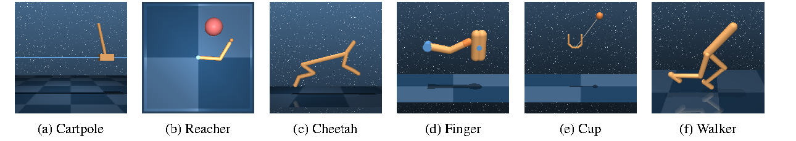
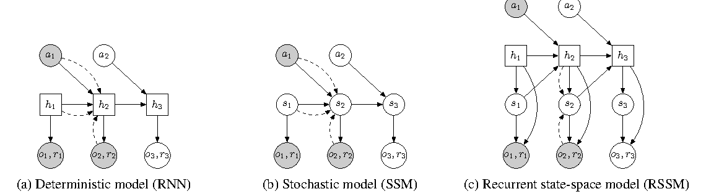
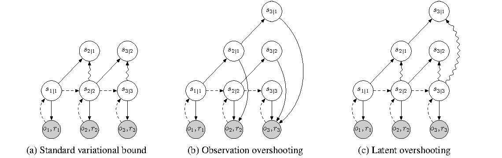
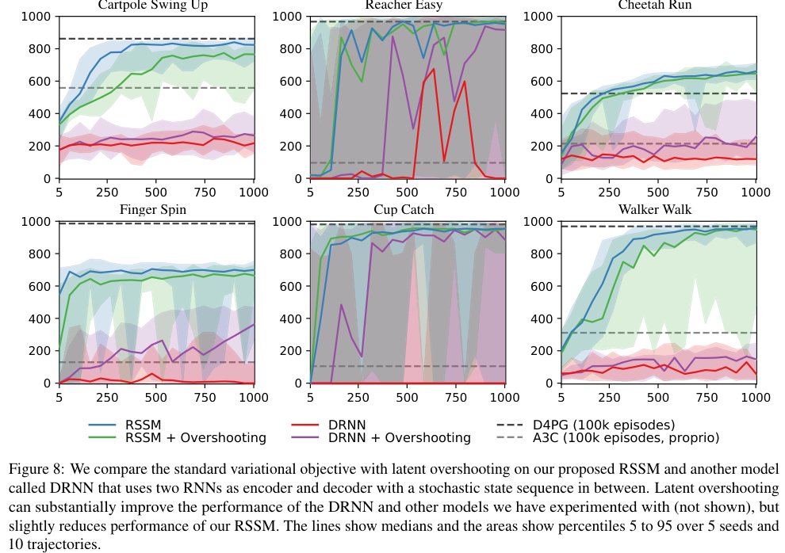
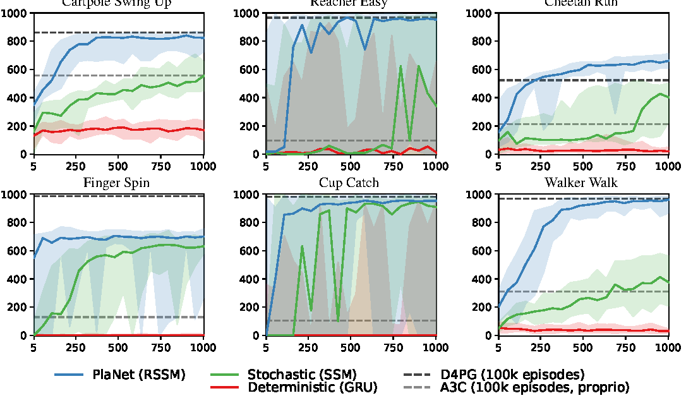
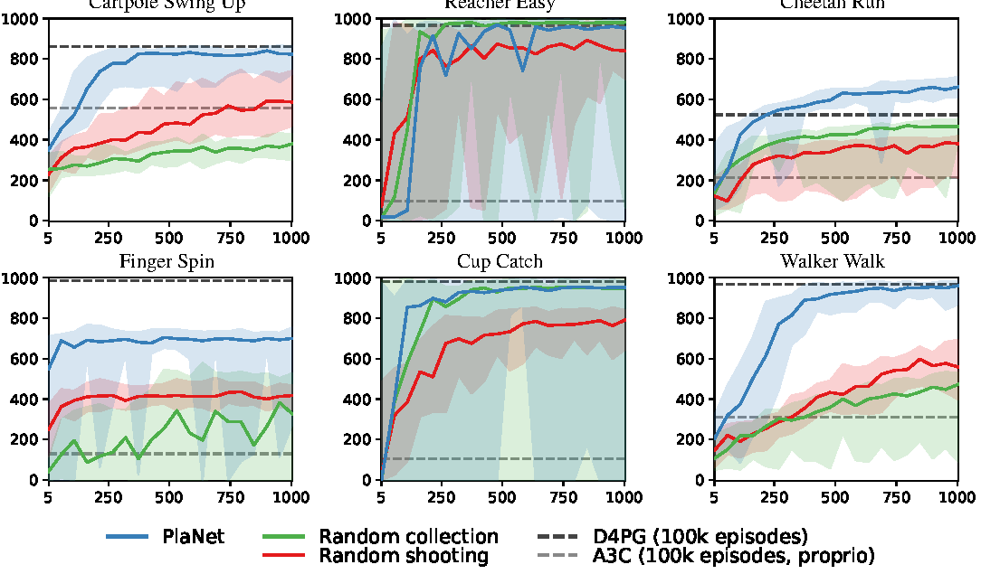
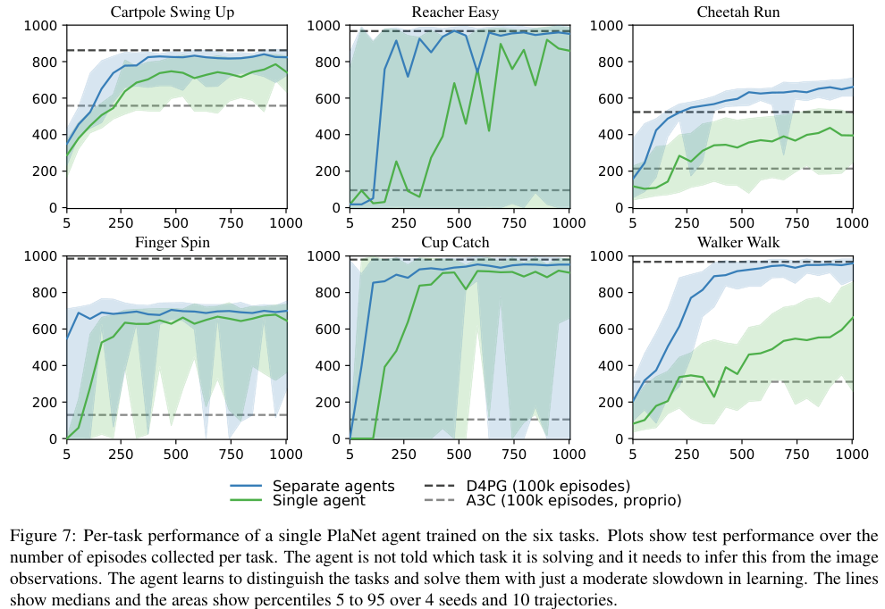
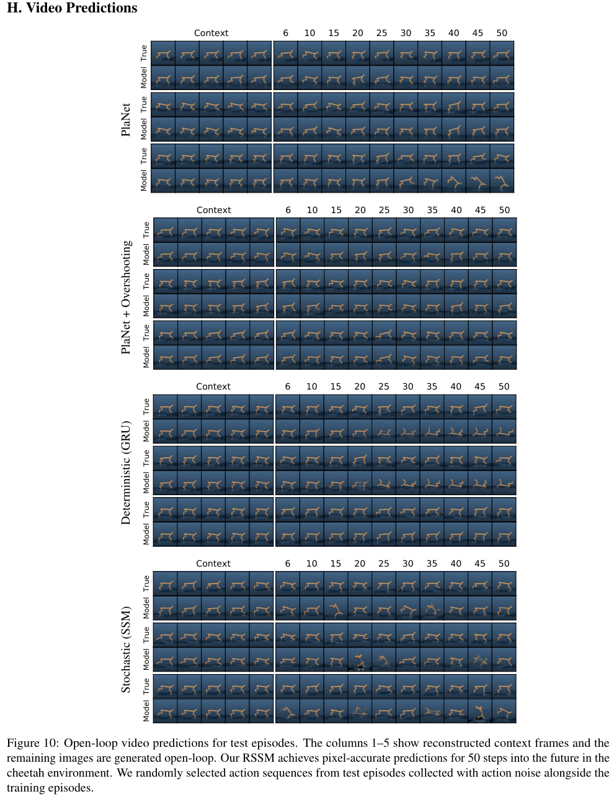
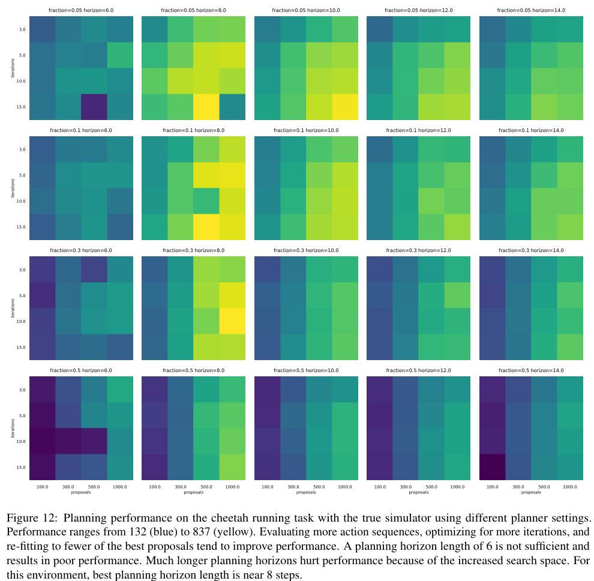

# PlaNet：像素规划的潜变量动力学

!!! info "论文信息"
    **论文题名：** Learning Latent Dynamics for Planning from Pixels。<br>
    **作者：** Danijar Hafner、Timothy Lillicrap、Ian Fischer、Ruben Villegas、David Ha、Honglak Lee、James Davidson。<br>
    **机构：** 未在公开元数据中稳定解析；以 arXiv/PDF 或官方页 affiliation block 为准。<br>
    **时间 / 主题：** 2018-11；世界模型。<br>
    **arXiv / 官方报告：** arXiv：[1811.04551](https://arxiv.org/abs/1811.04551)。<br>
    **GitHub / 项目：** GitHub：[github.com/danijar/planet](https://github.com/danijar/planet)。<br>
    **元数据来源与核验口径：** 来源：[arXiv](https://arxiv.org/abs/1811.04551)；[GitHub API / repo](https://github.com/danijar/planet)；Checked Date：2026-06-04；Repro Status：Paper / official materials reviewed, independent reproduction not claimed。

## 控制器为什么只执行第一个动作

一次 PlaNet 控制调用会在模型里想象很多步，环境却只收到一个动作。默认设置从动作分布采样 1000 条长度为 12 的候选序列，做 10 轮筛选和重新拟合，留下回报最高的 100 条，最后把拟合分布在第一个时刻的均值送给环境。环境返回新图像后，模型重新估计状态，再开始下一轮搜索。[↗](https://arxiv.org/pdf/1811.04551v5#page=3)

这个选择不是为了把规划过程写得好看。控制器手里只有 $64\times64$ 的图像、动作和奖励，模拟器没有直接告诉它摆杆的速度或画面外物体的位置，同一帧图像可能对应不同的运动状态。若每条候选轨迹都解码成完整图像，1000 条序列乘 12 步的搜索很快会比控制本身更贵。

PlaNet 因此把图像解码留在训练阶段。规划时只在紧凑的潜变量里滚动状态并预测奖励，真实观察每一步回来后再修正当前 belief。RSSM 用确定性记忆保存运动线索，用随机状态表达当前图像无法确定的部分；两者合起来才是规划器反复调用的模型状态。PlaNet 的全称是 **Deep Planning Network**。[↗](https://arxiv.org/pdf/1811.04551v5#page=1)

论文用六个任务检验这条闭环。Cartpole 需要记住较远的动作后果，Reacher 和 Cup 的奖励较稀疏，Finger 要处理接触，Cheetah 的动作空间更大，Walker 还要先站稳再走。六个任务都只给模型 $64\times64\times3$ 的第三人称图像。

```mermaid
flowchart LR
    O[连续图像观察 o_t] --> Q[posterior q(s_t | h_t, o_t)]
    Q --> H[确定性记忆 h_t]
    H --> P[prior p(s_t+1 | h_t, a_t)]
    A[候选动作序列] --> CEM[CEM 在潜空间评估]
    P --> CEM
    CEM --> ACT[只执行第一个动作]
    ACT --> ENV[真实环境]
    ENV --> O
    P --> R[reward head]
```

规划器在模型里比较未来，环境只执行当前计划的第一步。下一张真实图像回来后，posterior 重新修正潜状态，这个刷新动作是 PlaNet 能容忍模型误差的关键。

{ width="920" }

*原论文 Figure 1。依次为 Cartpole Swing Up、Reacher Easy、Cheetah Run、Finger Spin、Cup Catch、Walker Walk；图中视觉外观是模型实际面对的观察接口。*

论文的证据范围落在六类连续控制任务上。学习动力学加在线规划在这些任务中用远少于强 model-free 基线的交互接近其性能；这项结果不能外推到任意视觉环境。理解它，需要把模型结构、训练目标和每一步规划都连起来看。[↗](https://arxiv.org/pdf/1811.04551v5#page=6)

## 一次真实动作之前，模型怎样比较未来

设当前观察为 $o_t$，过去执行的动作为 $a_{<t}$。模型形成当前状态的 belief，也就是条件分布 $q(s_t\mid o_{\le t},a_{<t})$。这里沿用规划算法的简化记号，把整个潜在状态记作 $s_t$；后文再把 RSSM 中的确定性和随机部分展开。

规划器使用 **Cross-Entropy Method（CEM，交叉熵方法）**。它维护的是未来一段动作序列的分布，而不是对当前动作逐个打分。序列中的每个时刻、每个动作维度都有自己的均值和尺度，分布按这些维度因子化。因此，某个候选可以表示“先向左加速几步，再向右制动”，而不必局限于重复同一个动作。

每一次真实控制调用都按以下顺序运行。[↗](https://arxiv.org/pdf/1811.04551v5#page=3)

1. 把动作序列分布重新初始化为零均值、单位尺度的高斯。作者没有把上一步的最优序列平移过来作为 warm start，目的是避免搜索持续被同一个局部最优吸引。
2. 从当前动作分布采样 $J=1000$ 条候选序列，规划距离设为 $H=12$。
3. 对每条动作序列，从当前状态 belief 采样起点，再沿学到的转移模型采样一条潜在轨迹；沿途用奖励模型计算预期奖励并求和。
4. 选出回报最高的 $K=100$ 条序列，用这些 elite samples 重新拟合各时刻、各动作维度的均值与尺度。
5. 重复采样、评价、拟合共 $I=10$ 轮，最后执行拟合分布在第一个时刻的均值动作。

例如，把候选轨迹的状态记作 $s_{t+1:t+H}$，其评分可以概括为

$$
R^{(j)}=\sum_{\tau=t+1}^{t+H}\mathbb E_{p(r_\tau\mid s^{(j)}_\tau)}[r_\tau].
$$

这是有限规划距离内的预测奖励之和。原文 Algorithm 2 的索引采用包含端点的写法，动作写至 $t+H$、状态写至 $t+H+1$；上式用 $H$ 个预测步说明相同的计算过程。算法没有在末端接一个学到的 value estimate，也没有给出额外的风险惩罚项。重新拟合的均值就是 elite 动作的平均值

$$
\mu_\tau=\frac{1}{K}\sum_{j\in\mathcal K}a^{(j)}_\tau,
\qquad a_t=\mu_t.
$$

这里 $\mathcal K$ 是本轮 elite 序列集合。整条候选序列在模型中帮助比较动作，但真实环境只执行第一个动作；下一个观察到来后，belief 被更新，规划重新开始。这就是 **Model Predictive Control（MPC，模型预测控制）** 的滚动执行方式。它不要求一次预测把整个任务完成，也允许真实观察不断纠正已经积累的模型偏差。[↗](https://arxiv.org/pdf/1811.04551v5#page=12)

这个实现有一个容易被“概率模型”四个字遮住的细节。每条候选动作序列只对应一次采样出的潜在 rollout，算法没有为同一序列重复大量 rollout 来精确估计其期望回报或方差。随机状态让不同可能未来进入搜索，但不能据此把 PlaNet 描述为有校准误差保证的风险敏感控制器。它也没有一个区分模型知识不足与环境随机性的 ensemble。

默认设置意味着一次控制决策要评价约一万条候选序列，潜在转移计算达到 $10^5$ 量级。这个数量由 $I\times J\times H$ 的量级估算得到，不是论文报告的实际耗时。省去图像解码使这样的搜索可行，但在线搜索的成本仍然存在。PlaNet 的行为能力保存在世界模型和规划器的组合中，它没有额外训练一个 actor 来替代每次决策的搜索。

## RSSM 为何同时保留记忆与随机状态

纯粹的 deterministic RNN 可以用隐藏向量记住历史，但每次只能输出一条确定演化路径。部分可观测问题中，当前图像不足以判断速度、接触状态或画面外物体的位置，强行把这些可能性压成一个值，可能让规划器利用模型中过于乐观的预测。反过来，纯 stochastic state-space model 虽然能表达分布，长期信息却必须穿过连续的随机采样与状态压缩，保存历史更困难。

RSSM 把两种路径并行保留。这里恢复论文 Equation 4 的记号，$h_t$ 表示确定性记忆，$s_t$ 专指随机潜变量，二者合起来才是完整的模型状态。

$$
\begin{aligned}
h_t &= f(h_{t-1},s_{t-1},a_{t-1}),\\
s_t &\sim p(s_t\mid h_t),\\
o_t &\sim p(o_t\mid h_t,s_t),\\
r_t &\sim p(r_t\mid h_t,s_t).
\end{aligned}
$$

$h_t$ 的更新由 GRU 完成。它接收上一时刻的记忆、随机状态和动作，得到当前时刻的历史摘要。prior $p(s_t\mid h_t)$ 据此预测随机状态；图像和奖励的生成分布都使用 $(h_t,s_t)$。当真实图像 $o_t$ 可用时，状态推断由 posterior 完成

$$
q(s_t\mid h_t,o_t).
$$

posterior 同时看历史与当前图像，因此比只看历史的 prior 更有信息。训练时使用 posterior 构造状态序列，规划时未来图像不可用，就沿 prior 继续生成状态。两条路径之间的差距，正是后面 KL 项要约束的对象。[↗](https://arxiv.org/pdf/1811.04551v5#page=4)

沿 Figure 2 从左到右读，确定性模型只有一条记忆链，随机模型只有采样状态链，RSSM 则让确定性链跨越时间，同时把每个时刻的随机状态接入更新。图中实线表示生成过程，虚线表示观测进入推断的路径；方块和圆圈分别标记确定性与随机变量。

{ width="860" }

*原论文 Figure 2。右侧 RSSM 的重点是两条跨时间的信息通路，以及观察只在推断阶段进入模型的接口。*

确定性路径并不意味着图像可以绕过随机瓶颈。当前图像先影响 posterior，再通过采样得到的 $s_t$ 进入重建和后续记忆更新；模型没有一条把当前观察直接送到 decoder 的确定性捷径。否则，decoder 可以依赖图像编码重建得很好，而 prior 根本不必学会产生规划所需的状态。保留随机瓶颈，使“解释看到的图像”与“预测没有看到的未来”必须在同一状态空间内协调。

这种拆分也解释了模型容量的使用方式。确定性记忆负责稳定传递过去的信息，随机变量负责在给定历史下补充当前仍有歧义的部分。但作者没有证明两种角色会在每一个维度上自动清晰分工；网络仍然通过整体训练目标学习表示。随机性为何提升控制，最终要看结构消融，而不能仅凭模型图下结论。

## 从图像重建到可用于规划的先验

如果只训练图像重建，posterior 可以形成一个很会解释当前画面的状态，但规划器未来没有图像可看，未必能够自己预测出这个状态。PlaNet 使用变分目标，把重建与 prior 的学习绑在一起。将论文的观察目标与奖励预测合并，并显式写出 RSSM 的确定性状态，可将训练目标表示为

$$
\mathcal L_{\mathrm{model}}
=\mathbb E_q\sum_{t=1}^{T}\left[
\log p(o_t\mid h_t,s_t)
+\log p(r_t\mid h_t,s_t)
-\mathrm{KL}\big(q(s_t\mid h_t,o_t)\,\|\,p(s_t\mid h_t)\big)
\right].
$$

优化方向是最大化这个目标。第一项要求状态保留解释图像所需的信息，第二项让同一状态能够预测奖励，第三项要求只靠历史得到的 prior 接近看过真实图像的 posterior。若没有重建，稀疏奖励可能不足以教模型理解运动和接触；若没有 prior 与 posterior 的一致性，重建得到的状态又无法在没有观察时继续使用。[↗](https://arxiv.org/pdf/1811.04551v5#page=4)

训练中的一条序列先按真实动作更新 $h_t$，再从 posterior 采样 $s_t$，据此计算图像、奖励似然和 KL。高斯随机变量采用 reparameterization，使误差可以穿过采样过程传回编码器和动力学；期望在实现中用单次 Monte Carlo 样本估计。观察与奖励分布使用单位方差高斯时，负对数似然对应平方误差加常数，因此直观上是在同时减少图像误差、奖励误差和状态分布的预测差距。

三个目标之间仍有容量取舍。KL 太强，posterior 不愿从图像提取 prior 尚不知道的信息，状态可能过于贫乏；KL 太弱，posterior 能重建得很好，但 rollout 时的 prior 跟不上。最终配置把每步 KL 损失在下方截到 **3 free nats**。当 KL 低于这个门槛，继续压小它不会降低这部分损失，从而给模型一定的信息容量；超过门槛后仍需支付完整 KL 代价。这是一个下限截断，不是给所有 KL 乘以 3，也不是后来对 prior 与 posterior 分别分配梯度权重的 KL balancing。[↗](https://arxiv.org/pdf/1811.04551v5#page=12)

训练时，每一步 prior 都拿到上一时刻的 posterior 状态。这个状态已经利用了真实图像，因此单步预测的起点质量通常较好。规划时，模型连续使用自己的预测作为下一步输入，误差却会累积。确定性记忆可以跨时间传播信息，但它没有自动消除“训练多为一步预测，使用却要连续预测”的差别。latent overshooting 正是针对这个问题提出的。

## Latent overshooting 把多步误差放回潜在空间

一个理想、容量无限且每一步都精确的模型，当然也能得到精确的多步预测。现实中，模型容量有限，分布形式受限，单步目标的最佳解未必是长 rollout 的最佳解。若只在 posterior 状态附近训练下一步预测，模型可能对一小段自己的预测误差非常敏感，连续滚动后就走到训练时少见的状态。

一种直接补救是 **observation overshooting**。从某个时刻开始，让模型连续预测多步，再把每一步预测状态都解码成图像，与对应的真实图像比较。问题是多个起点、多个距离都要经过图像 decoder，计算和显存随之增加。PlaNet 提出在潜在分布之间比较，把额外监督放在紧凑空间中。

Figure 3 中的 $s_{i\mid j}$ 表示时刻 $i$ 的状态、只使用截至 $j$ 的观察。标准目标比较 $s_{3\mid2}$ 与 $s_{3\mid3}$，而 latent overshooting 还要求只看到第一帧时预测出的 $s_{3\mid1}$ 与当前有信息的 posterior 一致。看右图的波浪线，就能找到这些跨越多步的 KL 约束；它们不要求把所有预测状态解码成额外图像。

{ width="860" }

*原论文 Figure 3。阴影观察节点旁的箭头表示重建项，波浪线表示 KL；右侧把多步一致性训练留在潜在空间。*

多步预测首先要定义清楚。省略动作条件，并暂时沿用论文一般状态空间模型的 $s_t$ 记号，从 $s_{t-d}$ 预测 $s_t$ 的分布是把中间状态积分掉

$$
p(s_t\mid s_{t-d})
=\int\prod_{\tau=t-d+1}^{t}p(s_\tau\mid s_{\tau-1})\,
\mathrm ds_{t-d+1:t-1}
=\mathbb E_{p(s_{t-1}\mid s_{t-d})}
\big[p(s_t\mid s_{t-1})\big].
$$

$d$ 是预测距离，$d=1$ 时退回普通单步转移。公式不是假设多步边缘分布仍然属于一个简单高斯族；即使每一步条件分布是高斯，经过非线性转移和中间状态积分后，完整边缘也可能很复杂。实际训练通过采样中间轨迹构造监督。[↗](https://arxiv.org/pdf/1811.04551v5#page=5)

令 $q_t=q(s_t\mid o_{\le t})$ 表示有当前观察的 posterior。忽略奖励的同类项，论文 Equation 7 的潜在 overshooting 目标右侧可以写成

$$
\mathcal L_{\mathrm{over}}
=\sum_{t=1}^{T}\left[
\mathbb E_{q_t}\log p(o_t\mid s_t)
-\frac{1}{D}\sum_{d=1}^{D}\beta_d
\mathbb E_{q(s_{t-d}\mid o_{\le t-d})p(s_{t-1}\mid s_{t-d})}
\mathrm{KL}\big(q_t\,\|\,p(s_t\mid s_{t-1})\big)
\right].
$$

$D$ 是参与训练的最大预测距离，$\beta_d$ 控制不同距离的权重。读这个式子时，关键是 KL 外面的期望。它先从 $t-d$ 时刻的 posterior 采样一个起点，之后不用中间图像，沿 prior 滚动到 $t-1$，再用这时的预测分布 $p(s_t\mid s_{t-1})$ 与真实图像支持的 $q_t$ 比较。模型受到惩罚的是“从若干步前独立滚动过来之后，下一步仍与当前 posterior 不一致”。

因此，这个目标不是直接计算 $q_t$ 与完整多步混合分布之间的闭式 KL。它对采样得到的中间状态条件下的 KL 求期望，避免显式构造那个复杂的边缘分布。图像重建仍围绕 posterior 进行，额外增加的是多步潜在预测与 posterior 的匹配。

在 $d>1$ 的项中，作者对作为目标的 posterior **停止梯度**。这一步决定了学习方向。posterior 有真实观察提供的信息，多步 prior 则更容易积累错误；让两者共同向中间妥协，可能使 posterior 丢失有用信息。停止目标端的梯度，就要求多步预测追赶有信息的 posterior。$d=1$ 时仍保留普通的单步训练关系。[↗](https://arxiv.org/pdf/1811.04551v5#page=6)

理论表述也有边界。论文先推导固定距离 $d$ 的 predictive distribution $p_d$ 的变分下界，再将不同距离的目标合在一起；将这个下界进一步关联到原始一步生成模型的似然时，正文明确使用了 **“we conjecture”**，依据是数据处理不等式。因而更稳妥的理解是，一套有变分推导支撑、用于强化多步一致性的训练目标，而不是任意模型、任意 $\beta_d$ 权重下都已证明等价的标准 ELBO。加入可调距离权重后，其实际作用也应从正则化角度理解。

## 为什么最终 PlaNet 反而不需要 overshooting

latent overshooting 是论文的独立方法贡献，却不是最终 RSSM agent 的必选组件。正文与 Appendix A 明确说明，最终配置不再需要 earlier version 中的 latent overshooting 和额外固定全局 prior。只看方法介绍而把 overshooting 列成主实验成功的必要条件，会得到错误的复现方案。[↗](https://arxiv.org/pdf/1811.04551v5#page=12)

附录把问题拆得更细。除了 RSSM，作者还考虑 DRNN，一种在编码和生成两侧都使用循环网络、二者之间放置随机变量的结构。Figure 8 的六个面板对应六个任务，每个面板都画出两种结构有无 overshooting 的四条曲线。红色 DRNN 与紫色 DRNN + Overshooting 的差异显示，Reacher 与 Cup 加入多步约束后明显改善，说明只依赖单步训练的结构确实可能受益于跨距离监督；蓝色 RSSM 与绿色 RSSM + Overshooting 则没有形成一致增益，部分任务的学习反而略慢或更差。



*原论文 Figure 8。上下两排按任务排列；每个面板内，蓝色与绿色比较 RSSM 有无 overshooting，红色与紫色比较 DRNN 有无 overshooting。*

这组结果把两个问题分开了。多步一致性是否值得训练，取决于模型结构、已有的记忆路径和误差来源；一个合理目标能改善某种架构，不保证改善另一种已经较强的架构。RSSM 的确定性路径和随机路径组合，本身可能已让这些任务上的多步预测足够好，额外的约束还会改变重建、单步预测与长程预测之间的平衡。后一句是对实验的解释，论文没有进一步隔离所有原因。

采用时可以把 overshooting 看作可单独测试的机制。若模型在 teacher-forced 单步验证上很好，开放循环一长就漂移，它给出了一个不用额外图像解码的训练入口；若已采用本文最终 RSSM 配置，则应先复现没有 overshooting 的基线，再检验额外约束是否改善真实控制，而不是只看潜在 KL 下降。论文最有用的部分也包括这一负结果。[↗](https://arxiv.org/pdf/1811.04551v5#page=14)

## 模型更新与环境采集怎样交替

PlaNet 从少量随机经验启动，然后交替训练模型和收集新数据。初始经验池来自 5 个随机动作回合；每完成 100 次梯度更新，就用当前模型与 CEM 再收集一个回合，并在执行动作时加入标准差为 0.3 的高斯噪声。新经验进入数据集，下一轮模型训练因此覆盖当前控制器实际到达的状态。[↗](https://arxiv.org/pdf/1811.04551v5#page=12)

这个循环与监督视频预测的差别在于数据分布会随能力变化。随机动作也许足以看见机械臂在小范围内移动，却很少让 Walker 稳定站起并走动。规划器取得一点进步，就会收集更接近成功区域的轨迹；模型再利用这些轨迹改善后续预测。世界模型与数据采集互相推动，不能把结果理解成随机收一批视频、离线拟合后就自然具备同样的控制能力。

| Component | Setting | Role |
|---|---|---|
| Observation | $64\times64\times3$ RGB, 5-bit depth | 从像素学习表示；降低输入位深 |
| Deterministic state | GRU, 200 units | 保存历史信息 |
| Stochastic state | 30-dimensional diagonal Gaussian | 预测及推断状态分布 |
| Other networks | 2 layers, 200 units, ReLU | 实现潜变量分布与奖励等映射 |
| Training batch | 50 chunks × 50 steps | 在真实序列上训练模型 |
| Optimizer | Adam, learning rate $10^{-3}$, $\epsilon=10^{-4}$ | 联合更新表示与动力学 |
| Gradient clipping | Global norm 1000 | 限制单次更新的梯度范数 |
| Free nats | 3 | 避免低 KL 区间继续压缩状态信息 |
| Seed episodes | 5 | 提供初始随机经验 |
| Collection schedule | 1 episode / 100 updates | 交替改进模型与覆盖范围 |
| Exploration noise | $\mathcal N(0,0.3)$ | 在执行动作时增加探索 |
| CEM | $H=12$, $I=10$, $J=1000$, $K=100$ | 潜在空间中的在线动作搜索 |

*根据原论文 Appendix A 与 Algorithm 2 整理。CNN 与反卷积 decoder 沿用文中引用的 Ha & Schmidhuber 架构；表中 MLP 设置不应误读为图像编码器也只有两层全连接。*

不同任务中单独调整的是 action repeat。Cartpole 为 8，Reacher、Cheetah、Cup 为 4，Finger、Walker 为 2。一个模型步对应重复执行同一动作若干个环境步，因此 $H=12$ 在不同任务中约覆盖 24 至 96 个底层模拟步。这个换算只是说明时间尺度，不等同于统一的 12 帧视频预测任务，也不能忽略 action repeat 后比较规划距离。

action repeat 同时决定控制频率、模型需要预测的时间跨度和每回合要调用多少次 CEM。较大的 repeat 能减少决策次数，也让单个动作的后果更远；较小的 repeat 可以更及时纠正接触或平衡误差，却增加控制调用数量。论文把 action repeat、KL 尺度和学习率列为重要超参数，所以“多数超参数跨任务固定”不意味着时间分辨率不需要选择。

作者报告每次任务训练约 10–20 小时，使用一张 Nvidia V100，具体取决于任务。这是单次训练运行的量级，不能视为六任务、多个随机种子和全部消融的总成本。数据效率提升也不会自动消除计算成本，模型的梯度更新与每一步 CEM 搜索都要付费；它们换来的是更少的真实环境交互。[↗](https://arxiv.org/pdf/1811.04551v5#page=6)

## 1,000 回合得到了什么，约 200 倍又如何计算

主实验先问，完全基于模型的像素规划能否接近强 model-free 控制方法。对照来自 DeepMind Control Suite 已报告的 A3C 与 D4PG 结果。A3C 接收 proprioceptive state，D4PG 与 PlaNet 接收像素；两个 model-free 基线训练到 100,000 回合，PlaNet 主表训练到 1,000 回合。这个表不能当作所有方法在同一观察接口、同一数据量下的横向排名，它检验的是较小交互预算追赶强基线的可行性。

原论文 Table 1 的最终平均分如下。顺着同一任务的列比较，才能看见哪些任务接近、哪些仍有明显差距。

| Method | Modality | Episodes | Cartpole Swing Up | Reacher Easy | Cheetah Run | Finger Spin | Cup Catch | Walker Walk |
|---|---|---:|---:|---:|---:|---:|---:|---:|
| A3C | proprioceptive | 100,000 | 558 | 285 | 214 | 129 | 105 | 311 |
| D4PG | pixels | 100,000 | 862 | 967 | 524 | 985 | 980 | 968 |
| PlaNet (ours) | pixels | 1,000 | 821 | 832 | 662 | 700 | 930 | 951 |
| CEM + true simulator | simulator state | 0 | 850 | 964 | 656 | 825 | 993 | 994 |
| Data efficiency gain PlaNet over D4PG (factor) | — | — | 250 | 40 | 500+ | 300 | 100 | 90 |

*原论文 Table 1。最终分数为 5 个种子、10 条评估轨迹上的均值；最后一行是根据 D4PG 学习曲线估计的数据效率倍率，不是上方 Episodes 两个数字的直接比值。*[↗](https://arxiv.org/pdf/1811.04551v5#page=7)

从最终结果看，Walker 为 951 对 968、Cup 为 930 对 980，PlaNet 已接近 D4PG；Cheetah 为 662 对 524，按 $(662-524)/524$ 计算约提升 26%，对应论文强调的优势任务。Finger 则为 700 对 985，差距仍然很大。Reacher 的 832 也低于 D4PG 的 967，不能用“接近 model-free”抹平每个任务的表现。

学习曲线还提供了最终表格没有的信息。论文报告，在约 100 回合以内，PlaNet 已在所有任务上超过训练了 100,000 回合的 A3C；到约 500 回合，除 Finger 外接近 D4PG 的最终表现。这一结果比只看 1,000 回合的最终行更直接地支持数据效率主张。

“平均约 200 倍”来自另一种口径。作者查看 D4PG 的学习曲线，估计它达到 PlaNet 最终表现需要多少回合，再与 PlaNet 所用数据比较，所以得到 Cartpole 250、Reacher 40、Cheetah 500+ 等不同倍率。单纯用 100,000 除以 1,000 只能得到 100，无法复原这组值；Cheetah 的 500+ 也带有基线没有在相应曲线上达到目标分数的界限含义，不是精确计时测量。

主曲线的统计方式也不同于表格。Figure 4 的实线是中位数，阴影是第 5–95 百分位，来自 5 个种子和 10 条评估轨迹；Table 1 给均值。Reacher、Cup 的曲线中位数可以接近高分，表格均值却仍低于那个水平，因为稀疏奖励任务中成功与失败轨迹的差别很大。阴影宽不是绘图噪声，而是结果分布的重要信息。

最后一行 CEM + true simulator 给规划器提供真实模拟器状态和动力学，无需学习模型，所以 Episodes 写 0；它并不代表从零经验、只看像素就能完成任务。作者把它作为估计的性能上限参考，但它不是严格上界。Cheetah 中学习模型的 662 甚至略高于真实模拟器规划的 656，有限候选数和随机搜索足以使这类小差异出现。更准确的用途是判断，在相同有限 CEM 设置下，真实动力学能达到什么水平。

## 模型结构消融与数据收集消融各回答什么

主结果证明系统可行，却不能告诉我们为什么可行。Figure 4 同时替换动力学模型中的确定性与随机部分，让三种模型使用同一类规划方式。蓝色 RSSM 与红色 GRU、绿色 SSM 的对照，分别显示两个组成部分的价值。

{ width="920" }

*原论文 Figure 4。横轴为收集的回合数，纵轴为任务回报；横向虚线为已训练 100,000 回合的 A3C 与 D4PG 参考结果。阴影为第 5–95 百分位，不是均值的标准误。*

纯确定性 GRU 在多数任务上接近失败，Cartpole 虽有约 200 分的表现，也明显低于 RSSM。纯随机 SSM 不是完全不能学，Reacher 和 Cup 中可以得到高回报，但结果更不稳定；Walker 的表现又明显落后。RSSM 因而不是简单“加一个 RNN 让网络更大”，其收益同时与长期记忆路径和随机状态建模相关。[↗](https://arxiv.org/pdf/1811.04551v5#page=6)

作者提出两种可能解释。环境从图像观察者角度具有不确定性，随机状态有助于表示这些未知因素；模型噪声也可能给规划加上某种鲁棒余量，降低对过于精确但错误预测的利用。但实验没有独立区分这两种原因，也没有直接测量置信度是否校准。可以据消融判断“这个系统中随机成分非常有用”，却不能把收益唯一归因于某一种不确定性理论。

Figure 5 转而固定模型思路，改变智能体的两项工作方式。绿色版本始终用随机动作收集训练数据，红色版本把 CEM 换成一次性 random shooting，即采样 1,000 条动作序列后直接选择最好的候选。它们分别问，在线收集当前策略到达的数据是否必要，以及迭代调整动作分布是否有帮助。

{ width="920" }

*原论文 Figure 5。蓝色为完整 PlaNet，绿色使用随机动作采集数据，红色使用单轮 random shooting。两种替换针对不同环节。*

随机采集在 Reacher、Cup 上仍可能覆盖足够有用的状态，所以不应说“随机数据一概无用”；在 Cartpole、Finger 和 Walker 上，它成为明显瓶颈。尤其是必须先学会站立再学走路的 Walker，成功动作会创造后续学习所需的状态分布。这解释了为什么仅提高模型的离线拟合能力，还不足以替代交互闭环。

完整 CEM 在六个任务上都优于一次性 random shooting。不过，这个消融同时改变了搜索过程和评价预算。random shooting 总共评价 1,000 条序列，默认 CEM 则进行 10 轮、每轮 1,000 条；结果支持“这套迭代规划配置更有效”，不能单独证明在完全等量候选评价下，收益全部来自 CEM 的分布更新。若实际系统受到严格在线延迟约束，这个预算差别会直接影响选择。[↗](https://arxiv.org/pdf/1811.04551v5#page=8)

## 一个共享模型学六个任务，迁移到了哪一步

单任务结果仍留下一个问题，RSSM 学到的是只适配某一套图像和动作的表示，还是能容纳多种视觉域与动力学。论文训练了一个同时面对六个任务的共享 agent，不提供 task ID，而要求它从当前图像判断所在环境。不同任务的动作维度通过补上无用维度对齐；每完成 100 次模型更新，就在每个任务上各收集一个回合。[↗](https://arxiv.org/pdf/1811.04551v5#page=6)

Figure 7 中，应该比较同一任务的共享模型与单独训练模型，而不是跨任务比较分数。共享 agent 能学会所有任务，但整体学习更慢，Cheetah 与 Walker 这类运动任务尤其明显。它需要在同一容量内同时保存多套状态转移和视觉信息，不能由单任务的强结果推出共享训练一定更高效。



*原论文 Figure 7。横轴为每个任务收集的回合数；该图注报告 4 个种子、10 条评估轨迹，曲线与阴影分别为中位数和第 5–95 百分位。*

“每个任务”是这张图的关键计量单位。如果横轴为 1,000，共享 agent 已在六个任务各收集约 1,000 回合，总量约 6,000，而不是拿总共 1,000 回合完成全部六项。它也在训练中见过全部任务，所以这是已知多任务共同学习的证据，不是对未见环境的 zero-shot transfer。

这项实验仍然有明确价值。任务身份可以从观察中隐式推断，动作接口经过简单对齐后，一个潜在动力学模型能够同时承担多个域的预测和规划；但共享表示是否减少总交互、是否促进跨任务迁移，需要额外对照。本文结果首先证明了“装得下并能使用”，并未证明“共享训练在每个维度都更划算”。[↗](https://arxiv.org/pdf/1811.04551v5#page=13)

## 预测图像好看之外，状态究竟保留了什么

规划效果是模型的最终用途，预测可视化则帮助检查它在没有新观察时会怎样演化。Figure 10 用 5 帧真实上下文初始化模型，之后给定测试轨迹的动作，让模型开放循环预测，图中一直展示到第 50 帧。这里包含最初 5 帧上下文，因此是后续约 45 帧预测，不应改写成“看 5 帧之后又精确预测了 50 帧”。测试动作还包含噪声，使预测面对更丰富的轨迹。

{ width="560" .atlas-figure-tall }

*原论文 v5 Figure 10。四组分别为 PlaNet、PlaNet + Overshooting、Deterministic (GRU)、Stochastic (SSM)；每组对照真实图像与模型预测，前 5 帧为上下文。*

从长时间范围的身体姿态和运动方向看，RSSM 能维持有意义的 Cheetah 动态；确定性模型在后段出现姿态偏离，纯随机 SSM 的预测更容易模糊或丢失身体细节。图中也能看见，即使预测整体运动合理，也不等于每一个像素或每一次足部接触都准确。因此，这幅图支持模型学习了较长时间尺度的运动结构，不能单独证明每个任务都具有同样精确的长程预测，更不能替代控制回报的比较。[↗](https://arxiv.org/pdf/1811.04551v5#page=18)

更直接的诊断在 Figure 11。作者冻结已经训练好的世界模型，再训练小网络从潜在状态预测模拟器的真实位置、速度和奖励。这样可以问，尽管主训练只看到图像，潜在状态是否保存了与物理控制相关的信息。真实状态标签在这里是 probe 的监督信号，不能倒过来说 PlaNet 原本就用它们训练动力学。

这些曲线总体上跟随真实运动，说明状态并非只记住与控制无关的图像纹理。但误差也可见，部分位置通道随预测距离漂移，奖励预测在后段仍保持较高值时，真实奖励已经接近零。后者尤其关系到规划器，因为它优化的正是预测奖励；图像中大体像在跑，不足以保证回报估计同样可靠。论文没有给这张诊断图提供一个统一误差指标，因此不应把它包装成“完整恢复物理状态”的定量结论。[↗](https://arxiv.org/pdf/1811.04551v5#page=19)

这也解释了 MPC 的实际价值。PlaNet 不必在开放循环中无误差地跑完整个回合，它只执行短计划的第一个动作，然后用真实图像重新推断状态。好的局部预测加频繁重规划，可以产生比单看长程视频外观更可靠的闭环行为；另一方面，一旦短距离内的奖励预测已经被模型误差误导，重规划本身也不是万能修复。

## 更长的规划距离，为什么连真实模拟器也未必受益

限制规划距离常被解释为模型误差会积累，但本文的 Appendix J 还展示了另一个原因。Figure 12 在 Cheetah 上直接用真实模拟器规划，扫描规划距离、CEM 迭代数、候选数与 elite 比例。此时没有学习动力学误差，却仍不是距离越长越好。



*原论文 Figure 12。网格覆盖规划距离 6、8、10、12、14；迭代数 3、5、10、15；候选数 100、300、500、1000；elite 比例 0.05、0.1、0.3、0.5。颜色对应回报，图示范围约为 132–837。*

较短的距离可能看不到当前动作的延迟收益，图中 $H=6$ 就不足；但延长距离同时扩大动作序列的搜索空间。如果候选数量没有相应增加，有限采样可能很难找到一条整段都好的序列。图中这个 Cheetah 设置下 $H=8$ 较好，继续变长反而可能下降。因为使用的是真实动力学，这一现象不能归因于世界模型预测失真。

增加候选数和迭代数通常有帮助，较小 elite 比例也往往更好，但它们是在计算预算和搜索集中程度之间取舍。更多候选提高覆盖，更多迭代允许分布逐步靠近高回报区域，较小 elite 集合让更新更集中；过度集中又可能降低探索。主实验选择 $H=12$ 是跨六任务的一套默认配置，不是声称每个任务单独调参时都以 12 为最优。[↗](https://arxiv.org/pdf/1811.04551v5#page=20)

这个结果使 PlaNet 的适用条件更加具体。如果环境交互昂贵、潜在模型推理相对便宜，花大量内部预测换取更少外部试错具有吸引力；如果在线控制必须极低延迟，反复搜索一万条序列就会成为约束。仅仅增大模型或延长规划距离，不能替代对搜索预算、动作重复频率和误差传播的共同设计。

论文讨论了在规划末端使用 value prediction、通过模型梯度改进动作优化、减少对图像重建的依赖以及时间抽象等方向，它们在本文中仍是后续方案。当前系统已经提供的可复用接口更明确：用观察更新 posterior，用 prior 在潜在空间推演，用 reward head 评价动作，再以真实观察刷新计划。RSSM 解决的是这条接口能否承载有用的记忆和不确定性，overshooting 提供了额外的多步一致性训练工具，而六任务实验则告诉我们，数据效率收益能够出现，但依赖模型结构、在线采集和足够的规划计算共同成立。[↗](https://arxiv.org/pdf/1811.04551v5#page=8)

## 从 PlaNet 继续往下读

[世界模型基础](../../world-models/beginner-world-models-primer.md)先把状态、观察、动作条件和多步误差算清楚；[Dreamer](dreamer.md)再把同一类 RSSM 接到 imagined actor-critic；[模拟器、反事实与合成 rollout](../../world-models/simulators-counterfactuals-and-synthetic-rollouts.md)则专门讨论模型生成的未来怎样获得独立验证。三页分别回答表示接口、行为学习和数据用途，不能用其中一页的预测图替代另外两类证据。

PlaNet 是进入世界模型的好入口。先看[世界模型基础](../../world-models/beginner-world-models-primer.md)确认 observation、latent state 和 transition 的接口，再看[RSSM、Dreamer 与规划](../../world-models/rssm-dreamer-and-planning.md)理解后续方法如何把想象轨迹接到策略更新。若想做小实验，可接[世界模型评测与失败模式](../../world-models/evaluation-and-failure-modes.md)中的一步与多步对照。
