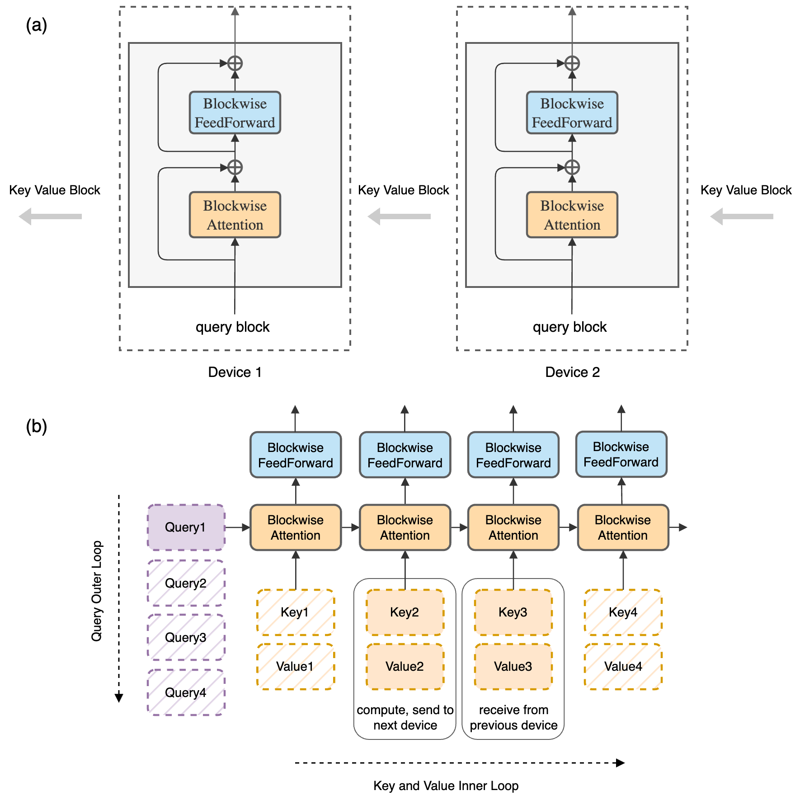
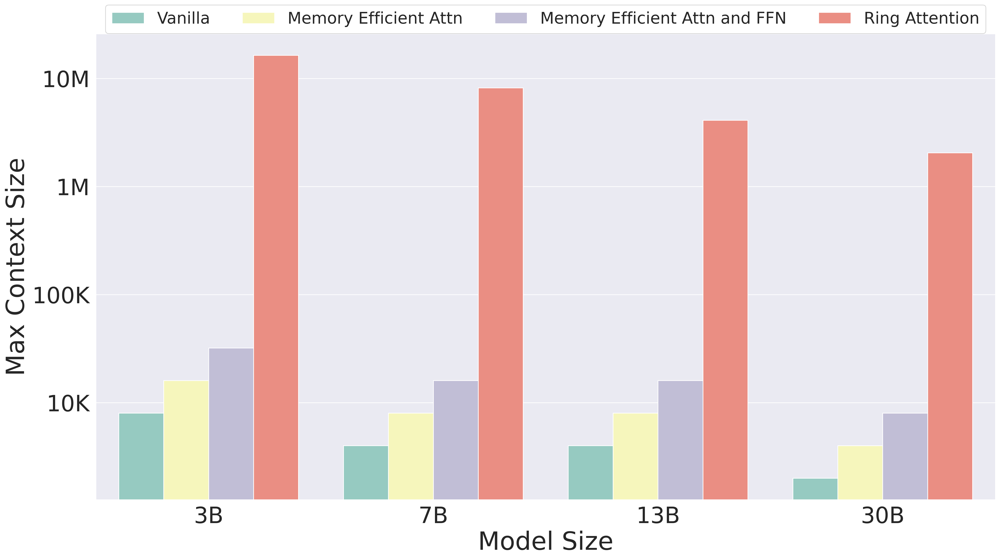
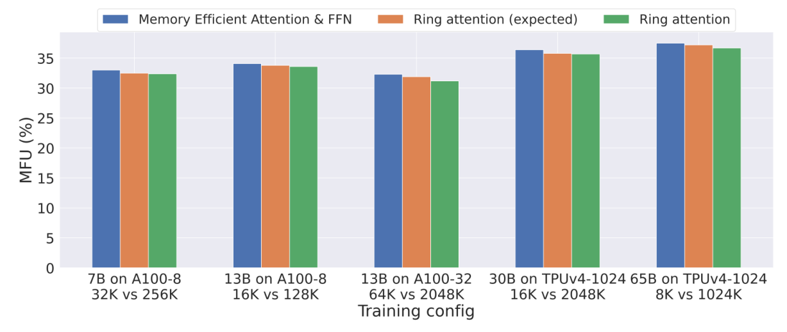
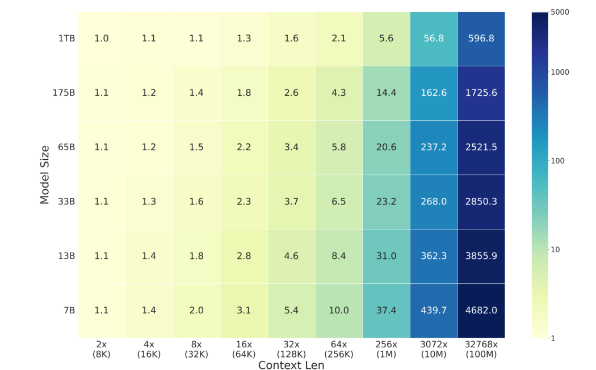
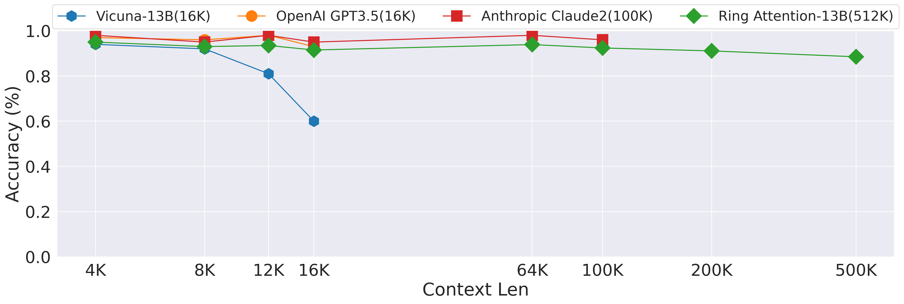

# RingAttention：近无限上下文训练

!!! info "论文信息"
    **论文题名：** Ring Attention with Blockwise Transformers for Near-Infinite Context。 
    **作者：** Hao Liu、Matei Zaharia、Pieter Abbeel。 
    **机构：** UC Berkeley。 
    **时间 / 主题：** 2023-10；世界模型。 
    **arXiv / 官方报告：** arXiv：[2310.01889](https://arxiv.org/abs/2310.01889)；官方材料：[largeworldmodel.github.io/lwm/](https://largeworldmodel.github.io/lwm/)。 
    **GitHub / 项目：** GitHub：[github.com/haoliuhl/ringattention](https://github.com/haoliuhl/ringattention)；项目页：[largeworldmodel.github.io/lwm/](https://largeworldmodel.github.io/lwm/)。 
    **元数据来源与核验口径：** 来源：[arXiv](https://arxiv.org/abs/2310.01889)；[GitHub API / repo](https://github.com/haoliuhl/ringattention)；[官方 / 项目材料](https://largeworldmodel.github.io/lwm/)；Checked Date：2026-06-04；Repro Status：Paper / official materials reviewed, independent reproduction not claimed。

## Ring Attention 解决的先是内存问题，随后才是通信调度

长序列的 attention 有一个直接的内存账单：如果序列长度是 $s$，完整的 score 矩阵需要 $s^2$ 个位置。FlashAttention 一类实现已经避免把这个矩阵整块保存下来，但训练时每层的激活仍随序列长度线性增长。序列再长一些，单张卡依然放不下。

Ring Attention 保留 dense self-attention 的计算关系。它把序列切到多台设备上，每台设备固定自己的 query 和输出，只把 key/value 分块沿环传递。当前块计算时，下一块可以同时传输；计算完成后再合并在线 softmax 的统计量。它改变的是设备上的数据布局和执行顺序，远处 token 仍然参与 attention。[↗](https://arxiv.org/pdf/2310.01889v4#page=3)

理解它的出发点，需要沿着内存瓶颈的转移往下看。普通 attention 直接物化 $s\times s$ 的注意力矩阵，序列长度 $s$ 增大时，矩阵占用按平方增长。memory-efficient attention 和 FlashAttention 一类方法通过分块与在线归一化，避免保存完整矩阵；但 FFN 的中间激活与每层输出仍随 $s$ 线性增长。Blockwise Parallel Transformer（BPT）进一步分块计算 FFN，减少该部分峰值，最后留下的仍是整段序列的状态本身。

线性内存也有上限。即便每个 token 只保留一个隐藏向量，几百万 token 乘以几千维特征，再考虑多层、梯度和训练状态，仍可能超过单设备 HBM。把 attention matrix 去掉，并没有让无限长的序列自动适合一张卡；想继续扩展，就需要把序列激活的存放位置也分散出去。

Ring Attention 接在 BPT 之后，利用多设备聚合内存承载同一个序列。它的价值首先是把“单台设备必须容纳完整序列”的约束移走，再尝试通过计算与通信重叠减少分布式代价。这里的 **near-infinite context** 指容量随可用设备扩展的方向，不是说算力、网络、训练数据和模型利用远程信息的能力都不再受限。

## 一个 query 如何分几次得到完整 softmax

对于一个 attention head，设 $Q,K,V\in\mathbb R^{s\times d}$，$d$ 是 head dimension，标准计算为

$$
O=\operatorname{softmax}\left(\frac{QK^\top}{\sqrt d}+M\right)V.
$$

$M$ 表示因果或其他 attention mask。若把所有 key/value 切成若干块，一个 query 不必同时拿到全部块，但最终结果必须使用全体允许位置共同计算的归一化分母。对每个块单独做 softmax，再把输出平均，会改变块与块之间的相对权重，通常不等于原始 attention。

论文依赖的关键性质，是各块的统计量可以正确合并，而且遍历顺序不影响数学结果。下面把 Appendix A 中 `max_score`、`denominator`、`numerator` 的含义展开。对固定 query $q$，令第 $j$ 个 key 的 masked logit 为 $z_j$；对一个 key/value 块 $A$，维护

$$
m_A=\max_{j\in A}z_j,\qquad
\ell_A=\sum_{j\in A}e^{z_j-m_A},\qquad
u_A=\sum_{j\in A}e^{z_j-m_A}v_j.
$$

$m_A$ 是数值稳定用的最大值，$\ell_A$ 是以它为基准的分母，$u_A$ 是尚未归一化的 value 加权和。设已经处理过的块集合为 $A$，新到达的块为 $B$，先取共同的最大值

$$
m=\max(m_A,m_B),
$$

再将旧统计量换到同一尺度

$$
\begin{aligned}
\ell&=e^{m_A-m}\ell_A+e^{m_B-m}\ell_B,\\
u&=e^{m_A-m}u_A+e^{m_B-m}u_B,\\
o&=u/\ell.
\end{aligned}
$$

这组式子是对原 attention 与实现统计量的代数展开，说明为何不需要保留全部 score matrix。两边被缩放后恰好对应同一个 $e^{-m}$ 因子，因此最终比值恢复全体 key 的 softmax 加权和。每次新块到来，只更新最大值、分母和分子，丢掉临时的局部 score 即可。[↗](https://arxiv.org/pdf/2310.01889v4#page=15)

这个性质也允许环形调度。设备 0 可以先处理自己的 K/V，再处理从设备末端传来的块；设备 1 则可能从另一顺序开始。只要所有允许的 key 都被处理一次、mask 与原始位置正确，合并后的 attention 在数学上相同。浮点加法顺序改变仍可能造成舍入差异，所以“exact attention”指没有删减或近似注意力关系，不等于不同执行顺序逐位完全一致。

## Query 不动，K/V 为什么绕环而行

设环中有 $P$ 台设备，每台持有长度约为 $c$ 的本地序列分片。设备 $i$ 从本地输入得到 $Q_i,K_i,V_i$，负责生成自己的输出 $O_i$。它不需要计算其他设备的 query 输出，却必须让 $Q_i$ 与整个序列允许的 K/V 发生交互。

最直接的做法是 all-gather 全部 K/V，但这会让每台设备重新持有全序列缓存，抵消序列分片的内存收益。逐块请求也不理想，如果计算完一块才等待下一块传来，网络等待就直接叠加到时间线上。Ring Attention 用双缓冲把“当前计算”和“下一块到达”并行安排。

1. 使用本地 query 与当前 K/V 块进行 blockwise attention，更新在线 softmax 统计量。
2. 同时将当前 K/V 发送给环上的后继，并从前驱接收下一块，接收数据写入另一组 buffer。
3. 当前计算完成后，切换到已到达的 K/V，继续下一轮。
4. 完成本地块与所有远端块的交互后，输出最终 attention 结果，再对本地 token 执行 FFN。

每个 query 分片总共要处理 $P$ 个 K/V 分片，其中一个是本地块，另外 $P-1$ 个来自远端。Appendix A 的 Jax 代码使用长度为 `axis_size` 的循环，明确覆盖全部块；不能因为需要 $P-1$ 次远端转发，就只计算 $P-1$ 个注意力块而漏掉本地或最后一块。

{ width="860" }

*原论文 Figure 2。上图显示设备各自保留 query 和本地层输出；下图把 query 的外循环与 K/V 的内循环分开，当前块计算、发送与下一块接收被重叠安排。*

图中的 FFN 需要结合完整计算语义阅读。FFN 是非线性的，不能对每一个尚未归一化完成的 K/V 局部输出各执行一次，再把结果相加。一个 query 输出完成所有必要的 attention 累积后，才进入该 token 的 FFN。BPT 允许 FFN 按 token 块执行，因此无需同时物化全序列的大中间激活；它没有改变原模型“attention 后接 FFN”的含义。[↗](https://arxiv.org/pdf/2310.01889v4#page=6)

序列原始位置也不会随 K/V 在网络中移动而改变。代码根据当前 query 所属分片和正在访问的 K/V 所属分片计算全局 chunk offset，并切出对应的 attention bias。对 causal attention 来说，哪些 key 属于未来，取决于全局位置，而不是它先到还是后到。若只看本地块编号、不更新偏置切片，环形传输虽然能跑通，模型语义仍可能错误。

## 反向传播为什么还要让梯度一起转圈

前向中，$Q_i$ 与所有 K/V 分片发生过交互，因此反向也必须汇总这些交互产生的梯度。对设备 $i$ 而言，自己的 $dQ_i$ 可以一直留在本地，每遇到一个 K/V 分片，就加入这一部分贡献。某个 $K_j,V_j$ 则服务过所有 query 分片，其 $dK_j,dV_j$ 必须汇集来自整个环的贡献。

Appendix A 使用 `jax.custom_vjp` 定义前向和反向。前向保存 output、Q/K/V、attention bias，以及在线 softmax 的 denominator 和 max score；反向调用块级 attention backward，重新计算需要的局部量，而不是保存完整注意力矩阵。然后 K/V 与对应的 dK/dV 一起经 `lax.ppermute` 传给下一台设备，逐步收集其他 query 的贡献，最终返回所属分片。

这与只在前向循环 K/V、反向在本地直接结束有根本区别。后者会遗漏远端 query 对本地 key/value 的梯度，得到的训练就不再等价于完整 attention。前向内存优化必须有匹配的反向归约与重计算安排，才能支持真正的端到端训练。[↗](https://arxiv.org/pdf/2310.01889v4#page=15)

环是逻辑拓扑，并不要求硬件必须物理连成一个圈。GPU 的高速互联与 TPU 的互联都可以实现相邻节点置换；但逻辑相邻是否走在高带宽路径上、多个环是否竞争同一物理链路，仍会影响实际可隐藏的传输时间。`ppermute` 是实现接口，不是通信自动免费的保证。

## 什么时候计算真的能遮住传输

论文把通信重叠条件写成一个简单的算术强度关系。设每台设备处理的块长为 $c$，特征维度为 $d$，有效计算吞吐为 $F$ FLOP/s，环上单向带宽为 $B$ byte/s。一次块对块 attention 中，$QK^\top$ 约需 $2dc^2$ FLOPs，再乘 $V$ 约需 $2dc^2$ FLOPs，总计

$$
C_{\mathrm{attn}}\approx4dc^2.
$$

若 K 和 V 各含 $cd$ 个 bf16 元素，每个元素 2 bytes，一对 K/V 的传输量为

$$
D_{\mathrm{KV}}\approx4cd\ \mathrm{bytes}.
$$

理想重叠要求当前块计算时间至少覆盖下一块传输时间

$$
\frac{4dc^2}{F}\ge\frac{4cd}{B}
\quad\Longrightarrow\quad
c\ge\frac FB.
$$

计算随 $c^2$ 增长，传输随 $c$ 增长，所以足够大的块更容易把通信藏进计算。小块虽然减少单次工作集，却可能使网络等待暴露出来；低带宽链路则要求更大的块。式中的带宽要用 byte/s，不能把 bit/s 直接代入，也不能把双向总带宽误当成论文假设的单向有效带宽。[↗](https://arxiv.org/pdf/2310.01889v4#page=5)

| Spec Per Host | FLOPS (TF) | HBM (GB) | Interconnect Bandwidth (GB/s) | Minimal Blocksize (×1e3) | Minimal Sequence Len (×1e3) |
|---|---:|---:|---:|---:|---:|
| A100 NVLink | 312 | 80 | 300 | 1.0 | 6.2 |
| A100 InfiniBand | 312 | 80 | 12.5 | 24.5 | 149.5 |
| TPU v3 | 123 | 16 | 112 | 1.1 | 6.6 |
| TPU v4 | 275 | 32 | 268 | 1.0 | 6.2 |
| TPU v5e | 196 | 16 | 186 | 1.1 | 6.3 |

*原论文 Table 2。这里是该论文采用的硬件与带宽口径，末列按作者的六块工作集关系 $s=6c$ 列出。*

同为 A100，NVLink 与该表的 InfiniBand 配置给出的最小块尺度差了一个数量级以上。这说明“用了环通信”不是决定性能的充分条件，模型块的计算量必须与实际链路匹配。表中 $F$ 基于硬件能力，而真正选择 block size 时，应结合实际 kernel 吞吐、通信启动延迟和并发流调度；峰值 FLOPS 不一定等于训练时可持续的计算速度。

论文的估算没有把 Q/K/V projection 与 tokenwise FFN 加入需传输 K/V 的块级算术强度，因此在其理想调度假设下是较保守的条件。这个推导也没有计算全部系统开销，例如首尾流水阶段、参数分片通信和同步。它支持的是满足条件时可重叠主要 K/V 传输，而非任意网络、任意块长都能零开销运行。

内存记账也应与这条条件分开。论文列出 query、当前 K/V、接收 K/V 和输出，共六份块状工作集，并在 Table 1 报告 Ring Attention 的最大激活为 $6bch$ bytes，BPT 则为 $2bsh$ bytes。重要变化是从依赖全局序列长 $s$，转为依赖本地块长 $c$。但若逐份把六个形状为 $b\times c\times h$ 的 bf16 buffer 相加，应为 $12bch$ bytes；原文的“六块”描述与字节常数并不完全一致。因此，$6bch$ 可作为原表的记账结果，不能直接当作完整实现逐字节预算。实际还需计入 softmax 统计量、临时空间、参数、优化器与 checkpoint 策略，可靠的结构性结论是本地工作集为 $O(bch)$。[↗](https://arxiv.org/pdf/2310.01889v4#page=5)

## 容量怎样增长，比较中又保持了什么

最大上下文实验采用 LLaMA 风格模型，并对 attention 与 FFN 都使用 full gradient checkpointing。基线包括普通 Transformer、仅 attention 内存优化的实现，以及 attention 与 FFN 都分块的 BPT。所有方法都使用 FSDP 分片模型训练状态，容量实验本身不加入 tensor parallelism，因此差别主要来自序列激活能否分布到更多设备。[↗](https://arxiv.org/pdf/2310.01889v4#page=6)

论文保持的是 total batch tokens。若有 $n$ 台设备，基线各处理一个长度 $l$ 的序列，总 token 数为 $nl$；Ring Attention 可以改为 $m$ 个长度 $nl/m$ 的序列，总 token 数仍为 $nl$。这让相同的聚合内存更多用于一条长序列，而非多条彼此独立的短序列。

但相同 token 数不代表相同 attention 计算量。$n$ 条长 $l$ 的序列各自做 attention，总配对数约为 $nl^2$；把它们合成一条长 $nl$ 的序列，总配对数约为 $n^2l^2$。后者多出来的跨片段关系正是长上下文想获得的能力，也是真实要支付的计算。因此，容量表能证明更长输入装得下，不能单独证明等时完成了更多同类工作。

{ width="920" }

*原论文 Figure 1。纵轴为对数尺度；比较的是端到端训练可容纳的最大上下文，不是有效检索距离或训练吞吐。*

原论文 Table 3 的详细数值如下，所有长度均保留原表的 $\times10^3$ tokens 单位。

| Configuration | Model | Vanilla | Memory Efficient Attn | Memory Efficient Attn and FFN | Ring Attention | Ours vs SOTA |
|---|---|---:|---:|---:|---:|---:|
| 8× A100 NVLink | 3B | 4 | 32 | 64 | 512 | 8× |
| 8× A100 NVLink | 7B | 2 | 16 | 32 | 256 | 8× |
| 8× A100 NVLink | 13B | 2 | 4 | 16 | 128 | 8× |
| 32× A100 InfiniBand | 7B | 4 | 64 | 128 | 4096 | 32× |
| 32× A100 InfiniBand | 13B | 4 | 32 | 64 | 2048 | 32× |
| TPUv3-512 | 7B | 1 | 4 | 8 | 2048 | 256× |
| TPUv3-512 | 13B | 1 | 2 | 8 | 1024 | 128× |
| TPUv4-1024 | 3B | 8 | 16 | 32 | 16384 | 512× |
| TPUv4-1024 | 7B | 4 | 8 | 16 | 8192 | 512× |
| TPUv4-1024 | 13B | 4 | 8 | 16 | 4096 | 256× |
| TPUv4-1024 | 30B | 2 | 4 | 8 | 2048 | 256× |
| TPUv5e-256 | 3B | 4 | 8 | 32 | 4096 | 128× |
| TPUv5e-256 | 7B | 2 | 8 | 16 | 2048 | 128× |

8 张 A100 上，7B 从 BPT 的 32K 扩到 256K，是 8 倍；32 张 A100 上，7B 从 128K 扩到 4096K，是 32 倍。TPUv4-1024 上，7B 从 16K 扩到 8192K，而 3B 最大达到 16384K。模型更大时，一部分资源要用于模型状态和其他分片安排，容量倍率不一定等于硬件配置名称中的数字。判断实际放大率应看参与同一序列的环规模与表中数据，不能只从 TPU 名称机械读出设备数。

论文多处使用“超过 100 million tokens”的表述，但 Table 3 中可逐行核对的最大容量是 3B 的 16384K；后面 Figure 5 的 100M 则是计算成本推算。两者不应混成一条已展示的一亿 token 训练实测。这里最明确的结果是多个硬件配置上从十万级扩到百万、千万级上下文的容量证据。[↗](https://arxiv.org/pdf/2310.01889v4#page=7)

精度设置同样影响容量。正文把实验概括为 full precision，Appendix B 又明确说明 TPU 使用 bf16 matmul、float32 accumulation，GPU 配置使用 float32 运算。复现时应以这个更具体的分平台设置为准，而不是假设 Table 2 的 bf16 通信估算就是所有 GPU 容量实验的完整 dtype 配置。[↗](https://arxiv.org/pdf/2310.01889v4#page=14)

## MFU 接近，为什么训练每个 token 仍可能更慢

最大容量解决“能否运行”，下一步才是“运行时有多少算力真正用于模型计算”。论文用 **Model FLOPs Utilization（MFU，模型浮点运算利用率）** 评价这一点，并让 baseline 与 Ring Attention 使用同一套 BPT 本地实现，减少因不同 kernel 引起的比较偏差。GPU 每 batch 为 2M tokens，TPU 为 4M tokens，训练结合 FSDP，且在这一部分讨论与 tensor parallelism 的组合。

Table 4 上方的柱状图比较了三种量。蓝柱是较短上下文 BPT 的 MFU，橙柱是把上下文扩长后，依据计算构成变化预计得到的 MFU，绿柱则是 Ring Attention 的实际 MFU。需要先比较橙、绿，再看蓝、绿，才能分开“长序列本身改变计算类型”和“新增分布式调度是否引入额外损失”。

*原论文 Table 4 中的柱状图。每组下方分别标出 BPT 与 Ring Attention 的上下文长度；柱高约为 31%–37%，原图没有给出逐柱精确数值标签。*

这五组配置包括 8 张 A100 上的 7B、13B，32 张 A100 上的 13B，以及 TPUv4-1024 上的 30B、65B。上下文分别从 32K 到 256K、16K 到 128K、64K 到 2048K、16K 到 2048K、8K 到 1024K。绿柱与橙柱相近，支持这些配置下主要通信代价得到较好重叠；绿柱仍普遍略低于蓝柱，不能从图中得出利用率在所有条件下严格不变。[↗](https://arxiv.org/pdf/2310.01889v4#page=8)

作者解释，attention 算子的 MFU 低于 FFN；上下文变长时，attention FLOPs 占比上升，所以即使调度没有新增明显损失，整体 MFU 也可能下降。这就是需要橙色“预期值”的原因。若只拿短序列蓝柱与长序列绿柱相减，会把工作负载结构变化和通信开销混在一起。

另一方面，MFU 不是 tokens/s。同样的 MFU 表示机器以相近比例执行模型 FLOPs；若每个 token 因长距离注意力而需要更多 FLOPs，处理相同 token 数仍会更久。本文柱状图支持的是在扩展容量的同时保持较好的计算效率，并不单独提供“长上下文训练与短上下文具有相同 token 吞吐”的证明。

## 没有额外算法开销，不等于长上下文没有额外 FLOPs

Ring Attention 仍然计算原始 dense attention 的所有有效 query–key 配对。固定模型与一个序列时，attention 算术复杂度随长度平方增长；固定数据集 token 总量时，因为长序列会减少序列条数，总成本的增长形式又不同。Appendix D 专门计算了后一个口径。

作者使用每批序列的近似 FLOPs

$$
C(s)=\left(24bsh^2+4bs^2h\right)L,
$$

其中 $b$ 为 batch size、$h$ 为 hidden dimension、$L$ 为层数。第一项涵盖随 token 数线性增长的主要计算，第二项表示注意力配对的二次项。若从长度 $s_1$ 扩到 $s_2$，同时保持训练数据集总 token 数不变，需要的序列数量减少 $s_2/s_1$ 倍，得到论文的比值

$$
\frac{C_{\mathrm{dataset}}(s_2)}{C_{\mathrm{dataset}}(s_1)}
=\frac{6h+s_2}{6h+s_1}.
$$

这既不是完全不增加成本，也不是把单序列的平方倍率直接当作全数据集倍率。越长的序列越能让同一 token 与远处 token 交互，但每个 token 要承担的 attention 工作也随之增加。[↗](https://arxiv.org/pdf/2310.01889v4#page=16)

以论文 7B 配置的 $h=4096$ 为例，从 4096 tokens 扩到 1,048,576 tokens，代入上式得到约 37.4 倍，和 Figure 5 的 7B、1M 单元格一致。上下文增加了 256 倍，固定 token 数据集的 FLOPs 约增加 37 倍；这已经是很大的训练预算变化，只是没有达到 256 的平方。

*原论文 Figure 5。基准为同一模型的 4K 上下文，图中是公式估算的计算成本倍率，并非每个格子都对应一次完成的训练。*

较大 hidden dimension 下，线性于序列长度的投影与 FFN 计算占比更高，因此同样扩长时，相对倍率较小。图中 1M 列，7B 为 37.4，65B 为 20.6，175B 为 14.4。但这不意味着大模型绝对成本低，它只是相对自身 4K 基准的增长率较小。图上的 10M、100M 是粗略长度标签，精确口径应同时看下方的 3072×、32768×，不能将它们无差别视为十进制的一千万和一亿。

“通信隐藏”和“保持 exact attention”因此需要分开评价。前者减少传输暴露在关键路径上的时间，后者保留完整计算语义；二者都没有把本来应计算的远距离注意力消掉。设备增加、局部块长度不变时，一台设备也会遇到更多 K/V 块，不能把容量的线性扩展解释为每设备每层耗时必然恒定。

## 更多历史轨迹，给 ExoRL 带来了多大收益

系统容量还需要下游任务证明有用。论文把 Ring Attention 接到 Agentic Transformer（AT）中，让模型在上下文里看到更多试错轨迹。ExoRL 数据由探索策略采集，行为质量多样，简单克隆所有动作并不一定能得到高回报；AT 的做法是让 Transformer 条件于多条轨迹与重新标记的目标回报，利用历史经验选择行为。[↗](https://arxiv.org/pdf/2310.01889v4#page=8)

这里长上下文的数量很具体。一个 trajectory 有 1,000 个环境时步，每步按 return、state、action、reward 四个位置组织，所以一条轨迹约占 4,000 个序列位置。32 条对应约 128K，128 条对应约 512K。论文使用约 350M 的模型，BPT 在 32 条时可运行，在 128 条时 OOM；Ring Attention 则使 128 条轨迹的条件输入可行。

| Task | BC-10% | DT | AT + ME, N Trajs = 32 | AT + BPT, N Trajs = 32 | AT + BPT, N Trajs = 128 | AT + RA, N Trajs = 128 |
|---|---:|---:|---|---:|---|---:|
| Walker Stand | 52.91 | 34.54 | oom | 95.45 | oom | 98.23 |
| Walker Run | 34.81 | 49.82 | oom | 105.88 | oom | 110.45 |
| Walker Walk | 13.53 | 34.94 | oom | 78.56 | oom | 78.95 |
| Cheetah Run | 34.66 | 67.53 | oom | 178.75 | oom | 181.34 |
| Jaco Reach | 23.95 | 18.64 | oom | 87.56 | oom | 89.51 |
| Cartpole Swingup | 56.82 | 67.56 | oom | 120.56 | oom | 123.45 |
| Total Average | 36.11 | 45.51 | oom | 111.13 | oom | 113.66 |

*原论文 Table 5。ME 为 memory-efficient attention，BPT 同时分块 attention 与 FFN，RA 为 Ring Attention；数值保留论文的 ExoRL return 口径，不能解释成百分制成功率。*

比较最右列与 BPT 的 32 条列，六个任务都略有提升，平均从 111.13 到 113.66，增加 2.53，约为原平均值的 2.28%。Walker Run 的增幅相对明显，Walker Walk 则仅从 78.56 到 78.95。更长历史确实被用于完成任务，但轨迹数量扩大四倍并没有带来同倍率的回报提升。

这项实验主要支持“系统优化允许模型使用更多上下文，并获得一组正向结果”。它不是把相同 32 条轨迹的 Ring Attention 与 BPT 做精度比较，因为 exact attention 的目标本来就不应凭空改变函数；它也没有隔离更长历史与其他运行条件的所有影响。表中未给种子方差，尤其对较小的回报差异，不宜宣称已经证明稳定而巨大的任务收益。[↗](https://arxiv.org/pdf/2310.01889v4#page=9)

## 512K 模型能检索长文本，但检索不等于长程推理

语言模型实验把 LLaMA-13B 微调到标称 512K context，使用 32 张 A100 80GB GPU。训练数据来自 ShareGPT，经清洗后保留约 125K 条对话；作者因云计算预算将这一实验限制在 512K，低于系统容量实验可以容纳的上限。这已经说明容量与实际模型训练是两个不同预算层次。[↗](https://arxiv.org/pdf/2310.01889v4#page=14)

评估采用 line retrieval，给模型一段很长的文本，要求准确返回指定行关联的数字。它检查模型能否从长输入中定位并输出局部信息，比“输入接口没有报错”更有意义，但仍不同于跨多段证据推理、长视频因果理解或复杂代码修改。

{ width="920" }

*原论文 Figure 3。绿色为 Ring Attention-13B(512K)，最右测试点是 500K；图中纵轴按 0–1 标记，0.9 对应约 90% 准确率。*

图中绿色曲线在 4K–200K 范围大致保持九成以上，到 500K 约为 0.89，也就是约 89%。这里是按原图读取的近似值，论文没有为每个点另列表格。它支持长距离检索在扩展后仍能工作，同时也保留了随着长度增长出现的性能下降。

短上下文共同覆盖的范围内，GPT-3.5 与 Claude 2 的曲线有时高于绿色曲线；它们在更长长度上没有点，主要反映实验中的上下文上限，并不等于在那里测得零准确率。Vicuna 在图例中是 13B、16K，在接近上限时表现明显下降。不能把绿色曲线延伸得更远解读为所有任务和所有重叠长度上都更强。[↗](https://arxiv.org/pdf/2310.01889v4#page=9)

这项实验也没有单独检验注意力算法以外的长上下文训练选择。位置编码扩展、数据组织、长距离目标的分布和优化过程都会影响最终可用长度。论文给出了模型、设备、数据量与检索结果，但不能据此认为将原 attention 调用替换成 ring kernel，就会自动得到相同的 512K 能力。

## 单 token 解码不能直接套用训练的重叠条件

训练与长 prompt 处理拥有许多 query，一个长度 $c$ 的 query 块与 K/V 块交互时有 $c^2$ 量级计算，正是前面隐藏传输的基础。自回归生成下一个 token 时，query 数通常只有 1，虽然历史 K/V cache 很长，对一个 K/V 块的计算却主要随块长度线性增长。把 cache 分散到多设备可以增加容量，但原来的 $c\ge F/B$ 推导不能原样证明 decode 阶段的通信也被隐藏。

Appendix C 举例讨论 32 个 TPUv5e 上 LLaMA-7B 的缓存容量，并声称可从常规 256K 扩大 32 倍。但它给出的推理重叠式与带宽换算存在单位问题。按段落所列 186 GB/s、196 TFLOP/s 和 40% 利用率统一单位，有效比值约为

$$
\frac BF=\frac{186\times10^9}{196\times10^{12}\times0.4}
\approx0.00237\ \mathrm{byte/FLOP},
$$

而不是文中写的 2.4；这个数字不能直接满足其写出的 $B/F\ge2$。因而，该段可作为分布式缓存容量的设想，不能作为“单 token 生成无需额外等待”的定量证明。本文的主要实验仍然集中于训练容量、训练 MFU 与任务效果，没有提供与该解码声明对应的完整吞吐实测。[↗](https://arxiv.org/pdf/2310.01889v4#page=14) [↗](https://arxiv.org/pdf/2310.01889v4#page=16)

实际部署应把长 prompt 的处理与逐 token 生成分开测量。前者有更丰富的 query 计算，较接近论文的块级分析；后者的缓存通信、batch size 和设备调度可能占主导。Ring Attention 在二者上都能提供序列或缓存分片的思路，但性能收益要由各自的工作负载决定。

## 采用时要分开配置序列、参数与计算预算

Ring Attention 与 FSDP、tensor parallelism 解决的不是同一块内存。FSDP 分片参数、梯度和优化器状态，tensor parallelism 切分特征或 head 相关计算，ring sequence parallelism 则把一个序列的 token 激活分散到不同设备。三者可以组合，但为其他维度分配更多设备后，同一条序列真正使用的环规模也会改变。

可执行的判断顺序是，先确认长上下文瓶颈来自哪部分，是否已采用 attention 与 FFN 分块；再根据本地工作集、实际 kernel 吞吐和单向互联带宽选择可重叠的块长；随后决定模型分片与序列分片的 mesh，并核对全局位置 mask、前向归一化和反向梯度归属。最后分别量化最大可运行长度、MFU、tokens/s 以及任务表现，避免用其中一项代替全部指标。

这篇论文为长视频、长轨迹和长文本训练提供的是一项基础设施能力，让同一序列可以使用多台设备的激活内存，同时尽量不暴露 K/V 传输等待。它保留了全局 attention 的信息通路，也保留了全局 attention 的计算账单。最值得带走的结论是，长上下文扩展需要同时处理存储位置、计算调度和学习目标；Ring Attention 把前两项推进了一步，ExoRL 与行检索展示了部分可用性，至于更复杂的长程理解，仍要由后续模型和任务证据回答。

## 把论文结果接到工程问题

先读[长上下文与 FlashAttention](../../operators/long-context-and-flashattention-evolution.md)，区分在线 softmax 的局部统计量与跨设备 K/V 传输；再看[分布式训练与 checkpoint](../../training/distributed-training-and-checkpointing.md)，把序列分片和参数、梯度、优化器状态分片分开。若关注服务端长 prompt，继续看[推理中的 GPU、batch 与显存](../../inference/gpu-kernels-batching-and-memory-systems.md)，单独测 prefill 与 decode。Ring Attention 的训练 MFU 和 ExoRL 结果不能直接替代目标服务的 TTFT、TPOT 或任务成功率。
