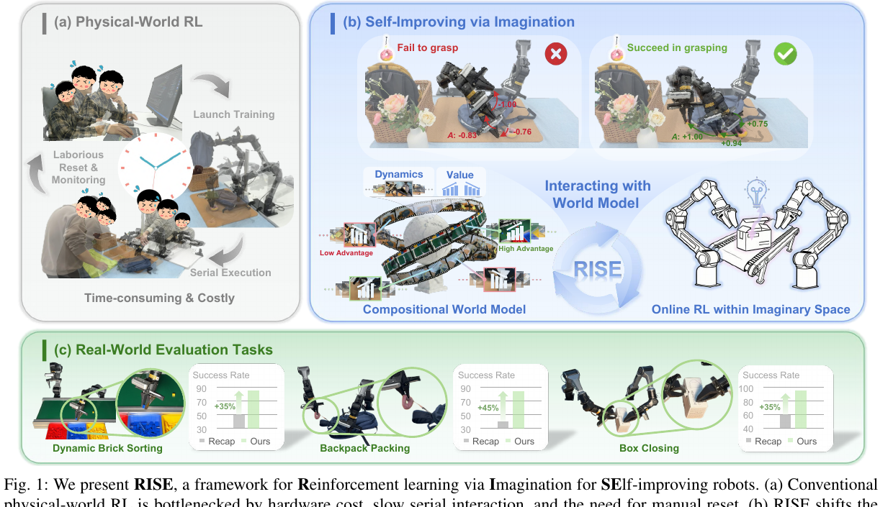
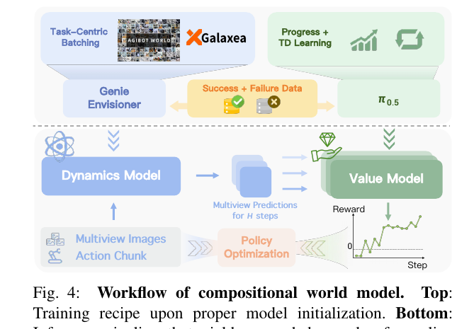
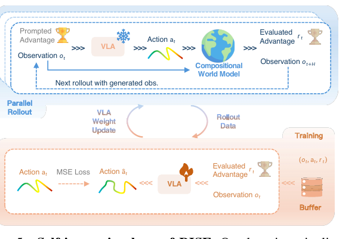
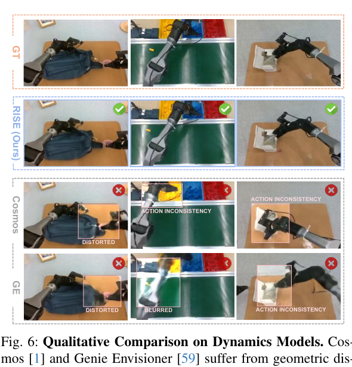

# RISE：用组合式世界模型做机器人想象强化学习

!!! info "论文信息"
    **论文题名：** RISE: Self-Improving Robot Policy with Compositional World Model。 
    **作者：** Jiazhi Yang、Kunyang Lin、Jinwei Li、Wencong Zhang、Tianwei Lin、Longyan Wu、Zhizhong Su、Hao Zhao、Ya-Qin Zhang、Li Chen、Ping Luo、Xiangyu Yue、Hongyang Li。 
    **机构：** The Chinese University of Hong Kong、Kinetix AI、The University of Hong Kong、Shanghai Innovation Institute、Horizon Robotics、Tsinghua University。 
    **时间 / 主题：** arXiv v1 2026-02-11，v2 2026-04-28；RSS 2026；世界模型、机器人强化学习、视频动力学模型、VLA 自我改进。 
    **arXiv / 官方报告：** arXiv：[2602.11075](https://arxiv.org/abs/2602.11075)；PDF：[arxiv.org/pdf/2602.11075](https://arxiv.org/pdf/2602.11075)；项目页：[opendrivelab.com/RISE](https://opendrivelab.com/RISE/)。 
    **GitHub / 项目：** GitHub：[OpenDriveLab/RISE](https://github.com/OpenDriveLab/RISE)。 
    **元数据来源与核验口径：** 来源：arXiv metadata、论文 PDF、官方项目页、官方 GitHub README；Checked Date：2026-08-08；Repro Status：Paper / official project / official code reviewed, independent reproduction not claimed。

## 原论文故事线

### 研究背景

RISE 的背景不是“视频世界模型能不能生成未来”，而是更具体的机器人训练问题：大 VLA 通过模仿学习能覆盖很多开放词汇任务，但在接触丰富、物体动态强、失败状态长尾的真实操作里，单纯行为克隆很容易暴露出 distribution shift。机器人一旦稍微抓偏、物体滑动或姿态偏离示教轨迹，策略就必须从自己造成的状态里恢复。

直接做真实机器人 on-policy RL 又很贵。它需要大量硬件交互、频繁 reset，还可能带来安全和设备磨损问题。于是论文把问题转向世界模型：如果我们能在模型里想象“执行这段动作后会看到什么”，再判断这些想象状态是否更接近成功，就可以把一部分 RL 更新搬到 imaginary space 里完成。

### 问题（Challenge）

RISE 要解决的问题是：**如何在不大量增加真实机器人交互的情况下，让 VLA policy 通过 imagined rollout 自我改进。** 这个问题有两个硬约束。第一，动力学模型必须对动作敏感，不能只生成视觉上顺滑的平均未来；同一初始状态下，不同 action chunk 应该导向不同多视角未来。第二，训练信号不能只等 episode 末端奖励，因为真实机器人任务失败形态复杂，长 horizon 终点奖励既稀疏又容易被生成误差污染。

因此 RISE 没有把 world model 做成一个单体 rollout simulator，而是拆成两个互补模块：一个 controllable dynamics model 负责预测未来观测，一个 progress value model 负责评价未来状态。前者回答“动作会把世界推向哪里”，后者回答“这个未来离成功近不近”。

### Finding

论文的关键 finding 是：**机器人世界模型未必需要在部署时替代策略，它可以在训练时充当可评估的想象环境。** RISE 不是让机器人执行世界模型生成的视频，也不是把未来视频直接解码成动作；它用世界模型为候选 action chunk 打 advantage，然后用这个 advantage 反过来训练 VLA。

这个 finding 把世界模型的角色从“生成器”换成“训练信号生产器”。组合式拆分也很重要：dynamics model 可以继承视频生成模型的多视角未来预测能力，value model 可以继承 VLA 的任务理解并学习 progress / TD 信号。两者组合后，策略获得的是 dense action-level advantage，而不是一个脆弱的长时模拟终局 reward。

### 方法

RISE 的方法有四步。第一，训练 controllable dynamics model。它从 Genie Envisioner / LTX-Video 风格视频模型初始化，加入轻量 action encoder，在 AgiBot World、Galaxea 等动作标注数据上预训练，再用具体任务数据 fine-tune，并用 Task-Centric Batching 强化同一任务内不同动作导致不同后果的可控性。

第二，训练 progress value model。它从预训练 VLA policy \(\pi_{0.5}\) 初始化，输入多视角 observation 和语言任务，输出状态进度值。训练目标同时包含按时间归一化的 progress loss 和带成功 / 失败终端信号的 TD loss。

第三，做 policy warm-up。RISE 先把 \(\pi_{0.5}\) 在离线数据上微调，包括人工示教、policy rollout 成功 / 失败轨迹、人类纠正数据。专家示教和纠正样本被视为 optimal advantage，rollout 样本则使用 value model 估计出的 advantage。

第四，进入 self-improving loop。rollout policy 在初始真实状态上以 optimal advantage 为条件提出 action chunk；dynamics model 想象未来多视角观测；value model 对 imagined observations 打分，得到 action advantage；训练 policy 学会在给定该 advantage 时输出相应动作。为了防止生成误差累积，连续 imagined interaction 最多只展开两次，并且训练时混入真实离线数据。

### 结论

论文在三个真实双臂操作任务上报告了明显提升：Dynamic Brick Sorting 从 \(\pi_{0.5}\) 的 35% 成功率提升到 85%，Backpack Packing 从 30% 到 85%，Box Closing 从 35% 到 95%。相较 RECAP，RISE 在三个任务上也分别提升到 85%、85%、95%。

消融实验支持三点：更多 offline anchor data 能提高 imagined learning 稳定性；把 online action 和 online imagined state 接入 rollout 会提高 training-time 分布覆盖；dynamics pre-training、Task-Centric Batching、progress loss 和 TD learning 都会影响最终得分。边界同样清楚：RISE 仍依赖真实任务数据、世界模型训练成本高，且 value model 和 dynamics model 在罕见状态上可能给错奖励或想错未来。

### 关键术语

- **Compositional World Model（组合式世界模型）**：把世界建模拆成 dynamics prediction 和 value evaluation，而不是一个端到端黑盒 simulator。
- **Controllable Dynamics Model（可控动力学模型）**：给定历史多视角观测和未来动作，预测未来多视角观测的视频模型。
- **Progress Value Model（进度价值模型）**：把当前或想象观测映射为任务进度 / 价值的模型。
- **Imaginary Rollout（想象 rollout）**：在 learned dynamics model 中展开候选 action，而不是让真实机器人执行。
- **Advantage Conditioning（优势条件化）**：把动作好坏离散成 advantage bin，作为 VLA 训练和 rollout 条件。
- **Task-Centric Batching（任务中心批采样）**：每个 batch 只采样少量任务、但包含同任务内更多动作变化样本，用来强化动作可控动态。
- **Offline Anchor（离线锚点）**：训练中持续混入真实示教、纠正和 rollout 数据，防止 imagined data 把策略带离真实分布。

## 论文位置

RISE 应该放在世界模型部分，而不是只放进具身智能或扩散生成部分。它的 dynamics model 确实使用视频生成 / flow matching 路线，但论文的核心问题是 world model 怎样进入机器人学习闭环。

和相邻工作相比，它的位置比较清楚：

| 路线 | 世界模型扮演的角色 | RISE 的区别 |
| --- | --- | --- |
| [Dreamer](dreamer.md) / DreamerV3 | 在 latent imagination 中训练 actor-critic | RISE 面向真实机器人 VLA，用视频 dynamics + value model 给 action chunk 打 advantage |
| [LingBot-VA 2.0](lingbot-va2.md) | 原生 video-action policy，推理时预测未来和动作 | RISE 的 world model 只在训练期使用，部署时没有额外推理开销 |
| [DreamZero](../embodied-ai/dreamzero.md) | WAM 直接作为闭环 policy | RISE 不让 world model 执行动作，而是把它当成 policy improvement 环境 |
| [Diffusion Forcing](../diffusion/diffusion-forcing.md) | 统一 next-token 与全序列扩散的生成范式 | RISE 关注动作条件未来如何变成 RL advantage |
| 普通视频生成模型 | 生成视觉上合理的未来 | RISE 要求未来对 action controllable，并能被 value model 评价 |

这篇论文的读法可以压成一句话：**世界模型不一定要替代真实环境，它也可以成为训练期的 advantage factory。**

## 总体方案

{ width="920" }

<small>图源：`RISE: Self-Improving Robot Policy with Compositional World Model`，Figure 1。原图展示 RISE 先在离线数据上训练组合式世界模型，再用 imagined rollout 产生 advantage 监督，最后更新 VLA policy。</small>

**这张图怎么读：先看真实世界和想象世界的分工。**
左侧真实世界提供离线示教、纠正和 policy rollout 数据；中间的 compositional world model 把 action-conditioned future prediction 和 progress evaluation 拆开；右侧 policy improvement 不直接消耗真实机器人交互，而是用 model-generated observations 和 value-estimated advantage 更新 VLA。

图里的关键不是“生成了视频”，而是“生成的视频被立刻拿去评价动作”。如果只生成未来，不评价 progress，它只是视频模型；如果只训练 value，不预测动作后果，它无法对候选 action 做反事实判断。RISE 的贡献正是在两者之间搭了一个训练闭环。

## Compositional World Model

论文把机器人观测写成多视角 observation：

\[
o_t = [m_t^1, \ldots, m_t^n],
\qquad
O_t = \{o_{t-C+1},\ldots,o_t\}.
\]

策略给出一个 action chunk：

\[
a_t = [a_t,\ldots,a_{t+H-1}] \sim \pi(\cdot \mid o_t,l).
\]

dynamics model 负责预测未来观测：

\[
\hat{o}_{t+1:t+H}=D(O_t,a_t).
\]

value model 负责评价状态：

\[
V(\hat{o}_{t+k},l).
\]

然后 action advantage 被定义为未来进度均值相对当前进度的提升：

\[
A(o_t,a_t,l)
=
\frac{1}{H}\sum_{k=1}^{H}V(\hat{o}_{t+k},l)-V(o_t,l).
\]

这个公式是 RISE 的核心。它避开了两种极端：不要求 dynamics model 一直 rollout 到任务终点，也不要求 value model 单独判断一个动作是否好。动作的好坏来自“执行这段 action 后，平均未来状态是否比当前更接近成功”。

{ width="760" }

<small>图源：论文 Figure 4。原图展示 dynamics model 和 value model 如何组合成 advantage estimator。</small>

**这张图怎么读：Dynamics 给反事实，Value 给标尺。**
上半部分的 dynamics model 接收当前多视角历史和 action proposal，产生 \(H\) 步未来观测；下半部分 value model 对每个 imagined frame 打 progress 分。把这些分数和当前状态比较，就得到用于 policy update 的 advantage。换句话说，world model 不输出动作，它输出“这段动作值得学到什么程度”。

## 可控动力学模型

RISE 的 dynamics model 不是从零训练。论文从 Genie Envisioner GE-base 初始化，而 GE-base 继承 LTX-Video 架构。这样做的理由很工程化：通用视频模型已经有较强视觉和时序先验；机器人任务需要在这个底座上补动作条件，而不是重学所有低层纹理和运动。

动作条件通过 lightweight action encoder 注入模型。为了让模型真的看动作，而不是只依赖视觉惯性，论文使用两类训练手段：

| 设计 | 作用 |
| --- | --- |
| 大规模 action-labeled video pre-training | 在 AgiBot World、Galaxea 等数据上学习动作和视觉变化的关系 |
| Task-Centric Batching | 一个 batch 覆盖较少任务，但包含同任务内更多不同动作样本，强化 action controllability |
| context frames stronger noise | 减少模型对条件帧复制的依赖，逼迫它使用动作信息预测未来 |
| task-specific fine-tuning | 把通用动作动态适配到 Dynamic Brick Sorting、Backpack Packing、Box Closing 等任务 |

论文还把速度作为现实约束来讨论。它报告 Cosmos 对 25 个多视角 future observations 的生成耗时超过 10 分钟，而 GE-base 小于 2 秒，约 300 倍加速。这个数字的意义不只是快，而是 imagined rollout 需要反复发生；如果每个候选动作都要分钟级生成，训练闭环就不可用。

核心训练配置如下：

| 项目 | 设置 |
| --- | --- |
| 观测 | 3 个视角，多视角 RGB，约 \(192 \times 256\) |
| 输入 / 预测帧 | 4 / 25 |
| 目标 | Flow Matching，logit-normal timestep schedule |
| 采样 | Euler solver，50 denoising steps |
| 预训练 | 16 张 H100，global batch 512，约 7 天 |
| 任务微调 | 8 张 H100，global batch 64，约 3 天 |
| 学习率 | AdamW，\(1\times10^{-4}\)，2k warm-up |

这里要注意一个边界：dynamics model 的质量直接决定 imagined advantage 的可靠性。视频越逼真不一定越适合 RL；更关键的是对动作的反事实敏感性，以及错误是否会系统性误导 value model。

## Progress Value Model

RISE 的 value model 从 \(\pi_{0.5}\) 初始化，而不是从普通图像 encoder 开始。这样它继承了 VLA 对任务语言、物体和操作进度的理解。输入是多视角 observation 和语言指令，输出是一个标量 progress / value。

训练目标有两部分。第一部分是 progress loss，把轨迹中的时间位置映射到归一化进度：

\[
\mathcal{L}_{prog}
=
\mathbb{E}\left[(V(o_t,l)-t/T)^2\right].
\]

第二部分是 TD loss，用成功 / 失败终端信号让 value 对真实结果敏感：

\[
\mathcal{L}_{TD}
=
\mathbb{E}\left[(V(o_t,l)-y_t)^2\right],
\qquad
y_t=r_t+\gamma V(o_{t+1},l).
\]

其中中间步奖励为 0，成功终止为 \(+1\)，失败终止为 \(-1\)。最终目标是：

\[
\mathcal{L}_V=\mathcal{L}_{prog}+\mathcal{L}_{TD}.
\]

这两个 loss 的互补性很重要。progress loss 稳定、密集，但可能把失败轨迹也当成“时间在前进”；TD loss 能感知成功 / 失败，但在稀疏信号下更容易不稳定。附录中的 value ablation 也显示，单独 progress 更平滑但不够敏感，单独 TD 更敏感但波动更大，组合后才适合给 imagined states 打分。

value model 训练配置：

| 项目 | 设置 |
| --- | --- |
| 初始化 | \(\pi_{0.5}\) |
| 输入 | 1 帧、3 视角 observation |
| 训练步数 | 50k steps |
| 损失 schedule | 前 10k 只用 progress，后 40k 加 TD |
| Batch / GPU | batch 64，8 张 GPU，约 1 天 |
| 折扣因子 | \(\gamma=0.995\) |
| 学习率 | AdamW，\(2.5\times10^{-5}\) |

## Policy Warm-up 与 Self-Improving Loop

RISE 不是一开始就把策略丢进想象环境。它先做离线 warm-up，数据包括专家示教、policy rollout、失败轨迹和人类纠正。专家示教和纠正数据被配上 optimal advantage；rollout 数据则由 value model 估计 advantage。这样 policy 先学会“advantage 条件和动作质量之间的关系”。

随后进入 imagined self-improving loop：

1. 从离线数据中采样一个真实初始状态；
2. rollout policy 以 optimal advantage 为条件提出 action chunk；
3. dynamics model 根据真实历史和候选 action 生成未来多视角观测；
4. value model 对 imagined observations 打分，得到 evaluated advantage；
5. 将 advantage 离散成 bins，用作 policy 训练条件；
6. 训练 policy 在给定 observation 和 evaluated advantage 时复现对应 action。

{ width="760" }

<small>图源：论文 Figure 5。原图展示 rollout stage 和 training stage 如何交替生成 imagined rollout data 并更新 VLA。</small>

**这张图怎么读：上半部分生产数据，下半部分消费数据。**
上半部分中，rollout policy 被“高 advantage”提示，先提出动作，再交给 compositional world model 评价；下半部分中，训练 policy 不追求永远输出高 advantage 动作，而是学习“给定某个 advantage 条件时，该动作是什么”。这种 advantage-conditioned imitation 让 policy 能吸收 imagined rollout 的排序信息。

论文还做了两个保守设计。第一，rollout policy 是 behavior policy 的 EMA 版本，避免数据分布剧烈抖动。第二，连续 imagined interaction 最多两次，防止 dynamics error 经过多轮生成后放大。也就是说，RISE 的 imagined RL 是短程、锚定真实状态的，不是完全脱离真实数据的开放式梦境训练。

## 数据、机器人与训练配置

三个任务都是真实双臂平台上的操作任务：

| 任务 | 数据规模 | 主要难点 |
| --- | --- | --- |
| Dynamic Brick Sorting | 3063 条人工示教 + 610 条 policy rollout | 动态积木、抓取滑动、分类和投放误差 |
| Backpack Packing | 2478 条人工示教 + 507 条 policy rollout | 软物体、包内空间、拉链和遮挡 |
| Box Closing | 2286 条人工示教 + 524 条 rollout + 540 条人类纠正 | 盒盖对齐、物体装载完整性、插舌和形变 |

硬件和控制接口也会影响读数。论文使用双臂机器人平台，腕部相机加 top-down camera，多视角 RGB 进入模型。VLA 输出长度为 50 的 action chunk，action dimension 为 14；底层控制器以约 30 Hz 执行 joint commands，并用 Temporal Ensembling 平滑新旧 action chunk。

这些细节说明 RISE 的提升不是纯算法闭门造车。它依赖一整套真实数据、视频动力学、value learning 和动作块执行机制。世界模型在部署时没有额外 inference overhead，但训练它本身并不便宜。

## 实验与结论

主实验最直接的结论是：RISE 在三个任务上都比 \(\pi_{0.5}\)、DAgger、PPO、DSRL 和 RECAP 更高。

| 方法 | Dynamic Brick Sorting Success / Score | Backpack Packing Success / Score | Box Closing Success / Score |
| --- | --- | --- | --- |
| \(\pi_{0.5}\) | 35.00 / 8.28 | 30.00 / 4.25 | 35.00 / 7.50 |
| \(\pi_{0.5}\) + DAgger | 15.00 / 6.10 | 50.00 / 7.00 | 40.00 / 7.50 |
| \(\pi_{0.5}\) + PPO | 10.00 / 7.68 | 35.00 / 5.88 | 10.00 / 4.75 |
| \(\pi_{0.5}\) + DSRL | 10.00 / 6.65 | 10.00 / 3.50 | 10.00 / 7.63 |
| RECAP | 50.00 / 9.00 | 40.00 / 6.13 | 60.00 / 8.13 |
| RISE | **85.00 / 9.78** | **85.00 / 9.50** | **95.00 / 9.88** |

表格怎么读：RISE 的优势不只是 score 更高，而是 success rate 在三个任务上都出现大幅提升。PPO / DSRL 在这些真实任务上反而很弱，说明直接套真实机器人 RL 或离线 RL baseline 并不能自动解决 VLA 的分布偏移。RISE 的改进来自“动作后果预测 + 进度评价 + advantage-conditioned policy update”这一整套闭环。

### 消融：offline ratio

论文在一个子任务设置里改变 offline data ratio。结果显示，真实数据锚点太少时，imagined learning 很不稳；ratio 提高后 pick / sort / complete 整体变好，但不是越高越单调。

| Offline ratio | Pick Success | Sort Accuracy | Complete Success | Score |
| --- | ---: | ---: | ---: | ---: |
| 0.1 | 15.00 | 83.33 | 5.00 | 1.35 |
| 0.3 | 78.75 | 80.95 | 25.00 | 7.03 |
| 0.6 | 90.00 | 87.50 | 50.00 | 8.32 |
| 0.9 | 90.00 | 80.56 | 30.00 | 7.90 |

读数边界：这张表不是说 0.6 是通用最优比例，而是说明 RISE 的 imagined data 需要真实数据约束。offline anchor 太低，world model 和 policy 都容易偏离真实状态分布；offline anchor 太高，policy improvement 的探索和在线想象比例又可能不足。

### 消融：online action 与 online state

| 设置 | Pick Success | Sort Accuracy | Complete Success | Score |
| --- | ---: | ---: | ---: | ---: |
| None | 80.00 | 76.56 | 35.00 | 6.98 |
| + online action | 96.25 | 84.42 | 40.00 | 8.73 |
| + online action + online state | **98.75** | **92.41** | **70.00** | **9.43** |

这个消融说明，RISE 不只是把离线数据重新标分。让 rollout policy 生成新 action，并把 imagined state 接入后续训练，能显著提高策略看到的状态-动作组合。但论文同时限制 consecutive imagined interaction，说明这种收益建立在短程想象和真实状态锚定上。

### 消融：模块贡献

| 去掉的模块 | Pick Success | Sort Accuracy | Complete Success | Score |
| --- | ---: | ---: | ---: | ---: |
| Dynamics w/o Pre-train | 97.50 | 60.26 | 15.00 | 7.43 |
| Dynamics w/o Task-Centric | 93.75 | 89.33 | 40.00 | 8.78 |
| Value w/o Progress | 95.00 | 86.84 | 50.00 | 8.78 |
| Value w/o TD Learning | 98.75 | 72.15 | 35.00 | 8.38 |
| RISE all | **98.75** | **92.41** | **70.00** | **9.43** |

这张表最有信息量的是 complete success。很多 ablation 仍能 pick 成功，但很难完成完整任务。这说明 RISE 的关键不是局部动作更像示教，而是让 value 和 dynamics 一起约束多步任务进度。

## Dynamics Model 的质量证据

论文除了真实任务结果，还比较了 dynamics model 的预测质量。

{ width="760" }

<small>图源：论文 Figure 6。原图展示 Cosmos、Genie Envisioner、RISE dynamics 等模型在不同视角和时间步的未来预测可视化。</small>

**这张图怎么读：看动作后的局部物理变化，不只看画面清晰度。**
用于 RISE 的 dynamics model 需要预测手、物体和容器随动作变化的细节。图中如果只看背景纹理，很容易高估模型；真正应该看的是抓取位置、物体移动方向、遮挡恢复和接触后的形变是否跟 action 一致。

定量指标上，RISE dynamics 在真实机器人任务数据和 Bridge 数据上整体优于 Cosmos 与 GE。一个值得保留的细节是：在真实任务 Experiment #1 中，RISE w/o Task-Centric 的 FVD 数值比 full RISE 更低，但 full RISE 在 PSNR、LPIPS、SSIM 和 EPE 上更好。也就是说，生成指标之间并不完全一致，最终仍要看 imagined advantage 能否带来 policy improvement。

| 模型 | PSNR | LPIPS ↓ | SSIM | FVD ↓ | EPE ↓ |
| --- | ---: | ---: | ---: | ---: | ---: |
| Cosmos | 21.17 | 0.14 | 0.79 | 97.90 | 1.21 |
| GE | 21.16 | 0.11 | 0.79 | 85.72 | 1.05 |
| RISE w/o Task-Centric | 22.67 | 0.08 | 0.80 | **61.22** | 0.68 |
| RISE | **23.90** | **0.07** | **0.82** | 66.84 | **0.54** |

表格怎么读：PSNR / LPIPS / SSIM 更偏视觉重建质量，FVD 更偏分布级视频质量，EPE 更关心运动误差。机器人 world model 要同时关心这些，但最终价值不是“视频指标最好”，而是“动作条件未来足够可靠，可以训练策略”。

## 和扩散生成路线的关系

RISE 的 dynamics model 属于视频生成模型路线，训练目标使用 flow matching，采样用多步 solver；因此它和 [Wan2.1](../diffusion/wan.md)、[Diffusion Forcing](../diffusion/diffusion-forcing.md)、[CausVid](../diffusion/causvid.md) 这类视频扩散工作有技术联系。

但 RISE 的研究问题更接近世界模型和机器人学习。扩散生成论文通常关心更清晰、更长、更快的视频；RISE 关心的是这些视频能否承载 action-conditioned counterfactual，并通过 value model 转成 policy gradient 近似信号。它提醒我们：世界模型的生成质量不能只靠 FVD 或 LPIPS 判断，还要看生成结果是否能改变决策。

更具体地说，RISE 把视频生成模块接进了三层机器人闭环：

| 层级 | 生成模型提供什么 | 机器人学习需要什么 |
| --- | --- | --- |
| 表示层 | 多视角未来观测 | 保留接触、抓取、物体位姿和任务相关状态 |
| 反事实层 | 同一历史下不同动作的未来分叉 | action controllability，而不是平均未来 |
| 优化层 | imagined observations | progress value 评价后形成 advantage |

这也是它比“生成视频辅助机器人”更进一步的地方：视频不是展示用结果，而是 policy update 的中间证据。

## 局限与风险

RISE 的局限不小，主要有六类。

第一，world model error 会进入 policy update。论文通过短 rollout、真实数据混合和 EMA rollout policy 缓解，但没有消除错误累积。第二，value model 在罕见失败状态上可能给错分，尤其是软物体、遮挡和接触变形场景。第三，任务范围仍是三个真实双臂操作任务，不能直接推出开放世界所有机器人任务都适用。

第四，训练成本高。dynamics pre-training 和 fine-tuning 都需要多张 H100，RISE 只是部署时没有额外 world model inference overhead，不是训练免费。第五，它仍需要任务相关 offline data，包括示教、policy rollout 和人类纠正。第六，论文没有证明长 horizon imagined RL 可以无限延伸；相反，作者明确限制连续想象次数，说明当前方法更适合短程 advantage estimation。

这些边界并不削弱论文价值，反而说明它的工程姿态很务实：先让世界模型在短程、可评价、真实状态锚定的区域里产生收益，而不是宣称一个生成模型可以完整替代真实环境。

## 主要贡献

RISE 的贡献可以归纳为三点。

第一，它提出了一个面向真实机器人 VLA 的 self-improving framework：不靠大量新增真实交互，而是在 learned world model 中生成短程 imagined rollout，给 action chunk 估计 advantage。

第二，它把 world model 拆成 controllable dynamics model 和 progress value model。这种拆分让视频模型负责“预测动作后果”，让 VLA 初始化的 value model 负责“理解任务进度”，比单体模拟器更容易对齐训练目标。

第三，它在真实双臂任务中展示了强结果，并用 offline ratio、online action / state、dynamics pre-training、Task-Centric Batching、progress / TD loss 等消融说明每个模块的作用。对世界模型研究来说，这篇论文最重要的不是某个指标，而是提供了一种把生成式世界模型接入 policy improvement 的清晰接口。

## 阅读结论

读 RISE 时不要把它理解成“又一个机器人视频生成模型”。更准确的读法是：它把视频动力学模型变成训练期的反事实环境，再用 progress value model 把想象未来压缩成 action advantage。

这篇论文对世界模型主线的启发是，world model 的价值可以有多种落点：可以像 Dreamer 那样在 latent imagination 里训练 actor-critic，可以像 DreamZero 那样直接变成 WAM policy，也可以像 RISE 这样只在训练期生产 dense supervision。对机器人来说，第三种路线尤其现实，因为它保留了真实策略部署的简洁性，同时把昂贵的自我试错搬进了模型空间。

最需要保留的怀疑是：RISE 的成功建立在短程、任务相关、真实数据锚定的 imagined rollout 上。它证明了组合式世界模型能显著改善三个真实操作任务，但还没有证明世界模型可以在没有真实数据刷新、没有任务 fine-tuning、长 horizon 完全开环的条件下可靠训练机器人。

## 外部精读

- arXiv abstract：[RISE: Self-Improving Robot Policy with Compositional World Model](https://arxiv.org/abs/2602.11075)
- 论文 PDF：[arxiv.org/pdf/2602.11075](https://arxiv.org/pdf/2602.11075)
- 项目页：[OpenDriveLab RISE](https://opendrivelab.com/RISE/)
- 官方代码：[OpenDriveLab/RISE](https://github.com/OpenDriveLab/RISE)
