# RISE：用组合式世界模型做机器人想象强化学习

!!! info "论文信息"
    **论文题名：** RISE: Self-Improving Robot Policy with Compositional World Model。 
    **作者：** Jiazhi Yang、Kunyang Lin、Jinwei Li、Wencong Zhang、Tianwei Lin、Longyan Wu、Zhizhong Su、Hao Zhao、Ya-Qin Zhang、Li Chen、Ping Luo、Xiangyu Yue、Hongyang Li。 
    **机构：** The Chinese University of Hong Kong、Kinetix AI、The University of Hong Kong、Shanghai Innovation Institute、Horizon Robotics、Tsinghua University。 
    **时间 / 主题：** arXiv v1 2026-02-11，v2 2026-04-28；RSS 2026；世界模型、机器人强化学习、视频动力学模型、VLA 自我改进。 
    **arXiv / 官方报告：** arXiv：[2602.11075](https://arxiv.org/abs/2602.11075)；PDF：[arxiv.org/pdf/2602.11075](https://arxiv.org/pdf/2602.11075)；项目页：[opendrivelab.com/RISE](https://opendrivelab.com/RISE/)。 
    **GitHub / 项目：** GitHub：[OpenDriveLab/RISE](https://github.com/OpenDriveLab/RISE)。 
    **元数据来源与核验口径：** 来源：arXiv metadata、论文 PDF、官方项目页、官方 GitHub README；Checked Date：2026-08-08；Repro Status：Paper / official project / official code reviewed, independent reproduction not claimed。

## 世界模型要成为训练环境，还必须能判断动作好在哪里

机器人已经学会抓取积木，并不等于它能在传送带移动时追踪、抓住，再按颜色放进正确的箱子。示范里没有出现“抓空以后怎么办”，模仿学习就很难凭空补出恢复动作。真实在线强化学习可以收集这类经验，却要付出机械臂执行、人工监控、失败处理和环境复位的成本。

RISE 把后续试错转入学到的视觉环境。策略提出动作，动力学模型生成动作之后的多视角观察，价值模型判断这些状态是否推进任务，再把评价结果变成策略训练条件。它的目标不只是在电脑里生成机器人视频，而是让想象中的成功和失败，最终改变真实部署时的动作分布。[原文 §I](https://arxiv.org/pdf/2602.11075#page=2)

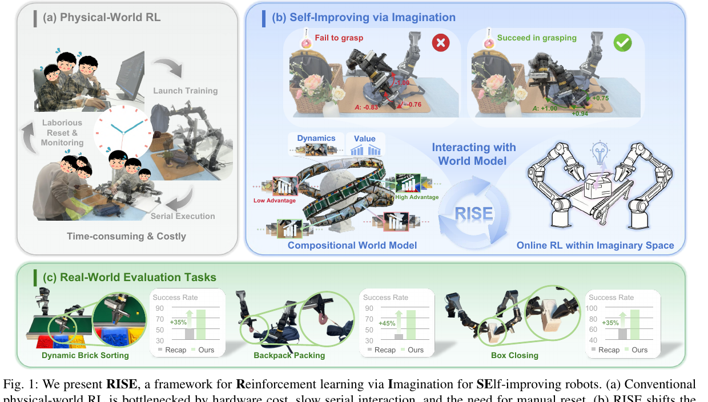{ width="920" }

*原文 Figure 1。左侧是真实世界 RL 的交互与复位成本，中央是由动力学和价值组成的想象环境，下方是三个真实任务的最终检验。*

这里有两个需要分别检查的接口。视频要随着候选动作改变，画面清楚却与动作无关的预测没有训练价值；评价要在中途识别进展和细小失败，等到任务结束才给标签又太稀疏。前者出错，策略会利用虚假的视觉后果；后者出错，想象轨迹就必须滚到很远才有训练信号。

Compositional World Model 因而拆成动力学 $D$ 与价值 $V$，分别采用适合视觉生成和任务判断的预训练网络。两者训练好后，在策略自改进期间保持冻结。最终部署只运行改进后的 VLA，世界模型不在线参与动作选择，所以它增加的是训练成本，没有为真实控制额外增加视频预测和价值评估调用。[原文 §III-A、Appendix XI-C](https://arxiv.org/pdf/2602.11075#page=16)

## 先把观察、动作和评价的接口分清

令 $o_t=[m_t^1,\ldots,m_t^n]$ 表示当前多相机观察，$O_t$ 表示一段观察历史，$\ell$ 是任务语言。策略输出未来 $H$ 步动作块 $\mathbf a_t=[a_t,\ldots,a_{t+H-1}]$。动力学模块的概念接口为

$$
\hat o_{t+1},\ldots,\hat o_{t+H}=D(O_t,\mathbf a_t).
$$

它要回答给定动作会造成什么后果。同一初始状态下，朝蓝色箱子移动和朝黄色箱子移动都可能生成清晰视频，但在蓝色积木分拣任务里，两者后果必须不同。这种 action controllability 决定了预测能否用作学习环境。[原文 Eq. 1](https://arxiv.org/pdf/2602.11075#page=2)

价值模型则接收单个时刻的多视角观察与指令，给出 $V(o_t,\ell)$。它不必承担整段视频生成，却必须知道当前场景对于指定任务意味着多少进展。两者组合后，RISE 用未来块内平均价值相对起点的提升作为优势。

$$
A(o_t,\mathbf a_t,\ell)=
\frac1H\sum_{k=1}^{H}V(\hat o_{t+k},\ell)-V(o_t,\ell).
$$

平均未来值使一个动作块的评价不只依赖最后一帧。比如抓取后短暂遮挡可能让某帧判断波动，整个块的信息会共同参与标签。但它仍是论文定义的 chunk-wise advantage，不是一般强化学习中带完整折扣累计奖励的 $Q-V$ 原式，也不是 GAE。[原文 Eq. 2](https://arxiv.org/pdf/2602.11075#page=3)

这一设计允许只模拟短动作块，通过价值变化判断方向，不必每次把背包拉链或关盒任务一直模拟到终点。代价在于，价值模型的排序质量会直接影响策略更新；动作产生的图像与图像获得的高分必须都可信。

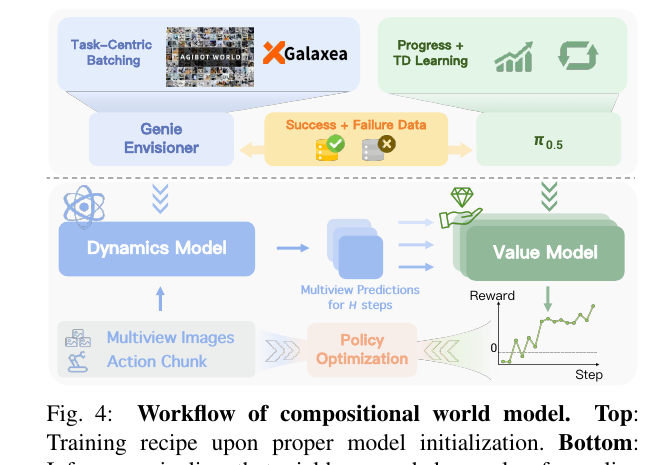{ width="760" }

*原文 Figure 4。上方分别训练 dynamics 与 value；下方将动作条件预测交给价值模型评价，再送往 policy optimization。两种能力来自不同 backbone 和训练目标。*

## 动力学模型的关键是同一场景里不同动作产生不同后果

### 从 GE-base 出发，控制动作进入视频生成

动力学模型初始化自 Genie Envisioner 的 GE-base，继承 LTX-Video 系列的高效生成结构。这里的 GE-base 是机器人视频生成基础模型，不应与早期 Genie 的无动作标签游戏环境方法混为一谈。RISE 增加轻量 action encoder，再在 Agibot World 和 Galaxea 的机器人动作标注数据上预训练，随后对目标任务微调。[原文 §III-A](https://arxiv.org/pdf/2602.11075#page=4)

选择 GE 还考虑了想象训练的吞吐。原文称生成 25 个多视角观察时，Cosmos 需要超过 10 分钟，GE 少于 2 秒，给出约 300× 的速度差。这是作者所用配置下的生成比较，报告此处没有足够配置细节支持任意 Cosmos/GE 版本、硬件和采样设置都具有同样倍数。实际意义在于，若每次想象都要等数分钟，在线生成训练数据会成为主要瓶颈。

RISE 对历史 context frames 加入比原 GE 训练更强的噪声，以降低对运动模糊与视觉伪影的敏感性。这样的输入扰动同时针对真实录制中的不完美图像和自回归想象里已经带有误差的历史；它并不保证错误被消除，而是让模型不要只依赖干净上下文。

### Task-centric batching 改变一个 batch 内的信息密度

异构机器人数据横跨不同任务和环境。如果每个 batch 都主要由互不相关的场景组成，优化时很大一部分变化来自背景、对象和外观，细小动作差异容易被淹没。

Task-centric batching 每次只从较小一部分任务采样，同时增加同任务、相近场景但动作不同的样本。它优先展示“世界差不多，动作变了，结果就应当变”的关系，使动作条件在预测中更有辨识度。[原文 §III-A](https://arxiv.org/pdf/2602.11075#page=4)

这项设计改变的是 batch 采样结构。论文没有把它定义成新的 task-centric loss，也没有提出用空间遮罩删掉无关背景。报告中的消融能够检验该采样策略是否有用，不能把解释中的“过滤干扰”写成网络真的执行了显式背景过滤。

### 预测频率和动作频率不能混为一个数字

附录给出具体实现。模型读取 3 个相机视角，每帧 $192\times256$；每次输入 4 帧历史，预测 25 帧。预训练视频采样频率为 30 Hz，任务微调为 15 Hz。它采用 flow matching，训练噪声时间来自 logit-normal 分布。

$$
\operatorname{logit}(s)\sim\mathcal N(0.2,1.0^2).
$$

context noise level 为 $\sigma=0.2$，AdamW 学习率 $10^{-4}$，前 2K steps warm-up，随后保持常数。预训练与任务微调分别为 120K、50K steps；推理用 Euler solver，50 个 denoising steps。[原文 Appendix XI-B、Table VIII](https://arxiv.org/pdf/2602.11075#page=17)

这里的 50 次去噪与策略 50 步动作是不同计数。控制器 30 Hz 下 50 个动作约覆盖 1.67 秒，微调视频 15 Hz 下 25 帧也约覆盖相同量级的时间。这个名义跨度有助于理解为何动作数量与预测帧数不同，具体重采样和对齐仍不能只凭概念公式 Eq. 1 推断成每个动作必有一个预测图像。

## 价值模型必须同时平滑和对失败敏感

### 时间进度是一个稳定的起点

价值网络从 π0.5 初始化，以保留机器人场景理解与多视角输入能力。它看到的是同一时刻的三视角观察和任务指令，输出一个标量。与重新训练一个泛用单图 VLM 相比，这种初始化直接匹配机器人的感知接口。

第一步使用专家轨迹的归一化时间 $t/T$ 作为 progress 监督。

$$
\mathcal L_{\mathrm{prog}}=
\mathbb E_{(o_t,\ell)\sim\mathcal D_{\mathrm{exp}}}
\left(V(o_t,\ell)-\frac{t}{T}\right)^2.
$$

成功示范通常从未完成走向完成，因此时间比例提供便宜、稠密且有整体方向的训练目标。它无需逐帧手工标注任务进度，却依赖专家轨迹本身接近正确执行。[原文 Eq. 5](https://arxiv.org/pdf/2602.11075#page=5)

问题是，时间晚并不代表状态好。拉链拉了更久，可能其实卡住；夹爪已经移动到箱子上方，积木可能根本没抓住。仅做 progress regression 容易输出平滑上升的值，无法区分这些细小但决定成败的变化。

### TD 把成败结果传回中间状态

第二条监督使用成功与失败轨迹。

$$
\mathcal L_{\mathrm{TD}}=
\mathbb E_{(o_t,\ell,o_{t+1})\sim\mathcal D}
\left(V(o_t,\ell)-y_t\right)^2,
\qquad y_t=r_t+\gamma V(o_{t+1},\ell).
$$

中间步 $r_t=0$，成功结束给 $+1$，失败结束给 $-1$；附录中折扣 $\gamma=0.995$。最终目标为 $\mathcal L_V=\mathcal L_{\mathrm{prog}}+\mathcal L_{\mathrm{TD}}$。先训练 10K steps progress，再训练 40K steps 两项联合，让稳定的粗进度先形成，再加入对失败后果的区分。[原文 Eq. 6、Table IX](https://arxiv.org/pdf/2602.11075#page=17)

原文没有在这个公式里展开 terminal masking、target network 或 stop-gradient 的实现细节，因此不能擅自补成某个特定 actor-critic 实现。可以明确的是，两类监督分别承担稠密结构与成败敏感性，并最终服务于想象状态排序。

Figure 14 的重点是绿色成功片段与红色失败片段附近的曲线，而不只是整体向上还是向下。抓空、未释放物体和盒盖卡住等细节，应该在值上产生相应变化。

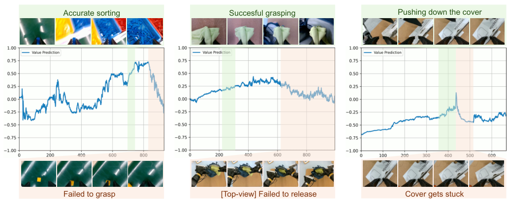

*原文 Figure 14。价值模型对成功分拣、稳定抓取和压盖给出增长信号，对抓空、未松手、盒盖卡住作出下降或停滞反应。*

Figure 15 再把两种损失拆开。Progress-only 曲线更平滑，但在关键插入步骤附近辨别力弱；TD-only 更敏感，却在反复尝试时波动明显；联合训练在这组示例中兼顾两者。

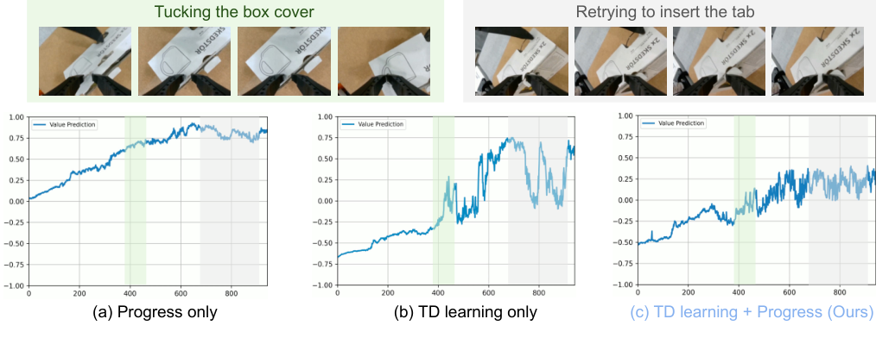

*原文 Figure 15。绿色区段对应有利行为，灰色区段对应重试。比较的是状态判断的反应与稳定性，图中曲线本身不是价值校准误差统计。*

这些定性例子说明损失分工有实际对应，后面的策略消融再检验价值差异是否影响任务成功。它们仍不证明每个想象画面的分数都正确，特别是生成器产生训练数据中罕见的物理错误时，价值模型也可能误判。

## 优势条件化怎样替代直接优化每个动作的似然比

RISE 延续 RECAP 类方法，将策略学习写成对高优势行为的条件生成。设 $\pi_{\mathrm{ref}}$ 为参考策略，$I$ 表示改善事件，目标分布按优势相关的改善概率加权。

$$
\hat\pi(\mathbf a_t\mid o_t,\ell)
\propto \pi_{\mathrm{ref}}(\mathbf a_t\mid o_t,\ell)
\,p\!\left(I\mid A^{\pi_{\mathrm{ref}}}(o_t,\mathbf a_t,\ell)\right)^\beta.
$$

因为改善判断通过动作优势决定，Bayes 关系把改善概率写成条件与非条件策略的密度比。

$$
p(I\mid\mathbf a_t,o_t,\ell)
\propto
\frac{\pi_{\mathrm{ref}}(\mathbf a_t\mid I,o_t,\ell)\,
 p(I\mid o_t,\ell)}
{\pi_{\mathrm{ref}}(\mathbf a_t\mid o_t,\ell)}.
$$

取 $\beta=1$，参考策略的无条件项相消，$p(I\mid o_t,\ell)$ 对动作固定，可以并入归一化常数，得到按改善条件生成动作的目标。论文实际将优势离散成档位，用档位作为策略输入；部署时请求高档位，就偏向训练中与高优势相对应的动作。[原文 Eq. 3–4](https://arxiv.org/pdf/2602.11075#page=3)

这个推导解释了为什么可以在通用 flow-matching 动作训练框架中学习，而无需为策略每一步去噪专门建立 PPO 的概率比优化。它没有证明学到的高档位在真实世界一定改进，因为优势估计、生成动力学和条件策略拟合都可能有误差。

还有一个关键点，低质量动作不必全部丢掉。它们带着低优势标签进入训练，让模型学到不同质量条件下的行为差异；如果把所有动作都标成最高档，再请求高档位，就失去了这种区分。

## Warm-up 先建立动作基础，也建立优势条件的含义

策略从预训练 π0.5 出发，在目标任务离线数据上 warm-up。数据包括专家示范、旧策略的成功与失败 rollout，以及人工接管纠错。研究者希望先得到物理上可行的行为基础，再开始用世界模型扩大探索。

标签分配没有对所有来源一视同仁。策略 rollout 使用真实记录中的未来帧，通过价值模型和 Eq. 2 计算优势；专家示范与人工纠错直接赋最优标签 1。作者早期实验发现，连专家数据都用学到的价值重新标注，结果比只标 rollout 更差。[原文 §III-B](https://arxiv.org/pdf/2602.11075#page=5)

附录还指出两点与 RECAP 实践的差别。RISE 将优势分成 10 个均匀区间，而原始 RECAP 方法采用二元分档；同时，RISE 的 π0.5 起点没有经过 π0.6 那样的 advantage-conditioned pre-training，所以最高档专家锚点对学习条件接口更重要。[原文 Appendix XI-D](https://arxiv.org/pdf/2602.11075#page=16)

这里的“最优标签 1”是一项训练约定，并不表示专家每个动作都在任意物理状态下有理论最大优势。它把人类示范用作高质量参考，同时让失败 rollout 教会模型低质量行为的样子。

## 自改进闭环更新策略，世界模型保持冻结

Figure 5 需要沿上下两条路径看。上方 rollout 先请求好动作，再评价实际想象后果；下方训练使用评价得到的档位，而不是把请求时的高档位原封不动保存成标签。

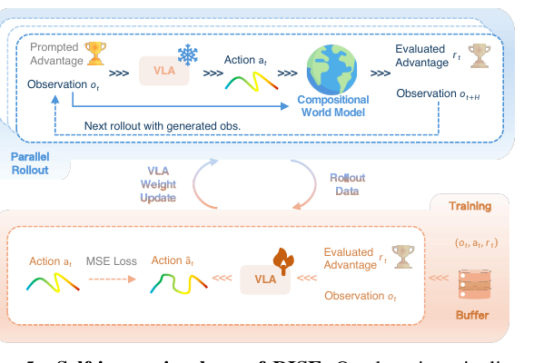{ width="760" }

*原文 Figure 5。Prompted Advantage 表达期望，Evaluated Advantage 表达世界模型对这次动作的评价，两者在训练数据中承担不同角色。*

一次迭代先从离线数据抽取初始观察，rollout policy 在优势条件 1 下提出动作。

$$
\hat{\mathbf a}_t=\pi_{\mathrm{rollout}}(1,o_t,\ell).
$$

动力学接收历史与动作，产生未来观察；价值模型再计算实际优势，将它分入 10 档。系统保存 $(o_t,\hat{\mathbf a}_t,A_t)$，让行为策略在条件 $A_t$ 下学习生成这一动作，采用原有 flow-matching 训练准则。[原文 Eq. 7–8](https://arxiv.org/pdf/2602.11075#page=5)

因此“请求高优势”不等于这次动作已经被认证为高优势。策略仍可能分错箱子或让拉链卡住，评价器会把这种动作分到较低档。反向训练使用的是被评价的标签，能够保留探索失败提供的信息。

RISE 还让生成状态成为下一次 rollout 的输入。仅在固定离线观察上换动作，主要扩展动作分布；继续从自己的后果出发，才会进入示范里没有出现的状态，学习偏离后的行为。每个离线起点最多连续交互两次，限制生成误差积累，而非无限滚动到任务成功。

rollout policy 通过行为策略参数的 EMA 更新，decay 为 0.995；训练 batch 继续混入离线标签数据，保留真实行为锚点。动力学与价值模块在整个自改进阶段冻结，更新对象是策略，不能把“self-improving”写成三个模型一起持续自我训练。[原文 Appendix XI-C–D、Table X](https://arxiv.org/pdf/2602.11075#page=17)

这也不同于将视频预测和价值梯度端到端穿过世界模型直接优化动作。论文描述的接口是生成轨迹、评价优势、离散标注、条件训练；它依赖样本与标签传递学习信号。

## 同一起点的成功和失败，必须由动力学与价值同时区分

Figure 16 将组合式设计放在一个具体例子里检验。起点是左手已经抓住蓝色积木，后续既可以放进蓝色箱，也可以误放进黄色箱。

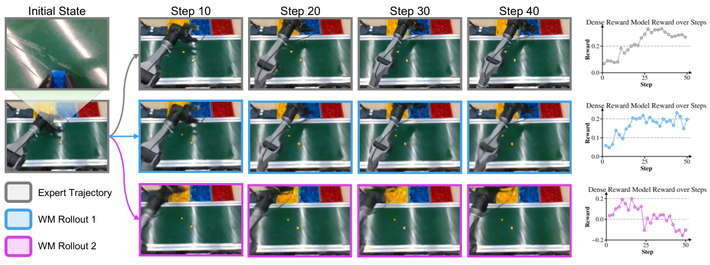

*原文 Figure 16。第一行为专家轨迹，第二行为正确想象 rollout，第三行为错误 rollout；右侧曲线显示动作后果获得的学习信号。*

正确轨迹中的机械臂接近蓝色箱子，评价随任务推进改善；错误轨迹在拿起积木时仍可能获得积极变化，但转向错误箱子后评价降低。图中所谓 reward curve 是模型产生的评价信号，不能当成外部真实奖励的逐帧人工标注。

这个例子的价值在于把抓取与分拣分开。若动力学不能跟随动作，两条轨迹可能都生成“正确放置”；若价值只看抓取进度，两条轨迹都可能高分。组合模型只有同时保持动作差异与任务语义差异，才会给策略提供有效的改进标签。[原文 Appendix XIII](https://arxiv.org/pdf/2602.11075#page=18)

## 三项真实任务怎样测量，机器人又如何执行动作块

实验使用双臂 AgileX 平台，顶部相机提供全局观察，两只腕部相机补充局部接触视角。主文将每侧概括为 7-DoF，附录 Figure 11 进一步注明是每侧 6-DoF arm 加 1-DoF gripper，两侧合计 14 维动作，并非两只各有七个机械臂关节的机器人。

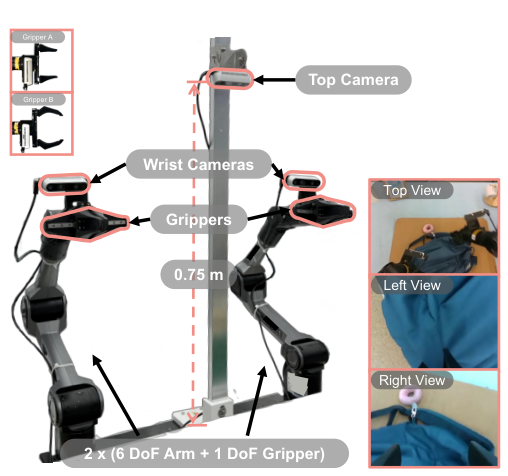

*原文 Figure 11。顶部相机高约 0.75 m；积木与背包使用 Gripper A，关盒使用更适合精细操作的 Gripper B。*

控制使用绝对关节命令。VLA 在较低推理频率下预测 $H=50$ 步动作，控制器以 30 Hz 执行。新块到达时，与 buffer 中尚未执行的旧动作重叠，采用时间变化的线性权重进行 temporal ensembling，重叠前段偏重旧计划以保证连续，后段逐渐偏向新计划以响应最新观察。[原文 Appendix X-B](https://arxiv.org/pdf/2602.11075#page=15)

因此 30 Hz 是低层命令执行频率，不能写成 VLA 每秒进行 30 次完整推理。异步融合仍是部署系统的一部分；“世界模型没有推理额外开销”也不表示动作生成和控制调度没有成本。

三个任务分别检验不同困难。Dynamic Brick Sorting 在运行中的传送带上抓取积木，并放到颜色匹配的箱子；Backpack Packing 要打开背包、放入衣物、提起整理，再拉上拉链；Box Closing 要装入杯子、折好盒盖并将锁片插入。所有结果按 20 次自主试验统计，另外记录满分 10 分的阶段分数。

| Task | Stage-wise scoring rule | 完成条件的含义 |
|---|---|---|
| Conveyor / Dynamic Brick Sorting | 每次抓住积木 1.0；放入匹配箱子再计 1.5；总分上限 10 | 抓取与正确分拣分别评价 |
| Backpack Packing | 打开并放入物品 2.5；提起整理累计 5.0；拉链一半累计 7.5；完全拉好累计 10.0 | 后面的柔性物体操作决定完整成功 |
| Box Closing | 装杯累计 2.5；折侧翼累计 5.0；折后盖累计 7.5；锁片插入累计 10.0 | 精细对齐和插入是最后一关 |

*原文 Table VII。背包和盒子的数值是累计里程碑分数，不能将 2.5、5、7.5、10 相加成总分。*

这种评分能区分完全失败、部分完成和最终成功。比如抓取大多正确但颜色分错，会有较高抓放率却较低完整成功；盒盖折好但锁片没进去，也可能得到较高阶段分数。完整成功率与阶段分数需要一起读。[原文 Appendix X-A](https://arxiv.org/pdf/2602.11075#page=15)

## 真实数据仍是整个闭环的基础

RISE 没有在自改进阶段继续进行大量物理试错，但在开始前使用了相当数量的目标任务数据。

| Task | Human demonstrations | Policy rollouts | Human corrections explicitly listed |
|---|---:|---:|---:|
| Dynamic Brick Sorting | 3,063 | 610 | 本表未另列数量 |
| Backpack Packing | 2,478 | 507 | 本表未另列数量 |
| Box Closing | 2,286 | 524 | 540 |

*原文 Appendix XI-A 的数据条目数；策略 rollout 包含成功与失败，不能全部计为成功示范。*

动力学和价值模型使用相同任务的专家与 rollout 数据，策略训练另外纳入 DAgger 纠错经验。它改变了新增探索数据的获取方式，并没有取消真实数据对视觉、动作和价值的锚定作用。[原文 §III-D](https://arxiv.org/pdf/2602.11075#page=6)

各基线都从 π0.5 初始化，但数据与训练方式按方法而异。纯 π0.5 只做专家示范模仿；DAgger 增加人类纠错；PPO 使用真实 rollout 的噪声、log probabilities 与优势做策略更新；DSRL 冻结基础 VLA，优化输入噪声，先用 10 条基础策略轨迹初始化，再进行 70 个 online steering episodes。[原文 Appendix XI-E](https://arxiv.org/pdf/2602.11075#page=16)

DAgger 还受硬件切换约束，采用单次接管协议，人类在即将失败时接手并完成本回合。因此这个基线不是任意频繁切换的人机共同控制。RECAP 因原 π0.6 不可用，在相同 π0.5 骨干上重建，使用与 RISE 对应的离线语料和 warm-up 配方。结果反映这些实现条件下的 post-training 方法差异，不能直接当作官方 π0.6 系统的比较。

## 主结果显示大幅提升，但并非每种在线 RL 都自然受益

| Method | Brick Sorting Succ. (%) | Brick Score | Backpack Succ. (%) | Backpack Score | Box Closing Succ. (%) | Box Score |
|---|---:|---:|---:|---:|---:|---:|
| π0.5 | 35.00 | 8.28 | 30.00 | 4.25 | 35.00 | 7.50 |
| π0.5 + DAgger | 15.00 | 6.10 | 50.00 | 7.00 | 40.00 | 7.50 |
| π0.5 + PPO | 10.00 | 7.68 | 35.00 | 5.88 | 10.00 | 4.75 |
| π0.5 + DSRL | 10.00 | 6.65 | 10.00 | 3.50 | 10.00 | 7.63 |
| RECAP on π0.5 | 50.00 | 9.00 | 40.00 | 6.13 | 60.00 | 8.13 |
| **RISE** | **85.00** | **9.78** | **85.00** | **9.50** | **95.00** | **9.88** |

*原文 Table I。Success 是整项任务成功，Score 满分为 10。*

相对 RECAP，RISE 在三项任务的提升分别为 $85-50=35$、$85-40=45$、$95-60=35$ 个百分点。原文正文把背包提升概括为 40%，与 Table I、摘要和 Figure 1 的 45 个百分点不一致；这里按表格可复算的值解释。[原文 §IV-B](https://arxiv.org/pdf/2602.11075#page=6)

成绩还说明，不是加入一个“在线 RL”标签就必然改进。PPO 和 DSRL 在积木任务都从基础策略的 35% 降到 10%，DAgger 在同一任务也下降，但在背包上提高。接触丰富任务中的稳定优化、纠错数据分布和反馈质量，会改变方法是否有效。这些结果不能扩大为 PPO 或 DAgger 在所有机器人任务上都不适用。

RISE 的阶段分数接近 10，表明完整成功增加的同时，失败回合也往往推进到较后阶段。20 次试验意味着一回合对应 5 个完整成功率百分点，95% 是这组评估中接近全成功，仍不等于长期部署零故障。论文未报告多随机种子置信区间，不能将点估计差异解释为已经完成严格显著性检验。

## 在线动作与在线状态的消融揭示了收益来自哪里

主表展示完整方法，Table III 则在动态积木任务中分离在线数据的两个维度。只生成新动作，状态仍来自离线集合；动作与状态一起在线扩展，才包含策略自身进入的新情境。

| Online Action | Online State | Pick & Place Succ. (%) | Sort Acc. (%) | Complete Succ. (%) | Score |
|---|---|---:|---:|---:|---:|
| No | No | 80.00 | 76.56 | 35.00 | 6.98 |
| Yes | No | 96.25 | 84.42 | 40.00 | 8.73 |
| Yes | Yes | **98.75** | **92.41** | **70.00** | **9.43** |

*原文 Table III。这里的 online 指与学到的世界模型交互，不能写成三种配置都新增了同样数量的真实机器人在线数据。*

新动作首先明显改善抓放和分拣，完整成功率却只从 35% 增到 40%。继续让想象状态进入下一次决策后，完整成功增至 70%。这支持状态分布扩展的重要性，策略需要学会处理自己导致的后果，而不只是给原始示范观察增加不同动作标签。[原文 §IV-C](https://arxiv.org/pdf/2602.11075#page=7)

Table III 的完整配置是 70%，主表是 85%。论文没有把两张表设成可直接逐项相减的统一贡献分解，因此不能拿主表 85% 减去这里的单项结果，声称某模块贡献了对应百分点。正确比较在同一消融表内部完成。

## 保留多少真实数据，有一个任务相关的折中

| Offline data ratio | Pick & Place Succ. (%) | Sort Acc. (%) | Complete Succ. (%) | Score |
|---|---:|---:|---:|---:|
| 0.1 | 15.00 | 83.33 | 5.00 | 1.35 |
| 0.3 | 78.75 | 80.95 | 25.00 | 7.03 |
| **0.6** | **90.00** | **87.50** | **50.00** | **8.32** |
| 0.9 | 90.00 | 80.56 | 30.00 | 7.90 |

*原文 Table II。比例指训练 batch 中离线数据占比。*

离线占比 0.1 时，完整成功只剩 5%，抓放率也大幅下降，与大量想象数据造成行为分布偏移的解释相符。提高到 0.6 后最好；继续提高到 0.9，则限制新经验的影响，完整成功回落到 30%。[原文 §IV-C](https://arxiv.org/pdf/2602.11075#page=7)

这张表支持真实数据锚定与想象探索之间需要平衡，但没有验证一个跨任务通用的 0.6 最优定律。它的最佳完整成功为 50%，与 Table III 的 70% 以及主表 85% 属于不同报告组，不能把它们拼成同一训练过程的连续提升曲线。

低离线占比一行的 Sort Acc. 仍有 83.33%，并不能抵消抓放率仅 15% 的问题。这说明分项率与完整成功的分母和事件条件不同；原文没有在此明确给出 Sort Acc. 的完整计数公式，不宜自行将其乘法关系当成正式指标定义。

## 模块消融让抓取能力与任务判断分开显现

| Module variant | Pick & Place Succ. (%) | Sort Acc. (%) | Complete Succ. (%) | Score |
|---|---:|---:|---:|---:|
| Dynamics — w/o Pre-train | 97.50 | 60.26 | 15.00 | 7.43 |
| Dynamics — w/o Task-Centric | 93.75 | 89.33 | 40.00 | 8.78 |
| Value — w/o Progress | 95.00 | 86.84 | 50.00 | 8.78 |
| Value — w/o TD Learning | 98.75 | 72.15 | 35.00 | 8.38 |
| **RISE with all designs** | **98.75** | **92.41** | **70.00** | **9.43** |

*原文 Table IV。各项消融在动态积木分拣中比较，完整配置与 Table III 相同。*

去掉动力学预训练，完整成功降至 15%，尽管抓放仍有 97.5%。说明视频环境提供的训练信号不只影响机械动作是否完成，也影响动作后果与任务语义能否正确联系。这里的 w/o Pre-train 是移除报告的动力学预训练阶段，不应顺手解释为模型完全随机初始化、没有 GE 基础先验。

去掉 task-centric batching，完整成功为 40%，低于完整配置 30 个百分点，支持控制相关的数据组织有实际策略价值。价值侧去掉 progress 后为 50%，去掉 TD 后为 35%，分别呼应稠密结构与失败敏感性。[原文 §IV-C](https://arxiv.org/pdf/2602.11075#page=8)

最有解释力的是无 TD 行，抓放率与完整模型同为 98.75%，分拣准确率却从 92.41% 降到 72.15%。如果只看机械臂有没有把积木拿起来，两个系统似乎差不多；加入正确目标判断之后，完整任务差距就显现出来。这为“仅按时间进度评分不够”提供了策略层面的证据。

这些消融一次改变一个训练组件，能支持每项在当前系统中的作用。它们的差值不能相加，因为多个组件共同决定同一批数据与策略的行为，收益并不独立。

## 更像真实视频与更适合控制，有时会给出不同排序

Figure 6 对比同一任务中的真实后果与模型预测。应先看手、夹爪、物体是否出现在动作要求的位置，再看清晰度和局部纹理。一个细节丰富但让机械臂走错方向的片段，不能作为可靠的强化学习环境。

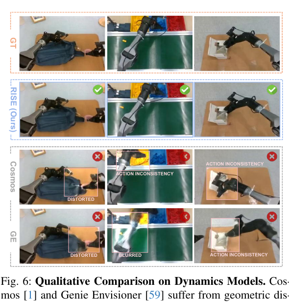{ width="760" }

*原文 Figure 6。对比包括动作不一致、模糊和几何失真；原图的错误标记来自作者对这些示例的分析。*

量化表进一步把像素、感知、分布与运动指标放在一起。

| Dataset / Method | PSNR ↑ | LPIPS ↓ | SSIM ↑ | FVD ↓ | EPE ↓ |
|---|---:|---:|---:|---:|---:|
| Target tasks / Cosmos | 21.17 | 0.14 | 0.79 | 97.90 | 1.21 |
| Target tasks / GE | 21.16 | 0.11 | 0.79 | 85.72 | 1.05 |
| Target tasks / RISE w/o Task-Centric | 22.67 | 0.08 | 0.80 | **61.22** | 0.68 |
| Target tasks / RISE | **23.90** | **0.07** | **0.82** | 66.84 | **0.54** |
| Bridge / Cosmos | 21.32 | 0.14 | 0.80 | 73.21 | 1.18 |
| Bridge / GE | 21.47 | 0.12 | 0.79 | 64.55 | 0.96 |
| Bridge / RISE w/o Task-Centric | 22.61 | **0.10** | 0.78 | 49.07 | 0.72 |
| Bridge / RISE | **23.68** | **0.10** | **0.82** | **45.21** | **0.64** |

*原文 Table V。上、下两组分别在目标任务与 Bridge 上微调后比较，不能混成一个数据集排行榜。*

目标任务中，完整 RISE 的 EPE 从 GE 的 1.05 降到 0.54，PSNR 从 21.16 升到 23.90。EPE 是光流 endpoint error，反映视觉运动与真实视频的差异，不是机械臂关节角误差，也不能直接当作接触力精度。

反例出现在 FVD。去掉 task-centric 的模型为 61.22，比完整模型 66.84 更低，但它的 EPE 更差，策略完整成功率也只有 40% 而非 70%。因此 FVD 单项更好并不足以证明模型更适合控制。任务学习关心的是同一条件动作下的正确后果，视觉分布质量无法完全替代这项要求。[原文 Table IV–V](https://arxiv.org/pdf/2602.11075#page=7)

Bridge 上完整模型同时改善 FVD 与 EPE，但 LPIPS 与去掉 task-centric 的版本同为 0.10。不能把论文概括的“更好”写成每一列都严格领先。附录 Table VI 还显示，省略动力学预训练时 EPE 为 1.09、FVD 为 83.36，完整模型分别为 0.54、66.84，与额外机器人预训练有助于后续环境预测的结论一致。[原文 Appendix IX](https://arxiv.org/pdf/2602.11075#page=14)

## 优势档位确实改变行为，延长基线训练也未追平

条件策略学好之后，输入不同档位应产生可观察的行为差异。Figure 7 固定已经学到的策略，分别请求高档 Bin 10、中间 Bin 5 与低档 Bin 1。

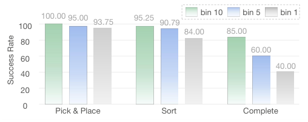

*原文 Figure 7。三组柱分别为 Pick & Place、Sort、Complete，不能只看抓放率就判断优势条件是否有效。*

| Prompted bin | Pick & Place (%) | Sort (%) | Complete (%) |
|---|---:|---:|---:|
| 10 | 100.00 | 95.25 | 85.00 |
| 5 | 95.00 | 90.79 | 60.00 |
| 1 | 93.75 | 84.00 | 40.00 |

抓放从 100% 降到 93.75%，完整成功却从 85% 降到 40%，差异主要表现为分拣选择与整体稳定性。它支持档位确实关联不同质量的行为，而不是模型忽略了优势输入；仍不能据此证明档位数值与真实收益已经精确校准。[原文 Appendix IX](https://arxiv.org/pdf/2602.11075#page=14)

另一个问题是，RISE 的收益是否只因为多训练了一段。Figure 8 将 RECAP 与 DSRL 在相同 batch size 下额外训练 50K steps。RECAP 成功率约在 30%–50%，DSRL 约在 5%–10%，RISE 则用额外约 9K steps 从 50% 提高到 85%。

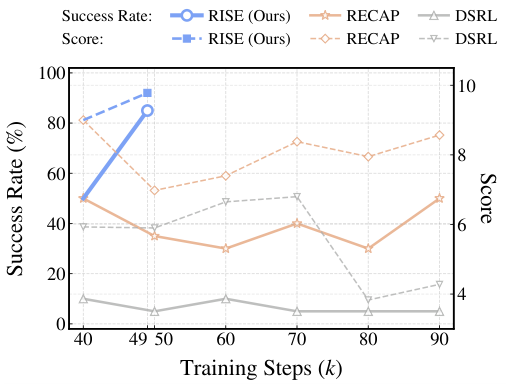

*原文 Figure 8。实线看左轴成功率，虚线看右轴阶段分数；RISE 的较短额外训练曲线与延长的基线曲线分别标出。*

这支持优势来自不同的训练经验与更新方式，而不只是简单延长所比较基线的训练。但训练步数不是统一算力单位，RISE 还要生成想象，并预先训练世界模型；图中不能直接推出总 GPU-hours 或经济成本更低。

## 计算投入替代了新增物理试错，并没有消失

| Component | Reported setup | Training scale |
|---|---|---|
| Dynamics pre-training | 16 NVIDIA H100，batch 512 | 120K steps，约 7 天 |
| Dynamics task fine-tuning | 8 NVIDIA H100，batch 64 | 50K steps，约 3 天 |
| Value training | 8 GPUs，batch 64，AdamW $2.5\times10^{-5}$ | 50K steps，约 1 天 |
| Policy warm-up / self-improving | 8 GPUs，batch 64 | self-improving 约 10K steps |

*原文 §III-D、Tables VIII–X。报告明确前两项硬件为 H100；策略与价值部分没有在对应描述中另列 GPU 型号。*

按作者给出的近似卡数与天数，动力学预训练约为 $16\times7\times24=2688$ H100 GPU-hours，任务微调约 $8\times3\times24=576$ H100 GPU-hours。这是粗略资源换算，不包含策略训练、价值训练、其他数据处理和未报告的运行开销，也不应将某次任务微调时间无依据乘以任务数量。

Table X 给策略学习率 $10^{-4}$、minimum learning-rate ratio 0.1、rollout EMA 0.995。表中把 “Optimizer” 一栏写成 “cosine”，但 cosine 通常描述学习率变化方式，正文没有进一步说明此处具体优化器算法，因此这里保留学习率配置，不据此发明一种 cosine optimizer。

实际采用时，最可复用的是模块接口。动力学可以先检查动作条件预测与光流误差，价值可以先检查细小失败的敏感性，策略可以检查不同优势档位是否产生质量差异。模块通过样本和评价连接，允许分别替换与验证；如果其中一环不可靠，扩大想象数据规模也未必会带来真实收益。

## 失败案例提醒我们，短想象也不是物理真值

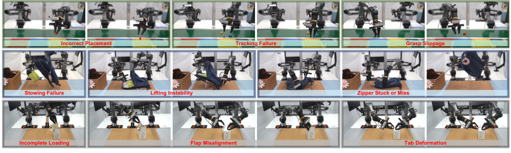

*原文 Figure 18。三行依次为动态积木、背包与关盒的失败，展示高成功率之后仍然存在的具体误差。*

积木分拣仍会出现追踪时序不一致、抓取滑落和放错箱子；背包的高形变会导致衣物没塞好、提起不稳、拉链卡住或没抓到；关盒对几何容差和双臂同步要求高，可能装杯不到位、翼片错位或锁片变形。[原文 Appendix XIV](https://arxiv.org/pdf/2602.11075#page=18)

这些错误也解释了为什么模型要限制每个真实起点最多连续想象两块，并保留离线数据。生成器在罕见状态里可能给出不真实转移，价值模型可能把伪影误当进展，策略则可能学习这种错误反馈。短 rollout 和真实锚点降低暴露程度，但论文没有建立严格的世界模型误差界或对抗性利用检测。

作者明确把 uncertainty-aware imagination、显式物理约束以及真实与模拟数据比例的原则化选择列为后续问题。它们不属于当前 RISE 已实现的模块。世界模型的可用范围仍受数据覆盖与训练成本限制。[原文 §VII](https://arxiv.org/pdf/2602.11075#page=9)

这篇论文把“用世界模型改进机器人”推进到一个可拆解、可验证的流程。高效动作条件视频负责短期后果，progress 与 TD 结合的价值负责中间任务判断，优势条件策略把不同质量的想象经验变成可部署行为。三项真实任务证明这条闭环在相应数据与计算条件下有效；进一步扩展时，最需要守住的是动作后果的可信度、失败评价的辨识力，以及真实数据对策略分布的约束。

如果要复算这条闭环，先看[模拟器、反事实与合成 rollout](../../world-models/simulators-counterfactuals-and-synthetic-rollouts.md)区分生成数据和真实环境证据，再读[世界模型评测与失败模式](../../world-models/evaluation-and-failure-modes.md)设计一步、多步和行为层检查。RISE 的策略更新还可以与[模型式强化学习](../../reinforcement-learning/rl-for-world-models.md)对照，观察 imagined return 在不同算法里怎样进入梯度。
