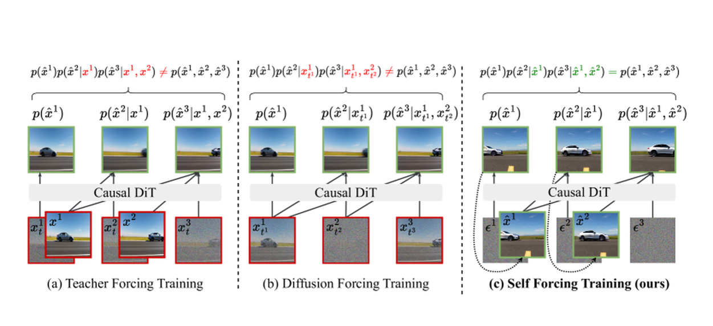
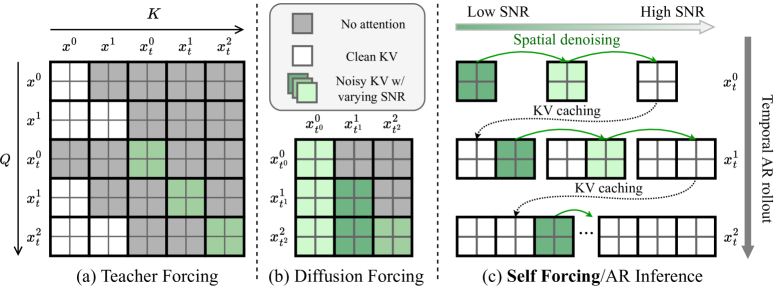
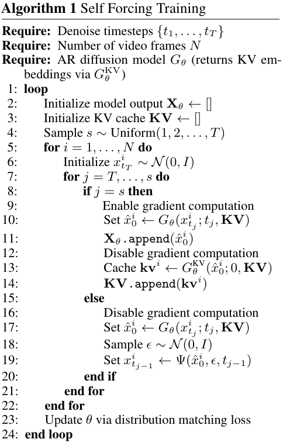
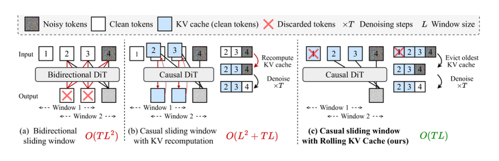
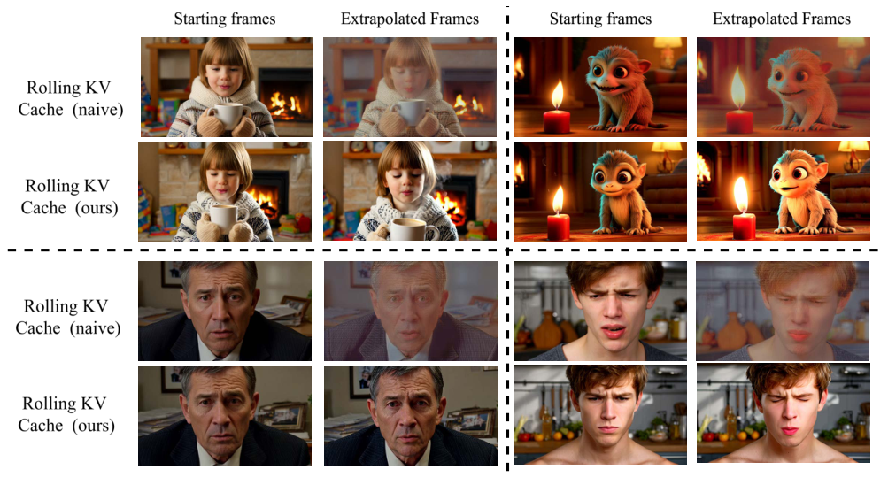
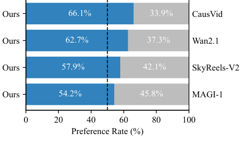
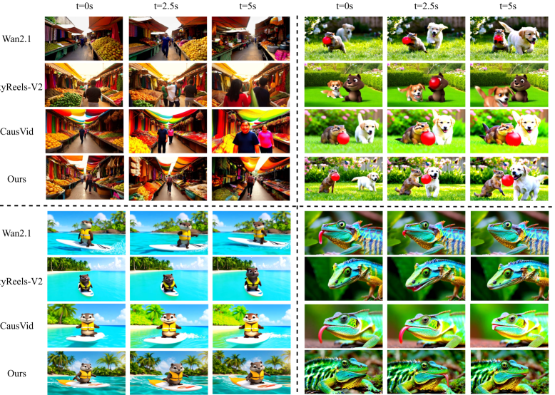
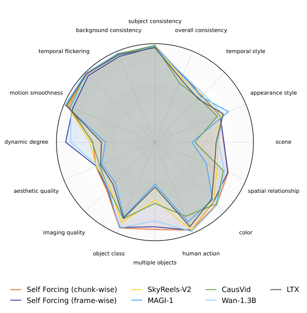
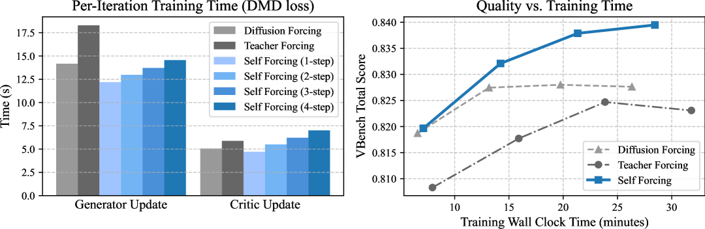

# Self Forcing：对齐自回归视频训练与推理

!!! info "论文信息"
    **论文题名：** Self Forcing: Bridging the Train-Test Gap in Autoregressive Video Diffusion。 
    **作者：** Xun Huang、Zhengqi Li、Guande He、Mingyuan Zhou、Eli Shechtman。 
    **机构：** Adobe Research；The University of Texas at Austin。 
    **时间 / 主题：** 2025-06 首版，2025-11 v2；世界模型。 
    **arXiv / 官方报告：** arXiv：[2506.08009](https://arxiv.org/abs/2506.08009)；官方材料：[self-forcing.github.io/](https://self-forcing.github.io/)。 
    **GitHub / 项目：** GitHub：[github.com/guandeh17/Self-Forcing](https://github.com/guandeh17/Self-Forcing)；项目页：[self-forcing.github.io/](https://self-forcing.github.io/)。 
    **元数据来源与核验口径：** 来源：[arXiv](https://arxiv.org/abs/2506.08009)；[GitHub repo](https://github.com/guandeh17/Self-Forcing)；[官方项目页](https://self-forcing.github.io/)；Checked Date：2026-07-08；Repro Status：Paper / official materials reviewed, independent reproduction not claimed。

## 自回归视频最容易出问题的地方，是它总要继续相信自己的上一段

视频模型可以在训练样本之后预测一个不错的片段，却在连续生成时逐渐出现颜色过饱和、纹理过锐、主体变化等问题。原因不一定在单步去噪能力。训练时给它的历史通常是真实视频，推理时给它的历史却是自己刚刚生成的结果，上一段的细小偏差会成为下一段的输入。

Self Forcing 将这种 exposure bias 直接放进训练流程。模型按部署时的自回归方式生成整段视频，后一个 frame 或 chunk 读取前面自己的输出，再用视频级分布匹配目标评价完整结果。它的核心变化是训练样本怎样由模型产生，而不只是换一个 attention mask 或减少 diffusion steps。[原文 §1](https://arxiv.org/pdf/2506.08009#page=2)

{ width="760" }

*原文 Figure 1。先看历史来自真实数据还是模型，再看损失评价单帧去噪还是整段生成分布。*

这项工作是在已有视频模型之上进行后训练。作者采用 Wan2.1-T2V-1.3B，先做因果初始化，再用少步采样和梯度截断控制训练成本。最终 chunk-wise 版本在单张 H100、$832\times480$ 分辨率下达到 17 FPS，首帧延迟 0.69 秒，VBench total 为 84.31。理解这些数字时，要把持续吞吐、开始看到画面的等待时间，以及生成质量分别看待。

## Teacher Forcing 和 Diffusion Forcing 改变了噪声，但历史仍来自数据

### 两层生成过程怎样组合

自回归视频扩散先在时间上分解联合分布。

$$
p_\theta(x^{1:N})=\prod_{i=1}^{N}p_\theta(x^i\mid x^{<i}).
$$

每个条件分布再用 diffusion 生成。外层决定当前生成第几个时间单元，内层将这个单元从噪声逐步去噪。论文中的 $x^i$ 为简化符号叫作 frame，实际也可以是一组 latent frames；它不总是一张最终 RGB 图像。[原文 §3.1](https://arxiv.org/pdf/2506.08009#page=4)

网络在 causal 3D VAE 的压缩 latent 中工作，信号仍是连续值。采用时间自回归，并不意味着必须将视频离散成 VQ tokens。它可以保留扩散生成连续视觉的能力，同时用因果时间关系逐块输出。

正文用一般噪声过程描述每帧输入。

$$
x^i_{t_i}=\Psi(x^i,\epsilon^i,t_i)
=\alpha_{t_i}x^i+\sigma_{t_i}\epsilon^i,
\qquad \epsilon^i\sim\mathcal N(0,I).
$$

常规 denoising loss 让网络根据当前带噪帧和上下文预测所加噪声。

$$
\mathcal L^{\mathrm{DM}}_\theta=
\mathbb E_{x^i,t_i,\epsilon^i}
\left[w_{t_i}\left\|\hat\epsilon^i_\theta-\epsilon^i\right\|_2^2\right].
$$

$w_{t_i}$ 控制不同噪声时间的权重。Teacher Forcing 与 Diffusion Forcing 的关键差异位于上下文条件，而不是这两个方法中有一个完全不做去噪。

### TF 的历史干净，DF 的历史带噪，但都不是自己的错误

Teacher Forcing 在真实、干净的历史帧上去噪当前帧，常见训练中不同帧共享所选噪声时间。Diffusion Forcing 给不同帧独立采样噪声时间，当前帧可能高度带噪，过去帧可能接近干净，也可能仍有噪声。

DF 因而覆盖了“历史较干净、当前帧很噪”的输入形式，但带噪真实视频仍不等于模型输出。真实图像加高斯噪声，不会自动重现模型特有的几何扭曲、身份变化、颜色偏移或语义错误。只改变 noise level 没有消除 context source 的差异。[原文 Figure 1、§3.1](https://arxiv.org/pdf/2506.08009#page=4)

| Training scheme | 历史的来源 | 当前单元怎样得到 | 与实际 AR rollout 的主要差别 |
|---|---|---|---|
| Teacher Forcing | 干净真实帧 | 条件去噪 | 没有经历自己生成的历史 |
| Diffusion Forcing | 不同噪声水平的真实帧 | 条件去噪 | 噪声覆盖不等于生成误差覆盖 |
| Self Forcing | 前面已经生成的帧或块 | 按时间继续少步去噪 | 采用自己的上下文，但训练仍有随机退出和梯度截断近似 |

Figure 2 再把这个区别落实到 attention。TF 和 DF 为了并行处理整段训练视频，用自定义 mask 限制可见关系；Self Forcing 顺序展开时间，把历史放进 KV cache，当前调用只接收已生成历史与当前单元。

{ width="760" }

*原文 Figure 2。Self Forcing 每次调用可使用普通 attention，是因为未来单元尚未放进输入，不是因为整段视频改成了任意双向读取。*

这种执行结构同时决定交互接口。如果未来片段已经预先部分生成，后来用户输入就难以立即改变它们。论文将严格按时间条件生成与 rolling diffusion 类方法区分，后者可能提前承诺未来，因此“可以连续输出”与“能够及时响应尚未知的输入”并不完全相同。[原文 §2](https://arxiv.org/pdf/2506.08009#page=3)

## Self Forcing 的训练是真实展开生成流程，但反向只保留必要部分

### 内层去噪先预测干净结果，再重新加较少噪声

设少步噪声网格为 $\{t_0=0,t_1,\ldots,t_T=1000\}$。当前时间单元从高斯噪声开始，网络 $G_\theta$ 在每个选定时间预测干净输出；如果还需要下一步，则将这个预测按更低噪声时间重新加噪。

$$
\hat x^i_0=G_\theta(x^i_{t_j},t_j,x^{<i}),
\qquad
x^i_{t_{j-1}}=\Psi(\hat x^i_0,\epsilon_{j-1},t_{j-1}).
$$

完成一个单元后，clean output 成为后续单元的历史。这让整段视频来自模型自己的条件链，错误会真实地影响后面的生成，而不是只在损失里抽象惩罚一下。

但如果对每一帧的每一步去噪，以及所有跨帧依赖都反传，显存会随两层展开迅速增加。因此作者把训练分成前向尽量像部署、反向只保留局部路径两部分。[原文 §3.2](https://arxiv.org/pdf/2506.08009#page=5)

### 每条序列随机选择一个退出步

Algorithm 1 给出具体执行顺序。一次训练为每条序列采样 $s\sim\operatorname{Uniform}\{1,\ldots,T\}$，所有时间单元都从 $t_T$ 去噪到 $t_s$，在这个位置把网络预测的干净输出作为本次结果。

*原文 Algorithm 1。第 4 行的随机退出位置在序列循环外；第 9 行只为当前单元的最后计算步骤开启梯度；第 13 行另外用干净输出生成 KV。*

在 $j>s$ 的早期去噪步，不保存反向图；到 $j=s$ 时才开启梯度，保存当前单元输出用于整段损失。随后关闭梯度，在 timestep 0 对这个干净输出取得 KV embeddings，追加到历史缓存，再生成下一单元。

这里有两个容易混淆的截断。第一，只对每个单元本次最后执行的去噪步反传，不是整段视频只给最后一帧梯度。第二，历史 KV 被 detach，当前输出的梯度不会通过缓存回传到所有过去帧的生成过程。整段视频中的各输出仍可以从同一个视频级评价获得直接训练信号。

随机退出使不同去噪阶段轮流获得监督，避免永远只优化固定最后一步。但它也意味着训练批次混合了不同去噪长度的 rollout，并非每次都精确复现推理的完整四步链。论文所说的 train-test alignment，核心是上下文来自模型自己的生成以及相同的时间展开结构；它不等于对完整推理分布进行了没有近似的全梯度优化。

这个区分有实际意义。Self Forcing 主要解决自己历史的输入偏差，梯度截断则解决算力与显存代价；两者配合才可训练，后者也可能限制长距离依赖学习，作者在局限部分明确承认了这一点。

## 损失评价完整视频分布，而不是把每一帧都对齐到固定答案

训练 rollout 得到 $x^{1:N}_\theta\sim p_\theta$ 后，可以比较整段生成视频与目标视频分布。为了利用预训练 diffusion 模型，并改善训练稳定性，作者先对两种完整视频分布加入噪声。

$$
p_{\cdot,t}(x_t^{1:N})=
\int q_{t\mid0}(x_t^{1:N}\mid x^{1:N})
\,p_\cdot(x^{1:N})\,\mathrm dx^{1:N}.
$$

比较的是 $p_{\theta,t}$ 与 $p_{\mathrm{data},t}$。它允许存在多种合理视频，而不要求同一文本提示总是回到某一条固定真实轨迹。重要的是，$p_\theta$ 中的视频确实经过自回归生成，而不是从真实上下文并行去噪后拼起来的另一个输出分布。[原文 §3.3](https://arxiv.org/pdf/2506.08009#page=5)

CausVid 是最直接的比较对象。它也使用少步生成与 DMD，但训练输出来自 DF 条件。若训练时对齐的是“读取带噪真实历史后得到的输出”，推理时却是“读取自己的历史后得到的输出”，同一个分布匹配损失仍会优化不同的对象。Self Forcing 改变的是被评价的样本如何产生，而非仅为 CausVid 换一项更强损失。[原文 §2、§3.3](https://arxiv.org/pdf/2506.08009#page=6)

论文检验 DMD、SiD 和 GAN 三种目标。它们共同使用这条生成路径，各自提供不同的分布比较方式。三者都有效能够支持训练范式的普适性，但具体教师、batch 与优化配置并不完全相同，不能把结果解读为纯粹只替换一个数学 divergence 的严格控制实验。

## DMD 用目标分布与学生分布的 score 差更新生成器

DMD 最小化加噪分布上的 reverse KL。

$$
\mathbb E_t\left[D_{\mathrm{KL}}
\left(p_{\theta,t}\Vert p_{\mathrm{data},t}\right)\right].
$$

固定的 real score network 近似目标分布 score，另一个 critic 用学生生成的视频做标准 diffusion 训练，估计当前学生分布的 fake score。对同一个带噪生成样本比较二者，得到生成器应如何移动的更新方向。

$$
\nabla_\theta\mathbb E_tD_{\mathrm{KL}}(p_{\theta,t}\Vert p_{\mathrm{data},t})
=-\mathbb E\left[
\big(s_{\mathrm{real}}(\hat x_t,t)-s_{\mathrm{fake}}(\hat x_t,t)\big)
\frac{\partial\hat x}{\partial\theta}
\right].
$$

这里 $\hat x$ 是整段生成视频，$\hat x_t$ 是它的带噪版本。critic 必须跟随生成器更新，否则它估计的就不再是当前输出分布。作者使用的可优化 surrogate 为

$$
\mathcal L_{\mathrm{DMD}}=
\mathbb E\left[\frac12
\left\|\hat x-\operatorname{sg}\left[
\hat x-\big(f_\psi(\hat x_t,t)-f_\phi(\hat x_t,t)\big)
\right]\right\|_2^2\right].
$$

$f_\phi$ 是固定 real 网络，$f_\psi$ 是学习中的 critic，$\operatorname{sg}$ 固定括号内的目标，不让生成器这条损失同时更新目标构造。注意这里差值顺序是 fake 减 real，应与 score 梯度的参数化转换一起理解，不能随意交换符号。[原文 Appendix A, Eq. 2–3](https://arxiv.org/pdf/2506.08009#page=17)

一个影响实验归因的细节是，主结果使用的 DMD real score network 为 **Wan2.1-T2V-14B**，学生和 critic 为 **1.3B**。所以它同时受益于更强教师的分布指导，不能把主表中略高于原 1.3B 基础模型的分数全部解释为“同等教师能力下，仅靠因果生成超越双向模型”。在相同后训练框架内比较 TF、DF 与 SF，才更直接隔离训练历史的影响。

## SiD 与 GAN 说明方法不依赖单一训练目标

### SiD 的实际设置省掉了不稳定的一项

SiD 使用目标与生成分布 score 的距离。论文给出的实现损失为

$$
\begin{aligned}
\mathcal L_{\mathrm{SiD}}=
\mathbb E\Big[&
(f_\phi(\hat x_t,t)-f_\psi(\hat x_t,t))^\top
(f_\psi(\hat x_t,t)-\hat x)\\
&+(1-\alpha)
\left\|f_\phi(\hat x_t,t)-f_\psi(\hat x_t,t)\right\|_2^2
\Big].
\end{aligned}
$$

原文说明 $\alpha=0.5$ 对应 Fisher divergence 的梯度，但第二项在实践中容易不稳定，所以实际取 $\alpha=1$，将它去掉。不能在概述中说“SiD 使用 Fisher divergence”，随后又默认实验精确采用 $\alpha=0.5$ 的那一套梯度。[原文 Appendix A, Eq. 4](https://arxiv.org/pdf/2506.08009#page=17)

SiD 的 real score 与 critic 都初始化为 Wan2.1-T2V-1.3B，real score CFG weight 为 3.0，与 DMD 的教师规模不同。这为较小教师下的后训练提供了另一种实现，但也限制了跨目标分数的直接因果解释。

### GAN 直接比较生成样本和目标样本

GAN 版本在 critic 上增加 cross-attention layers 与 classification heads，采用 R3GAN 的 relativistic pairing 目标。判别器判断真实目标视频相对生成视频是否更真，生成器反过来提高自己的相对分数。

$$
\mathcal L_D=-\mathbb E\log\operatorname{sigmoid}
\left(f_\psi(x_t)-f_\psi(\hat x_t)\right)
+\lambda\mathcal L_{\mathrm{reg}},
$$

$$
\mathcal L_G=-\mathbb E\log\operatorname{sigmoid}
\left(f_\psi(\hat x_t)-f_\psi(x_t)\right).
$$

$x_t$ 与 $\hat x_t$ 分别是带噪目标数据和带噪生成数据。R1、R2 用 finite difference 近似，对二者额外施加小高斯扰动，约束 critic 输出不要剧烈变化。报告使用 $\lambda=30$、扰动尺度 $\sigma=0.05$。对于随机退出步 $s$ 产生的视频，只从 $[t_{s-1},t_s]$ 采样判别噪声时间以改善稳定性。[原文 Appendix A, Eq. 5–7](https://arxiv.org/pdf/2506.08009#page=17)

GAN 的 effective batch size 为 768，明显高于 DMD/SiD 的 64；它使用的 70K 目标视频也是由 Wan2.1 14B 生成的数据集。因此这里的 real/fake 是判别训练的两类角色，不能把所有 real videos 写成相机拍摄的真实视频。

DMD 与 SiD 后训练可以不读取视频训练样本，但仍依赖预训练 diffusion 模型，以及前面的 ODE 初始化数据。论文称其 data-free，指这一分布匹配后训练阶段不用目标视频语料，不等于整套流程从未使用视频知识或没有生成任何初始化样本。

## Rolling KV cache 解决重复计算，还需要解决第一帧离场后的分布变化

### 因果 attention 并不自动保证窗口移动时无需重算

固定长度模型要继续生成更长视频，通常需要滑动时间窗口。Figure 3 比较三种做法，区别在旧历史需要重新计算多少，而不只在网络是否声明为 autoregressive。

{ width="760" }

*原文 Figure 3。左侧双向窗口反复计算历史，中间因果窗口仍重算重叠部分，右侧保存最近窗口的 KV 并逐出最旧条目。*

双向 diffusion 在每次新窗口中重新处理整个窗口，不支持直接复用因果历史 KV。因果模型能够缓存，但已有实现仍会在窗口平移时重编码重叠历史；为了降低开销，常使用较大步幅，代价是窗口起始部分可用的历史更少。

Self Forcing 维护容量为最近 $L$ 个时间单元的缓存。新单元完成后，以 timestep 0 计算 clean KV，若缓存已满则逐出最旧条目，再追加新条目。过去条目随窗口移动继续保留，不因位置变化重新计算。[原文 §3.4、Algorithm 2](https://arxiv.org/pdf/2506.08009#page=6)

| Sliding-window method | 原文给出的 attention 复杂度 | 主要重复工作 |
|---|---|---|
| Bidirectional diffusion | $O(TL^2)$ | 每个去噪步处理整个窗口 |
| Causal with KV recomputation | $O(L^2+TL)$ | 窗口切换时重算重叠历史 |
| Rolling KV cache | $O(TL)$ | 新单元读取保留的历史 KV |

这里 $T$ 是去噪步数，$L$ 是时间窗口规模，表达的是原文省略固定空间 token 等因素后的 attention 成本关系。它不是整个视频系统的精确 FLOPs，也不意味着每一层与所有硬件都会按同一比例提速。

这种缓存能持续循环生成，却只有有限历史容量。较旧内容被逐出后，不能保证所有对象身份和早先场景都永久保留；保存下来的历史表示也不等于对新截取窗口从头重算一定得到完全相同的特征。它是一种高效流式执行方式，质量还要由训练验证。

### 第一 latent frame 的统计特性不同

causal 3D VAE 的第一 latent frame 只编码首张图像，之后的 latent frames 才包含时间压缩。训练短片时，模型总能看到这个特殊的初始 image latent；长生成的 rolling cache 将它逐出后，窗口中不再有同样类型的锚点。

直接部署 rolling cache 因而出现另一种 train-test mismatch。作者的处理是在训练最终 chunk 时，禁止它读取第一 chunk，提前让模型经历“特殊首块已经不可见”的条件。并非永久把第一块固定在缓存里，也不是训练全程去掉所有历史。[原文 §3.4、Appendix B](https://arxiv.org/pdf/2506.08009#page=17)

*原文 Figure 7。每组上行为朴素 rolling cache，下行为加入局部窗口训练；比较 starting frames 与 extrapolated frames 中出现的变淡、闪烁及结构伪影。*

在 10 秒生成设置中，重算 KV 的 throughput 为 4.6 FPS，经过局部窗口适配的 rolling cache 为 16.1 FPS。吞吐比约为 $16.1/4.6=3.5$，这项比较针对长视频缓存执行，不能与主表 5 秒设置中的 17 FPS 当作同一个实验点。[原文 §4](https://arxiv.org/pdf/2506.08009#page=9)

图中适配明显缓解了窗口外推伪影，但原文没有宣称无限生成都保持训练长度内的质量。作者明确指出，大幅超出训练长度后仍会退化。可无限追加的算法结构与可无限保持正确内容，是两种不同能力。

## 初始化、提示词和教师配置都是实验条件的一部分

基础模型 Wan2.1-T2V-1.3B 生成约 5 秒、16 FPS、$832\times480$ 视频。作者先使用基础模型采样的 16K ODE solution pairs，按 CausVid 的协议加入 causal attention masking 做初始化，再进行 Self Forcing 后训练。[原文 §4](https://arxiv.org/pdf/2506.08009#page=7)

两种主要变体只改变时间生成单位。chunk-wise 每次生成 3 个 latent frames，frame-wise 每次生成 1 个 latent frame。latent 的时间压缩意味着这两个名称不能直接理解成每次输出三张或一张最终 RGB 图像。

少步网格按附录写为 $[1000,750,500,250]$，time shift factor 为 5。附录前向式写出的噪声系数和时间方向，与 Algorithm 1 在 $t_T=1000$ 初始化纯高斯噪声的约定存在不一致；其 data prediction 参数式也未在正文展开转换。因此这里以正文一般形式 $\alpha_t x+\sigma_t\epsilon$ 解释机制，保留明确的步数与 shift 配置，不把附录那一行未经澄清直接当作可运行 scheduler。[原文 Appendix A](https://arxiv.org/pdf/2506.08009#page=16)

训练提示词来自 VidProM 的 VidProS 子集，约 100 万条语义去重的用户提示，经过长度、命令行参数和标注内容概率过滤后约剩 25 万条，再由 Qwen2.5-7B-Instruct 按 Wan2.1 的系统提示扩写。VBench 测试提示也做同类改写；Wan2.1 及支持这类增强的基线同样使用改写输入。[原文 Appendix A](https://arxiv.org/pdf/2506.08009#page=16)

这使模型得到更详细的语义条件，也意味着结果不是所有方法都在最短原始提示上直接测试。不能漏掉 prompt rewriting，再把语义分数全部归因于 Self Forcing 的训练历史。

## 主结果要同时读吞吐、首帧延迟与质量

所有速度测试使用单张 NVIDIA H100。Table 1 保留各模型自身的参数量与分辨率，整体给出实际系统对照，其中 CausVid 与 Self Forcing 使用相同 1.3B、$832\times480$ 设置，比较最直接。

| Model | #Params | Resolution | Throughput (FPS) ↑ | Latency (s) ↓ | Total ↑ | Quality ↑ | Semantic ↑ |
|---|---:|---|---:|---:|---:|---:|---:|
| LTX-Video | 1.9B | 768×512 | 8.98 | 13.5 | 80.00 | 82.30 | 70.79 |
| Wan2.1 | 1.3B | 832×480 | 0.78 | 103 | 84.26 | **85.30** | 80.09 |
| SkyReels-V2 | 1.3B | 960×540 | 0.49 | 112 | 82.67 | 84.70 | 74.53 |
| MAGI-1 | 4.5B | 832×480 | 0.19 | 282 | 79.18 | 82.04 | 67.74 |
| CausVid | 1.3B | 832×480 | **17.0** | 0.69 | 81.20 | 84.05 | 69.80 |
| **Self Forcing, chunk-wise** | **1.3B** | **832×480** | **17.0** | **0.69** | **84.31** | **85.07** | **81.28** |
| NOVA | 0.6B | 768×480 | 0.88 | 4.1 | 80.12 | 80.39 | 79.05 |
| Pyramid Flow | 2B | 640×384 | 6.7 | 2.5 | 81.72 | 84.74 | 69.62 |
| Self Forcing, frame-wise | 1.3B | 832×480 | 8.9 | **0.45** | 84.26 | 85.25 | 80.30 |

*原文 Table 1。Self Forcing 两行均使用 DMD 和 4-step diffusion；Latency 为开始得到首帧的等待时间，Total/Quality/Semantic 为 VBench 分数。*

chunk-wise 在保留 CausVid 同样 17 FPS、0.69 秒的同时，将 total 从 81.20 提高到 84.31，semantic 从 69.80 提高到 81.28。由于时间结构与少步规模相近，这直接显示改进不只来自加速，更来自生成分布的质量。

与 Wan2.1 相比，total 仅高 0.05，quality 还略低 0.23，semantic 高 1.19。不能概括为所有质量维度都超过基础模型。显著变化在等待时间，从 103 秒降到 0.69 秒，约 $149$ 倍；吞吐则是 $17/0.78\approx21.8$ 倍。论文约 150× 的表述对应 latency，不是所有速度指标都提高 150 倍。[原文 Table 1、Figure 5](https://arxiv.org/pdf/2506.08009#page=8)

frame-wise 将 latency 进一步降至 0.45 秒，代价是 throughput 8.9 FPS，低于基础视频的 16 FPS 播放速率。它更快给出第一段结果，却不能仅凭这个设置在 16 FPS 下无限期无缓冲播放。chunk-wise 的 17 FPS 则超过该播放率，兼顾亚秒启动和持续供帧。交互应用应根据启动响应与持续流畅程度选择，不能只拿最好的 latency 数字代表整个系统实时性。

## 人类偏好支持可感知的质量，但评测规模有明确含义

Figure 4 比较 Self Forcing chunk-wise 与四个主要模型。每次展示相同提示下的两段视频，用户依据整体质量与提示符合程度选择更好的一段。

*原文 Figure 4。虚线为 50% 偏好率；Self Forcing 对四个基线均超过该线，幅度不同。*

| Baseline | Preference for Self Forcing | Preference for baseline |
|---|---:|---:|
| MAGI-1 | 54.2% | 45.8% |
| SkyReels-V2 | 57.9% | 42.1% |
| Wan2.1 | 62.7% | 37.3% |
| CausVid | 66.1% | 33.9% |

附录说明使用 MovieGenBench 的全部 1,003 个提示，每个提示由一名用户评价。1,003 是提示数量，不能自动解释成 1,003 名互不重复的评审，也不能写成每条提示都由多人投票。报告没有给出多评审一致性或偏好置信区间。[原文 Appendix E](https://arxiv.org/pdf/2506.08009#page=19)

结果支持改进在整体观看体验上可感知，尤其相对 CausVid。它不证明所有具体场景都更优，也没有独立测量动作控制响应或物理世界真实性；本论文主体仍是 text-to-video 生成质量与时序效率评测。

## 控制消融说明关键在 self-rollout，而不只在 DMD

主表 CausVid 的 81.20 来自官方实现，Table 2 的 DF + DMD 则在作者自己的训练框架中复现对应机制。两者不能互换，因为后者才控制了当前实验环境中的实现条件。

| Training paradigm / Objective | Chunk-wise Total | Chunk-wise Quality | Chunk-wise Semantic | Frame-wise Total | Frame-wise Quality | Frame-wise Semantic |
|---|---:|---:|---:|---:|---:|---:|
| Many (50×2)-step DF | 82.95 | 83.66 | 80.09 | 77.24 | 79.72 | 67.33 |
| Many (50×2)-step TF | 83.58 | 84.34 | 80.52 | 80.34 | 81.34 | 76.34 |
| Few (4)-step DF + DMD | 82.76 | 83.49 | 79.85 | 80.56 | 81.02 | 78.71 |
| Few (4)-step TF + DMD | 82.32 | 82.73 | 80.67 | 78.12 | 79.62 | 72.11 |
| **Self Forcing + DMD** | **84.31** | **85.07** | **81.28** | **84.26** | **85.25** | **80.30** |
| Self Forcing + SiD | 84.07 | 85.52 | 78.24 | 83.54 | 84.71 | 78.86 |
| Self Forcing + GAN | 83.88 | 85.06 | 79.16 | 83.27 | 84.57 | 78.08 |

*原文 Table 2，保留原表 Many (50×2)-step 标签。它描述作者的多步基线配置，不应与 Self Forcing 的两个时间循环自行对应。*

在相同 DMD 目标下，chunk-wise SF 比 DF 高 1.55、比 TF 高 1.99 total 分。换成 frame-wise 后，SF 比 DF 高 3.70、比 TF 高 6.14。更细的时间生成单位需要更多 AR 展开，基线下降更明显，而 SF total 只从 84.31 变化到 84.26。这与“自己历史的误差会沿更多生成轮次放大”的机制相吻合。[原文 §4](https://arxiv.org/pdf/2506.08009#page=9)

SiD 与 GAN 也保持较好的 total，说明优势不限于 DMD 一种目标。但 SiD 的 chunk-wise quality 85.52 高于 DMD 的 85.07，semantic 却低于 DMD；不同目标会形成不同取舍。教师大小与 batch 配置也不同，不能只按总分宣称某个 divergence 在所有条件下最优。

定性图提供了随时间变化的可见例子。它并非只比较第一帧有多漂亮，而是沿 0、2.5、5 秒检查饱和度与细节是否逐渐偏离。

{ width="760" }

*原文 Figure 5。CausVid 示例中后段出现更明显的过饱和，Self Forcing 的视觉变化更稳定；这是对具体样例的观察，不能代替完整误差统计。*

附录 Figure 8 还显示，frame-wise 不是毫无代价地获得低延迟。它的 dynamic degree 更高，但 background consistency、motion smoothness 与 temporal flickering 方面较 chunk-wise 差。两个 total 分接近，并不表示它们在所有时序属性上相同。

*原文 Figure 8。雷达图用于观察维度取舍，不从没有数值标注的轴上读取并编造精确分数。*

## 顺序生成训练未必更慢，取决于一次调用实际做了什么

Self Forcing 外层按时间顺序运行，看起来不如 TF/DF 全序列并行；但一个 frame/chunk 内仍有大量空间与局部时间 tokens 并行计算，GPU 不一定因此闲置。

另一个差别是 attention 实现。TF/DF 需要专门的 mask，作者使用 FlexAttention；SF 每次只处理已可见内容，可以直接使用 FlashAttention-3。顺序展开付出的调用次数，与更简单 attention kernel 节省的开销共同决定每次迭代时间。[原文 §4、Appendix A](https://arxiv.org/pdf/2506.08009#page=16)

{ width="920" }

*原文 Figure 6。左图分别计 generator 与 critic update，右图比较相同 wall-clock 下的 VBench；应同时看每步成本和达到质量所需时间。*

图中 SF 不同退出长度的单次成本与 TF/DF 可比，且相同训练时间下质量更高。这证明在当前模型、kernel 与后训练配置中，顺序 rollout 可以有效执行，不能扩大成所有顺序训练都比并行训练快。更重要的可复用结论是，分布对齐可能减少达到有效质量所需的更新，从而抵消部分执行结构成本。

DMD 在 64 张 H100 上约 1.5 小时收敛，SiD/GAN 约 2–3 小时。前者约为 96 GPU-hours，后两者约 128–192 GPU-hours，均只是对应后训练运行的粗略换算，不包含 Wan 基础模型预训练、16K ODE 初始化样本准备，以及 GAN 的 70K 视频数据生成。

| Hyperparameter | DMD | SiD | GAN |
|---|---|---|---|
| Real score network | Wan2.1-T2V-14B | Wan2.1-T2V-1.3B | N/A |
| Critic initialization | Wan2.1-T2V-1.3B | Wan2.1-T2V-1.3B | Wan2.1-T2V-1.3B |
| Effective batch size | 64 | 64 | 768 |
| Generator learning rate | $2\times10^{-6}$ | $2\times10^{-6}$ | $2\times10^{-6}$ |
| Critic learning rate | $4\times10^{-7}$ | $2\times10^{-6}$ | $2\times10^{-6}$ |
| Optimizer | AdamW | Adam | AdamW |
| EMA decay | 0.99 | 0.99 | 0.99 |

*原文 Table 3。通常每 GPU batch 为 1，较大 effective batch 通过梯度累积实现；DMD/SiD 的 real score CFG weight 为 3.0。*

这些配置说明它是一条适合已有视频模型团队采用的后训练路径。单张 H100 推理与 64 张 H100 训练分别对应部署和优化预算，不能因为模型可单卡运行，就暗示全部训练也只需要同样资源。

## 对世界模型研究最有用的是训练历史的对齐方式

Self Forcing 将一个常被掩盖的差异显式化。把真实历史加噪、把去噪步数减少、把 attention 改成因果，都不会自动让训练见到部署时自己的错误。只有真正从当前模型生成样本，再评价这条生成分布，损失才作用于系统实际会产生的轨迹。

这给交互视频与世界模型提供了可复用方法，但本文没有直接验证机器人动作控制、任务成功率或物理动力学精度。将它接入动作条件世界模型后，还需要测量动作是否正确改变未来；将它用于长期环境时，还需要独立评估对象与场景是否能持续保留。VBench 和人类视频偏好不能替代这些任务证据。

当前方法也有明确边界。rolling cache 只保留有限上下文，视频远超训练长度仍会退化；KV detach 与去噪梯度截断虽然节省显存，也减少了长程反向学习路径。论文提出改进外推和探索 state-space 等循环结构作为后续方向，尚未由当前实验解决。[原文 §5](https://arxiv.org/pdf/2506.08009#page=10)

真正值得带走的实践判断是，先检查模型训练时读到的历史是否来自同一个生成过程，再选择分布目标和加速方案。Self Forcing 的价值就在于把这三件事接起来，同时保留了足够具体的速度、质量和消融证据，让“低延迟连续生成”成为可以衡量的系统行为。
