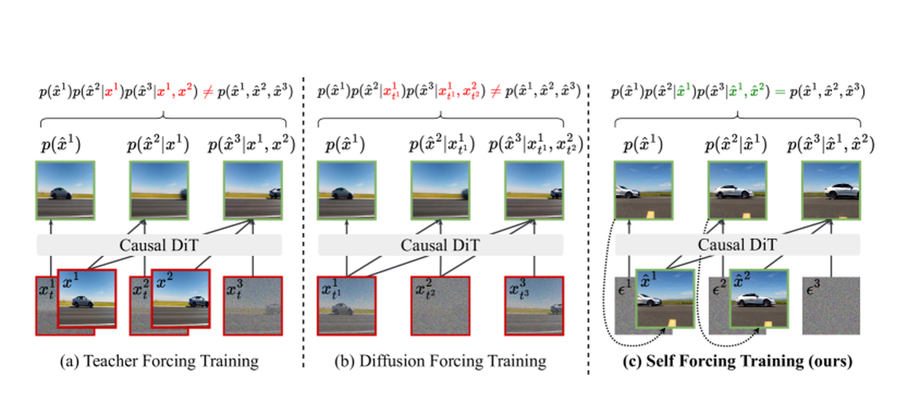
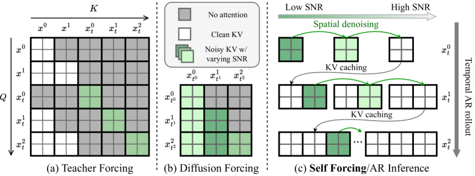
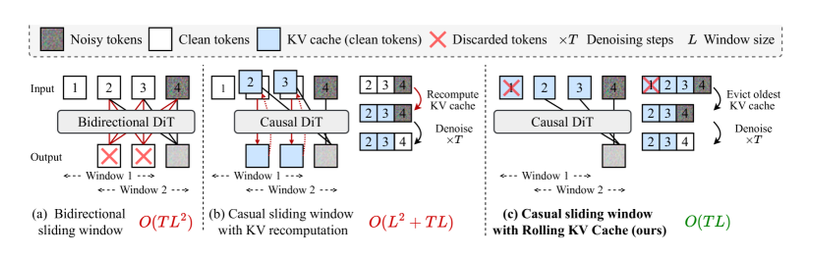
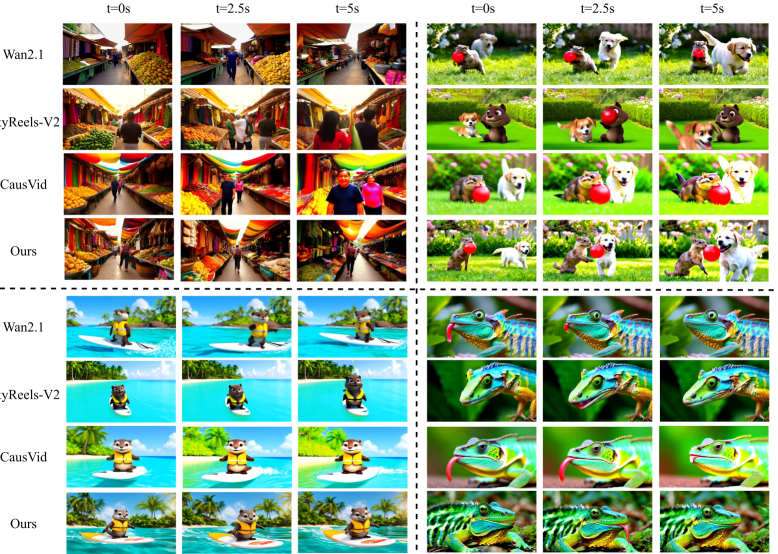
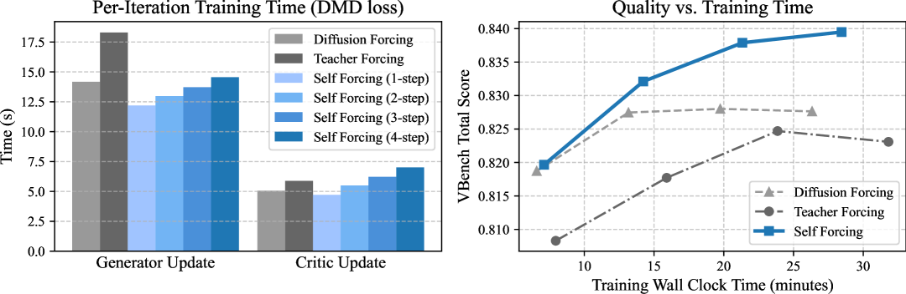

# Self Forcing：对齐自回归视频训练与推理

!!! info "论文信息"
    **论文题名：** Self Forcing: Bridging the Train-Test Gap in Autoregressive Video Diffusion。<br>
    **作者：** Xun Huang、Zhengqi Li、Guande He、Mingyuan Zhou、Eli Shechtman。<br>
    **机构：** Adobe Research；The University of Texas at Austin。<br>
    **时间 / 主题：** 2025-06 首版，2025-11 v2；世界模型。<br>
    **arXiv / 官方报告：** arXiv：[2506.08009](https://arxiv.org/abs/2506.08009)；官方材料：[self-forcing.github.io/](https://self-forcing.github.io/)。<br>
    **GitHub / 项目：** GitHub：[github.com/guandeh17/Self-Forcing](https://github.com/guandeh17/Self-Forcing)；项目页：[self-forcing.github.io/](https://self-forcing.github.io/)。<br>
    **元数据来源与核验口径：** 来源：[arXiv](https://arxiv.org/abs/2506.08009)；[GitHub repo](https://github.com/guandeh17/Self-Forcing)；[官方项目页](https://self-forcing.github.io/)；Checked Date：2026-07-08；Repro Status：Paper / official materials reviewed, independent reproduction not claimed。

## 原论文故事线

### 研究背景

Self Forcing 属于 autoregressive video diffusion，也就是一种 hybrid generative model：它用 autoregressive chain-rule decomposition 拆解视频序列，又用 diffusion / flow matching 来建模每个条件分布。直观地说，模型按时间一帧或一块一块往前生成；生成当前 frame/chunk 时，从 Gaussian noise 开始逐步去噪，并条件化于此前已经生成的内容。

这条路线试图结合两类模型的优点。普通视频 diffusion 画质强，但常用 bidirectional denoising 一次性生成整段视频，不适合实时交互；自回归模型天然可以流式输出，降低观看延迟，也更适合实时互动内容创作、游戏模拟和机器人学习。代价是 exposure bias：训练时模型依赖真实上下文，推理时却必须依赖自己之前生成的、有误差的输出继续生成。如果某一步偏了一点，下一步就会在这个偏差上继续去噪，错误可能沿时间放大。

这个背景和世界模型直接相关。交互世界模型必须长期 rollout，并在每一步接收用户或 agent 的新输入。如果模型只在干净 ground-truth context 上训练，部署时小错误会沿时间积累，导致漂移、闪烁、过锐化、过饱和或语义断裂。

### 问题（Challenge）

论文要解决的问题是：**如何让自回归视频扩散模型在训练时就面对推理时的自生成上下文，从而减少长时 rollout 的 train-test mismatch？** 难点在于，真正 unroll 自回归扩散很贵；如果对完整 rollout 反向传播，显存会爆；如果只做 frame-wise denoising，又无法惩罚整段视频分布的漂移。此外，实时场景还要求 KV cache、低延迟和足够吞吐。

有些方法会在推理阶段引入 noisy context frames，希望模型不要过度相信历史帧。这能缓解一部分误差累积，但会牺牲 temporal consistency，KV-cache 设计也更复杂，生成延迟更高；更关键的是，它没有改变训练时主要依赖 ground-truth context 的事实，因此没有从根上解决 exposure bias。

这个问题有价值，因为世界模拟器不是只生成一个短 clip，而是要边看边生成、边交互边更新。训练分布和推理分布不对齐，会直接限制可交互性。

### Finding

作者的 finding 是：**解决 AR 视频扩散的长期漂移，关键不是给 ground-truth context 加噪声，而是在训练中执行和推理一致的 self-rollout，并用视频级 distribution matching 约束整段生成序列。** 这个洞见把训练对象从“下一帧在真实历史下是否去噪正确”转为“模型自己滚出来的视频分布是否像真实视频”。

这个 finding 解释了 Self Forcing 和 Diffusion Forcing 的差别。Diffusion Forcing 让不同帧处在不同噪声水平，缓解一部分上下文不确定性，但上下文仍不是模型真实生成分布；Self Forcing 直接用当前模型生成的历史帧作为下一步条件，让模型在训练时就见过自己犯下的小错误，并学习如何从这些错误里恢复。

### 方法

Self Forcing 以 few-step autoregressive diffusion model 为基础，每个条件分布 \(p(x_i|x_{<i})\) 由少步扩散近似。训练时，模型按推理流程自回归 rollout：生成第 \(i\) 帧或 chunk 时，条件是前面自己生成的 \(\hat{x}_{<i}\)，并使用 KV cache 模拟真实推理。为控制显存，论文采用 gradient truncation，不对完整历史无限反传。

损失方面，Self Forcing 不只逐帧检查生成结果是否接近真实帧，而是对完整生成视频施加 holistic distribution matching loss，直接评价整段序列的整体质量。论文讨论了 DMD、SiD、GAN-style objectives 等视频级匹配方式。长视频推理使用 rolling KV cache 和 sliding-window 机制，支持训练长度之外的 extrapolation，同时避免双向模型每步重算完整上下文。

### 结论

实验显示，Self Forcing 可以把预训练视频扩散模型转成实时自回归视频生成器，在单 H100 GPU 上报告约 17 FPS 和亚秒级延迟，同时质量可与更慢的非因果或双向扩散模型竞争。消融表明，self-rollout、视频级 distribution matching、few-step diffusion、gradient truncation 和 rolling KV cache 都服务于同一个目标：对齐训练和推理的生成分布。

边界是：论文仍是视频生成/外推评估，不直接评估动作条件反事实或真实机器人控制。对世界模型来说，它提供的是长期自回归视频模拟器的训练策略，尤其适合解决交互 rollout 中由模型自身历史造成的误差积累。

### 关键术语

- **Teacher Forcing（教师强制）**：训练时用真实历史作为条件，推理时却用模型生成历史，容易产生分布错位。
- **Exposure Bias（暴露偏差）**：模型训练时没有暴露于自身错误，推理时错误逐步累积的问题。
- **Self-rollout（自生成展开）**：训练时让模型按推理方式逐步生成历史，再用这些历史继续生成后续帧。
- **Distribution Matching Loss（分布匹配损失）**：直接让完整生成视频分布接近真实视频分布的目标。
- **Autoregressive Video Diffusion（自回归视频扩散）**：按时间分解视频分布，每个 frame/chunk 的条件分布再由扩散去噪过程建模。
- **Few-step Diffusion（少步扩散）**：用很少 denoising steps 近似扩散生成，以满足实时生成需求。
- **Rolling KV Cache（滚动键值缓存）**：长视频自回归生成时保留近期历史缓存、滑动更新上下文的机制。

一句话读法：Self Forcing 要做的不是从零学会“什么是视频”，而是在已有视频扩散模型的 post-training 阶段修正一个具体错位：训练时依赖真实上下文，推理时依赖自己生成的上下文。它把模型放回真实推理轨道里训练，再用视频级分布匹配约束整段 rollout。

## 论文位置

Self Forcing 和 [Diffusion Forcing](../diffusion/diffusion-forcing.md)、[CausVid](../diffusion/causvid.md)、[LingBot-World](lingbot-world.md) 在同一条路线附近，但解决层级不同。

| Method | Core idea | Main limitation it addresses |
| --- | --- | --- |
| Teacher Forcing | train next frame/chunk using clean ground-truth context | inference uses generated context, so exposure bias remains |
| Diffusion Forcing | assign independent noise levels to different frames/chunks | covers noisy context, but training context still not true model rollout |
| CausVid | causal student distilled from bidirectional teacher with DMD | fast streaming generation, but DF-generated training outputs differ from inference outputs |
| Self Forcing | train with autoregressive self-rollout and video-level distribution matching | directly aligns training outputs with inference-time model distribution |

从世界模型角度看，这篇论文重要，是因为流式视频世界模拟器最终必须长期 rollout。一个只在固定短片段里好看的模型，不一定能在交互闭环里稳定；Self Forcing 把训练目标改成“模型要学会处理自己造成的历史误差”。

这里也能看出它和“推理时给历史帧加噪”的区别。noisy context inference 是在部署路径上补丁式地降低历史帧置信度，可能牺牲时间一致性并增加 KV cache 和延迟成本；Self Forcing 则把错位前移到训练阶段处理，让 loss 直接作用在模型真实会生成的序列分布上。

{ width="760" }

<small>图源：`Self Forcing`，Figure 1。原图对比 Teacher Forcing、Diffusion Forcing 和 Self Forcing：前两者训练输出不来自推理时真实模型分布，Self Forcing 在训练中执行 autoregressive self-rollout，并对最终视频序列施加 distribution matching loss。</small>

## 核心问题

自回归视频扩散把视频分布拆成时间上的条件分布：

\[
p(x_{1:T}) = \prod_{t=1}^{T} p(x_t \mid x_{<t}).
\]

每个条件分布不是一次性输出 token，而是通过扩散或 flow matching 逐步去噪：

\[
x_t^{\tau} = \alpha_\tau x_t^0 + \sigma_\tau \epsilon,
\qquad
\epsilon \sim \mathcal N(0,I).
\]

\(\epsilon\sim\mathcal N(0,I)\) 表示标准高斯噪声：\(0\) 是均值，\(I\) 是单位协方差；\(\alpha_\tau\) 保留原 latent，\(\sigma_\tau\) 控制噪声强度。

Teacher Forcing 训练的是：

\[
p_\theta(x_t \mid x_{<t}^{\text{data}}),
\]

但推理时实际使用的是：

\[
p_\theta(x_t \mid \hat x_{<t}^{\theta}).
\]

这里 \(x_{<t}^{\text{data}}\) 是真实历史，\(\hat x_{<t}^{\theta}\) 是模型自己生成的历史。二者分布不同，训练时没有教模型如何纠正自己的错误，推理时错误就会滚雪球。

可以先想一个 5 秒滑板视频。模型生成第 1 秒时，滑板边缘稍微锐化过头，衣服颜色也比真实视频更饱和；如果第 2 秒仍然用真实历史训练，模型永远不用面对这个错误。但推理时第 2 秒只能接着自己刚生成的“偏红衣服”和“过锐滑板”往下滚，到了第 4 秒，颜色、轮廓和动作节奏都可能被放大成漂移。Self Forcing 要解决的正是这个问题：训练时不再把模型保护在干净历史里，而是让它在自己造成的历史误差上继续生成，并用完整视频分布来惩罚这种长期漂移。

Diffusion Forcing 把上下文噪声水平随机化，确实比纯 clean ground-truth 更接近推理场景，但仍然没有真正从模型自己的 rollout 分布里取上下文。Self Forcing 的核心变化是把训练上下文改成：

\[
\hat x_{<t}^{\theta}
\quad\text{generated by the current model itself}.
\]

这就是它名字里的 `Self`。

## 方法总览

Self Forcing 的训练流程可以压成一条链：

```text
initialize causal AR diffusion model from Wan2.1 / CausVid-style ODE init
  -> during training, run autoregressive rollout with KV cache
  -> each new frame/chunk conditions on self-generated previous frames/chunks
  -> truncate gradients to keep memory manageable
  -> apply holistic video-level distribution matching loss
  -> update generator and optional critic / fake score network
```

这条链说明 Self Forcing 的成本为什么可控：它不是从零训练一个视频模型，而是在 post-training 阶段修正 rollout 分布错位；再配合 few-step diffusion backbone 和梯度截断，让顺序 rollout 训练不会退化成不可承受的全序列反传。

{ width="760" }

<small>图源：`Self Forcing`，Figure 2。原图展示 TF/DF 需要在整段视频上用特殊 causal mask 并行训练，而 Self Forcing 训练过程直接模仿 AR inference，使用 KV cache，不需要特殊 attention mask。</small>

**attention mask 图在比较训练形态。**
TF/DF 看起来并行高效，但需要人为设计 attention mask，让模型“假装”在做因果生成；上下文仍主要来自数据或带噪数据。Self Forcing 反过来：训练时就真的逐步生成，并用 KV cache 复用历史，因此模型看到的是自己 rollout 造成的上下文分布。读这张图时重点看“训练时上下文从哪里来”，而不是只看是否用了 causal mask。

## 自回归 self-rollout

论文采用 few-step diffusion / flow matching，让每个 frame 或 chunk 只用 4 个 denoising steps。否则，如果每帧都要几十步扩散，还要反传整条 rollout，训练成本会不可接受。

这里的“自回归一步”不一定是一帧。实践中也可以一次生成一个 frame chunk，再把这个 chunk 当成下一步上下文；论文为了记号简洁，常把 chunk 也记作 frame。这个选择会直接影响首帧延迟、AR 链长度和时间一致性压力。

论文实现里有两种自回归粒度：

| Variant | Generation unit | Strength | Weakness |
| --- | --- | --- | --- |
| Frame-wise AR | one latent frame at finer temporal granularity | lower first-frame latency, more responsive | more AR steps, more temporal consistency pressure |
| Chunk-wise AR | 3 latent frames per block | better quality and consistency | slightly higher latency |

chunk-wise 是主结果，frame-wise 用来说明 Self Forcing 在更长 AR chain 下也能稳住质量。

训练时，模型在第 \(t\) 个 frame/chunk 上执行几步去噪，并把生成结果写入 KV cache，下一步生成会读这个 cache。这个流程和推理一致，所以训练 loss 看到的是模型真实会产生的错误。

## 梯度截断

Self-rollout 的难点是内存。若对所有历史 frame/chunk 和所有 denoising steps 全量反传，代价会爆炸。论文采用 stochastic gradient truncation：

1. 对每个训练序列随机采样一个 denoising step \(s \in \{1,\dots,S\}\)，其中 \(S\) 是少步扩散的 denoising step 数；
2. 用第 \(s\) 步 denoised output 作为当前训练样本的最终输出，让不同中间步都有机会收到监督；
3. 只对当前 frame/chunk 的相关 denoising step 开启梯度；
4. 历史 frames/chunks 写入 KV cache 后 detach；
5. 前面生成的上下文仍影响当前输出，但不承受跨整条序列的反传。

这种设计的取舍很清楚：它牺牲了一部分长程 credit assignment，但换来可训练性。论文也在局限里承认，梯度截断可能限制模型学习更长距离依赖。

## 视频级 distribution matching

Self Forcing 的 loss 不再是单纯 frame-wise denoising MSE，而是对完整生成视频分布做匹配：

\[
\hat x_{1:T} \sim p_\theta^{\text{AR}}(x_{1:T}),
\qquad
\mathcal L = D(p_\theta^{\text{AR}} \,\|\, p_{\text{data}}).
\]

这句话的重点是“完整生成视频”。传统 frame-wise objective 更像在问：当前帧在给定真实或带噪上下文时是否去噪正确；Self Forcing 问的是：模型按推理方式连续滚出来的一整段视频，整体分布是否像真实视频。这个目标更直接对应用户最终看到的序列质量。

论文实验支持三类 distribution matching objective：

| Objective | Matched divergence / signal | Notes |
| --- | --- | --- |
| DMD | reverse KL via score difference | main result; data-free when using pretrained diffusion score networks |
| SiD | Fisher-divergence-style score identity distillation | also works, but training can be less stable |
| GAN | Jensen-Shannon via discriminator | uses generated real video dataset and R3GAN-style objective |

重点不是哪个 objective 单独最强，而是 Self Forcing 框架本身可以接不同的视频级分布匹配目标。论文 Table 2 显示 DMD、SiD、GAN 三者都比 TF/DF 基线更稳。

## Rolling KV cache

自回归模型相对标准视频 diffusion 的一个关键优势，是理论上可以通过 sliding-window inference 不断往训练长度之外外推。Self Forcing 还提出 rolling KV cache，用于让这种长视频外推在系统上可行。问题是：普通 sliding-window 视频扩散在窗口移动时，要重复计算重叠 frames 的 KV；已有 causal diffusion 实现也常常需要在新窗口重算 cache。

Self Forcing 的做法更像 StreamingLLM：

```text
keep fixed-size KV cache for recent frames/chunks
when generating a new chunk:
  if cache is full, evict the oldest KV entry
  denoise current chunk using cached recent context
  append new KV entry
```

{ width="760" }

<small>图源：`Self Forcing`，Figure 3。原图对比 bidirectional sliding window、causal sliding window with KV recomputation 和 Self Forcing rolling KV cache。Self Forcing 不重算 KV，将长视频外推复杂度降到随长度线性增长。</small>

**为什么 rolling KV cache 是系统关键。**
长视频流式生成时，问题不只是模型能不能 causal，还包括历史上下文的计算能不能复用。bidirectional sliding window 每次处理一个窗口都需要看窗口内全部 token，不能自然复用过去计算；普通 causal sliding window 虽然不看未来，但如果每次移动窗口都重算历史 KV，长视频成本仍然很高。

Self Forcing 的 rolling KV cache 把过去 chunk 的 key/value 缓存下来，新 chunk 只计算自己的 KV，并读最近历史 cache。窗口满了就淘汰最旧 KV。这样每新增一段视频，计算量主要来自新段，而不是反复重算整段历史。对世界模型或交互视频来说，这个设计决定了它能不能长期 rollout，而不只是生成一个短 demo。

论文还发现一个细节：naive rolling KV 会有明显闪烁，因为模型训练时总能看到第一帧 image latent，而 rolling cache 长视频推理时第一帧会被淘汰。解决办法是在训练时限制 attention window，让模型在 denoise 最后一个 chunk 时看不到第一 chunk，从而模拟长视频推理条件。

## 训练细节

论文和官方代码给出的实现细节如下。

| Item | Detail |
| --- | --- |
| Base model | Wan2.1-T2V-1.3B |
| Model family | Flow Matching text-to-video model with causal 3D VAE latent space |
| Video setting | 5s videos, 16 FPS, 480P-level generation |
| Initialization | CausVid-style ODE initialization |
| ODE pairs | 16K ODE solution pairs sampled from the base model |
| Prompt source | filtered and LLM-extended VidProM / VidProS prompts |
| Prompt filtering | remove too-short prompts, command-line args, and high-NSFW prompts |
| Prompt expansion | Qwen/Qwen2.5-7B-Instruct with Wan2.1-style prompt extension |
| Diffusion steps | 4-step schedule |
| Denoising step list in code | `[1000, 750, 500, 250]` |
| Timestep shift | `5.0` |
| CFG / guidance scale | `3.0` |
| Chunk-wise AR | 3 latent frames per block |
| DMD training | about 600 iterations, under 2 hours on 64 H100 GPUs in released repo |
| Paper training budget | each DMD Self Forcing experiment converges in about 1.5 hours on 64 H100 GPUs |
| Repro note | repo suggests gradient accumulation can reproduce in under 16 hours on 8 H100 GPUs |
| Attention | Self Forcing uses FlashAttention-3; TF/DF baselines use FlexAttention |
| Mixed precision | enabled in released config |
| FSDP sharding | `hybrid_full` in released config |
| EMA | `0.99`, starts at step 200 in released config |
| DMD total batch size | 64 |
| DMD learning rate | generator `2e-6`, critic/fake score `4e-7` |
| SiD learning rate | generator `2e-6`, critic `2e-6` |
| DMD / SiD update ratio | `dfake_gen_update_ratio = 5` in released configs |
| Stochastic truncation | randomly sample one denoising step \(s\) per training sequence and use the \(s\)-th denoised output as final output |

有两个细节特别值得注意：

1. DMD/SiD 版本可以是 data-free post-training：不需要真实视频数据，只需要 prompts 和 pretrained score networks；
2. GAN 版本需要真实或生成的视频数据，论文用 Wan2.1-14B 生成 70K videos 作为 GAN 训练数据，也用于 many-step TF/DF AR baseline 微调。

### Table 3: Specification of training hyperparameters

下面根据论文 Table 3 与官方配置重绘，保留英文表头。部分 GAN 细节论文只在公式和文字中描述，开源 repo 当前主要提供 DMD / SiD 配置。

| Hyperparameters | DMD | SiD | GAN |
| --- | --- | --- | --- |
| Real score network | Wan2.1-T2V-14B | Wan2.1-T2V-1.3B | N/A |
| Real score CFG weight | 3.0 | 3.0 | N/A |
| Critic network initialization | Wan2.1-T2V-1.3B | Wan2.1-T2V-1.3B | Wan2.1-T2V-1.3B |
| Batch size | 64 | 64 | 768 |
| Generator optimizer | AdamW | Adam | AdamW |
| Critic optimizer | AdamW | Adam | AdamW |
| Generator LR | 2e-6 | 2e-6 | reported in paper appendix |
| Critic LR | 4e-7 | 2e-6 | reported in paper appendix |
| EMA decay | 0.99 | 0.99 | reported in paper appendix |
| Denoising steps | 4 | 4 | 4 |
| Distribution loss | DMD | SiD | R3GAN / relativistic GAN with R1 + R2 |

<small>表源：`Self Forcing: Bridging the Train-Test Gap in Autoregressive Video Diffusion`，Table 3。原论文表格要点：该表汇总 DMD、SiD 和 GAN 三类 Self Forcing objective 的训练超参；DMD/SiD 使用 pretrained score networks 和 4-step generator，GAN 版本则使用 R3GAN-style 对抗目标与更大的 batch。</small>

## 实验结果

### Table 1: Comparison with relevant baselines

论文使用 VBench 和速度指标比较同规模模型。表格保留英文格式。

| Model | #Params | Resolution | Throughput (FPS) | Latency (s) | Total Score | Quality Score | Semantic Score |
| --- | ---: | --- | ---: | ---: | ---: | ---: | ---: |
| LTX-Video | 1.9B | 480P | 8.98 | 13.5 | 80.00 | 82.30 | 70.79 |
| Wan2.1 | 1.3B | 480P | 0.78 | 103 | 84.26 | 85.30 | 80.09 |
| SkyReels-V2 | 1.3B | 480P | 0.49 | 112 | 82.67 | 84.70 | 74.53 |
| MAGI-1 | 4.5B | 480P | 0.19 | 282 | 79.18 | 82.04 | 67.74 |
| CausVid | 1.3B | 480P | 17.0 | 0.69 | 81.20 | 84.05 | 69.80 |
| Self Forcing (Ours, chunk-wise) | 1.3B | 480P | 17.0 | 0.69 | 84.31 | 85.07 | 81.28 |
| NOVA | 0.6B | 480P | 0.88 | 4.1 | 80.12 | 80.39 | 79.05 |
| Pyramid Flow | 2B | 480P | 6.7 | 2.5 | 81.72 | 84.74 | 69.62 |
| Self Forcing (Ours, frame-wise) | 1.3B | 480P | 8.9 | 0.45 | 84.26 | 85.25 | 80.30 |

<small>表源：`Self Forcing: Bridging the Train-Test Gap in Autoregressive Video Diffusion`，Table 1。原论文表格要点：该表比较同类视频生成模型的参数量、分辨率、吞吐、延迟和 VBench 分数；Self Forcing 在保持 Wan2.1 级别总分的同时，把延迟降到 `0.69s` chunk-wise 或 `0.45s` frame-wise。</small>

这张表支撑三点：

1. chunk-wise Self Forcing 和 CausVid 速度相同，但质量和语义分数明显更高；
2. frame-wise Self Forcing 延迟最低，为 0.45s；
3. 相对 Wan2.1，Self Forcing 基本保住 VBench 总分，同时把 latency 从 103s 降到 0.69s 或 0.45s。

{ width="760" }

<small>图源：`Self Forcing`，Figure 5。原图对比 Wan2.1、SkyReels-V2、CausVid 和 Self Forcing 在多个时间点的生成结果，展示 CausVid 随时间出现过饱和，而 Self Forcing 更稳定。</small>

**定性对比图要沿时间读。**
这类视频结果不能只看第一帧或最漂亮的一帧，要沿时间检查颜色是否逐步过饱和、主体是否漂移、背景是否跳变、动作是否变慢。图中 CausVid 的问题更像长期 rollout 的统计漂移，而不是单帧能力不足；Self Forcing 的优势在于训练时已经让模型条件在自己生成的历史上，所以更能适应这种推理时分布。它和前面的 self-rollout 训练图是一组因果链：训练分布更接近推理分布，长时视觉漂移更轻。

### Table 2: Ablation study

| Chunk-wise AR | Total Score | Quality Score | Semantic Score |
| --- | ---: | ---: | ---: |
| Diffusion Forcing (DF), Many (502)-step models | 82.95 | 83.66 | 80.09 |
| Teacher Forcing (TF), Many (502)-step models | 83.58 | 84.34 | 80.52 |
| DF + DMD, Few (4)-step models | 82.76 | 83.49 | 79.85 |
| TF + DMD, Few (4)-step models | 82.32 | 82.73 | 80.67 |
| Self Forcing (Ours, DMD) | 84.31 | 85.07 | 81.28 |
| Self Forcing (Ours, SiD) | 84.07 | 85.52 | 78.24 |
| Self Forcing (Ours, GAN) | 83.88 | 85.06 | 79.16 |

| Frame-wise AR | Total Score | Quality Score | Semantic Score |
| --- | ---: | ---: | ---: |
| Diffusion Forcing (DF), Many (502)-step models | 77.24 | 79.72 | 67.33 |
| Teacher Forcing (TF), Many (502)-step models | 80.34 | 81.34 | 76.34 |
| DF + DMD, Few (4)-step models | 80.56 | 81.02 | 78.71 |
| TF + DMD, Few (4)-step models | 78.12 | 79.62 | 72.11 |
| Self Forcing (Ours, DMD) | 84.26 | 85.25 | 80.30 |
| Self Forcing (Ours, SiD) | 83.54 | 84.71 | 78.86 |
| Self Forcing (Ours, GAN) | 83.27 | 84.57 | 78.08 |

<small>表源：`Self Forcing: Bridging the Train-Test Gap in Autoregressive Video Diffusion`，Table 2。原论文表格要点：该表在 chunk-wise 和 frame-wise AR 两种设置下比较 TF、DF、DMD 后训练和 Self Forcing；frame-wise AR 链更长、误差累积更强，而 Self Forcing 仍保持最高或接近最高 VBench 分数，直接支撑 train-test distribution alignment 的主张。</small>

**为什么这张消融表重要。**
这张表要分 chunk-wise 和 frame-wise 两部分读。chunk-wise 每次生成一个较大的 latent block，AR 链较短，误差累积压力较小；frame-wise 的生成粒度更细，链更长，更容易暴露 train-test mismatch。若一个方法只在 chunk-wise 好，在 frame-wise 掉很多，说明它可能仍然依赖较短 rollout 掩盖误差。

Self Forcing 在 frame-wise 下仍保持接近 84 的总分，而 TF/DF 和它们的 DMD 后训练版本掉得更明显。这直接支撑论文主张：训练时使用模型自己的 rollout 分布，比只在真实历史或 noisy context 上训练更能抗长期误差累积。这里的重点不是 Self Forcing 换了一个更强 backbone，而是同一类 AR 设置下训练分布对齐带来的差异。

{ width="920" }

<small>图源：`Self Forcing`，Figure 6。原图左侧比较 DMD loss 下不同训练范式的单 iteration 时间，右侧比较相同 wall-clock budget 下 VBench score。Self Forcing 虽然顺序 rollout，但训练效率不差，且同等时间质量更高。</small>

**这张效率图怎么读。**
常见担心是 Self Forcing 训练时要顺序 rollout，会比 TF/DF 慢太多。左图看单次 iteration 成本，右图看同样 wall-clock budget 下的 VBench 分数；真正要比较的是“单位训练时间换来多少质量”，不是单步是否最并行。图里的结论是：Self Forcing 虽然牺牲了一部分并行形态，但因为训练分布更对齐推理分布，同等时间下质量收益更好。

## 和 CausVid 的关系

CausVid 和 Self Forcing 都从 Wan2.1-1.3B 出发，都追求 few-step causal video generation，也都使用 distribution matching。但它们的训练分布不同。

| Dimension | CausVid | Self Forcing |
| --- | --- | --- |
| Training context | DF-style noisy / ground-truth-derived context | self-generated context from AR rollout |
| Loss target | distribution matching on DF-generated outputs | distribution matching on actual inference-time outputs |
| KV cache in training | mainly inference-side system mechanism | used during training self-rollout |
| Main failure addressed | bidirectional-to-causal distillation and speed | exposure bias and error accumulation |
| Reported speed | 17 FPS, 0.69s latency in comparable Wan-1.3B setting | 17 FPS, 0.69s chunk-wise; 8.9 FPS, 0.45s frame-wise |

论文对 CausVid 的批评非常明确：CausVid 的 DMD loss 匹配的是 DF 训练输出分布，而不是模型真实推理分布。Self Forcing 认为这会导致 loss 对错分布做优化。它的修正方式就是训练时真的跑 AR inference。也就是说，Self Forcing 不是让模型在推理时临时处理 noisy context，而是让训练 loss 从一开始就看见真实 self-rollout 输出。

## 和 LingBot-World 的关系

LingBot-World 要把视频生成模型变成可交互世界模拟器；Self Forcing 则解决这条路线里的一个关键训练问题。

| Requirement for interactive world model | Self Forcing contribution |
| --- | --- |
| low latency | 0.45s / 0.69s first-frame latency on single H100 |
| streaming generation | causal AR generation with KV cache |
| long rollout | rolling KV cache avoids recomputing overlapping windows |
| train-test consistency | training uses self-generated context |
| robust sequence quality | holistic video-level distribution matching reduces error accumulation |

不过 Self Forcing 本身仍不是完整的动作条件世界模型。它主要解决“视频如何稳定、低延迟地自回归生成”，还没有解决动作、交互、物理约束和闭环评测。要变成 LingBot-World 一类系统，还需要接动作条件数据、用户输入、交互接口和长期记忆。

## 最值得复用的设计经验

### 1. 并行训练不一定总是正确目标

TF/DF 的优势是并行，但并行训练把模型放在一个不同于推理的分布里。Self Forcing 的观点是：基础预训练可以并行，关键 post-training 可以顺序化，以换取训练-推理一致性。

### 2. 少量 post-training 也能改变 rollout 行为

论文和 repo 都显示，DMD Self Forcing 只需要数百到数千级别的 post-training iteration，就能显著改善 AR rollout。这对已有视频模型工程很实用：它要修的是“训练上下文”和“推理上下文”的错位，而不是重新学习完整视频分布。

### 3. distribution matching 应该匹配真实生成分布

如果训练 loss 作用在 teacher-forced 或 diffusion-forced 输出上，而推理输出来自 self-rollout，那么优化目标和真实用户看到的视频不一致。Self Forcing 的核心原则是：loss 要施加在模型实际会生成的序列上。

### 4. KV cache 不是只属于推理

Self Forcing 把 KV cache 放进训练 loop，让训练过程也经历推理时的状态更新。这是它和常规“训练并行、推理缓存”的关键区别。

## 局限与风险

1. **超过训练长度仍会退化**：论文承认训练长度内误差累积明显缓解，但远超 5s 训练 horizon 后仍会质量下降。
2. **梯度截断限制长程学习**：为了可训练，历史 KV 被 detach，可能影响长距离 credit assignment。
3. **不是动作条件模型**：没有显式建模动作如何改变未来视频，不能直接作为交互世界模型。
4. **真实数据依赖因 objective 而异**：DMD/SiD 可以 data-free，但 GAN 版本需要视频数据。
5. **实时性依赖硬件和优化**：论文速度主要在单 H100 上报告，项目页也提到 4090 需要优化才能接近实时。
6. **生成风险更高**：低延迟视频生成降低了滥用门槛，论文也提醒 deepfake、虚假信息和偏见风险。

## 阅读结论

Self Forcing 最值得记住的不是“视频扩散又快了一点”，而是它把自回归生成的监督对象改对了。Teacher Forcing 和 Diffusion Forcing 都在某种外部构造的历史上训练模型，Self Forcing 则直接在模型自己的 rollout 分布上训练：历史帧从模型来，KV cache 按推理方式更新，loss 作用在完整生成视频上。

它的工程成熟度属于前沿待复现：论文和官方代码给出了清晰 post-training 路线，也报告了单 H100 上 17 FPS、亚秒级延迟和 VBench 结果，但本站没有独立复现这些数字。可复用机制主要是 self-rollout post-training、视频级 distribution matching、stochastic gradient truncation 和 rolling KV cache。不可外推项也很明确：它不能凭空补出动作因果、物理约束或闭环安全性；但如果一个视频模型连自己的生成历史都没见过，就很难指望它在交互系统里长期稳定运行。

## 外部精读

1. Huang et al. [Self Forcing: Bridging the Train-Test Gap in Autoregressive Video Diffusion](https://arxiv.org/abs/2506.08009). arXiv:2506.08009.
2. 官方项目页：[Self Forcing](https://self-forcing.github.io/).
3. 官方代码：[guandeh17/Self-Forcing](https://github.com/guandeh17/Self-Forcing).
4. 论文 HTML 版本：[ar5iv:2506.08009v2](https://ar5iv.labs.arxiv.org/html/2506.08009v2).
