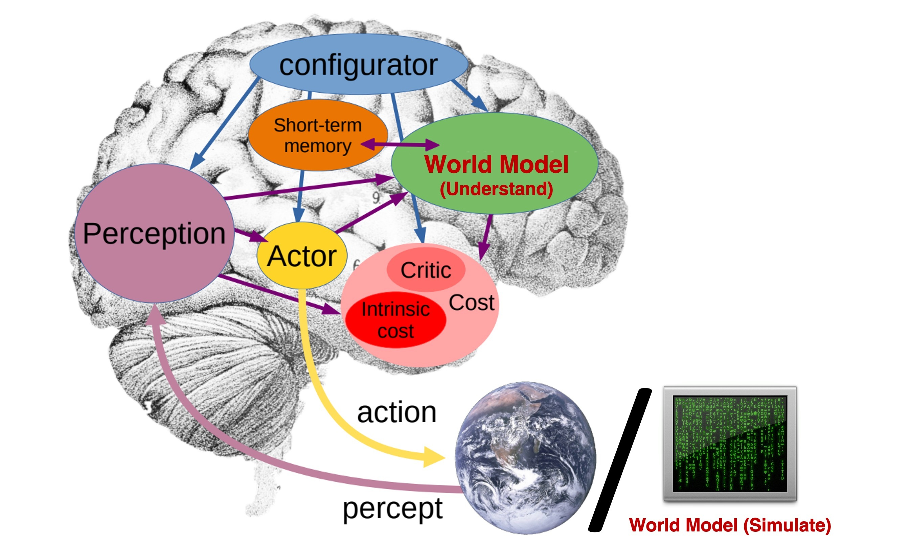
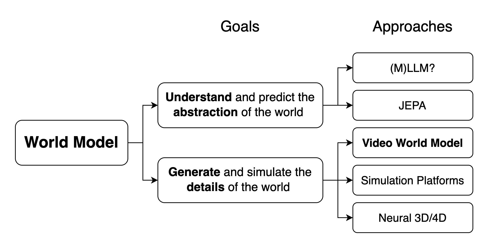
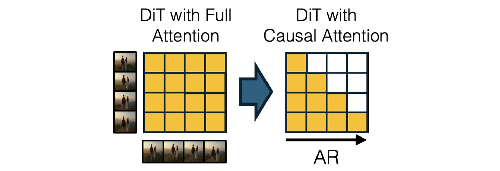
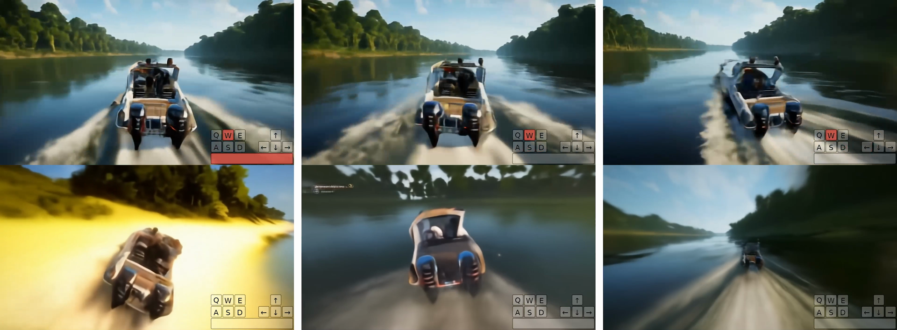
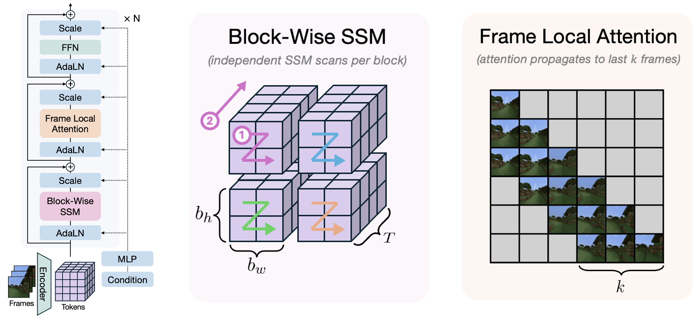
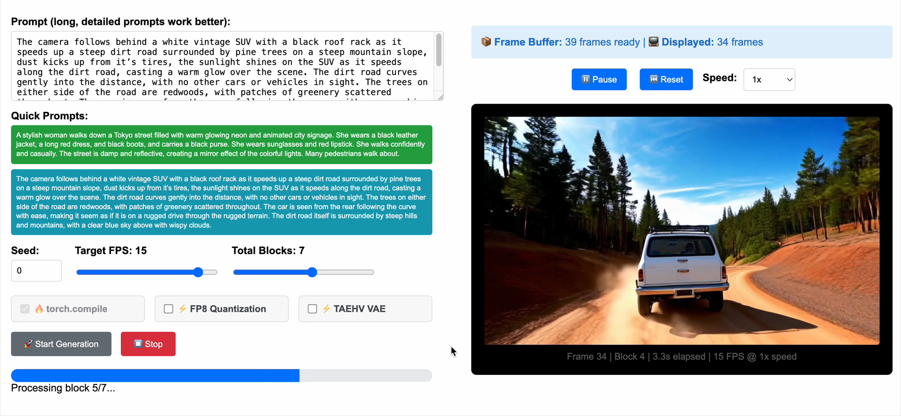
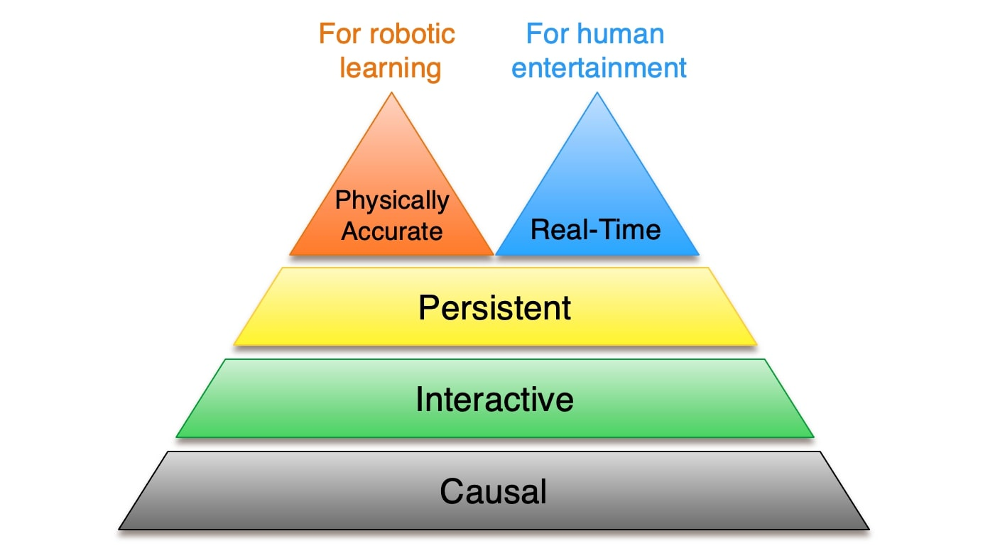
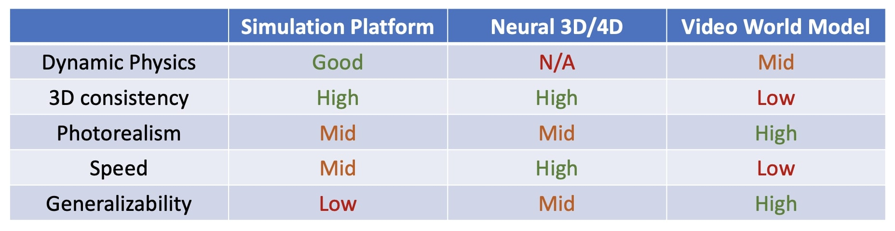

# Towards Video World Models：视频世界模型五个门槛

!!! info "论文信息"
    **论文题名：** Towards Video World Models。 
    **作者：** Xun Huang。 
    **机构：** 作者个人技术博客；原文未给出机构署名。 
    **时间 / 主题：** 2025-07；世界模型。 
    **arXiv / 官方报告：** arXiv：未找到专门条目；官方原文：[xunhuang.me/blogs/world_model.html](https://www.xunhuang.me/blogs/world_model.html)。 
    **GitHub / 项目：** GitHub：未找到官方链接。 
    **元数据来源与核验口径：** 来源：[官方原文](https://www.xunhuang.me/blogs/world_model.html)；Checked Date：2026-07-07；Repro Status：Blog / official materials reviewed, independent reproduction not claimed。

## 先问它要理解世界，还是要提供一个可操作的世界

“世界模型”可以指机器人脑中的预测模块，也可以指机器人外部的训练环境。两者都要预测动作后果，但前者可能只需知道一个动作能否达成目标，后者还要产生让相机、控制器或人类用户能够持续接收的环境反馈。若不先区分用途，就容易把“为什么要生成无关像素”和“模拟器为什么缺少视觉细节”当成同一个争论。

Xun Huang 的《Towards Video World Models》是一篇研究路线评论。它没有提出新训练损失或新排行榜，而是针对视频生成如何变成外部世界模拟器，提出五项要求，并用已有方法说明每一项的障碍与可能路线。文章发表于 2025 年 7 月，其模型例子与比较应放在这一研究背景下理解。[原文开篇](https://www.xunhuang.me/blogs/world_model.html)

Figure 1 的重点是脑内与脑外的分工。内部 world model 和 perception、actor、critic 等模块协作，预测对当前决策有用的后果；外部 simulator 则承担“世界”的角色，让行动产生可以观察到的结果。

{ width="860" }

*原文 Figure 1，由 LeCun 的相关示意图改编。红字区分 World Model (Understand) 与 World Model (Simulate)，不能仅凭两者同名就要求它们输出相同细节。*

可以用一个导航例子理解差别。决策模块可能只需预测前方是否可通行，不需要还原每片树叶；若环境要给视觉导航策略提供训练观测，则需要生成足够一致的视角、障碍外观和运动反馈。这里的“足够”取决于任务，并非外部模拟必须在所有细节上达到无限精度才有价值。

文章将两类目标分别称为内部世界理解与外部世界模拟。它们可以协作，机器人用内部模型规划，再通过外部环境中的交互经验改进内部表示。视频世界模型只是外部模拟的一条实现路线，并不包揽所有 world model 研究。[原文 What Are World Models](https://www.xunhuang.me/blogs/world_model.html#what-are-world-models)

## 分类图先分目标，再分实现，避免把不同层级的方法排成一列

Figure 2 先将 Goals 分成抽象理解预测和详细生成模拟，再列出对应 Approaches。这个顺序比简单列模型名更重要。

{ width="900" }

*原文 Figure 2。左侧是共同名称，中间是不同目标，右侧才是候选架构与技术路线。图中 (M)LLM 后的问号也保留了作者对这一路线的开放判断。*

内部理解一侧，文章讨论多模态语言模型与 JEPA。LWM 通过长视频和语言上下文吸收时序信息，V-JEPA 2 一类方法预测抽象视频表示，避免把所有细节都还原成像素。文章将它们作为具身世界理解的候选路线，并没有证明任何能描述视频的语言模型已经具备完整的行动后果预测能力。

外部模拟一侧，视频生成、物理仿真平台和神经 3D/4D 表示并列。它们都能向智能体或人提供环境体验，但保存状态、接收控制和产生观测的方法不同。将“JEPA 是否更好”和“视频模拟器是否更逼真”直接放进同一排行榜，往往先混淆了比较目标。

| 首先要做什么 | 世界模型主要需要保留什么 | 更直接的检验方向 |
|---|---|---|
| 辅助智能体理解、预测和规划 | 决策相关的抽象状态与变化 | 预测能否帮助选择动作、提高任务表现 |
| 为智能体提供可学习的外部环境 | 与动作相符的状态转移和观测 | 策略在环境中学到的行为是否有效 |
| 为人提供可交互的虚拟体验 | 连贯环境、响应动作的视觉未来 | 是否能持续操作，等待与漂移是否破坏体验 |

这张表是对原文目标区分的整理，不是作者提供的新评测标准。它提示读者先确定服务对象，再讨论是否必须生成像素、是否需要显式几何，以及速度应该以什么口径计算。

## 五项要求是一组相互制约的接口条件

作者提出 causal、interactive、persistent、real-time、physically accurate 五项要求。它们不是五个可以随意相加的分数，也不是已经由社区统一认证的等级。每一项针对一类容易被漂亮视频掩盖的问题。

| Requirement | 需要回答的问题 | 单靠什么还不能证明它 |
|---|---|---|
| Causal | 新的未来能否在已呈现历史之后继续生成 | 整段视频看起来时间顺畅 |
| Interactive | 运行中输入动作能否改变后续结果 | 开始前给过一个文本提示 |
| Persistent | 足够长时间后，原有环境事实是否仍成立 | 能不停产生新帧 |
| Real-time | 能否既跟上播放，又及时反馈控制 | 只报告高 FPS |
| Physically accurate | 动作后果是否遵循任务所需物理关系 | 纹理逼真、运动视觉上自然 |

前两项是作者定义交互视频世界时的基础条件，持续性可以有程度差别，实时性与物理精度则会随应用形成不同权重。将这层关系想清楚，后面的技术路线就不再是孤立的方法清单。[原文 Summary](https://www.xunhuang.me/blogs/world_model.html#summary)

## 因果性先给尚未发生的动作留下位置

### 这里说的是时间依赖，不是从相关性中识别干预效应

文章专门区分两种 causal。本文要求已生成的过去不再依赖尚未知的未来，强调时间单向性；因果机器学习还会讨论混杂、干预和相关性识别，那是另一组问题。一个采用 causal attention 的视频模型，并不会因此自动证明它学到了正确的物理因果规律。[原文 Causal](https://www.xunhuang.me/blogs/world_model.html#causality)

普通双向 video DiT 同时处理一段固定长度视频，前后帧在去噪中相互协调。这对离线制作很有效，因为模型可以利用整段信息调整每一帧。但若视频已经全部确定，用户在播放到中间时临时按下左转，后续内容不会自然改变，系统需要一个重新生成未来的机制。

时间自回归将接口改成先生成当前帧或短块，再把它作为历史继续生成下一块。过去已经确定，新动作可以进入尚未完成的后续条件。关键不是把矩阵形状改成三角形本身，而是系统真的按这个时间关系执行，让未来保持可受输入影响。

### 扩散与自回归可以承担不同层次的生成

文章回顾了离散 token 视频生成路线，如 CogVideo 和 VideoPoet，并指出当时一些方法面临 VQ 压缩损失和逐 token 解码速度问题。这个判断针对所讨论的实现，不应推广成所有自回归方法都必然低质量。

更有用的结构是让自回归负责时间顺序，让扩散负责当前视觉单元的连续生成。当前块内可以并行去噪，块之间保留过去到未来的依赖，避免必须逐个空间 token 生成整张图像。

{ width="920" }

*原文 Figure 3，引用 CausVid。左图整段 attention 可双向读取，右图按时间限制可见关系；少步采样是配套的速度改造。*

作者用三项工作串起路线。Diffusion Forcing 让不同帧具有独立噪声水平，使模型可以处理历史较确定、当前更不确定的生成状态；CausVid 将已有大规模双向视频模型转成因果 AR-DiT，并进行少步蒸馏；MAGI-1 探索直接预训练 AR-DiT，并为此调整基础设施。[原文 Causal](https://www.xunhuang.me/blogs/world_model.html#causality)

这三者的角色不同。前者提供训练条件的表达方式，第二项提供从强预训练模型迁移的路径，第三项探索原生训练。不能都概括成“让视频模型变快”，因为因果接口与采样速度分别解决能否接收新输入、多久给出结果。

## 交互性要求同一个过去在不同动作下走向不同未来

一个因果模型可以不停生成视频，却完全不接收外部动作。作者称它为 observer mode 的被动模拟器。要成为可操作环境，模型还要根据运行中注入的行为改变后续预测。

游戏中的按键、机器人电机命令、汽车的转向与加速，都是动作接口，但维度、频率和后果完全不同。开始时输入“一个人在房间里走动”，主要是语义条件；运行中连续输入左转、停下、后退，并让画面相应变化，才是这里强调的 interactive controllability。[原文 Interactive](https://www.xunhuang.me/blogs/world_model.html#interactive)

原文 Figure 4 的 Genie-2 视频将相近初始场景展开为三个控制分支。下图保留原视频中的前后抽帧，按键显示与路径变化一起出现。

*原文 Figure 4 视频的两组原始抽帧。每组横向三列展示不同控制下的未来，后期路径明显分开；它提供定性控制例子，并非动作跟踪误差统计。*

文章回顾的早期 recurrent VAE 世界模型、Dreamer 系列，以及较新的 GameNGen、DIAMOND 等扩散环境，虽然视觉表达不同，都需要连接行动与观察。驾驶和导航路线也各自采用相应动作空间。因此比较方法时，首先应问它能接收什么控制，而非只看环境视频是否真实。

### 视频规模不能替代动作对齐

网络视频覆盖很多外观与事件，但通常没有同步的电机、按键或车辆控制记录。游戏可以输出输入日志，机器人可以记录动作和传感器，真实互联网视频却往往只提供“发生了什么”，缺少“施加了什么控制”。

Genie 的无监督 latent action 学习尝试从相邻视觉状态中压缩变化因素，再让动力学使用这些因素预测。文章将它视为利用无动作标签视频的路径，也提到 Genie-2 采用 AR-DiT 的交互表现。它降低了显式动作标签要求，却没有让潜在动作天然等于某台机器人的可执行电机命令。[原文 Interactive](https://www.xunhuang.me/blogs/world_model.html#interactive)

这条边界直接影响应用。能够按键控制相机游览，不表示系统已经知道夹爪开合、摩擦接触和物体受力；能够生成抓取画面，也不表示它对每个关节命令都给出可信后果。控制接口、对齐数据与任务范围需要一起定义。

## 持续性包含长度，也包含同一个世界没有被悄悄换掉

持续生成首先要长到足以完成任务。几秒视频可以展示一个动作，却未必覆盖探索、回访或多阶段操作。更严格的要求是，后续结果必须与先前生成保持一致。

可以用离开房间再返回的情形理解。模型在离开期间仍不断输出清晰图像，只说明 rollout 没有停止；返回时桌子、门和此前移动过的物体应当仍处在相容状态，才说明环境具有一定 persistence。这个例子是对文章要求的解释，不是原文额外报告的一组成功率实验。

长 context Transformer 理论上能读取更多历史，但每次生成也可能随历史增长而变贵。人类交互环境不能因为运行十分钟就比第一分钟明显卡顿，因此记忆结构同时是一个运行时问题。[原文 Persistent](https://www.xunhuang.me/blogs/world_model.html#persistence)

### 压缩远期历史，隐含了近期信息更重要的假设

FAR 与 FramePack 类路线对较远的历史压缩得更强，将计算优先分配给近帧。这适合近期视觉已足够决定未来的场景，但可能丢失很早出现、当前才重新变重要的细节。

作者借用 needle in a haystack 类比说明这个问题。压缩做得越激进，模型越需要知道什么是未来仍有用的事实；如果所有远期细节一概压低，某个目标物体、房间入口或早先交互状态可能恰好被丢掉。它是一种明确的归纳偏置，不能只用“支持长上下文”掩盖信息选择。

### 显式三维条件擅长保存空间，动态世界还需要时间状态

另一类方法将持久 3D 条件输入视频生成，例如 GEN3C、显式 3D 建模和空间记忆路线。相机移动时，可以重新查询同一几何结构，因此静态场景的一致性较容易保持。

困难转向动态环境。物体不仅占据空间，还会运动、变形、被拿走或遮挡。若用显式表示保存这些变化，就要处理更复杂的 4D 状态更新。静态几何一致并不能单独保证不可见对象仍按时间正确变化。[原文 Persistent](https://www.xunhuang.me/blogs/world_model.html#persistence)

### 循环状态将历史压成固定形式，局部 attention 保留近期细节

第三条路线使用线性 RNN 或 state-space model，让时间推进主要表现为隐藏状态更新，避免每帧重新读取不断增长的历史。原文引用的 State-Space Video World Model 将 block-wise SSM scan、3D hidden states 与 frame-local attention 结合。

{ width="920" }

*原文 Figure 5。中间为分块 SSM 扫描，右侧 local attention 只读取近邻帧；结构在长期压缩记忆与近期高保真信息之间分工。*

3D hidden state 让空间组织参与历史更新，局部 attention 则保留最近画面的详细关系。它与早期 ConvLSTM 视频预测在“循环保存历史”这一点上有相似性，但图示并不证明固定状态能够无损记住无限细节。状态容量、更新规则和训练目标仍决定哪些事实会留下。

| Memory route | 保存历史的方式 | 主要优势 | 关键压力点 |
|---|---|---|---|
| 远期帧压缩 | 保留历史但降低远期表示精度 | 控制 context 成本，保留近期细节 | 早期关键事实可能被压掉 |
| 持久 3D 条件 | 将场景空间结构显式保留 | 便于跨视角一致和回访 | 动态对象与 4D 更新复杂 |
| 循环 / SSM 状态 | 持续更新固定形式隐藏状态 | 每步成本更稳定 | 压缩状态是否保留任务信息 |

这三条路线没有在本文接受统一预算的定量比较。它们回答的是如何处理记忆与成本，实际选择仍要看应用中的关键历史是什么。

## 实时性需要同时看生成速度和动作反馈

高 FPS 容易掩盖交互延迟。一个系统可能提前算好很多帧，播放一直流畅，却要等缓冲区中的旧内容播完，才让刚按下的控制键改变画面。用户感受到的仍是动作迟钝。

文章因此分开讨论 throughput 与 latency。前者问单位时间产出多少帧，后者问新动作进入系统后，多久出现真正受它影响的画面。生成吞吐至少跟得上播放消费，是长时间流畅运行的必要条件；动作响应还需要满足应用自己的延迟预算。[原文 Real-Time](https://www.xunhuang.me/blogs/world_model.html#real-time)

| Quantity | 原文定义及判断用途 | 不能据此直接推出什么 |
|---|---|---|
| Throughput | 模型每秒生成的帧数，能否长期支撑播放 | FPS 高不等于动作响应快 |
| Latency | 交互动作到响应帧之间的延迟 | 低首帧延迟不等于之后每个动作都及时 |
| Buffer | 原视频界面显示已生成与已播放帧的差额 | 缓冲能改善播放连续性，也可能延后新动作生效 |

前两项是作者明确提出的评价维度，第三项来自原始演示界面的阅读，用来解释二者如何在系统中相互影响。缓冲不是越多越好，关键要看已经生成的未来还能否接受新动作，以及旧帧能否被替换。

作者引用研究，举出直播约 1 秒、游戏约 0.1 秒、VR 约 0.01 秒的可接受延迟例子。这些数值在文中用于说明应用差异，不能当作所有设备、内容、用户与任务通用的硬标准。机器人闭环还会有自己的传感、控制周期与安全边界，本文没有给出统一阈值。

### 非因果长块的问题是未来提前确定

原文将一次性生成 $t$ 秒视频的非因果模型描述为至少具有 $t$ 秒交互延迟，并进一步断言它无法真正实时。理解这个判断需要保留其系统前提。

若整段未来已经固定，系统继续按原计划播放，段中到来的动作确实无法影响这些帧。但实际等待多长，还取决于动作在块内何时到来，系统是否允许丢弃已生成帧、重新生成剩余内容，以及是否采用部分流式输出。固定块长本身并不是所有实现的普适墙钟延迟下界。

能够稳妥保留的结论是，交互系统需要让未显示的未来及时接受新动作。时间自回归提供自然接口，小块生成缩短提交范围，少步蒸馏减少每次计算，KV cache 则复用过去条件。因果 attention 解决的是依赖关系，不能单独保证整个系统已足够快。

这也解释了文章为何同时讨论 CausVid 与 Self Forcing。前者将因果生成与分布匹配蒸馏结合，后者在训练时运行自己的自回归生成过程，让模型学习处理自身输出构成的历史，并采用 KV 缓存。速度和长程质量在这里互相牵制，推理步骤少了，模型还要能在自己的误差上继续生成。

*原文 Figure 6 视频抽帧。界面同时显示生成中、目标播放 15 FPS、frames ready 39 与 displayed 34；这些是该演示时刻的运行状态，不是独立测得的模型吞吐基准。*

博客引用 Self Forcing 的结果为单 GPU 约 17 FPS、亚秒级延迟，并提到 APT2 继续探索训练时 rollout 和交互控制微调。这里的 17 FPS 是所引工作的性能报告，不能从视频文件的编码帧率推出，也不能推广到任意分辨率、硬件、帧块长度或动作条件。

更完整的系统报告应同时给出硬件、输出分辨率、吞吐、首帧或动作响应延迟、长时间运行速度是否下降，以及测量时采用的缓冲策略。这些项目是由文章讨论推导出的阅读准则；博客本身没有把列举的所有系统放在统一环境下重测。

## 物理准确性决定生成的经验是否值得学习

对于娱乐，画面在视觉上可信可能已经有价值。对于训练机器人，问题会更具体。夹爪是否真能托住物体，支撑消失后物体是否会落下，碰撞后运动方向是否合理，这些后果决定策略会学到什么。

因此，视觉质量高并不能直接证明动态规律正确。模型可能很好地复现熟悉动作的外观，却在训练数据较少覆盖的速度、质量、接触状态或动作组合上产生错误。若策略持续利用这样的预测，错误会从画面进入决策。

### 组合泛化与物理参数外推需要分开检验

原文引用 Kang 等人的 PhyWorld 研究。该研究使用物理模拟器产生的简单二维数据，区分组合泛化与物理属性分布外的外推；博客概括的发现是，前者有一定可行性，后者在未见速度、质量等条件下仍有明显失败。[原文 Physically Accurate](https://www.xunhuang.me/blogs/world_model.html#physically-accurate)

这个结果的意义是将“看起来懂物理”拆成可检查的问题。见过分别运动的物体后，能否处理它们的新组合；见过某一速度范围后，能否正确处理范围之外的运动，两者不是同一能力。把有限数据分布中的成功直接称为掌握普适物理定律，会忽略这个差别。

同样，这项被引用的实验也不能支持“所有视频世界模型都不可能学会物理”。实验使用特定数据、架构与测试设置，能说明相应外推问题尚未解决。博客没有提供逐项实验表或新的复现，因此这里保留结论层级，不另造成功率或误差数值。

作者随后提出乐观判断，认为很多实际任务可能与互联网视频中已有情形具有组合相似性，并用“训练分布覆盖整个世界就没有分布外”作轻松表达。这句话适合读作对扩大数据覆盖的期待。现实数据有限，机器人执行自己的策略后还会主动进入稀有状态；相似外观也不能保证关键物理参数已被观测。因此它不是分布外问题已经消失的证据。

### 目标函数与数据覆盖是两种互补干预

文章给出三项增强物理真实感的例子。VideoJAM 认为仅关注常用像素重建目标不足以表达运动一致性，因此联合引入 optical flow 去噪目标，让训练显式关心运动。Ctrl-Crash 使用汽车事故片段微调，补充正常行驶视频较少覆盖的碰撞事件。PISA 则使用合成或真实物体下落视频进行微调。

| Work cited | 博客强调的干预 | 希望补足的信息 |
|---|---|---|
| VideoJAM | 联合视频与光流去噪目标 | 图像变化所对应的运动结构 |
| Ctrl-Crash | 用汽车事故视频微调 | 稀有碰撞及其后果 |
| PISA | 用合成或真实物体下落视频微调 | 重力、支撑与下落相关情形 |

三者提示两条可以叠加的路线。一条改变模型被要求预测什么，避免清晰图像掩盖运动错误；另一条改变模型见过什么，让重要但稀少的事件在训练中有足够权重。本文没有给出统一控制变量的比较，因此不能据此排列三项工作的强弱。

应用时还要决定什么物理误差真正影响任务。远景布料的细节变化可能只影响观看效果，抓取过程中接触点偏移却可能改变动作成功与否。针对下游动作后果定义评价，比单一“物理真实感”总分更容易定位问题。这是从文章论点延伸出的应用分析，并非作者新增的实验结论。

## 双头金字塔把应用分歧留在图里

五项要求并非一条完全线性的排行榜。作者在总结图中把 causal、interactive、persistent 排成底部层级，随后让顶端分向 real-time 与 physically accurate。

{ width="760" }

*原文 Figure 8。底部三层说明环境接口与持续运行，两个顶端分别对应对实时交互和物理准确的强调；这是作者提出的组织框架，不是社区认证标准。*

在作者选择的外部视频仿真定义下，因果性和交互性属于硬要求。一个不能让新动作改变后续结果的系统，很难承担可操作环境；持续性则有程度差别，即使尚不能无限保持全部细节，中等长度、局部可靠的模拟仍可能有用。[原文 Summary](https://www.xunhuang.me/blogs/world_model.html#summary)

两个顶端提醒读者先确定使用者。面向人的交互娱乐必须及时回应操作，只要运动足以支持观看和操控，未必需要精确恢复全部物理量。面向机器人学习的模拟则更关心动作后果是否值得信任，离线生成训练经验未必必须与真实时间同步。

“训练时不要求实时”也不等于速度无关。吞吐仍决定单位预算内能生成多少轨迹，延迟仍可能影响在线规划是否可用。只是当目标是离线训练策略时，物理错误导致的错误经验可能比慢一些生成更加昂贵；当人正在游戏中转向时，即使结果很真实，迟到的响应也无法补回操作体验。

原文用模型规模概括这种取舍，大模型往往较准确但较慢，小模型更适合实时。这个方向具有解释力，但不能当作不变定律。训练数据、蒸馏质量、动作空间、模型结构和运行系统都能移动两者的边界；本文没有建立规模与物理准确性的通用定量曲线。

## 物理引擎、神经三维表示和视频模型各自保存了什么

讨论五项门槛以后，作者回到更宽的外部仿真路线。视频生成只是其中一种，显式物理模拟与神经三维、四维表示也能承担不同职责。

物理仿真平台通常将动力学引擎与渲染器分开。状态、碰撞、约束与控制由明确的模拟机制推进，再把状态渲染成观察。MuJoCo、Isaac 和 Genesis 是文中例子。这类系统便于接入机器人训练，但制作具体场景、物体和任务常需额外工作，照片级视觉与实时渲染也会带来成本。[原文 Other Approaches](https://www.xunhuang.me/blogs/world_model.html#other-approaches)

神经三维、四维路线让网络生成显式世界表示，例如 3D 或 4D Gaussian Splatting。Wonderland、WonderWorld、Bolt3D 等工作被列为相关方向。对于已有的三维场景，同一表示可以服务多个视角，渲染效率与视角一致性有明显结构优势；若世界中的物体还要自由运动并响应复杂交互，动态状态的建模会增加难度。

视频世界模型把大量外观与事件规律放进生成模型，在条件变化、场景多样性和写实画面上具有吸引力。不过，它并不自动显式保存可查询的三维状态，也不天然满足实时互动。前面讨论的 persistence 与 real-time，正是在这里重新出现。

{ width="920" }

*原文 Figure 9。表中 High、Mid、Low、Good 与 N/A 是作者在 2025 年文章中的定性判断，没有统一测试集、硬件和误差指标。*

为便于对照原图，下面保留其英文条目。N/A 也按原图记录，不将其改写成“所有神经三维方法都没有动力学”。

| Axis | Simulation Platform | Neural 3D/4D | Video World Model |
|---|---|---|---|
| Dynamic Physics | Good | N/A | Mid |
| 3D Consistency | High | High | Low |
| Photorealism | Mid | Mid | High |
| Speed | Mid | High | Low |
| Generalizability | Low | Mid | High |

这个比较适合作为寻找结构优势的入口，不适合当成定量榜单。“泛化高”尤其需要限定含义，视频模型对视觉场景和语言条件的适应广，并不自动意味着它对未见质量、接触或机器人控制也具有高外推准确率；前面的 PhyWorld 讨论已经给出反例方向。

### 混合系统可以把不同责任分配给不同表示

文章用 WonderPlay 举例，将物理模拟器、3D Gaussian 表示和视频扩散组合起来。可以从职责分配理解这条路线，动力学机制约束对象如何运动，三维表示维持空间结构，视频生成补足视觉表达。

这种组合的价值取决于接口是否可靠。渲染出的接触位置应与动力学状态相容，生成过程不能随意改变会影响控制的物体身份或几何，新的视觉细节也不能使观察偏离可执行动作的实际后果。否则，单个模块分别漂亮或准确，合起来仍可能产生不一致经验。

这些接口问题是对混合路线的工程分析。博客没有为 WonderPlay 提供重新测量的比较表，也没有证明某种组合已经满足五项要求。它提出的是一种值得探索的分工，避免把所有问题都压在同一个表示和生成目标上。

## 从这篇文章带走一套能用于项目的追问方式

这篇博客的贡献在于给“从视频生成到世界模拟”的讨论补上接口与运行条件。它没有提出新损失函数、统一训练配方或新的综合基准，因而最适合用来组织选型与实验问题。

若要做可互动环境，首先写清输入的动作空间、输入到来频率、可修改未来的粒度，以及响应延迟如何测量。若要做机器人训练，还要写清哪些动作后果必须可信，哪些状态超出了训练覆盖，策略是否会主动进入模型最不可靠的区域。若要做长程探索，则需要设计离开再返回、遮挡后重现、对象被移动后回访等能检验历史状态的任务。

这些问题会把宣传中宽泛的“实时”“长时”“懂物理”变成可复查的条件。同样的模型可以在一个用途里足够好，在另一个用途里仍缺少关键接口；判断依据应是任务需要和所提供的证据。

文章开头区分的内部理解与外部模拟，也因此回到同一条链路。机器人内部模型可以只保留决策所需的抽象状态，外部模拟器则负责产生可交互的经验。二者能够相互帮助，但各自应接受与职责一致的检验，不能用漂亮视频替代动作后果验证，也不能用一个抽象预测指标代表完整环境已经建成。

## 继续阅读

五个门槛可以用[世界模型基础](../../world-models/beginner-world-models-primer.md)逐项定位；如果关心机器人闭环，接[世界模型与机器人综述](world-model-for-robot-learning-survey.md)。
