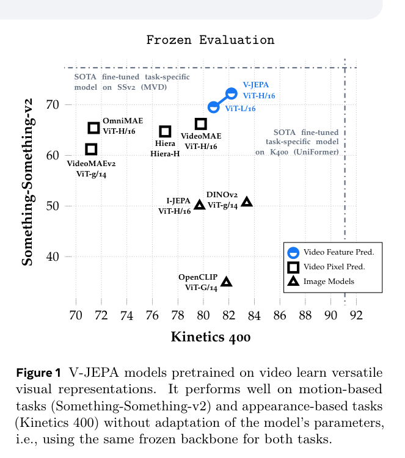
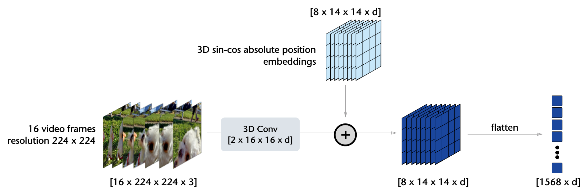
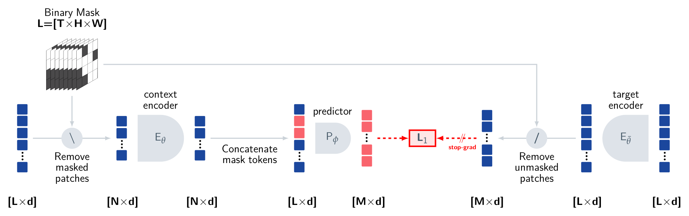
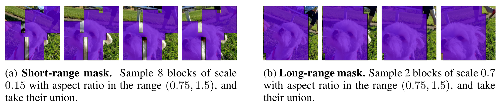
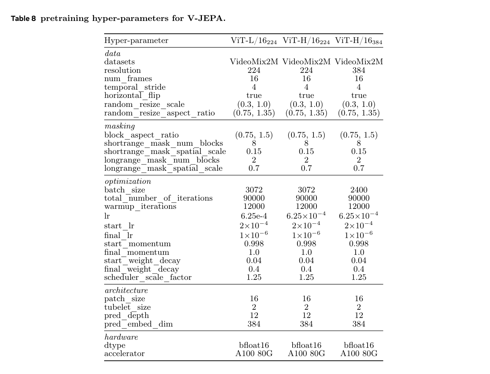
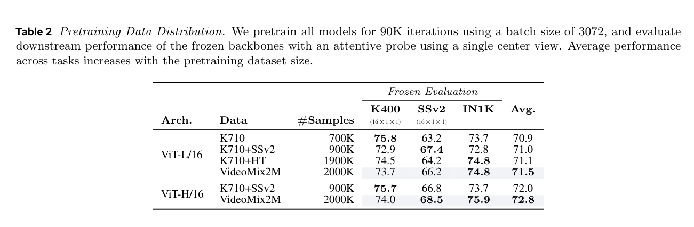
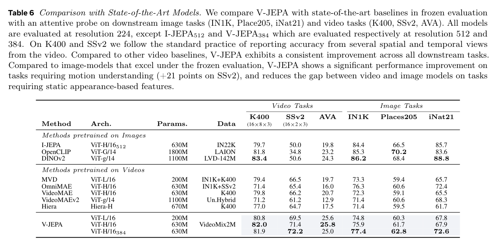
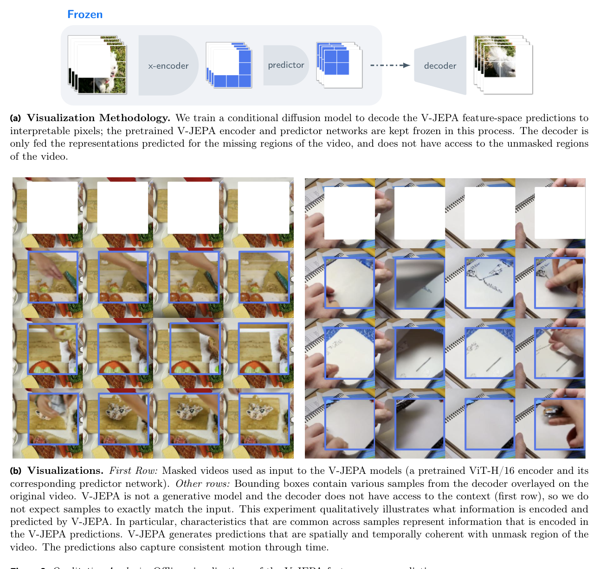
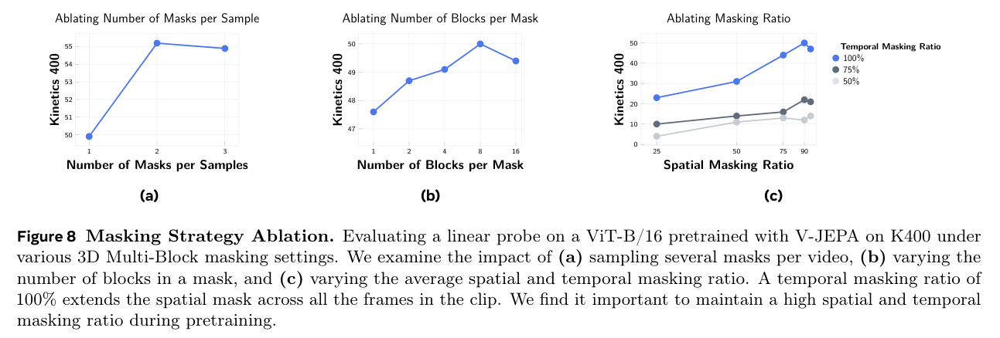

# V-JEPA：视频潜变量预测表征

!!! info "论文信息"
    **论文题名：** Revisiting Feature Prediction for Learning Visual Representations from Video。 
    **作者：** Adrien Bardes、Quentin Garrido、Jean Ponce、Xinlei Chen、Michael Rabbat、Yann LeCun、Mahmoud Assran、Nicolas Ballas。 
    **机构：** Meta AI。 
    **时间 / 主题：** 2024-02；世界模型。 
    **arXiv / 官方报告：** arXiv：[2404.08471](https://arxiv.org/abs/2404.08471)；官方材料：[ai.meta.com/research/publications/revisiting-feature-prediction-for-learning-visual-representations-from-video/](https://ai.meta.com/research/publications/revisiting-feature-prediction-for-learning-visual-representations-from-video/)。 
    **GitHub / 项目：** GitHub：[github.com/facebookresearch/jepa](https://github.com/facebookresearch/jepa)；项目页：[ai.meta.com/research/publications/revisiting-feature-prediction-for-learning-visual-representations-from-video/](https://ai.meta.com/research/publications/revisiting-feature-prediction-for-learning-visual-representations-from-video/)。 
    **元数据来源与核验口径：** 来源：[arXiv](https://arxiv.org/abs/2404.08471)；[GitHub API / repo](https://github.com/facebookresearch/jepa)；[官方 / 项目材料](https://ai.meta.com/research/publications/revisiting-feature-prediction-for-learning-visual-representations-from-video/)；Checked Date：2026-06-15；Repro Status：Paper / official materials reviewed, independent reproduction not claimed。

## 预测视频的潜变量，为什么能学到可迁移的表示

V-JEPA 把视频预训练目标放在特征空间。模型从一个视频 clip 的可见时空区域预测被遮挡区域的表示，损失比较的是 teacher encoder 产生的潜变量，不是 RGB 像素。预训练不使用文本、动作标签、人工标签、负样本或像素重建。论文随后冻结视频 encoder，只训练下游读出头，检查它对动作、运动、图像和检测任务的迁移能力。因此它首先是视频表示学习方法，不能直接当成带动作接口的闭环世界模型。[论文第 1–3 页](https://arxiv.org/pdf/2404.08471v1#page=1)

{ width="920" }

*当前锁定 PDF Figure 1。它是 frozen evaluation 的 Kinetics-400 / Something-Something-v2 散点图，比较视频特征预测模型、像素预测模型和图像模型；模型内部的信息流见后文 Figure 3。*

## 从一个 clip 到 1568 个 token

预训练每次从视频中采样 16 帧，时间 stride 为 4。按 30 FPS 估算，采样覆盖 64 帧，约 2 秒。空间尺寸缩放到 224×224。一个 16×224×224×3 的 clip 先经过核大小和 stride 都为 2×16×16 的 3D convolution，得到 8×14×14×d 的特征图。加入 absolute 3D sin-cos positional embedding 后展平为 8×14×14=1568 个 token。V-JEPA 没有使用 CLS token。[论文第 16–17 页](https://arxiv.org/pdf/2404.08471v1#page=16)

{ width="860" }

*每个 token 覆盖连续 2 帧和 16×16 的空间 patch，不能把 token 当成一整帧。*

## 两条 encoder 分支和一次 teacher 计算

给定完整 token 序列 xL，取两个互补的索引集合。N 个可见 token 组成 xN，M 个被遮挡 token 的位置记为 IM。

1. x-encoder 只接收可见 token，得到 zN=Eθ(xN)。
2. predictor 接收 zN 与 M 个带绝对 3D 位置的 learnable mask token，输出每个被遮挡位置的预测 ŝM=Pϕ(zN,mM)。
3. y-encoder 接收完整 clip xL，得到 teacher 表示 sL=Ebarθ(xL)。训练目标只取 IM 上的 sk。

损失是被遮挡位置上的平均 L1 距离

$$
\mathcal{L}(\theta,\phi)=\frac{1}{M}\sum_{k\in I_M}
\left\|P_\phi\left(E_\theta(x^N),m^M\right)_k-
\operatorname{sg}\left(E_{\bar{\theta}}(x^L)_k\right)\right\|_1 .
$$

这里的 y 不是另一个只含目标区域的输入。teacher 看到的是完整 clip，再从目标位置取出特征。对 θ、ϕ 做梯度更新，barθ 由 x-encoder 的 EMA 更新并停止梯度。predictor 负责把可见上下文映射到目标位置，stop-gradient 防止 teacher 被当前误差直接拉动，EMA 又让目标表征缓慢变化；三者共同打破 student 与 target 即时互相追随的塌缩路径。论文的一维直觉是，若 predictor 已近似最优，L1 更偏向条件中位数，encoder 增加可预测上下文可以降低条件 median absolute deviation。这个解释依赖简化假设，不能当成任意网络训练都不会塌缩的严格保证。L1 只约束被遮挡位置，促使模型保留能从上下文预测的结构，同时可以丢掉难以预测的像素细节。[论文第 3–4、16 页](https://arxiv.org/pdf/2404.08471v1#page=3)

{ width="920" }

*读图时要区分 student 路径和 teacher 路径。teacher 的完整 clip forward 会被两种 mask 复用。*

## 两个 mask 让一次 teacher forward 产生两项任务

V-JEPA 每个 clip 采样两种 mask。short-range mask 由 8 个空间尺度约为 0.15 的随机块取并集，long-range mask 由 2 个空间尺度约为 0.7 的随机块取并集；每个块的长宽比从 0.75 到 1.5 采样。两类 mask 都沿整个时间轴延伸，合并后的平均遮挡约为 90%。这些比例来自多个可能重叠的块，不能把 0.15 和 0.7 直接相加。[论文第 4、18、22–23 页](https://arxiv.org/pdf/2404.08471v1#page=4)

给定一个 clip，x-encoder 和 predictor 要分别为 short-range、long-range 两个 mask 做 forward，但 y-encoder 对完整 clip 的计算只做一次。这个 multi-mask 设计把 teacher 的成本摊到两个互补预测任务上，也解释了为什么两个 mask 是训练效率和效果之间的一个具体设计点。

{ width="920" }

*mask 的难度来自连续时空块和高遮挡率。random-tube 同样沿整个时间轴遮挡空间 patch；multi-block 则移除大块连续空间区域，减少局部邻域冗余带来的捷径。消融结果显示，在这套 feature-prediction 目标下 random-tube 的表示质量更差。*

论文的受控消融也支持这一点。ViT-L/16 在 K710+SSv2 上、使用单中心视角和 attentive probe 时，random-tube[0.9] 的 K400/SSv2/IN1K 为 51.5/46.4/55.6，causal multi-block[12] 为 71.9/63.6/72.2，完整 multi-block 为 72.9/67.4/72.8。完整 clip 上的时空上下文优于只从前 12 帧预测后续区域，严格的 future-only 约束并不是这篇论文的最优表示学习任务。[论文第 6 页](https://arxiv.org/pdf/2404.08471v1#page=6)

## 训练配方和调度边界

VideoMix2M 约含 200 万个视频，合并 HowTo100M、K710 和 Something-Something-v2，并去除与验证集重叠。模型使用 16 frames、temporal stride 4。ViT-L/16 与 ViT-H/16 在 224 分辨率使用 batch 3072，ViT-H/16 在 384 分辨率使用 batch 2400。

| 配置 | ViT-L/16 224 | ViT-H/16 224 | ViT-H/16 384 |
| --- | ---: | ---: | ---: |
| batch size | 3072 | 3072 | 2400 |
| 实际训练迭代 | 90000 | 90000 | 90000 |
| warmup iterations | 12000 | 12000 | 12000 |
| 起始学习率 | 2e-4 | 2e-4 | 2e-4 |
| 峰值学习率 | 6.25e-4 | 6.25e-4 | 6.25e-4 |
| nominal floor | 1e-6 | 1e-6 | 1e-6 |
| weight decay | 0.04 → 0.4 | 0.04 → 0.4 | 0.04 → 0.4 |
| EMA momentum | 0.998 → 1.0 | 0.998 → 1.0 | 0.998 → 1.0 |
| dtype / accelerator | bfloat16 / A100 80G | bfloat16 / A100 80G | bfloat16 / A100 80G |

论文用 AdamW 优化 x-encoder 与 predictor。predictor 是 12 个 Transformer blocks、384 维 embedding 的窄 ViT，并且预训练不使用 CLS token。学习率、weight decay 和 EMA 的 schedule 按 112500 iterations 计算，然后在 90000 处截断。也就是说，表中的最终训练点并没有走到默认 schedule 的终点；作者报告这种截断能避免最后 25% 的超参数变化过于激进，并改善性能。把 112500 写成实际训练步数会夸大训练量。[论文第 17–18 页](https://arxiv.org/pdf/2404.08471v1#page=17)

{ width="560" .atlas-figure-tall }

*训练表里的 12000 warmup、90000 实际迭代和 112500 scheduler horizon 必须同时出现。*

## attentive probe 才是冻结评测的读出方式

冻结 backbone 只表示 encoder 参数不更新，默认读出的是 target encoder 的特征。论文的 attentive probe 仍然需要监督训练 20 epochs。它用一个 learnable query q 对冻结 encoder 输出的 token 做 cross-attention，再接 residual、两层 MLP、LayerNorm 和线性分类器。核心聚合是对每个 token 的 key 相似度做 softmax 加权，再用 value 向量求和。实际 probe 使用 12 个 head，每个 head 维度为 12。

K400 默认从视频均匀分成的 8 个时间段各取一个 16-frame clip，分别编码后拼接 feature map，再送入 probe；SSv2 主表默认使用 2 个 clip。测试时再平均 3 个 spatial views。单 clip 约 2 秒，8 clips 约 16 秒，因而冻结分数也包含读出头容量和时间覆盖差异。Table 9 的 SSv2 `num_clips=1` 与正文主表的 2-clip 记载构成原文内部协议记载不一致；现有材料不足以把它解释成“另一套下游超参数表”，因此这里只保留冲突，不替原文补出未给出的原因。[论文第 18–19、21–22 页](https://arxiv.org/pdf/2404.08471v1#page=18)

冻结视频模型用于图像任务时，论文把一张图复制成 16 帧的 still clip。作者指出 3D tokenizer 的 temporal stride 是 2，复制成 2 帧已经足以产生与静态 2D tokenizer 相同数量的 token。图像模型用于视频任务时，则逐帧独立编码，再把 frame-level feature map 拼接交给 attentive probe。AVA 另用预训练 Faster R-CNN 的 region proposals，冻结 V-JEPA 的最后一层和三个中间层，训练线性分类器，报告 60 个常见类别的 mAP。[论文第 19 页](https://arxiv.org/pdf/2404.08471v1#page=19)

## 先看受控消融，再看跨模型比较

### 特征目标相对像素目标

下表在相同 ViT-L/16、VideoMix2M、90K、batch 3072 和 multi-block 任务下比较 feature target 与 normalized pixel target。冻结评测使用单中心视角和 attentive probe。

| Target | K400 frozen | SSv2 frozen | IN1K frozen | K400 fine-tuning |
| --- | ---: | ---: | ---: | ---: |
| Pixels | 68.6 | 66.0 | 73.3 | 85.4 |
| Features | 73.7 | 66.2 | 74.8 | 85.6 |

feature target 在 K400 的受控增益是 5.1 points，SSv2 是 0.2，IN1K 是 1.5，K400 fine-tuning 是 0.2。它支持特征空间目标在这套控制条件下更适合迁移，不能推广成所有数据、分辨率和下游协议都必然更好。[论文第 5 页](https://arxiv.org/pdf/2404.08471v1#page=5)

### 数据分布和 probe 都会改变结果

VideoMix2M 的平均分最高，但单任务最优数据源并不相同。ViT-L/16 的 K710、K710+SSv2、K710+HT、VideoMix2M 在 K400/SSv2/IN1K/Avg. 分别为 75.8/63.2/73.7/70.9、72.9/67.4/72.8/71.0、74.5/64.2/74.8/71.1、73.7/66.2/74.8/71.5。ViT-H/16 的 K710+SSv2 为 75.7/66.8/73.7/72.0，VideoMix2M 为 74.0/68.5/75.9/72.8。[论文第 5–6 页](https://arxiv.org/pdf/2404.08471v1#page=5)

{ width="900" }

平均池化与 attentive pooling 的比较更直接。原表的 V-JEPA ViT-L/16 结果为 K400 56.7 → 73.7，SSv2 50.1 → 66.2。按表内数值计算，增益分别是 17.0 和 16.1 points；Table 3 caption 把 K400 写成 +17.3，正文这里采用可复算的原始分数差，避免把 caption 与 raw values 混写。[论文第 6 页](https://arxiv.org/pdf/2404.08471v1#page=6)

### Table 5 与 Table 6 的比较协议

Table 5 固定所有方法为 ViT-L 或近似参数量的 Hiera-L、输入分辨率 224，并保留 frozen 与 fine-tuning 两种协议。

| Method | Arch. | Samples seen | K400 | SSv2 | AVA | IN1K | Places205 | iNat21 | K400-ft | SSv2-ft |
| --- | --- | ---: | ---: | ---: | ---: | ---: | ---: | ---: | ---: | ---: |
| OmniMAE | ViT-L/16 | 2400M | 65.6 | 60.6 | 14.4 | 75.1 | 59.8 | 66.1 | 84.0 | 74.2 |
| VideoMAE | ViT-L/16 | 410M | 77.8 | 65.5 | 21.6 | 71.1 | 59.3 | 64.6 | 85.4 | 74.3 |
| Hiera | Hiera-L | 770M | 75.5 | 64.2 | 15.8 | 68.9 | 58.5 | 56.9 | 87.3 | 75.1 |
| V-JEPA | ViT-L/16 | 270M | 80.8 | 69.5 | 25.6 | 74.8 | 60.3 | 67.8 | 85.6 | 75.1 |

Table 6 放开架构和预训练数据差异，所有结果仍是 frozen attentive probe，默认 224 分辨率，I-JEPA 为 512，V-JEPA-H/16 为 384。Table 9 的 `num_clips=1` 与正文主结果写的 2 clips 属于原文内部口径不一致，引用时应保留这个冲突，不能擅自解释成两套已知协议。当前锁定 PDF 的 V-JEPA 行为 L/16 80.8/69.5/25.6/74.8/60.3/67.8，H/16 82.0/71.4/25.8/75.9/61.7/67.9，H/16 384 81.9/72.2/25.0/77.4/62.8/72.6。

| Method | Arch. | Data | K400 | SSv2 | AVA | IN1K | Places205 | iNat21 |
| --- | --- | --- | ---: | ---: | ---: | ---: | ---: | ---: |
| I-JEPA | ViT-H/16 512 | IN22K | 79.7 | 50.0 | 19.8 | 84.4 | 66.5 | 85.7 |
| OpenCLIP | ViT-G/14 | LAION | 81.8 | 34.8 | 23.2 | 85.3 | 70.2 | 83.6 |
| DINOv2 | ViT-g/14 | LVD-142M | 83.4 | 50.6 | 24.3 | 86.2 | 68.4 | 88.8 |
| MVD | ViT-L/16 | IN1K+K400 | 79.4 | 66.5 | 19.7 | 73.3 | 59.4 | 65.7 |
| OmniMAE | ViT-H/16 | IN1K+SSv2 | 71.4 | 65.4 | 16.0 | 76.3 | 60.6 | 72.4 |
| VideoMAE | ViT-H/16 | K400 | 79.8 | 66.2 | 20.7 | 72.3 | 59.1 | 65.5 |
| VideoMAEv2 | ViT-g/14 | Un.Hybrid | 71.2 | 61.2 | 12.9 | 71.4 | 60.6 | 68.3 |
| Hiera | Hiera-H | K400 | 77.0 | 64.7 | 17.5 | 71.4 | 59.5 | 61.7 |
| V-JEPA | ViT-L/16 | VideoMix2M | 80.8 | 69.5 | 25.6 | 74.8 | 60.3 | 67.8 |
| V-JEPA | ViT-H/16 | VideoMix2M | 82.0 | 71.4 | 25.8 | 75.9 | 61.7 | 67.9 |
| V-JEPA | ViT-H/16 384 | VideoMix2M | 81.9 | 72.2 | 25.0 | 77.4 | 62.8 | 72.6 |

{ width="920" }

*当前锁定 PDF 的 Table 6。图中保留 V-JEPA-H/16 384 的 81.9 K400 与 72.2 SSv2。*

这里的结论要按任务拆开。DINOv2 的 K400 是 83.4，高于 V-JEPA H/16 的 82.0，说明静态外观线索仍然很强。V-JEPA H/16 的 SSv2 71.4 远高于 DINOv2 的 50.6，运动任务更依赖视频。384 模型的 SSv2 和图像任务分数更高，但 K400 与 AVA 并没有同步最高。模型越大或分辨率越高，不等于所有指标一起上升。

## 少量标签下的差距

Table 7 每个标签比例取 3 个随机 split，报告均值和标准差。5%、10%、50% 分别约为 K400 每类 29、58、287 个样本，SSv2 每类 48、96、440 个样本。

| Method | Arch. | K400 5% | K400 10% | K400 50% | SSv2 5% | SSv2 10% | SSv2 50% |
| --- | --- | ---: | ---: | ---: | ---: | ---: | ---: |
| MVD | ViT-L/16 | 62.6±0.2 | 68.3±0.2 | 77.2±0.3 | 42.9±0.8 | 49.5±0.6 | 61.0±0.2 |
| VideoMAE | ViT-H/16 | 62.3±0.3 | 68.5±0.2 | 78.2±0.1 | 41.4±0.8 | 48.1±0.2 | 60.5±0.4 |
| VideoMAEv2 | ViT-g/14 | 37.0±0.3 | 48.8±0.4 | 67.8±0.1 | 28.0±1.0 | 37.3±0.3 | 54.0±0.3 |
| V-JEPA H/16 | ViT-H/16 | 67.0±0.2 | 72.1±0.1 | 80.2±0.2 | 51.9±0.3 | 57.5±0.4 | 67.3±0.2 |
| V-JEPA H/16 384 | ViT-H/16 | 68.2±0.2 | 72.8±0.2 | 80.6±0.2 | 54.0±0.2 | 59.3±0.5 | 67.9±0.2 |

最大模型从 50% 标签降到 5%，K400 从 80.6 降到 68.2，下降 12.4 points；SSv2 从 67.9 降到 54.0，下降 13.9 points。论文正文把它们约写成 12% 和 13.9%，这里保留原始分数差，避免把百分点和相对百分比混为一谈。[论文第 9 页](https://arxiv.org/pdf/2404.08471v1#page=9)

## predictor 能被解码出什么，不能被解码出什么

论文把预训练 encoder 和 predictor 都冻结，另训一个 conditional diffusion decoder，将预测的 masked representations 映射回像素。decoder 只接收 predictor 预测出的缺失区域表示，看不到 unmasked pixels。不同随机种子生成的样本中反复出现的内容，才可以视作预测表示中比较稳定的信息。Figure 6 左侧的 sandwich 场景里，蓝框区域在不同样本中保持与周围食物和手部动作一致的空间位置；右侧 notebook 场景里，笔、纸面和手的相对布局会随样本变化，但书写方向和时间连续性仍保持。部分样本还显示遮挡后的 object permanence。它们是定性观察，不能替代像素级视频预测或控制成功率。[论文第 9–10 页](https://arxiv.org/pdf/2404.08471v1#page=9)

*Figure 6 是定性 probe。decoder 只看预测的 masked representations，不能据此宣称 V-JEPA 已经生成了原生像素视频、学会了控制器或完成了未来 rollout。*

## 样本数和 wall-clock 不是同一个指标

Table 5 的 samples seen 是预训练期间网络实际处理的 clip 数，依次为 OmniMAE 2400M、VideoMAE 410M、Hiera 770M、V-JEPA 270M。Table 16 的另一组样本效率比较为 OpenCLIP 39000M、DINOv2 1900M、VideoMAEv2 1600M、V-JEPA-H/16 384 210M。2M 是数据集视频数量，210M 或 270M 是训练过程中的 clip 计数，不能互换。

Figure 5 的 wall-clock 使用单 GPU、microbatch 10 clips 的测量，再按 global batch 2400 做线性外推。原论文同时提醒，pixel-prediction 基线的准确率来自更小 batch 和更长 schedule，因此图上的约 2 倍速度差是该测量和外推口径下的比较，不是一次 2400 卡并行训练的实测吞吐，也不是所有硬件上的固定加速比。[论文第 8、23 页](https://arxiv.org/pdf/2404.08471v1#page=8)

## 26 个 mask 消融告诉了什么

附录 E.4 在 K400 上用 ViT-B/16 做了 26 组 mask 实验，图中下游读出是 linear probe。固定有效遮挡率约 90% 时，两个 mask 的结果优于一个或三个 mask；改变每个 mask 的 block 数时，8 个 block 在图中最好；空间遮挡率和时间遮挡率都高时性能更好。完整 clip 的 multi-mask 是非因果的，它允许从整个 16-frame clip 取上下文；causal multi-block 只给前 6 或前 12 帧。主实验 16 frames、stride 4 在 30 FPS 下约 2 秒，不能直接把它写成固定的 3 秒，因为实际时长还取决于视频帧率。[论文第 21–23 页](https://arxiv.org/pdf/2404.08471v1#page=21)

*图中三组横轴分别改变 mask 数量、每个 mask 的 block 数和空间/时间遮挡率。*

## fine-tuning 与表示迁移的边界

Table 15 的 fine-tuning 结果使用 16 frames 和多视角推理。V-JEPA H/16 在 K400/SSv2 为 86.6/77.0，VideoMAE H/16 为 86.6/74.8，VideoMAEv2 H/16 为 86.9/76.8，MVD H/16 为 87.2/77.3。V-JEPA 在 SSv2 具有竞争力，K400 则不是所有方法中的最高分；MVD 还使用 ImageNet1K，且预训练样本更多。

| Method | Arch. | Pretraining data | Samples seen | K400 | SSv2 |
| --- | --- | --- | ---: | ---: | ---: |
| VideoMAE v1 | ViT-L/16 | K400\|SSv2 | 380M\|410M | 85.4 | 74.3 |
| VideoMAE v1 | ViT-H/16 | K400\|SSv2 | 380M\|410M | 86.6 | 74.8 |
| VideoMAEv2 | ViT-H/16 | Un.Hybrid | 1600M | 86.9 | 76.8 |
| MVD | ViT-L/16 | K400+IN1K | 2400M | 86.4 | 76.7 |
| MVD | ViT-H/16 | K400+IN1K | 2400M | 87.2 | 77.3 |
| V-JEPA | ViT-L/16 | VideoMix2M | 270M | 85.6 | 75.1 |
| V-JEPA | ViT-H/16 | VideoMix2M | 270M | 86.6 | 77.0 |

Table 12 还提醒评测协议不能混读。VideoMAE 在该表的 SSv2 attentive-probe 分数是 61.2，而 Table 5 主比较是 65.5；两张表的输入裁剪与多视角设置不同，不能把全部 4.3 个百分点差距严格归因于少一个 crop。图像任务中，V-JEPA-H/16 384 的 77.4 是一层 attentive probe；论文正文还报告两层 attentive probe 可到 77.9。

V-JEPA 的论文贡献是让视频预测目标落在表示空间，并用时空 mask、EMA teacher 和 attentive readout 得到较强迁移结果。它没有动作输入、规划目标、闭环 rollout 或物理世界控制评测。把它用于全栈学习时，最适合把它当作“视频如何形成可预测表示”的一个完整案例，再与真正的 action-conditioned world model 分开比较。[论文第 10 页](https://arxiv.org/pdf/2404.08471v1#page=10)
