# World Model for Robot Learning：机器人学习世界模型综述

!!! info "论文信息"
    **论文题名：** World Model for Robot Learning: A Comprehensive Survey。 
    **作者：** Bohan Hou、Gen Li、Jindou Jia、Tuo An、Xinying Guo、Sicong Leng、Haoran Geng、Yanjie Ze、Tatsuya Harada、Philip Torr、Oier Mees、Marc Pollefeys、Zhuang Liu、Jiajun Wu、Pieter Abbeel、Jitendra Malik、Yilun Du、Jianfei Yang。 
    **机构：** Nanyang Technological University、University of California, Berkeley、Stanford University、The University of Tokyo、University of Oxford、Microsoft、ETH Zurich、Princeton University、Harvard University。 
    **时间 / 主题：** 2026-04；世界模型、机器人学习、VLA、视频世界模型、learned simulator。 
    **arXiv / 官方报告：** arXiv：[2605.00080](https://arxiv.org/abs/2605.00080)；PDF：[arxiv.org/pdf/2605.00080](https://arxiv.org/pdf/2605.00080)。 
    **GitHub / 项目：** GitHub：[NTUMARS/Awesome-World-Model-for-Robotics-Policy](https://github.com/NTUMARS/Awesome-World-Model-for-Robotics-Policy)；项目页：[ntumars.github.io/wm-robot-survey](https://ntumars.github.io/wm-robot-survey/)。 
    **元数据来源与核验口径：** 来源：[arXiv](https://arxiv.org/abs/2605.00080)、论文 PDF、官方 GitHub / 项目页；Checked Date：2026-06-15；Repro Status：Survey / official resource list reviewed, independent reproduction not claimed。

## 先问未来预测进入了哪一条控制链

机器人可以在执行前想象未来，也可以在一个学出来的环境里反复试错，还可以把未来预测只作为训练信号。这几种系统都常被称为 world-model-based policy，但它们的计算成本、数据要求和失败方式差别很大。

这篇综述最有用的贡献，是把“用了世界模型”拆成三个可以分别回答的问题。未来预测怎样与动作生成连接，模型在系统中承担策略、模拟器还是评估器的职责，视频预测又具备哪些足以支持实际交互的能力。读清这些接口，比把所有工作按发布日期排成一列更有帮助。[原文 §1–2，PDF pp.1–5](https://arxiv.org/pdf/2605.00080v1#page=1)

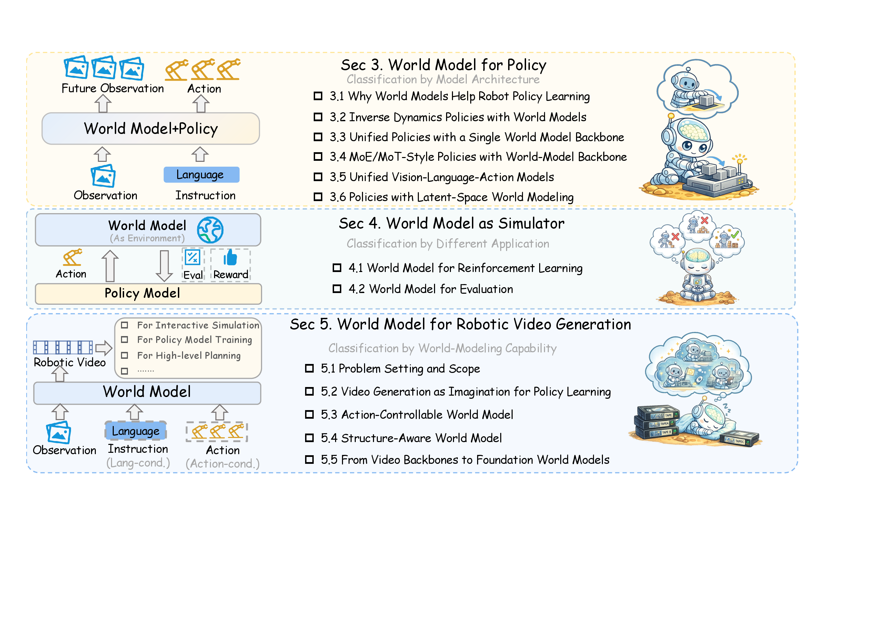{ width="920" }

*原文 Figure 1。上方按架构分策略，中间按用途分模拟器，下方按能力讨论机器人视频模型。三个区域使用不同分类轴，同一项工作可以同时出现在多个区域。*

例如，一个共享视频与动作骨干的模型，属于策略架构的一种；若它还可以接受外部动作预测未来，就可能被用作模拟器；若预测结果经过价值模型打分，又能成为候选动作的评估器。架构相同不保证用途相同，用途相同也不要求架构相同。

原文是 2026 年 4 月 30 日的 arXiv v1，PDF 共 43 页，正文到第 31 页，后面是参考文献，没有单独附录。它汇总已有研究，没有训练一个统一新模型，也没有在同一数据、硬件、随机种子下重新测试所有方法。后文的结果表应当作为跨论文证据索引阅读。

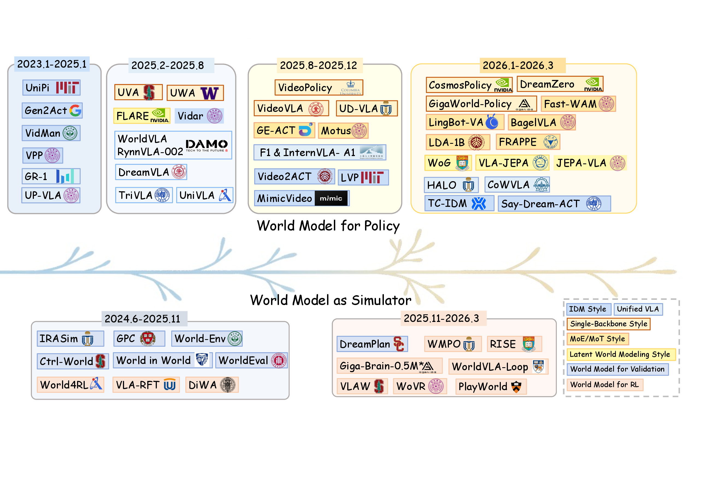{ width="920" }

*原文 Figure 2。上半部展示预测与动作逐渐出现更多耦合方式，下半部展示模拟器用途从验证扩展到策略训练和共同更新。图注强调这些是主要趋势，并非后来的方法严格替代早期方法。*

## “世界”可以是像素、潜变量，也可以是关系状态

综述采用机器人学习中的功能定义。一个世界模型预测系统在动作影响下如何演化，输出必须能服务控制、规划、模拟、评估或数据生成。只生成一段看起来合理的视频，并不能单独说明它具有这种作用。

原文 Eq.1 将问题写为

$$
p(x_{t+1:t+H}\mid x_t,a_{t:t+H-1},l).
$$

$x_t$ 是被建模的状态，可以是图像、隐藏表示、物理结构，也可以是规划器使用的符号。$a$ 表示底层动作，$l$ 表示任务或语言条件，$H$ 是预测范围。这个形式没有要求必须恢复全部世界信息，它要求选出的状态足以支持相应决策。[原文 §2.1，PDF pp.4–5](https://arxiv.org/pdf/2605.00080v1#page=4)

文章将语言指令也视为广义的高层 action，但始终用 $l$ 与底层控制 $a$ 区分。这个约定扩大了覆盖范围，让语言条件的视频规划也进入综述；它不表示“把杯子拿起来”和某一段关节命令是同一精度的干预。前者规定希望发生什么，后者决定机器人实际施加什么控制。

当状态取视觉观察时，Eq.2 变为未来视频的条件分布。图像能保留接触、位置、遮挡和对象变化的丰富证据，也增加了建模负担。背景纹理与控制关键状态都进入生成目标，计算量随时空分辨率增长，预测还必须同时满足时间连续、动作跟随和长程一致。

因此，本文以视频路线为重点，是对近期文献规模的选择，不能理解成像素预测已经被证明是控制的最优抽象。符号状态可以表达“杯子在抽屉内”，潜变量可以保留抓取相关信息，深度或占据表示可以服务几何规划。是否需要生成完整画面，应由后续计算怎样使用预测来决定。

## 从动作策略出发，才看得清增加未来变量的价值

原文首先回顾 imitation learning 中的策略。给定当前观察 $o_t$ 和任务 $l$，策略输出一段动作，写作 $p(a_{t+1:t+k}\mid o_t,l)$。动作分块把相邻控制一起建模，能够表达连贯行为；模型是否预测未来视觉，是另一项独立设计。

Diffusion Policy 等专门的 visuomotor policy 使用扩散或 flow matching 表达多模态动作分布。面对同一物体，可以从左侧或右侧接近，直接回归一个平均动作可能不合适，生成式策略则能够表达多种可行动作模式。原文也回顾了使用视觉表示、历史动作等更有信息的基础分布来改善采样效率的工作。[原文 §2.2，PDF pp.6–7](https://arxiv.org/pdf/2605.00080v1#page=6)

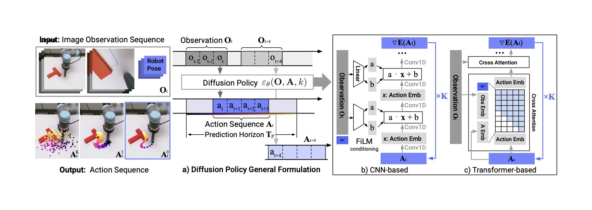{ width="880" }

*补充阅读图，来自已有 Diffusion Policy 原论文/项目资产，并非本综述 Figure。图中 observation horizon、prediction horizon 与 action horizon 分别说明观察范围、预测动作范围和实际执行范围，便于理解闭环分块控制。*

VLA 则利用视觉语言预训练提供语义知识，再通过机器人轨迹建立动作接口。RT-2、OpenVLA 等采用离散动作 token，FAST 用频域压缩改善动作序列表示；另一类通过连续扩散或 flow 动作头避免简单量化带来的精度限制。这里比较的是动作表示和训练起点，不能从“连续”或“离散”单独推导机器人是否理解未来。

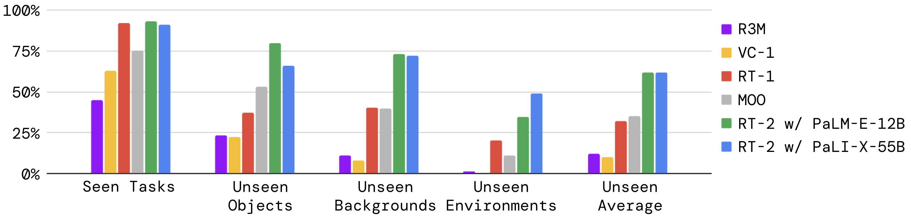{ width="920" }

*补充阅读图，沿用已有 RT-2 资产。实际内容是已见任务与未见对象、背景、环境等条件下的比较柱状图，用于说明视觉语言迁移的研究背景；它不是本综述统一测试的结果，也不是世界模型架构图。*

视频预训练提供的另一种先验来自时间演化。它可能学习运动连续性、遮挡变化和部分交互规律，而视觉语言预训练往往更直接强调语义对应。但综述明确保留了证据边界，目前不能据其汇总结果断言，在匹配规模、数据和训练预算后，视频骨干必然优于 VLM 骨干。下一步要理解的是怎样把这种预测先验接入策略。

## 一个联合分布解释四种不同查询

原文 §3.1 从未来观察与未来动作的联合分布出发。为避免重复长下标，下面记 $O=o_{t+1:t+k}$、$A=a_{t+1:t+k}$，其理想化共同对象为

$$
p(O,A\mid o_t,l).
$$

如果只想输出动作，可以把未来观察边缘化；如果只想生成未来，可以把动作边缘化。原文 Eq.5–6 的关系对应

$$
p(A\mid o_t,l)=\int p(O,A\mid o_t,l)\,dO,
\qquad
p(O\mid o_t,l)=\int p(O,A\mid o_t,l)\,dA.
$$

这两个输出分别接近 policy model 与 passive world model。前者回答接下来怎样动，后者回答在当前任务下可能发生什么。若给定候选动作，再查询未来，就得到 controllable world model；若给定观察到的或计划的状态变化，再恢复动作，就得到 inverse dynamics model。[原文 Eq.4–8，PDF p.7](https://arxiv.org/pdf/2605.00080v1#page=7)

| Query | 已给条件 | 希望得到的结果 | 对机器人系统的作用 |
|---|---|---|---|
| Policy Model | 当前观察、任务 | 未来动作 | 执行控制 |
| Passive World Model | 当前观察、任务 | 可能的未来观察 | 提供视觉计划或未来表示 |
| Controllable World Model | 当前观察、候选动作 | 与该动作相应的未来 | 模拟、评价或规划 |
| Inverse Dynamics Model | 当前与未来观察 | 能实现状态变化的动作 | 将视觉计划落到控制空间 |

这是一种组织方法的概率视角，并不保证四个独立训练的模型已经来自同一个一致联合分布。原文 Eq.7–8 还省略了部分任务条件，重点是查询对象的差别，不能将这种简写当成所有实现的条件独立假设。

同样，观察数据中的条件概率不自动等于已识别的干预机制。若训练数据中某个任务几乎总和某种动作一起出现，模型可能主要根据任务猜测结果，忽略具体动作。对规划器而言，恰恰是候选动作不同造成的结果差异最重要。

这个联合视角也解释了为什么“未来预测只在训练时存在”仍可能有用。联合训练可以改变策略表示，部署时只查询动作；也可以保留未来分支，让它参与候选评价。是否在线生成未来，应当在训练目标之外单独检查。

## 第一类策略保留独立预测器，关键在中间表示

IDM-style 方法采用先预测、再行动的模块化路径。世界模型给出任务条件的未来视频或潜在表示，独立策略再将它与当前观察结合，输出机器人动作。原文 Figure 3(a) 展示的正是这种串联关系。

可以用下面的示意关系概括其信息流

$$
\hat O=W(o_t,l),
\qquad
A\sim\pi(\cdot\mid o_t,l,\Phi(\hat O)).
$$

这里的 $\Phi$ 表示策略实际读取的未来信息，可能是图像特征、去噪隐藏状态、运动轨迹或几何计划。这个式子是对原文 Eq.9–12 的统一解释，不是某篇方法的逐字损失函数。原文相应式子的动作下标在 chunk 与单步之间有所简写，实际实现还需区分视频预测范围 $H$ 与动作输出范围 $H'$。[原文 §3.2，PDF pp.9–10](https://arxiv.org/pdf/2605.00080v1#page=9)

### 从完整视频到潜在计划，减少的是哪些负担

UniPi 建立了生成任务视频再用逆动力学恢复动作的基本路线。VidMan、Vidar 等进一步强调与动作有关的区域，Gen2Act 则把生成的人类执行视频作为机器人动作推断的条件。共同问题是，未来必须既合理又可执行，不能只描绘任务成功的外观。

若先把全部未来像素渲染出来，再由另一个网络重新提取控制信息，系统可能为无关细节支付两次成本。VPP、Video2Act 因而直接使用预训练视频扩散模型中的预测特征，将世界模型变成未来表示的来源。它们仍保留独立动作模块，改变的是模块间传递的内容。

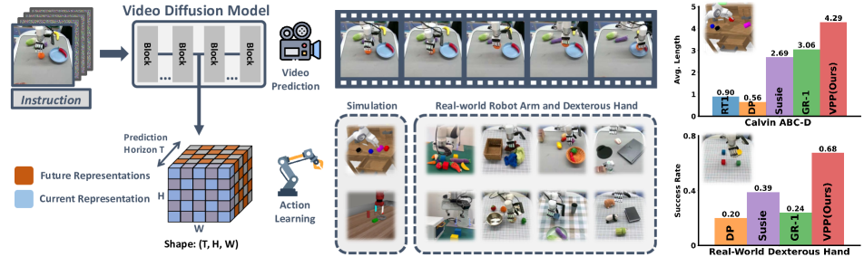{ width="920" }

*补充阅读图，来自已有 VPP 原论文资产。左侧 prediction horizon 与 future/current representation 展示预测特征如何进入动作学习；右侧原论文示例与结果属于 VPP 自己的实验，不是综述统一比较。*

MimicVideo 再向前一步，使用部分去噪的 latent visual plan。对控制有用的运动轮廓可能较早出现，策略未必需要等到纹理完全恢复。TC-IDM、LVP 则将未来整理成工具中心的几何轨迹或可重定向计划，让动作恢复更贴近执行约束。Say-Dream-ACT 使用视频计划作为另一策略的上下文提示，其作用与严格逐帧求逆并不完全相同。

因此，IDM-style 在综述中是架构家族，包含多种 future-conditioned control 接口，不能要求每个成员都使用完全相同的相邻帧逆动力学损失。

### 显式几何中间量增加了可执行约束

AVDC 从生成视频中提取密集对应关系，VidBot 关注人手三维轨迹和交互线索，object-centric motion field 与 NovaFlow 等把变化表示成对象中心的三维运动。它们试图缩短从“看到未来”到“知道怎样动”的距离。

这种结构也引入新的误差来源。像素对应错误会影响动作恢复，三维轨迹需要与机器人可达空间一致，人的手部运动不能直接复制成异构机器人控制。模块化便于替换预测器和动作头，却要求两者对中间状态的含义达成一致。

原文将冻结、轻量适配或连接独立策略头列为这类方法的常见训练方式，并未规定统一流程。实际读一篇方法时，要确认世界模型是否更新，动作损失能否传回预测器，以及推理时读取完整视频还是隐藏表示，不能只凭“预训练视频模型”猜测训练成本。

## 第二类策略在同一个生成过程中预测视频与动作

共享骨干路线把未来视觉表示 $z_v$ 与动作表示 $z_a$ 放入同一模型。原文 Eq.13–14 用一个通用去噪映射说明这个思路

$$
x=[z_v;z_a],
\qquad
\hat y=f_\theta(\tilde x_\tau,o_t,l,\tau),
\qquad
\mathcal L_{\mathrm{unified}}=\mathbb E[\ell(\hat y,y)].
$$

$\tau$ 是噪声或去噪时间，不能与机器人时间 $t$ 混淆。目标 $y$ 随具体模型变化，可以是扩散噪声、flow velocity 或离散 mask token。综述没有声称所有模型都采用同一个均方误差、相同噪声调度或相同采样器。[原文 §3.3，PDF pp.10–12](https://arxiv.org/pdf/2605.00080v1#page=11)

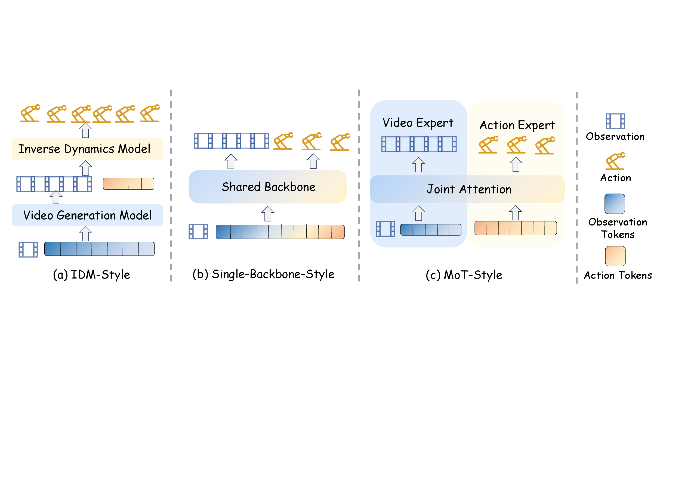{ width="920" }

*原文 Figure 3。左图通过模块接口传递未来，中图让观察与动作 token 经过共享骨干，右图保留专家参数并通过 joint attention 深度交换信息。三者的差异在参数与信息流组织。*

共享生成过程使视觉与动作约束能在内部交换。例如动作表示指向某个抓取位置，未来视觉应当反映相应运动；预测未来的几何变化也能影响动作生成。它提供了学习对齐的机会，但若训练信号允许一条分支忽视另一条，参数共享本身仍不是动作忠实性的证明。

### 相同共享骨干，不同部署查询

UVA 学习视频与动作联合潜空间，并用轻量解码头允许策略推理绕过显式视频生成。UWA 将视频与动作扩散放入同一个 Transformer，利用模态相关时间步控制查询方式。VideoVLA 则将视频 DiT 扩展为联合视觉未来与动作的 video-action 模型。

Cosmos Policy 把动作、未来状态和价值表示成额外 latent frames。直接策略模式只需要执行动作输出，规划模式才进一步使用未来状态和价值为候选排序。DreamZero 使用自回归 flow matching 的视频动作模型，但综述强调其闭环分块联合去噪，不能把它等同于一次性自由生成很长轨迹再全部照做。

UD-VLA 将类似耦合放入离散多模态同步去噪过程，GigaWorld-Policy 则采用使视觉分支在推理时可选的因果设计。它们共同说明，共享训练与在线视频渲染并非捆绑关系。

| Representative Work | 原文强调的耦合 | 部署时要追问的区别 |
|---|---|---|
| UVA | Joint video–action latent space | 是否通过专用头绕过视频解码 |
| UWA | Joint diffusion with modality-specific timesteps | 怎样通过时间步查询动作边缘 |
| VideoVLA | Joint future video and action prediction | 视觉分支参与多少推理计算 |
| Cosmos Policy | Action, future-state and value latent frames | Direct policy 与 planning mode 是否相同 |
| DreamZero | Chunk-wise joint video–action flow modeling | 何时重新观察并更新后续 chunk |
| UD-VLA | Discrete synchronous denoising | 测试时效率技术如何影响生成流程 |
| GigaWorld-Policy | Shared transformer with causal organization | 是否启用可选视觉分支 |

表中是综述提供的设计差异，并非统一实测延迟表。若要做复现，仍需回到各原论文确定 chunk 长度、去噪步数、动作频率与硬件。

## 第三类策略保留专家分工，让预测信息逐层参与动作

视频与动作的尺度差别很大。视频包含大量空间 token，动作维度较低却可能更新更快；两种表示需要的网络容量、损失尺度与噪声过程也未必相同。MoE/MoT-style 路线由此保留模态专门参数，再通过 joint attention、cross-attention 或交错序列进行耦合。

原文 Eq.15 将这种关系写成逐层混合

$$
(h_v^{\ell+1},h_a^{\ell+1})
=F_{\mathrm{mix}}^{\ell}(h_v^{\ell},h_a^{\ell};o_t,l).
$$

它强调视频流与动作流都持续存在，并在多层里交换信息。这里的“专家”不一定采用 token 稀疏路由，也不表示每层只选一个专家执行；要以具体 MoT 或融合结构为准。[原文 §3.4，PDF pp.12–13](https://arxiv.org/pdf/2605.00080v1#page=12)

GE-Act 的例子是预训练视频路径旁边增加 flow action 路径，用深层交叉注意力注入预测特征。Motus 明确保留理解、视频、动作专家。LingBot-VA 将视频与动作放进共享的因果序列，通过双流 MoT 让预测上下文参与动作细化。BagelVLA 将语言计划、视觉预测和动作连接成执行循环，并用 Residual Flow Guidance 缩短视觉预测过程。

这里说的 LingBot-VA 是综述对应版本的工作，不将后续 LingBot-VA 2.0 的数据量和系统性能倒填入表格。类似地，BagelVLA 的单步视觉先见属于所引方法的效率设计，不能推广成全部专家架构都只需一次去噪。

Fast-WAM 对这一家族提出值得注意的实验方向，收益可能更多来自训练时视频共训练，而非部署时显式想象。LDA-1B 将未来表示转移到 DINO latent space，FRAPPE 让平行专家对齐视觉基础模型的表示，DiT4DiT 使用视频去噪中间特征指导动作。

这些方法逐渐把视频分支视为预测过程而不只是待显示的成品。可比较的问题因此变成，动作支路到底利用了什么未来信息，关闭或打乱这部分信息时表现怎样，节省解码以后是否保留了关键控制收益。综述组织了这些方向，没有提供把所有结构放在同一预算下的消融。

## 第四与第五类把未来能力放回 VLA 内部

前面三类主要围绕视频生成骨干与动作结合，统一 VLA 路线则从多模态策略本身出发。它在理解观察与语言的同时，联合学习未来图像、世界知识、视觉子目标或动态表示。[原文 §3.5–3.6，PDF pp.13–15](https://arxiv.org/pdf/2605.00080v1#page=13)

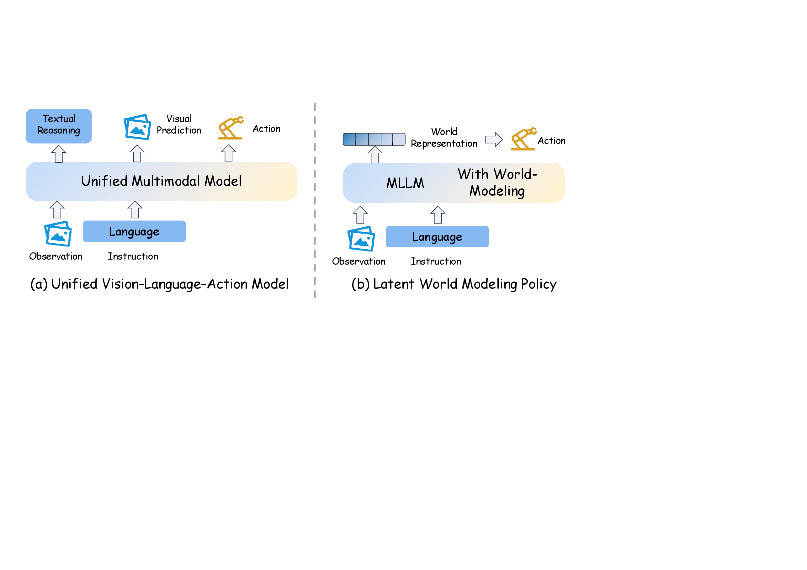{ width="860" }

*原文 Figure 4。左侧统一多模态模型可同时输出推理、视觉预测和动作，右侧将未来信息压进 world representation 后服务动作。右图没有像素输出，不等于没有预测监督。*

GR-1 和 UP-VLA 使用未来图像预测，WorldVLA 将动作、图像理解与生成统一，但未来图像主要作为共同训练信号。DreamVLA 预测动态、空间和语义等结构知识，UniVLA 在原生多模态 token 框架上学习世界建模，CoWVLA 更强调 latent motion 和紧凑未来视觉目标。

F1、InternVLA-A1、HALO、TriVLA 又在统一模型中保留功能分工。它们与上一节一样可能使用多专家结构，但综述按预训练起点与预测支路角色将其放在 unified VLA 下。分类边缘会重叠，不能把表中的组名理解成数学上互斥的集合。

### 潜在空间路线要区分监督目标与推理输入

FLARE 将动作去噪网络的隐藏特征对齐到未来观察的 latent embedding。未来信息通过训练目标塑造动作表示，不要求每次控制都生成未来图像。

VLA-JEPA 进一步强调 leakage-free state prediction，未来帧只用于构造监督目标，避免模型在预测时直接读取答案。JEPA-VLA 采用另一条路，将视频 JEPA 学出的预测 embedding 作为现有 VLA 更好的表示基础。这两个名称相近的方法不能混成一个统一算法。

WoG 将预测对象缩小到动作生成所需的 future-oriented condition，DIAL 则把 VLM 特征空间中的潜在视觉先见作为高层意图与底层动作之间的瓶颈。它们共同追问，若动作只需要某部分未来信息，是否有必要重建所有像素。

对这些路线，读者应检查目标编码器是否固定或更新、未来帧是否仅作为训练 target、动作头如何读取预测表示，以及推理中到底增加了哪些计算。综述概括这些设计原则，但没有列齐每篇方法的优化器、学习率、训练硬件和损失权重，不能从家族标签补出统一配方。

### 非像素预测还可以交给符号规划器

原文另外讨论 predicates、对象关系、affordances 和因果过程等结构状态。模型预测这些状态的转移，再由符号或任务运动规划器选择技能序列。它与 latent VLA 的共同点是避免不必要的像素重建，区别则在于状态是否显式、规划器如何查询，以及如何把视觉观察映射到这些状态。

符号抽象可以稳定表达长程任务逻辑，但也可能遗漏接触细节或连续几何。感知与符号对齐失败时，推理规则正确仍不能保证执行成功。综述将其作为互补路线，并未声称显式符号能自动消除所有长程误差。

## 原表一最值得读的列是推理时还生成什么

下图保留原文 Table 1 的完整英文条目。横向读同一组，可以看到“用同类骨干”与“部署时做同样计算”之间的差距。

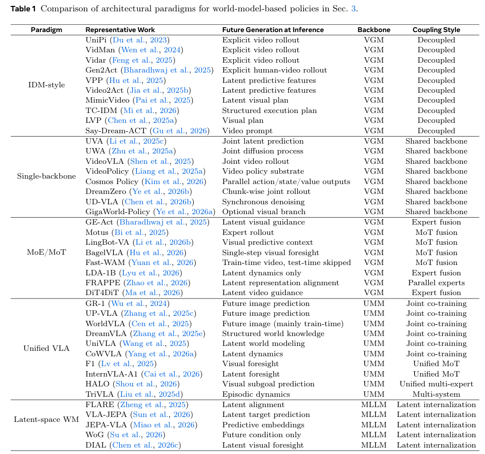{ width="1000" }

*原文 Table 1，PDF p.8。Future Generation at Inference 一列从 explicit video rollout、latent predictive features 到 test-time skipped，说明预测能力可以通过不同形式进入控制。*

| Paradigm | Future Generation at Inference 的典型形式 | Coupling Style | 主要接口压力 |
|---|---|---|---|
| IDM-style | 视频、潜在计划或结构化计划 | Decoupled | 预测未来能否被动作模块执行 |
| Single-backbone | 联合生成、并行状态/价值或可选视觉分支 | Shared backbone | 联合训练与部署查询如何对应 |
| MoE/MoT | 预测隐藏流、专家 rollout 或训练后省略 | Expert fusion / MoT fusion | 模态尺度与计算分配 |
| Unified VLA | 未来图像、子目标或世界知识 | Joint co-training 等 | 预测目标是否真正服务动作 |
| Latent-space WM | 预测 embedding 或未来条件 | Latent internalization | 表示是否保留控制关键变化 |

前面三列对应原表的分类与信息，最后一列是本文的接口分析。它们没有一个天然占优的统一排序。若部署时延严格受限，训练期预测监督可能更合适；若需要展示或检查候选未来，显式生成又可能提供更直接的接口。

## 世界模型成为训练环境时，误差会进入优化目标

模型作为模拟器的关键变化，是策略真的在它产生的状态中继续行动。给定历史、动作和任务，模型输出下一观察，并可能同时输出奖励与终止信号。原文 Eq.16 的形式为

$$
(\hat o_{t+1},\hat r_t,\hat d_t)
\sim p_\phi(\cdot\mid o_{\leq t},a_{\leq t},l).
$$

奖励和终止预测是可选能力，不能默认每个视频模型都具备。环境转移、任务进展评分、结束判断有时来自不同组件，其误差也会分别影响训练。[原文 §4.1，PDF pp.15–17](https://arxiv.org/pdf/2605.00080v1#page=16)

策略随后在想象轨迹中提高回报，原文 Eq.17 写作

$$
J(\theta)=\mathbb E_{\hat\tau\sim(\pi_\theta,p_\phi)}
\left[\sum_t\gamma^t\hat r_t\right].
$$

这能减少真实机器人交互、复位和失败尝试的成本，也让策略有机会超出固定示范。但优化器追求的是模拟器中的高分，如果世界模型忽视某种动作后果，策略可能学会利用这一偏差，而非学到真实有效行为。

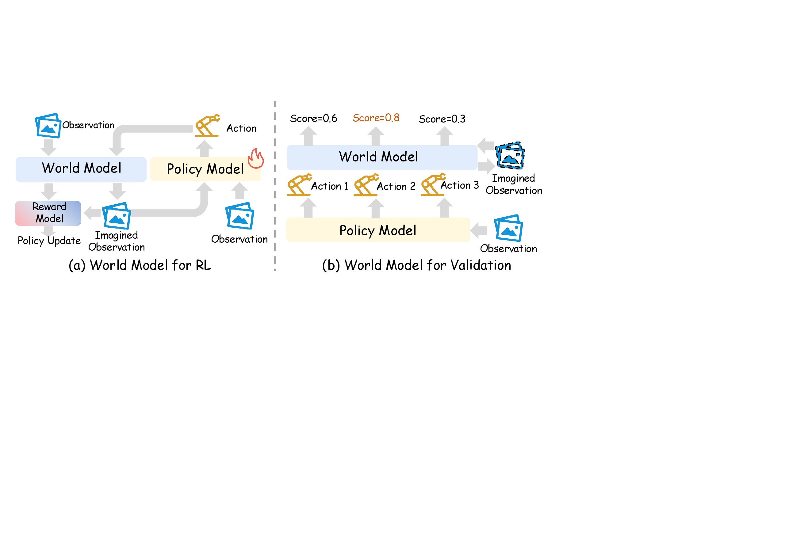{ width="860" }

*原文 Figure 5。左图的想象轨迹进入 policy update，右图比较候选未来并选择动作。一个改变策略参数，一个主要改变当前选择，验证两者时需要不同证据。*

### 从固定模拟器到适配现代动作头

UniSim、World-Env、VLA-RFT 展示了动作条件模拟与反馈结合的基本路径。DiWA 使用从大规模 play 数据中学习并冻结的世界模型，支持扩散策略的离线适配；World4RL 则探索高保真操作场景中的想象优化。

随后，World-Gymnast、PlayWorld、RehearseVLA 等分别强调视频环境中的 RL、自治 play 数据，以及提供奖励和终止反馈的反思组件。WMPO 关注像素空间想象与 on-policy GRPO，ProphRL 针对 flow 动作头设计优化，RISE 引入组合动态建模和 progress-value 估计，GigaBrain-0.5M* 面向预训练 VLA 适配。

原文 Eq.18 用 clipped policy surrogate 表示一类训练方式。为了和环境奖励 $\hat r_t$ 区分，下面把概率比记成 $\rho_t$，其示意形式为

$$
\mathcal L_{\mathrm{RL}}(\theta)
=-\mathbb E_t\left[
\min\left(\rho_t(\theta)\hat A_t,
\operatorname{clip}(\rho_t(\theta),1-\epsilon,1+\epsilon)\hat A_t\right)
\right],
\qquad
\rho_t(\theta)=\frac{\pi_\theta(a_t\mid s_t)}{\pi_{\theta_{\mathrm{old}}}(a_t\mid s_t)}.
$$

它说明为何要限制策略一次偏离旧分布过远，但不是本节所有系统的共同代码实现。动作可能按 chunk 生成，flow head 的概率与优化也有专门处理，RISE 等方法又采用自己的改进机制。复现时不能把综述中的概括式直接当成每一项方法的损失函数。

### 策略一变，模型需要预测的分布也会变

固定世界模型的训练数据可能覆盖原策略的常见状态，却没有覆盖改进策略主动探索的新状态。策略表现提升或者偏离原行为后，模型误差的分布会跟着改变。增加同一静态数据上的训练轮数，未必能修复这种覆盖缺口。

World-VLA-Loop 利用策略失败 rollout 改进模拟器，VLAW 在真实数据修复模拟器和合成数据改进策略之间交替，WoVR 则把动作跟随、关键帧初始化与策略模型共同演化放进同一循环。原文 Eq.19 概括为

$$
\phi_{k+1}\leftarrow\operatorname{UpdateWM}
\left(\phi_k,\mathcal D_{\mathrm{real}}\cup\mathcal D_{\mathrm{policy}}(\pi_{\theta_k})\right),
$$

$$
\theta_{k+1}\leftarrow\operatorname{UpdatePolicy}
\left(\theta_k,\hat{\mathcal D}(\phi_{k+1})\right).
$$

这里 $k$ 是外层更新轮次。第一步用相关交互修复模型，第二步用更新后的模型生成经验。公式表达共同演化的组织原则，具体系统采用什么真实数据、多少想象数据以及怎样限制 rollout，需要分别核查。

因此，可信的策略改进证据应包含真实执行或可靠外部环境中的复测。只报告模拟器内回报上升，无法区分策略真正变好与策略更会利用模型漏洞。

## 世界模型成为评估器时，排序可信比画面精细更关键

评估用途不一定更新策略参数。给定当前观察，已有策略提出几个动作候选，世界模型预测各自后果，系统再评分、拒绝或修改候选。GPC 在冻结生成式策略外增加预测前瞻，IRASim 使用预测价值选择轨迹，World-in-World 让计划经历想象、评价和修订，DreamPlan 则进一步把 rollout 比较变成偏好训练信号。[原文 §4.2，PDF pp.17–18](https://arxiv.org/pdf/2605.00080v1#page=17)

这一用途尤其依赖候选之间的相对差异。若抓取候选 A 在现实中成功、B 在现实中失败，模拟器却把两者都画成抓起物体，那么画面再真实，也无法帮助选择。反过来，预测画面不够精美，但准确保留了碰撞、错位和任务进展的差别，仍可能对排序有用。

MPC 将这种查询进一步用于动作序列优化。它通过模型滚动评估代价，反复更新候选并只执行部分计划，然后重新观察。TD-MPC2、LeWorldModel 是综述引用的潜空间例子。这里不能将“优化动作序列”一概等同于“所有方法都通过模型做梯度下降”，具体规划器可以使用不同优化算法。

### 当前动作评估与整套策略评估不是同一测试

另一个用途是比较不同 policy 或 checkpoint，而非只挑当前一段动作。Veo World Simulator 中的机器人策略评估、WorldEval 与 WorldArena 等工作关注模型是否保留真实世界中的策略相对次序，能否用于分布外或安全探测。

World-Env 的奖励和终止预测、VLA-RFT 的反馈、World-VLA-Loop 的联合奖励输出，以及 RISE 的 progress value，都让想象轨迹具备可计算分数。但评分器如果共享生成模型的错误偏好，就可能给错误未来很高分。

| Use | 被比较的对象 | 应优先核对的外部证据 |
|---|---|---|
| Candidate assessment | 当前候选 action sequence | 预测排序与实际执行结果是否一致 |
| MPC / iterative planning | 连续修订的动作序列 | 反复查询后的闭环成功率与计算预算 |
| Offline policy evaluation | 不同策略或 checkpoint | 相对排名、价值估计与真实结果的对应 |
| Safety / failure probing | 潜在失败轨迹 | 对真实危险或失败的识别和漏检情况 |
| Imagined feedback for learning | 轨迹奖励、进展或完成信号 | 得分提高是否转化成真实策略改进 |

这是按原文用途整理的阅读表，没有填入原文未提供的统一误差指标。潜在空间 JEPA 系列可以支持规划和物理合理性判断，但综述也将其视为邻近方向，不能据此称所有 JEPA 模型都是成熟的完整策略评估器。

## 视频能力的四个阶段分别增加了什么约束

原文 §5 从生成模型本身出发，讨论 imagination、action-controllable、structure-aware 和 foundation world model 四类能力。它们强调的要求逐步增加，但分组并非互斥，也不是每一项模型都依次经过四个阶段。[原文 §5.1–5.6，PDF pp.19–23](https://arxiv.org/pdf/2605.00080v1#page=19)

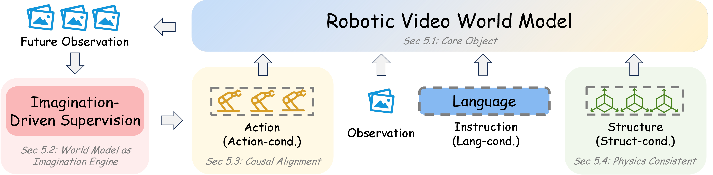{ width="920" }

*原文 Figure 6。未来视频既可以作为想象监督，也可以在动作条件与结构条件下受到更强约束。图中 action、language 与 structure 是不同信息来源，不能只保留任务文字就假设低层动作已对齐。*

### 想象监督先补充行为覆盖，再解决动作落地

Dreamitate 在任务相关的人类示范上适配视频扩散模型，将新场景中的生成执行作为视觉计划。RoboDreamer 把任务拆成可复用成分，改善对象与动作组合的泛化；ManipDreamer 通过动作树、深度和语义引导增加结构约束。

DreMa 将 Gaussian Splatting 与物理模拟结合，建立可操纵数字场景并生成更多示范。PhysWorld 从生成视频重建物理世界，再通过对象中心的残差强化学习落到可执行动作。它们说明，视觉计划可以借助显式动力学补充执行约束。

DreamGen 将强视频生成器适配到目标 embodiment，合成神经轨迹，再用 latent action 或 IDM 恢复动作。这类系统扩大的是可用监督，生成视频还不等于完整机器人数据。动作标签如何得到、错误视频如何过滤、训练策略后是否在真实任务改善，都属于数据引擎的一部分。

### 动作可控要求画面随候选控制改变

IRASim 在 Transformer block 中引入帧级动作条件，把轨迹到视频的对应做得更细。RoboMaster 处理机器人和对象的协同轨迹与操作阶段，Ctrl-World 将多视角、帧级控制、记忆结合起来支持策略在环 rollout，EnerVerse-AC 同时服务数据生成与评估。

Interactive World Simulator 将目标进一步推向高频、长程、稳定的策略条件交互。EVA 则通过逆动力学奖励缩小“画面合理但动作难以执行”的差距。RoboEnvision 关注长程多任务中的语义和时间一致性，也被综述放在这一讨论范围内。

这里最重要的实验应改变动作而保持其他条件尽量一致。只有这样，才能检查模型是否跟随命令，而不是根据语言和背景完成一个最常见成功动画。文章称之为 causal alignment，但没有以此完成一般意义上的因果机制识别证明。

### 几何、身份和多视角一致性限制了自由幻觉

Mask2IV 先预测 actor 与 object 的交互轨迹，再据此生成视频，减少对用户提供稠密 mask 的依赖。TesserAct 同时预测 RGB、深度和法线，把空间关系纳入更丰富的四维表示。RoboVIP 通过 visual identity prompting 维持多视角与时间中的对象一致性，支持操作数据增广。

这些结构会改变错误发生的位置。模型不能随意改变对象身份或几何而不违反额外监督；但若轨迹本身错了，后续视频可能只是更稳定地复现错误。因此仍要检验结构预测与动作后果，而不只是检查渲染结果是否连续。

### 基础模型路线把预测器做成可复用接口

Vid2World 将已有视频扩散骨干改造成动作条件的交互模型。Genie Envisioner 将视频世界建模与动作解码整合成平台。DreamDojo 先利用大规模人类第一视角视频学习，再通过连续 latent action 与机器人后训练连接目标 embodiment。

WoW 强调来自机器人交互的数据，通过生成、逆动力学与 critique 连接想象和执行。GigaWorld-0 结合可控视频分支与具物理基础的三维分支，面向数据生产；ABot-PhysWorld 关注物理对齐与动作可控的操作视频。UnifoLM-WMA-0 和 Cosmos Predict 2.5 则体现可复用世界骨干的发展。

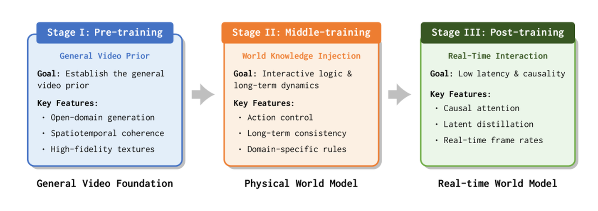{ width="920" }

*补充阅读图，沿用站内 LingBot-World 的训练阶段资产，并非本综述六张 Figure 之一。它用于对照“通用视觉先验、交互动态适配、低延迟部署”的分工，不作为所有机器人世界模型都采用相同三阶段流程的证据。*

“基础模型”也不是所有能力已经完成的证书。预训练覆盖、多 embodiment 适配、动作接口、长期可靠性和服务速度仍要分别验证。尤其不能把某模型的人类视频预训练小时数直接当成其拥有同量机器人动作标签。

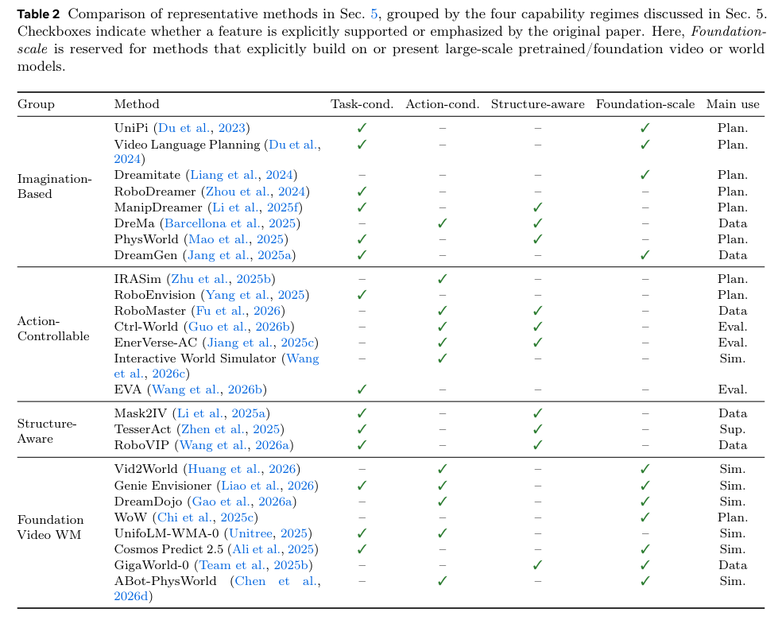{ width="1000" }

*原文 Table 2，PDF p.20。Task-cond.、Action-cond.、Structure-aware、Foundation-scale 与 Main use 分别记录不同属性；勾选表示原论文明确支持或强调，横线不能自动解释成该模型被证明完全缺少该能力。*

原表中也能看到分类重叠。DreMa 在 imagination 组却带动作与结构条件；foundation 组中的条目也不是每一列都打勾。这提醒读者将组名作为组织线索，同时阅读具体列和原论文，不要把表格压缩为四级能力认证。

## 导航与驾驶改变了未来状态应包含的内容

导航面对部分可观测环境，预测的价值常在于尚未看见的空间。Pathdreamer 生成未访问视角的全景 RGB、深度和语义观察；VISTA 与 VISTAv2 将语言条件想象、动作条件未来及在线价值图连接起来；NWM 和 EgoWM 探索可控第一视角预测，SparseVideoNav 则用稀疏未来减轻密集长 rollout 的成本。[原文 §6，PDF pp.23–24](https://arxiv.org/pdf/2605.00080v1#page=23)

这些工作服务的决策包括未来是否可见目标、路线是否可通行、某个转向是否增加任务进展。完整照片级画面只是表达这些信息的一种方式。若稀疏预测或价值图已经足够选择路径，减少生成内容可能更符合部署需求。

自动驾驶则增加了多参与者、结构几何和安全相关长尾。MILE 使用带几何归纳偏置的 latent dynamics，OccWorld 在三维 occupancy space 中表达自车与场景演化，GAIA-1 联合视频、文本和动作 token，DriveDreamer 用结构条件约束交通视频。

Drive-WM 通过可控多视角未来及图像奖励比较轨迹，UniDWM 强调结构与动态感知的统一 latent world representation，DriveWorld-VLA 让 latent world state 直接服务规划，DriveVLA-W0 使用未来图像预测提供比低维动作更密集的训练监督。SteerVLA 又将高层语义推理与低层控制分工。

| Domain | 原文强调的预测对象 | 对控制有用的后果 |
|---|---|---|
| Manipulation | 对象、机器人、接触与任务进展 | 是否可达、是否抓稳、动作是否完成 |
| Navigation | 未见视角、空间布局、未来价值 | 是否通行、何处观察、如何接近目标 |
| Driving | 多车互动、几何占据、自车条件未来 | 候选轨迹风险与交通演化 |

最后一列是对原文用途的概括，不是统一评价指标。跨领域可迁移的是预测与决策的接口思想，具体动作空间、状态变量与误差后果仍然不同。

## 评测需要在预测、闭环用途和失效机制之间来回验证

综述将评测分为三类。开放环测试生成结果是否连贯、动作是否跟随；闭环测试这些预测能否改善规划、评估或控制；诊断测试查出哪些物理与可执行性因素导致失效。三类证据互补。[原文 §7.1，PDF pp.24–26](https://arxiv.org/pdf/2605.00080v1#page=24)

### 开放环便于标准化，却没有暴露全部反馈误差

在开放环中，模型接收既定观察、动作或任务，生成未来，不把自己的输出持续送入一个真实决策循环。RBench 强调结构一致、物理合理和动作完整，EWMBench 将场景一致、运动正确与语义对齐拆开，DreamGen Bench 关注指令与物理对齐，EVA-Bench 关注长程与视角、布局、运动分布变化。

这能高效比较预测器的基本能力。但策略根据模型结果行动后，新的观察与动作分布可能改变，模型会进入开放环测试没有覆盖的区域。一次预测质量高，不等于多轮想象与行动仍然稳定。

### 闭环直接测试模型是否改变了正确的决定

WorldArena 同时考察合成数据、策略评估与动作规划，WorldEval 检查策略及 checkpoint 的相对顺序，WorldGym 用交互环境中的 Monte Carlo 评估关联真实价值与成功趋势，World-in-World 则把模型放进迭代预测和重规划流程。

这些任务比平均像素误差更贴近实际用途，但也需要拆开系统贡献。若最终成功率上升，可能同时来自候选数增加、更强评分器或额外计算。对比时应检查模型替换之外是否改变其他资源，不能把整个系统收益全部归因于世界模型的一个结构选择。

### 可执行性诊断解释为什么漂亮视频也会失败

WorldSimBench 同时考虑视觉与操作评价，检查视频能否通过逆动力学恢复出可用动作。WoW-World-Eval 包含物理规律与执行相关判断，其 IDM-based Turing Test 关注视频诱导出的动作是否合理。DrivingGen 检验轨迹、时间一致与自车控制，WM-ABench 则分解空间、时间、运动、机械模拟和受控反事实等基础能力。

IDM 能从视频产生平滑动作，是一种有价值的诊断信号，却不等于已验证全部真实动力学。动作可以平滑但接触位置不正确，预测可以符合机器人运动学却误判物体摩擦。诊断应该和真实或可信环境中的后果测试相互补充。

| Evaluation category | Representative benchmarks | 本文建议保留的比较条件 |
|---|---|---|
| Open-loop predictive quality | RBench, EWMBench, DreamGen Bench, EVA-Bench | 初始状态、动作条件、预测时长、分布外设置 |
| Closed-loop utility | WorldArena, WorldEval, WorldGym, World-in-World | 候选预算、rollout 次数、真实对照、评分来源 |
| Physical / executable diagnostics | WorldSimBench, WoW-World-Eval, DrivingGen | 物理属性、动作敏感性、执行映射与失败类型 |
| Atomic capabilities | WM-ABench | 原子能力与实际闭环任务之间的对应关系 |

第三列是从综述讨论整理的复查条件。原文没有提供一个把所有维度加权成单一分数的公认方案，也没有依据支持仅用视觉指标替代下游评测。

## 数据规模之外，还要检查动作、时长和接触证据

原文 Table 3 问数据实际包含什么，Table 4 问它可能支持什么能力。前者的列为跨 embodiment、动作、观察/三维、语言、其他模态或接触信号；后者再映射到通用轨迹、长程、跨平台、人类先验、物理接触和合成扩展。[原文 §7.2，PDF pp.26–28](https://arxiv.org/pdf/2605.00080v1#page=26)

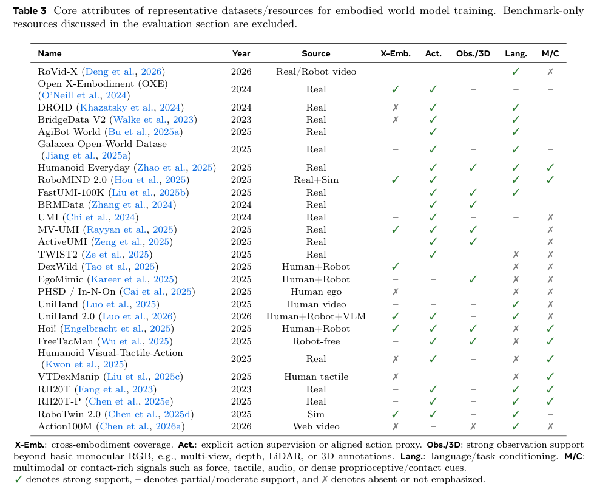{ width="1000" }

*原文 Table 3。✓ 表示强支持，– 表示部分或中等支持，✗ 表示缺少或未强调。这里的 – 与 Table 2 的能力标记、Table 5–6 的结果缺失不是同一种含义。*

OXE 聚合多种机器人数据，DROID、BridgeData V2 等提供真实动作对齐轨迹。AgiBot World、Galaxea 数据扩展场景与行为覆盖，Humanoid Everyday、RoboMIND 2.0、FastUMI-100K、BRMData 等又在长程任务、平台多样性或额外信号上各有侧重。

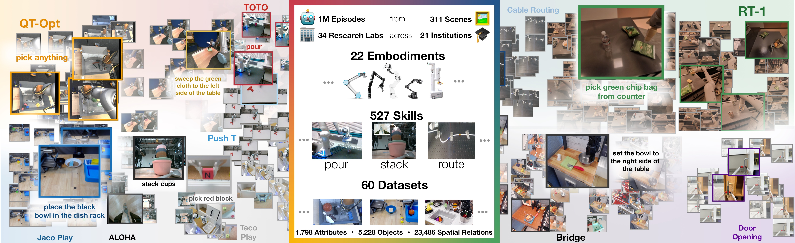{ width="920" }

*补充阅读图，来自已有 Open X-Embodiment 资产。图中不同平台、视角与任务说明数据聚合的异质性；其中规模数字属于该原图版本，不作为本文对当前数据集规模的重新统计。*

数据聚合并不自动解决动作语义。不同机器人可能使用关节空间、末端位姿或夹爪开合表示，采样频率、坐标系和相机布局也不同。世界模型需要知道动作具体作用在哪个 embodiment 上，否则相同数值并不意味着相同物理变化。

### 人类视频提供交互先验，执行标签仍需连接

UMI、MV-UMI、ActiveUMI 等提供不同形式的人类采集与可迁移操作信息，DexWild、EgoMimic、PHSD / In-N-On、UniHand 系列扩展人类行为覆盖。它们对学习对象交互有价值，但机器人动作监督的形式并不统一。

原表将有无 explicit action supervision 或 aligned proxy 单列，就是为了避免把视频条数直接视作机器人控制标签数量。人手运动、相机运动、对象变化和电机命令之间需要额外对应，latent action 只是可能接口之一。

### 接触信号补上视觉看不见的状态

FreeTacMan、Humanoid Visual-Tactile-Action、VTDexManip、RH20T 和 RH20T-P 等资源补充触觉、力或相关接触线索。摩擦、刚度、接触稳定性不能总从一张图像中判定，这些信号直接影响动作是否可执行。

但多模态并不只是把向量拼接。触觉与视觉可能异步、频率不同，视觉 token 数量又远多于接触信号。若联合训练让视觉损失占主导，模型仍可能忽视决定动作成败的瞬态反馈。

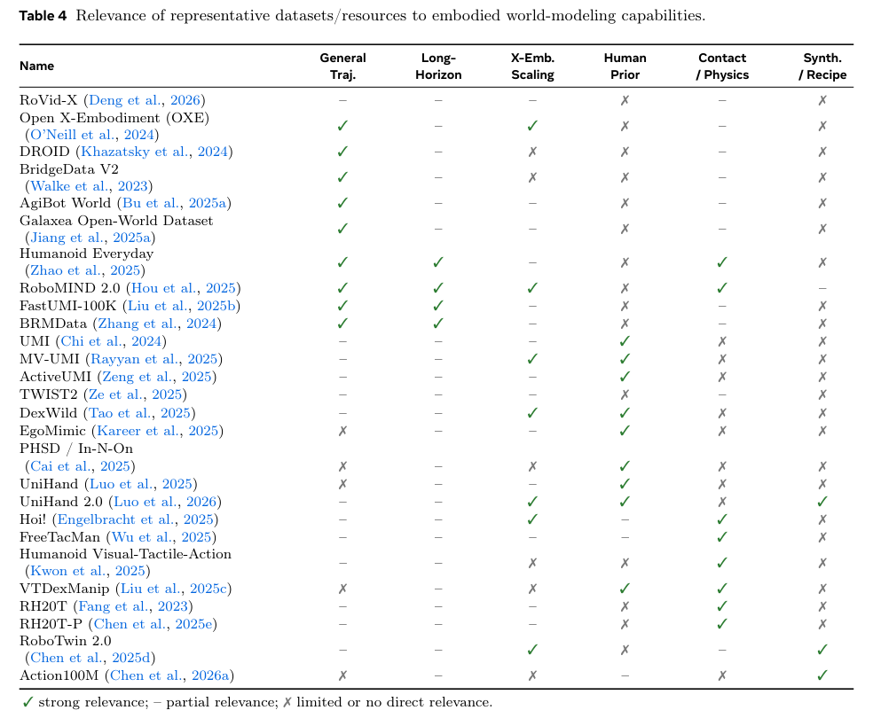{ width="1000" }

*原文 Table 4。它评价各数据资源与不同世界建模能力的相关性，勾选不是作者已统一测量的训练增益；同一个资源可以横跨多个维度。*

| Resource | Source（按原 Table 3） | 两张表帮助辨别的用途 |
|---|---|---|
| Open X-Embodiment | Real | 动作对齐与跨 embodiment 聚合 |
| DROID | Real | 真实通用轨迹，平台范围需单独看 |
| RoboMIND 2.0 | Real+Sim | 长程、跨平台与接触相关覆盖 |
| MV-UMI | Real | 多视角与人类先验到机器人迁移 |
| UniHand 2.0 | Human+Robot+VLM | 人类、机器人与语言资源组合 |
| FreeTacMan | Robot-free | 动作代理与接触相关信号 |
| RH20T | Real | 语言条件、动作与多模态接触信息 |
| RoboTwin 2.0 | Sim | 可控合成变化与跨 embodiment 数据 |
| Action100M | Web video | 网络行为语义与数据构建配方 |

表中用途是对原表多个列的合读，不能把“相关”改写成“已经证明训练该能力有效”。尤其是高质量成功示范增长很快，但失败恢复、决策敏感变化和稠密物理监督仍较少。若要训练可靠模拟器，恰好需要看到采取错误动作之后世界如何变化。

## LIBERO 结果要保留四个子集，平均值不能代替任务结构

原文 Table 5 汇集标准 Spatial / Object / Goal / Long 四套 LIBERO 结果。它按世界建模接入方式分组，保留未报告项，不把只测试某个子集的工作强行补成四套平均。

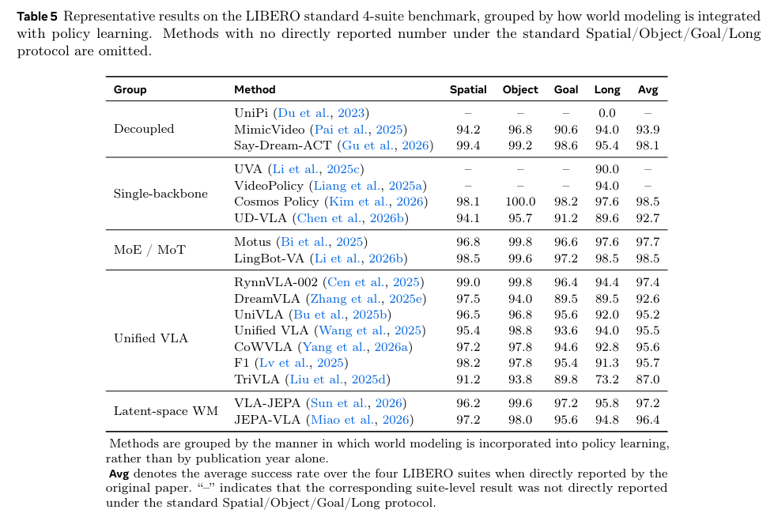{ width="1000" }

*原文 Table 5，PDF p.28。以下 Markdown 表保留原表 Method 名称、列和数值，单位为原表汇总的成功率百分数。– 表示没有按该协议直接报告，不是 0。*

| Group | Method | Spatial | Object | Goal | Long | Avg |
|---|---|---:|---:|---:|---:|---:|
| Decoupled | UniPi | – | – | – | 0.0 | – |
| Decoupled | MimicVideo | 94.2 | 96.8 | 90.6 | 94.0 | 93.9 |
| Decoupled | Say-Dream-ACT | 99.4 | 99.2 | 98.6 | 95.4 | 98.1 |
| Single-backbone | UVA | – | – | – | 90.0 | – |
| Single-backbone | VideoPolicy | – | – | – | 94.0 | – |
| Single-backbone | Cosmos Policy | 98.1 | 100.0 | 98.2 | 97.6 | 98.5 |
| Single-backbone | UD-VLA | 94.1 | 95.7 | 91.2 | 89.6 | 92.7 |
| MoE / MoT | Motus | 96.8 | 99.8 | 96.6 | 97.6 | 97.7 |
| MoE / MoT | LingBot-VA | 98.5 | 99.6 | 97.2 | 98.5 | 98.5 |
| Unified VLA | RynnVLA-002 | 99.0 | 99.8 | 96.4 | 94.4 | 97.4 |
| Unified VLA | DreamVLA | 97.5 | 94.0 | 89.5 | 89.5 | 92.6 |
| Unified VLA | UniVLA | 96.5 | 96.8 | 95.6 | 92.0 | 95.2 |
| Unified VLA | Unified VLA | 95.4 | 98.8 | 93.6 | 94.0 | 95.5 |
| Unified VLA | CoWVLA | 97.2 | 97.8 | 94.6 | 92.8 | 95.6 |
| Unified VLA | F1 | 98.2 | 97.8 | 95.4 | 91.3 | 95.7 |
| Unified VLA | TriVLA | 91.2 | 93.8 | 89.8 | 73.2 | 87.0 |
| Latent-space WM | VLA-JEPA | 96.2 | 99.6 | 97.2 | 95.8 | 97.2 |
| Latent-space WM | JEPA-VLA | 97.2 | 98.0 | 95.6 | 94.8 | 96.4 |

原表将 UniVLA 与 Unified VLA 分别列成两行，并使用其对应引用；这里保留作者标签，不根据名称相近自行合并。Avg 同样保留原文报告值，不重新四舍五入来替代来源。

这张表支持几项有限但具体的观察。Cosmos Policy 与 LingBot-VA 的 Avg 都是 98.5，但 Long 分别为 97.6 和 98.5，Goal 又分别是 98.2 与 97.2。相同平均数没有说明它们具有相同任务优势，也不能据一个子集就判定整体更强。

TriVLA 的 Object 为 93.8，Long 为 73.2，显示同一系统在长程设置中可能明显下降；而 MimicVideo 的 Long 为 94.0，高于其 Goal 的 90.6，因此“所有模型都在 Long 最差”同样不成立。原文强调长程任务具有区分度，并没有给出适用于每行的单调规律。

多个家族都出现高分，说明有效预测结构可以通过不同架构进入控制。但跨论文比较没有控制预训练数据、示范量、训练预算、骨干规模、执行频率和评估种子。因此表中结果不能证明某类架构因果上优于另一类，也不能单独量化“增加世界模型”的净收益。[原文 §7.3，PDF pp.28–30](https://arxiv.org/pdf/2605.00080v1#page=28)

## RoboTwin、CALVIN 与 SIMPLER 不能混成一个分数

原文 Table 6 把其他常用平台并列，目的是展示跨 benchmark 的表现分布。不同列对应不同任务、机器人、协议和量纲，不能横向取平均再做总榜。

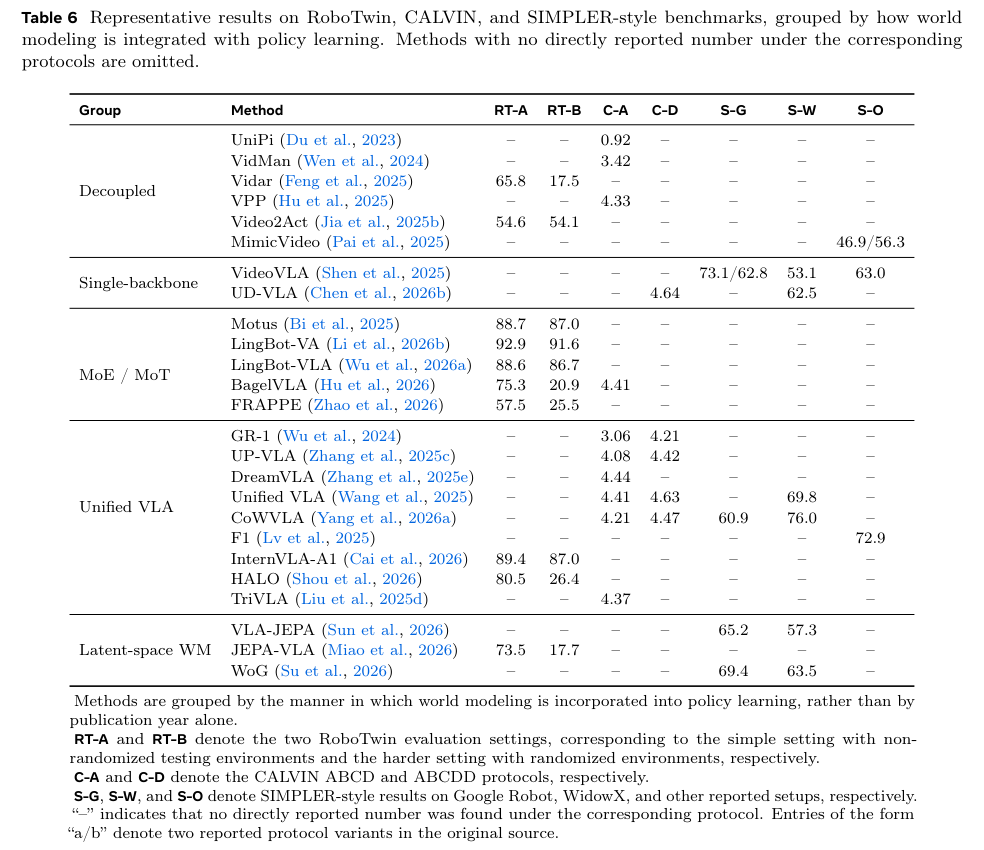{ width="1000" }

*原文 Table 6，PDF p.29。RT-A / RT-B 对应作者所述非随机化与更难的随机化 RoboTwin 设置；C-A / C-D 是两个 CALVIN 协议标签；S-G / S-W / S-O 分别为 Google Robot、WidowX 与其他 SIMPLER-style 设置。*

| Group | Method | RT-A | RT-B | C-A | C-D | S-G | S-W | S-O |
|---|---|---:|---:|---:|---:|---|---:|---|
| Decoupled | UniPi | – | – | 0.92 | – | – | – | – |
| Decoupled | VidMan | – | – | 3.42 | – | – | – | – |
| Decoupled | Vidar | 65.8 | 17.5 | – | – | – | – | – |
| Decoupled | VPP | – | – | 4.33 | – | – | – | – |
| Decoupled | Video2Act | 54.6 | 54.1 | – | – | – | – | – |
| Decoupled | MimicVideo | – | – | – | – | – | – | 46.9/56.3 |
| Single-backbone | VideoVLA | – | – | – | – | 73.1/62.8 | 53.1 | 63.0 |
| Single-backbone | UD-VLA | – | – | – | 4.64 | – | 62.5 | – |
| MoE / MoT | Motus | 88.7 | 87.0 | – | – | – | – | – |
| MoE / MoT | LingBot-VA | 92.9 | 91.6 | – | – | – | – | – |
| MoE / MoT | LingBot-VLA | 88.6 | 86.7 | – | – | – | – | – |
| MoE / MoT | BagelVLA | 75.3 | 20.9 | 4.41 | – | – | – | – |
| MoE / MoT | FRAPPE | 57.5 | 25.5 | – | – | – | – | – |
| Unified VLA | GR-1 | – | – | 3.06 | 4.21 | – | – | – |
| Unified VLA | UP-VLA | – | – | 4.08 | 4.42 | – | – | – |
| Unified VLA | DreamVLA | – | – | 4.44 | – | – | – | – |
| Unified VLA | Unified VLA | – | – | 4.41 | 4.63 | – | 69.8 | – |
| Unified VLA | CoWVLA | – | – | 4.21 | 4.47 | 60.9 | 76.0 | – |
| Unified VLA | F1 | – | – | – | – | – | – | 72.9 |
| Unified VLA | InternVLA-A1 | 89.4 | 87.0 | – | – | – | – | – |
| Unified VLA | HALO | 80.5 | 26.4 | – | – | – | – | – |
| Unified VLA | TriVLA | – | – | 4.37 | – | – | – | – |
| Latent-space WM | VLA-JEPA | – | – | – | – | 65.2 | 57.3 | – |
| Latent-space WM | JEPA-VLA | 73.5 | 17.7 | – | – | – | – | – |
| Latent-space WM | WoG | – | – | – | – | 69.4 | 63.5 | – |

两处细节需要在表旁说明。其一，原表对 CALVIN 的脚注直接排成 ABCD 与 ABCDD，未清楚呈现训练集合到测试集合的箭头；本文保留 C-A / C-D 标签，严谨复现时必须回到对应原论文确认划分，不能仅凭连写字符串补定协议。CALVIN 这些值属于任务链完成类指标，不能读成 4.41% 的成功率。

其二，$a/b$ 表示来源中两种协议变体的结果，不是误差条或置信区间；S-O 又汇集其他设置，不能将该列所有行当作相同机器人任务。横线仍表示未直接报告。

同一行的简单与随机化设置可以提示敏感性。例如 LingBot-VA 的 RT-A / RT-B 差 1.3 个百分点，BagelVLA 对应差 54.4 个百分点。这些是原表数字的算术差，不是控制数据与训练预算后的架构消融。模型使用的演示数量、随机化范围和原始实验协议仍需核对。

原文据此总结，强表现出现在多种架构中，长程鲁棒性、跨平台迁移和标准化报告仍然不足。更强的结论，例如某个范式已普遍解决机器人世界建模，超出了这些汇总表能够支持的范围。

## 六类未解决问题都可以落到具体接口上

综述最后讨论的挑战并不只是继续扩大参数。每一项都对应前文一个可能失真的接口。[原文 §8，PDF pp.30–31](https://arxiv.org/pdf/2605.00080v1#page=30)

第一项是动作条件不足。模型根据历史和任务猜到了一个常见未来，却没有响应当前候选控制。联合训练可能改善对齐，但仍要通过动作替换、反向动作或失败动作等设置检验预测是否真正改变。语言意图正确不能替代命令后果正确。

第二项是效率。显式视频训练、联合生成和在线 rollout 各自产生成本。轻量适配降低的是参数更新负担，部分去噪减少生成过程，latent prediction 减少表示与解码，Fast-WAM 式训练后省略分支则改变部署流程。不同方案解决不同部分，单一“更快”不足以描述系统。

第三项是多模态物理反馈。视觉与本体感知仍可能无法确定摩擦、刚度和稳定接触。触觉、力反馈能补充信息，但异步采样、信号尺度和模态权重会影响是否真正使用它们。模型接收传感器数据不等于已经学会依赖它。

第四项是与经典控制结合。世界模型可以提供 MPC 所需的前向动态，反复候选 rollout 却可能限制实时性。更进一步的 Lyapunov 稳定或鲁棒控制保证，被文章提出为研究方向，不能写成现有视频策略已经具备形式化安全保证。

第五项是结构与符号抽象。对象、关系、规则可以减少长程推理时无关细节，也要求可靠感知落地。抽象太粗会漏掉决定动作成败的连续状态，抽象太细又可能失去简化优势，混合表示需要围绕任务检验。

第六项是用途相关的评价。训练环境、策略评估器、视觉计划生成器所需指标不同。文章倡议把动作敏感性、长期一致、任务成功、策略排名和可执行诊断一起纳入比较，但并未提出已获共识的唯一总分。

| Interface | 可能出现的失败 | 更直接的检查 |
|---|---|---|
| Task / action → future | 任务成功动画压过候选动作 | 固定场景与任务，改变动作再比较后果 |
| Future → executable action | 视觉轨迹不可达或控制不稳定 | 动作恢复与实际执行验证 |
| Simulator → policy update | 策略利用模型漏洞 | 独立真实评估与失败轨迹回收 |
| Rollout → ranking | 漂亮未来获得错误高分 | 与真实候选、策略排名对照 |
| History → memory | 遮挡或长程后状态改变 | 回访、状态保持与任务链测试 |
| Training prediction → deployment | 去掉分支后收益消失 | 部署模式下的等预算消融 |

这张表是对综述的工程化整理，不是原文新的 benchmark。它把“模型质量”进一步拆成哪个接口没有履行职责，让失败更容易归因。

## 用这篇综述设计研究，先写出预测将改变哪一步

若现有策略的问题是动作歧义，未来条件或潜在目标可能提供有用结构；若问题是示范覆盖不足，合成行为还要连接动作恢复与数据过滤；若问题是缺乏失败学习，模拟器中的策略改进需要可信反馈和真实验证；若部署时只能增加少量计算，训练期的预测监督可能比完整在线想象更合适。

这些选择没有通用最优解，但可以形成可执行实验。先明确模型预测什么状态、接受哪种动作，再写出未来信息进入动作、评分或参数更新的位置；最后选对应的对照和真实结果指标。这样才能区分预测结构带来的价值、额外数据带来的价值和额外推理预算带来的价值。

本文没有提供一套统一优化器或新模型训练配方，它提供的是拆解这些系统的共同语言。读完后最值得保留的判断，是世界模型的价值必须沿着信息流追到动作后果。预测画面、潜在表示、结构状态都可以成为接口，最终是否有用取决于它们是否让机器人在目标任务里作出更可靠的决定。
