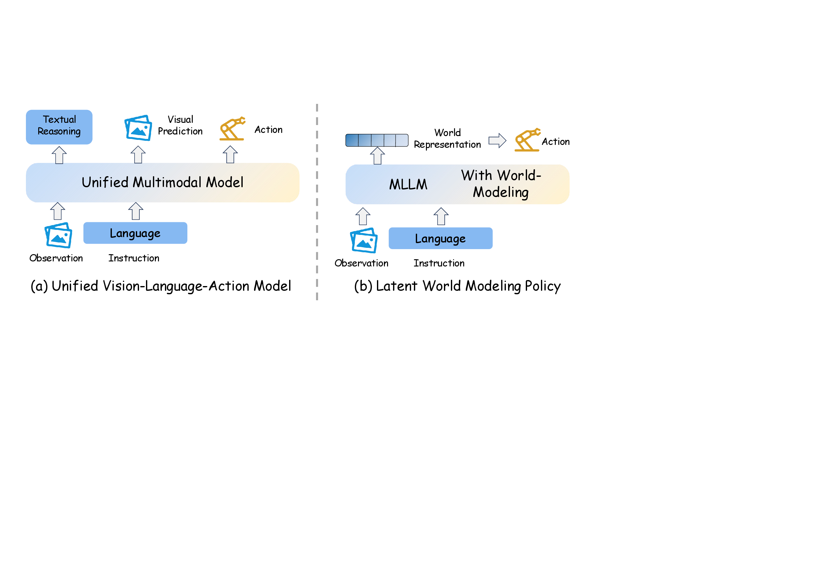

# World Model for Robot Learning：机器人学习世界模型综述

!!! info "论文信息"
    **论文题名：** World Model for Robot Learning: A Comprehensive Survey。<br>
    **作者：** Bohan Hou、Gen Li、Jindou Jia、Tuo An、Xinying Guo、Sicong Leng、Haoran Geng、Yanjie Ze、Tatsuya Harada、Philip Torr、Oier Mees、Marc Pollefeys、Zhuang Liu、Jiajun Wu、Pieter Abbeel、Jitendra Malik、Yilun Du、Jianfei Yang。<br>
    **机构：** Nanyang Technological University、University of California, Berkeley、Stanford University、The University of Tokyo、University of Oxford、Microsoft、ETH Zurich、Princeton University、Harvard University。<br>
    **时间 / 主题：** 2026-04；世界模型、机器人学习、VLA、视频世界模型、learned simulator。<br>
    **arXiv / 官方报告：** arXiv：[2605.00080](https://arxiv.org/abs/2605.00080)；PDF：[arxiv.org/pdf/2605.00080](https://arxiv.org/pdf/2605.00080)。<br>
    **GitHub / 项目：** GitHub：[NTUMARS/Awesome-World-Model-for-Robotics-Policy](https://github.com/NTUMARS/Awesome-World-Model-for-Robotics-Policy)；项目页：[ntumars.github.io/wm-robot-survey](https://ntumars.github.io/wm-robot-survey/)。<br>
    **元数据来源与核验口径：** 来源：[arXiv](https://arxiv.org/abs/2605.00080)、论文 PDF、官方 GitHub / 项目页；Checked Date：2026-06-15；Repro Status：Survey / official resource list reviewed, independent reproduction not claimed。

## 原论文故事线

### 研究背景

这篇综述聚焦 robot learning 中的 world models。机器人学习正在从解析式控制和单任务策略，转向 VLA、行为克隆、扩散策略和大规模多任务策略；但纯反应式策略仍有长时规划、错误累积、数据效率和安全评估问题。世界模型可以在动作执行前预测未来状态、奖励、终止、风险或关键帧，从而辅助策略生成、训练和评估。

综述的背景不是把所有“会生成视频”的模型都叫世界模型，而是区分它们在机器人系统里的功能：有的 world model 融入 policy，有的作为 simulator 生成 imagined rollouts，有的作为 video world model 提供 action-conditioned future，有的只做 representation 或 data augmentation。

### 问题（Challenge）

综述要解决的问题是：**机器人学习里的世界模型到底有哪些角色，如何判断一篇工作是在帮助动作决策、模拟训练，还是只是在生成未来视频？** 这个问题难在术语混乱。VLA、视频生成、latent dynamics、learned simulator、diffusion policy、action-conditioned prediction 都可能自称 world model，但证据强度差异很大。

这个问题有价值，因为机器人领域关心最终动作效果。一个模型未来画面漂亮，如果没有改变 policy、planner、reward estimation 或 closed-loop success，就不能直接说明它是 actionable world model。

### Finding

综述的核心 finding 是：**机器人世界模型的价值不在未来画面是否逼真，而在预测是否被决策链路消费并改变动作选择、训练样本或评估结论。** 这个洞见把阅读标准从“生成质量”转成“decision utility”。

这个 finding 解释了论文的 taxonomy。World model for policy 关注预测如何进入策略结构；world model as simulator 关注 imagined rollout 如何训练或评估 policy；robotic video generation 关注 action-conditioned future 是否能成为可控模拟信号；datasets/benchmarks 关注是否包含 transition、动作和闭环效用指标。最终判断都回到一个问题：预测有没有服务机器人决策。

### 方法

综述按功能把机器人世界模型分成几类。第一类是 world model for policy：预测模块可能与 policy 解耦、共享 backbone、通过 expert fusion 融合，或作为 latent internalization 隐式存在。第二类是 world model as simulator：模型在 imagined environment 中生成未来状态、奖励或视频，用于 policy training、candidate action evaluation 或 safety checking。第三类是 robotic video generation：从 task-conditioned、action-conditioned、structure-aware 到 foundation-scale video world model，逐步接近机器人可用的未来预测。

论文还整理数据集、benchmark、评估指标和开放问题。它强调 POMDP 视角：真实 state 不可完全观测，world model 需要维护 latent state，使用 posterior 从真实观测校正当前状态，用 prior 按动作 rollout 未来。评估方面，不能只看 FVD/LPIPS 等视觉指标，还要看 rollout consistency、action controllability、planning success、policy improvement 和 real/sim transfer。

### 结论

综述的结论是：机器人 world model 已经从小规模 latent dynamics 扩展到 VLA 内部模块、learned simulator 和大规模视频世界模型，但仍缺少统一评估。未来关键方向包括 action-conditioned long-horizon prediction、真实机器人闭环验证、可控视频生成、3D/geometry-aware state、uncertainty estimation、安全评估和与基础 VLA 的深度融合。

需要注意的是，综述本身不提供新模型实验；它的价值是阅读和选型框架。对本站专题来说，最重要的 takeaway 是：评价机器人世界模型时要追问最后一环，预测是否真的让动作更好，而不只是让未来看起来更像视频。

### 关键术语

- **World Model for Policy（策略内世界模型）**：直接或间接参与动作生成的预测模块。
- **World Model as Simulator（作为模拟器的世界模型）**：生成 imagined rollouts，用于训练、评估或筛选动作。
- **Robotic Video Generation（机器人视频生成）**：面向机器人任务的未来视觉预测，通常需要动作、任务和结构条件。
- **Action-conditioned Prediction（动作条件预测）**：未来状态显式依赖动作输入，是机器人世界模型可用于决策的关键。
- **Decision Utility（决策效用）**：预测对动作选择、策略训练或安全评估的实际帮助。
- **Closed-loop Evaluation（闭环评估）**：让模型进入真实或模拟控制循环，用任务成功率等指标验证效用。

这篇综述要解决的不是“再列一批世界模型论文”，而是给机器人学习里的世界模型划清三种用途：**放进 policy、变成 simulator、作为 video world model 提供可控未来**。读它最重要的收获，是以后看到一篇新工作时，能先问清楚：它到底在帮助动作生成、帮助模拟训练，还是只是在生成更像真的未来视频。

一句话概括：**机器人世界模型的价值不在于未来画面是否漂亮，而在于预测是否能改变动作选择。**

## 先抓主线

这篇论文的所有分类都可以压到一个判断链路：

```text
当前观测 / 语言 / 动作
  -> 预测未来状态、未来视频、reward、termination、value 或 latent
  -> policy / planner / evaluator 使用这些预测
  -> 动作选择、训练数据或评估结论发生变化
```

如果最后一步没有发生，模型最多只是 video predictor 或 representation learner，还不能强称为机器人学习里的 actionable world model。

| 问题 | 论文对应章节 | 要判断的核心 |
| --- | --- | --- |
| 世界模型怎样帮助 policy 出动作 | Sec. 3 World Model for Policy | 预测未来是 decoupled、shared backbone、expert fusion，还是 latent internalization |
| 世界模型怎样替代环境 | Sec. 4 World Model as Simulator | 它是在 imagined rollout 里训练 policy，还是在执行前评估候选动作 |
| 视频生成怎样变成机器人世界模型 | Sec. 5 Robotic Video Generation | 它是否 task-conditioned、action-conditioned、structure-aware、foundation-scale |
| 数据和评测怎么支撑这些 claim | Sec. 7 Benchmarks, Datasets, and Results | 数据是否包含 transition，评测是否看 closed-loop utility |

所以这篇要按“功能角色”读，不要按论文发布时间或表格行数读。

## 为什么 VLA 还需要世界模型

机器人策略学习正在从“为单个任务手工设计控制流程”，转向“用基础模型统一感知、语言理解和动作生成”。VLA 正是这条路线的代表：它接收图像、语言和机器人状态，直接输出动作，随着模型、数据和任务规模扩大，已经表现出很强的跨任务和跨本体泛化能力。

但一个只做

```text
当前观测 + 当前指令 -> 下一段动作
```

的反应式策略，在复杂真实环境中仍然会遇到三个相互关联的问题。

| 问题 | 含义 | 机器人例子 | 世界模型补什么 |
| --- | --- | --- | --- |
| Long-horizon reasoning | 任务包含多个有依赖关系的子目标，当前动作必须服从后续计划 | 打开柜门、取出杯子、接水、再放到桌面 | 预测子目标完成后的状态，让策略知道当前动作在整条任务链中的位置 |
| Temporal credit assignment | 最终成败与早期动作相隔很远，很难判断责任属于哪一步 | 最后抓取失败，根因可能是前面靠近角度已经错误 | 在 imagined rollout 中评估中间状态、progress、reward 或 value |
| Robustness under compounding errors | 视觉、控制和接触误差会在长序列里逐步累积 | 夹爪每一步只偏一点，几秒后已经完全错过目标 | 预测动作后果，用真实观测回写并进行纠错或重规划 |

因此，从 VLA 到世界模型并不是简单地在策略旁边“多放一个视频生成器”，而是把显式或隐式的未来预测引入动作生成：模型需要估计“如果执行这段动作，世界会怎样变化”，再据此约束当前决策。

这也解释了动作条件视频模型为什么重要。普通视频生成模型学习 plausible future；动作条件视频世界模型进一步学习：

$$
p(o_{t+1:t+H}\mid o_t,a_{t:t+H-1},l)
$$

它把视频模型的时空预测能力和机器人动作后果连接起来，才有机会服务 planning、policy improvement、evaluation 和 synthetic data generation。

## 机器人 Policy 的两层背景

理解论文的分类前，需要先把“控制方式”和“学习策略架构”分开。

### 从解析式控制到端到端学习

传统 analytical controllers 依赖明确的数学模型和工程结构，例如 PID、LQR、MPC、逆运动学、轨迹优化和阻抗控制。工程师需要显式建模状态、动力学、约束、代价函数和控制律。

端到端学习模型则从示范或交互数据中学习：

$$
\pi(a_{t+1:t+k}\mid o_t,l)
$$

其中 \(o_t\) 可以包含相机观测和 proprioception，\(l\) 是可选语言指令，\(a_{t+1:t+k}\) 是长度为 \(k\) 的 action chunk。动作分块比逐步输出更容易保持短时连续性，也能降低高频控制下的误差累积。

端到端策略并不意味着解析控制彻底消失。实际系统常常让学习策略负责语义、subgoal 或末端轨迹，再由低层控制器负责频率更高、稳定性要求更强的执行。世界模型也通常位于高层预测和低层控制之间，而不是替代所有控制模块。

### 两类主流学习策略

| Policy family | 典型代表 | 优势 | 局限 |
| --- | --- | --- | --- |
| Specialized visuomotor policy | Diffusion Policy、ACT 等 | 模型较轻、控制精度高、部署延迟低，适合明确任务和固定本体 | 语义知识、开放词汇和跨任务迁移较弱 |
| Generalist VLA | RT-2、OpenVLA、\(\pi_0\) 等 | 继承 VLM 的语义知识、开放词汇和跨任务/跨本体泛化 | 训练与部署成本高，动作精度、长时规划和闭环纠错仍是难点 |

两类策略都在使用生成式动作建模，因为机器人示范通常是多模态分布：同一个任务可能有多条合理轨迹，直接回归均值容易得到一条谁都不像的动作。

{ width="880" }

<small>图源：[Diffusion Policy](https://diffusion-policy.cs.columbia.edu/) 项目页 / 论文图。原图表达：策略把当前视觉观测作为条件，生成未来一段连续动作序列，并以 receding horizon 方式执行。本站读法：专用 visuomotor policy 的优势是动作分布建模精细、闭环延迟可控；但它通常不显式评估“如果换一个动作未来会怎样”。</small>

{ width="920" }

<small>图源：[RT-2](https://arxiv.org/abs/2307.15818)，Figure 1。原图表达：RT-2 将 web-scale VLM 预训练迁移到机器人动作 token 输出。本站读法：VLA 的强项是把视觉语言知识接到动作空间，但若没有 world-model-style 预测接口，它仍可能只是更强的 reactive policy。</small>

### 动作怎样表示

VLA 的 action head 主要有离散和连续两条路线。

**离散动作 tokenization。**
RT-2、OpenVLA 等方法把连续动作量化成离散 token，让 action token 和 text token 共用 next-token prediction 机制。它容易复用语言模型训练框架，但普通逐维分桶会带来量化误差和很长的高频动作序列。

FAST 的改进是先用 DCT 把 action chunk 压到频率空间，再把压缩系数编码成更紧凑的 token 序列。直觉上，它不再逐时刻记录所有动作细节，而是先描述一段动作的低频趋势和必要的高频变化，从而减少 autoregressive decoding 长度。

**连续动作生成。**
\(\pi\) 系列和 Diffusion Policy 路线不把动作离散化，而是把 action head 设计成 diffusion 或 flow matching 条件生成器：

$$
p(a_{t+1:t+k}\mid o_t,l)
$$

模型从 Gaussian noise、视觉表征或 action history 等 base distribution 出发，逐步生成连续 action chunk。视觉表征能让采样起点更贴合当前场景，action history 则能提高动作连续性。

世界模型会进入这两种 action head：它既可以提供显式未来视频，也可以提供 future latent、subgoal、value 或 motion feature。后面的架构分类，核心就是这些 predictive signals 在哪里进入动作生成。

## 证据边界

综述的强项是组织文献和统一问题语言；弱项是它不重新跑实验，也不统一所有论文的训练条件。下面这张表是读全文的证据口径。

本文配图遵守同一个口径：正文只使用论文、官方项目页或研究博客中的原图 / 已归档图，不使用 image2 或自生成概念图。表格可以为讲解重排，但会保留英文列名和来源说明。

| 论文结论 | 证据来源 | 证据等级 | 可以吸收什么 | 不能直接推出什么 |
| --- | --- | --- | --- | --- |
| 机器人世界模型应以 action usefulness 为中心 | 定义、Figure 1、evaluation discussion | Survey synthesis | 评测不能只看视觉质量，要看 action sensitivity、planning utility、policy ranking | 某个具体模型已经可靠控制真实机器人 |
| policy coupling 正从 decoupled 走向 unified / MoE / latent | Figure 2、Figure 3、Table 1 | Literature taxonomy | 选型时先看未来预测是否 inference-active，以及动作和视频在哪里耦合 | shared backbone 一定优于 decoupled |
| learned simulator 正从训练环境扩展到 evaluator | Figure 5、Sec. 4 | Functional taxonomy | world model 可以提供 reward、termination、policy ranking、candidate filtering | simulator 的 reward 或 ranking 一定可信 |
| robotic video WM 的重点从 imagination 转向 controllable interface | Figure 6、Table 2 | Literature taxonomy | 视频底座训练要补动作、结构、长时一致和交互数据 | 普通 text-to-video 能力等同于机器人世界模型 |
| 数据集要按 transition richness 判断 | Dataset tables、Sec. 7 | Survey synthesis | 数据 schema 要记录动作、语言、3D/multiview、接触、长 horizon | 表格就是数据集推荐榜 |

## 定义：世界模型不是视频生成器

论文采用的是 robotics-centered definition。它不要求世界模型一定预测像素，也不要求一定是 Dreamer 那类 latent dynamics。它要求预测必须对机器人决策有用。

通用形式是：

$$
p(x_{t+1:t+H} \mid x_t, a_{t:t+H-1}, l)
$$

这里 \(x_t\) 是被建模的状态，可以是 RGB 视频、latent state、3D/occupancy、reward/value 相关状态，甚至 object relation / predicate 这类符号状态；\(a_{t:t+H-1}\) 是动作序列；\(l\) 是语言指令或高层任务目标。论文特别把语言也看成 high-level action，因为语言指定“未来应该实现什么”。

如果状态落到视频空间，就得到：

$$
p(v_{t+1:t+H} \mid o_t, a_{t:t+H-1}, l)
$$

这也是为什么视频生成模型会进入世界模型讨论。但分界线很清楚：**视频模型生成 plausible future；机器人世界模型要生成 action-faithful future。**

固定历史画面，如果输入“向左移动”和“向右移动”得到几乎同一个未来，那它可能是强视频先验，却不是可用于控制的动作条件世界模型。

## 总图：三种用法，不是一条流水线

{ width="920" }

<small>图源：`World Model for Robot Learning: A Comprehensive Survey`，Figure 1。原论文图意：整篇综述按三个主轴组织：Sec. 3 讨论 world models 如何和 robot policies 耦合；Sec. 4 讨论 world models 作为 simulators；Sec. 5 讨论 robotic video world models 的能力演进。</small>

这张图不是在说三条路线按顺序发生，而是在说一个世界模型可能有三种身份。

| 身份 | 输入 | 输出 | 下游使用者 | 主要风险 |
| --- | --- | --- | --- | --- |
| World Model for Policy | observation、language、history，有时有 future target | action、future latent、future image、subgoal | policy head / action decoder | 未来预测和动作生成脱节 |
| World Model as Simulator | observation、candidate actions、instruction | imagined observation、reward、done、value | RL algorithm / evaluator / planner | simulator hallucination 污染训练或排序 |
| Robotic Video World Model | observation、task、action、structure priors | future video / visual state | data engine / planner / policy evaluator | 视觉真实但动作不可信 |

把这三种身份分开，文章就顺了：先看模型怎样进入 policy，再看怎样替代环境，最后看视频模型怎样变得可控。

{ width="920" }

<small>图源：`World Model for Robot Learning: A Comprehensive Survey`，Figure 2。原论文图意：上支展示 world model for policy 从 IDM-style 走向 single-backbone、MoE/MoT、unified VLA 和 latent world modeling；下支展示 world model as simulator 从 validation / candidate evaluation 走向 RL、post-training 和 policy-world-model co-optimization。</small>

Figure 2 的重点不是“新方法替代旧方法”，而是两个收敛趋势：policy 侧越来越把预测和动作生成绑紧；simulator 侧越来越把世界模型放进训练、评估和自我修正循环里。

## 主线一：世界模型进入 Policy

policy 侧的核心问题是：**未来预测到底在哪里影响动作？**

论文把 policy、world model、inverse dynamics 看成同一个联合分布的不同查询：

$$
p(o_{t+1:t+k}, a_{t+1:t+k} \mid o_t, l)
$$

| Query | Formulation | 直觉 |
| --- | --- | --- |
| Policy Model | \(p(a_{t+1:t+k}\mid o_t,l)\) | 直接从当前观测和指令出动作 |
| Passive World Model | \(p(o_{t+1:t+k}\mid o_t,l)\) | 不显式给动作，只按任务想象未来 |
| Controllable World Model | \(p(o_{t+1:t+k}\mid o_t,a_{t+1:t+k})\) | 给定候选动作，预测后果 |
| Inverse Dynamics Model | \(p(a_{t+1:t+k}\mid o_{t:t+k})\) | 给定状态变化，反推动作 |

这个视角很有用，因为很多论文看起来完全不同，本质上只是把未来预测放在了 policy 的不同位置。

### 同一个联合分布的四种读法

**Policy Model：只保留动作。**
policy 把未来观测边缘化，只关心未来动作：

$$
p(a_{t+1:t+k}\mid o_t,l)
=
\int p(o_{t+1:t+k},a_{t+1:t+k}\mid o_t,l)\,d o
$$

其中 \(o\) 表示被边缘化的未来观测序列；这行式子不是说 policy 不需要世界状态，而是说它把未来状态当作隐变量积分掉，只输出动作条件分布。

它回答“当前看到这些、任务要求这些，下一段应该怎么动”。普通 VLA、Diffusion Policy 和 flow-based policy 都可以落在这个接口上，不要求显式生成未来画面。

**Passive World Model：只保留未来观测。**
它把动作边缘化：

$$
p(o_{t+1:t+k}\mid o_t,l)
=
\int p(o_{t+1:t+k},a_{t+1:t+k}\mid o_t,l)\,d a
$$

它回答“在当前场景和任务下，未来大概会发生什么”。很多 text/image-conditioned video generator 更接近这一形式。因为动作不是显式输入，它适合做 visual planning 或 data generation，却很难直接比较候选控制序列。

**Controllable World Model：固定动作，预测后果。**

$$
p(o_{t+1:t+k}\mid o_t,a_{t+1:t+k},l)
$$

它回答“如果执行这段动作，未来会变成什么”。planner 可以给出 \(a^{(1)},a^{(2)},a^{(3)}\) 等候选动作序列，让 world model 分别 rollout，再按 success、value、risk 或 progress 选择。对机器人控制而言，这是最关键的 world-model query。

**Inverse Dynamics Model：看到变化，反推动作。**

$$
p(a_{t+1:t+k}\mid o_{t:t+k})
$$

它回答“环境从状态 A 变到状态 B，中间可能执行了什么动作”。这使系统能从无动作标签的人类视频或生成视频中恢复伪动作，也能把视觉计划转成机器人控制。

四者并不是互斥模型。一个统一 video-action model 可以通过不同 mask、timestep 或 decoder 查询这些条件分布；一个 decoupled pipeline 则把它们实现成独立模块。

{ width="920" }

<small>图源：`World Model for Robot Learning: A Comprehensive Survey`，Figure 3。原论文图意：展示 IDM-style、single-backbone-style 和 MoT-style 三种用世界模型支撑 policy 的架构范式。</small>

### 1. Decoupled / IDM-style：先想象，再反推动作

这类方法先用世界模型生成未来观测或未来 latent：

$$
\hat{o}_{t+1:t+H}=\mathcal{W}(o_t,l)
$$

再用 inverse dynamics 或 policy head 预测动作：

$$
\pi(a_{t+1:t+H'} \mid o_t,l,\Phi(\hat{o}_{t+1:t+H}))
$$

它的优点是模块清楚：world model 负责“未来会怎样”，policy 负责“怎么做过去”。问题也很直接：如果生成未来不受动作约束，IDM 会从一个错误或平均化的未来里恢复动作。

训练上常见做法是先训练或适配 video predictor，再冻结或轻量适配它，最后训练 action decoder。VPP、Video2Act、MimicVideo 这类工作会进一步把 pixel rollout 压成 latent predictive features，减少完整视频生成成本。

这条路线的发展不是简单增加模型数量，而是在不断改造 world model 和 policy 之间的接口：

| 接口阶段 | 代表工作 | 给 policy 的未来信息 | 解决的问题 |
| --- | --- | --- | --- |
| Explicit future video | UniPi | 完整未来帧序列 | 建立“先预测、再行动”的基本范式 |
| Action-focused visual change | VidMan、Vidar | masked / action-relevant regions | 避免 IDM 被背景和无关视觉变化干扰 |
| Human-video condition | Gen2Act | 生成的人类执行视频 | 利用人类视频中的动作和语义先验 |
| Latent predictive feature | VPP、Video2Act、MimicVideo | 视频扩散中间特征或部分去噪 latent | 避免完整像素 rollout，提高稳定性和效率 |
| Visual goal + exploration | V2A | 合成视频状态作为 visual goal | 不直接回归 IDM，而是通过 hindsight-style exploration 学 goal-conditioned policy |
| Structured execution plan | TC-IDM、LVP | tool trajectory、visual plan、几何结构 | 把视觉未来压成更容易执行的控制接口 |

这张演进表揭示了 decoupled 方法的真正趋势：future representation 从“完整画面”逐步变成“动作相关、结构化、低成本的 predictive condition”。因此，decoupled 不等于落后；如果接口足够紧凑并能保留动作后果，它仍然是很实用的工程选择。

{ width="920" }

<small>图源：[Video Prediction Policy](https://arxiv.org/abs/2412.14803)，Figure 1。原图表达：视频 diffusion model 的内部表征包含当前视觉和未来预测信息，VPP 将这些 predictive visual representations 聚合后交给机器人 policy。本站读法：这张图正好说明 decoupled 路线的一个关键演进：未来不一定要以高清视频形式进入策略，控制侧真正需要的是可消费的预测表征。</small>

### 2. Single-backbone：未来视觉和动作一起生成

single-backbone 方法不再把 world model 和 policy 分成两个模块，而是把未来视觉表示 \(z^v\) 和动作表示 \(z^a\) 放进同一个生成过程：

$$
\mathbf{x}=[z^v;z^a], \qquad
\hat{y}=f_\theta(\tilde{\mathbf{x}}_\tau,o_t,l,\tau)
$$

这里 \(\tilde{\mathbf{x}}_\tau\) 可以是加噪 diffusion latent、flow matching 中间状态，或 masked token。目标 \(y\) 可能是 diffusion noise、velocity field 或 token target。训练压力来自联合预测：模型必须同时解释“未来世界怎样变”和“动作应该怎样出”。

这条路线的关键收益是减少 representational gap。Cosmos Policy 把 action、future state、value 作为额外 latent frames；DreamZero 做 chunk-wise joint denoising；GigaWorld-Policy 让视觉分支在推理时可选。这些设计都说明一个事实：完整视频不是最终目的，真正重要的是可被动作生成使用的 predictive structure。

这类方法的演进可以按“视觉分支在推理时还剩多少”来理解：

| 设计 | 代表工作 | 联合训练方式 | 推理时怎样用 |
| --- | --- | --- | --- |
| Joint video-action latent | UVA | 在共享 latent space 中同时监督 future visual 和 action | 用轻量 modality head 解码动作，可绕过完整视频渲染 |
| Modality-specific diffusion time | UWA | 视频和动作处于同一 diffusion transformer，但使用不同 timestep / noise 状态 | 通过 timestep control 边缘化视觉未来，直接查询 action |
| Video-Action DiT | VideoVLA、VideoPolicy | 把 pretrained video generator 改造成同时生成视频和动作的 backbone | 视频生成本身成为 policy substrate，动作由同一生成过程读出 |
| Parallel action/state/value latent | Cosmos Policy | 把 action、future state、value 编码成视频序列中的额外 latent frames | direct policy 只取 action；planning mode 同时使用 future state 和 value |
| Chunk-wise closed-loop generation | DreamZero | flow-matching DiT 共同去噪视频和动作 chunk | 每个 chunk 后接收真实观测，避免 free-running 长 rollout 漂移 |
| Optional visual branch | GigaWorld-Policy | 共享 transformer 联合做 action prediction 和 action-conditioned video generation | 部署时可关闭视觉解码，保留 joint training 带来的动态先验 |

这几种设计回答了同一个工程问题：**能否享受视频预测带来的时序先验，又不在每个控制周期支付完整视频生成成本？**

#### Single-backbone 的训练链路

一个典型训练过程可以拆成四步：

1. 从预训练 video diffusion / flow model 初始化时空 backbone；
2. 把 action、proprioception、future state 或 value 编码成新 token / latent frame；
3. 对视频分支和动作分支施加联合 diffusion、flow matching 或 discrete denoising loss；
4. 推理时根据任务选择只解码动作，或保留 future/value 分支做 planning。

联合训练并不意味着每个 loss 权重相同。视频 reconstruction/denoising 的梯度规模通常远大于低维动作 loss，若不做 modality-specific normalization、loss balancing 或独立 timestep，动作分支容易被视觉分支淹没。反过来，如果动作 loss 太强，也可能破坏视频底座已经学到的开放域时空先验。

#### Single-backbone 的边界

共享主干减少了模块间误差，但也把错误绑在了一起：未来视觉 hallucination 可能直接影响动作；动作数据规模远小于互联网视频，也可能让 joint finetuning 发生 catastrophic forgetting。因此 strong video prior 是有价值的 inductive bias，却不能自动证明它比同规模 VLM backbone 更适合机器人控制。

### 3. MoE / MoT：视频专家和动作专家深度交互

MoE/MoT-style 不完全共享所有参数，而是保留视频、动作、语言等专家分支，通过 shared attention、cross attention 或 interleaved sequence 交换信息：

$$
(\mathbf{h}^{v}_{\ell+1},\mathbf{h}^{a}_{\ell+1})
=
\mathcal{F}^{mix}_{\ell}(\mathbf{h}^{v}_{\ell},\mathbf{h}^{a}_{\ell};o_t,l)
$$

它的动机是视频预测和动作控制的频率、尺度、监督目标不同。强行完全共享 backbone 可能让两边互相拖累；完全拆开又让信息交互太浅。LingBot-VA、Motus、BagelVLA、Fast-WAM 等方法都在这条中间路线上做取舍。

MoE/MoT 路线可以继续拆成三种交互方式。

**平行专家。**
GE-Act 一类方法保留预训练视频 diffusion backbone，再增加较轻的 flow-matching action branch。视频专家提供未来动态特征，动作专家通过 cross-attention 读取这些特征。优势是能冻结大部分视频参数，只训练 action pathway 和连接层；问题是 cross-attention 太浅时，动作可能只读到视觉语义，而没有真正使用未来动态。

**逐层深度交互。**
Motus、LingBot-VA、BagelVLA、DiT4DiT 等方法让视频 expert 和 action expert 在多层 shared/joint attention 中持续交换信息。LingBot-VA 还把 video/action token 组织成因果序列，使 imagined future state 成为后续动作 refinement 的上下文。BagelVLA 进一步把语言规划、visual foresight 和 action generation 放在同一执行循环里，并用 single-step visual foresight 降低完整 rollout 成本。

**latent-space expertization。**
LDA-1B 不重建像素，而是在 DINO 等视觉 latent 空间预测未来；FRAPPE 则让多个 expert stream 对齐 future visual representation。它们保留 expert specialization，但把视频分支从“画未来”变成“预测控制相关表征”。

| 设计问题 | MoE/MoT 的回答 | 工程代价 |
| --- | --- | --- |
| 视频和动作是否共享全部参数 | 不共享全部参数，只共享 attention 或跨分支交互 | 参数、显存和通信量增加 |
| 两种模态频率不同怎么办 | 各自 tokenization、timestep、head 和 expert | 需要仔细做时间对齐和 loss balance |
| 是否必须生成完整未来视频 | 不一定，可读取中间 denoising feature 或 latent state | 中间特征缺少直接可视化，验证更困难 |
| 视频分支部署时能否关闭 | Fast-WAM 等路线允许 train-time co-training、test-time skipped | 必须证明移除视频分支后收益仍保留 |

MoE/MoT 的核心不是参数更多，而是把“共享什么”和“保留什么”分开设计。它适合视频和动作能力都很强、但数据频率和优化目标明显不同的系统；若任务简单或训练数据有限，复杂 expert fusion 也可能只是增加系统成本。

### 4. Unified VLA / Latent-space WM：把未来预测内化进表征

{ width="860" }

<small>图源：`World Model for Robot Learning: A Comprehensive Survey`，Figure 4。原论文图意：展示两条 MLLM-based 路线：unified VLA 在同一模型里联合处理 observation、language、action 和未来辅助输出；latent-space WM 则把未来动态压进 compact world representation 或 latent prediction。</small>

Unified VLA 不一定在线生成未来视频，但会用 future image prediction、visual foresight、structured world knowledge 或 latent future target 给 action learning 加预测压力。Latent-space WM 则更像 JEPA 路线：未来帧只产生 latent target，不要求像素重建。

这一类最关键的训练细节是防止 leakage。未来帧可以做监督目标，但推理时不能被模型偷看。VLA-JEPA 这类方法强调 leakage-free state prediction，本质上是在保证 future supervision 真正变成内部 predictive state，而不是训练捷径。

这两条路线容易混在一起，可以按“未来预测是否有独立输出”区分。

#### Unified VLA：未来预测是辅助任务

Unified VLA 仍然以 MLLM / VLA 为主干，future modeling 作为联合训练目标进入同一模型。

| 未来监督形式 | 代表工作 | 训练作用 |
| --- | --- | --- |
| Future image prediction | GR-1、UP-VLA、WorldVLA | 让 backbone 不只理解当前画面，还学习任务执行后的视觉状态 |
| Structured world knowledge | DreamVLA | 把 dynamic、spatial、semantic cues 作为中间预测目标 |
| Compact latent dynamics | UniVLA、CoWVLA | 避免重建冗余像素，把监督集中到运动和未来状态 |
| Visual foresight / subgoal | F1、InternVLA-A1、HALO、TriVLA | 先预测未来视觉目标或 episodic dynamics，再输出动作 |

它们的共同目标不是训练一个可独立调用的 simulator，而是用 future-oriented auxiliary loss 改善 policy representation。推理时通常只保留动作路径，因此 latency 较低；代价是“模型是否真的会模拟未来”不容易单独验证。

#### Latent-space WM：未来预测本身就是内部状态

Latent-space 方法进一步取消显式像素目标，只要求当前观测和动作能够预测未来 representation。

- FLARE 对齐 action denoising hidden feature 与 future observation latent；
- VLA-JEPA 用 leakage-free JEPA objective 预测未来 state representation；
- JEPA-VLA 直接把 V-JEPA 2 等 predictive encoder 作为 policy backbone；
- WoG 只预测对动作生成有用的 future condition；
- DIAL 用 latent visual foresight 把 high-level intent 和 low-level action 解耦。

可写成一个通用目标：

$$
\hat{z}_{t+1:t+H}
=
g_\theta(z_t,a_{t:t+H-1},l),
\qquad
\mathcal{L}_{latent}
=
d(\hat{z}_{t+1:t+H},
\operatorname{sg}(E(o_{t+1:t+H})))
$$

其中 \(E\) 是 target encoder，\(\operatorname{sg}\) 表示 stop-gradient，\(d\) 是 cosine、L1/L2 或其他 representation distance。关键不是具体距离，而是 target branch 只能提供训练监督，不能把未来信息泄漏给 policy 输入。

latent prediction 的优势是省掉 VAE decode 和多步视频采样，也能忽略纹理、光照等控制无关细节。风险是 latent 很可能学成 benchmark shortcut：它在训练分布内能预测任务进度，却未必保存接触、物体身份和动作反事实所需的信息。因此仍要用 downstream control 和 action sensitivity 验证。

#### 符号和结构化世界模型

论文还把 predicate、object relation、affordance、occupancy 和 causal process 视为 latent world modeling 的相邻路线。它们不预测像素，而预测：

```text
drawer_closed -> drawer_open
cup_on_table -> cup_in_gripper
path_blocked -> path_clear
```

这种表示更适合长时任务规划和约束检查，但前提是视觉输入能稳定 grounding 到符号状态。现实系统更可能采用 hybrid design：神经网络负责感知和短时动力学，结构化状态负责长时规划与安全约束。

### Table 1：Architectural paradigms for world-model-based policies

| Paradigm | Representative Work | Future Generation at Inference | Backbone | Coupling Style |
| --- | --- | --- | --- | --- |
| IDM-style | UniPi | Explicit video rollout | VGM | Decoupled |
| IDM-style | VidMan | Explicit video rollout | VGM | Decoupled |
| IDM-style | Vidar | Explicit video rollout | VGM | Decoupled |
| IDM-style | Gen2Act | Explicit human-video rollout | VGM | Decoupled |
| IDM-style | VPP | Latent predictive features | VGM | Decoupled |
| IDM-style | Video2Act | Latent predictive features | VGM | Decoupled |
| IDM-style | MimicVideo | Latent visual plan | VGM | Decoupled |
| IDM-style | TC-IDM | Structured execution plan | VGM | Decoupled |
| IDM-style | LVP | Visual plan | VGM | Decoupled |
| IDM-style | Say-Dream-ACT | Video prompt | VGM | Decoupled |
| Single-backbone | UVA | Joint latent prediction | VGM | Shared backbone |
| Single-backbone | UWA | Joint diffusion process | VGM | Shared backbone |
| Single-backbone | VideoVLA | Joint video rollout | VGM | Shared backbone |
| Single-backbone | VideoPolicy | Video policy substrate | VGM | Shared backbone |
| Single-backbone | Cosmos Policy | Parallel action/state/value outputs | VGM | Shared backbone |
| Single-backbone | DreamZero | Chunk-wise joint rollout | VGM | Shared backbone |
| Single-backbone | UD-VLA | Synchronous denoising | VGM | Shared backbone |
| Single-backbone | GigaWorld-Policy | Optional visual branch | VGM | Shared backbone |
| MoE/MoT | GE-Act | Latent visual guidance | VGM | Expert fusion |
| MoE/MoT | Motus | Expert rollout | VGM | MoT fusion |
| MoE/MoT | LingBot-VA | Visual predictive context | VGM | MoT fusion |
| MoE/MoT | BagelVLA | Single-step visual foresight | VGM | MoT fusion |
| MoE/MoT | Fast-WAM | Train-time video, test-time skipped | VGM | MoT fusion |
| MoE/MoT | LDA-1B | Latent dynamics only | VGM | Expert fusion |
| MoE/MoT | FRAPPE | Latent representation alignment | VGM | Parallel experts |
| MoE/MoT | DiT4DiT | Latent video guidance | VGM | Expert fusion |
| Unified VLA | GR-1 | Future image prediction | UMM | Joint co-training |
| Unified VLA | UP-VLA | Future image prediction | UMM | Joint co-training |
| Unified VLA | WorldVLA | Future image (mainly train-time) | UMM | Joint co-training |
| Unified VLA | DreamVLA | Structured world knowledge | UMM | Joint co-training |
| Unified VLA | UniVLA | Latent world modeling | UMM | Joint co-training |
| Unified VLA | CoWVLA | Latent dynamics | UMM | Joint co-training |
| Unified VLA | F1 | Visual foresight | UMM | Unified MoT |
| Unified VLA | InternVLA-A1 | Latent foresight | UMM | Unified MoT |
| Unified VLA | HALO | Visual subgoal prediction | UMM | Unified multi-expert |
| Unified VLA | TriVLA | Episodic dynamics | UMM | Multi-system |
| Latent-space WM | FLARE | Latent alignment | MLLM | Latent internalization |
| Latent-space WM | VLA-JEPA | Latent target prediction | MLLM | Latent internalization |
| Latent-space WM | JEPA-VLA | Predictive embeddings | MLLM | Latent internalization |
| Latent-space WM | WoG | Future condition only | MLLM | Latent internalization |
| Latent-space WM | DIAL | Latent visual foresight | MLLM | Latent internalization |

<small>表源：`World Model for Robot Learning: A Comprehensive Survey`，Sec. 3 Table。原表英文列名保留。`VGM` 指 video generation model，`UMM` 指 unified multimodal model，`MLLM` 指 multimodal large language model。</small>

这张表的用法很简单：不要横向比“谁更强”，而是先看 **Future Generation at Inference**。如果未来预测只在训练时出现，它更像 representation regularizer；如果推理时也 rollout，它就是 latency 和 simulator reliability 的核心成本。

## 主线二：世界模型作为 Simulator

simulator 侧的核心问题是：**世界模型是否能替代环境给 policy 反馈？**

最一般形式是：

$$
(\hat{o}_{t+1},\hat{r}_t,\hat{d}_t)
\sim p_\phi(\cdot \mid o_{\le t},a_{\le t},l)
$$

这里 \(\hat{o}_{t+1}\) 是想象下一观测，\(\hat{r}_t\) 是 reward / progress，\(\hat{d}_t\) 是 termination。policy 可以在 learned simulator 里最大化 imagined return：

$$
J(\theta)=
\mathbb{E}_{\hat{\tau}\sim(\pi_\theta,p_\phi)}
\left[\sum_t \gamma^t \hat{r}_t\right]
$$

对现代 VLA post-training，论文把它概括到 PPO / GRPO-style objective：

$$
\mathcal{L}_{RL}(\theta)=
-\mathbb{E}_t
\left[
\min(r_t(\theta)\hat{A}_t,
\mathrm{clip}(r_t(\theta),1-\epsilon,1+\epsilon)\hat{A}_t)
\right]
$$

这个公式不是说所有工作实现完全一样，而是把共同点说清：真实机器人交互贵、慢、危险、难 reset，所以大家试图在 learned world simulator 里产生 rollouts 和 feedback。

{ width="860" }

<small>图源：`World Model for Robot Learning: A Comprehensive Survey`，Figure 5。原论文图意：左侧是 world model as learned simulator for RL，右侧是 world model as validation / evaluator，用 imagined consequences 评分候选动作。</small>

### Simulator 有两种功能

| 功能 | 做什么 | 代表方向 | 最关键的风险 |
| --- | --- | --- | --- |
| Reinforcement Training | policy 在 learned simulator 里 rollout、收 reward、更新参数 | World-Env、VLA-RFT、WMPO、World4RL、World-Gymnast、PlayWorld、RehearseVLA | policy exploit simulator，reward / done head 被钻空子 |
| Evaluation / Validation | policy 先提出候选动作，world model rollout 后排序、过滤或估值 | GPC、IRASim、World-in-World、DreamPlan、WorldEval、WorldArena | 候选排序和真实执行排序不一致 |

这里有一个很重要的区别：RL route 会改变 policy 参数，validation route 不一定训练 policy，它可能只是 test-time selection 或 offline policy ranking。因此两条路线的证据也不同。RL 要看真实任务成功率是否提升；validation 要看 policy-ranking fidelity、value fidelity、failure detection 是否跟真实世界一致。

### 1. 在 learned simulator 里做强化学习

这一类工作的共同骨架并不复杂：

```text
real trajectories
      ↓
train action-conditioned world model
      ↓
policy proposes action chunks
      ↓
world model rolls out future observations
      ↓
reward / progress / termination / risk
      ↓
PPO / GRPO / flow-compatible policy update
      ↓
real replay or real-robot validation
```

真正拉开方法差异的不是“有没有 rollout”，而是 rollout 的表示、反馈头和 policy optimizer 是否匹配。

| 发展层次 | 代表工作 | 训练重点 | 解决的核心问题 |
| --- | --- | --- | --- |
| Basic learned environment | UniSim、World-Env、VLA-RFT | action-conditioned transition + reward / termination | 证明机器人可以在 learned simulator 中进行低成本强化 |
| Offline / frozen adaptation | DiWA | 冻结由大规模 play data 学到的 world model，离线适配 diffusion policy | 不额外采集真实交互也能改善策略 |
| High-fidelity imagined optimization | World4RL、World-Gymnast、PlayWorld | diffusion/video rollout、autonomous play、end-to-end imagined update | 让 learned simulator 覆盖更复杂的操作分布 |
| VLA post-training | RehearseVLA、WMPO、GigaBrain-0.5M | 物理一致 rollout、pixel-space imagination、on-policy GRPO | 把 simulator-based RL 接到预训练 VLA |
| Optimizer-aware RL | ProphRL | FA-GRPO、FlowScale 等 flow-action 适配 | 避免把 token-policy 的 RL 目标生搬到 flow head |
| Structured feedback | RISE | compositional dynamics + progress-value model | 不只判断最终成功，还为长任务提供稠密进度信号 |

其中，reward 和 termination 不是附属模块，而是决定 imagined RL 是否有效的关键接口。仅预测未来画面时，policy 仍然不知道“这段未来值不值得”；只有加入 reward、progress、value、risk 或 done 信号，rollout 才能真正进入优化目标。

#### 一次可靠的 imagined-RL 训练循环

| 阶段 | 输入与处理 | 必须检查的误差 |
| --- | --- | --- |
| 1. Collect | 收集成功、失败、恢复、play 和策略在线轨迹 | 数据是否只覆盖专家流形 |
| 2. Fit WM | 学习 observation transition、reward、done，必要时加入 multi-view / state | 动作是否真的改变预测，而不是只由历史决定 |
| 3. Seed rollout | 从真实帧或关键帧初始化 imagined trajectory | 初始状态是否落在训练分布内 |
| 4. Imagine | 用当前 policy 生成 action chunk，world model 多步 rollout | 长时漂移、接触错误和视角不一致 |
| 5. Score | 计算 reward、progress、risk、termination 和 uncertainty | feedback head 是否可校准、是否有捷径 |
| 6. Update policy | 用 PPO、GRPO 或 flow-compatible objective 更新 policy | policy 是否开始利用 simulator 漏洞 |
| 7. Ground | 在真实 replay、软件仿真或少量真实执行中验证 | imagined gain 是否能转化为真实成功率 |

这个流程中最危险的是 **model exploitation**。policy optimization 会主动寻找 world model 的盲点：例如让生成画面“看上去任务完成”，却没有真实接触；或利用 done head 的错误提前结束；或找到 reward model 的视觉捷径。因而 rollout 越多、policy 更新越激进，不一定越好。

实用的防护手段包括：

1. 用真实状态或关键帧频繁重新初始化，缩短 free-running horizon；
2. 对 reward / done 做 hard-negative 和失败轨迹训练，而不是只见成功视频；
3. 用 ensemble disagreement、prediction confidence 或 OOD detector 拒绝不可靠 rollout；
4. 将 policy 更新限制在真实数据支持附近，并对大幅偏离 behavior policy 的动作加惩罚；
5. 每轮 imagined update 后，用保留的真实 replay 和少量真实执行做回归测试。

{ width="920" }

<small>图源：[Advancing Open-source World Models](https://arxiv.org/abs/2601.20540)，Figure 4。原图表达：从 foundation video generator 出发，经过 pre-training、middle-training、post-training 逐步得到可交互 world simulator。本站读法：这不是本文综述的原图，而是相邻系统论文的训练路线例子；它帮助理解为什么 learned simulator 需要数据、动作条件、因果 rollout 和推理加速一起设计。</small>

### 2. 从固定 simulator 到 policy-world-model 共演化

固定 world model 的隐含假设是：训练 simulator 的数据已经覆盖 policy 更新后会访问的状态。但 policy 一旦变强或变得更激进，就会进入新的状态分布，原来可靠的 simulator 可能马上失效。

论文因此强调一个更前沿的 loop：world model 和 policy 共同演化。

$$
\phi^{k+1}\leftarrow \mathrm{UpdateWM}
(\phi^k,D_{real}\cup D_{policy}(\pi_{\theta^k}))
$$

$$
\theta^{k+1}\leftarrow
\mathrm{UpdatePolicy}(\theta^k,\hat{D}(\phi^{k+1}))
$$

直觉是：policy 失败轨迹暴露 simulator 盲区；更好的 simulator 再生成更有用的 imagined data。World-VLA-Loop、VLAW、WoVR 都在靠近这个方向。工程上要特别小心，因为一旦 simulator 对长 horizon、接触或动作分叉不可靠，policy 会沿着错误反馈越走越偏。

| 方法 | 共演化方式 | 值得借鉴的设计 |
| --- | --- | --- |
| World-VLA-Loop | 联合预测未来观测和 reward，再用 policy failure rollout 修补 simulator | 把失败看成 world model 的主动学习样本 |
| VLAW | 真实数据修复 simulator、合成数据改善 VLA，交替迭代 | 明确区分“修模型”的真实数据和“训策略”的 imagined data |
| WoVR | controllable video model + Keyframe-Initialized Rollouts + 显式共演化 | 用关键帧限制 rollout 漂移，把 simulator reliability 放在优化中心 |

共演化不是让两个模型无约束地互相生成数据。更稳妥的做法是把真实数据保留为锚点，让每轮 policy 产生的失败和新状态只负责扩展 simulator 的边界，而不能覆盖已有的真实动力学证据。

### 3. 世界模型作为执行前评估器

evaluation route 不一定更新 policy。它让 policy 先提出候选动作、候选计划或候选 checkpoint，再用 imagined consequence 做选择。根据“被比较的对象”不同，可以分成五种形式。

| 评估形式 | 被比较的对象 | 代表工作 | 输出 |
| --- | --- | --- | --- |
| Candidate rollout ranking | 多个 action chunk / plan | GPC、IRASim、World-in-World、DreamPlan | 排名、拒绝、修订或 preference pair |
| Continuous planning / MPC | 连续动作序列 | TD-MPC2、LeWorldModel | 经 imagined cost 优化后的动作 |
| Policy / checkpoint ranking | 不同 policy 或同一 policy 的多个 checkpoint | Veo World Simulator、WorldEval、WorldArena、WorldGym | policy rank、value、safety estimate |
| Explicit feedback heads | 单条 imagined trajectory | World-Env、VLA-RFT、World-VLA-Loop、RISE | reward、done、progress、risk |
| Latent predictive planning | latent action / future embedding | V-JEPA 2、V-JEPA 2.1、LeWorldModel | goal distance、plausibility 或 latent cost |

**候选排序**是最直接的用法。GPC 不重新训练 frozen generative policy，而是在部署时生成多个 action candidates，再用 action-conditioned world model look-ahead 进行排序和 refinement。World-in-World 增加 revision policy：候选计划先在想象中执行，再根据失败迹象修订。DreamPlan 则把 rollout 排序转成 preference pairs，用来训练更好的策略。

**MPC**更进一步，不只在几个离散候选中选一个，而是在 learned dynamics 中反复优化动作序列：

$$
a_{t:t+H-1}^{*}
=
\arg\min_{a_{t:t+H-1}}
\sum_{h=1}^{H}
c(\hat{z}_{t+h},a_{t+h-1})
$$

TD-MPC2 和 LeWorldModel 代表 latent-space 路线。它省去了高清像素解码，更适合在每个控制周期执行多次 rollout；但 latent cost 必须与真实任务进展对齐，否则“优化得动”不等于“执行得对”。

**policy ranking**用于离线选择模型版本。WorldEval 的问题不是某条视频像不像，而是 learned simulator 能否保持真实世界中的相对顺序：如果 policy A 在真实机器人上优于 B，simulator 中也应如此。Veo World Simulator 一类大规模系统还把 OOD 和安全探测纳入离线评估。

#### Evaluator 应该报告什么

| Metric | 测什么 | 为什么比 FVD 更接近控制价值 |
| --- | --- | --- |
| Rank correlation | imagined policy 排名与真实排名的一致性 | 直接决定能否用 simulator 选 policy / checkpoint |
| Value calibration | predicted success / return 与真实成功率的一致性 | 防止 evaluator 过度自信 |
| Pairwise preference accuracy | 两条候选轨迹谁更好 | 对 candidate selection 和 preference learning 最直接 |
| False-safe rate | 被判安全但真实失败的比例 | 安全过滤中最危险的错误 |
| Planning success | 使用 world model 后的 closed-loop task success | 检验 rollout 是否真的改善动作选择 |
| Horizon degradation | 指标随 rollout horizon 增长的下降曲线 | 暴露长时漂移，而不是只报短片平均质量 |
| Action sensitivity | 替换动作后预测是否产生正确分叉 | 检验 causal conditioning，而非视觉惯性 |

因此，simulator 的最终质量不应只由 reconstruction loss 决定。对 RL，它要经得住 policy exploitation；对 evaluation，它要保持真实世界中的排序、价值和风险关系。两者都要求 rollout 是 **action-faithful and decision-calibrated**，而不仅是 visually plausible。

## 主线三：视频世界模型如何变成机器人世界模型

视频世界模型部分最容易写成流水账，因为方法很多。更清楚的读法是看四个能力台阶。

{ width="920" }

<small>图源：`World Model for Robot Learning: A Comprehensive Survey`，Figure 6。原论文图意：以 robotic video world model 为核心，展示它从 task-conditioned imagination，到 action conditioning，再到 structure priors 和 foundation-scale video backbone 的能力递进。</small>

| 台阶 | 解决的问题 | 训练信号 | 成熟后的用途 |
| --- | --- | --- | --- |
| Imagination-Based | 用未来视频补监督或视觉计划 | task / language conditioned video，inverse dynamics，latent action | data augmentation、visual planning |
| Action-Controllable | 给定动作后未来要跟动作走 | \((o_t,a_t,o_{t+1})\)、frame-level action conditioning、多步 transition | policy evaluation、model-based planning |
| Structure-Aware | RGB 不足以表达接触、遮挡和几何 | mask、depth、normal、multi-view、3D flow、object trajectory | contact-aware data、physically consistent rollout |
| Foundation Video WM | 复用大规模视频底座并接到机器人 | video pretraining、action adaptation、post-training、distillation | reusable simulator、data engine、planning substrate |

这一段的主线是：**从“生成一个像任务的视频”，走向“给定动作和结构，生成可用于控制的未来”。**

### 1. Imagination-Based：先把未来变成监督

最早一批方法没有要求模型精确响应低层机器人动作，而是先用语言或任务条件生成“应该发生什么”的视觉轨迹，再把轨迹转成 action supervision、visual goal 或 synthetic demonstration。

| 方法组 | 关键机制 | 从视频到动作的接口 |
| --- | --- | --- |
| UniPi、Video Language Planning | 把语言视为 high-level action，生成任务相关未来视频 | 未来帧作为视觉计划，再由 IDM / policy 执行 |
| Dreamitate | 在任务相关人类示范上微调 video diffusion，在新场景生成执行视频 | 合成视频直接作为机器人动作引导 |
| RoboDreamer | 将指令分解为可复用 primitive，再做 compositional generation | 未见过的 object-action 组合也可形成视觉计划 |
| ManipDreamer | action tree + depth + semantic guidance | 用结构条件提高时序和物理一致性 |
| DreMa | Gaussian Splatting + physics simulator 重建可操作 digital twin | 在显式场景中生成额外 imitation demonstrations |
| PhysWorld | 从生成视频重建物理世界，再用 object-centric residual RL 对齐动作 | 把“看起来合理”进一步约束为可执行 |
| DreamGen | 将强视频模型适配到目标 embodiment，生成 neural trajectories | 用 latent action model 或 IDM 恢复机器人动作 |

这一阶段最重要的贡献是 **data amplification**。互联网视频和人类演示没有机器人 action label，但包含大量对象交互先验。video model 先把这些先验转成目标环境中的视觉未来，再用 IDM、latent action 或 goal-conditioned policy 完成 embodiment grounding。

它的边界也很清楚：language / task conditioning 只规定“要发生什么”，没有精确规定“机械臂每一步怎样动”。因此它可以产生合理的 visual plan，却不适合直接回答两个相近 action chunk 会造成怎样不同的结果。

### 2. Action-Controllable：从 plausible future 到 intervention outcome

第二阶段把低层动作显式放进动态路径：

$$
\hat{o}_{t+1:t+H}
\sim
p_\phi(o_{t+1:t+H}\mid o_{\le t},a_{t:t+H-1},l)
$$

关键不只是把 action embedding 拼到输入，而是建立帧与动作、机械臂与对象、多视角与时间之间的精确对应。

| 设计问题 | 代表工作 | 技术回答 |
| --- | --- | --- |
| 每个动作怎样影响对应帧 | IRASim | 在 transformer block 内加入 frame-level action conditioning |
| 长任务如何保持语义和时序 | RoboEnvision | 面向 multi-task、long-horizon manipulation 约束持续一致性 |
| 机械臂和对象怎样共同运动 | RoboMaster | phase decomposition + collaborative robot/object trajectory control |
| 多相机和长时记忆怎样维持 | Ctrl-World | joint multi-view prediction + frame-level control + memory |
| world model 怎样同时服务数据和评估 | EnerVerse-AC | action-conditional multi-view generation |
| 怎样从离线视频走向交互 simulator | Interactive World Simulator | 高频、长时、policy-conditioned 的闭环 rollout |
| 视觉合理怎样转成动作可执行 | EVA | 用 inverse-dynamics reward 对齐平滑、embodiment-consistent action |

这里最关键的训练样本是 transition tuple，而不只是 clip：

```text
(history observations, aligned action chunk, future observations,
 proprioception, camera metadata, optional reward / phase / contact)
```

动作和视频必须严格时间同步。若 action chunk 与 future frame 错位，模型会退化成依赖图像惯性和任务语义的 passive predictor。多视角模型还需要相机标定或稳定的 view identity，否则不同视角虽然各自“像”，却不属于同一个三维事件。

### 3. Structure-Aware：给像素预测加上可控制的骨架

机器人交互的难点集中在少量结构变量：抓取点、对象轨迹、遮挡关系、接触阶段、深度和表面法向。直接让视频模型从 RGB 自己发现全部结构，监督过于间接。structure-aware 方法因此先预测或显式输入这些变量，再生成视频。

**Mask2IV** 采用两阶段流程：先预测 actor 和 object 的 interaction trajectories，再以轨迹为条件生成视频。它让控制接口从 dense pixel 变成稀疏轨迹，同时避免用户逐帧提供 mask。

**TesserAct** 将表示从 2D RGB 视频扩展到包含 RGB、depth 和 normal 的 4D embodied representation。深度和法向不只是提高画质，它们为 inverse dynamics、空间一致性和遮挡后的对象位置提供更直接的监督。

**RoboVIP** 面向机器人数据增强中的多视角一致性，用 visual identity prompting 约束不同相机中的机器人和对象身份。这样生成的多视角序列才能作为同一条 trajectory 进入 policy training。

structure-aware 的核心不是“多预测几个通道”，而是把控制真正依赖的变量从像素中显式提取出来。它也自然连接到 object-centric、predicate、affordance 和 occupancy 等符号/结构化世界模型。

### 4. Foundation Video WM：把通用视频先验变成机器人基础设施

foundation-scale 路线不再从小规模机器人视频训练完整生成器，而是从大规模 video backbone 出发，逐步加入 embodiment、action 和交互约束。

| 方法 | Foundation adaptation 的重点 | 最终角色 |
| --- | --- | --- |
| Vid2World | 将 pretrained video diffusion 系统化改造成 action-conditioned interactive predictor | learned simulator |
| Genie Envisioner | 统一 video world modeling 与 action decoding | simulation + manipulation |
| DreamDojo | human egocentric pretraining、continuous latent action、target embodiment post-training | long-horizon rollout、evaluation、planning |
| WoW | 使用大规模机器人交互轨迹，而非只依赖 passive video；结合 rollout、IDM 和 critique | imagination-to-action loop |
| UnifoLM-WMA-0、Cosmos Predict 2.5 | 提供可复用的 world-model backbone / platform | 多任务 simulator substrate |
| GigaWorld-0 | controllable video branch + physically grounded 3D branch | 大规模 embodied data engine |
| ABot-PhysWorld | 同时强化物理可信和动作可控 | physics-aligned simulator |

DreamDojo 和 WoW 恰好代表两种互补观点。前者强调人类第一视角视频提供大规模交互先验，再用 latent action 和 embodiment post-training 接入机器人；后者强调 passive observation 不足以学习物理直觉，必须加入真实机器人 interaction trajectories。更可能的答案不是二选一，而是分阶段混合：先从通用视频获得时空和语义先验，再用机器人交互校准动作因果与接触动力学。

### Table 2：Robotic video WM capability regimes

| Group | Method | Task-cond. | Action-cond. | Structure-aware | Foundation-scale | Main use |
| --- | --- | --- | --- | --- | --- | --- |
| Imagination-Based | UniPi | ✓ | -- | -- | ✓ | Plan. |
| Imagination-Based | Video Language Planning | ✓ | -- | -- | ✓ | Plan. |
| Imagination-Based | Dreamitate | -- | -- | -- | ✓ | Plan. |
| Imagination-Based | RoboDreamer | ✓ | -- | -- | -- | Plan. |
| Imagination-Based | ManipDreamer | ✓ | -- | ✓ | -- | Plan. |
| Imagination-Based | DreMa | -- | ✓ | ✓ | -- | Data |
| Imagination-Based | PhysWorld | ✓ | -- | ✓ | -- | Plan. |
| Imagination-Based | DreamGen | ✓ | -- | -- | ✓ | Data |
| Action-Controllable | IRASim | -- | ✓ | -- | -- | Plan. |
| Action-Controllable | RoboEnvision | ✓ | -- | -- | -- | Plan. |
| Action-Controllable | RoboMaster | -- | ✓ | ✓ | -- | Data |
| Action-Controllable | Ctrl-World | -- | ✓ | ✓ | -- | Eval. |
| Action-Controllable | EnerVerse-AC | -- | ✓ | ✓ | -- | Eval. |
| Action-Controllable | Interactive World Simulator | -- | ✓ | -- | -- | Sim. |
| Action-Controllable | EVA | ✓ | -- | -- | -- | Eval. |
| Structure-Aware | Mask2IV | ✓ | -- | ✓ | -- | Data |
| Structure-Aware | TesserAct | ✓ | -- | ✓ | -- | Sup. |
| Structure-Aware | RoboVIP | ✓ | -- | ✓ | -- | Data |
| Foundation Video WM | Vid2World | -- | ✓ | -- | ✓ | Sim. |
| Foundation Video WM | Genie Envisioner | ✓ | ✓ | -- | ✓ | Sim. |
| Foundation Video WM | DreamDojo | -- | ✓ | -- | ✓ | Sim. |
| Foundation Video WM | WoW | -- | -- | -- | ✓ | Plan. |
| Foundation Video WM | UnifoLM-WMA-0 | ✓ | ✓ | -- | -- | Sim. |
| Foundation Video WM | Cosmos Predict 2.5 | ✓ | -- | -- | ✓ | Sim. |
| Foundation Video WM | GigaWorld-0 | -- | -- | ✓ | ✓ | Data |
| Foundation Video WM | ABot-PhysWorld | -- | ✓ | -- | ✓ | Sim. |

<small>表源：`World Model for Robot Learning: A Comprehensive Survey`，Sec. 5 Table。原表英文列名保留。Checkbox 表示原论文明确支持或强调该能力。</small>

表里最该看的不是方法数量，而是列名。`Task-cond.` 只能说明模型知道任务目标；`Action-cond.` 才开始接近控制；`Structure-aware` 说明模型额外看见几何、接触或对象结构；`Foundation-scale` 说明它可能继承大规模视频先验。一个机器人世界模型最好不是只占一列，而是能把动作、结构和长期记忆同时接起来。

### 从视频底座到机器人 world model 的训练配方

把这部分文献合在一起，可以抽象出一条相对完整的训练路线。

| Stage | Data | Objective | 这一阶段学什么 |
| --- | --- | --- | --- |
| 1. Video prior pretraining | web video、human egocentric video、大规模通用视频 | video denoising / flow matching / token prediction | 物体恒常性、常见运动、视角变化和语义 |
| 2. Robot-domain adaptation | robot video、目标机型外观、多相机视频 | masked reconstruction、parameter-efficient finetuning | 机器人形态、工作台分布、相机视角 |
| 3. Action grounding | 时间同步的 observation-action trajectories | action-conditioned future prediction、latent action、IDM | 机器人动作与视觉变化的因果对应 |
| 4. Structure grounding | depth、normal、mask、trajectory、3D、contact | auxiliary geometry / interaction losses | 遮挡、抓取、对象运动和跨视角一致性 |
| 5. Interactive post-training | play、failure、recovery、policy rollout | reward / done / value、closed-loop rollout loss | 长时稳定、失败识别、policy-in-the-loop 分布 |
| 6. Deployment optimization | teacher rollout、latent target、cached features | distillation、partial denoising、latent prediction | 降低控制周期中的视频生成成本 |
| 7. Closed-loop verification | held-out replay、sim、real robot | policy ranking、action sensitivity、task success | 验证世界模型是否真的对决策有用 |

训练时不应一开始就把所有损失混在一起。更稳的顺序是先让模型学会 robot-domain video prediction，再加强 action conditioning，最后才加入 reward/value 和 policy optimization。否则 reward 梯度可能会鼓励模型生成“容易得分”的画面，而不是忠实模拟动作后果。

部署时也不必保留所有分支。若 world model 主要用于 representation learning，可以蒸馏 future latent 后关闭视频 decoder；若用于候选评估，则保留短 horizon rollout 和 value/risk head；若用于 data engine，则可以接受较慢但高质量的离线多视角生成。

## 延伸应用：导航与自动驾驶

论文将导航和自动驾驶单独列出，因为它们揭示了 manipulation 之外的两个关键问题：**partial observability** 和 **structured safety-critical state**。

### 导航：想象尚未看见的空间

导航 agent 的观测天然不完整。它站在当前视角，看不到拐角后、房门内或尚未访问的位置。世界模型的作用不是渲染漂亮的室内视频，而是把 unseen space 转成可以比较的 future observation、value map 或 traversability signal。

| 路线 | 代表工作 | 预测接口 | 规划用途 |
| --- | --- | --- | --- |
| Unseen-view imagination | Pathdreamer | 未访问 viewpoint 的 360° RGB、depth、semantic observation | 缩小 imagined observation 与真实 future observation 的规划差距 |
| Instruction-conditioned imagination | VISTA | 根据指令生成并对齐未来视觉 | 判断路径是否与语言目标一致 |
| Future rollout to value map | VISTAv2 | candidate action 下的 egocentric future | 将未来投影到在线 value map |
| Controllable navigation video | NWM | action-conditioned future video | trajectory ranking 和 look-ahead planning |
| Sparse future generation | SparseVideoNav | 只生成关键未来状态 | 避免 dense long-horizon rollout 的延迟 |
| Internet-prior adaptation | EgoWM | 轻量 action conditioning 适配互联网 video diffusion | 用大规模第一视角先验补足导航数据 |

导航特别适合 sparse / latent world model。路径规划通常不需要逐帧生成墙面纹理，而需要知道“往左走后是否看到目标、是否可通行、是否接近终点”。因此 keyframe、value map 和 latent future 往往比高清连续视频更符合实时需求。

### 自动驾驶：为什么结构化状态更常见

驾驶比桌面操作更强调长 horizon、多智能体、几何和安全。周围车辆的运动、ego trajectory、道路拓扑和可占用空间都必须共同演化。因此 driving world model 经常在 latent、occupancy 或 multi-view representation 中建模，而不是只做单相机 RGB continuation。

| 路线 | 代表工作 | 世界状态 | 对 planning 的价值 |
| --- | --- | --- | --- |
| Latent dynamics with geometry | MILE | 带几何归纳偏置的 compact latent | 低成本预测城市驾驶动态 |
| Occupancy world model | OccWorld | ego motion + 3D occupancy evolution | 与碰撞检测和轨迹规划直接兼容 |
| Multimodal generative modeling | GAIA-1 | video、text、action token sequence | 统一场景、语义和驾驶动作 |
| Structure-constrained diffusion | DriveDreamer | 受结构条件约束的 future scene | 建模复杂交通演化 |
| Multi-view imagined planning | Drive-WM | controllable multi-view future video | 用多未来和 image-based reward 选择更安全轨迹 |
| Unified latent substrate | UniDWM | structure- and dynamics-aware latent | 统一 perception、prediction、planning |
| Latent-state VLA planning | DriveWorld-VLA | action-conditioned latent world state | 避免昂贵 pixel rollout |
| Future prediction as dense supervision | DriveVLA-W0 | future image target | 为 end-to-end driving VLA 提供比低维动作更密集的监督 |
| Hierarchical semantic steering | SteerVLA | high-level VLM semantic world model | 用常识推理引导低层 VLA 处理长尾驾驶 |

驾驶领域的经验反过来提醒 manipulation：如果下游 planner 真正在意的是碰撞、可达性和对象关系，就应让 world state 与这些变量对齐。像素可以保留丰富信息，但 occupancy、object track、contact graph 或 latent geometry 往往是更可计算的控制接口。

## 数据：训练世界模型缺的不是视频，而是转移

论文的 dataset 部分可以用一句话概括：**世界模型训练数据不是 video collection，而是 agent-environment transition collection。**

理想数据样本不只是帧序列，还要包含动作、语言、embodiment 信息、任务阶段、失败和恢复、接触或力觉、多视角 / 3D 线索。否则模型学到的是“常见未来”，不是“动作后果”。

### 世界模型需要的数据层次

| 数据层 | 主要来源 | 提供什么 | 缺什么 |
| --- | --- | --- | --- |
| Passive visual prior | web video、human egocentric video | 大规模对象、动作、场景和时空先验 | 没有机器人动作，因果控制弱 |
| Robot demonstrations | teleoperation、expert trajectory、OXE-style aggregation | observation-action 对齐和任务成功范式 | 失败、恢复和反事实分支不足 |
| Autonomous interaction | play、exploration、policy rollout、failure collection | 动作覆盖、失败边界、恢复和 OOD 状态 | 数据噪声大，质量控制困难 |
| Structured / multimodal data | multiview、depth、3D、force、tactile、contact | 几何、接触和物理可执行性 | 采集昂贵、频率和坐标系难对齐 |
| Simulation / synthetic data | physics simulator、digital twin、generated trajectories | 可控变化、稀有事件和大规模 counterfactual | sim-to-real gap、生成偏差 |

这几层数据不是替代关系。passive video 适合学 prior，robot demonstration 负责 action grounding，autonomous interaction 暴露 policy 会访问的真实状态，multimodal data 校准视觉看不见的物理量，simulation 则补足稀有和危险事件。

对 action-conditioned world model，最有价值的数据往往不是另一条成功示范，而是 **同一状态附近不同动作的分叉**。只有看到“向左抓”和“向右抓”导致不同未来，模型才有机会学到 intervention，而不是根据任务意图猜一个平均未来。

{ width="920" }

<small>图源：[Open X-Embodiment](https://arxiv.org/abs/2310.08864)，Figure 1。原图表达：跨机器人、跨任务、跨场景的数据集合并为通用机器人学习提供规模基础。本站读法：世界模型需要的不是“更多视频”本身，而是带动作、任务、机器人本体和环境变化的 transition-rich data；跨本体数据还会带来动作空间、频率和坐标系对齐问题。</small>

### Table 3：Core attributes of representative datasets/resources

| Name | Year | Source | X-Emb. | Act. | Obs./3D | Lang. | M/C |
| --- | --- | --- | --- | --- | --- | --- | --- |
| RoVid-X | 2026 | Real/Robot video | partial | partial | partial | ✓ | × |
| Open X-Embodiment (OXE) | 2024 | Real | ✓ | ✓ | partial | partial | partial |
| DROID | 2024 | Real | × | ✓ | partial | ✓ | partial |
| BridgeData V2 | 2023 | Real | × | ✓ | partial | ✓ | partial |
| AgiBot World | 2025 | Real | partial | ✓ | partial | ✓ | partial |
| Galaxea Open-World Dataset | 2025 | Real | partial | ✓ | partial | ✓ | partial |
| Humanoid Everyday | 2025 | Real | partial | ✓ | ✓ | ✓ | ✓ |
| RoboMIND 2.0 | 2025 | Real+Sim | ✓ | ✓ | partial | ✓ | ✓ |
| FastUMI-100K | 2025 | Real | partial | ✓ | ✓ | ✓ | partial |
| BRMData | 2024 | Real | partial | ✓ | ✓ | partial | partial |
| UMI | 2024 | Real | partial | ✓ | partial | partial | × |
| MV-UMI | 2025 | Real | ✓ | ✓ | ✓ | partial | × |
| ActiveUMI | 2025 | Real | partial | ✓ | ✓ | partial | × |
| TWIST2 | 2025 | Real | partial | ✓ | partial | × | × |
| DexWild | 2025 | Human+Robot | ✓ | partial | partial | × | × |
| EgoMimic | 2025 | Human+Robot | partial | partial | ✓ | × | × |
| PHSD / In-N-On | 2025 | Human ego | × | partial | partial | × | × |
| UniHand | 2025 | Human video | partial | partial | partial | ✓ | × |
| UniHand 2.0 | 2026 | Human+Robot+VLM | ✓ | ✓ | partial | ✓ | × |
| Hoi! | 2025 | Human+Robot | ✓ | ✓ | ✓ | × | ✓ |
| FreeTacMan | 2025 | Robot-free | partial | ✓ | ✓ | × | ✓ |
| Humanoid Visual-Tactile-Action | 2025 | Real | × | ✓ | partial | × | ✓ |
| VTDexManip | 2025 | Human tactile | × | partial | partial | × | ✓ |
| RH20T | 2023 | Real | partial | ✓ | partial | ✓ | ✓ |
| RH20T-P | 2025 | Real | partial | ✓ | partial | ✓ | ✓ |
| RoboTwin 2.0 | 2025 | Sim | ✓ | ✓ | partial | ✓ | partial |
| Action100M | 2026 | Web video | × | partial | × | ✓ | × |

<small>表源：`World Model for Robot Learning: A Comprehensive Survey`，Table "Core attributes of representative datasets/resources for embodied world model training"。原表英文列名保留。`X-Emb.` 是 cross-embodiment coverage；`Act.` 是 explicit action supervision or aligned action proxy；`Obs./3D` 是 multiview/depth/LiDAR/3D 等观测支持；`Lang.` 是 language/task conditioning；`M/C` 是 multimodal or contact-rich signals。</small>

### Table 4：Dataset relevance to world-modeling capabilities

| Name | General Traj. | Long-Horizon | X-Emb. Scaling | Human Prior | Contact / Physics | Synth. / Recipe |
| --- | --- | --- | --- | --- | --- | --- |
| RoVid-X | partial | partial | partial | × | partial | × |
| Open X-Embodiment (OXE) | ✓ | partial | ✓ | × | partial | × |
| DROID | ✓ | partial | × | × | partial | × |
| BridgeData V2 | ✓ | partial | × | × | partial | × |
| AgiBot World | ✓ | partial | partial | × | partial | × |
| Galaxea Open-World Dataset | ✓ | partial | partial | × | partial | × |
| Humanoid Everyday | ✓ | ✓ | partial | × | ✓ | × |
| RoboMIND 2.0 | ✓ | ✓ | ✓ | × | ✓ | partial |
| FastUMI-100K | ✓ | ✓ | partial | × | partial | × |
| BRMData | ✓ | ✓ | partial | × | partial | × |
| UMI | partial | partial | partial | ✓ | × | × |
| MV-UMI | partial | partial | ✓ | ✓ | × | × |
| ActiveUMI | partial | partial | partial | ✓ | × | × |
| TWIST2 | partial | partial | partial | × | partial | × |
| DexWild | partial | partial | ✓ | ✓ | × | × |
| EgoMimic | × | partial | partial | ✓ | × | × |
| PHSD / In-N-On | × | partial | × | ✓ | × | × |
| UniHand | × | partial | partial | ✓ | × | × |
| UniHand 2.0 | partial | partial | ✓ | ✓ | × | ✓ |
| Hoi! | partial | partial | ✓ | partial | ✓ | × |
| FreeTacMan | partial | partial | partial | partial | ✓ | × |
| Humanoid Visual-Tactile-Action | partial | partial | × | × | ✓ | × |
| VTDexManip | × | partial | × | ✓ | ✓ | × |
| RH20T | partial | partial | partial | × | ✓ | × |
| RH20T-P | partial | partial | partial | × | ✓ | × |
| RoboTwin 2.0 | partial | partial | ✓ | × | partial | ✓ |
| Action100M | × | partial | × | partial | × | ✓ |

<small>表源：`World Model for Robot Learning: A Comprehensive Survey`，Table "Relevance of representative datasets/resources to embodied world-modeling capabilities"。原表英文列名保留。`✓` 表示 strong relevance，`partial` 表示 partial relevance，`×` 表示 limited or no direct relevance。</small>

两张数据表应该合起来读。Table 3 看原始属性：有没有动作、多视角、语言、接触信号。Table 4 看训练用途：能不能支撑 general trajectory pretraining、long-horizon modeling、cross-embodiment scaling、human-prior transfer、contact / physics modeling。当前最大短板不是成功轨迹太少，而是失败恢复、动作反事实和接触临界样本太少。

### 一条 episode 至少应该存什么

| Field | 建议内容 | 对 world model 的作用 |
| --- | --- | --- |
| `timestamp` | 统一时钟、原始频率、重采样索引 | 保证 action 与 observation 不错位 |
| `observations` | 多相机 RGB、depth、segmentation、view id | 学习视觉转移和跨视角一致性 |
| `proprioception` | joint、pose、velocity、gripper state | 区分外观相似但机器人状态不同的场景 |
| `actions` | 原始控制量、执行后动作、action chunk、control mode | 建立动作到后果的因果条件 |
| `language` | task、subgoal、correction、operator note | 提供高层目标和失败解释 |
| `phase / progress` | task phase、step completion、progress label | 训练长时 progress / value head |
| `reward / done` | success、failure、timeout、termination reason | 支撑 simulator RL 和 evaluator |
| `contact` | force、torque、tactile、collision、grasp event | 校准接触和物理可执行性 |
| `calibration` | intrinsics、extrinsics、robot/camera frame transform | 统一 multi-view、3D 和 action 坐标 |
| `provenance` | embodiment、operator、domain、policy version、sim/real | 做数据平衡、OOD 划分和共演化追踪 |

如果历史数据没有完整 schema，也应尽量保留原始时间戳和未压缩控制信号。后处理可以再生成 action chunk、phase label 和 progress target，但时间错位一旦在采集阶段丢失，后面很难恢复。

### 数据混合与 curriculum

训练 world model 时，不宜按样本量直接随机混合。web video 数量巨大，会淹没稀缺的机器人 transition；成功轨迹更规整，也会淹没失败和恢复。一个更合理的 curriculum 是：

1. 用通用视频和人类第一视角数据预训练时空 backbone；
2. 提高 robot trajectory 采样权重，完成 embodiment 和 action grounding；
3. 对 failure、recovery、contact boundary、action branch 做 priority sampling；
4. 加入 multi-view / depth / tactile auxiliary loss，校准结构和物理；
5. 用当前 policy rollout 做最后的 on-policy repair，并保留真实 replay 防止遗忘。

跨 embodiment 训练还要做 action normalization 和 embodiment conditioning。不同机器人即使都用 7-DoF，动作含义、控制频率、夹爪定义和坐标系也可能不同。若只把所有 action tensor 拼在一起，模型容易学到数据集身份，而不是可迁移的动力学。

## 评测：从 open-loop 到 decision utility

论文把 embodied world model evaluation 分成三层。层级越往后，越接近真正机器人价值。

| Evaluation category | 关注点 | 典型问题 | 证据强度 |
| --- | --- | --- | --- |
| Action-conditioned generation and open-loop predictive quality | 给定历史和动作，未来是否语义正确、时序一致、动作敏感 | 视频看起来合理，但动作是否真的控制了未来 | 中 |
| Closed-loop task utility and policy evaluation | 世界模型放进 planner / evaluator / simulator 后是否提升 decision utility | imagined rollout 的排序、value 和真实执行是否一致 | 高 |
| Physical consistency, controllability, and executability diagnostics | 生成未来是否物理可信、动作可恢复、可执行 | 能否通过 IDM recovery、physical-law 或 execution-oriented checks | 高，但协议更难统一 |

这也是为什么论文结果表不能当简单榜单。它们来自不同 benchmark 和不同 reporting protocol，更适合看设计趋势。

### 三层 benchmark 各自回答什么

**Open-loop predictive quality。**
RBench 检查 diverse robotic tasks / embodiments 下的结构一致性、物理合理性和 action completeness；EWMBench 将问题拆成 scene consistency、motion correctness 和 semantic alignment。DreamGen Bench 进一步问生成轨迹能否作为 policy learning 的 synthetic experience；EVA-Bench 关注 long-horizon anticipation 和 viewpoint、layout、motion distribution 变化下的 OOD robustness。

这层适合快速迭代生成模型，但不能单独证明控制价值。FVD、PSNR、LPIPS 等指标主要度量分布或像素相似性，同一个合理动作本来就可能存在多个未来，因而与 ground-truth frame 不像不一定错误；相反，复制背景、弱化动作变化也可能取得不错的视觉指标。

**Closed-loop decision utility。**
WorldArena 同时测 synthetic data、policy evaluation 和 planning；WorldEval 测 policy / checkpoint 的相对排序；WorldGym 用 learned model 做 Monte Carlo evaluation，比较 estimated value 与真实趋势；World-in-World 则把异构 world model 接入在线 planning，直接观察迭代预测与重规划后的 task success。

这一层更接近真实价值，因为 model error 会通过 policy 反复反馈。但结果必须报告 rollout horizon、replanning frequency、candidate budget 和真实观测回写频率，否则不同系统并不公平。

**Physical and executability diagnostics。**
WorldSimBench 同时做 perceptual evaluation 和 manipulative evaluation，并检查生成视频能否支持 inverse-dynamics recovery；WoW-World-Eval 覆盖 perception、planning、prediction、execution、generalization，并加入 physical-law 和 IDM-based executability tests；WM-ABench 则把能力拆成空间、时间、运动、mechanistic simulation 和 controlled counterfactual reasoning。

这层的价值是定位失败原因。若 closed-loop success 低，诊断 benchmark 可以区分是动作不敏感、物理不一致、长时漂移，还是 IDM 无法从生成未来恢复有效控制。

### 一个完整的 world-model 评测协议

| Test | 操作 | 应报告的结果 |
| --- | --- | --- |
| Action counterfactual | 固定 history / language，只替换 action chunk | future divergence、方向正确率、action sensitivity |
| Temporal rollout | 在多个 horizon 上 free-run | consistency-horizon curve、failure time |
| Structural consistency | 比较对象轨迹、depth、contact、multi-view geometry | trajectory error、geometry / identity consistency |
| Reward and done calibration | 在真实 replay 上评估反馈头 | AUROC、ECE、false-safe / false-done rate |
| Candidate ranking | 对同一状态的多条候选动作排序 | pairwise accuracy、Spearman / Kendall correlation |
| Policy ranking | 在想象和真实环境中评估多个 policy / checkpoint | rank correlation、value calibration |
| Closed-loop planning | 将模型放入 planner / MPC / selector | task success、planning latency、candidate budget |
| OOD and safety | 改变对象、背景、视角、动作幅度和失败类型 | degradation curve、unsafe acceptance rate |

最重要的实验是 action counterfactual。固定当前图像和指令，输入若干物理上不同的动作：向左、向右、闭合夹爪、保持不动。如果生成未来几乎一样，模型学到的是 task-conditioned video prior，而不是 controllable world model。

### Table 5：LIBERO standard 4-suite results

| Group | Method | Spatial | Object | Goal | Long | Avg |
| --- | --- | --- | --- | --- | --- | --- |
| Decoupled | UniPi | -- | -- | -- | 0.0 | -- |
| Decoupled | MimicVideo | 94.2 | 96.8 | 90.6 | 94.0 | 93.9 |
| Decoupled | Say-Dream-ACT | 99.4 | 99.2 | 98.6 | 95.4 | 98.1 |
| Single-backbone | UVA | -- | -- | -- | 90.0 | -- |
| Single-backbone | VideoPolicy | -- | -- | -- | 94.0 | -- |
| Single-backbone | Cosmos Policy | 98.1 | 100.0 | 98.2 | 97.6 | 98.5 |
| Single-backbone | UD-VLA | 94.1 | 95.7 | 91.2 | 89.6 | 92.7 |
| MoE / MoT | Motus | 96.8 | 99.8 | 96.6 | 97.6 | 97.7 |
| MoE / MoT | LingBot-VA | 98.5 | 99.6 | 97.2 | 98.5 | 98.5 |
| Unified VLA | RynnVLA-002 | 99.0 | 99.8 | 96.4 | 94.4 | 97.4 |
| Unified VLA | DreamVLA | 97.5 | 94.0 | 89.5 | 89.5 | 92.6 |
| Unified VLA | UniVLA | 96.5 | 96.8 | 95.6 | 92.0 | 95.2 |
| Unified VLA | Unified VLA | 95.4 | 98.8 | 93.6 | 94.0 | 95.5 |
| Unified VLA | CoWVLA | 97.2 | 97.8 | 94.6 | 92.8 | 95.6 |
| Unified VLA | F1 | 98.2 | 97.8 | 95.4 | 91.3 | 95.7 |
| Unified VLA | TriVLA | 91.2 | 93.8 | 89.8 | 73.2 | 87.0 |
| Latent-space WM | VLA-JEPA | 96.2 | 99.6 | 97.2 | 95.8 | 97.2 |
| Latent-space WM | JEPA-VLA | 97.2 | 98.0 | 95.6 | 94.8 | 96.4 |

<small>表源：`World Model for Robot Learning: A Comprehensive Survey`，Table "Representative results on the LIBERO standard 4-suite benchmark"。原表英文列名保留。`Avg` 是四个 LIBERO suite 平均成功率；`--` 表示原论文未按标准 Spatial/Object/Goal/Long 协议直接报告。</small>

LIBERO 表最值得看的不是最高平均分，而是 Long suite。很多方法在 Spatial / Object 上已经很高，Long 更能暴露长时动作一致性、子任务衔接和错误恢复问题。

### Table 6：RoboTwin, CALVIN, and SIMPLER-style results

| Group | Method | RT-A | RT-B | C-A | C-D | S-G | S-W | S-O |
| --- | --- | --- | --- | --- | --- | --- | --- | --- |
| Decoupled | UniPi | -- | -- | 0.92 | -- | -- | -- | -- |
| Decoupled | VidMan | -- | -- | 3.42 | -- | -- | -- | -- |
| Decoupled | Vidar | 65.8 | 17.5 | -- | -- | -- | -- | -- |
| Decoupled | VPP | -- | -- | 4.33 | -- | -- | -- | -- |
| Decoupled | Video2Act | 54.6 | 54.1 | -- | -- | -- | -- | -- |
| Decoupled | MimicVideo | -- | -- | -- | -- | -- | -- | 46.9/56.3 |
| Single-backbone | VideoVLA | -- | -- | -- | -- | 73.1/62.8 | 53.1 | 63.0 |
| Single-backbone | UD-VLA | -- | -- | -- | 4.64 | -- | 62.5 | -- |
| MoE / MoT | Motus | 88.7 | 87.0 | -- | -- | -- | -- | -- |
| MoE / MoT | LingBot-VA | 92.9 | 91.6 | -- | -- | -- | -- | -- |
| MoE / MoT | LingBot-VLA | 88.6 | 86.7 | -- | -- | -- | -- | -- |
| MoE / MoT | BagelVLA | 75.3 | 20.9 | 4.41 | -- | -- | -- | -- |
| MoE / MoT | FRAPPE | 57.5 | 25.5 | -- | -- | -- | -- | -- |
| Unified VLA | GR-1 | -- | -- | 3.06 | 4.21 | -- | -- | -- |
| Unified VLA | UP-VLA | -- | -- | 4.08 | 4.42 | -- | -- | -- |
| Unified VLA | DreamVLA | -- | -- | 4.44 | -- | -- | -- | -- |
| Unified VLA | Unified VLA | -- | -- | 4.41 | 4.63 | -- | 69.8 | -- |
| Unified VLA | CoWVLA | -- | -- | 4.21 | 4.47 | 60.9 | 76.0 | -- |
| Unified VLA | F1 | -- | -- | -- | -- | -- | -- | 72.9 |
| Unified VLA | InternVLA-A1 | 89.4 | 87.0 | -- | -- | -- | -- | -- |
| Unified VLA | HALO | 80.5 | 26.4 | -- | -- | -- | -- | -- |
| Unified VLA | TriVLA | -- | -- | 4.37 | -- | -- | -- | -- |
| Latent-space WM | VLA-JEPA | -- | -- | -- | -- | 65.2 | 57.3 | -- |
| Latent-space WM | JEPA-VLA | 73.5 | 17.7 | -- | -- | -- | -- | -- |
| Latent-space WM | WoG | -- | -- | -- | -- | 69.4 | 63.5 | -- |

<small>表源：`World Model for Robot Learning: A Comprehensive Survey`，Table "Representative results on RoboTwin, CALVIN, and SIMPLER-style benchmarks"。原表英文列名保留。`RT-A` / `RT-B` 是 RoboTwin 两种设置；`C-A` / `C-D` 是 CALVIN ABCD / ABCDD；`S-G`、`S-W`、`S-O` 是 SIMPLER-style 的 Google Robot、WidowX 和 other reported setups。</small>

RoboTwin、CALVIN、SIMPLER-style 更碎，不能和 LIBERO 一起排绝对名次。它们更适合提醒我们：world model 方法对 embodiment、动作空间、仿真随机化和任务协议都很敏感。一个方法在单一 benchmark 上强，不等于它已经学到可迁移的物理世界模型。

## 从综述落到训练方案

如果要把这篇综述转成项目 checklist，最有价值的是下面五个训练问题。

| 训练问题 | 综述给出的判断 | 工程检查项 |
| --- | --- | --- |
| 未来预测是否真的受动作控制 | controllable world model 要建模 \(p(o_{t+1:t+k}\mid o_t,a_{t+1:t+k})\) | 固定历史，替换候选动作，看 future latent / reward / risk 是否分叉 |
| 视频分支推理时是否必要 | 很多方法只把 future prediction 作为 train-time auxiliary 或 latent guidance | 明确部署路径：full video rollout、partial denoising、latent features、test-time skipped |
| 数据是否 transition-rich | 世界模型需要 action、long horizon、cross-embodiment、3D/multiview、contact-rich signals | 数据 schema 存动作、语言、状态、失败、恢复、接触、时间同步 |
| simulator feedback 是否可信 | RL in learned world model 会放大 reward / termination 错误 | 用真实 replay、hard negative、policy ranking fidelity 检查 reward exploit |
| 评测是否功能化 | open-loop realism 不能代表 control utility | 至少补 action sensitivity、closed-loop success、policy ranking、executability diagnostics |

一个很实际的结论是：完整像素级视频 rollout 经常太贵，也不一定必要。MimicVideo、LingBot-VA、Fast-WAM、LeWorldModel 等路线都指向同一件事：policy 很多时候需要的是 motion dynamics、latent foresight 或 train-time world-model regularization，而不是每次都生成高清未来视频。

## 局限与挑战

论文最后的挑战可以按“为什么世界模型还不能放心进机器人闭环”来理解。

| Challenge | 本质问题 | 对项目的提醒 |
| --- | --- | --- |
| Causal Conditioning Gaps | 未来预测更受历史和任务意图影响，而不是待执行动作影响 | action token 要进入 dynamic path，并做反事实动作评测 |
| Efficiency Bottlenecks | 共同预测视频和动作、或扩散视频 rollout 会显著增加成本 | 优先尝试 latent prediction、partial denoising、train-time-only WM |
| Multi-Modal Perception Bottlenecks | 仅靠 vision/proprioception 难以捕捉摩擦、刚度、接触稳定性 | 接触任务要引入 tactile、force、dense proprioception 或物理状态 |
| Classical Control Integration | MPC 需要大量 rollout，高容量 world model 很难实时优化 | learned dynamics 要和稳定性、鲁棒控制、低层 controller 协同 |
| Symbolic Structure Integration | 像素/latent rollout 长时会漂，符号和关系结构可提升组合泛化 | 长任务需要 object-centric、relational、predicate 或 occupancy abstraction |
| Open Challenges in Evaluation Metrics | 缺少统一 metrics；视觉真实和功能价值经常脱钩 | 建议固定 task success、policy-ranking fidelity、executability diagnostics |

其中最关键的是 causal conditioning gap。很多系统有 world model head，但未来主要由历史画面和语言意图决定，动作只是弱条件。这样的模型可以辅助表征学习，却不能可靠做 candidate action evaluation。

### 1. Causal conditioning：从相关性预测到动作干预

当前训练数据大多只有行为策略选择过的一条未来，因此 action、state 和 task 高度相关。模型可以忽略 action，仅凭“看到杯子 + 指令是拿杯子”生成一段抓取视频。解决这个问题不能只靠更大模型，还需要数据和目标共同改变：

- 在相近状态采集不同动作、失败动作和 no-op，增加局部 counterfactual coverage；
- 让 action token 进入每层 dynamic pathway，而不是只在输入端做一次拼接；
- 训练 action contrastive / ranking objective，要求正确动作对应真实未来，错误动作对应不同结果；
- 把 action sensitivity 作为独立验证门槛，不通过就不能宣称可用于 planning。

### 2. 效率：预测多少未来才够控制

完整高分辨率视频最容易解释，却通常不是最经济的控制表示。不同用途需要不同预算：

| 用途 | 推荐预测接口 | 原因 |
| --- | --- | --- |
| Policy representation learning | future latent / intermediate denoising feature | 训练时提供动态先验，部署时可移除 decoder |
| Candidate selection | 短 horizon、低分辨率 rollout + value/risk head | 只需区分候选，不必生成细节 |
| MPC | compact latent dynamics + differentiable cost | 每个控制周期需要大量 rollout |
| Synthetic data engine | 高质量 multi-view video + structure channels | 离线生成可以接受较高成本 |
| Human inspection / debugging | 可视化 pixel rollout | 便于识别 hallucination 和错误因果 |

MimicVideo、LingBot-VA 的 partial denoising，LeWorldModel 的 latent prediction，以及 Fast-WAM 的 train-time-only world modeling，都在说明同一原则：world model 的输出分辨率应由下游决策需要决定，而不是由视频生成能力决定。

### 3. 多模态和控制：视觉之外的真实世界

摩擦、刚度、接触稳定性和微小滑移很难仅从 RGB 推断。tactile / force 的频率通常远高于视频，维度却更低，直接拼接容易被视觉特征淹没。更合理的做法是使用独立 encoder、modality-specific timestep / normalization、事件级 contact token，再通过 cross-attention 或 shared latent 融合。

与 classical control 的结合也不应只剩一个 MPC 名字。world model 可以负责高层 subgoal、对象动力学、risk 和 reference trajectory；低层 IK、impedance 或 robust controller 负责高频稳定执行。这样既使用 learned dynamics 的开放世界适应能力，也保留低层控制的稳定性和约束。

### 4. 符号结构与像素结构需要互补

像素/latent rollout 擅长开放场景感知，但长 horizon 会积累误差；predicate、object relation、affordance、occupancy 等结构更稳定，却依赖可靠 grounding。混合路线可以让视觉模型负责从观测更新 object-centric state，让 symbolic transition 负责长期计划，再由局部 video / latent world model验证接触和执行细节。

因此，未来更可信的系统可能不是一个从像素端到端生成所有东西的单体模型，而是一个具有多种时间尺度和状态抽象的 predictive stack：语义/符号层管长程任务，latent dynamics 管候选动作，低层控制器管稳定执行，真实观测持续纠正三者。

## 阅读结论

这篇综述的成熟度是“前沿路线图 + 官方维护资源列表”，不是可复现单模型 recipe。它最值得复用的是三步判断法：第一，看世界模型是进入 policy、替代 simulator，还是作为 video WM；第二，看动作、未来、结构和 reward/value 在训练图里在哪里耦合；第三，看证据是 open-loop 视觉、closed-loop success，还是 policy-ranking / executability。

对世界模型高效训练来说，它给出的最大启发是：不要把目标写成“生成更好看的未来视频”。更稳的目标是训练一个可被 policy 消费的预测接口，能在动作分叉、长 horizon、接触风险、reward / termination 和 policy ranking 上提供可靠信号。下一步最需要补的证据，是统一协议下的 action sensitivity、closed-loop task utility、simulator exploitation analysis 和跨 embodiment 复现。
