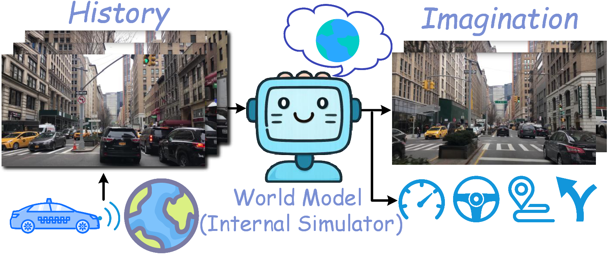
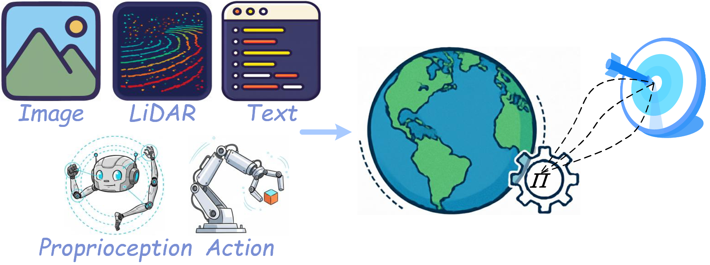
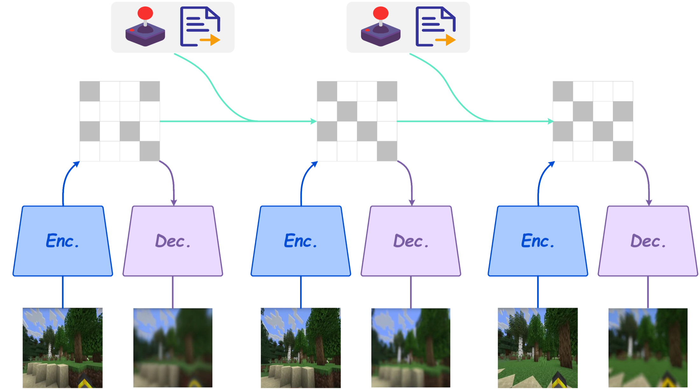
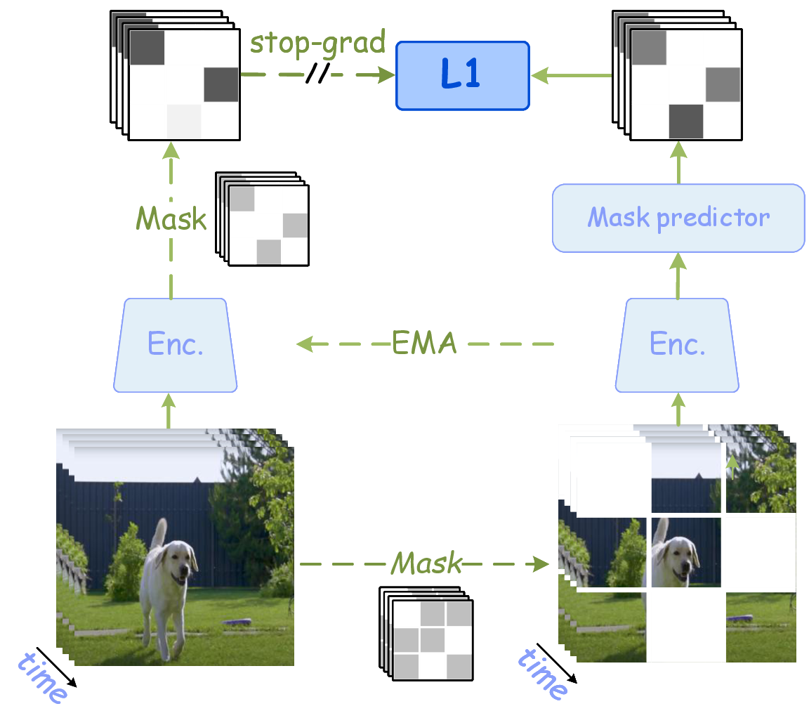
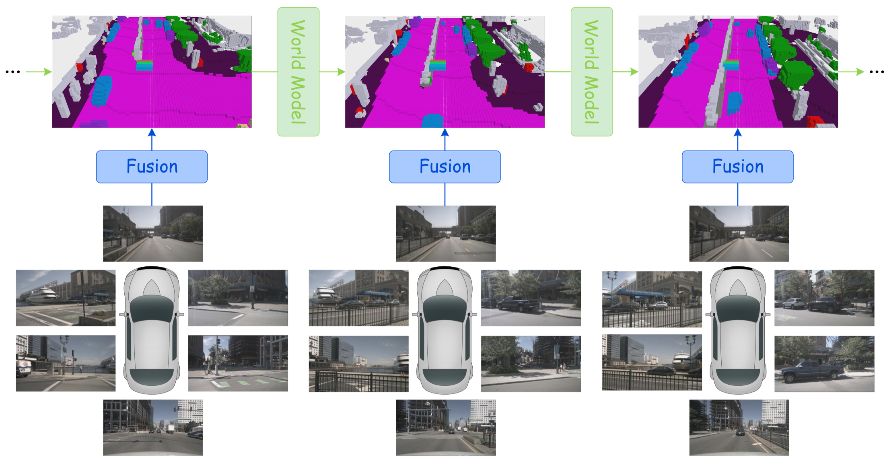

# Embodied World Model Survey：具身世界模型综述

!!! info "论文信息"
    **论文题名：** A Comprehensive Survey on World Models for Embodied AI。 
    **作者：** Xinqing Li、Xin He、Le Zhang、Min Wu、Xiaoli Li、Yun Liu。 
    **机构：** This work was supported in part by the National Natural Science Foundation of China (No. 62576176) and in part by the Fundamental Research Funds for the Central Universities (Nankai University, No. 070-63253235).。 
    **时间 / 主题：** 2025-10；世界模型。 
    **arXiv / 官方报告：** arXiv：[2510.16732](https://arxiv.org/abs/2510.16732)。 
    **GitHub / 项目：** GitHub：[github.com/Li-Zn-H/AwesomeWorldModels](https://github.com/Li-Zn-H/AwesomeWorldModels)。 
    **元数据来源与核验口径：** 来源：[arXiv](https://arxiv.org/abs/2510.16732)；[GitHub API / repo](https://github.com/Li-Zn-H/AwesomeWorldModels)；Checked Date：2026-06-15；Repro Status：Paper / official materials reviewed, independent reproduction not claimed。

## 原论文故事线

### 研究背景

这篇综述面向 embodied AI 的 world models。具身智能中的 agent 不只要识别当前画面，还要在部分可观测环境中维护内部状态、预测动作后果、规划未来、处理空间结构和时间演化。传统强化学习、VLA、视频生成和几何表示各自解决一部分问题，但“world model”这个词在不同论文中含义不一。

综述的背景是把这些路线放在统一坐标系中：世界模型可以是 latent dynamics，可以是可渲染 3D state，可以是视频模拟器，也可以是参与决策的 internal simulator。关键不是模型是否“知道世界知识”，而是它是否把历史观测和动作组织成可预测的未来状态。

### 问题（Challenge）

综述要解决的问题是：**如何系统分类 embodied AI 中的世界模型，并区分它们在决策耦合、时间建模和空间表示上的差异？** 难点在于，这些模型跨越 RL、robotics、video generation、3D scene representation、navigation 和 manipulation；有些直接训练 policy，有些只学 representation，有些生成视觉未来，有些维护 latent belief。

这个问题有价值，因为一个新模型是否适合具身任务，取决于它在这三条轴上的位置：它和决策是否紧耦合，未来是递推 rollout 还是一次性预测，世界状态是向量、token、occupancy、scene graph 还是 3D representation。

### Finding

综述的 finding 是：**具身世界模型可以用三条主轴理解：decision coupling、temporal evolution、spatial representation；这三者共同决定模型是否能从“预测未来”转化为“帮助行动”。** 这个洞见把零散文献整理成可操作分类。

这个 finding 能解决阅读混乱：Dreamer 类模型强在 latent temporal rollout 和 policy coupling；JEPA/V-JEPA 强在 representation prediction，但缺动作闭环；LWM/RingAttention 强在长上下文记忆；LingBot/视频世界模型强在视觉未来模拟；几何/3D 方法强在空间结构和可渲染状态。不同路线不是互相替代，而是覆盖不同轴。

### 方法

综述先用 POMDP 形式化世界模型：agent 只能看到 observation \(o_t\)，执行 action \(a_t\)，需要维护 latent state \(z_t\)。Dynamics prior \(p_\theta(z_t|z_{t-1},a_{t-1})\) 用于未来 rollout；filtered posterior \(q_\phi(z_t|z_{t-1},a_{t-1},o_t)\) 用真实观测校正状态；reconstruction 或 prediction head 让 latent 解释观测或任务信号。

随后论文按 taxonomy 展开：按决策耦合程度区分 model-free-like implicit world model、planning-oriented model、policy-integrated model；按时间建模区分一步预测、多步 rollout、hierarchical temporal abstraction 和 long-horizon memory；按空间表示区分 latent vector、token grid、occupancy / BEV、scene graph、NeRF / Gaussian / 3D representation 等。它还整理数据集、benchmark、评估指标和未来挑战。

### 结论

综述结论是：embodied world models 正在从小型 latent dynamics 走向 foundation-scale、video-based、geometry-aware 和 policy-integrated 系统，但闭环效用、长时稳定性、动作可控性、物理一致性和安全性仍是主要瓶颈。单独的视频生成质量、重建误差或 representation benchmark 都不足以证明具身智能收益。

对本站来说，这篇综述适合作为路线地图：遇到新论文时先问它属于哪条轴，输入输出是什么，预测如何被 policy/planner 使用，评估是否包含真实或模拟闭环。

### 关键术语

- **Embodied AI（具身智能）**：在物理或模拟环境中通过感知和行动完成任务的智能系统。
- **Internal Simulator（内部模拟器）**：在 latent 或显式空间中模拟未来状态，供规划和控制使用的模型。
- **Decision Coupling（决策耦合）**：世界模型与 policy/planner 连接的紧密程度。
- **Temporal Evolution（时间演化）**：模型如何表示状态随时间和动作变化，包括一步、多步、层级和长上下文。
- **Spatial Representation（空间表示）**：世界状态的空间编码方式，如 latent、grid、BEV、scene graph、NeRF 或 3D Gaussian。
- **POMDP（部分可观测马尔可夫决策过程）**：agent 无法直接观察完整状态，只能用历史观测和动作推断 latent state 的决策模型。

这篇论文不是一个新模型，而是一张世界模型文献地图。它最有价值的地方，是把近几年非常混乱的 world model 工作压到三个问题上：**模型和决策耦合得多紧、未来是一步步 rollout 还是整体预测、世界状态到底用向量、token、网格还是可渲染 3D 表示。**

如果你想快速判断一篇新论文的位置，这篇综述比单篇 Dreamer、V-JEPA、LingBot-World 更适合做入口。它不会教你复现某个模型，但会帮你判断：这篇工作证明的是视觉生成能力、状态预测能力、规划收益，还是闭环控制能力。

## 论文位置

站内已有几条世界模型主线：

| 主线 | 代表页面 | 核心问题 |
| --- | --- | --- |
| latent dynamics for control | [PlaNet](planet.md)、[Dreamer](dreamer.md)、[DreamerV3](dreamerv3.md) | 如何从像素交互轨迹学习 latent state，并在想象轨迹里规划或训练 policy |
| representation-space prediction | [JEPA](jepa.md)、[V-JEPA](v-jepa.md)、[H-JEPA](h-jepa.md) | 世界模型是否一定要重建像素，能否只预测高层表征 |
| long-context multimodal world model | [RingAttention](ringattention.md)、[LWM](lwm.md) | 长视频、语言和轨迹 token 如何支撑长期记忆 |
| video world model / external simulator | [Towards Video World Models](towards-video-world-models.md)、[LingBot-World](lingbot-world.md) | 视频生成模型如何变成交互式世界模拟器 |
| world action model | [DreamZero](../embodied-ai/dreamzero.md) | 能否把未来预测和动作预测统一成 zero-shot policy |

这篇综述的作用是把这些路线放进同一个坐标系。它提醒我们不要只问“这个模型是不是 world model”，而要问更具体的三个问题：

1. 它和决策耦合得多紧；
2. 它怎样建模时间；
3. 它怎样表示空间世界状态。

**初学者先抓住。**
世界模型不是“模型知道很多世界知识”。在具身智能里，世界模型更具体：它要把历史观测、动作和隐藏状态组织起来，预测未来状态、未来观测、奖励、风险或终止信号。一个 VLM 能说出“桌上有杯子”不等于它有世界模型；它还要能回答“如果夹爪从右侧推杯子，杯子会不会倒、会不会掉到桌下、任务会不会失败”。

## 总框架

论文 Figure 1 给出整篇 survey 的结构。它先定义 core concepts，再进入三轴 taxonomy，然后整理数据与指标，最后比较性能和开放挑战。

{ width="760" }

<small>图源：`A Comprehensive Survey on World Models for Embodied AI`，Figure 1 子图。原论文图意：world model 作为 internal simulator，把历史观测转化为可用于 imagination、planning 和控制的内部世界状态。</small>

**综述总图用于定位方法，不是证明方法有效。**
**输入输出**：输入是综述 taxonomy、任务类型和方法家族，输出是具身世界模型路线图。
**效率机制**：用分类框架降低阅读和方案选型成本，而非直接降低训练成本。
**对主线意义**：它帮助把 RSSM、视频模拟、几何状态和 VLA 接到同一张地图。
**不能证明什么**：综述图不能证明任何单一方法在真实闭环中有效。

论文把世界模型能力拆成三根柱子：

| Pillar | 中文解释 | 初学者理解 |
| --- | --- | --- |
| Simulation & Planning | 用 learned dynamics 生成未来情景，辅助选择动作 | 先在脑中试几种做法，再选风险更小的一种 |
| Temporal Evolution | 学习状态如何随时间变化 | 不只是识别当前画面，还要知道下一秒会怎样 |
| Spatial Representation | 用合适形式编码空间、几何和对象状态 | 世界要被压缩成模型能算、planner 能用的状态 |

“internal simulator” 的含义是：模型不一定真的运行物理引擎，但它在 latent space 里近似模拟环境动态。这个模拟必须能被下游决策消费。比如自动驾驶里，世界模型预测前车突然刹车后的占用格变化；机器人里，世界模型预测抓取动作后物体是否会滑落；游戏里，世界模型预测按下转向键后视角和场景如何改变。

## 数学定义

论文用 POMDP formalize world model。真实世界状态 \(s_t\) 往往不可完全观测，agent 只能看到 observation \(o_t\)，并执行 action \(a_t\)。所以世界模型要维护一个 learned latent state \(z_t\)，用它近似“当前世界到底处于什么状态”。

论文写出的三个基本分布是：

$$
\begin{array}{ll}
\text{Dynamics Prior:} & p_\theta(z_t \mid z_{t-1}, a_{t-1}) \\
\text{Filtered Posterior:} & q_\phi(z_t \mid z_{t-1}, a_{t-1}, o_t) \\
\text{Reconstruction:} & p_\theta(o_t \mid z_t)
\end{array}
$$

这三个式子可以这样读：

| Component | 它在做什么 | 训练/推理意义 |
| --- | --- | --- |
| Dynamics Prior | 只根据上一 latent state 和上一动作预测当前 latent state | rollout、planning、counterfactual 主要靠它 |
| Filtered Posterior | 看到真实观测后，修正当前 latent state | 训练时把视觉、LiDAR、状态传感器注入 latent |
| Reconstruction | 从 latent state 重建或预测观测 | 让 latent 不变成无意义变量，而是解释真实数据 |

**prior 和 posterior 为什么要分开。**
训练时我们有真实观测 \(o_t\)，所以 posterior \(q_\phi\) 可以看见当前画面并校正 latent；但规划未来时，未来观测还不存在，模型只能用 prior \(p_\theta\) 按动作往前滚。世界模型训练的核心就是让两者对齐：posterior 学会从真实数据读状态，prior 学会在没有真实未来帧时也能预测状态。

论文的 ELBO 视角可以压缩成 reconstruction-regularization paradigm：

| Loss part | 直觉 | 如果做不好会怎样 |
| --- | --- | --- |
| Reconstruction / prediction likelihood | latent 要能解释观测、视频、状态、奖励或 occupancy | latent 可能丢掉任务关键细节，生成未来也不可信 |
| KL regularization | posterior 和 dynamics prior 要对齐 | 训练时看见真实帧很好，推理 rollout 时很快漂移 |
| Action conditioning | latent transition 要依赖动作 | 固定历史下换动作，模型仍生成同一个“平均未来” |
| Long-horizon rollout consistency | 多步预测不能快速崩掉 | 短片段指标好，但规划 horizon 一长就不可用 |

从训练角度看，这个公式提醒我们：世界模型不是单纯重建图片。重建项只保证 latent 能解释当前观测；KL/regularization 才逼迫 transition prior 学会不用未来观测也能往前推。LingBot-World、CausVid、Self Forcing 这类视频世界模型后训练，本质上也在处理训练-推理分布差。

## 三轴 Taxonomy

### 第一轴：Decision-Coupled vs General-Purpose

第一根轴是 functionality：世界模型到底是直接服务某个决策任务，还是先学一个通用世界模拟/预测器。

| Type | 目标 | 典型代表 | 常见风险 |
| --- | --- | --- | --- |
| Decision-Coupled World Models | 预测对任务目标有用的未来状态或结果 | PlaNet、Dreamer、TD-MPC、driving BEV/occupancy models、robot manipulation world models | 任务绑定强，跨域迁移和开放生成能力弱 |
| General-Purpose World Models | 先学习通用动态、视频或表征，再迁移到下游任务 | V-JEPA、Genie、Sora-like video generators、LingBot-World | 视觉质量强不等于动作后果可靠 |

{ width="760" }

<small>图源：`A Comprehensive Survey on World Models for Embodied AI`，Figure 1 子图。原论文图意：Decision-Coupled world model 接收多模态观测和动作，预测对任务目标有用的未来状态或结果。</small>

Decision-coupled 模型和 policy、planner、reward、safety constraint 绑得更紧。它不是为了生成所有可能未来，而是为了让 agent 做得更好。假设厨房里有一个杯子，通用视频模型可能关心“未来画面看起来是否自然”；决策耦合世界模型更关心“如果夹爪从这个角度靠近，杯子是否会被碰倒”。

General-purpose 模型更像 foundation model。它先从大规模视频、多模态数据或交互轨迹中学习通用动态，再迁移到不同任务。优势是迁移和规模，风险是评测容易偏视觉质量。如果只看 FID/FVD/VBench，模型可能很会生成好看视频，却不一定会预测对规划有用的动作后果。

### 第二轴：Sequential Simulation vs Global Difference Prediction

第二根轴是 temporal modeling：模型是一步步展开未来，还是一次性预测整体未来差异。

| Type | 基本形式 | 优点 | 风险 |
| --- | --- | --- | --- |
| Sequential Simulation and Inference | \(z_t \rightarrow z_{t+1} \rightarrow z_{t+2}\) | 和真实交互循环一致，支持在线动作注入，适合 MPC/tree search/actor-critic | 多步 rollout 会累积误差，长 horizon 容易漂移 |
| Global Difference Prediction | \(p(x_{t+1:t+H}\mid x_{\le t}, a_{t:t+H-1}, c)\) | 训练并行度高，整体协调未来，短期视觉一致性强 | 在线交互不自然，临时换动作时不易更新 |

{ width="780" }

<small>图源：`A Comprehensive Survey on World Models for Embodied AI`，Figure 1 子图。原论文图意：Sequential Simulation and Inference 用 recurrent 或 autoregressive 方式逐步更新 latent state，并生成对应观测。</small>

视频世界模型里常见折中是 chunk-wise autoregressive：每次生成一段未来，再把生成结果作为下一段上下文。它比逐帧自回归快，又比整段双向生成更接近因果交互。代价是 chunk 边界和误差累积：第一段稍微偏了，第二段会把偏差当成真实历史继续放大。

{ width="680" }

<small>图源：`A Comprehensive Survey on World Models for Embodied AI`，Figure 1 子图。原论文图意：Masked JEPA 通过 mask target 区域，在 latent space 中预测缺失的时空表示，并用 stop-gradient/EMA target 稳定训练。</small>

Masked JEPA 不要求模型补出每个像素，而是预测被遮挡区域的 latent representation。它更像在学“哪些内容对理解和规划有用”，而不是学“怎样画出高清细节”。这也是 V-JEPA 与视频 diffusion 的关键区别。

### 第三轴：Spatial Representation

第三根轴是空间表示：世界状态到底以什么形式被模型保存和更新。论文分成四类。

| Representation | 代表路线 | 优势 | 不足 |
| --- | --- | --- | --- |
| Global Latent Vector (`GLV`) | PlaNet、Dreamer、DreamerV2/3 | 省计算，适合实时控制和 reward/value/policy head | 空间细节和几何结构不显式 |
| Token Feature Sequence (`TFS`) | Transformer world model、VLM/VLA、LWM、Genie、WorldVLA | 适合多模态融合，可复用 LLM/Transformer 基础设施 | token 太多时 attention 成本高，物理几何含义不一定清楚 |
| Spatial Latent Grid (`SLG`) | BEV、voxel、occupancy、latent map | 对规划器友好，空间位置明确 | 高分辨率网格显存和计算重 |
| Decomposed Rendering Representation (`DRR`) | NeRF、3DGS、4DGS、可微渲染场景 | 视角一致性强，可用于 digital twin 和 novel view | 动态对象、接触物理和大规模更新困难 |

{ width="760" }

<small>图源：`A Comprehensive Survey on World Models for Embodied AI`，Figure 1 子图。原论文图意：Spatial Latent Grid 用 BEV、voxel、occupancy 或几何对齐 latent grid 表示世界，并在网格上做预测、融合和生成。</small>

自动驾驶特别偏爱 BEV / occupancy，因为规划最后要回答“这条轨迹会不会撞、能不能走、离车道线多远”。RGB 视频能展示未来画面，但 planner 更需要空间状态。视频看起来再真实，如果不能告诉你 2 秒后哪个 voxel 被车占据，对安全规划帮助就有限。

## 三轴合起来怎么读论文

这篇 survey 的三轴可以组合成一个实用判断表。

| 组合 | 常见代表 | 适合任务 | 主要风险 |
| --- | --- | --- | --- |
| Dec / Seq / GLV | PlaNet、Dreamer、DreamerV3 | pixel control、DMC、Atari、连续控制 | 几何细节弱，开放视觉模拟不足 |
| Dec / Seq / TFS | IRIS、TWM、WorldVLA、tokenized VLA | 多模态控制、语言条件策略、机器人轨迹 | token 成本高，动作后果对齐困难 |
| Dec / Seq / SLG | DriveWorld、OccWorld、DINO-WM | 自动驾驶、BEV/occupancy planning | 数据和几何标定要求高 |
| Dec / Seq / DRR | ManiGaussian、DreMa、GAF | 机器人操作、digital twin、sim2real | 物体分解和动态更新难 |
| Gen / Seq / TFS | Genie、iVideoGPT、LingBot-World 类路线 | 交互世界生成、视频 rollout | 长时漂移、实时延迟、物理一致性 |
| Gen / Glo / TFS | V-JEPA、Sora-like、MaskGWM | 大规模视频预训练、representation learning | 闭环决策接口弱 |
| Gen / Glo / SLG | DynamicCity、OccSora、AETHER | 驾驶场景生成、4D occupancy | 算力大，实时交互难 |
| Gen / Seq / DRR | GaussianWorld、InfiniCube | 大规模 3D/4D 场景生成 | 可扩展性和真实动态仍难 |

看到一篇 world model 新论文，可以先不要急着看 benchmark。先问：它是 `Dec` 还是 `Gen`？是 `Seq` 还是 `Glo`？状态是 `GLV`、`TFS`、`SLG` 还是 `DRR`？这三个答案能迅速告诉你它的能力边界。比如 `Gen/Glo/TFS` 很可能生成质量强但闭环弱；`Dec/Seq/GLV` 很可能控制效率高但几何表达弱；`Dec/Seq/SLG` 很可能适合自动驾驶规划，但不一定能生成漂亮视频。

## 原论文大表怎么读

论文 Table 1 和 Table 2 很大，分别整理 robotics/general-purpose 与 autonomous driving domain 的代表工作。它们更适合当检索地图，不适合逐行背诵。阅读时抓三件事就够：

| 表格线索 | 读法 |
| --- | --- |
| `Taxonomy` | 先把方法放到 `Dec/Gen`、`Seq/Glo`、`GLV/TFS/SLG/DRR` 坐标里 |
| `Characteristics` | 看主干是假设 RSSM、Transformer、JEPA、Video Diffusion、3DGS 还是 occupancy forecasting |
| `Datasets Platform / Modality` | 判断它学到的是被动视频统计、动作条件动态、几何状态，还是 reward/termination |

典型例子：

| Paper family | Taxonomy | 快速判断 |
| --- | --- | --- |
| PlaNet / Dreamer | `Dec/Seq/GLV` | 强控制、低成本，但几何和开放视觉模拟有限 |
| V-JEPA | `Gen/Glo/TFS` | 强表征学习，但还缺动作、reward 和闭环接口 |
| Genie / LingBot-World | `Gen/Seq/TFS` | 更接近可交互视频世界，但要盯长时漂移和动作敏感性 |
| OccWorld / DriveWorld | `Dec/Seq/SLG` 或 `Dec/Glo/SLG` | 更适合自动驾驶规划，因为状态能被 planner 消费 |
| ManiGaussian / GaussianWorld | `Dec/Seq/DRR` 或 `Gen/Seq/DRR` | 几何和可渲染性强，但动态更新与大规模泛化更难 |

自动驾驶为什么单独成表？因为它对空间表示特别敏感。RGB 视频能展示未来画面，但 planner 更需要 BEV、occupancy、轨迹、地图和碰撞风险。因此自动驾驶表里 `SLG` 和 `DRR` 比例很高。读自动驾驶 world model 时，不能只看视频生成质量，还要看预测出来的状态能否被规划器消费。

## 数据、评测与性能证据

原论文把数据资源分成四类：Simulation Platforms、Interactive Benchmarks、Offline Datasets、Real-world Robot Platforms。比记住名字更重要的是看每个数据源提供什么监督信号。

| Data source type | 代表 | 提供什么信号 | 更适合训练什么 |
| --- | --- | --- | --- |
| Simulation Platforms | MuJoCo、CARLA、Habitat、Isaac Lab | 可控状态、动作、传感器、reward 或 task protocol | model-based RL、navigation、driving、robot learning |
| Interactive Benchmarks | Atari、DMC、Meta-World、RLBench、LIBERO | 标准任务、成功条件、动作接口 | 闭环控制和策略评测 |
| Offline Datasets | SSv2、nuScenes、Waymo、RT-1、Occ3D、OXE、OpenDV、VideoMix22M | 被动视频、多传感器轨迹、机器人示范、occupancy 或语言条件 | 表征预训练、action-conditioned modeling、BEV/occupancy prediction |
| Real-world Robot Platforms | Franka、Unitree Go1/G1 等 | 真实硬件动作、proprioception、视觉和接触限制 | sim2real、操作策略、恢复与安全评估 |

数据决定模型能学到哪种因果关系。只有被动视频时，模型主要学“未来看起来像什么”；有动作轨迹时，才有机会学“动作如何改变未来”；有 reward/success/collision 时，才更容易把预测接到决策质量。

评测也要分层看：

| Metric layer | 常见指标 | 它回答什么 | 局限 |
| --- | --- | --- | --- |
| Pixel Generation Quality | FID、FVD、SSIM、PSNR、LPIPS、VBench | 图像或视频是否像真实数据 | 不等价于物理正确、动作敏感和任务成功 |
| State-level Understanding | mIoU、mAP、ADE/FDE/L2、Chamfer Distance | 语义、occupancy、轨迹或几何是否预测准 | 仍可能和最终控制收益脱节 |
| Task Performance | Success Rate、Reward/Return、Sample Efficiency、Collision Rate | 模型是否改善任务完成、数据效率或安全性 | 评测协议差异大，跨论文比较要谨慎 |

**为什么 FVD 高不等于世界模型强。**
FVD 只说明生成视频在特征分布上像真实视频。它不能告诉你固定同一历史、换一个动作时未来是否合理分叉，也不能告诉你 planner 用这些未来预测后是否更安全。世界模型最终要用任务层指标收口：任务成功率、碰撞率、return、sample efficiency、long-horizon consistency。像素指标只是第一层体检。

原论文的性能表支持几个方向性结论：

| Evidence table | 主要信息 | 更稳的读法 |
| --- | --- | --- |
| Pixel Generation on nuScenes | driving video generation 的 FID/FVD 已经快速进步 | 视觉质量提升不直接证明驾驶决策更安全，要继续看 planning 和 occupancy |
| 4D Occupancy Forecasting on Occ3D-nuScenes | 有 occupancy 输入或辅助监督的方法通常更稳，远 horizon 更难 | 当前重建不等于长期预测，3s horizon 才更暴露动态误差 |
| Control on DMC | Dreamer 系 latent dynamics + imagined rollout 有很强样本效率 | 不同论文任务数和 step budget 不一致，不能只看平均分 |
| Manipulation on RLBench | 深度、proprioception、语言和 3D 表示会影响操作成功率 | 机器人操作不是纯视觉续写，动作接口和对象几何同样关键 |
| Planning on nuScenes | L2 error 和 collision rate 更接近“是否对决策有用” | 一个模型如果视频好看但 collision 不改善，很难说是好的决策世界模型 |

## 训练细节：不同路线在优化什么

这篇 survey 是综述，不给出某一个模型的完整训练 recipe，但它把训练目标拆得很清楚。不同世界模型其实在优化不同层次的预测。

| Route | 主要监督信号 | 训练目标 | 关键风险 |
| --- | --- | --- | --- |
| RSSM / Dreamer-style | observation、action、reward、discount | reconstruction + reward prediction + KL alignment + imagined actor-critic | latent 是否保留任务关键变量 |
| Token world model | visual tokens、action tokens、language tokens、trajectory tokens | next-token prediction、masked prediction、sequence modeling | token 成本和动作后果对齐 |
| JEPA-style | masked target latent、EMA target encoder | latent prediction without pixel reconstruction | 表征是否足够可控、可规划 |
| Video diffusion world model | video latent、condition、action/camera/text | denoising、flow matching、action-conditioned generation | 动作是否真的影响未来、是否 causal |
| Occupancy / BEV world model | BEV、voxel、ego trajectory、map、LiDAR/camera | future occupancy / BEV forecasting | 远 horizon 衰减和 geometry consistency |
| 3DGS / NeRF world model | multi-view images、camera pose、3D primitives、actions | renderable scene reconstruction and update | 动态对象、接触和大规模场景更新 |

**训练路线怎么选。**
如果目标是机器人控制，先问是否需要高清未来画面。很多时候不需要，latent dynamics 或 token policy 就够。若目标是自动驾驶规划，BEV/occupancy 可能比 RGB 视频更有用。若目标是交互式模拟器或数据生成，视频/3D 可渲染路线才更重要。训练目标必须服务最终接口，不能因为视频模型好看就默认它适合所有世界模型任务。

## 和站内其他论文的连接

这篇综述可以作为世界模型专题的索引页使用：

| 想深入的问题 | 先读哪篇专题 | 和本综述的连接 |
| --- | --- | --- |
| latent state 如何学 | [PlaNet](planet.md) | `Dec/Seq/GLV` 的早期代表 |
| world model 如何训练 policy | [Dreamer](dreamer.md)、[DreamerV3](dreamerv3.md) | imagined rollout、reward/value、actor-critic |
| 不重建像素是否可行 | [JEPA](jepa.md)、[V-JEPA](v-jepa.md) | `Gen/Glo/TFS` 和 masked representation prediction |
| 长上下文如何支持视频世界模型 | [RingAttention](ringattention.md)、[LWM](lwm.md) | token sequence 和 million-length context |
| 视频生成如何成为交互模拟 | [Towards Video World Models](towards-video-world-models.md)、[LingBot-World](lingbot-world.md) | causal、interactive、persistent、real-time |
| 动作和未来能否统一建模 | [DreamZero](../embodied-ai/dreamzero.md) | world action model，把动作预测和未来预测接到 policy |

如果你还没有世界模型基础，建议先读本页的数学定义和 taxonomy，再读 PlaNet/Dreamer 理解 latent dynamics，然后读 V-JEPA 理解 latent prediction，最后读 LingBot-World 和 DreamZero 看视频生成、动作条件和机器人策略如何合流。这样不会把“会生成视频”和“能支持决策”混在一起。

## 开放挑战

论文最后把挑战分成三类：Data & Evaluation、Computational Efficiency、Modeling Strategy。

| Challenge group | 具体表现 | 可能方向 |
| --- | --- | --- |
| Data & Evaluation | 机器人、驾驶、导航、视频预训练、仿真平台格式分裂；大量互联网视频没有动作；像素指标不足 | cross-domain trajectory dataset、latent action learning、counterfactual / closed-loop metrics |
| Computational Efficiency | Transformer 和 diffusion 强但重，实时控制和多候选 planning 会放大延迟 | KV cache、SSM、few-step distillation、hierarchical memory、selective rendering |
| Modeling Strategy | autoregressive 易漂移，global prediction 闭环弱；向量省但几何弱，3D/4D 强但贵 | hybrid latent + grid + renderable representation、self-rollout loss、action intervention tests |

世界模型长期难点是 temporal consistency 和 spatial fidelity 的取舍。Autoregressive 适合交互，但误差累积；global prediction 整体一致，但闭环动作注入弱。Latent vector 高效但几何弱；3D/4D representation 几何强但昂贵。

## 综述型论文的证据边界

这篇综述没有自己的新模型消融，因此不能按“去掉模块 A 分数下降”来读。更合适的读法是把它当作跨论文证据地图，检查每条路线缺的是哪类证据。

| Route | 已有证据通常强在哪里 | 最常缺的证据 | 读者应追问 |
| --- | --- | --- | --- |
| RSSM / Dreamer-style | 控制 benchmark、sample efficiency、ablation | 高分辨率几何、真实机器人开放任务 | latent 里是否保留了任务关键空间变量 |
| JEPA / representation world model | frozen representation、迁移任务 | 动作条件、reward、closed-loop planning | 表征是否能支持反事实动作预测 |
| Video diffusion world model | 视觉质量、长视频 demo、用户偏好 | 动作敏感性、因果 rollout、物理 stress test | 固定历史换动作，未来是否真的分叉 |
| BEV / occupancy world model | 驾驶规划、collision、occupancy forecast | 开放域泛化、罕见事件、sim2real | planner 使用后是否降低风险 |
| 3DGS / renderable world model | novel view、几何一致性、digital twin | 动态接触、可扩展更新、任务收益 | 渲染一致是否真的转成控制收益 |

因此，这篇综述最有价值的不是告诉你“哪条路线最好”，而是避免证据错配：视频指标不能替代 closed-loop success，occupancy 指标不能替代真实安全，representation probe 不能替代动作反事实。读者用它筛论文时，应该先标注每篇工作的证据类型，再决定能不能进入项目实验。

## 阅读结论

第一，世界模型不是单一路线。Dreamer、V-JEPA、Genie、LingBot-World、BEV occupancy model、3DGS simulator 都可以是 world model，但它们服务的接口不同。

第二，taxonomy 比模型名更重要。`Decision-Coupled / General-Purpose`、`Sequential / Global`、`GLV / TFS / SLG / DRR` 这三组标签能快速判断一篇论文的能力边界。

第三，训练目标必须和使用场景对齐。控制任务要 reward、termination、action-conditioned dynamics；驾驶规划要 occupancy、trajectory、collision；交互模拟器要 causal rollout、long memory、few-step generation；通用表征要 scalable self-supervision。

第四，评测要从像素走向任务。FID/FVD/VBench 可以说明视频质量，但世界模型最终要证明自己能改善 planning、policy learning、risk prediction、data generation 或 closed-loop success。

最后，如果把世界模型放回具身智能主线，可以用一句话总结：

> 世界模型的价值不是“想象未来”本身，而是把动作条件下的未来后果变成可被智能体用来规划、控制、恢复和自我改进的信号。

## 相关阅读与下一步

- 外部材料：[论文标题 arXiv 检索](https://arxiv.org/search/?query=A+Comprehensive+Survey+on+World+Models+for+Embodied+AI&searchtype=title)。
- 外部材料：[Semantic Scholar 标题检索](https://www.semanticscholar.org/search?q=A+Comprehensive+Survey+on+World+Models+for+Embodied+AI)。
- 外部材料：[Papers with Code 检索](https://paperswithcode.com/search?q=A+Comprehensive+Survey+on+World+Models+for+Embodied+AI)。
- 站内下一步：[论文精读专题](../index.md)。
- 站内下一步：[论文专题写作规范](../writing-standard.md)。
- 站内下一步：[外部精读来源台账](../../references/external-reading-ledger.md)。
