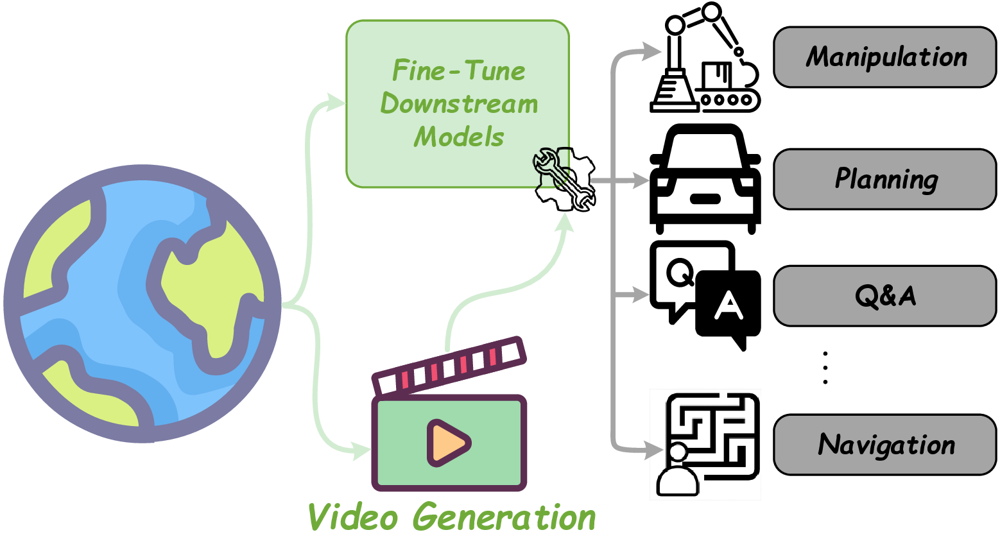
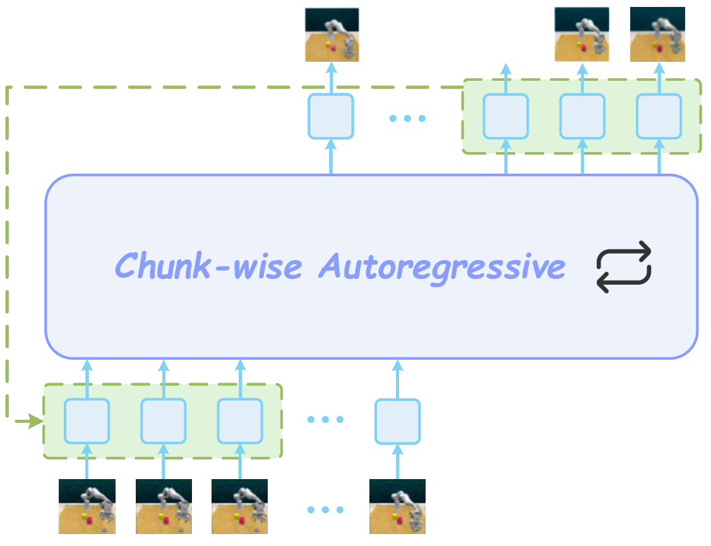
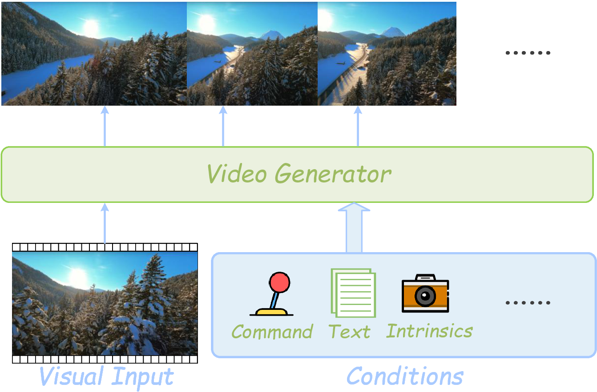
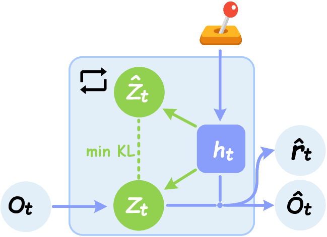
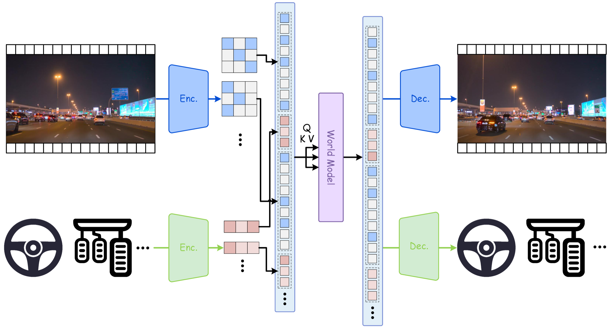
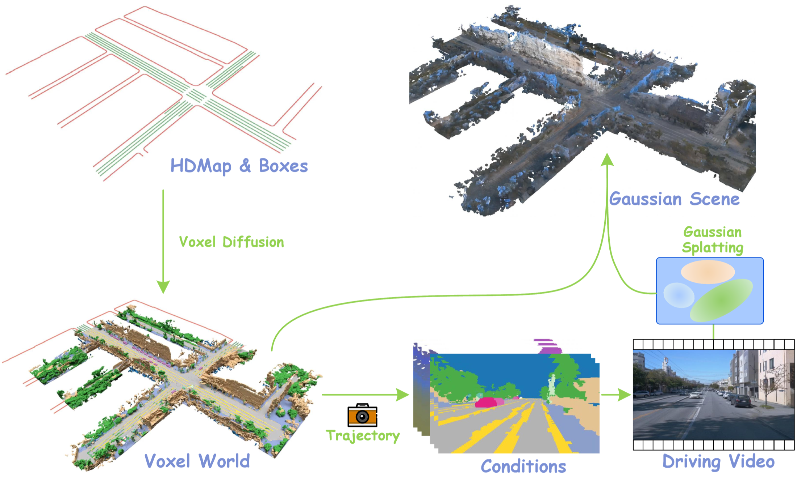

# A Comprehensive Survey on World Models for Embodied AI：具身世界模型综述

!!! info "论文信息"
    - 论文：`A Comprehensive Survey on World Models for Embodied AI`
    - 链接：[arXiv:2510.16732](https://arxiv.org/abs/2510.16732)
    - 作者：`Xinqing Li, Xin He, Le Zhang, Min Wu, Xiaoli Li, Yun Liu`
    - 资源：[AwesomeWorldModels](https://github.com/Li-Zn-H/AwesomeWorldModels)
    - 关键词：world model、embodied AI、POMDP、taxonomy、temporal modeling、spatial representation、robotics、autonomous driving、video world model

这篇论文不是一个新模型，而是一篇面向具身智能的世界模型综述。它最有价值的地方，是把近几年非常混乱的 world model 文献整理成一张可读的地图：**世界模型到底服务决策还是服务通用模拟、未来是一步步 rollout 还是整体预测、世界状态到底压成向量、token、网格还是可渲染 3D 表示。**

如果你想通过一篇文章建立世界模型全貌，这篇综述比单篇 Dreamer、V-JEPA、LingBot-World 更适合做地图入口。它不会告诉你某个模型的实现细节怎么写，但会帮你判断一篇新论文应该放在哪条路线里，以及它的训练目标、数据资源和评测指标到底在证明什么。

## 论文位置

站内已有几条世界模型主线：

| 主线 | 代表页面 | 核心问题 |
| --- | --- | --- |
| latent dynamics for control | [PlaNet](planet.md)、[Dreamer](dreamer.md)、[DreamerV3](dreamerv3.md) | 如何从像素交互轨迹学习 latent state，并在想象轨迹里规划或训练 policy |
| representation-space prediction | [JEPA](jepa.md)、[V-JEPA](v-jepa.md)、[H-JEPA](h-jepa.md) | 世界模型是否一定要重建像素，能否只预测高层表征 |
| long-context multimodal world model | [RingAttention](ringattention.md)、[LWM](lwm.md) | 长视频、语言和轨迹 token 如何支撑长期记忆 |
| video world model / external simulator | [Towards Video World Models](towards-video-world-models.md)、[LingBot-World](lingbot-world.md) | 视频生成模型如何变成交互式世界模拟器 |
| world action model | [DreamZero](dreamzero.md) | 能否把未来预测和动作预测统一成 zero-shot policy |

这篇 survey 的作用是把这些路线放进一个统一坐标系。它提醒我们不要只问“这个模型是不是 world model”，而要问更具体的三个问题：

1. 它和决策耦合得多紧；
2. 它怎样建模时间；
3. 它怎样表示空间世界状态。

!!! note "初学者先抓住"
    世界模型不是“模型知道很多世界知识”。在具身智能里，世界模型更具体：它要把历史观测、动作和隐藏状态组织起来，预测未来状态、未来观测、奖励、风险或终止信号。一个 VLM 能说出“桌上有杯子”不等于它有世界模型；它还要能回答“如果夹爪从右侧推杯子，杯子会不会倒、会不会掉到桌下、任务会不会失败”。

## 这篇综述的总框架

论文 Figure 1 给出整篇 survey 的结构。它先定义 core concepts，再进入三轴 taxonomy，然后整理数据与指标，最后比较性能和开放挑战。

{ width="860" }

<small>图源：`A Comprehensive Survey on World Models for Embodied AI`，Figure 1 子图。原论文图意：world model 作为 internal simulator，把历史观测转化为可用于 imagination、planning 和控制的内部世界状态。</small>

!!! note "图解：为什么叫 internal simulator"
    这张图的重点不是中间的卡通形象，而是左右两侧的转换关系。左侧是历史观测：比如过去几秒的驾驶画面、机器人相机帧、LiDAR、语言目标和动作记录。右侧是 imagination：模型内部推演未来可能发生什么。

    “internal simulator” 的含义是：模型不一定真的运行物理引擎，但它在 latent space 里近似模拟环境动态。这个模拟必须能被下游决策消费。比如自动驾驶里，世界模型预测前车突然刹车后的占用格变化；机器人里，世界模型预测抓取动作后物体是否会滑落；游戏里，世界模型预测按下转向键后视角和场景如何改变。

论文把世界模型能力拆成三根柱子：

| Pillar | 中文解释 | 初学者理解 |
| --- | --- | --- |
| Simulation & Planning | 用 learned dynamics 生成未来情景，辅助选择动作 | 先在脑中试几种做法，再选风险更小的一种 |
| Temporal Evolution | 学习状态如何随时间变化 | 不只是识别当前画面，还要知道下一秒会怎样 |
| Spatial Representation | 用合适形式编码空间、几何和对象状态 | 世界要被压缩成模型能算、planner 能用的状态 |

## 数学定义：从 POMDP 到世界模型训练

论文用 POMDP 来 formalize world model。POMDP 的直觉很简单：真实世界状态 \(s_t\) 往往不可完全观测，agent 只能看到 observation \(o_t\)，并执行 action \(a_t\)。所以世界模型要维护一个 learned latent state \(z_t\)，用它近似“当前世界到底处于什么状态”。

论文写出的三个基本分布是：

$$
\begin{array}{ll}
\text{Dynamics Prior:} & p_\theta(z_t \mid z_{t-1}, a_{t-1}) \\
\text{Filtered Posterior:} & q_\phi(z_t \mid z_{t-1}, a_{t-1}, o_t) \\
\text{Reconstruction:} & p_\theta(o_t \mid z_t)
\end{array}
$$

这三个式子可以这样读：

| Component | 它在做什么 | 训练/推理意义 |
| --- | --- | --- |
| Dynamics Prior | 只根据上一 latent state 和上一动作预测当前 latent state | rollout、planning、counterfactual 主要靠它 |
| Filtered Posterior | 看到真实观测后，修正当前 latent state | 训练时把视觉、LiDAR、状态传感器注入 latent |
| Reconstruction | 从 latent state 重建或预测观测 | 让 latent 不变成无意义变量，而是解释真实数据 |

!!! note "难点解释：prior 和 posterior 为什么要分开"
    训练时我们有真实观测 \(o_t\)，所以可以用 posterior \(q_\phi\) 看见当前画面并校正 latent；但规划未来时，未来观测还不存在，模型只能用 prior \(p_\theta\) 按动作往前滚。世界模型训练的核心就是让这两者对齐：posterior 学会从真实数据读状态，prior 学会在没有真实未来帧时也能预测状态。

    Dreamer/RSSM 这类模型里的 `representation model` 和 `transition model`，本质上就是这组结构。视频世界模型也类似，只是 observation 可能变成视频 latent、BEV grid、occupancy、3D Gaussian 或 token 序列。

在这个设定下，观测和 latent 的联合分布可以写成：

$$
p_\theta(o_{1:T}, z_{0:T} \mid a_{0:T-1})
= p_\theta(z_0)\prod_{t=1}^{T}
p_\theta(z_t \mid z_{t-1}, a_{t-1})p_\theta(o_t \mid z_t).
$$

推断 latent 的近似 posterior 是：

$$
q_\phi(z_{0:T}\mid o_{1:T}, a_{0:T-1})
= q_\phi(z_0\mid o_1)\prod_{t=1}^{T}
q_\phi(z_t\mid z_{t-1}, a_{t-1}, o_t).
$$

直接最大化 \(\log p_\theta(o_{1:T}\mid a_{0:T-1})\) 很难，所以论文采用 ELBO 视角。化简后，可以理解成：

$$
\mathcal{L}(\theta,\phi)
= \sum_{t=1}^{T}\mathbb{E}_{q_\phi(z_t)}
\big[\log p_\theta(o_t\mid z_t)\big]
- D_{\mathrm{KL}}\big(q_\phi(z_{0:T}\mid o_{1:T},a_{0:T-1})
\|p_\theta(z_{0:T}\mid a_{0:T-1})\big).
$$

这就是常说的 reconstruction-regularization paradigm：

| Loss part | 直觉 | 如果做不好会怎样 |
| --- | --- | --- |
| Reconstruction / prediction likelihood | latent 要能解释观测、视频、状态、奖励或 occupancy | latent 可能丢掉任务关键细节，生成未来也不可信 |
| KL regularization | posterior 和 dynamics prior 要对齐 | 训练时看见真实帧很好，推理 rollout 时很快漂移 |
| Action conditioning | latent transition 要依赖动作 | 固定历史下换动作，模型仍生成同一个“平均未来” |
| Long-horizon rollout consistency | 多步预测不能快速崩掉 | 短片段指标好，但规划 horizon 一长就不可用 |

!!! note "从训练角度看，这个公式在提醒什么"
    世界模型训练不是单纯重建图片。重建项只保证 latent 能解释当前观测；KL/regularization 才逼迫 transition prior 学会不用未来观测也能往前推。如果你的模型只做 teacher-forced next-frame prediction，推理时不断吃自己生成的历史，就容易出现 exposure bias 和误差累积。LingBot-World、CausVid、Self Forcing 这类视频世界模型后训练，本质上也在处理这个训练-推理分布差。

## Taxonomy 第一轴：Decision-Coupled vs General-Purpose

论文第一根轴是 functionality：世界模型到底是直接服务某个决策任务，还是先学一个通用世界模拟/预测器。

{ width="860" }

<small>图源：`A Comprehensive Survey on World Models for Embodied AI`，Figure 1 子图。原论文图意：Decision-Coupled world model 接收多模态观测和动作，预测对任务目标有用的未来状态或结果。</small>

### Decision-Coupled World Models

Decision-coupled 模型和 policy、planner、reward、safety constraint 绑得更紧。它不是为了生成所有可能未来，而是为了让 agent 做得更好。

典型例子：

| Method family | 预测什么 | 如何服务决策 |
| --- | --- | --- |
| PlaNet / Dreamer / DreamerV3 | latent state、reward、discount/continuation | 在 latent imagination 里做 MPC 或 actor-critic |
| TD-MPC / TD-MPC2 | decoder-free latent dynamics、value | 用 latent rollout 支撑 continuous control |
| driving BEV / occupancy world models | future BEV、occupancy、trajectory risk | 给自动驾驶 planner 提供候选轨迹评估 |
| robot manipulation world models | object state、point cloud、future scene、action outcome | 比较抓取、推、拉、放置等候选动作 |

!!! note "有趣例子：为什么同样是预测未来，任务不同答案也不同"
    假设厨房里有一个杯子。通用视频模型可能关心“未来画面看起来是否自然”；决策耦合世界模型更关心“如果夹爪从这个角度靠近，杯子是否会被碰倒”。前者预测的是视觉合理性，后者预测的是对动作选择有用的后果。

{ width="860" }

<small>图源：`A Comprehensive Survey on World Models for Embodied AI`，Figure 1 子图。原论文图意：General-Purpose world model 更像通用预测器或生成器，预训练后可迁移到 manipulation、planning、Q&A、navigation 等多个下游任务。</small>

### General-Purpose World Models

General-purpose 模型更像 foundation model。它先从大规模视频、多模态数据或交互轨迹中学习通用动态，再迁移到不同任务。

典型例子：

| Method family | 先学什么 | 到决策还缺什么 |
| --- | --- | --- |
| V-JEPA / JEPA | latent representation prediction | 需要动作条件、reward、planner 接口 |
| Sora-like video generators | large-scale spacetime generation | 需要 causal、interactive、physical consistency 验证 |
| Genie / Genie-like interactive environments | latent action、可控视频环境 | 需要更强任务奖励和真实闭环验证 |
| LingBot-World | action-conditioned interactive video simulator | 需要证明生成未来能稳定提升真实 agent performance |

general-purpose 的优势是迁移和规模，风险是评测容易偏视觉质量。如果只看 FID/FVD/VBench，模型可能很会生成好看视频，却不一定会预测对规划有用的动作后果。

## Taxonomy 第二轴：Sequential Simulation vs Global Difference Prediction

第二根轴是 temporal modeling：模型是一步步展开未来，还是一次性预测整体未来差异。

{ width="900" }

<small>图源：`A Comprehensive Survey on World Models for Embodied AI`，Figure 1 子图。原论文图意：Sequential Simulation and Inference 用 recurrent 或 autoregressive 方式逐步更新 latent state，并生成对应观测。</small>

### Sequential Simulation and Inference

Sequential route 的基本形式是：

$$
z_t \rightarrow z_{t+1} \rightarrow z_{t+2} \rightarrow \cdots
$$

每一步都根据当前 state 和 action 预测下一步 state。它非常适合 closed-loop control，因为 agent 可以在每一步重新观察、重新规划、重新选择动作。

| 优点 | 风险 |
| --- | --- |
| 和真实交互循环一致 | 多步 rollout 会累积误差 |
| 支持在线动作注入 | 训练和推理分布可能不一致 |
| 可配合 MPC、tree search、actor-critic | 长 horizon 可能漂移或模糊 |
| 对实时控制更自然 | 每步都调用模型，延迟和稳定性很关键 |

论文还把 autoregressive chunk 作为一类重要形式：

{ width="700" }

<small>图源：`A Comprehensive Survey on World Models for Embodied AI`，Figure 1 子图。原论文图意：chunk-wise autoregressive 方法每次生成一段未来，再把生成结果作为下一段的上下文。</small>

!!! note "图解：chunk-wise autoregressive 为什么适合视频世界模型"
    逐帧自回归太慢，整段双向生成又不够因果。chunk-wise autoregressive 折中处理：每次生成一个小视频块，下一块再接着生成。这样可以保留视频模型的并行生成能力，同时让系统按时间向前推进。

    代价是 chunk 边界和误差累积。生成第一段稍微偏了，第二段会把这个偏差当成真实历史继续放大。所以 Self Forcing、CausVid、LingBot-World 里反复出现 causalization、KV cache、self-rollout、few-step distillation，本质上都在解决“生成模型如何稳定跑成流式世界模型”。

{ width="820" }

<small>图源：`A Comprehensive Survey on World Models for Embodied AI`，Figure 1 子图。原论文图意：Global Difference Prediction 直接从条件输入预测整个未来视频或状态差异。</small>

### Global Difference Prediction

Global route 不强调一步一步滚，而是直接预测一段未来：

$$
p(x_{t+1:t+H}\mid x_{\le t}, a_{t:t+H-1}, c).
$$

它在视频生成、masked prediction、diffusion、JEPA、BEV/occupancy 并行预测中很常见。

| 优点 | 风险 |
| --- | --- |
| 可以整体协调未来，短期视觉一致性强 | 在线交互不如 sequential route 自然 |
| 训练并行度高 | 未来动作临时改变时不易更新 |
| 少一些逐步误差传播 | 对 causal 和 counterfactual 要额外设计 |
| 适合 masked modeling 和 diffusion | 可能更重计算、更难实时 |

{ width="720" }

<small>图源：`A Comprehensive Survey on World Models for Embodied AI`，Figure 1 子图。原论文图意：Masked JEPA 通过 mask target 区域，在 latent space 中预测缺失的时空表示，并用 stop-gradient/EMA target 稳定训练。</small>

!!! note "图解：Masked JEPA 和视频生成路线有什么不同"
    Masked JEPA 不要求模型补出每个像素，而是预测被遮挡区域的 latent representation。它更像在学“哪些内容对理解未来有用”，而不是学“怎样画出高清细节”。这也是 V-JEPA 与视频 diffusion 的区别：V-JEPA 更靠近 internal representation world model，视频 diffusion 更靠近 external simulator。

    对具身智能来说，二者都重要。策略和规划未必需要高清像素，但交互仿真、数据生成和人类检查常常需要可见未来。长期方向可能是把 representation prediction 的抽象性和 generative simulation 的可视化能力结合起来。

## Taxonomy 第三轴：Spatial Representation

第三根轴是空间表示：世界状态到底以什么形式被模型保存和更新。论文分成四类。

### Global Latent Vector

{ width="430" }

<small>图源：`A Comprehensive Survey on World Models for Embodied AI`，Figure 1 子图。原论文图意：Global Latent Vector 用紧凑 latent state 表示世界，并通过 dynamics 和 reconstruction head 支持预测。</small>

Global latent vector 是 PlaNet、Dreamer、DreamerV2、DreamerV3 这条线的典型表示。它把高维观测压成一个紧凑向量或向量集合，再用 recurrent state-space model 更新。

| 优势 | 不足 |
| --- | --- |
| 很省计算，适合实时控制和真实机器人 | 空间细节和几何结构不显式 |
| 容易接 reward/value/policy head | 对遮挡、对象身份、复杂 3D 关系可能吃力 |
| 在 low-dimensional control 和 Atari/DMC 中很强 | 对开放世界视频模拟不够细 |

!!! note "初学者例子：latent vector 像一句压缩摘要"
    你看完一段视频后，可以用一句话记住“机器人在桌前，红杯在右侧，夹爪打开”。这很省，但细节丢了。Global latent vector 也是这样：它适合快速决策，但如果任务需要精确几何、遮挡关系或多视角渲染，就可能不够。

### Token Feature Sequence

{ width="920" }

<small>图源：`A Comprehensive Survey on World Models for Embodied AI`，Figure 1 子图。原论文图意：Token Feature Sequence 把图像、动作、轨迹、文本等转为 token 序列，用世界模型建模跨模态依赖。</small>

Token feature sequence 是 Transformer world model、VLM/VLA、LWM、DrivingGPT、Genie、WorldVLA 等方向的共同语言。它把图像 patch、视频 latent、动作、语言、轨迹、地图、传感器状态都变成 token。

| 优势 | 不足 |
| --- | --- |
| 很适合多模态融合 | token 太多时 attention 成本高 |
| 可以复用 LLM/Transformer 基础设施 | 状态是否有物理几何含义不一定清楚 |
| 支持 next-token prediction、masked modeling、instruction conditioning | 长 horizon 容易受上下文长度和缓存影响 |
| 方便连接 VLM、VLA 和世界模型 | 动作 token 如果没有和后果对齐，可能只是表面条件 |

这类表示最容易连接到站内 VLM/VLA 主线。VLM 先学视觉和语言对齐，VLA 把视觉语言状态接到动作，token world model 再把状态、动作和未来组织成可预测序列。

### Spatial Latent Grid

{ width="920" }

<small>图源：`A Comprehensive Survey on World Models for Embodied AI`，Figure 1 子图。原论文图意：Spatial Latent Grid 用 BEV、voxel、occupancy 或几何对齐 latent grid 表示世界，并在网格上做预测、融合和生成。</small>

Spatial latent grid 常见于自动驾驶、室内导航和几何密集任务。它不是把世界压成一个向量，而是保留空间格子结构，例如 BEV grid、voxel grid、4D occupancy、latent map。

| 优势 | 不足 |
| --- | --- |
| 对规划器友好，空间位置明确 | 网格分辨率越高，显存和计算越重 |
| 容易表达道路、障碍、可行驶区域、占用状态 | 开放世界外观细节可能不足 |
| 适合碰撞、遮挡、轨迹安全评估 | 多层高度、动态对象和稀疏区域需要额外设计 |
| 可和相机、LiDAR、地图融合 | 跨域泛化依赖数据和几何标定 |

!!! note "为什么自动驾驶特别喜欢 BEV / occupancy"
    驾驶规划最后要回答的是“这条轨迹会不会撞、能不能走、离车道线多远”。BEV 或 occupancy 直接把世界放进车体坐标系，比纯 RGB 视频更容易被 planner 使用。视频看起来再真实，如果不能告诉你 2 秒后哪个 voxel 被车占据，对安全规划帮助就有限。

### Decomposed Rendering Representation

{ width="900" }

<small>图源：`A Comprehensive Survey on World Models for Embodied AI`，Figure 1 子图。原论文图意：Decomposed Rendering Representation 用 HD map、boxes、voxel diffusion、Gaussian scene、Gaussian splatting 等显式可渲染结构连接 3D 世界和图像输出。</small>

Decomposed rendering representation 把世界拆成可渲染组件，比如 NeRF、3D Gaussian Splatting、4DGS、可微渲染场景、数字孪生。它很适合需要 novel view、3D consistency 和视觉检查的世界模拟。

| 优势 | 不足 |
| --- | --- |
| 视角一致性强，可以渲染新视角 | 动态场景和接触物理很难 |
| 容易和 digital twin、仿真、可微渲染结合 | 构建和更新成本高 |
| 对机器人和自动驾驶的 sim2real 有吸引力 | 大规模开放世界仍然难扩展 |
| 比纯视频 token 更显式地保留几何 | 需要处理传感器误差、遮挡和物体分解 |

!!! note "有趣例子：为什么 3DGS 世界模型像可编辑沙盘"
    纯视频模型像一台会续写电影的机器：你看到的是画面。3DGS/NeRF 类表示更像一张可转动的舞台布景：你可以换视角、移动相机、重新渲染。对机器人来说，这很有价值，因为机器人经常要从另一个角度观察、绕开遮挡或评估抓取路径。

## 三轴合起来怎么读论文

这篇 survey 的三轴可以组合成一个实用判断表。

| 组合 | 常见代表 | 适合任务 | 主要风险 |
| --- | --- | --- | --- |
| Dec / Seq / GLV | PlaNet、Dreamer、DreamerV3 | pixel control、DMC、Atari、连续控制 | 几何细节弱，开放视觉模拟不足 |
| Dec / Seq / TFS | IRIS、TWM、WorldVLA、tokenized VLA | 多模态控制、语言条件策略、机器人轨迹 | token 成本高，动作后果对齐困难 |
| Dec / Seq / SLG | DriveWorld、OccWorld、DINO-WM | 自动驾驶、BEV/occupancy planning | 数据和几何标定要求高 |
| Dec / Seq / DRR | ManiGaussian、DreMa、GAF | 机器人操作、digital twin、sim2real | 物体分解和动态更新难 |
| Gen / Seq / TFS | Genie、iVideoGPT、LingBot-World 类路线 | 交互世界生成、视频 rollout | 长时漂移、实时延迟、物理一致性 |
| Gen / Glo / TFS | V-JEPA、Sora-like、MaskGWM | 大规模视频预训练、representation learning | 闭环决策接口弱 |
| Gen / Glo / SLG | DynamicCity、OccSora、AETHER | 驾驶场景生成、4D occupancy | 算力大，实时交互难 |
| Gen / Seq / DRR | GaussianWorld、InfiniCube | 大规模 3D/4D 场景生成 | 可扩展性和真实动态仍难 |

!!! note "读新论文时的快捷问题"
    看到一篇 world model 新论文，可以先不要急着看 benchmark。先问：它是 `Dec` 还是 `Gen`？是 `Seq` 还是 `Glo`？状态是 `GLV`、`TFS`、`SLG` 还是 `DRR`？这三个答案能迅速告诉你它的能力边界。比如 `Gen/Glo/TFS` 很可能生成质量强但闭环弱；`Dec/Seq/GLV` 很可能控制效率高但几何表达弱；`Dec/Seq/SLG` 很可能适合自动驾驶规划，但不一定能生成漂亮视频。

## 原论文大表怎么读

论文 Table 1 和 Table 2 分别整理 robotics/general-purpose 与 autonomous driving domain 的代表工作。原表非常大，适合当检索地图，不适合逐行背诵。下面保留英文表头，抽取一些能连接站内主线的代表行。

| Paper | Publication | Taxonomy | Characteristics | Datasets Platform | Modality | Reality |
| --- | --- | --- | --- | --- | --- | --- |
| PlaNet | ICML'19 | Dec/Seq/GLV | RSSM | DMC | RGB, Action |  |
| Dreamer | ICLR'20 | Dec/Seq/GLV | RSSM | DMC, Atari, Other(s) | RGB, Action |  |
| DreamerV3 | Nature'25 | Dec/Seq/GLV | RSSM | DMC, Atari, Other(s) | RGB, Action, Proprio. | ✓ |
| Genie | ICML'24 | Gen/Seq/TFS | Transformer | RT-1, Other(s) | RGB, Action |  |
| V-JEPA | TMLR'24 | Gen/Glo/TFS | JEPA | SSv2, Other(s) | RGB |  |
| V-JEPA 2 | arXiv'25 | Gen/Glo/TFS | JEPA | SSv2, Franka, Other(s) | RGB, Action, Proprio., Language | ✓ |
| WorldVLA | arXiv'25 | Dec/Seq/TFS | Transformer | RT-1 | RGB, Action, Language |  |
| ManiGaussian | ECCV'24 | Dec/Seq/DRR | 3DGS | RLBench | RGB, Action, Proprio., Depth, Language | ✓ |

<small>表源：`A Comprehensive Survey on World Models for Embodied AI`，Table 1 摘取。原表用 `Taxonomy`、`Characteristics`、`Datasets Platform`、`Modality` 和 `Reality` 等列整理 robotics 与 general-purpose world models。</small>

这张表最该关注的不是哪一行最强，而是 taxonomy 如何解释模型差异。PlaNet/Dreamer 系列是典型 `Dec/Seq/GLV`，所以适合控制；V-JEPA 是 `Gen/Glo/TFS`，所以更像通用表征；ManiGaussian 是 `Dec/Seq/DRR`，所以更贴近 3D 可渲染机器人操作。

| Paper | Publication | Taxonomy | Characteristics | Datasets Platform | Input Modality |
| --- | --- | --- | --- | --- | --- |
| MILE | NeurIPS'22 | Dec/Seq/GLV | RSSM | CARLA | RGB, Motion, Map |
| Drive-WM | CVPR'24 | Dec/Glo/SLG | Video Diffusion | nuScenes | RGB, Motion, Map, Bound box, Language, Other(s) |
| ViDAR | CVPR'24 | Gen/Seq/SLG | Transformer | nuScenes | RGB, Motion, LiDAR |
| OccWorld | ECCV'24 | Dec/Seq/SLG | Transformer | nuScenes, Occ3D | RGB, Motion, LiDAR, Occupancy |
| Vista | NeurIPS'24 | Gen/Seq/SLG | Video Diffusion | nuScenes, Waymo, OpenDV, Other(s) | RGB, Motion, Language |
| GaussianWorld | CVPR'25 | Gen/Seq/DRR | Transformer | nuScenes, Other(s) | RGB, Motion |
| InfiniCube | ICCV'25 | Gen/Seq/DRR | 3DGS | Waymo | RGB, Motion, Map, Language, Other(s) |

<small>表源：`A Comprehensive Survey on World Models for Embodied AI`，Table 2 摘取。原表专门整理 autonomous driving world models，强调数据平台和输入模态。</small>

!!! note "图表解释：自动驾驶为什么单独成表"
    自动驾驶世界模型对空间表示特别敏感。RGB 视频能展示未来画面，但 planner 更需要 BEV、occupancy、轨迹、地图和碰撞风险。因此自动驾驶表里 `SLG` 和 `DRR` 比例很高。读自动驾驶 world model 时，不能只看视频生成质量，还要看预测出来的状态能否被规划器消费。

## 数据资源：世界模型到底从哪里学

论文把数据资源分成四类：Simulation Platforms、Interactive Benchmarks、Offline Datasets、Real-world Robot Platforms。下面重绘原论文 Table 3，保留英文表头和英文条目。

| Category | Name | Year | Task | Input | Domain | Scale | Protocol |
| --- | --- | --- | --- | --- | --- | --- | --- |
| Platform | MuJoCo | 2012 | Continuous control | Proprio. | Sim | - | - |
| Platform | CARLA | 2017 | Driving simulation | RGB-D/Seg/LiDAR/Radar/GPS/IMU | Sim | - | ✓ |
| Platform | Habitat | 2019 | Embodied navigation | RGB-D/Seg/GPS/Compass | Sim | - | ✓ |
| Platform | Isaac Gym | 2021 | continuous control | Proprio. | Sim | - | - |
| Platform | Isaac Lab | 2023 | Robot learning suites | RGB-D/Seg/LiDAR/Proprio. | Sim | - | - |
| Benchmark | Atari | 2013 | Discrete-action game | RGB/State | Sim | 55+ Games | ✓ |
| Benchmark | DMC | 2018 | Continuous control | RGB/Proprio. | Sim | 30+ Tasks | ✓ |
| Benchmark | Meta-World | 2019 | Multi-task manipulation | RGB/Proprio. | Sim | 50 tasks | ✓ |
| Benchmark | RLBench | 2020 | Robotic manipulation | RGB-D/Seg/Proprio. | Sim | 100 tasks | ✓ |
| Benchmark | nuPlan | 2021 | Driving planning | RGB/LiDAR/Map/Proprio. | Real | 1.5k hours | ✓ |
| Benchmark | LIBERO | 2023 | Lifelong manipulation | RGB/Text/Proprio. | Sim | 130 tasks | ✓ |
| Dataset | SSv2 | 2018 | Video-action understanding | RGB/Text | Real | 220k videos | 169k/24k/27k |
| Dataset | nuScenes | 2020 | Driving perception | RGB/LiDAR/Radar/GPS/IMU | Real | 1k scenes | 700/150/150 |
| Dataset | Waymo | 2020 | Driving perception | RGB/LiDAR | Real | 1.15k scenes | 798/202/150 |
| Dataset | HM3D | 2021 | Indoor navigation | RGB-D | Real | 1k scenes | 800/100/100 |
| Dataset | RT-1 | 2022 | Real-robot manipulation | RGB/Text | Real | 130k+ trajectories | - |
| Dataset | Occ3D | 2023 | 3D occupancy | RGB/LiDAR | Real | 1.9k scenes | 600/150/150; 798/202/- |
| Dataset | OXE | 2024 | Cross-embodiment pretraining | RGB-D/LiDAR/Text | Real | 1M+ trajectories | - |
| Dataset | OpenDV | 2024 | Driving video pretraining | RGB/Text | Real | 2k+ hours | - |
| Dataset | VideoMix22M | 2025 | Video pretraining | RGB | Real | 22M+ samples | - |
| Robot | Franka Emika | 2022 | Manipulation | Proprio. | Real | - | - |
| Robot | Unitree Go1 | 2021 | Quadruped locomotion | RGB-D/LiDAR/Proprio. | Real | - | - |
| Robot | Unitree G1 | 2024 | Humanoid manipulation | RGB-D/LiDAR/Proprio./Audio | Real | - | - |

<small>表源：`A Comprehensive Survey on World Models for Embodied AI`，Table 3。原论文表格要点：把训练和评测资源分成平台、benchmark、离线数据集和真实机器人平台，方便比较不同世界模型的数据基础。</small>

!!! note "训练细节：数据表背后真正重要的不是名字"
    初学者容易把数据集当清单背。更重要的是看每个数据源提供什么监督信号。DMC/Atari 有环境交互和 reward，适合 model-based RL；RT-1/OXE 有真实机器人轨迹，适合 VLA 和 action-conditioned world model；nuScenes/Waymo/OpenDV 有多传感器驾驶数据，适合 BEV、occupancy 和驾驶视频模拟；VideoMix22M 这类大视频集适合表征或视频预训练，但缺少明确动作和奖励。

    也就是说，数据决定了模型能学到哪种因果关系。只有被动视频时，模型主要学“未来看起来像什么”；有动作轨迹时，才有机会学“动作如何改变未来”；有 reward/success/collision 时，才更容易把预测接到决策质量。

## 评测指标：从像素到状态再到任务

论文把 metrics 分成三层：Pixel Generation Quality、State-level Understanding、Task Performance。这是理解世界模型评测最重要的一段。

### Pixel Generation Quality

| Metric | English meaning | 它回答什么 | 局限 |
| --- | --- | --- | --- |
| FID | Fréchet Inception Distance | 单帧图像分布是否像真实图像 | 不看时间和动作后果 |
| FVD | Fréchet Video Distance | 视频分布是否有较好时序一致性 | 不等价于物理正确和任务成功 |
| SSIM | Structural Similarity Index Measure | 生成图和参考图结构是否相似 | 对感知质量和语义变化不够鲁棒 |
| PSNR | Peak Signal-to-Noise Ratio | 像素误差多大 | 容易奖励模糊平均结果 |
| LPIPS | Learned Perceptual Image Patch Similarity | 深度特征空间是否接近 | 仍主要是感知相似，不是决策指标 |
| VBench | Video generation benchmark | 多维度评估视频质量和条件一致性 | 对 embodied closed-loop 仍不充分 |

### State-level Understanding

| Metric | English meaning | 它回答什么 | 适合场景 |
| --- | --- | --- | --- |
| mIoU | mean Intersection over Union | 预测语义/occupancy 和真值重叠多少 | segmentation、BEV、occupancy |
| mAP | mean Average Precision | 检测或实例识别是否准 | object detection、instance prediction |
| ADE/FDE/L2 | Displacement Error | 轨迹点和真值偏差多大 | driving planning、navigation |
| CD | Chamfer Distance | 点云或几何表面是否接近 | point cloud、3D reconstruction |

### Task Performance

| Metric | English meaning | 它回答什么 | 为什么重要 |
| --- | --- | --- | --- |
| Success Rate | fraction of successful episodes | 任务是否完成 | 机器人和导航最直接 |
| Reward / Return | cumulative reward | policy 在环境里表现如何 | model-based RL 主指标 |
| Sample Efficiency | samples needed for target performance | 需要多少真实交互 | 世界模型常被用来省真实数据 |
| Collision Rate | fraction or rate of collisions | 是否安全 | 自动驾驶和移动机器人核心指标 |

!!! note "难点解释：为什么 FVD 高不等于世界模型强"
    FVD 只说明生成视频在特征分布上像真实视频。它不能告诉你固定同一历史、换一个动作时未来是否合理分叉，也不能告诉你 planner 用这些未来预测后是否更安全。世界模型最终要用任务层指标收口：任务成功率、碰撞率、return、sample efficiency、long-horizon consistency。像素指标只是第一层体检。

## 性能比较：表格证据支持了什么

论文的性能比较覆盖三类：pixel generation、scene understanding、control tasks。这里保留关键表格和读法。

### Pixel Generation on nuScenes

| Method | Pub. | Resolution | FID↓ | FVD↓ |
| --- | --- | --- | --- | --- |
| MagicDrive3D | arXiv'24 | 224 x 400 | 20.7 | 164.7 |
| Delphi | arXiv'24 | 512 x 512 | 15.1 | 113.5 |
| Drive-WM | CVPR'24 | 192 x 384 | 15.8 | 122.7 |
| GenAD | CVPR'24 | 256 x 448 | 15.4 | 184.0 |
| DriveDreamer | ECCV'24 | 128 x 192 | 52.6 | 452.0 |
| Vista | NeurIPS'24 | 576 x 1024 | 6.9 | 89.4 |
| DrivePhysica | arXiv'24 | 256 x 448 | **4.0** | 38.1 |
| DrivingWorld | arXiv'24 | 512 x 1024 | 7.4 | 90.9 |
| DriveDreamer-2 | AAAI'25 | 256 x 448 | 11.2 | 55.7 |
| UniFuture | arXiv'25 | 320 x 576 | 11.8 | 99.9 |
| MiLA | arXiv'25 | 360 x 640 | 4.1 | **14.9** |
| GeoDrive | arXiv'25 | 480 x 720 | 4.1 | 61.6 |
| LongDWM | arXiv'25 | 480 x 720 | 12.3 | 102.9 |
| MaskGWM | CVPR'25 | 288 x 512 | 8.9 | 65.4 |
| GEM | CVPR'25 | 576 x 1024 | 10.5 | 158.5 |
| Epona | ICCV'25 | 512 x 1024 | 7.5 | 82.8 |
| STAGE | IROS'25 | 512 x 768 | 11.0 | 242.8 |
| DriVerse | ACMMM'25 | 480 x 832 | 18.2 | 95.2 |

<small>表源：`A Comprehensive Survey on World Models for Embodied AI`，Table 4。原论文表格要点：在 nuScenes driving video generation 上比较 FID 和 FVD；DrivePhysica 的 FID 最低，MiLA 的 FVD 最低。</small>

!!! note "图表解释：FID/FVD 表该怎么读"
    这张表能说明 driving video generation 的视觉质量进步很快，但不能直接证明自动驾驶决策更强。比如 FVD 最低说明视频时间特征更接近真实数据，仍需进一步看轨迹预测、occupancy forecasting、collision rate 和 closed-loop planning。世界模型评测不能只停在这张表。

### 4D Occupancy Forecasting on Occ3D-nuScenes

原论文 Table 5 很宽，下面抽取关键行保留英文表头。它展示一个重要结论：有 occupancy 输入的模型通常明显强于纯 camera 自监督变体，而 ego trajectory 或辅助监督会影响 2-3 秒 horizon 的稳定性。

| Method | Input | Aux. Sup | Ego traj. | mIoU Recon. | mIoU 1s | mIoU 2s | mIoU 3s | mIoU Avg. | IoU Recon. | IoU 1s | IoU 2s | IoU 3s | IoU Avg. |
| --- | --- | --- | --- | --- | --- | --- | --- | --- | --- | --- | --- | --- | --- |
| Copy & Paste | Occ | None | Pred. | 66.38 | 14.91 | 10.54 | 8.52 | 11.33 | 62.29 | 24.47 | 19.77 | 17.31 | 20.52 |
| OccWorld-O | Occ | None | Pred. | 66.38 | 25.78 | 15.14 | 10.51 | 17.14 | 62.29 | 34.63 | 25.07 | 20.18 | 26.63 |
| DTT-O | Occ | None | Pred. | 85.50 | 37.69 | 29.77 | 25.10 | 30.85 | 92.07 | 76.60 | 74.44 | 72.71 | 74.58 |
| COME-O | Occ | None | GT | - | 42.75 | 32.97 | 26.98 | 34.23 | - | 50.57 | 43.47 | 38.36 | 44.13 |
| OccWorld-S | Camera | None | Pred. | 0.27 | 0.28 | 0.26 | 0.24 | 0.26 | 4.32 | 5.05 | 5.01 | 4.95 | 5.00 |
| DTT-F | Camera | Occ | Pred. | 43.52 | 24.87 | 18.30 | 15.63 | 19.60 | 54.31 | 38.98 | 37.45 | 31.89 | 36.11 |
| COME-F | Camera | Occ | GT | - | 26.56 | 21.73 | 18.49 | 22.26 | - | 48.08 | 43.84 | 40.28 | 44.07 |

<small>表源：`A Comprehensive Survey on World Models for Embodied AI`，Table 5 摘取。原表比较 Occ3D-nuScenes 4D occupancy forecasting，报告 mIoU 和 IoU 的重建、1s、2s、3s 与平均值。</small>

!!! note "图表解释：为什么 horizon 越远越难"
    4D occupancy 是典型世界模型任务：给过去 2 秒，预测未来 3 秒的空间占用。1 秒后还能靠速度和短期惯性预测，3 秒后就涉及车辆交互、遮挡、ego motion、交通规则和误差累积。表里很多方法从 Recon. 到 3s 明显下降，说明世界模型最难的不是当前重建，而是长期动态一致。

### Control on DMC

| Method | Step | Reacher Easy | Cheetah Run | Finger Spin | Walker Walk | Avg. / Total |
| --- | --- | --- | --- | --- | --- | --- |
| PlaNet | 5M | 469 | 496 | 495 | 945 | 333/20 |
| Dreamer | 5M | 935 | 895 | 499 | 962 | 823/20 |
| Dreaming | 500k | 905 | 566 | 762 | 469 | 610/12 |
| TransDreamer | 2M | - | 865 | - | 933 | 893/4 |
| DreamerPro | 1M | 873 | 897 | 811 | - | 857/6 |
| MWM | 1M | - | 670 |  | - | 690/7 |
| HRSSM | 500k | 910 | - | 960 | - | 938/3 |
| DisWM | 1M | 960 | 820 | - | 920 | 879/5 |

<small>表源：`A Comprehensive Survey on World Models for Embodied AI`，Table 6。原论文表格要点：比较 DMC 控制任务中的 episode return，强调不同方法 step budget 和任务子集并不完全一致。</small>

这张表应该和 Dreamer 系列一起读。它支持的不是“某个模型绝对最强”，而是说明 latent dynamics + imagined rollout 在连续控制里有很强样本效率。注意表里的 `Avg. / Total` 只是粗略比较，因为不同论文评估任务数不同。

### Manipulation on RLBench

| Criteria | VidMan | ManiGaussian | ManiGaussian++ | DreMa | TesserAct |
| --- | --- | --- | --- | --- | --- |
| Episode | 125 | 25 | 25 | 250 | 100 |
| Pixel | 224 | 128 | 256 | 128 | 512 |
| Depth |  | ✓ | ✓ | ✓ | ✓ |
| Language | ✓ | ✓ | ✓ |  | ✓ |
| Proprioception | ✓ | ✓ | ✓ |  |  |
| Characteristic | IDM | GS | Bimanual | GS | DiT |
| Stack Blocks | 48 | 12 | - | 12 | - |
| Close Jar | 88 | 28 | - | 51 | 44 |
| Open Drawer | 94 | 76 | - | - | 80 |
| Sweep to Dustpan | 93 | 64 | 92 | - | 56 |
| Slide Block | 98 | 24 | - | 62 | - |
| Avg. / Total | 67/18 | 45/10 | 35/10 | 25/9 | 63/10 |

<small>表源：`A Comprehensive Survey on World Models for Embodied AI`，Table 7。原论文表格要点：比较 RLBench manipulation tasks，包含设置、模态、方法特点和若干任务成功率。</small>

!!! note "图表解释：机器人操作为什么不能只看视频"
    RLBench 表里 `Depth`、`Proprioception`、`Language` 和 `Characteristic` 很关键。机器人操作不是纯视觉续写：夹爪状态、深度、末端位姿、语言目标、对象几何都会影响动作后果。VidMan 的 `IDM`、ManiGaussian 的 `GS`、TesserAct 的 `DiT` 代表不同建模假设：有的从视频反推动作，有的显式维护 3D Gaussian，有的用生成式模型建未来。

### Planning on nuScenes

原论文 Table 8 很宽，下面抽取能体现 planner 读法的关键行。

| Method | Input | Aux. Sup. | L2 1s↓ | L2 2s↓ | L2 3s↓ | L2 Avg.↓ | Collision 1s↓ | Collision 2s↓ | Collision 3s↓ | Collision Avg.↓ |
| --- | --- | --- | --- | --- | --- | --- | --- | --- | --- | --- |
| UniAD | Camera | Map & Box & Motion & Tracklets & Occ | 0.48 | 0.96 | 1.65 | 1.03 | 0.05 | 0.17 | 0.71 | 0.31 |
| UniAD+DriveWorld | Camera | Map & Box & Motion & Tracklets & Occ | 0.34 | 0.67 | 1.07 | 0.69 | 0.04 | 0.12 | 0.41 | 0.19 |
| GenAD | Camera | Map & Box & Motion | 0.36 | 0.83 | 1.55 | 0.91 | 0.06 | 0.23 | 1.00 | 0.43 |
| SSR | Camera | None | 0.24 | 0.65 | 1.36 | 0.75 | 0.00 | 0.10 | 0.36 | 0.15 |
| Drive-OccWorld | Camera | None | 0.32 | 0.75 | 1.49 | 0.85 | 0.05 | 0.17 | 0.64 | 0.29 |
| DTT-O | Occ | None | 0.32 | 0.91 | 1.76 | 1.00 | 0.08 | 0.32 | 0.51 | 0.30 |

<small>表源：`A Comprehensive Survey on World Models for Embodied AI`，Table 8 摘取。原表比较 nuScenes validation split open-loop planning，报告 L2 error 和 collision rate。</small>

这张表比 FID/FVD 更靠近“世界模型是否对决策有用”。L2 低说明轨迹接近真值，collision 低说明安全性更好。一个模型如果视频很真实但 collision rate 没改善，就很难说它已经成为好的决策世界模型。

## 训练细节：不同路线在优化什么

这篇 survey 是综述，不给出某一个模型的完整训练 recipe，但它把训练目标拆得很清楚。不同世界模型其实在优化不同层次的预测。

| Route | 主要监督信号 | 训练目标 | 关键风险 |
| --- | --- | --- | --- |
| RSSM / Dreamer-style | observation、action、reward、discount | reconstruction + reward prediction + KL alignment + imagined actor-critic | latent 是否保留任务关键变量 |
| Token world model | visual tokens、action tokens、language tokens、trajectory tokens | next-token prediction、masked prediction、sequence modeling | token 成本和动作后果对齐 |
| JEPA-style | masked target latent、EMA target encoder | latent prediction without pixel reconstruction | 表征是否足够可控、可规划 |
| Video diffusion world model | video latent、condition、action/camera/text | denoising、flow matching、action-conditioned generation | 动作是否真的影响未来、是否 causal |
| Occupancy / BEV world model | BEV、voxel、ego trajectory、map、LiDAR/camera | future occupancy / BEV forecasting | 远 horizon 衰减和 geometry consistency |
| 3DGS / NeRF world model | multi-view images、camera pose、3D primitives、actions | renderable scene reconstruction and update | 动态对象、接触和大规模场景更新 |

!!! note "训练路线怎么选"
    如果目标是机器人控制，先问是否需要高清未来画面。很多时候不需要，latent dynamics 或 token policy 就够。若目标是自动驾驶规划，BEV/occupancy 可能比 RGB 视频更有用。若目标是交互式模拟器或数据生成，视频/3D 可渲染路线才更重要。训练目标必须服务最终接口，不能因为视频模型好看就默认它适合所有世界模型任务。

## 和站内其他论文的连接

这篇综述可以作为世界模型专题的索引页使用：

| 想深入的问题 | 先读哪篇专题 | 和本综述的连接 |
| --- | --- | --- |
| latent state 如何学 | [PlaNet](planet.md) | `Dec/Seq/GLV` 的早期代表 |
| world model 如何训练 policy | [Dreamer](dreamer.md)、[DreamerV3](dreamerv3.md) | imagined rollout、reward/value、actor-critic |
| 不重建像素是否可行 | [JEPA](jepa.md)、[V-JEPA](v-jepa.md) | `Gen/Glo/TFS` 和 masked representation prediction |
| 长上下文如何支持视频世界模型 | [RingAttention](ringattention.md)、[LWM](lwm.md) | token sequence 和 million-length context |
| 视频生成如何成为交互模拟 | [Towards Video World Models](towards-video-world-models.md)、[LingBot-World](lingbot-world.md) | causal、interactive、persistent、real-time |
| 动作和未来能否统一建模 | [DreamZero](dreamzero.md) | world action model，把动作预测和未来预测接到 policy |

!!! note "初学者阅读顺序"
    如果你还没有世界模型基础，建议先读本页的数学定义和 taxonomy，再读 PlaNet/Dreamer 理解 latent dynamics，然后读 V-JEPA 理解 latent prediction，最后读 LingBot-World 和 DreamZero 看视频生成、动作条件和机器人策略如何合流。这样不会把“会生成视频”和“能支持决策”混在一起。

## 论文的开放挑战

论文最后把挑战分成三类：Data & Evaluation、Computational Efficiency、Modeling Strategy。

### 1. Data & Evaluation

世界模型数据很碎：机器人、驾驶、导航、视频预训练、仿真平台各有格式和协议。统一大规模数据集仍然缺乏，评测也经常只覆盖某个 domain。

关键问题：

| Challenge | 具体表现 | 可能方向 |
| --- | --- | --- |
| unified dataset scarcity | 机器人、驾驶、视频、仿真数据格式不统一 | cross-domain multimodal trajectory dataset |
| action labels missing | 大量互联网视频没有动作 | latent action learning、伪标签、仿真补标 |
| pixel metrics insufficient | FID/FVD 不看物理因果和规划收益 | physical consistency、counterfactual、closed-loop task metrics |
| benchmark fragmentation | 各论文任务、分辨率、horizon、输入不同 | standard protocol + ablation reporting |

### 2. Computational Efficiency

具身智能常常要求实时控制。Transformer 和 diffusion 很强，但推理成本高；RNN、SSM、global latent vector 更轻，但表达能力有限。

关键问题：

| Challenge | 具体表现 | 可能方向 |
| --- | --- | --- |
| real-time control latency | planner 多次调用 world model，延迟被 horizon 和候选数放大 | KV cache、SSM、few-step distillation、model pruning |
| long context cost | 视频、轨迹和多模态 token 很长 | RingAttention、state-space memory、hierarchical memory |
| high-resolution simulation | 视觉和几何越真实越贵 | latent-space planning、selective rendering、multi-resolution state |
| deployment mismatch | 训练可离线，部署要流式 | causal adaptation、self-rollout training、online evaluation |

### 3. Modeling Strategy

世界模型长期难点是 temporal consistency 和 spatial fidelity 的取舍。Autoregressive 适合交互，但误差累积；global prediction 整体一致，但闭环动作注入弱。Latent vector 高效但几何弱；3D/4D representation 几何强但昂贵。

关键问题：

| Challenge | 具体表现 | 可能方向 |
| --- | --- | --- |
| long-horizon drift | rollout 越长，场景、对象和动作后果越容易漂移 | memory、hierarchical planning、self-rollout loss |
| causal dynamics | 模型学到视觉相关性，不一定学到动作因果 | counterfactual data、action intervention tests |
| spatial representation tradeoff | 向量省但粗，3D 强但贵 | hybrid latent + grid + renderable representation |
| physical consistency | 视觉合理不等于碰撞、接触、摩擦正确 | physics-informed loss、sim data、risk stress test |

## 这篇综述最值得带走的结论

第一，世界模型不是单一路线。Dreamer、V-JEPA、Genie、LingBot-World、BEV occupancy model、3DGS simulator 都可以是 world model，但它们服务的接口不同。

第二，taxonomy 比模型名更重要。`Decision-Coupled / General-Purpose`、`Sequential / Global`、`GLV / TFS / SLG / DRR` 这三组标签能快速判断一篇论文的能力边界。

第三，训练目标必须和使用场景对齐。控制任务要 reward、termination、action-conditioned dynamics；驾驶规划要 occupancy、trajectory、collision；交互模拟器要 causal rollout、long memory、few-step generation；通用表征要 scalable self-supervision。

第四，评测要从像素走向任务。FID/FVD/VBench 可以说明视频质量，但世界模型最终要证明自己能改善 planning、policy learning、risk prediction、data generation 或 closed-loop success。

最后，如果把世界模型放回具身智能主线，可以用一句话总结：

> 世界模型的价值不是“想象未来”本身，而是把动作条件下的未来后果变成可被智能体用来规划、控制、恢复和自我改进的信号。

