# Embodied World Model Survey：具身世界模型综述

!!! info "论文信息"
    **论文题名：** A Comprehensive Survey on World Models for Embodied AI。 
    **作者：** Xinqing Li、Xin He、Le Zhang、Min Wu、Xiaoli Li、Yun Liu。 
    **机构：** This work was supported in part by the National Natural Science Foundation of China (No. 62576176) and in part by the Fundamental Research Funds for the Central Universities (Nankai University, No. 070-63253235).。 
    **时间 / 主题：** 2025-10；世界模型。 
    **arXiv / 官方报告：** arXiv：[2510.16732](https://arxiv.org/abs/2510.16732)。 
    **GitHub / 项目：** GitHub：[github.com/Li-Zn-H/AwesomeWorldModels](https://github.com/Li-Zn-H/AwesomeWorldModels)。 
    **元数据来源与核验口径：** 来源：[arXiv](https://arxiv.org/abs/2510.16732)；[GitHub API / repo](https://github.com/Li-Zn-H/AwesomeWorldModels)；Checked Date：2026-06-15；Repro Status：Paper / official materials reviewed, independent reproduction not claimed。

## 三个独立问题，比一个“世界模型”标签更能说明系统

世界模型可以是机器人控制循环中的一个小型潜在动力学网络，也可以是从大量视频学习的生成器，还可以显式维护三维对象和空间结构。它们都预测未来，却未必预测同一种未来，也未必服务同一种决策。

这篇综述用三个坐标组织这些方法。功能轴问预测与具体控制目标耦合多紧，时间轴问未来如何沿时间展开，空间轴问状态用什么结构表示。它的主要价值是帮助读者定位设计取舍，而非给所有世界模型排出单一强弱顺序。[原文 §I–III，PDF pp.1–3](https://arxiv.org/pdf/2510.16732v3#page=1)

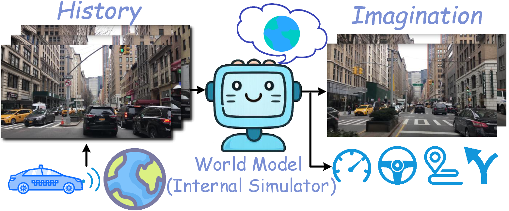{ width="760" }

*原文 Figure 1 的 core concepts 局部。历史观察进入内部模型，想象结果再服务行动，强调预测应当连接决策。这里的图示没有保证生成内容已经满足真实物理。*

本文依据 arXiv:2510.16732v3，该版本更新于 2026 年 6 月 25 日。文中出现 2026 年工作属于该版本的覆盖范围，不能只按初始 arXiv 编号中的 2025 年判断内容时点。

综述没有提出并训练一个新的统一世界模型。它给出概率建模背景、三轴分类、数据与指标整理，以及来自不同论文的定量汇总。理解其结论，既要读分类中的结构差异，也要保留结果表中的数据、输入和预算条件。

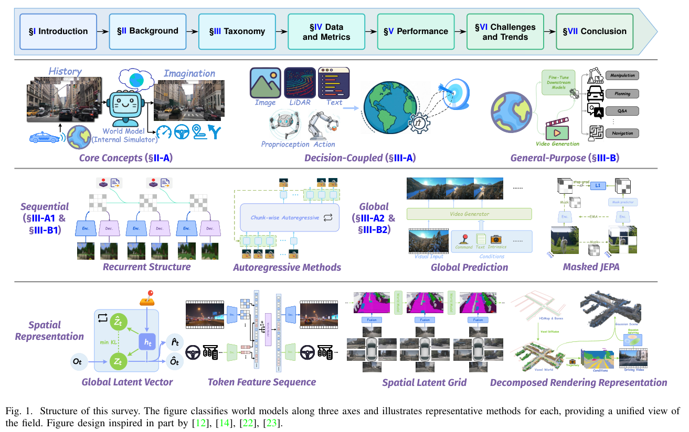{ width="1100" }

*原文完整 Figure 1。上层区分决策耦合与通用用途，中层区分逐步预测与整体预测，下层给出四种空间表示。一个方法的位置由三轴共同决定，图中横向顺序不是技术代际。*

| Axis | Categories in the paper | 真正需要回答的问题 |
|---|---|---|
| Functionality / Decision Coupling | Decision-Coupled; General-Purpose | 模型主要为哪类下游决策学习，怎样接受任务约束 |
| Temporal Modeling | Sequential Simulation and Inference; Global Difference Prediction | 未来按步或块依次生成，还是在一个范围内联合预测 |
| Spatial Representation | Global Latent Vector; Token Feature Sequence; Spatial Latent Grid; Decomposed Rendering Representation | 哪些状态结构被显式保留，哪些信息被压缩 |

三个问题相互影响，但不能互相替代。通用预训练模型可以接受动作，扩散模型可以按时间自回归运行，token 也可以保存空间网格。一个方法使用 Transformer，并不足以说明它在这三个坐标上的位置。

## 数学起点是看不全世界时，怎样维持可预测状态

原文将环境交互建模为 POMDP。真实状态 $s_t$ 无法直接完全观察，智能体只能获得 $o_t$，并通过动作 $a_t$ 改变环境。世界模型因此需要一个学习到的状态 $z_t$，将与预测有关的历史压缩进内部记忆。[原文 §II-B，PDF p.2](https://arxiv.org/pdf/2510.16732v3#page=2)

$z_t$ 与真实状态 $s_t$ 不是同一个对象。前者是模型构造的表示，是否足够保留任务信息要靠训练与检验。原文假设 $z_{t-1}$ 总结了相关历史，再用当前观察更新它，这是一种近似建模选择。

### 动态先验与过滤后验分别对应想象和看见之后的校正

原文 Eq.1 区分三个分布

$$
\begin{aligned}
\text{Dynamics Prior:}\quad &p_\theta(z_t\mid z_{t-1},a_{t-1}),\\
\text{Filtered Posterior:}\quad &q_\phi(z_t\mid z_{t-1},a_{t-1},o_t),\\
\text{Reconstruction:}\quad &p_\theta(o_t\mid z_t).
\end{aligned}
$$

动态先验只看过去状态与动作，预测接下来可能是什么。过滤后验还看到当前观察，因此能修正预测。重建分布则让内部表示能够解释观察。

真实交互时，模型不断获得新图像并进行后验更新；纯想象时，没有真实 $o_t$ 来校正，只能沿先验继续滚动。两种使用方式的差别，正是长程误差问题的来源之一。单步后验重建很好，并不保证先验连续运行很多步仍可靠。

为了统一初始边界，原文定义空动作 $a_0$，并把生成分布写成

$$
p_\theta(o_{1:T},z_{0:T}\mid a_{0:T-1})
=p_\theta(z_0)\prod_{t=1}^{T}
 p_\theta(z_t\mid z_{t-1},a_{t-1})p_\theta(o_t\mid z_t).
$$

近似后验采用相应时间分解

$$
q_\phi(z_{0:T}\mid o_{1:T},a_{0:T-1})
=q_\phi(z_0\mid o_1)\prod_{t=1}^{T}
q_\phi(z_t\mid z_{t-1},a_{t-1},o_t).
$$

这是一种过滤式近似，和可以利用整段未来观察的任意平滑后验并不相同。原文的目的在于建立潜在动态模型的共同记号，不是在此证明所有任务都满足该简化。

### ELBO 把观察解释与可预测性放在一起

直接求观察似然需要积分掉全部潜状态，往往不可解。原文 Eq.4–5 转而最大化证据下界

$$
\log p_\theta(o_{1:T}\mid a_{0:T-1})
\geq
\mathbb E_{q_\phi}\left[
\log\frac{p_\theta(o_{1:T},z_{0:T}\mid a_{0:T-1})}
{q_\phi(z_{0:T}\mid o_{1:T},a_{0:T-1})}
\right]
=\mathcal L(\theta,\phi).
$$

将其展开，可得重建项与潜在轨迹分布的 KL 正则

$$
\mathcal L(\theta,\phi)
=\sum_{t=1}^{T}\mathbb E_{q_\phi(z_t)}[\log p_\theta(o_t\mid z_t)]
-D_{\mathrm{KL}}\left(
q_\phi(z_{0:T}\mid o_{1:T},a_{0:T-1})
\,\Vert\,
p_\theta(z_{0:T}\mid a_{0:T-1})
\right).
$$

重建项要求表示保留足够观察信息，KL 则让“看见当前观察后得到的状态”和“只根据历史动作预测的状态”保持可对齐。KL 作用于整个轨迹分布，按马尔可夫分解还包含初始分布及逐步条件项的期望，不能省略这些关系后称它只是某一个时刻的简单距离。

这套公式最直接描述带显式概率潜状态与观察解码的模型。后文 JEPA、去掉解码器的表示预测、符号规划与部分扩散系统，未必逐项采用这个目标。因此它是阅读背景，不能替代每种模型的真实训练配方。综述没有给出所有方法共享的优化器、学习率、KL 权重或硬件设置。

## 第一轴关注任务约束进入模型的程度

Decision-Coupled 模型围绕具体控制目标学习或使用动态，预测价值主要由动作和回报等任务结果决定。紧密耦合可以把容量集中在决策相关变化上，也可能让状态对训练任务之外的信息缺乏保留。

General-Purpose 模型则优先覆盖更宽的视觉、动态或场景分布，再通过适配、规划接口或下游头服务不同任务。它的表示可能更通用，但预训练目标与具体控制目标之间存在距离。例如大量生成纹理的能力，不一定改善夹爪接触判断。[原文 §III，PDF pp.3–4](https://arxiv.org/pdf/2510.16732v3#page=3)

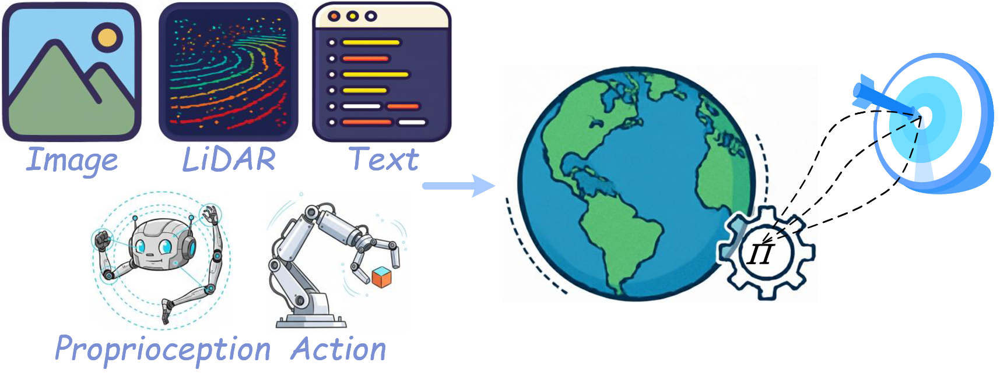{ width="760" }

*原文 Figure 1 的 decision-coupled 局部。图像、LiDAR、文本、本体感知与动作进入世界模型，并指向目标；这里强调多模态预测如何服务控制。*

这个区分不是“有动作”和“无动作”。Genie、AdaWorld 等通用路线也可以通过潜在动作或适配获得控制接口；决策耦合模型也可以先从无动作视频预训练。它更接近模型被组织成什么角色，而非某个输入端口是否存在。

同一个基础模型在不同阶段也可能改变用途。预训练时学习广泛动态，后训练时绑定某个机器人动作空间，部署时再进入特定规划器。三轴标签通常概括论文主要设计，不能覆盖同一系统所有训练和推理模式。

## 第二轴将真实时间展开方式与去噪过程分开

Sequential Simulation and Inference 让未来按步或短块前进，下一段依赖已有历史。它可以采用 RNN、Transformer、SSM，也可以在每个时间步内部使用扩散。Global Difference Prediction 则在一个预测范围内联合估计多个未来位置或时间状态，例如整体视频生成、masked feature prediction 和并行占据预测。

这里的 Global Difference Prediction 是作者的类别名称，不表示所有方法必须显式回归 $x_{t+H}-x_t$，更不等同于数值微分算法。区别在时间依赖如何组织，而非是否使用某个名为 difference 的损失。

### 顺序模型自然接受新动作，也自然继承历史误差

一步预测结束后，系统可以接收新观察、新动作并继续。因此顺序模型适合反馈控制、MPC 以及策略在环模拟。它不需要在开始时决定整段未来如何展开。

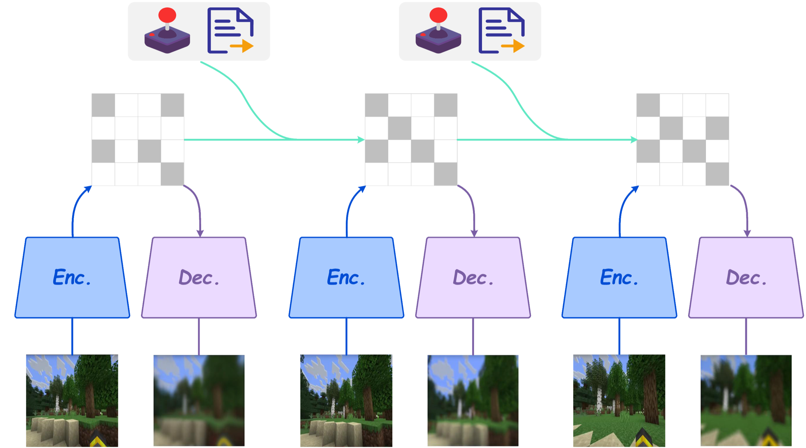{ width="780" }

*原文 Figure 1 的 sequential 局部。每个状态由编码、动态更新与解码连接，动作或条件参与下一状态预测；绿色时间箭头说明预测结果将成为后续历史。*

困难也来自同一结构。模型在自己预测出的状态上继续预测，偏差可能逐步积累，训练时真实历史与推理时生成历史的分布差异会放大问题。延长记忆、改善条件、加入物理结构或改变训练 rollout，都可能缓解不同部分，但不能仅凭因果 attention 宣布长程稳定已解决。

原文将顺序 rollout 的成本概括为随长度增长。严格地说，这首先描述串行步数增加；总计算是否线性还取决于每步读取多少历史、是否缓存、状态是否固定大小。保留全部历史的 attention 和固定状态循环，并没有相同的增长曲线。

### 整体预测减少时间串联，不等于只算一次或没有误差

联合预测允许一个窗口内的状态相互协调，也能并行处理多个目标时间。它减少了必须先完成前一帧才能启动后一帧的依赖，但扩散仍可能需要多次去噪，长序列 token 数量也会提高计算与内存需求。

整体窗口还改变交互粒度。如果整段未来已经生成，用户或策略临时改变动作，系统需要重新预测、局部更新或等待下一次窗口。因此较强全局一致与细粒度在线响应之间存在取舍，但这不是所有整体方法延迟都更高的普遍定理。

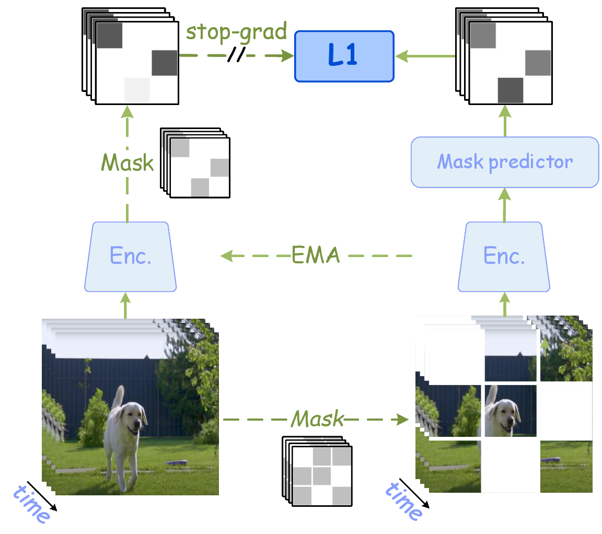{ width="680" }

*原文 Figure 1 的 masked JEPA 局部。可见输入进入预测器，目标分支提供被遮挡区域的 embedding，stop-grad 与 EMA 限定目标更新路径。图中 L1 是表示误差，不是未来像素重建误差。*

V-JEPA 所预测的是隐藏表示，目标可能覆盖被遮挡时空区域。这个训练接口能够学习运动和外观相关特征，但训练掩码恢复不自动等于已得到任意动作条件的机器人模拟器。V-JEPA 2 的机器人后训练、V-JEPA 2.1 的密集目标与更深监督，是需要分别说明的后续设计。

顺序和整体也可以组合。块间自回归、块内扩散，局部循环记忆与全局 masked update，都能同时使用两种结构。分类帮助定位主导路径，不应该把这些混合系统强行压成“只属于一种计算机制”。

## 第三轴决定哪些空间事实容易保存

空间表示是世界模型的内部接口。选择它时，需要考虑哪些变化必须显式可查询、怎样与动作坐标系对齐，以及规划器会怎样读取状态。

| Representation | 原文强调的结构 | 更容易保留什么 | 常见代价 |
|---|---|---|---|
| Global Latent Vector | 紧凑全局向量 | 控制所需摘要与循环记忆 | 细粒度位置和对象结构不显式 |
| Token Feature Sequence | 多个 token 或对象 slot | 多模态关系和局部特征 | 序列长度、注意力与数据成本 |
| Spatial Latent Grid | BEV、voxel 或空间对齐特征 | 局部拓扑、多视角对应、地图状态 | 内存、分辨率和空间范围 |
| Decomposed Rendering Representation | Gaussian、NeRF 等可渲染基元 | 跨视角几何与对象级操作 | 动态更新、重建和复杂拓扑变化 |

这些是结构上的倾向，不是统一 benchmark 得出的固定效率排名。网格可以 token 化，三维基元可以与扩散结合，紧凑向量也可能由 Transformer 更新。

### 全局向量把计算预算集中在少量状态上

RSSM 是典型起点。确定性记忆保留历史，不确定分量表达多种可能未来，潜在 rollout 可在较低维状态上快速进行。PlaNet、Dreamer 系列由此将学习动态与规划或策略优化连接起来。[原文 §III-A1，PDF pp.4–6](https://arxiv.org/pdf/2510.16732v3#page=4)

这类模型的优势不是向量天然懂物理，而是内部模拟不必每步重建所有高分辨率细节。对控制而言，如果潜在状态已经保留位置、速度、接触或目标信息，紧凑计算可以支持更多想象轨迹。

代价在于压缩选择。重建背景的压力可能占用容量，干扰物也可能进入状态。因此 Dreaming 引入对比目标，DreamerPro 使用原型，HRSSM 使用不依赖重建的双分支对齐，DisWM 尝试分离语义知识与视频内容。它们改善的不是同一模块，不能一概归结为“更大 RSSM”。

LeWorldModel 又说明 Global Latent Vector 不限定于传统 RSSM。综述将它描述为联合训练像素编码器与动作条件 Transformer predictor，用 next-embedding loss 和 SIGReg 避免表示坍塌，服务无奖励的潜在规划。TransDreamer 替换为 Transformer state-space structure，GLAM 使用 Mamba 的全局与局部模块，也都改变了时间更新方式。

### Token 序列保留多个单位，单位的意义需要另外设计

Token Feature Sequence 给 attention 提供多个可交互单元。它们可以对应空间 patch、离散视觉代码、语言、动作，或者对象 slot。虽然分类介绍使用了 discretizes 一词，后文 JEPA 与 DINO 特征预测包含连续 embedding，因此不能把整个 TFS 家族都限定为必须经过离散码本。

MWM 将视觉 token 学习与 RSSM 动态分开，IRIS、TWM 使用 token 序列支持想象中的策略学习，DrivingGPT 和 WorldVLA 将观察、动作等放进共享序列。DreamZero 则体现视频扩散骨干上的分块视频动作预测。这些例子共享“多个表示单元参与预测”，却不共享完全相同的 tokenizer 或损失。

对象中心方法如 CarFormer、Dyn-O 把场景分成 slot，试图将对象身份、运动和关系保持得更清楚。它们与普通图像 patch 的区别在于单元是否指向可持续追踪的实体。注意力能够交换信息，但对象恒常性和接触关系仍需目标、训练数据或额外结构来支持。

LLM 也可以通过语言与符号维护世界状态。Statler 区分状态读取和更新，Inner Monologue 使用环境反馈，NavCoT、MineDreamer 等将推理、想象与行动相连。不过，生成一段合理解释不能替代动作后果验证，文字中的因果叙述和实际动力学模型是不同证据。

### 空间网格让预测结果更直接进入几何规划

BEV 与 voxel 给状态明确坐标，附近格子对应附近空间，多视角观察可以融合到同一位置。规划器因而更容易查询可通行区域、对象占据与候选轨迹关系。

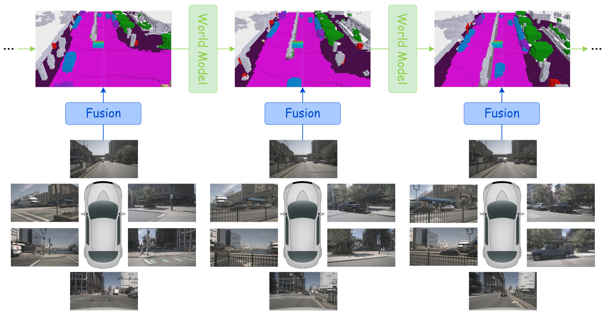{ width="760" }

*原文 Figure 1 的 SLG 局部。多相机观察先融合到空间状态，再沿时间更新；世界模型预测的是可与几何位置对应的结构。*

DriveWorld 在 BEV 表示上学习动态，OccWorld 和 OccLLaMA 预测未来 occupancy，WoTE 在 BEV 中评估候选轨迹，RoboOccWorld 将类似结构用于室内机器人。DINO-WM 保留预训练视觉特征的局部空间组织，PointWorld 用点云与场景位移表达动作后果。[原文 §III-A1，PDF p.7](https://arxiv.org/pdf/2510.16732v3#page=7)

最后两个例子也提示，综述的 SLG 分类容纳了较广的空间对齐表示，不应将每个成员都解释为规则体素网格。关键是局部关系和几何结构是否在状态里保留。

显式空间并不意味着没有预算问题。体素越细、范围越大，内存越高；未知区域与遮挡需要区分，动态对象和自车运动需要正确对齐。若格子里保存的语义或几何来自错误感知，预测器也会继承这个初始错误。

### 可渲染基元将跨视角一致性放进表示本身

Decomposed Rendering Representation 使用 NeRF、3DGS 或相关显式基元，将动态更新与观测渲染连接起来。同一状态从不同相机渲染，天然提供一个共同空间参照。

ManiGaussian 预测 Gaussian 场景的变化，ManiGaussian++ 增加层级与多体操作设计，GAF 让 splat 携带运动属性。DreMa 将 Gaussian 场景与物理模拟组合，PIN-WM 结合可微物理估计参数，数字孪生路线则将候选动作在可操纵场景中评估。[原文 §III-A1，PDF pp.7–8](https://arxiv.org/pdf/2510.16732v3#page=7)

这能限制任意改变视角导致的外观漂移，却不能自动保证碰撞、摩擦、刚度或拓扑变化正确。基元位置更新错误时，渲染可以保持非常一致地展示一个错误世界。表示解决的是一致性接口，动力学规律仍需学习、模拟或监督。

## 三轴组合以后，同一类骨干会出现不同用途

分别理解坐标以后，可以回到原文对方法的组合式讨论。它没有要求先选择“扩散还是 Transformer”再决定一切，而是先看系统需要什么样的预测接口。

### 决策耦合的顺序路线重视可执行反馈

在紧凑 latent 模型中，PreLAR 学习动作抽象来连接视频预训练与控制，ReDRAW 从仿真预训练出发，用有限无奖励真实数据修正动态，AdaWM 根据模型与规划器失配选择适配部分，DayDreamer 则把模型学习带到实体机器人。不同工作分别处理表示迁移、动态修复和部署交互，不能将它们概括成同一种 sim-to-real 技术。

逆动力学也常进入这些系统。它从初始与目标状态推断可能动作，和前向动态互补。Iso-Dream 用 IDM 帮助分离可控与不可控变化，GLAMOR 学习达到目标的动作。IDM 并不直接回答“给定任意动作会发生什么”，因此不能不经说明就取代前向世界模拟器。

空间模型中的控制接口则更具几何结构。PointWorld 预测场景点的动作条件位移，WoTE 在 BEV 中比较轨迹，DreMa 为控制生成数字孪生经验。它们的主要预测量不同，适用的误差指标和规划成本也不同。

### 决策耦合的整体预测可以成为计划或动作条件

FLARE 在潜在未来表示上对齐动作策略，避免在线像素生成。Cosmos Policy 将本体状态、动作 chunk、未来观察与价值编码成视频 latent frames，使一个扩散模型可以承担不同查询。VidMan 和 villa-X 将视频预测与 IDM 结合，TOKEN 则以对象 token 支持轨迹推理。[原文 §III-A2，PDF p.8](https://arxiv.org/pdf/2510.16732v3#page=8)

这类设计的共同问题是，整体预测结果怎样进入执行。可能通过动作头直接读取潜变量，也可能通过 IDM 恢复命令，或者由价值模型比较多个计划。预测范围很长不等于机器人必须一次执行同样长的动作，闭环系统可以只执行一部分后再观测。

结构化整体预测又包括 TesserAct 的 RGB、深度与法线联合建模，Drive-WM 的多视角未来和图像奖励，以及 COMBO 的多智能体动作组合与搜索。它们说明“整体”可以指不同预测对象，不能一律解释为没有反馈的离线视频。

### 通用顺序模型从广泛数据学习，再补动作接口与记忆

iVideoGPT 从无动作交互视频预训练，再适配控制；Genie 学习离散 latent action，AdaWorld 从相邻帧提取自监督动作条件，Vid2World 将预训练视频模型改成因果交互形式。学习到的潜在动作是否对应真实机器人命令，仍取决于后训练与适配。[原文 §III-B1，PDF pp.8–9](https://arxiv.org/pdf/2510.16732v3#page=8)

长程生成中，Geometry Forcing 和 DeepVerse 加入几何相关目标或记忆，VRAG 检索历史帧，StateSpaceDiffuser 使用 SSM，LongDWM 用蒸馏改善跨时预测，MiLA 先产生稀疏锚点再细化。它们针对不同失效原因，不应都表述为“支持无限记忆”。

顺序模型还可以作为策略评估或学习环境。WorldGym、WorldEval 用动作条件 rollout 与评估组件估计策略表现，RLVR-World 用可验证奖励缩小预训练目标与任务目标的距离。评价器是否可信，取决于动作后果与评分是否对应真实执行，不能由生成质量单独保证。

### 通用整体预测强调跨任务表示与多时刻约束

V-JEPA 学习被遮挡区域的 embedding，V-JEPA 2 扩大预训练并通过机器人交互后训练支持规划，V-JEPA 2.1 改进密集目标和监督层次。DINO-Foresight 预测视觉基础模型的语义特征，再交给分割、深度或法线头。它们提供的未来不是必须显示出来的像素视频。[原文 §III-B2，PDF p.10](https://arxiv.org/pdf/2510.16732v3#page=10)

生成式路线则包括将视频表示为 spacetime patches 的 DiT，以及整合多模态序列的基础模型。Sora、Cosmos 3 等在综述中被用来说明更广的理解、生成与模拟接口，但本文没有重新训练或统一测试它们，也不能据综述中的定位推导其所有控制能力已经验证。

几何路线中，BEVWorld 融合图像和 LiDAR，OccSora 使用四维 tokenizer，DynamicCity 以 HexPlanes 表达四维 occupancy，COME 分离自车运动与场景演化，ORV 让四维语义占据约束视频。DriveDreamer4D、ReconDreamer、MagicDrive3D 再把生成与 Gaussian 重建相连，UnO 使用连续占据场。

这些路线可能共享大规模预训练，却承担不同监督目标。目标可以是特征预测、占据重建、多模态生成或可渲染几何，后续控制的接入方式也不同。综述的表格为它们提供坐标，并没有将它们训练成可直接互换的标准组件。

## 两张方法总表要连同数据与模态列一起读

原文 Table I 和 II 分别整理机器人/通用领域与自动驾驶领域，保留 Taxonomy、Characteristics、Datasets Platform、Modality 等列。阅读顺序应从模型的预测接口走向数据和验证条件。

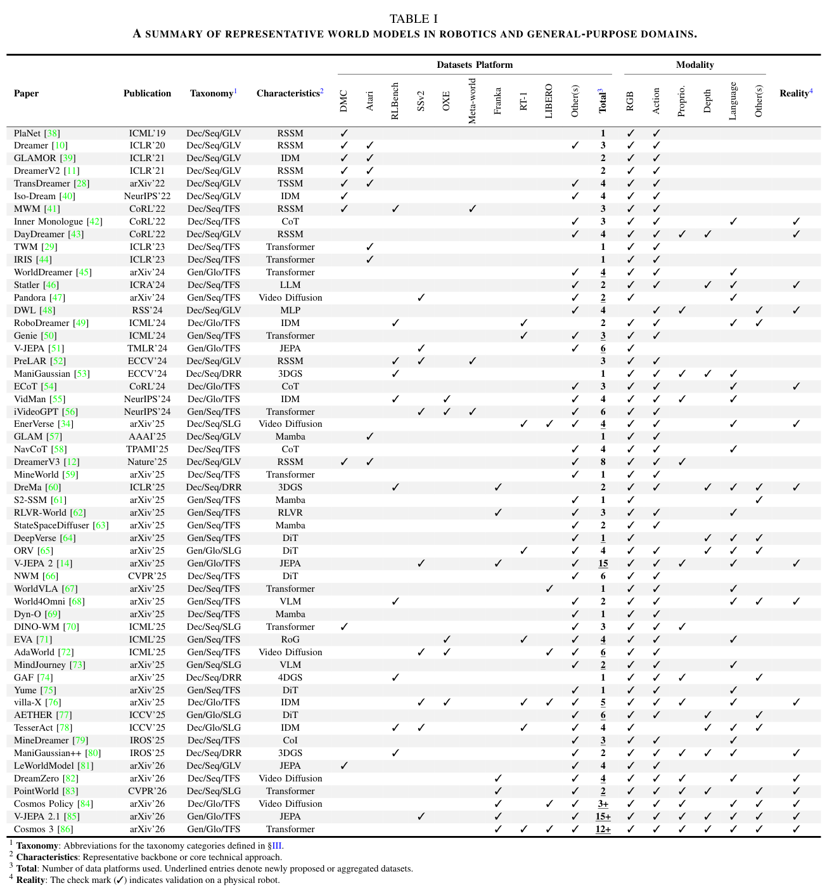{ width="1100" }

*原文 Table I，PDF p.4。Dec / Gen、Seq / Glo、GLV / TFS / SLG / DRR 是三轴缩写；Total 表示使用的数据平台数量，Reality 勾选表示在实体机器人上验证过。*

Total 不是训练样本量，不是机器人数量，也不是成功任务数量。一个方法使用更多平台，可能增加覆盖，但不能仅凭列中的数值推导数据更多或泛化更强。Reality 同样只标记存在真实机器人验证，并不表达测试规模、失败率或对所有 embodiment 的可靠性。

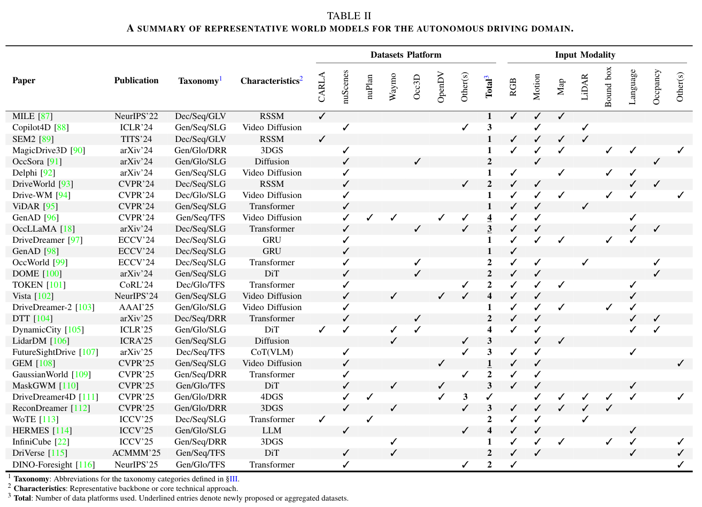{ width="1100" }

*原文 Table II，PDF p.5。驾驶模型的输入可能包括图像、运动、地图、LiDAR、框、语言与 occupancy，比较结果时应核查模型到底获得哪些信息。*

表中存在同名但来源不同的 GenAD 条目，分别标注 CVPR 2024 与 ECCV 2024，对应原文不同引用，不能据名称自行合并。类似地，一个模型名称后带不同后缀，常代表输入或感知前端不同，后面的 occupancy 与规划表会更明确地展示这种差别。

三轴分类还带有作者的组织判断。某些混合系统横跨多个表示，正文在相邻小节讨论它们，并不意味着表格标签能穷尽其实现。可靠使用这份地图的方法，是据表找到工作，再回原论文核对训练、推理与评价接口。

## 数据资源分四类，分别决定可以训练什么与怎样验证

环境引擎、标准任务、离线记录和实体机器人常被一起称为“数据平台”，但它们的作用不同。原文因此分为 Simulation Platforms、Interactive Benchmarks、Offline Datasets 和 Real-world Robot Platforms。[原文 §IV-A，PDF pp.11–12](https://arxiv.org/pdf/2510.16732v3#page=11)

模拟平台提供可控环境与传感器，例如 MuJoCo、CARLA、Habitat、Isaac 系列。它们可以运行交互，生成训练数据，但平台本身未必定义同一任务集合、动作范围或测试条件。

交互 benchmark 在平台之上明确任务与评价方式。DMC 面向连续控制，Atari-100k 限定交互预算，Meta-World、RLBench、LIBERO 强调不同形式的操作任务，nuPlan 将驾驶记录与规划评价连接起来。是否在同一 benchmark 上测试，还要继续追问具体任务子集与协议。

离线数据集提供已有观察和行为轨迹，无法直接回答任意新动作之后的真实结果。它们便于复现与大规模预训练，却依赖记录中已有的覆盖。训练世界模型之后再用它生成反事实经验，并不会让原始离线数据本身变成交互环境。

实体机器人提供真实动力学、传感器延迟和接触条件，是检验模拟迁移的重要载体。原文列出 Franka Emika、Unitree Go1 和 G1。硬件的自由度、传感配置或底层控制频率，不能直接当作世界模型推理速度；例如机器人接口支持高频控制，不表示视频模型也以同样频率重新规划。

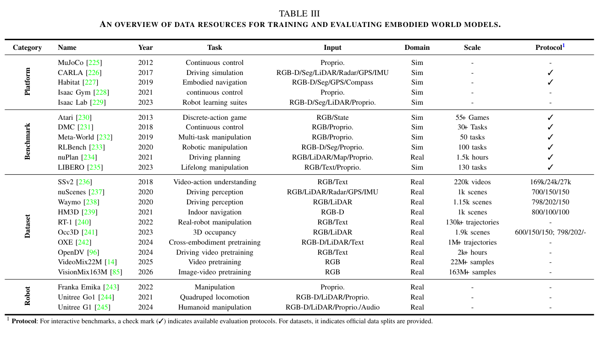{ width="1100" }

*原文 Table III，PDF p.12。Category 区分资源角色，Protocol 对交互任务表示可用评价协议，对离线数据表示官方划分；Scale 属于该综述版本整理的口径。*

### 规模数字需要与样本类型一起读

SSv2 包含 174 类细粒度动作，原文给出 220,847 段视频，训练、验证、测试分别为 168,913、24,777、27,157。它提供动作语义与时间变化，不能自动提供机器人关节命令。

OXE 汇集 60 个来源、21 个机构、22 种机器人、527 项技能和超过一百万轨迹，原文用它说明跨 embodiment 数据共享。数据集合层面具有多模态，不表示其中每条轨迹都完整包含表格列出的所有传感器；动作坐标与采样频率也需要统一或显式区分。

OpenDV 的综述口径是 2,059 小时、约 6,510 万帧，来源包括网络视频与公开数据。它扩大驾驶视觉覆盖，但语义标注、轨迹条件与精确物理控制标签不能混为同一种信息。

VideoMix22M 包含不同来源的视频与被转换为静态视频的图像，VisionMix163M 又引入更大的图像来源并调整视频采样。22M 或 163M samples 不能被改写成同等数量的机器人交互轨迹，更不能由总样本量推导动作覆盖程度。

| Resource type | 原文例子 | 对建模的主要帮助 | 仍需核对的缺口 |
|---|---|---|---|
| Simulation Platform | MuJoCo, CARLA, Habitat, Isaac | 可控交互与变化生成 | 仿真动态、传感与真实环境差异 |
| Interactive Benchmark | DMC, Atari, RLBench, LIBERO, nuPlan | 标准任务与闭环评价 | 任务子集、预算、协议版本 |
| Offline Dataset | RT-1, OXE, nuScenes, OpenDV | 大规模已有行为与观察 | 行为覆盖、动作标签、失败数据 |
| Video / image mixture | VideoMix22M, VisionMix163M | 通用外观与运动预训练 | 具体动作和物理参数的对齐 |
| Real-world Robot | Franka, Unitree Go1/G1 | 实际接触与部署验证 | 试验规模、硬件设置、可重复性 |

这是对原文资源角色的解释表。它没有把不同单位的 scenes、frames、hours 与 trajectories 相加，也不把综述时点的规模当成当前版本的在线统计。

## 三层指标分别检验外观、状态和决策

原文将评价分为 Pixel Prediction Quality、State-level Understanding 和 Task Performance。每层都能暴露某类问题，却不能代替另一层。分布距离低，不能直接证明动作后果正确；状态几何准确，也不代表规划器一定选择了好动作。[原文 §IV-B，PDF pp.12–14](https://arxiv.org/pdf/2510.16732v3#page=12)

### FID 与 FVD 比较特征分布，不直接验证物理机制

FID 在 Inception 特征空间中，用均值和协方差近似真实与生成分布，原文 Eq.6 为

$$
\operatorname{FID}(x,y)
=\|\mu_x-\mu_y\|_2^2
+\operatorname{Tr}\left(\Sigma_x+\Sigma_y-2(\Sigma_x\Sigma_y)^{1/2}\right).
$$

较低数值表示这些统计更接近。它只检查所用特征的有限统计，不能保证完整分布完全一致，也不能单独认证每个样本符合真实动力学。

FVD 采用视频特征，原文介绍为用在 Kinetics-400 上预训练的 I3D 替换图像特征，再计算类似距离。因此它同时受外观与运动信息影响，不能简单称为纯粹的“时间一致性误差”。视频更清晰、内容分布更匹配，都可能改变 FVD。

### 成对图像指标需要说明参考帧和像素尺度

SSIM 比较局部亮度、对比和结构，PSNR 来自像素均方误差，LPIPS 比较预训练网络特征，VBench 再将视频质量与条件一致性拆成 16 个维度。这些指标从不同侧面补充视觉评价。

原文 Eq.8–9 的 PSNR 关系为

$$
\operatorname{MSE}=\frac{1}{N}\sum_{i=1}^{N}(x_i-y_i)^2,
\qquad
\operatorname{PSNR}=10\log_{10}\frac{\operatorname{MAX}^2}{\operatorname{MSE}}.
$$

MAX 取决于像素归一化方式，不能在不同动态范围下不加处理地比较。SSIM 与 PSNR 对相位或小位移也可能敏感，而多种合理未来未必与单一参考逐像素重合。它们适合回答特定重建问题，不应单独决定世界模型是否能控制环境。

### 状态指标把语义、几何和轨迹拆开

mIoU 对语义类分别计算交并比再平均

$$
\operatorname{IoU}_c=\frac{TP_c}{TP_c+FP_c+FN_c},
\qquad
\operatorname{mIoU}=\frac{1}{|\mathcal C|}\sum_{c\in\mathcal C}\operatorname{IoU}_c.
$$

Occupancy IoU 与语义 mIoU 的关注点不同，一个可以主要检查空间是否占据，另一个还区分类别；类别集合、可见性 mask 和未知区域处理会影响可比性。

mAP 则根据检测结果的置信排序与匹配计算 precision–recall 面积，再按类与阈值平均。它反映检测质量，但原文关于更高 mAP 对应更好置信度校准的表述不能当作保证。预测排序正确与概率数值校准良好是两件事，校准需要单独检验。

轨迹误差常用 ADE 与 FDE，前者汇总多个未来点，后者只检查终点。低终点误差并不保证中间路线避开障碍，低平均误差也不表示每个关键时刻都安全。

Chamfer Distance 则比较点集的最近邻距离。原文 Eq.16 使用未归一化的平方距离双向求和

$$
\operatorname{CD}(S_1,S_2)
=\sum_{x\in S_1}\min_{y\in S_2}\|x-y\|_2^2
+\sum_{y\in S_2}\min_{x\in S_1}\|x-y\|_2^2.
$$

按这个写法，点数会影响数值规模。其他实现可能除以点数或不平方，不能只看到都叫 CD 就直接比较。它能检查几何接近程度，但对象身份、动力学和动作因果仍需要其他条件。

### 任务指标必须先定义成功和预算

Success Rate 依赖成功判据与时间限制，Sample Efficiency 依赖达到某表现所需样本或固定预算下表现，Return 依赖奖励定义与累计方式。碰撞率还可能按 episode、公里、小时或预测轨迹时间点归一化。

因此，0.15% collision rate 要连同具体评测协议阅读，不能从开放环预测指标直接换算成真实车队事故风险。相同任务名称下，演示数量、动作执行方式、最大步数和测试变化也可能不同。

| Level | Metrics in the paper | 可以支持的判断 | 不能单独支持的判断 |
|---|---|---|---|
| Pixel / perceptual | FID, FVD, SSIM, PSNR, LPIPS, VBench | 生成分布、成对画面或条件匹配 | 物理机制正确、任意动作可控 |
| State / geometry | mIoU, mAP, ADE, FDE, CD | 语义、检测、空间与轨迹误差 | 策略一定高效、安全或可迁移 |
| Task | SR, SE, Return, Collision | 特定预算和协议下的任务结果 | 脱离协议的普适模型排名 |

## nuScenes 视频表首先比较的是不同配置下的生成结果

原文 Table IV 汇集驾驶视频生成结果，使用 FID 与 FVD，且完整列出分辨率。下面保留全部 18 行，数值属于所引论文报告，不是综述作者在统一硬件上重新测试。[原文 §V-A，PDF p.14](https://arxiv.org/pdf/2510.16732v3#page=14)

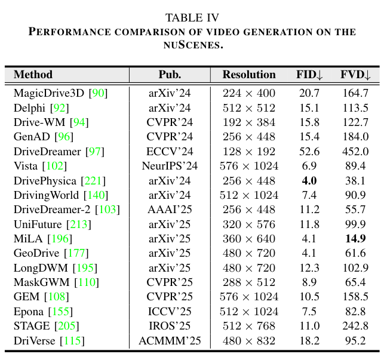{ width="850" }

*原文 Table IV。最低 FID 与最低 FVD 来自不同方法，Resolution 也不同。*

| Method | Pub. | Resolution | FID↓ | FVD↓ |
|---|---|---|---:|---:|
| MagicDrive3D | arXiv’24 | 224 × 400 | 20.7 | 164.7 |
| Delphi | arXiv’24 | 512 × 512 | 15.1 | 113.5 |
| Drive-WM | CVPR’24 | 192 × 384 | 15.8 | 122.7 |
| GenAD | CVPR’24 | 256 × 448 | 15.4 | 184.0 |
| DriveDreamer | ECCV’24 | 128 × 192 | 52.6 | 452.0 |
| Vista | NeurIPS’24 | 576 × 1024 | 6.9 | 89.4 |
| DrivePhysica | arXiv’24 | 256 × 448 | 4.0 | 38.1 |
| DrivingWorld | arXiv’24 | 512 × 1024 | 7.4 | 90.9 |
| DriveDreamer-2 | AAAI’25 | 256 × 448 | 11.2 | 55.7 |
| UniFuture | arXiv’25 | 320 × 576 | 11.8 | 99.9 |
| MiLA | arXiv’25 | 360 × 640 | 4.1 | 14.9 |
| GeoDrive | arXiv’25 | 480 × 720 | 4.1 | 61.6 |
| LongDWM | arXiv’25 | 480 × 720 | 12.3 | 102.9 |
| MaskGWM | CVPR’25 | 288 × 512 | 8.9 | 65.4 |
| GEM | CVPR’25 | 576 × 1024 | 10.5 | 158.5 |
| Epona | ICCV’25 | 512 × 1024 | 7.5 | 82.8 |
| STAGE | IROS’25 | 512 × 768 | 11.0 | 242.8 |
| DriVerse | ACMMM’25 | 480 × 832 | 18.2 | 95.2 |

表内最低 FID 是 DrivePhysica 的 4.0，最低 FVD 是 MiLA 的 14.9。MiLA 与 GeoDrive 的 FID 都为 4.1，FVD 却分别为 14.9 和 61.6，说明单帧分布接近程度不足以概括视频特征分布。

但不能据此将 FVD 的差异全部归因于某一个记忆模块，也不能把最低 FVD 写成已经证明最准确的物理规律。分辨率从 128 × 192 到 576 × 1024，原表没有为所有方法统一列出片段长度、采样策略、预训练数据与计算预算。它支持在各自报告设置下的结果对照，不支持无条件的范式优越性判断。

## Occupancy 预测必须先分清模型获得了什么信息

该任务给定过去 2 秒的场景状态，预测后续 3 秒，并在多个时间范围评估语义 mIoU 与占据 IoU。原表 V 将 Input、Aux. Sup 与 Ego traj. 放在分数前，是理解结果的关键。[原文 §V-B，PDF pp.14–15](https://arxiv.org/pdf/2510.16732v3#page=14)

Input 为 Occ 时，模型获得真实占据输入；Camera 则先从相机中恢复有关状态。Aux. Sup 可以包含 Semantic LiDAR 或 Occ，表示训练时的额外监督。Ego traj. 的 Pred. 与 GT 又区分使用预测自车轨迹和真实自车轨迹，后者提供更强条件。

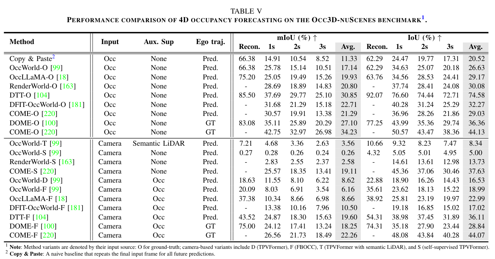{ width="1100" }

*原文 Table V。Recon. 衡量当前重建，1s / 2s / 3s 衡量未来预测，Avg. 汇总未来范围；不能把 Recon. 与未来分数一起平均。*

为便于阅读，下表保留全部方法的未来 mIoU，并同时列出原表 IoU Avg.。完整重建值与逐时刻 IoU 见上方原表，后缀 O、D、F、T、S 仍按原文保留。

| Method | Input | Aux. Sup | Ego traj. | mIoU 1s ↑ | mIoU 2s ↑ | mIoU 3s ↑ | mIoU Avg. ↑ | IoU Avg. ↑ |
|---|---|---|---|---:|---:|---:|---:|---:|
| Copy & Paste | Occ | None | Pred. | 14.91 | 10.54 | 8.52 | 11.33 | 20.52 |
| OccWorld-O | Occ | None | Pred. | 25.78 | 15.14 | 10.51 | 17.14 | 26.63 |
| OccLLaMA-O | Occ | None | Pred. | 25.05 | 19.49 | 15.26 | 19.93 | 29.17 |
| RenderWorld-O | Occ | None | Pred. | 28.69 | 18.89 | 14.83 | 20.80 | 30.08 |
| DTT-O | Occ | None | Pred. | 37.69 | 29.77 | 25.10 | 30.85 | 74.58 |
| DFIT-OccWorld-O | Occ | None | Pred. | 31.68 | 21.29 | 15.18 | 22.71 | 32.27 |
| COME-O | Occ | None | Pred. | 30.57 | 19.91 | 13.38 | 21.29 | 29.03 |
| DOME-O | Occ | None | GT | 35.11 | 25.89 | 20.29 | 27.10 | 36.36 |
| COME-O | Occ | None | GT | 42.75 | 32.97 | 26.98 | 34.23 | 44.13 |
| OccWorld-T | Camera | Semantic LiDAR | Pred. | 4.68 | 3.36 | 2.63 | 3.56 | 8.34 |
| OccWorld-S | Camera | None | Pred. | 0.28 | 0.26 | 0.24 | 0.26 | 5.00 |
| RenderWorld-S | Camera | None | Pred. | 2.83 | 2.55 | 2.37 | 2.58 | 13.73 |
| COME-S | Camera | None | Pred. | 25.57 | 18.35 | 13.41 | 19.11 | 37.63 |
| OccWorld-D | Camera | Occ | Pred. | 11.55 | 8.10 | 6.22 | 8.62 | 16.53 |
| OccWorld-F | Camera | Occ | Pred. | 8.03 | 6.91 | 3.54 | 6.16 | 18.99 |
| OccLLaMA-F | Camera | Occ | Pred. | 10.34 | 8.66 | 6.98 | 8.66 | 22.99 |
| DFIT-OccWorld-F | Camera | Occ | Pred. | 13.38 | 10.16 | 7.96 | 10.50 | 17.02 |
| DTT-F | Camera | Occ | Pred. | 24.87 | 18.30 | 15.63 | 19.60 | 36.11 |
| DOME-F | Camera | Occ | GT | 24.12 | 17.41 | 13.24 | 18.25 | 28.84 |
| COME-F | Camera | Occ | GT | 26.56 | 21.73 | 18.49 | 22.26 | 44.07 |

Copy & Paste 把最后输入状态重复到所有未来时间，是检查模型是否真的学到动态的基线。多个模型随预测时间增长而下降，说明时间误差仍然存在；但下降幅度同时受到输入质量、动态表示与自车对齐影响。

同名 COME-O 的 mIoU Avg. 在 Pred. ego 下为 21.29，在 GT ego 下为 34.23，相差 12.94 个百分点。这是表中条件变化对应的数值差，提醒读者自车轨迹信息可能影响很大；不能把它当成更换架构的提升。

### 原文关于 IoU 最优的概括与表格冲突

第 14 页文字称使用 GT ego 的 COME 同时取得最优平均 mIoU 与逐时间 IoU。前半句与 Table V 的 mIoU Avg. 34.23 相符，后半句不能由表支持。DTT-O 的 IoU 在 1s / 2s / 3s 为 76.60 / 74.44 / 72.71，Avg. 为 74.58，均高于 COME-O GT 的 50.57 / 43.47 / 38.36 与 44.13。

这里保留来源表格数值并明确指出矛盾，不自行猜测哪一项结果应被改成别的数字。表内能够确认的是语义 mIoU 与占据 IoU 的排序不同；更严格比较仍需检查 DTT 与 COME 原论文的指标实现、数据与评价设置。

相机输入与真实 occupancy 输入也不能脱离条件直接排名。相机模型需要承担感知误差，GT occupancy 模型已获得更强初始结构，额外训练监督又可能不同。把这些分数压成一个总冠军，会丢掉原表最重要的实验边界。

## DMC 的平均分需要和任务数一起读

DMC 部分使用像素控制设置，原文说明常见输入为 64 × 64 × 3。其 episode return 在所述 1,000 步、单步奖励位于 0 到 1 的设置下，上限为 1,000。这个边界属于该评价设置，不是所有强化学习任务的统一范围。[原文 §V-C，PDF pp.14–15](https://arxiv.org/pdf/2510.16732v3#page=14)

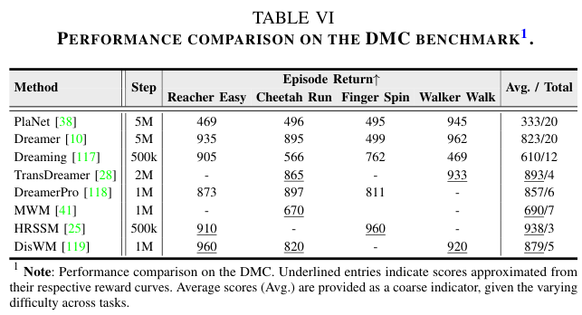{ width="900" }

*原文 Table VI。下划线标记从 reward curve 近似读取的分数。Markdown 表用 † 保留这一信息，– 表示未给出，MWM 的 Finger Spin 空格也按缺失处理。*

| Method | Step | Reacher Easy | Cheetah Run | Finger Spin | Walker Walk | Avg. / Total |
|---|---:|---:|---:|---:|---:|---|
| PlaNet | 5M | 469 | 496 | 495 | 945 | 333/20 |
| Dreamer | 5M | 935 | 895 | 499 | 962 | 823/20 |
| Dreaming | 500k | 905 | 566 | 762 | 469 | 610/12 |
| TransDreamer | 2M | – | 865† | – | 933† | 893†/4 |
| DreamerPro | 1M | 873 | 897 | 811 | – | 857/6 |
| MWM | 1M | – | 670† | – | – | 690†/7 |
| HRSSM | 500k | 910† | – | 960† | – | 938†/3 |
| DisWM | 1M | 960† | 820† | – | 920† | 879†/5 |

Avg. / Total 包含原工作汇总的任务集合，不是对表中四个显示列直接取平均。PlaNet 的 333/20 与 HRSSM 的 938/3 覆盖 20 个和 3 个任务，不能据这两个平均数推导后者在相同任务集上提高了多少。

交互预算也从 500k 到 5M 不等。较少交互下达到较高表现可以提示样本效率进展，但任务难度、训练配置和曲线近似读数都影响比较。原文据此强调评价协议不统一，不能把这张汇总表当作严格同预算消融。

这也影响对三轴分类的结论。表中不少模型都属于紧凑顺序动态家族，它们的差异还包括表示目标、模型更新、探索和策略学习。高分不能单独归因于某个时间或空间标签。

## RLBench 把模态和预算差异直接写在分数上方

原文 RLBench 表比较五项方法，环境为模拟 Franka 操作，成功率表示在给定步数限制内完成任务的比例。但五列的 Episode、Pixel、模态和任务数量并不一致。

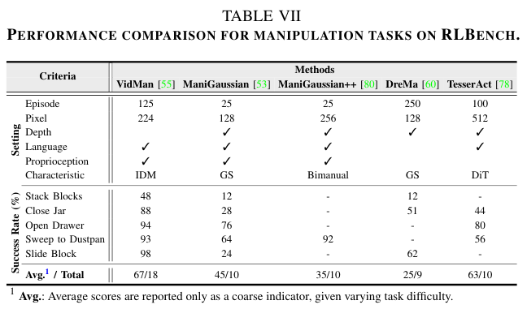{ width="1000" }

*原文 Table VII。Setting 与 Success Rate 分区同时保留，才能看见模型获得的信息与汇总范围差异。*

| Criteria | VidMan | ManiGaussian | ManiGaussian++ | DreMa | TesserAct |
|---|---:|---:|---:|---:|---:|
| Episode | 125 | 25 | 25 | 250 | 100 |
| Pixel | 224 | 128 | 256 | 128 | 512 |
| Depth | – | ✓ | ✓ | ✓ | ✓ |
| Language | ✓ | ✓ | ✓ | – | ✓ |
| Proprioception | ✓ | ✓ | ✓ | – | – |
| Characteristic | IDM | GS | Bimanual | GS | DiT |
| Stack Blocks | 48 | 12 | – | 12 | – |
| Close Jar | 88 | 28 | – | 51 | 44 |
| Open Drawer | 94 | 76 | – | – | 80 |
| Sweep to Dustpan | 93 | 64 | 92 | – | 56 |
| Slide Block | 98 | 24 | – | 62 | – |
| Avg. / Total | 67/18 | 45/10 | 35/10 | 25/9 | 63/10 |

任务行采用成功率百分数，Setting 行按原表保留。Pixel 原表只给单个数值，本文不额外补成未经该表明确说明的长宽配置；Episode 同样只按原列名记录，不擅自将其全部解释成同一种训练或测试轨迹预算。空白模态项用 – 表示表中未标记。

VidMan 的 Avg. 为 67、覆盖 18 个任务，TesserAct 为 63、覆盖 10 个任务。它们并非相同任务集合上的 4 个百分点差距。ManiGaussian++ 在 Sweep to Dustpan 报告 92，也不能仅凭这一行推导它在所有单臂任务上接近 VidMan，因为表中对其特性明确写的是 Bimanual。

原文将这些结果看作 IDM、Gaussian 与 DiT 等结构进入操作的证据，并强调多模态与更强骨干的发展。能成立的是多条路线都具有下游用途，尚不能据异构表格证明哪种表示整体优胜。

## nuScenes 规划表的最小轨迹误差与最小碰撞率不属于同一目标

开放环规划使用过去 2 秒，预测未来 3 秒的二维 BEV 自车轨迹，按 UniAD 协议在多个时间点报告 L2 与 Collision Rate。它评估预测计划，不等于车辆在真实环境中反复执行、观察、纠正后的完整闭环结果。[原文 §V-C，PDF pp.15–16](https://arxiv.org/pdf/2510.16732v3#page=16)

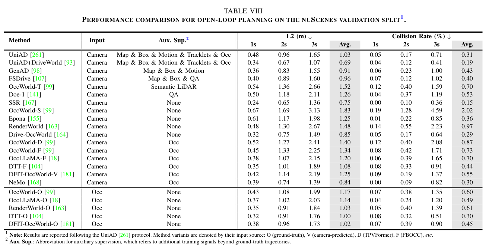{ width="1100" }

*原文 Table VIII。Aux. Sup. 表示真实轨迹监督之外的额外训练信号，None 不等于完全无监督。完整 22 行保留在原表图中。*

下面节选八行用于对照输入、监督与两个目标，所有数值仍按原表报告。

| Method | Input | Aux. Sup. | L2 1s ↓ | L2 2s ↓ | L2 3s ↓ | L2 Avg. ↓ | Collision 1s ↓ | Collision 2s ↓ | Collision 3s ↓ | Collision Avg. ↓ |
|---|---|---|---:|---:|---:|---:|---:|---:|---:|---:|
| UniAD | Camera | Map & Box & Motion & Tracklets & Occ | 0.48 | 0.96 | 1.65 | 1.03 | 0.05 | 0.17 | 0.71 | 0.31 |
| UniAD+DriveWorld | Camera | Map & Box & Motion & Tracklets & Occ | 0.34 | 0.67 | 1.07 | 0.69 | 0.04 | 0.12 | 0.41 | 0.19 |
| SSR | Camera | None | 0.24 | 0.65 | 1.36 | 0.75 | 0.00 | 0.10 | 0.36 | 0.15 |
| OccWorld-S | Camera | None | 0.67 | 1.69 | 3.13 | 1.83 | 0.19 | 1.28 | 4.59 | 2.02 |
| Drive-OccWorld | Camera | None | 0.32 | 0.75 | 1.49 | 0.85 | 0.05 | 0.17 | 0.64 | 0.29 |
| NeMo | Camera | Occ | 0.39 | 0.74 | 1.39 | 0.84 | 0.00 | 0.09 | 0.82 | 0.30 |
| OccWorld-O | Occ | None | 0.43 | 1.08 | 1.99 | 1.17 | 0.07 | 0.38 | 1.35 | 0.60 |
| DTT-O | Occ | None | 0.32 | 0.91 | 1.76 | 1.00 | 0.08 | 0.32 | 0.51 | 0.30 |

L2 单位为米，Collision 为原协议下的百分数。UniAD+DriveWorld 的平均 L2 为 0.69，低于 SSR 的 0.75；SSR 的平均碰撞率为 0.15，低于前者的 0.19。拟合参考轨迹与避开碰撞相关，但不是完全相同的优化目标。

“平均最优”还应保留时间范围。SSR 的 1 秒 L2 为 0.24，优于 UniAD+DriveWorld 的 0.34，因此后者并非每个时间点都最低。NeMo 的 2 秒碰撞率为 0.09，低于 SSR 的 0.10，因此 SSR 的最低平均碰撞率也不是每个时间点均最优。

部分相机方法超过部分真实 occupancy 输入方法，说明系统设计与训练目标会显著影响结果。它不能证明相机在信息上普遍优于真实占据，因为模型、额外监督、状态接口与规划器没有被全部控制为相同。类似地，某条 Camera / None 行表现好，只能说明没有使用表中列出的额外监督，不能写成不使用真实轨迹训练。

## 分类最后要落到误差、计算和数据预算

原文提出三组挑战。第一组来自数据与评价，跨领域资源仍然碎片化，多智能体和安全关键交互不足，生成视频评价与机器人控制评价之间还有距离。更大的预训练集合提供覆盖，却不能替代动作、回报和失败后果的对齐。[原文 §VI，PDF pp.16–17](https://arxiv.org/pdf/2510.16732v3#page=16)

第二组是计算效率。Transformer、扩散与复杂空间表示的容量增加，会与机器人端侧时延、内存和能耗预算冲突。量化、剪枝、低秩、稀疏计算与 SSM 是作者列出的方向，另一个思路是根据资源调节分辨率、预测范围或模态使用。

这并不要求所有计算都在线完成。大视频模型可以离线生产数据，小模型可以承担实时控制或监测。是否值得使用更昂贵预测，应看它为当前动作选择提供了多少额外信息，而非默认每次都生成完整高质量视频。

第三组是建模策略。顺序模型易于交互却承受误差传播，整体预测增强窗口一致却可能增加计算并降低反馈粒度；紧凑状态便宜，显式三维状态更容易维持几何，却难以低成本处理全部动态。混合时间结构、显式记忆、层级规划和几何约束因而成为自然研究方向。

作者还强调因果、物理与不确定性。视觉上常见的变化不总是动作真实后果，固定场景中的成功不意味着未见质量、摩擦或交互关系也可靠。世界模型作为共享预测基础设施，需要让感知、未来预测和决策使用兼容的状态与误差边界。

这些都是综述提出的方向，没有在本文通过一个新系统统一验证。将模型压缩后仍保持控制能力、混合表示是否减少长程失败、显式记忆是否真正保留任务事实，都需要各自实验。

## 读完三轴地图以后，可以怎样定义一个更清楚的实验

先选择模型要服务的计算。若只是给动作策略提供更好的表示，潜在预测可能已经足够；若要比较候选轨迹，动作条件敏感性与评价一致性更关键；若要生成可检查的场景，空间表示与渲染能力就进入需求。

再确定时间接口。一次预测多长，多久重新观察，动作何时进入未来，已经生成的内容能否改动。把这些问题写清，才知道测试的是长程开放环预测、分块闭环控制，还是离线数据生成。

最后让空间表示与评价对齐。向量、token、网格和可渲染基元各自保留不同结构，指标也应检查模型承诺提供的东西。视觉分数、状态误差与任务成功率应相互补充，某一层提高以后，仍需确认下一层是否受益。

这篇综述没有给出一种可以直接替代全部系统的统一算法。它让世界模型的比较从名称与示例画面，转向任务耦合、时间依赖、空间状态以及真实评价条件。沿着这条路径，模型是否有用才能落实到具体的预测和决定上。

## 继续阅读

具身世界模型的分类先用[世界模型入门](../../world-models/beginner-world-models-primer.md)建立共同词汇；从预测到动作的闭环见[世界模型与机器人综述](world-model-for-robot-learning-survey.md)。
