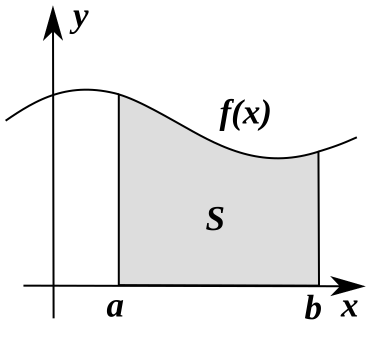

# 微积分与牛顿-莱布尼茨公式

这篇回答一个问题：为什么训练、优化、扩散模型和控制里总是出现导数、积分、梯度、ODE、SDE，以及牛顿-莱布尼茨公式。

微积分的核心不是“求导技巧”，而是把变化讲清楚。导数描述局部变化率，积分累积一段区间里的变化，牛顿-莱布尼茨公式把二者接起来。

## 导数：局部变化率

一元函数的导数写成：

\[
f'(x)=\lim_{\Delta x\to 0}\frac{f(x+\Delta x)-f(x)}{\Delta x}
\]

它回答的是：当 \(x\) 轻微改变时，\(f(x)\) 会怎样变。训练里，loss 对参数的导数告诉我们“改这个参数会让 loss 往哪个方向变”。

这行公式可以逐项读：

| 符号 | 含义 |
| --- | --- |
| \(\Delta x\) | 给输入一个很小的扰动 |
| \(f(x+\Delta x)-f(x)\) | 输出随扰动变化了多少 |
| \(\frac{f(x+\Delta x)-f(x)}{\Delta x}\) | 平均变化率 |
| \(\Delta x\to0\) | 把平均变化率压到局部瞬时变化率 |

后面看训练时，可以把 \(x\) 换成参数 \(\theta_i\)，把 \(f\) 换成 loss \(\mathcal{L}\)。如果 \(\partial\mathcal{L}/\partial\theta_i\) 很大，说明这个参数的微小变化会强烈影响 loss。

多元函数里，梯度是所有偏导数组成的向量：

\[
\nabla_\theta \mathcal{L}
=
\left(
\frac{\partial \mathcal{L}}{\partial \theta_1},
\frac{\partial \mathcal{L}}{\partial \theta_2},
\dots
\right)
\]

它指向 loss 上升最快的方向，所以梯度下降要沿负梯度走。

## 积分：把局部变化累积起来

积分可以先看成“面积”或“累计量”：

\[
\int_a^b f(x)\,dx
\]

如果 \(f(x)\) 是速度，积分就是位移；如果 \(f(x)\) 是概率密度，积分就是某个区间的概率；如果 \(f(x)\) 是连续时间噪声或 score 场，积分就和扩散采样路径有关。

这里 \(a,b\) 是积分区间，\(dx\) 表示沿 \(x\) 轴切成很薄的小片，\(f(x)\,dx\) 是每一小片的贡献。积分符号 \(\int\) 做的事，就是把这些小片加起来。读公式时不要把 \(dx\) 当装饰，它告诉你正在沿哪个变量累积。

{ width="560" }

<small>图源：[Wikimedia Commons: Integral as region under curve](https://commons.wikimedia.org/wiki/File:Integral_as_region_under_curve.svg)。原图展示曲线下方面积。本站用它说明：积分不是抽象符号，而是在把连续区间里的局部贡献累积成总量。</small>

## 牛顿-莱布尼茨公式：变化率和累计量相连

牛顿-莱布尼茨公式，也叫微积分基本定理，常写成：

\[
\int_a^b f'(x)\,dx=f(b)-f(a)
\]

或者如果

\[
F(x)=\int_a^x f(t)\,dt
\]

那么：

\[
F'(x)=f(x)
\]

这两句话很关键：导数告诉你瞬时变化，积分把瞬时变化累积起来，累积结果只和端点差有关。

一个小例子：如果 \(f'(x)=2x\)，那么从 \(a=1\) 到 \(b=3\) 的累计变化是

\[
\int_1^3 2x\,dx
=
f(3)-f(1)
=
3^2-1^2
=
8
\]

这说明你不必把每个微小变化都列出来；只要知道变化率对应的原函数 \(f(x)=x^2\)，区间总变化就由端点决定。

后面读 ODE/SDE、扩散采样、连续 normalizing flow、概率流 ODE 时，这个关系会不断出现：模型学的是局部方向场，采样器沿时间把这些局部方向积分成最终样本。

例如概率流 ODE 可以抽象成 \(\frac{dx}{dt}=v_\theta(x,t)\)。模型给出每个时刻的速度 \(v_\theta\)，采样器做的事就是沿时间积分这条速度场，把噪声端点一步步带到数据端点。

## 链式法则：反向传播的骨架

如果 \(y=f(g(x))\)，链式法则写成：

\[
\frac{dy}{dx}
=
\frac{dy}{dg}
\frac{dg}{dx}
\]

神经网络是一长串复合函数。反向传播的核心就是沿计算图反向应用链式法则，把 loss 对输出的影响逐层传回参数。

在神经网络里可以把它读成：“后一层对 loss 的影响”乘上“当前层对后一层的影响”，得到“当前层对 loss 的影响”。如果链条很长，很多小于 1 的导数连乘可能让梯度消失，很多大于 1 的导数连乘可能让梯度爆炸。

矩阵乘 \(Y=XW\) 的反向传播里：

\[
\frac{\partial\mathcal{L}}{\partial W}=X^\top G,
\qquad
\frac{\partial\mathcal{L}}{\partial X}=GW^\top
\]

这里 \(G=\partial\mathcal{L}/\partial Y\)。这解释了为什么训练会保存 activation，也解释了 activation checkpointing 为什么可以用重算换显存。

## ODE：状态按确定规则连续变化

常微分方程写成：

\[
\frac{dx}{dt}=f(x,t)
\]

它说的是：状态 \(x\) 在时间 \(t\) 的变化率由 \(f\) 决定。给定初始状态，沿着这个变化率积分，就得到一条轨迹。

在 AI 里，ODE 会出现在：

| 场景 | ODE 语言在说什么 |
| --- | --- |
| Neural ODE | 网络直接学习连续时间变化率 |
| diffusion probability flow ODE | 用确定性路径从噪声走向数据 |
| robot control | 状态随控制输入连续演化 |
| optimizer dynamics | 把参数更新看成连续时间运动的近似 |

## SDE：变化率里加上随机扰动

随机微分方程常写成：

\[
dx=f(x,t)\,dt+g(t)\,dW_t
\]

其中 \(dW_t\) 表示布朗运动带来的随机扰动。扩散模型里的 forward noising 和 reverse denoising 可以用 SDE 统一描述：一边是逐步把数据推向噪声，一边是学会从噪声回到数据。

这行式子里有两股力量：\(f(x,t)\,dt\) 是确定性的漂移，告诉样本平均往哪里走；\(g(t)\,dW_t\) 是随机扩散，告诉样本会被噪声打散多少。读 Score SDE 时，正向过程通常是在逐步增加随机性，反向过程则要用学到的 score 把随机性组织回数据结构。

## 常见误读

| 误读 | 更稳的理解 |
| --- | --- |
| 导数就是斜率公式 | 在模型里，导数是局部敏感度和更新方向 |
| 积分只是在算面积 | 在概率、动力学和扩散里，积分是在累积密度、速度或变化 |
| 牛顿-莱布尼茨公式离 AI 很远 | 连续时间生成、ODE/SDE solver 和控制都在用“局部变化积分成整体轨迹” |
| 反向传播是深度学习专属魔法 | 它主要是链式法则在计算图上的系统实现 |

## 读完以后怎么判断

看到导数，问“谁对谁敏感”；看到积分，问“沿什么区间累积了什么”；看到 ODE/SDE，问“状态怎样随时间推进，随机性从哪里进入”。这三问足够支撑后面的训练、扩散、控制和世界模型文章。

## 相关阅读与下一步

- 站内下一步：[优化与训练入门](../foundations/optimization-and-training-basics.md)。
- 站内下一步：[Score Matching 到 SDE](../diffusion/score-matching-sde-and-probability-flow.md)。
- 外部材料：[colah: Calculus on Computational Graphs](https://colah.github.io/posts/2015-08-Backprop/)。
