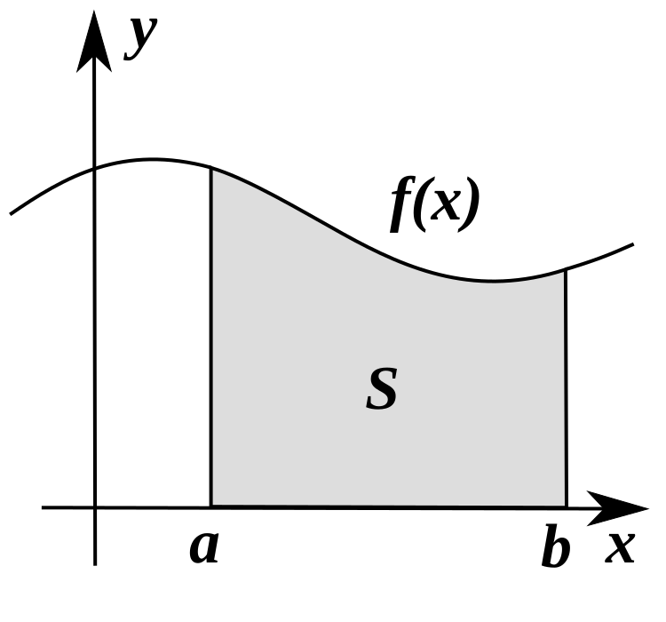

# 微积分与牛顿-莱布尼茨公式

一个模型给出当前的变化率，还没有给出最终状态。训练中，我们用局部导数选择参数更新；生成中，我们沿速度场累积多个小步。本文先计算回归损失的一次变化，再把同样的局部近似接到积分、ODE与SDE。

关键区别是哪些函数可以直接积分，哪些速度依赖尚未求出的状态。牛顿—莱布尼茨公式解释导数和积分的联系，数值求解器则处理不能直接写出解的轨迹。

## 从一次实际变化理解导数

取 \(f(x)=x^2\)，在 \(x=3\) 附近增加 \(h\)，有

\[
f(3+h)-f(3)=6h+h^2.
\]

除以输入变化 \(h\)，平均变化率为 \(6+h\)。当 \(h\to0\)，它趋向 6，这就是 \(f'(3)\)。用导数近似输出变化，得到 \(\Delta f\approx6h\)。取 \(h=0.01\)，近似是 0.06，真实变化是 0.0601，差的 0.0001 来自二阶项。

一般定义为

\[
f'(x)=\lim_{h\to0}\frac{f(x+h)-f(x)}h.
\]

导数首先是一阶局部近似的系数。大步更新可能离开这个近似有效的区域，所以“负梯度是下降方向”不保证任意学习率都会让实际损失下降。

## 梯度为何能用于参数更新

考虑最简单的回归 \(\hat y=wx\)，取一个样本 \(x=2,y=3\)，损失为

\[
L(w)=\tfrac12(2w-3)^2,
\qquad L'(w)=2(2w-3).
\]

在 \(w=1\) 时，预测为 2，损失为 0.5，导数为 -2。学习率取 0.1，一次梯度下降得到 \(w'=1-0.1(-2)=1.2\)，新损失为 0.18。如果学习率取 1，则 \(w'=3\)，损失变成 4.5。方向相同，步长不同，结果完全不同。

多参数情况下，梯度收集各坐标偏导数。对小扰动 \(\Delta\theta\)，有

\[
L(\theta+\Delta\theta)
\approx L(\theta)+\nabla L(\theta)^\top\Delta\theta.
\]

若采用欧氏范数，并限制 \(\|\Delta\theta\|_2\) 相同，负梯度方向使这个一阶变化最小。换成不同的距离度量或参数化，最陡方向的含义也会改变。优化器中的预条件、动量和自适应尺度正是在改变更新规则，不能把所有更新都等同于裸梯度。

## 链式法则怎样把损失传回参数

把上面的回归分成三个中间量

\[
a=wx,\quad e=a-y,\quad L=e^2/2.
\]

局部导数分别为 \(\partial L/\partial e=e\)、\(\partial e/\partial a=1\)、\(\partial a/\partial w=x\)，连起来得到 \(\partial L/\partial w=ex\)。在当前样本上就是 \((-1)\times2=-2\)。

反向传播沿计算图重复这件事。共享变量通过多条路径影响损失时，各路径的导数贡献要相加。向量情形需要 Jacobian，但实际实现通常直接计算向量与 Jacobian 的乘积，避免物化巨大矩阵，详见[Jacobian 与梯度传播](differential-jacobian-and-gradient-flow.md)。

## 积分把变化率累积成总变化

假设一维运动速度为 \(v(t)=2t\)。从 \(t=1\) 到 \(t=3\)，位移是

\[
\int_1^3 2t\,\mathrm dt=[t^2]_1^3=8.
\]

如果速度有负值，积分会扣除反向运动的位移。总路程则需要积分 \(|v(t)|\)，因此面积直觉必须保留符号与被积对象的含义。

{ width="560" }

<small>图源为 [Wikimedia Commons](https://commons.wikimedia.org/wiki/File:Integral_as_region_under_curve.svg)。积分累积区间内的局部贡献，物理意义取决于被积函数与单位。</small>

当 \(f\) 连续时，累积函数 \(F(x)=\int_a^x f(t)\,\mathrm dt\) 满足 \(F'(x)=f(x)\)。若 \(F\) 是被积函数的一个原函数，则牛顿-莱布尼茨公式给出

\[
\int_a^b f(t)\,\mathrm dt=F(b)-F(a).
\]

这里的关键条件是积分的是这个原函数的导数。不能据此说任意向量场沿不同路径的积分都只依赖端点；一般路径积分可能与路径有关。随机积分也需要另行规定积分意义，不能直接套用普通微积分的全部规则。

## ODE 中局部速度依赖尚未求出的状态

常微分方程 \(\mathrm dx/\mathrm dt=v(x,t)\) 指定每个状态的变化率。给定初值后，解满足

\[
x(t)=x(t_0)+\int_{t_0}^t v(x(s),s)\,\mathrm ds.
\]

积分里包含未知的 \(x(s)\)，因此只写出积分不等于已经求出轨迹。Euler 方法把一个短区间内的速度近似为起点速度

\[
x_{k+1}=x_k+h\,v(x_k,t_k).
\]

取 \(v(x,t)=-x\)、\(x(0)=1\)，解析解为 \(e^{-t}\)。走到 \(t=1\)，步长 0.5 时 Euler 得到 \(0.5^2=0.25\)，步长 0.1 时得到 \(0.9^{10}\approx0.34868\)，解析值约为 0.36788。减小步长改进了这个例子的近似，但增加了速度函数调用次数。

若生成约定噪声时间从 1 下降到 0，那么 \(h\) 为负。速度场的定义与积分方向必须配套，具体例子见[视频训练与采样](../diffusion/video-training-and-sampling-1029-1246.md)。同一个确定性 ODE 可以从不同随机初值出发，确定性轨迹并不排除生成结果的多样性。

## 每步的小误差为什么会累积

在 \(\dot x=-x\) 的例子里，真实一步是 \(x(t+h)=e^{-h}x(t)\)，Euler一步是 \((1-h)x(t)\)。展开指数可见单步差从 \(h^2x/2\) 开始。固定总时长要走约 \(1/h\) 步，于是在适当平滑与稳定条件下，整体误差通常是 \(O(h)\)。局部二阶小误差与全局一阶精度并不矛盾。

还要区分精度与稳定性。这里离散更新系数为 \(1-h\)，只有 \(0<h<2\) 时幅度收缩；h=3会交替放大，哪怕连续方程本来稳定。生成采样器减少步数时，必须同时考虑离散误差、模型预测误差与时间方向。

## 为什么有时先解析处理线性部分

对半线性系统

\[
\dot x=ax+r(x,t),
\]

常数 \(a\) 对应的齐次部分可以精确求解。乘积分因子并整理，得到

\[
x(t+h)=e^{ah}x(t)+\int_t^{t+h}e^{a(t+h-s)}r(x(s),s)\,\mathrm ds.
\]

若残余项刚好是常数 \(r=b\)，且 \(a\ne0\)，则

\[
x(t+h)=e^{ah}x(t)+\frac{e^{ah}-1}{a}b.
\]

例如 \(a=-2,b=2,x(0)=0,h=0.5\)，准确结果为 \(1-e^{-1}\approx0.63212\)，单步 Euler 得到 1。指数积分器利用可解的线性结构，再近似剩余积分。它的优势依赖方程结构和剩余项性质，不能推出任何高阶方法在任何步长下都更好。

## SDE 的随机增量按步长平方根缩放

随机微分方程可写成

\[
\mathrm dx=f(x,t)\,\mathrm dt+g(x,t)\,\mathrm dW_t.
\]

布朗运动在长度 \(h>0\) 的不重叠区间上有独立增量，且 \(\Delta W\sim\mathcal N(0,h)\)。Euler–Maruyama 离散化使用

\[
x_{k+1}=x_k+f(x_k,t_k)h+g(x_k,t_k)\sqrt h\,\xi_k,
\quad \xi_k\sim\mathcal N(0,1).
\]

漂移乘 \(h\)，随机项乘 \(\sqrt h\)。若误把随机项也乘 \(h\)，走完固定总时长后的噪声方差会随步长缩小而消失，得到错误的随机过程。以纯布朗运动为例，100 步、每步 0.01 的总方差应为 \(100\times0.01=1\)，错误缩放会给出 0.01。

SDE 的反向生成需要相应的反向漂移与时间定义，不能只把正向式中的 \(h\) 换成负数再开平方。具体关系见[Score SDE 与概率流](../diffusion/score-matching-sde-and-probability-flow.md)。

## 运行积分误差的比较

```python
import math
for steps in (2, 10, 100):
    h = 1 / steps
    x = 1.0
    for _ in range(steps):
        x += h * (-x)
    print(steps, round(x, 6), round(abs(x - math.exp(-1)), 6))
```

输出依次为 `2 0.25 0.117879`、`10 0.348678 0.019201`、`100 0.366032 0.001847`。这项验证只测试一个已知解析解的方程，用于说明离散误差，不代表某个生成模型的质量或加速比。

## 参考资料

- [Calculus on Computational Graphs](https://colah.github.io/posts/2015-08-Backprop/)解释计算图上的局部导数与链式法则。
- [微分与 Jacobian](differential-jacobian-and-gradient-flow.md)继续讨论向量输出、JVP 和 VJP。


- [D2L 微积分](https://github.com/d2l-ai/d2l-zh/blob/e6b18ccea71451a55fcd861d7b96fddf2587b09a/chapter_preliminaries/calculus.md)，从有限变化率到导数，再连接链式法则；本文的ODE例子另用解析解核对。
