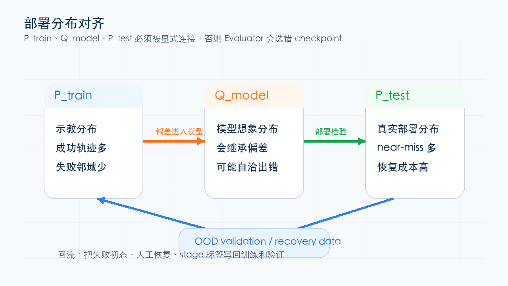

# 因果、反事实与分布偏移

两种方案在简单和困难样本上都由A胜出，合并以后却可能变成B胜出。这并不矛盾，两个方案面对的样本难度比例可能不同。下面从一张可复算的分层表出发，解释相关、干预和反事实分别需要什么信息。

调整权重可以纠正已观测的混杂结构，但只有在相关因果假设成立时，调整后的差异才能解释为干预效应。算术正确不等于因果识别成立。

## 相关性：一起变不等于互相导致

相关性可以用协方差或相关系数表达。皮尔逊相关系数是：

\[
\rho_{X,Y}
=
\frac{\operatorname{Cov}(X,Y)}
{\sigma_X\sigma_Y}
\]

\(\rho\) 接近 1 表示两个变量大体同向变化，接近 -1 表示反向变化，接近 0 表示线性相关弱。

但相关不说明因果。机器人数据里，“看到夹爪接近杯子”和“任务成功”可能高度相关，但真正导致成功的是抓取接触、力控、姿态和后续动作。如果模型只学到画面相关性，部署时一换视角、遮挡或失败恢复状态，就可能崩。

## 干预：把“看到”改成“动手改”

因果干预常用 \(do(\cdot)\) 记号：

\[
P(Y\mid do(X=x))
\]

它问的是：如果我们主动把 \(X\) 设置为 \(x\)，\(Y\) 会怎样。它不同于普通条件概率：

\[
P(Y\mid X=x)
\]

普通条件概率只是在已有数据里筛选 \(X=x\) 的样本；干预分布要求改变生成过程。动作条件世界模型正是在问这个问题：固定当前观测，如果换一个动作，未来会不会按动作分叉。

在观测数据上训练 \(P(o_{t+1}\mid o_t,a_t)\)，得到的首先仍是条件分布。若操作者看到的隐藏变量同时影响动作选择和下一状态，而模型输入没有包含它，条件分布就可能混入选择偏差。动作进入网络、替换动作会改变预测，都不足以单独证明识别了真实干预效果。

### 同一组数据为什么会给出相反结论

设有容易和困难两类场景，两个动作A、B的记录如下，数字均为教学构造。

| 场景 | A的成功数/尝试数 | B的成功数/尝试数 |
| --- | --- | --- |
| 容易 | 18/20 = 90% | 64/80 = 80% |
| 困难 | 40/80 = 50% | 8/20 = 40% |
| 合计 | 58/100 = 58% | 72/100 = 72% |

A在两类场景内都高10个百分点，合计却更差，因为它更常用于困难场景。直接比较总体条件成功率，会把场景构成混入动作差异。

若难度S包含了全部共同原因、每种难度下两个动作都有覆盖，且记录动作与实际执行语义一致，就可用调整公式

\[
P(Y=1\mid do(A=a))
=\sum_sP(Y=1\mid A=a,S=s)P(S=s).
\]

在目标场景容易与困难各一半时，A的调整成功率为 \(0.5\times0.9+0.5\times0.5=0.7\)，B为0.6。这里得出因果解释依赖所声明的无未观测混杂、覆盖和一致性假设。只做分层计算而未验证假设，最多得到按指定权重重算的关联比较。

对顺序决策，还要在每一步处理观测历史、动作选择和后续状态，不能把整个轨迹当作一次独立治疗。随机化试验可通过设计减少混杂，但实际机器人试验还受可执行动作、安全范围和状态覆盖限制。

## 同一分层权重为什么仍不够

把两组都加权为一半简单、一半困难，只消除了“已记录难度”这个维度的构成差异。如果A还更多服务于隐藏的严重病例，层内比较仍可能混杂。因果解释通常需要一致性、条件可交换性和正值性等假设；随机试验能通过设计帮助满足部分条件，观测数据则需要更谨慎的论证。

也不能按干预之后才产生的变量随意分层。例如方案会影响处理时长，再固定处理时长比较结果，可能阻断一部分真实效应或引入选择偏差。调整哪些变量是建模问题，不是把所有字段都加进回归即可。

## 反事实：如果当时做另一件事会怎样

反事实问题可以写成：

\[
Y_{X\leftarrow x'}
\]

它问的是：在同一个已经发生的场景里，如果把动作或条件换成 \(x'\)，结果会怎样。

世界模型和 VLA 评测经常需要反事实思维。例如同一个桌面状态下，向左推和向右推应该导致不同未来；同一个 prompt 下，改掉工具调用顺序应该影响任务结果；同一个失败轨迹，如果加入 recovery action，是否能回到成功路径。

反事实还要求保留“同一个场景”的背景条件。例如结构模型 \(Y=2A+U\)，U表示该个体不随动作改变的背景量。已观察到 \(A=1,Y=5\)，就推得 \(U=3\)；把动作改成0，反事实结果为3。步骤是先从事实推断背景，再替换动作方程，最后重新计算结果。

这个结果来自已给定的结构模型。仅凭 \(P(Y\mid A)\) 未必能识别相同的个体反事实。模拟器可以重置同一状态并更换动作，但结果仍依赖模拟器忠实程度；真实环境往往无法让同一个个体同时经历两个互斥动作。配对试验、动作干预和失败邻域评测能提供更强证据，也需要说明哪些背景条件真正保持相同。

## 分布偏移：训练分布不等于部署分布

训练集分布记作 \(P_{\text{train}}\)，部署分布记作 \(P_{\text{test}}\)。很多失败来自：

\[
P_{\text{train}}(x,y)
\ne
P_{\text{test}}(x,y)
\]

偏移有不同结构，修正方法所需假设也不同。

| 偏移形式 | 保持不变的假设 | 改变的部分与例子 |
| --- | --- | --- |
| Covariate shift | 条件关系 \(P(Y\mid X)\) | 输入分布 \(P(X)\)，如长请求比例变化 |
| Label shift | 类条件分布 \(P(X\mid Y)\) | 类别先验 \(P(Y)\)，如已知疾病的流行率变化 |
| 条件机制变化 | 通常无前两种不变保证 | \(P(Y\mid X)\)，如同样输入因工具权限变化而失败 |

这些是分析假设，不应只凭数据集名称判断成立。在纯covariate shift且支持集覆盖时，风险可以用 \(w(x)=p_{\rm test}(x)/p_{\rm train}(x)\) 重加权。若训练从未出现某种接触状态，有限权重无法补出缺失结果；若条件机制本身变化，输入重加权也不足以修复。

{ width="780" }

<small>图源：机器人数据飞轮专题图。原图表达：示教分布、模型想象分布和真实部署分布必须被显式连接，否则 evaluator 或 checkpoint selection 容易选错。这里的重点是：分布对齐是闭环系统能否可靠部署的前提。</small>

## IID 假设：样本独立同分布只是理想起点

很多统计估计默认样本独立同分布：

\[
(x_i,y_i)\sim P,\quad i=1,\ldots,n
\]

要区分序列内部的相关性与序列之间的采样。完整episode可以作为独立实验单元，而其中每一帧通常不独立；自回归模型的条件分解本身，也不代表来自独立文档的训练样本一定违反IID。需要检查的依赖包括：

| 场景 | 为什么不是 IID |
| --- | --- |
| 自回归生成 | 前一步输出会影响后一步输入 |
| 机器人闭环 | policy 的动作会改变后续状态分布 |
| 世界模型 rollout | 模型误差会随时间积累并改变未来输入 |
| 在线服务 | 用户请求、工具状态和系统 prompt 随时间变化 |

因此应按实际独立单元划分训练与验证。把同一视频的相邻帧随机分到两边，会高估泛化；机器人应考虑按场景、物体或采集会话切分，再单独报告同分布与新条件表现。闭环中策略会改变访问状态的分布，开环离线准确率不能直接替代部署回放。

## Benchmark generalization：分数能外推多远

benchmark 是有限样本和有限任务集合。读论文分数时，要问：

1. benchmark 是否覆盖目标部署分布。
2. 测试集是否和训练数据泄漏或相似。
3. 提升来自机制，还是来自评测口径。
4. 是否报告了不同任务桶、难度、长尾和失败案例。

相关性、因果性和分布偏移在这里会合：一个模型可能在 benchmark 上相关性学得很好，但在反事实动作、OOD 场景或工具环境变化下失败。
