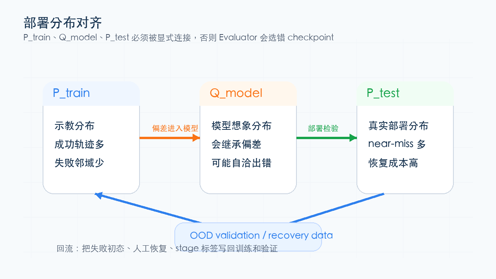

# 因果、反事实与分布偏移

causal、intervention、counterfactual、OOD、train-test mismatch、distribution shift 和 benchmark generalization 都在追问同一件事：模型学到的是观察相关，还是能经得起动作、干预和部署分布变化的机制。相关性告诉我们“两个变量一起变”；因果性要回答“如果我主动改变其中一个，另一个会不会跟着变”。

## 相关性：一起变不等于互相导致

相关性可以用协方差或相关系数表达。皮尔逊相关系数是：

\[
\rho_{X,Y}
=
\frac{\operatorname{Cov}(X,Y)}
{\sigma_X\sigma_Y}
\]

\(\rho\) 接近 1 表示两个变量大体同向变化，接近 -1 表示反向变化，接近 0 表示线性相关弱。

但相关不说明因果。机器人数据里，“看到夹爪接近杯子”和“任务成功”可能高度相关，但真正导致成功的是抓取接触、力控、姿态和后续动作。如果模型只学到画面相关性，部署时一换视角、遮挡或失败恢复状态，就可能崩。

## 干预：把“看到”改成“动手改”

因果干预常用 \(do(\cdot)\) 记号：

\[
P(Y\mid do(X=x))
\]

它问的是：如果我们主动把 \(X\) 设置为 \(x\)，\(Y\) 会怎样。它不同于普通条件概率：

\[
P(Y\mid X=x)
\]

普通条件概率只是在已有数据里筛选 \(X=x\) 的样本；干预分布要求改变生成过程。动作条件世界模型正是在问这个问题：固定当前观测，如果换一个动作，未来会不会按动作分叉。

如果模型只学到 \(P(o_{t+1}\mid o_t)\)，它可能生成合理视频；如果学到 \(P(o_{t+1}\mid o_t,a_t)\)，并且 \(a_t\) 真的改变未来，它才更接近可用于规划的因果模型。

## 反事实：如果当时做另一件事会怎样

反事实问题可以写成：

\[
Y_{X\leftarrow x'}
\]

它问的是：在同一个已经发生的场景里，如果把动作或条件换成 \(x'\)，结果会怎样。

世界模型和 VLA 评测经常需要反事实思维。例如同一个桌面状态下，向左推和向右推应该导致不同未来；同一个 prompt 下，改掉工具调用顺序应该影响任务结果；同一个失败轨迹，如果加入 recovery action，是否能回到成功路径。

这类问题不能只靠平均指标验证。它需要 paired action、hard negative、failure-adjacent states 或候选轨迹排序，让模型面对“相似输入，不同干预”的样本。

## 分布偏移：训练分布不等于部署分布

训练集分布记作 \(P_{\text{train}}\)，部署分布记作 \(P_{\text{test}}\)。很多失败来自：

\[
P_{\text{train}}(x,y)
\ne
P_{\text{test}}(x,y)
\]

偏移可以发生在输入、标签、任务组合、动作频率、相机视角、工具权限和用户请求上。论文里常见的 OOD、domain shift、train-test mismatch、exposure bias 都在描述这种断裂。

{ width="780" }

<small>图源：机器人数据飞轮专题图。原图表达：示教分布、模型想象分布和真实部署分布必须被显式连接，否则 evaluator 或 checkpoint selection 容易选错。这里的重点是：分布对齐是闭环系统能否可靠部署的前提。</small>

## IID 假设：样本独立同分布只是理想起点

很多统计估计默认样本独立同分布：

\[
(x_i,y_i)\sim P,\quad i=1,\ldots,n
\]

但真实 AI 系统常常不是 IID：

| 场景 | 为什么不是 IID |
| --- | --- |
| 自回归生成 | 前一步输出会影响后一步输入 |
| 机器人闭环 | policy 的动作会改变后续状态分布 |
| 世界模型 rollout | 模型误差会随时间积累并改变未来输入 |
| 在线服务 | 用户请求、工具状态和系统 prompt 随时间变化 |

这就是为什么只看随机验证集平均分不够。闭环任务要看 rollout horizon、failure recovery、OOD validation、P95/P99、任务桶和真实部署回放。

## Benchmark generalization：分数能外推多远

benchmark 是有限样本和有限任务集合。读论文分数时，要问：

1. benchmark 是否覆盖目标部署分布。
2. 测试集是否和训练数据泄漏或相似。
3. 提升来自机制，还是来自评测口径。
4. 是否报告了不同任务桶、难度、长尾和失败案例。

相关性、因果性和分布偏移在这里会合：一个模型可能在 benchmark 上相关性学得很好，但在反事实动作、OOD 场景或工具环境变化下失败。

## 常见误读

| 误读 | 更稳的理解 |
| --- | --- |
| 相关性高就说明机制对 | 相关性可能来自混杂变量或数据偏差 |
| action-conditioned 就一定有因果 | 要验证替换动作后未来是否真实分叉 |
| OOD 只是数据集名字不同 | OOD 是生成机制、任务组合或部署路径变了 |
| benchmark 第一就能上线 | 部署还要验证分布、工具链、长尾和闭环反馈 |

## 读完以后怎么判断

看到 causal、counterfactual、OOD、distribution shift 或 benchmark generalization，先问：模型学的是观察相关还是干预效果，是否有 paired counterfactual 样本，训练分布和部署分布哪里不同，评测是否覆盖失败恢复和长尾状态。这个问题链会支撑 DreamZero、kai0、世界模型综述、VLA 数据飞轮和大模型系统卡论文。
