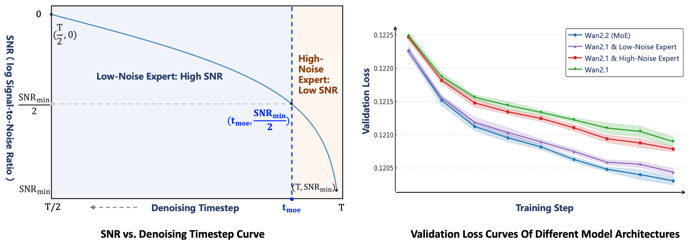

# 卷积、频域与多尺度表示

信号(1,0,-1,0)在四个采样点上完成一个振荡。我们先在空间或时间域对它滤波，再用频率坐标解释幅度、相位和降采样的信息损失。频率表示是同一信号的另一套坐标，不是额外生成了信息。

讨论卷积定理时必须明确线性卷积还是循环卷积；有限数组的padding和边界条件会改变对应关系。

## 卷积：用同一个局部模板扫过信号

一维离散卷积可以写成：

\[
(x*k)_t
=
\sum_{i=-m}^{m}x_{t-i}k_i
\]

二维图像卷积可以写成：

\[
(X*K)_{u,v}
=
\sum_{i,j}X_{u-i,v-j}K_{i,j}
\]

这里 \(K\) 是 kernel 或 filter。直觉上，卷积在每个位置问同一个问题：附近像不像某种局部模式。边缘、角点、纹理、深度局部结构、动作短期平滑，都可以用这种局部模板直觉理解。

卷积共享同一组kernel参数，在不同位置重复计算。实现时要核对符号。深度学习中名为卷积的层通常执行互相关，不先翻转kernel。例如信号 \((1,2,4,8)\)、kernel \((1,-1)\)，无padding的互相关为 \((-1,-2,-4)\)；翻转kernel后则为 \((1,2,4)\)。可学习kernel通常能适应这一区别，但手写滤波器或复现公式时不能混用。

对一维互相关，输入长度L、kernel长度k、padding p、stride s、dilation d的常见输出长度为

\[
L_{\rm out}=\left\lfloor\frac{L+2p-d(k-1)-1}{s}\right\rfloor+1.
\]

取 \(L=8,k=3,p=1,s=2,d=1\)，输出长度4。padding和边界处理会影响平移等变性，stride大于1也只保留特定采样格点，不能把“参数共享”直接推成任意平移都完全等变。

## Filter：保留一些变化，压掉另一些变化

filter 不是只能指卷积层。更抽象地说，filter 是一个选择器：保留某些成分，压低另一些成分。

| filter 类型 | 保留什么 | 常见场景 |
| --- | --- | --- |
| 低通 filter | 平滑、慢变化、整体趋势 | 动作 chunk、视频运动趋势、去噪 |
| 高通 filter | 边缘、突变、细节 | 图像边缘、接触瞬间、异常检测 |
| 带通 filter | 某个频率范围 | 音频、周期运动、振动信号 |

读论文里的 filtering、smoothing、temporal aggregation 时，可以先问：它在保留哪种变化，牺牲哪种变化。

## Fourier 和 DCT：把信号换到频率坐标

离散 Fourier 变换可以抽象成：

\[
X_k
=
\sum_{n=0}^{N-1}
x_n
\exp\left(-2\pi i\frac{kn}{N}\right)
\]

这里用 \(\mathrm i^2=-1\) 表示虚数单位。DFT把N个数换到N个离散频率坐标，逆变换使用 \(1/N\) 归一化。对 \(x=(1,0,-1,0)\)，代入上式得到 \(X=(0,2,0,2)\)。它没有直流均值，只包含一对共轭频率分量。

把信号平移一格成为 \((0,1,0,-1)\)，频谱变为 \((0,-2\mathrm i,0,2\mathrm i)\)。两者幅值完全相同，相位不同。只保存频谱幅值，无法知道信号在何处出现，也不能唯一恢复原序列。

频谱可以分成两个部分读：幅值告诉你某个频率有多强，相位告诉你这些波峰波谷在什么位置。很多视觉任务不能只看幅值，因为边缘、形状和时序对齐都依赖相位；但幅值足够说明一个直觉：平滑动作主要集中在低频，抖动、边缘和噪声更容易出现在高频。

一种常用的正交DCT-II定义为

\[
C_k=\alpha_k\sum_{n=0}^{N-1}x_n\cos\!\left[\frac{\pi}{N}(n+\tfrac12)k\right],
\quad \alpha_0=1/\sqrt N,\quad \alpha_{k>0}=\sqrt{2/N}.
\]

常数信号 \((2,2,2,2)\) 只有直流系数 \(C_0=4\)，其余为零。平滑动作往往能用少数低频系数近似，量化这些系数后再编码可以缩短表示。但抓取接触、紧急制动和夹爪开合可能含有关键突变，删掉高频会把它们抹平；压缩是否合适必须回到动作误差和闭环结果。

这也是为什么 FAST 一类动作 tokenization 方法会谈 DCT，视频模型会谈时空频率，扩散和去噪会谈不同噪声水平负责不同尺度。

## 卷积定理：空间里的局部模板等价于频域里的乘法

卷积定理可以粗略写成：

\[
\mathcal{F}(x*k)
=
\mathcal{F}(x)\cdot\mathcal{F}(k)
\]

这里 \(\mathcal{F}\) 表示 Fourier transform。它说的是：在时间或空间域做卷积，等价于在频域把信号频谱和 filter 频谱逐点相乘。

在有限长度DFT下，直接逐点相乘对应循环卷积；要得到线性卷积，必须做足够的零填充。边界约定是等式的一部分。

对两点平均kernel \((1/2,1/2)\)，频率响应为 \(H(\omega)=\tfrac12(1+e^{-\mathrm i\omega})\)。在 \(\omega=0\) 时为1，常量被保留；在 \(\omega=\pi\) 时为0，逐点正负交替的信号被消掉。差分kernel \((1,-1)\) 则在直流处为零，对变化敏感。

假设信号为 \((1,-1,1,-1,\ldots)\)，直接隔点下采样得到全1，原来的最高频变化被误认为常量，这叫混叠。先低通再下采样可以抑制这种折返，却也丢掉被滤除的细节。高分辨率不能从已经发生的混叠中自动恢复真实信息。

## 在四点例子上核对循环卷积

使用循环平滑 \(y_n=(x_n+x_{n-1})/2\)，下标按4取模，得到 \((0.5,0.5,-0.5,-0.5)\)。原信号DFT为 `(0,2,0,2)`，滤波器响应为 \(H_k=(1+e^{-2\pi ik/4})/2\)，逐频相乘后是 `(0,1-i,0,1+i)`。

幅度下降，同时相位发生变化。这说明“平滑保留低频”只是简写，具体滤波器还会改变相位。若用零padding的线性卷积，边界值不同，不能拿同一个循环结果验证。

## 多尺度：同一个对象在不同分辨率下看

图像和视频既有全局布局，也有局部细节。多尺度方法会把信号分成粗到细的层级：

1. 粗尺度看整体结构、长距离关系和大运动。
2. 中尺度看对象、局部布局和阶段变化。
3. 细尺度看纹理、边缘、接触和微小误差。

在视觉模型里，这可能表现为 feature pyramid、patch merging、多分辨率 decoder；在世界模型里，可能表现为 latent dynamics 负责高层未来，pixel decoder 负责可视细节；在机器人里，可能表现为高层 subgoal 和低层控制频率分开。

## SNR 和 timestep：扩散里的尺度坐标

扩散模型里的 timestep 不只是循环编号，它对应噪声强度。常见信噪比可以写成：

\[
\operatorname{SNR}(t)
=
\frac{\alpha_t^2}{\sigma_t^2}
\]

\(\alpha_t\) 表示信号保留强度，\(\sigma_t\) 表示噪声强度。这个系数比通常对应 \(x_t=\alpha_tx_0+\sigma_t\epsilon\)，并假设信号与噪声按所用坐标归一化为可比方差。若实际信号方差不是1，真正功率比还需乘上相应方差。取 \(\alpha=0.8,\sigma=0.6\)，系数SNR为 \(0.64/0.36\approx1.78\)；时间索引t本身没有固定强度含义，必须看schedule如何映射。

{ width="820" }

<small>图源：`Wan2.2` 相关论文图，已本地化于视频扩散专题。原图展示 denoising timestep 与 SNR 阶段，以及不同 expert 在不同噪声区间的验证曲线。这里的重点是：timestep 可以被读成噪声尺度，不同阶段承担的生成职责不同。</small>

分阶段去噪方法会利用不同噪声区间的统计差异。高噪声阶段常与整体结构恢复相关，低噪声阶段常与细节相关，但这是一种依赖数据谱、参数化和模型的经验概括，不能据此认定某个timestep只处理某个空间频段。SNR是信号与噪声尺度，频率是变化快慢，两者不是同一个坐标。
