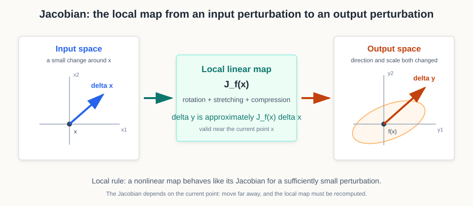

# Jacobian、向量链式法则与反向传播

模型的一层把向量变成另一个向量。输入每个坐标轻微变化时，输出可能同时向多个方向移动。Jacobian 把这些局部关系排成矩阵，让我们既能向前预测扰动，也能向后传递损失的敏感度。

一直使用同一个函数

\[
f(x_1,x_2)=\begin{bmatrix}x_1+2x_2\\x_1x_2\end{bmatrix},
\qquad x=(1,2)^\top,
\qquad y=f(x)=(5,2)^\top.
\]

## 每行对应输出，每列对应输入

Jacobian 的第 i 行第 j 列是 \(\partial f_i/\partial x_j\)，因此本例为

\[
J_f(x)=\begin{bmatrix}1&2\\x_2&x_1\end{bmatrix},\qquad
J_f(1,2)=\begin{bmatrix}1&2\\2&1\end{bmatrix}.
\]

第一列说 x1 增加一点，会使第一个输出增加一倍、第两个输出增加两倍；第二列说 x2 的对应影响为两倍和一倍。一般 \(f:\mathbb R^n\to\mathbb R^m\) 的 Jacobian 是 m×n，乘输入列向量后仍得到 m 维输出变化。

{ width="800" }

<small>本站示意图。Jacobian只描述当前位置附近的拉伸、旋转与压缩，远离这个点以后要重新计算。</small>

## 用一个小扰动检验局部近似

令 \(\Delta x=(0.01,-0.02)^\top\)。一阶变化为

\[
J_f\Delta x=(-0.03,0)^\top.
\]

真实第一个输出从5变为4.97，完全匹配，因为它是线性的。第二个输出从2变为 \(1.01\times1.98=1.9998\)，变化-0.0002。遗漏项正是 \(\Delta x_1\Delta x_2\)，属于二阶。

这能解释量化误差分析的边界。小输入误差可以先通过 Jacobian 估计；扰动较大、跨过激活分段或改变离散选择时，局部近似可能失效。对可微区域，谱范数给出一阶最坏方向放大量 \(\|J_f\|_2\)，实际数据扰动未必沿这个最坏方向。

## 接上一个损失，梯度就向后走

定义 \(L(y)=\frac12(y_1^2+y_2^2)\)，输出端梯度为 \(\nabla_yL=(5,2)^\top\)。链式法则得到

\[
\nabla_xL=J_f^\top\nabla_yL=(9,12)^\top.
\]

同一扰动带来的损失变化为 \(9(0.01)+12(-0.02)=-0.15\)。也可以先算输出扰动，再用输出敏感度相乘，\((5,2)\cdot(-0.03,0)=-0.15\)。两种方向计算的是同一个标量。

向前的 \(J_fv\) 称 JVP，它回答输入沿 v 改变会怎样；向后的 \(u^\top J_f\) 称 VJP，列向量形式是 \(J_f^\top u\)，回答某个输出敏感度怎样传回输入。真实自动微分通常直接计算这些乘积，不需要存完整 Jacobian。

## 多层组合时顺序不能交换

若 \(h=f(x),y=g(h)\)，有

\[
J_{g\circ f}(x)=J_g(f(x))J_f(x).
\]

右侧的 Jf 先作用于输入扰动，再由 Jg 传到最终输出。反向传播则为 \(\nabla_xL=J_f^\top J_g^\top\nabla_yL\)。矩阵通常不交换，所以只记“把所有导数乘起来”还不够，必须保留数据依赖顺序。

多个下游分支使用同一中间值时，它的梯度是各分支贡献之和。例如 \(L=u+x,u=x^2\)，在 x=2 处为 \(2x+1=5\)。只沿平方分支反传会漏掉直接相加的一项。源码中的 `+=` 就在收集这些路径。

## 把这个例子的反向过程拆成局部贡献

前面的结果可以完全按计算图重算一遍。令

\[
u=x_1+2x_2,\qquad v=x_1x_2,\qquad L=\frac12(u^2+v^2).
\]

在 \(x=(1,2)\) 处，\(u=5,v=2\)。从损失开始，先得到

\[
\bar u=\frac{\partial L}{\partial u}=5,
\qquad
\bar v=\frac{\partial L}{\partial v}=2.
\]

沿 \(u\) 这条分支，\(x_1\) 收到 \(5\times1=5\)，\(x_2\) 收到 \(5\times2=10\)。沿 \(v\) 这条分支，\(x_1\) 收到 \(2\times x_2=4\)，\(x_2\) 收到 \(2\times x_1=2\)。同一个输入节点要把两条路径的贡献相加，所以

\[
\bar x_1=5+4=9,\qquad \bar x_2=10+2=12.
\]

这正是 \(J_f^\top\nabla_yL\) 的结果。计算图教程常把它说成“沿边相乘，遇到汇合就相加”，在实现里对应保存中间值、按逆拓扑顺序执行局部反向函数，以及对已有梯度做累加。若把赋值写成覆盖，第二条路径就会悄悄丢失。

可以用一个很小的 PyTorch 程序检查同一件事：

```python
import torch

x = torch.tensor([1.0, 2.0], requires_grad=True)
y = torch.stack((x[0] + 2 * x[1], x[0] * x[1]))
loss = 0.5 * (y * y).sum()
loss.backward()
print(y.detach().tolist())       # [5.0, 2.0]
print(x.grad.tolist())            # [9.0, 12.0]
```

这段程序只检查一个标量损失和两个输入，不能代替大模型的梯度检查。它适合在改写一个自定义算子或手写反向函数时先确认局部链式法则，再把问题扩大到 batch、广播和实际 dtype。

## Softmax 的各概率为什么相互影响

Softmax 为 \(p_i=e^{z_i}/\sum_j e^{z_j}\)。对商求导可得

\[
\frac{\partial p_i}{\partial z_j}=p_i(\delta_{ij}-p_j),\qquad
J=\operatorname{diag}(p)-pp^\top.
\]

\(\delta_{ij}\) 在 i=j 时为1，其余为0。对两类分布 p=(0.8,0.2)，Jacobian 为 `[[.16,-.16],[-.16,.16]]`。仅提高第一个 logit 0.1，一阶预测概率变化 `(0.016,-0.016)`，总和为零。所有 logit 同时加相同常数则完全不改变概率，Jacobian乘全1向量为零。

接上交叉熵 \(L=-\sum_i y_i\log p_i\)，且标签分布总和为1，链式法则化简成 \(\nabla_zL=p-y\)。若正确类别为第二类，梯度为 `(0.8,-0.8)`。这条简式来自特定损失与softmax的组合，不能用于任意输出损失。

## 用数值差分验证两个输入梯度

```python
def loss(x):
    y1, y2 = x[0]+2*x[1], x[0]*x[1]
    return (y1*y1+y2*y2)/2
x, step = [1.,2.], 1e-5
grad = []
for j in range(2):
    plus, minus = x.copy(), x.copy()
    plus[j] += step
    minus[j] -= step
    grad.append((loss(plus)-loss(minus))/(2*step))
print([round(v,6) for v in grad])
```

输出 `[9.0,12.0]`。步长过大有截断误差，过小有浮点抵消，数值差分是小规模检查方法，不是大型网络的常规求导方式。

Hessian进一步对标量损失求二阶导数，Fisher则衡量参数对概率分布的影响，三者对象不同，详见[谱与二阶结构](spectral-second-order-and-low-rank.md)。如果需要把这些局部导数放回真实训练图，可接着看[自动微分、检查点与显存](../foundations/autograd-activation-checkpointing-and-memory.md)。

## 对照源码

- [micrograd 的 Value 与 backward](https://github.com/karpathy/micrograd/blob/7bc720e951fe422b8f8814aa5aa1b64121d26b4c/micrograd/engine.py)，逐个局部导数、分支累积和逆拓扑遍历对应本文的反向链式法则。

- [Colah 对计算图与正反向模式的讲解](https://colah.github.io/posts/2015-08-Backprop/)，用于对照“路径贡献如何合并”的直觉。本文的数值例子和代码是本站重新写的。
