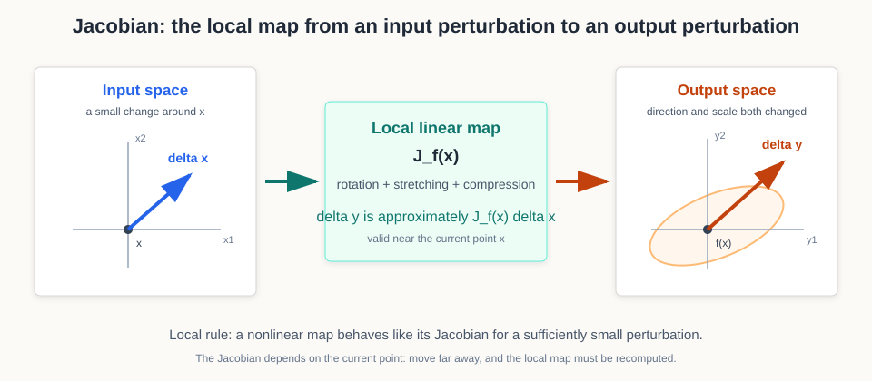

# 微分、Jacobian 与梯度传播

读到神经网络、机器人控制或量化论文时，我们常看到一句话：“一个小误差会被后续层的 Jacobian 放大。”如果只把 Jacobian 记成“偏导数组成的矩阵”，这句话仍然很难落到直觉上。

这篇从一个更有用的问题开始：**输入朝某个方向动一点，输出会朝哪里动、动多远？** Jacobian 就是当前点附近回答这个问题的局部地图。它把标量导数扩展到向量映射，也把微积分、自动微分、误差传播和控制连接到了一起。

## 导数其实在做局部线性近似

一元函数在 \(x\) 附近变化时，有：

\[
f(x+\Delta x)
\approx
f(x)+f'(x)\Delta x
\]

移项以后：

\[
\Delta y
\approx
f'(x)\Delta x
\]

这里的导数 \(f'(x)\) 不只是一条曲线的斜率。它还是一个局部线性变换：把输入的小变化 \(\Delta x\) 乘上一个比例，得到输出的小变化 \(\Delta y\)。

例如 \(f(x)=x^2\)，在 \(x=3\) 处 \(f'(3)=6\)。如果 \(\Delta x=0.01\)，局部近似给出：

\[
\Delta y\approx 6\times0.01=0.06
\]

真实变化是 \(3.01^2-3^2=0.0601\)。少掉的 \(0.0001\) 来自更高阶项；当扰动足够小时，一阶近似已经能很好描述变化。

神经网络面对的通常不是一个输入和一个输出。一个 hidden state 可能有 4096 维，一层网络又输出另一个 4096 维向量。此时单个导数不够，我们需要把每个输入方向对每个输出方向的影响都记下来。

## Jacobian：把每个输入方向对每个输出的影响排成矩阵

设：

\[
f:\mathbb{R}^n\rightarrow\mathbb{R}^m
\]

输入 \(x\) 有 \(n\) 个分量，输出 \(y=f(x)\) 有 \(m\) 个分量。Jacobian 定义为：

\[
J_f(x)
=
\begin{bmatrix}
\frac{\partial f_1}{\partial x_1} & \cdots & \frac{\partial f_1}{\partial x_n}\\
\vdots & \ddots & \vdots\\
\frac{\partial f_m}{\partial x_1} & \cdots & \frac{\partial f_m}{\partial x_n}
\end{bmatrix}
\in\mathbb{R}^{m\times n}
\]

它的第 \(i\) 行在问“所有输入怎样影响输出 \(f_i\)”；第 \(j\) 列在问“输入 \(x_j\) 的变化会同时推动哪些输出”。局部变化写成：

\[
\Delta y
\approx
J_f(x)\Delta x
\]

shape 也在声明同一件事：

\[
(m\times n)(n\times1)\rightarrow(m\times1)
\]

{ width="800" }

<small>图源：本站自绘示意图。非线性函数在当前点附近可以先看成一个线性映射：输入扰动经过 Jacobian 后可能被旋转、拉伸或压缩。这个近似只在局部成立，换到远处需要重新计算 Jacobian。</small>

来看一个两维例子：

\[
f(x_1,x_2)
=
\begin{bmatrix}
x_1+2x_2\\
x_1x_2
\end{bmatrix}
\]

它的 Jacobian 是：

\[
J_f(x_1,x_2)
=
\begin{bmatrix}
1 & 2\\
x_2 & x_1
\end{bmatrix}
\]

在 \(x=(1,2)\) 处：

\[
J_f(1,2)
=
\begin{bmatrix}
1 & 2\\
2 & 1
\end{bmatrix}
\]

如果输入扰动是：

\[
\Delta x
=
\begin{bmatrix}
0.01\\
-0.02
\end{bmatrix}
\]

那么输出变化近似为：

\[
\Delta y
\approx
\begin{bmatrix}
1 & 2\\
2 & 1
\end{bmatrix}
\begin{bmatrix}
0.01\\
-0.02
\end{bmatrix}
=
\begin{bmatrix}
-0.03\\
0
\end{bmatrix}
\]

真实第二个输出从 \(1\times2=2\) 变成 \(1.01\times1.98=1.9998\)，变化是 \(-0.0002\)。一阶近似把它看成 0，误差来自两个小扰动相乘的二阶项。

## 梯度和 Jacobian 到底差在哪里

如果输出只有一个标量：

\[
\mathcal L:\mathbb{R}^n\rightarrow\mathbb{R}
\]

这里 \(\mathcal L\) 表示把 \(n\) 维输入映射成一个标量 loss，因此输出维度已经从一般 Jacobian 的 \(m\) 收缩为 1。

那么 Jacobian 只有一行：

\[
J_{\mathcal L}(x)
=
\begin{bmatrix}
\frac{\partial\mathcal L}{\partial x_1}
&
\cdots
&
\frac{\partial\mathcal L}{\partial x_n}
\end{bmatrix}
\]

梯度通常写成列向量：

\[
\nabla_x\mathcal L
=
\begin{bmatrix}
\frac{\partial\mathcal L}{\partial x_1}\\
\vdots\\
\frac{\partial\mathcal L}{\partial x_n}
\end{bmatrix}
\]

因此在这套约定下：

\[
J_{\mathcal L}(x)
=
\nabla_x\mathcal L^\top
\]

不同教材和自动微分框架可能采用不同的行列约定，所以读公式时不要只盯着转置符号。更稳定的判断是：输入有几维、输出有几维、这个乘法最后应该得到什么 shape。

## 向量链式法则：局部线性映射怎样接起来

设：

\[
x\xrightarrow{f}h\xrightarrow{g}y
\]

其中 \(h=f(x)\)，\(y=g(h)\)。在当前点附近：

\[
\Delta h\approx J_f(x)\Delta x
\]

第一行表示输入扰动先经过 \(f\) 的局部 Jacobian，变成中间表示的扰动。接着：

\[
\Delta y\approx J_g(h)\Delta h
\]

第二行表示同一个扰动再经过 \(g\) 的局部 Jacobian，继续传到最终输出。

把第一行代入第二行：

\[
\Delta y
\approx
J_g(f(x))J_f(x)\Delta x
\]

这个乘积表示两段局部线性映射按数据流顺序复合；最靠近输入的 \(J_f\) 先作用在 \(\Delta x\) 上。

所以：

\[
J_{g\circ f}(x)
=
J_g(f(x))J_f(x)
\]

假设 \(x\in\mathbb R^n\)、\(h\in\mathbb R^k\)、\(y\in\mathbb R^m\)，那么：

\[
(m\times k)(k\times n)=(m\times n)
\]

这就是向量形式的链式法则。深层网络的 Jacobian 是许多局部 Jacobian 的乘积；梯度消失、梯度爆炸和扰动放大，都可以从这些局部映射连续相乘来理解。

## JVP 与 VJP：自动微分真正计算的对象

完整 Jacobian 可能非常大。一个 4096 维输入映射到 4096 维输出，Jacobian 就有约 1678 万个元素。自动微分通常不会先把它完整写出来，而是直接算“Jacobian 与某个向量的乘积”。

**JVP，Jacobian-vector product**：

\[
J_f(x)v
\]

它问：输入沿方向 \(v\) 轻微移动时，输出沿什么方向变化。JVP 从输入扰动往输出推进，和 forward-mode automatic differentiation 的方向一致。

**VJP，vector-Jacobian product**：

\[
u^\top J_f(x)
\]

它问：上游对输出的敏感度 \(u\) 传过当前函数后，对输入有多敏感。VJP 从输出敏感度往输入传，和 reverse-mode automatic differentiation，也就是深度学习常说的 backward，方向一致。

当最终目标是一个标量 loss 时，reverse mode 很合算：从一个标量开始向后传播，可以一次得到 loss 对大量参数的梯度。后面的[自动微分与激活显存](../foundations/autograd-activation-checkpointing-and-memory.md)会把这个数学对象接到计算图、activation 保存和 checkpointing。

## Softmax Jacobian：改一个 logit，为什么所有概率都会动

Softmax 定义为：

\[
p_i
=
\frac{e^{z_i}}{\sum_k e^{z_k}}
\]

它的 Jacobian 元素是：

\[
\frac{\partial p_i}{\partial z_j}
=
p_i(\delta_{ij}-p_j)
\]

其中 \(\delta_{ij}\) 是 Kronecker delta：当 \(i=j\) 时为 1，否则为 0。拆成两种情况：

\[
\frac{\partial p_i}{\partial z_i}
=
p_i(1-p_i)
\]

\[
\frac{\partial p_i}{\partial z_j}
=
-p_ip_j,\qquad i\ne j
\]

对 logits \(z=(2,1,0)\)，softmax 约为：

\[
p\approx(0.6652,0.2447,0.0900)
\]

对应 Jacobian 约为：

\[
J_{\mathrm{softmax}}
\approx
\begin{bmatrix}
0.2227 & -0.1628 & -0.0599\\
-0.1628 & 0.1848 & -0.0220\\
-0.0599 & -0.0220 & 0.0819
\end{bmatrix}
\]

如果只把第一个 logit 增加 \(0.1\)：

\[
\Delta z=(0.1,0,0)
\]

这里 \(\Delta z\) 表示只扰动第一个类别的 logit，另外两个 logit 保持不变。

那么：

\[
\Delta p
\approx
J_{\mathrm{softmax}}\Delta z
\approx
(0.0223,-0.0163,-0.0060)
\]

第一个概率上升，另外两个概率一起下降，而且三个变化量之和约为 0。这不是巧合：softmax 输出始终要满足 \(\sum_i p_i=1\)，所以概率之间天然耦合。

这也解释了 [Attn-QAT](../paper-deep-dives/foundations/attn-qat.md) 为什么会特别保护 softmax backward 的关键标量项。对 attention probability 的低精度扰动不只影响一个位置，它会通过 softmax Jacobian 联动整行概率。

## 误差传播：量化扰动为什么可能被后续网络放大

设一段网络输出为 \(y=f(x)\)，输入因量化、压缩或传感器噪声出现小扰动 \(\delta x\)。局部一阶近似是：

\[
\delta y
\approx
J_f(x)\delta x
\]

用谱范数可以写出一个上界：

\[
\|\delta y\|_2
\lesssim
\|J_f(x)\|_2
\|\delta x\|_2
\]

这里 \(\|J_f(x)\|_2\) 表示 Jacobian 的谱范数，也就是局部最容易放大扰动的方向所对应的最大倍率。

如果 \(\|J_f(x)\|_2\) 很大，某些方向上的小输入误差会被明显放大；如果小于 1，扰动在局部可能被压缩。对多层网络：

\[
\delta h_L
\approx
J_{L-1}J_{L-2}\cdots J_l\,\delta h_l
\]

所以“这一层权重量化误差很小”不等于“最终输出误差很小”。误差还要穿过后续层的局部映射。站内的[量化方法比较](../quantization/comparison-table.md)正是用这条直觉解释分层敏感性。

这里有两个边界：

1. Jacobian 是局部近似。扰动太大、激活跨过 ReLU 分段或模型进入另一个状态区域时，需要重新评估。
2. 范数上界描述最坏方向，可能比真实数据分布上的平均误差更保守。因此论文还会结合校准集、Hessian、Fisher 或实际任务指标。

## Jacobian、Hessian 与 Fisher 的边界

这三个矩阵都在谈敏感度，但对象不同：

| 对象 | 常见定义 | 回答的问题 |
| --- | --- | --- |
| Jacobian | \(J_f=\partial f/\partial x\) | 输入的小变化怎样改变向量输出 |
| Hessian | \(H=\nabla^2\mathcal L\) | 参数扰动怎样改变标量 loss 的局部曲率 |
| Fisher | \(F=\mathbb E[ss^\top]\) | 参数扰动怎样改变模型概率分布 |

例如 KV 合并可以先用 attention 输出对 K/V 的 Jacobian 看一阶输出变化，再用 loss Hessian 看二阶质量代价。[KVSlimmer](../paper-deep-dives/inference/kvslimmer.md)进一步利用 exact Hessian block 处理相邻 token 的耦合；[谱分解、二阶近似与低秩结构](spectral-second-order-and-low-rank.md)则详细解释 Hessian 和 Fisher。

## 常见误读

| 误读 | 更稳的理解 |
| --- | --- |
| Jacobian 就是梯度的另一个名字 | 梯度通常对应标量输出；Jacobian 可以描述多输入、多输出映射 |
| 自动微分一定会生成完整 Jacobian | 深度学习 backward 通常直接算 VJP |
| Jacobian 大就说明模型一定不稳定 | 要说明在哪个点、哪个方向、使用什么范数，以及扰动是否落在真实数据分布上 |
| 一阶近似能解释任意大小的量化误差 | 它只在局部可靠，大扰动还会受到高阶项和激活区域变化影响 |
| Hessian、Fisher 和 Jacobian 可以互换 | 三者分析的对象和近似语义不同 |

## 读完以后怎么判断

看到 Jacobian 时先问四件事：输入和输出分别是什么，矩阵 shape 是多少，乘在左边还是右边的向量代表什么，近似只在当前点附近还是覆盖了真实扰动范围。

如果论文说“误差被 Jacobian 放大”，还要继续问：它用的是最坏方向范数、样本平均，还是某个任务 loss；只算了一层，还是把后续网络也纳入了分析。能把这几问说清楚，Jacobian 就不再只是偏导数表，而是读自动微分、量化、控制和鲁棒性论文的一张局部地图。

## 相关阅读与下一步

- 站内前置：[微积分与牛顿-莱布尼茨公式](calculus-and-newton-leibniz.md)。
- 站内下一步：[自动微分与激活显存](../foundations/autograd-activation-checkpointing-and-memory.md)。
- 站内下一步：[谱分解、二阶近似与低秩结构](spectral-second-order-and-low-rank.md)。
- 论文例子：[Attn-QAT：4-bit Attention 量化感知训练](../paper-deep-dives/foundations/attn-qat.md)。
- 论文例子：[KVSlimmer：非对称 KV 合并](../paper-deep-dives/inference/kvslimmer.md)。
- 外部材料：[Automatic Differentiation in Machine Learning: a Survey](https://jmlr.org/papers/v18/17-468.html)。
