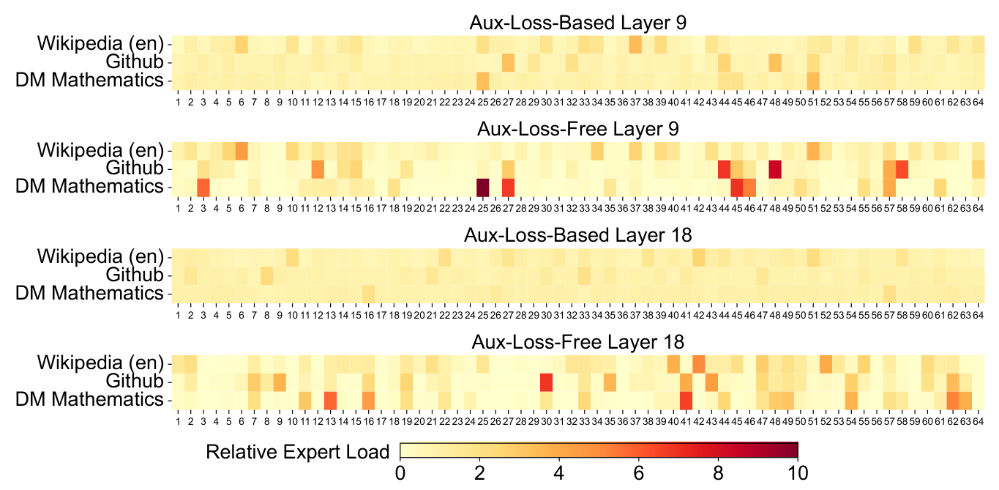

# 离散选择、Top-k 与稀疏路由

给四个候选打分(2,1,0,-1)，可以选择最高分、保留前两个、按概率采样，或把多个结果加权合并。分数相同，操作不同，输出和可微路径也不同。

本文先对照这些操作，再讨论把选择放进beam search、树搜索与专家路由时新增的状态和容量约束。它们共用一些数学工具，但优化的对象不能混在一起。

## 打分：先把候选变成可比较的数字

给定候选集合 \(\{1,\ldots,n\}\)，模型通常先给每个候选一个 score：

\[
s_i=f_\theta(x,i)
\]

这里 \(x\) 是上下文，\(i\) 是候选编号。score 可以来自 logits、router MLP、retriever 相似度、value head 或 reward model。

score 的作用是提供排序依据，不直接说明“真理”。后面所有选择错误，都可能来自 score 本身不准，也可能来自选择规则不适合任务。

## Argmax 和 Top-k：从连续分数到离散选择

最硬的选择是 argmax：

\[
i^*=\arg\max_i s_i
\]

它只保留分数最高的一个候选。top-k 则保留前 \(k\) 个：

\[
S_k=\operatorname{TopK}(s_1,\ldots,s_n)
\]

例如分数 \((2,1,0,-1)\) 的top-2集合为前两个候选。只要次序不改变，轻微调整分数不会改变集合；在两个分数交叉时，集合会突然跳变。因此选择索引没有通常意义上可用的连续梯度。被选候选的输出与连续权重仍可求导，但那条梯度不能自动教会未入选候选“如果被选中会怎样”。具体方法需要辅助目标、探索、连续松弛或其他估计器。

早期剪枝还可能丢掉后续最优路径。假设第一步A概率0.6、B概率0.4，而第二步各自最好延续的条件概率为0.5和0.99。贪心先选A，完整路径概率0.3；保留两个前缀后能找到B分支的0.396。宽度2在这个玩具树中有用，但有限beam仍可能在更深层剪掉全局最优解。

## Top-k集合不随微小分数变化时

对分数(2,1,0,-1)选前二并在集合内softmax，权重约为(0.731059,0.268941)。将第三个分数从0改为0.1不会改变集合，也不会通过这个已屏蔽分支影响输出；将它提高到1.1则会替换第二名，计算图发生离散切换。

因此集合内权重可以有普通梯度，索引变化却不能简单用同一个平滑导数解释。生成采样、MoE gating和STE分别对这种离散性作出不同处理，需检查实际目标而非统一叫“可微top-k”。

## Beam search：保留多条前缀，而不是只走一条

贪心解码每一步只取当前最高分 token：

\[
y_t=\arg\max_y \log p(y\mid y_{<t},x)
\]

beam search 会保留 \(B\) 条候选前缀，并按累计 log probability 排序：

\[
\operatorname{score}(y_{1:t})
=
\sum_{i=1}^{t}\log p(y_i\mid y_{<i},x)
\]

beam search 是一种有限宽度搜索，不是随机采样。\(B\) 越大，搜索空间覆盖越广，但计算越贵，也更可能偏向高似然但乏味或过短的序列。读 EAGLE 的 draft tree、传统 seq2seq 解码或候选轨迹搜索时，beam 都可以先理解成“预算有限的多分支前缀保留”。

## MCTS：边搜索边更新树上的价值

Monte Carlo Tree Search 不只是 top-k 排序。它通常循环四步：

1. **Selection**：从根节点沿着当前最有希望的分支往下走。
2. **Expansion**：展开新的候选动作或 token。
3. **Evaluation / Simulation**：用 value model、rollout 或 reward 估计叶子好坏。
4. **Backup**：把叶子价值回传，更新路径上的访问次数和价值估计。

一个 PUCT 风格的常见选择规则会在 exploitation 和 exploration 之间折中：

\[
a^*
=
\arg\max_a
\left[
Q(s,a)
+
c\,P(s,a)
\frac{\sqrt{N(s)}}{1+N(s,a)}
\right]
\]

这里 \(Q(s,a)\) 是当前价值估计，\(P(s,a)\) 是先验概率，\(N\) 是访问次数，\(c\) 控制探索强度。取父节点访问次数25，两个动作的 \((Q,P,N)\) 分别为 \((0.6,0.8,20)\) 和 \((0.5,0.2,1)\)，并取 \(c=1\)。两个分数为 \(0.6+4/21\approx0.7905\) 和 \(0.5+1/2=1.0\)。第二个动作当前价值更低，却因尝试较少获得更高探索奖励。如果随后叶子评估为0.9，且该边原有一次价值0.5的访问，简单平均backup会把它更新为0.7、访问次数2。带中间奖励、折扣或轮流对弈符号时，backup还需按任务约定处理。MuZero 用树搜索把 learned dynamics、policy prior 和 value 接起来；EAGLE-2 的 draft tree 虽然不是完整 MCTS，但也在做“哪些分支值得扩展”的预算分配。

## Softmax gating：把分数变成权重

如果不想只做硬选择，可以先把 score 转成概率权重：

\[
p_i
=
\frac{\exp(s_i)}
{\sum_j\exp(s_j)}
\]

这里 \(s_i\) 表示第 \(i\) 个候选的原始 score，分母对全部候选求和，所以所有 \(p_i\) 的总和等于 1。

MoE router 常在 top-k 之后只对被选中的 expert 重新归一化：

\[
\tilde p_i
=
\frac{\exp(s_i)}
{\sum_{j\in S_k}\exp(s_j)},
\quad i\in S_k
\]

其中 \(S_k\) 表示 score 最高的 \(k\) 个 expert 集合；新的分母只在 \(S_k\) 内求和，因此未入选 expert 的权重为 0，入选权重重新加总为 1。

然后把 expert 输出加权合并：

\[
y
=
\sum_{i\in S_k}\tilde p_i E_i(x)
\]

继续用分数 \((2,1,0,-1)\)，top-2内softmax权重为 \((0.7311,0.2689)\)。若两个expert在某个输出维度上返回10和2，混合输出约为7.8485。权重分母只包含已选集合，这是本例的明确约定；有些架构会采用不同归一化顺序、共享expert或额外缩放，必须看实现。

若固定分数差为1，把前两个expert整体加10，集合内softmax仍相同。路由权重表达当前输入下的混合比例，并不是expert在所有任务上的准确率。

## 负载均衡：不能让所有 token 都挤向少数专家

如果 router 总是选择同几个 expert，MoE 会出现 hot expert：少数专家过载，其他专家闲置。一个简单负载向量可以写成：

\[
f_i
=
\frac{\text{tokens routed to expert }i}
{\text{total routed tokens}}
\]

理想状态下，\(f_i\) 不必完全相等，但不能严重塌缩。负载均衡 loss 的不同论文写法很多，核心都是约束 router 分布和实际 token 分配不要太偏。

{ width="820" }

<small>图源：`DeepSeek-V3` 技术报告相关图，已本地化于论文专题。原图展示不同设置下 expert load 的热力图。这里的重点是：稀疏路由不仅要选 top-k，还要监控专家负载是否均衡。</small>

## Entropy：选择分布有多尖

router 或采样分布的熵可以写成：

\[
H(p)
=
-\sum_i p_i\log p_i
\]

低熵表示分布很尖，模型强烈偏向少数候选；高熵表示分布更平，候选更分散。

单个token的熵与整批负载是不同量。每个token都接近均匀分布，但第一位总比其他expert高一点，top-1仍可能把所有token送到同一expert。反过来，每个token都很确定地选择不同expert，可以同时得到低单样本熵和均衡整批负载。因此要检查实际分配计数、路由概率和溢出，不能用一个熵数值代替。

投机采样也需要比较草稿与目标两个分布，低目标熵不保证二者一致；详见[温度与序列概率](sequence-position-and-masking.md)。

## Capacity 和丢弃：选择还受系统预算约束

理论上 top-k 选中了 expert，系统就该处理它。但训练和推理中，每个 expert 的容量可能有限。若某个 expert 被太多 token 选中，系统要么排队，要么溢出，要么使用 dropless routing 和更复杂通信。

例如8个token做top-1，两个expert实际分配为6和2，而每个expert容量为4。若实现丢弃溢出分配，则第一个expert有2个token无法处理；若不丢弃，就要用额外时间、动态buffer或不同调度承接。平均每个expert只有4个token，并不能说明没有溢出。top-k场景还应声明负载分母是输入token数还是总路由分配数，两者差一个k倍。

所以稀疏选择有两层约束：

| 层次 | 问题 | 典型指标 |
| --- | --- | --- |
| 模型层 | 该选哪些候选 | accuracy、reward、acceptance、expert specialization |
| 系统层 | 选中的候选能否高效执行 | expert load、all-to-all、GEMM size、latency |

这解释了为什么 MoE 报告不能只看 total parameters 和 activated parameters。router 数学上选得漂亮，如果系统执行时 hot expert、all-to-all 或碎 GEMM 成为瓶颈，实际吞吐仍会受影响。

- [SwitchFeedForward](https://github.com/labmlai/annotated_deep_learning_paper_implementations/blob/2be1800d141eb2716d6079405bbe47ce1040ef85/labml_nn/transformers/switch/__init__.py)，分开查看torch.max产生的routes与仍保留梯度的route_prob_max。
## 继续读

继续看[MoE 路由与多模型服务](../inference/moe-routing-and-multi-model-serving.md)和[稀疏 kernel](../operators/moe-routing-and-sparse-kernels.md)。
