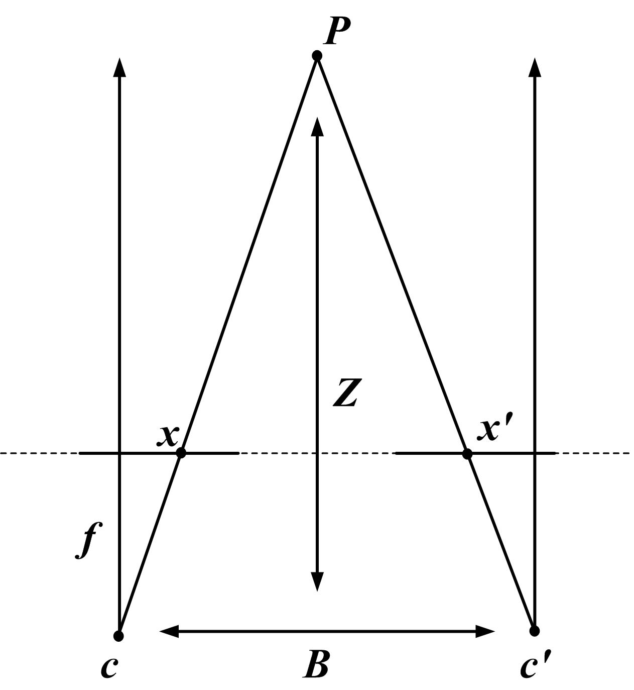

# 几何、视觉与三维空间

一个相机坐标点(0.2,0.1,2)会落到哪个像素？像素(370,265)又能否唯一还原这个三维点？本文沿投影与反投影计算，说明内参、外参、深度、视差和多视角各补上了什么信息。

先固定坐标约定，后讨论位姿表示。所有平移与深度必须使用一致单位，旋转和坐标方向也必须在传递过程中保持一致。

## 针孔相机：三维点怎样落到二维图像

最简相机投影可以写成：

\[
\begin{bmatrix}
u\\v\\1
\end{bmatrix}
\sim
K
\begin{bmatrix}
X/Z\\Y/Z\\1
\end{bmatrix}
\]

其中 \((X,Y,Z)\) 是相机坐标系中的三维点，\((u,v)\) 是像素坐标，\(K\) 是相机内参矩阵。

常见内参矩阵是：

\[
K=
\begin{bmatrix}
f_x & 0 & c_x\\
0 & f_y & c_y\\
0 & 0 & 1
\end{bmatrix}
\]

这里 \(f_x,f_y\) 以像素为单位，\(c_x,c_y\) 是主点位置。忽略镜头畸变、使用常见x向右y向下z向前的相机坐标时，投影为 \(u=f_xX/Z+c_x\)、\(v=f_yY/Z+c_y\)，要求点位于可见的正深度区域。

例如 \(f_x=f_y=500,c_x=320,c_y=240\)，相机点 \((X,Y,Z)=(0.2,0.1,2)\) 米投影到 \((370,265)\) 像素。把三维点等比例乘2，像素不变，所以单个像素只确定一条射线，不能单独给出绝对深度。

若图像尺寸缩为一半，像素坐标、焦距和主点必须使用一致的缩放约定；裁剪还会改变主点相对新图像原点的位置。直接沿用原内参，会让后续点云出现系统偏移。实际resize可能有半像素中心约定，工程实现应与图像库对应。

## 外参：相机在世界里的位置和朝向

外参把世界坐标变成相机坐标：

\[
X_{\text{cam}}
=
R X_{\text{world}}+t
\]

其中 \(R\) 是旋转矩阵，\(t\) 是平移向量。机器人多相机系统里，每个相机都有自己的外参；如果外参错了，不同视角的点云、深度和动作坐标就会对不上。

这里明确写的是world-to-camera变换。相机中心在世界中的位置为 \(C=-R^\top t\)，一般不等于t。例如相机位于世界 \((1,0,0)\)、朝向与世界轴相同，则 \(R=I,t=(-1,0,0)\)。世界点 \((1.2,0.1,2)\) 变成上述相机点 \((0.2,0.1,2)\)。把t误当作相机位置会导致方向相反的误差。

反向变换为 \(X_{\rm world}=R^\top X_{\rm cam}-R^\top t\)。数据字段叫`extrinsics`或`pose`还不足以确定方向，必须核对输入坐标系、输出坐标系、轴朝向和长度单位。

## 双目视差：深度来自左右图像的位移

双目几何里，同一个三维点会投影到左右相机的不同像素位置。左右位置差叫视差 \(d\)，深度可以粗略写成：

\[
Z=\frac{fB}{d}
\]

这里 \(Z\) 是深度，\(f\) 是焦距，\(B\) 是左右相机 baseline，\(d\) 是视差。

{ width="680" }

<small>图源：[Wikimedia Commons: Stereo camera model](https://commons.wikimedia.org/wiki/File:Stereo-camera-model.jpg)。原图展示左右相机、baseline、投影点和深度关系。这里的重点是：深度估计在几何约束下从视差反推三维位置。</small>

这个简式依赖双目校正、平行视线与相应内参约定。取 \(f=500\) 像素、\(B=0.12\) 米、\(d=30\) 像素，得到深度2米。对视差求导

\[
\frac{\partial Z}{\partial d}=-\frac{fB}{d^2}=-\frac{Z^2}{fB}.
\]

此处0.5像素视差误差对应约0.0333米深度误差。若同样相机下目标在4米，视差减到15像素，同样0.5像素误差会放大到约0.1333米。远处深度更敏感，是几何关系本身的结果。零视差、遮挡和无纹理区域还需要有效性判断，不能直接盲目做除法。

## 位姿和 SE(3)：刚体在三维空间里的运动

三维刚体位姿通常由旋转和平移组成：

\[
T=
\begin{bmatrix}
R & t\\
0 & 1
\end{bmatrix}
\in SE(3)
\]

这里 \(R\in SO(3)\) 表示旋转，\(t\in\mathbb{R}^3\) 表示平移，\(SE(3)\) 表示三维刚体变换群。

若 \(T_{AB}\) 把B系坐标变到A系，\(T_{BC}\) 把C系变到B系，则 \(T_{AC}=T_{AB}T_{BC}\)，靠近点的变换先作用。逆变换的旋转为 \(R^\top\)，平移为 \(-R^\top t\)。

旋转和平移通常不可交换。二维平面内，将点 \((1,0)\) 先逆时针转90度、再沿x平移1，得到 \((1,1)\)；先平移再转则得到 \((0,2)\)。三维机器人坐标链同样如此。给矩阵写清上下标，比笼统地说“乘外参”更能防止错误。

## 四元数：机器人姿态常用的旋转表示

旋转矩阵直观，但有 9 个数，还要满足正交约束。机器人动作接口和 VLA 数据集里，经常用四元数表示末端姿态：

\[
q=(w,x,y,z)
\]

单位四元数满足：

\[
\|q\|_2=1
\]

对单位旋转轴 \(u\) 和转角 \(\theta\)，有 \(q=(\cos(\theta/2),u\sin(\theta/2))\)。例如绕z轴转90度，wxyz顺序为 \((\sqrt2/2,0,0,\sqrt2/2)\)。向量部分同时含轴方向和半角正弦的尺度，不能当作独立的三个普通角度。

四元数避免Euler角的万向节锁，但仍有单位范数约束和双重表示。接口还可能采用xyzw顺序，以及不同主动/被动旋转约定；必须核对后再发送到控制器。

读机器人论文时要记住一个细节：\(q\) 和 \(-q\) 表示同一个旋转。因此有些 rotation loss 会写成：

\[
\min\left(\|q-\hat q\|_2,\|q+\hat q\|_2\right)
\]

这一步处理的是四元数的双重表示。RT-2、\(\pi_0\) 系列、ACT、Diffusion Policy、MapAnything 这类动作或位姿预测论文里，看到 quaternion、axis-angle、6D rotation representation 时，都要先问：它表示的是相机姿态、物体姿态，还是机器人末端执行器姿态。

如果目标是机器人控制接口，优先看部署系统实际接收哪种姿态表示；如果目标是神经网络回归，连续性、归一化约束和 loss 是否处理等价表示，往往比人类可读性更重要。

## 点云：把深度图还原成三维点

如果知道像素 \((u,v)\)、深度 \(Z\) 和相机内参，可以反投影到三维：

\[
X=\frac{(u-c_x)Z}{f_x},
\qquad
Y=\frac{(v-c_y)Z}{f_y}
\]

将 \((u,v,Z)=(370,265,2)\) 代回，得到 \(X=0.2,Y=0.1\)，与投影前一致。这给出一个可以实际检查的往返关系。

<a id="像素只确定射线深度决定射线上的位置"></a>

像素本身只确定一条射线。本例的归一化方向为(0.1,0.05,1)，长度约1.00623；如果给的是沿射线距离r，就应把这个方向单位化后再乘r。

这里Z是光轴方向深度，不一定是传感器到点的欧氏距离。上例距离为 \(\sqrt{0.2^2+0.1^2+2^2}\approx2.01246\) 米。如果数据提供的是射线range，必须先按射线方向转换；把range当Z会造成越靠图像边缘越明显的几何误差。

```python
fx, fy, cx, cy = 500, 500, 320, 240
X, Y, Z = 0.2, 0.1, 2.0
u, v = fx*X/Z+cx, fy*Y/Z+cy
recovered = ((u-cx)*Z/fx, (v-cy)*Z/fy, Z)
print((u, v), recovered)  # (370, 265), (0.2, 0.1, 2.0)
print(500*0.12/30)        # stereo depth = 2.0 m
```

这个往返检查验证单位和公式，不验证真实标定的精度；真实镜头畸变、运动同步和depth空洞还需独立检查。

RGB与深度常提供互补证据。RGB模型也能估计几何，但单目绝对尺度通常需要额外先验或传感信息；深度自身也可能有噪声、反光和遮挡空洞。融合时不能把任何一种模态视为无误差真值。

## 对极几何：两张图之间的像素约束

双目和多视角重建不只靠 \(Z=fB/d\)。更一般地，如果同一个三维点在两张图里的齐次像素坐标是 \(x_1,x_2\)，它们满足对极约束：

\[
x_2^\top F x_1=0
\]

这里 \(F\) 是 fundamental matrix。它的意思是：第一张图里的点 \(x_1\)，在第二张图里不会随便落在任意位置，而是必须落在一条极线附近：

\[
l_2=F x_1
\]

如果相机内参已知，还会看到 essential matrix：

\[
E=[t]_\times R
\]

其中约定 \(X_2=RX_1+t\)，\([t]_\times\) 表示叉乘矩阵。归一化成像坐标满足 \(\tilde x_2^\top E\tilde x_1=0\)，像素坐标使用 \(F=K_2^{-\top}EK_1^{-1}\)。两者不能在未去除内参时混用。VGGT、Fast-FoundationStereo、MapAnything 和 SfM/MVS 相关论文里的 epipolar geometry，都在用这种约束缩小匹配搜索空间。

对极几何的价值是：它不要求一开始就知道深度，而是先告诉你“匹配点应该去哪条线上找”。深度、位姿和三维点可以在后续通过三角化、PnP 或 bundle adjustment 进一步求出来。

## 多视角一致性：不同相机要说同一个世界

多视角系统最怕各相机各说各话。一个三维点从相机 A 变到相机 B，需要经过外参变换；同一个物体在不同视角下的 depth、mask、track 应该互相一致。

因此 embodied AI 论文会强调 calibration、multi-view、depth、normal、trajectory 和 3D flow。这些量给模型提供更强的空间约束。

两类常见名字也可以先这样读：PnP 是用 3D 点和 2D 像素对应来估计相机位姿；ICP 是用两组点云反复找对应、估计刚体变换，让它们对齐。它们都不是神经网络专属方法，但会成为 3D foundation model 和机器人系统里的几何验算工具。
