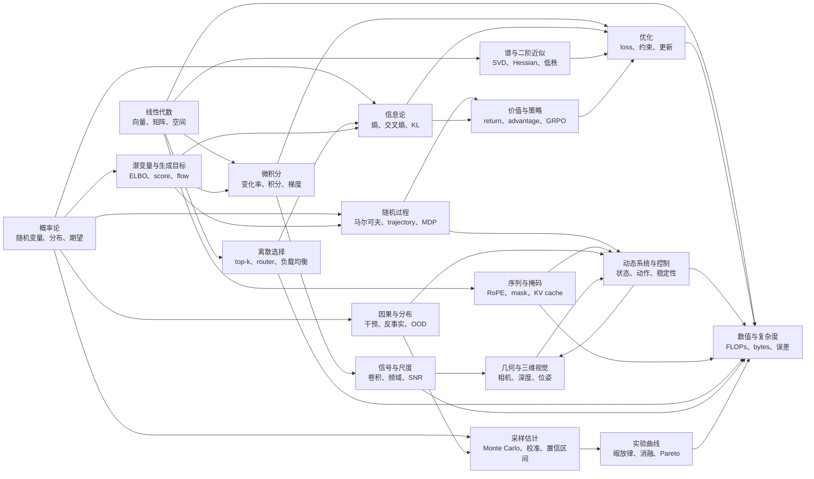

# 前置数学知识

这个专题不是把数学课本搬进来，而是给本站后面的 AI 文章补一套“能读懂公式和名词”的前置语言。

后面的博客会反复出现这些词：向量空间、矩阵乘法、雅可比、牛顿-莱布尼茨公式、半线性 ODE、指数积分器、概率密度、期望、条件概率、贝叶斯、马尔可夫、随机过程、熵、KL、梯度下降、拉格朗日乘子、Bellman、λ-return、ODE、SDE、SVD、Hessian、Newton-Schulz、Monte Carlo、校准、位置编码、attention mask、top-k、beam search、MCTS、router、负载均衡、潜变量、先验、后验、ELBO、score、flow matching、价值函数、优势函数、卷积、频域、卷积定理、SNR、因果、分布偏移、相机内外参、深度、四元数、对极几何、位姿、缩放律、数值稳定性、复杂度。它们如果只作为符号出现，读者很容易看完公式却不知道公式在说什么；这个专题的目标，是把这些词先讲成可以使用的工具。

## 建议阅读顺序

| 你后面会遇到的问题 | 先读哪一篇 |
| --- | --- |
| embedding、attention、GEMM、低秩近似到底在什么空间里发生 | [线性代数与几何直觉](linear-algebra-and-geometry.md) |
| SVD、谱能量、Hessian、Taylor 近似、Newton-Schulz 为什么会出现在优化、压缩和 KV 合并论文里 | [谱分解、二阶近似与低秩结构](spectral-second-order-and-low-rank.md) |
| 梯度、积分、牛顿-莱布尼茨公式、ODE/SDE、指数积分器为什么总在训练和扩散里出现 | [微积分与牛顿-莱布尼茨公式](calculus-and-newton-leibniz.md) |
| 概率、条件概率、期望、方差、似然、贝叶斯这些词怎么连起来 | [概率论、分布与期望](probability-distributions-and-expectation.md) |
| Monte Carlo、偏差-方差、置信区间、分层估计、校准和 ECE 怎样读 | [采样、估计与校准](sampling-estimation-and-calibration.md) |
| 熵、交叉熵、KL、互信息为什么能写进 loss | [信息论、熵与分布距离](information-theory-and-divergence.md) |
| token 序列、RoPE、causal mask、temperature 和 KV cache 怎样读 | [序列、位置编码与注意力掩码](sequence-position-and-masking.md) |
| 马尔可夫、转移概率、trajectory、MDP 为什么支撑 RL 和世界模型 | [随机过程与马尔可夫性](stochastic-processes-and-markov.md) |
| loss 怎么变成参数更新，为什么优化器不是简单减梯度 | [优化、梯度与约束](optimization-and-gradient-methods.md) |
| top-k、beam search、MCTS、router、gating、expert load 和稀疏选择怎样读 | [离散选择、Top-k 与稀疏路由](discrete-selection-topk-and-routing.md) |
| latent、prior、posterior、ELBO、score 和 flow matching 怎样支撑生成模型 | [潜变量、似然与生成模型目标](latent-likelihood-and-generative-objectives.md) |
| return、value、λ-return、advantage、PPO、GRPO 和 KL penalty 怎样支撑后训练 | [价值函数、策略梯度与强化学习目标](value-policy-and-rl-objectives.md) |
| 状态空间、相图、稳定性、控制和规划怎么连接到机器人 | [动态系统、控制与状态空间](dynamic-systems-and-control.md) |
| convolution、kernel、卷积定理、DCT、频率、SNR 和多尺度为什么常一起出现 | [卷积、频域与多尺度表示](convolution-frequency-and-multiscale.md) |
| 相机内参、外参、深度、四元数、对极几何、位姿和点云怎样支撑 3D / 具身论文 | [几何、视觉与三维空间](geometry-vision-and-3d.md) |
| causal、counterfactual、OOD、train-test mismatch 和 benchmark 泛化怎样读 | [因果、反事实与分布偏移](causality-counterfactual-and-distribution-shift.md) |
| scaling law、log-log 曲线、Pareto frontier 和 ablation 应该怎么读 | [缩放律、幂律与实验曲线](scaling-laws-and-experimental-curves.md) |
| FLOPs、Big-O、浮点误差、数值稳定性如何影响系统实现 | [数值计算、复杂度与估算](numerics-complexity-and-estimation.md) |

## 一张图上的全局关系

这张图的读法是：线性代数给数据找坐标，谱分解和二阶近似看清方向结构和敏感度，序列与掩码规定信息能沿哪些位置流动，离散选择解释 top-k、router 和稀疏预算分配，微积分描述坐标里的变化，概率论描述不确定性，采样估计告诉我们有限样本结论是否可信，潜变量和生成目标把 likelihood、ELBO、score 与连续生成路径接起来，信息论衡量分布之间的代价，价值函数和策略梯度把长期收益变成可优化目标，因果与分布偏移提醒我们不要把相关性误读成可部署机制，随机过程和动态系统把“下一步”接成长期行为，信号与尺度解释卷积、频率、噪声阶段和多分辨率，几何把像素、相机和三维空间接起来，数值计算、实验曲线和复杂度最后决定这些数学在机器上能不能跑得起。

## 和“基础概念”的分工

`前置数学知识` 负责解释数学名词本身，例如什么是期望、KL、马尔可夫性、梯度、积分和矩阵分解。

`基础概念` 负责解释 AI 模型和系统机制，例如 Transformer、计算图、优化训练、潜变量模型、数据集、生成解码和模型压缩。

如果你在后面的文章里卡在“这个符号/名词是什么意思”，回到这里；如果你知道数学名词，但想看它怎样变成模型结构或工程机制，去读基础概念和各专题正文。

## 读这些数学页时抓什么

每篇文章都按同一套问题组织：

1. 这个数学概念最朴素的直觉是什么。
2. 它的核心公式在声明什么输入、输出和约束。
3. 它在后面的 AI 文章里会以什么名字出现。
4. 它最容易被误读到哪里。
5. 读完后应该能解释哪个具体现象。

这个专题的目标不是让你能证明所有定理，而是让你读后面的模型文章时，能把公式翻译回机制：谁在变化，谁是随机的，谁被优化，谁在随时间转移，谁最后会变成显存、延迟或误差。
