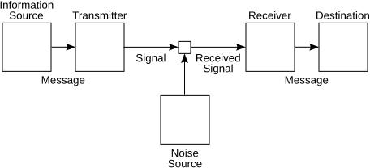

# 信息论、熵与分布距离

这篇回答一个问题：熵、交叉熵、KL、互信息为什么能出现在语言模型、扩散模型、蒸馏和 RLHF 的 loss 里。

信息论关心的是不确定性和编码代价。模型输出一个概率分布，本质上就是在声明“我认为哪些结果更可能”。熵和 KL 这些量，就是用来衡量这个分布有多不确定、和另一个分布差多少。

## 熵：不确定性有多大

离散分布 \(p\) 的熵写成：

\[
H(p)=-\sum_i p_i\log p_i
\]

如果分布很尖，大部分概率集中在一个结果上，熵低；如果分布很平，很多结果都差不多可能，熵高。

这行公式里的 \(i\) 遍历所有可能结果，\(p_i\) 是第 \(i\) 个结果的概率，\(-\log p_i\) 可以理解为“这个结果出现时带来的惊讶程度”。概率越小，惊讶越大；概率越大，惊讶越小。熵就是把每个结果的惊讶程度按概率加权平均。

举个极端例子：如果模型 100% 确定下一个 token 是 `cat`，熵接近 0；如果它在 1000 个 token 上几乎平均分配概率，熵就高得多。采样温度、top-p 和探索策略都会改变这种不确定性。

生成模型里，熵会影响多样性；强化学习里，entropy bonus 可以鼓励探索；分类模型里，过低熵有时表示自信，也可能表示过度自信。

## 交叉熵：用一个分布编码另一个分布的代价

交叉熵写成：

\[
H(p,q)=-\sum_i p_i\log q_i
\]

这里 \(p\) 是真实分布，\(q\) 是模型分布。如果真实标签是 one-hot，交叉熵就变成：

\[
-\log q_y
\]

也就是惩罚模型给正确答案 \(y\) 的概率太低。语言模型训练常用的 next-token loss 就是这个思想。

如果正确 token 的模型概率是 \(q_y=0.8\)，loss 是 \(-\log 0.8\)，惩罚很小；如果 \(q_y=0.01\)，loss 是 \(-\log 0.01\)，惩罚会大很多。语言模型预训练就是在每个位置重复这个动作：让正确下一个 token 的概率变高。

## KL：两个分布之间的信息代价

KL divergence 写成：

\[
D_{\mathrm{KL}}(p\|q)
=
\sum_i p_i\log\frac{p_i}{q_i}
\]

它可以理解为：如果真实分布是 \(p\)，却用 \(q\) 来编码，会多付多少代价。

逐项看，\(\frac{p_i}{q_i}\) 比较两个分布在第 \(i\) 个结果上的概率。如果 \(p_i\) 很大而 \(q_i\) 很小，说明 \(q\) 漏掉了 \(p\) 认为重要的结果，这一项惩罚就大。前面的 \(p_i\) 表示：只在 \(p\) 经常发生的地方重点计算代价。

KL 不对称：

\[
D_{\mathrm{KL}}(p\|q)\neq D_{\mathrm{KL}}(q\|p)
\]

这点很重要。不同方向的 KL 会偏好不同错误：有的更怕漏掉 \(p\) 支持的区域，有的更怕把概率放到 \(p\) 不支持的区域。VAE、RLHF、policy regularization 和蒸馏都会遇到这个差异。

后续例子：RLHF 里常见 KL penalty：

\[
r^{\text{total}}
=
r^{\text{task}}
-\beta D_{\mathrm{KL}}(\pi_\theta\|\pi_{\mathrm{ref}})
\]

这里 \(r^{\text{task}}\) 鼓励模型完成任务，\(\pi_\theta\) 是当前策略，\(\pi_{\mathrm{ref}}\) 是参考模型，\(\beta\) 控制“不要偏离参考模型太远”的力度。这个公式不是在说 KL 越小越好，而是在平衡新能力和底座行为稳定性。

## 通信模型：信息要经过有噪声的通道

{ width="720" }

<small>图源：[Wikimedia Commons: Shannon communication system](https://commons.wikimedia.org/wiki/File:Shannon_communication_system.svg)。原图展示信息源、编码器、信道、噪声和解码器。本站用它说明：信息论的基本问题是如何在有噪声的通道里表示、传输和恢复信息；这和模型压缩、表示学习、tokenization、通信并行都有呼应。</small>

把这个图放进 AI 里看：

| 通信系统 | AI 系统里的对应物 |
| --- | --- |
| 信息源 | 文本、图像、状态、动作、奖励 |
| 编码器 | tokenizer、vision encoder、latent encoder |
| 信道噪声 | 数据噪声、量化误差、dropout、采样随机性 |
| 解码器 | language head、diffusion decoder、action head |
| 传输代价 | token 数、bit 数、显存、带宽、延迟 |

## 互信息：两个变量共享多少信息

互信息写成：

\[
I(X;Y)=H(X)-H(X\mid Y)
\]

它衡量知道 \(Y\) 之后，\(X\) 的不确定性减少了多少。表征学习常关心一个表示 \(Z\) 是否保留了对任务 \(Y\) 有用的信息，同时丢掉无关噪声。

公式里的 \(H(X)\) 是不知道 \(Y\) 时对 \(X\) 的不确定性，\(H(X\mid Y)\) 是知道 \(Y\) 后剩下的不确定性。两者差得越大，说明 \(Y\) 对 \(X\) 越有信息量。

在世界模型和 VLA 里，好的 latent 不只是压缩视频，还要保留动作、接触、遮挡、目标和风险的信息。压缩率高但互信息保错方向，后续控制会出问题。

## Perplexity：语言模型里的指数化交叉熵

Perplexity 常写成：

\[
\mathrm{PPL}=\exp(\mathcal{L}_{\text{CE}})
\]

它可以直觉理解为：模型平均每一步还在多少个候选之间犹豫。PPL 低通常说明语言建模更好，但它不是所有能力的充分证明；推理、工具调用、安全和闭环任务还要看专门评测。

## 常见误读

| 误读 | 更稳的理解 |
| --- | --- |
| 熵越低越好 | 过低可能是过度自信，生成时也可能缺少多样性 |
| KL 是距离 | KL 不对称，不满足普通距离直觉 |
| 交叉熵只属于分类 | 语言模型、蒸馏、对齐和序列建模都在用它 |
| PPL 低就代表模型全能 | PPL 是语言建模指标，不替代复杂能力评测 |

## 读完以后怎么判断

看到熵、交叉熵、KL 或互信息，先问它在衡量哪个分布，分布来自数据、模型、teacher、reference policy 还是 posterior。分布来源一清楚，loss 的作用也会清楚。

## 相关阅读与下一步

- 站内下一步：[生成与解码基础](../foundations/generation-and-decoding-basics.md)。
- 站内下一步：[预训练、微调与对齐](../training/pretraining-finetuning-alignment.md)。
- 站内下一步：[Policy Gradient、Actor-Critic、PPO 与 GRPO](../reinforcement-learning/policy-gradient-actor-critic-ppo-grpo.md)。
