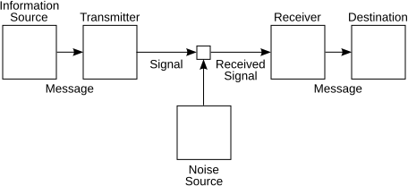

# 信息论、熵与分布距离

一个分类器把真实类别分布 \(p=(0.75,0.25)\) 预测成 \(q=(0.5,0.5)\)。我们可以问数据本身有多不确定、用q编码要付出多少代价、错用q比知道p多付出多少。这三个问题分别得到熵、交叉熵和KL。

下面一直沿这组概率计算。对数使用自然底，单位为nat；采用log2时单位变为bit，所有数值会按同一常数缩放。

## 同一组概率上的三次计算

设真实类别分布为 \(p=[0.75,0.25]\)，模型分布为 \(q=[0.5,0.5]\)。结果越少见，\(-\log p_i\) 越大；把它按真实发生概率平均，得到熵

\[
H(p)=-\sum_i p_i\log p_i
=-0.75\log0.75-0.25\log0.25\approx0.562335.
\]

如果用模型的概率编码真实结果，平均代价为交叉熵

\[
H(p,q)=-\sum_i p_i\log q_i=\log2\approx0.693147.
\]

两者相差约0.130812，正是

\[
D_{\mathrm{KL}}(p\|q)=\sum_i p_i\log\frac{p_i}{q_i}
=H(p,q)-H(p).
\]

固定数据分布 \(p\) 时，\(H(p)\) 不随模型变化，最小化交叉熵等价于最小化这个方向的KL。单个观测标签可以表示成one-hot分布，交叉熵便是 \(-\log q_y\)；对许多标签求平均，才是在估计数据分布下的交叉熵。

## 交叉熵怎样产生具体梯度

模型先输出 logits \(z\)，再通过softmax得到 \(q_i=e^{z_i}/\sum_j e^{z_j}\)。标签分布 \(p\) 的分量和为1时，交叉熵对logit的导数为

\[
\frac{\partial H(p,q)}{\partial z_j}=q_j-p_j.
\]

在上例中梯度为 `[-0.25,0.25]`。梯度下降会提高第一类logit、降低第二类logit，使预测向真实分布移动。若某个样本的真实标签是第一类，梯度则为 `[-0.5,0.5]`。逐样本信号不同，其期望与分布级梯度一致。

损失的梯度还会经过网络传回参数。不同token与样本共享参数，因此提高当前正确类别的概率并不保证每个其他样本都会改善。Label smoothing、软老师分布和token权重会改变 \(p\) 或各项权重，应按实际目标重新解释梯度。

## 为什么软标签CE和KL可训练同一个学生

当p来自固定标签或冻结教师时，\(H(p)\) 不随学生参数改变，\(H(p,q)=H(p)+\mathrm{KL}(p\|q)\) 因而给出相同学生梯度，但日志数值相差一个常数。若p本身也参与求导，这个推论不再自动成立，需要说明哪些分支停止梯度。

反过来，\(\mathrm{KL}(q\|p)\) 的平均对象也变为q，其梯度包含q变化的影响。仅调换公式里的两个字母，已经换了优化目标；不能把两种方向当成名称差异。

## KL方向与支持集决定怎样惩罚错误

交换前面的两个分布，有

\[
D_{\mathrm{KL}}(q\|p)
=0.5\log(0.5/0.75)+0.5\log(0.5/0.25)
\approx0.143841,
\]

与0.130812不同。KL不对称，也不满足一般距离的全部性质。

若 \(p_i>0\) 而 \(q_i=0\)，\(D_{\mathrm{KL}}(p\|q)\) 为无穷，因为模型把真实可能发生的事件判为绝不可能。反方向则按 \(q\) 采样和加权。常见的“覆盖模式”或“偏向某个模式”是特定近似族和分布上的结果，不能脱离支持集与模型能力只凭KL方向作普遍保证。

对连续变量，概率换成密度、求和换成积分。微分熵可以为负，并且会随坐标缩放改变；不能把离散熵非负的性质直接移过去。相同可逆坐标变换下，两分布的KL保持不变，因为密度变换的Jacobian因子在比值里抵消。

## 单次log-ratio可以为负

以当前策略 \(\pi=[0.75,0.25]\)、参考策略 \(\pi_{\rm ref}=[0.5,0.5]\) 为例，当前策略到参考策略的KL为

\[
\mathbb E_{a\sim\pi}\left[\log\pi(a)-\log\pi_{\rm ref}(a)\right].
\]

第一动作的log-ratio约为0.405465，第二动作约为-0.693147。按当前策略加权，得到非负的0.130812。一次抽到第二动作就会看到负值，它是一个样本，不是“KL算错了”。

语言模型响应的概率按token条件概率相乘，对数比因此按token相加。对同一提示词分布，从当前策略采完整响应，再平均这些序列log-ratio，可估计相应序列KL。若token和前缀来自旧策略或截断采样分布，就需要明确分布差异，不能继续把未经修正的平均解释成同一个KL。

RLHF中使用的KL惩罚控制策略偏离参考分布的代价。系数过大可能阻碍任务改进，过小可能让策略利用奖励模型漏洞。低KL只说明与所选参考接近，不证明事实正确或任务安全。

## 策略熵鼓励保留哪些选择

离散动作策略在状态 \(s\) 下的熵为

\[
H(\pi(\cdot\mid s))=-\sum_a\pi(a\mid s)\log\pi(a\mid s).
\]

二动作均匀策略的熵为 \(\log2\approx0.693147\)，`[0.9,0.1]`的熵约为0.325083，确定性策略的熵为0。在最大化奖励的目标中加入 \(+\alpha H\)，可以奖励分布保留多个选择；若转成梯度下降损失，符号要相应反转。

高熵不等于有效探索。均匀选择已知坏动作也会提高熵；连续动作策略的微分熵还受动作单位、缩放和变换影响。SAC中的有界动作分布需要把变换的log-Jacobian纳入密度，不能仅对变换前的高斯熵作解释，详见[连续控制与SAC](../reinforcement-learning/continuous-control-and-sac.md)。

## 互信息测量知道一个变量后减少的未知

对于离散变量，互信息可以写成

\[
I(X;Y)=H(X)-H(X\mid Y)
=D_{\mathrm{KL}}(p(x,y)\|p(x)p(y)).
\]

构造一个公平二元变量 \(X\)，经过独立概率0.1的翻转得到 \(Y\)。不看 \(Y\) 时，\(H(X)=\log2\)。看到 \(Y\) 后，仍有0.1概率被翻转，条件熵为

\[
H(X\mid Y)=-0.9\log0.9-0.1\log0.1\approx0.325083.
\]

所以互信息约为0.368064 nat。完全不翻转时达到 \(\log2\)，以0.5概率翻转时，输出不再透露输入信息，互信息为0。

{ width="720" }

<small>图源为 [Wikimedia Commons](https://commons.wikimedia.org/wiki/File:Shannon_communication_system.svg)。编码、信道噪声与解码共同决定可恢复的信息。</small>

若 \(X\to Z\to Y\) 构成Markov链，且有关互信息定义良好，数据处理不等式给出 \(I(X;Y)\le I(X;Z)\)。后处理不能从完全丢掉的信息中恢复与原输入的关联。不过生成器能利用先验补出合理内容，合理内容与忠实恢复原始细节是不同要求。对表示学习，更有用的问题是保留了多少与任务相关的信息，而非让某个泛化“信息量”无条件变大。

## Perplexity为何要先平均再指数化

若一段序列两个真实token的预测概率分别是0.8和0.2，平均负对数似然为

\[
L=-\tfrac12(\log0.8+\log0.2)=\log2.5,
\qquad\mathrm{PPL}=e^L=2.5.
\]

它等于真实token概率几何平均的倒数。若先求两个倒数再平均，会得到 \((1.25+5)/2=3.125\)，这是另一个量。

PPL可以理解为达到同样平均编码代价的均匀分布候选数，不代表模型真的在每个位置考虑恰好2.5个候选。比较模型时还需固定tokenization、数据、有效token掩码和归一化方式。不同词表的每token PPL不能直接当成同一单位比较。

## 重算分布级指标

```python
import math
p, q = [0.75, 0.25], [0.5, 0.5]
entropy = -sum(a * math.log(a) for a in p)
cross_entropy = -sum(a * math.log(b) for a, b in zip(p, q))
kl = sum(a * math.log(a / b) for a, b in zip(p, q))
print(round(entropy, 6), round(cross_entropy, 6), round(kl, 6))
assert abs(cross_entropy - entropy - kl) < 1e-12
```

输出为 `0.562335 0.693147 0.130812`。概率与条件平均的基础见[概率论](probability-distributions-and-expectation.md)，这些目标进入生成模型的方式见[潜变量与似然](latent-likelihood-and-generative-objectives.md)。


- [PyTorch 蒸馏教程](https://github.com/pytorch/tutorials/blob/5672cd98a7671eda4d9122b10f8eec580f74d03e/beginner_source/knowledge_distillation_tutorial.py)，soft_targets固定，KL项与标签CE按权重共同训练学生。
