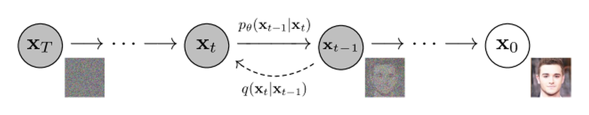
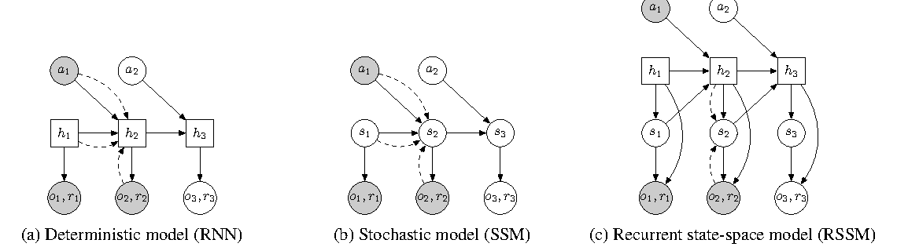

# 潜变量、似然与生成目标

观察到一个结果，可能存在多种隐藏解释。潜变量模型把这些解释记为 z，把观测记为 x，再用联合分布描述二者。生成时先选解释再产生观测，推断时则从观测反过来判断解释。

从两个隐藏状态开始。设 \(z\in\{0,1\}\)，先验各为 0.5；某个已观察事件 x 在两状态下的概率分别为 0.2 和 0.8。我们可以枚举所有情况，核对后验、似然与下界，而不先面对一个不可算的高维积分。

## 联合概率加起来得到似然

两个联合概率为 \(p(x,z=0)=0.1\)、\(p(x,z=1)=0.4\)，相加得到 \(p(x)=0.5\)。看到 x 后，对隐藏状态重新归一化

\[
p(z\mid x)=\frac{p(x\mid z)p(z)}{p(x)}=(0.2,0.8).
\]

先验相信两个状态一样可能，观测使第二个状态更可信。这里 \(p(x\mid z)\) 是随 z 变化的似然，\(p(z\mid x)\) 是对 z 归一化后的后验，不能对调。

连续潜变量把求和换成积分 \(p_\theta(x)=\int p_\theta(x\mid z)p(z)\,dz\)。生成仍容易按条件采样，边缘似然却可能难算。变分推断正是在这个位置引入一个容易计算的近似后验 q。

## 下界来自哪一步

假设 q 的支持覆盖联合分布中需要积分的区域，乘除 q 后可写

\[
\log p_\theta(x)=\log\mathbb E_{q(z\mid x)}
\left[\frac{p_\theta(x,z)}{q(z\mid x)}\right]
\ge\mathbb E_q\left[\log\frac{p_\theta(x,z)}{q(z\mid x)}\right].
\]

不等式来自 log 的凹性。把联合分布展开，右侧就是

\[
\operatorname{ELBO}=
\mathbb E_q[\log p_\theta(x\mid z)]
-\mathrm{KL}(q(z\mid x)\|p(z)).
\]

第一项使用近似推断出的解释去预测观测，第二项比较这些解释与先验。两项合起来是下界，单独最大化重建项没有同样的含义。

## 两个 KL 各在比较什么

若近似推断器仍输出 \(q=(0.5,0.5)\)，它与先验的 KL 为零，ELBO 为

\[
0.5\log0.2+0.5\log0.8=\log0.4=-0.916291.
\]

真实 log 似然为 \(\log0.5=-0.693147\)。两者差为 0.223144，恰好等于

\[
\mathrm{KL}(q(z\mid x)\|p_\theta(z\mid x))
=0.5\log(0.5/0.2)+0.5\log(0.5/0.8).
\]

ELBO 内部的 KL 比较近似后验与先验；下界间隙的 KL 比较近似后验与真实后验。先验 KL 为零，不意味着推断正确。

把 q 改成真实后验 `(0.2,0.8)` 后，重建期望约 -0.500402，先验 KL 约 0.192745，ELBO 变成 -0.693147，间隙为零。生成模型固定时，这是收紧下界的明确例子；联合更新生成模型时，真实后验也会移动，不能保证间隙逐步缩小。

```python
import math
prior, like = [.5,.5], [.2,.8]
evidence = sum(a*b for a,b in zip(prior,like))
posterior = [a*b/evidence for a,b in zip(prior,like)]
for q in [[.5,.5],posterior]:
    recon = sum(a*math.log(b) for a,b in zip(q,like))
    kl_prior = sum(a*math.log(a/b) for a,b in zip(q,prior))
    bound = recon-kl_prior
    gap = sum(a*math.log(a/b) for a,b in zip(q,posterior))
    print(round(bound,6), round(math.log(evidence)-bound,6), round(gap,6))
```

两行分别是 `-0.916291 0.223144 0.223144` 与 `-0.693147 0.0 0.0`。高斯 VAE 的采样与梯度在[潜变量模型基础](../foundations/probability-latent-variables-and-generative-models.md)中继续计算。

## 能量先给相对权重，再谈归一化

另一种建模方式是给候选分配能量 E，令 \(p(y\mid x)=e^{-E(x,y)}/Z(x)\)。对于两个候选，能量 `(0,log3)` 对应未归一化权重 `(1,1/3)`，归一化后概率是 `(0.75,0.25)`。

同时给两个能量减去100，概率不变。因此“数据能量降低”本身无法证明数据概率提高。最大似然负损失梯度还包含模型分布上的对照项

\[
\nabla_\theta[-\log p_\theta(x)]
=\nabla_\theta E_\theta(x)
-\mathbb E_{X\sim p_\theta}[\nabla_\theta E_\theta(X)].
\]

第二项约束其他区域的相对能量，却要求从模型分布采样。直接搜索最小能量解、从规范化分布采样、用对比损失训练，是不同操作。一个叫 energy 的相似度函数不自动附带最大似然训练或可计算分区函数。

## Score 避开了对输入无关的常数

对密度的输入坐标求导，定义 score \(s(x)=\nabla_x\log p(x)\)。若 \(p(x)\propto e^{-E(x)}\)，归一化常数与 x 无关，所以 \(s(x)=-\nabla_xE(x)\)。它描述密度上升方向，不是对模型参数的梯度。

高斯 \(\mathcal N(\mu,\sigma^2)\) 的 score 为 \(-(x-\mu)/\sigma^2\)。取 \(\mu=2,\sigma=2,x=6\)，结果是 -1。仅沿 score 做梯度上升会趋向密度峰，不等于从完整分布采样；采样器还需规定漂移、噪声或确定性流的完整动力学。

在高斯加噪 \(x_t=\alpha_tx_0+\sigma_t\epsilon\) 下，条件 score 是 \(-\epsilon/\sigma_t\)。平方误差最优噪声预测为 \(\mathbb E[\epsilon\mid x_t]\)，因此可联系到边缘 score。这个关系依赖加噪形式和时间约定，不适用于任意写着 denoising 的目标。

## 速度目标描述另一种局部变化

Flow matching 训练向量场 \(v_\theta(x_t,t)\)，生成时解 \(dx_t/dt=v_\theta(x_t,t)\)。若端点为噪声1、数据5，线性路径 \(x_t=(1-t)1+t5\) 在 t=0.25 处是2，条件速度标签为4。

训练时知道端点，所以能构造这个标签；生成时不知道数据端，网络只能根据当前位置、时间和条件预测。不同端点对可能经过相同位置，平方误差最优预测是条件平均速度，不能把每条训练直线误认为最终生成轨迹。

{ width="620" }

<small>[DDPM Figure 2](https://arxiv.org/abs/2006.11239)。隐藏变量可以是一串噪声状态。离散下界、score和连续速度场在不同建模路线中各有作用，比较时要确认变量与目标。</small>

进一步阅读[Score SDE](../diffusion/score-matching-sde-and-probability-flow.md)和[Flow matching](../diffusion/index.md)时，可把每个式子对回三个对象：当前状态、训练可见标签、生成时可见条件。

{ width="820" }

<small>图源：[PlaNet](https://arxiv.org/abs/1811.04551)，Figure 2。</small>

这里的索引对应环境时间。RNN 传递确定性记忆，SSM 使用随机状态，RSSM 组合二者。在有观测时推断隐状态，与没有未来观测时按动力学预测，是两条不同的信息路径；它们都可使用前文的条件分布语言。

## 推导来源

- [Auto-Encoding Variational Bayes](https://arxiv.org/abs/1312.6114)给出变分下界与可微采样。

- [D2L 概率章节](https://github.com/d2l-ai/d2l-zh/blob/e6b18ccea71451a55fcd861d7b96fddf2587b09a/chapter_preliminaries/probability.md)，先用联合分布和条件化核对离散例子，再扩展到潜变量积分。
