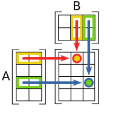

# 线性代数与几何直觉

两个样本经同一个矩阵变换后，哪些区别会保留下来？下面从一次 \(XW+b\) 计算出发，逐步看坐标、投影与秩。它们分别解释数组里的数怎么计算、向量的方向怎样理解，以及压缩时哪些信息可能消失。

本文先固定行向量约定；出现列向量几何例子时会明确标注。这个约定能避免把权重存储布局误当成数学变换方向。

## 一次矩阵乘法究竟组合了什么

本文把一个样本写成行向量。取两个样本，每个有两个特征，定义

\[
X=\begin{bmatrix}1&2\\3&4\end{bmatrix},\quad
W=\begin{bmatrix}2&-1&0\\1&1&3\end{bmatrix},\quad
b=[0,1,-2].
\]

输入形状是 \([2,2]\)，权重形状是 \([2,3]\)，偏置有三个分量。输出 \(Y=XW+b\) 为

\[
XW=\begin{bmatrix}4&1&6\\10&1&12\end{bmatrix},\qquad
Y=\begin{bmatrix}4&2&4\\10&2&10\end{bmatrix}.
\]

第一行第一个输出是 \(1\times2+2\times1=4\)。第二个输出先计算 \(1\times(-1)+2\times1=1\)，再加上对应偏置 1，得到 2。每个输出位置都读取输入的两个特征，使用权重矩阵里自己对应的一列。

这里两行样本互不混合，偏置沿样本维复制。对于 \([B,L,D_{\rm in}]\) 的 token 表示，同一个权重对每个样本、每个位置重复应用

\[
Y_{b,l,j}=\sum_{i=1}^{D_{\rm in}}X_{b,l,i}W_{i,j}+b_j.
\]

结果形状为 \([B,L,D_{\rm out}]\)。匹配的是特征维 \(D_{\rm in}\)，不是 token 数 \(L\)。框架也可能把权重保存成 \([D_{\rm out},D_{\rm in}]\)，前向中再转置；矩阵的保存布局与公式里的数学方向需要分别核对。

### 偏置把线性层变成仿射变换

如果把输入看成列向量，只有矩阵乘法的变换会把原点留在原点。加入偏置以后，变换变成

\[
f(x)=Wx+b.
\]

例如一维的 \(f(x)=2x+3\) 会把 \(0\) 送到 \(3\)。它仍然保持直线之间的平行关系，但不再是严格意义上的线性映射。神经网络代码常把两者都叫 linear layer，这个名称来自模块接口，不代表偏置已经消失。

把偏置写成齐次坐标可以看清它的位置。令

\[
\tilde x=\begin{bmatrix}x\\1\end{bmatrix},\qquad
\tilde W=\begin{bmatrix}W&b\\0&1\end{bmatrix},
\]

则 \(\tilde W\tilde x=[Wx+b;1]\)。这个写法主要用于几何推导和坐标变换，不建议为了普通神经网络前向真的增加一个常数维度。它说明 bias 是一个固定平移向量，而不是又一组与样本相乘的输入特征。

对归一化层和残差层也要保留这个区分。LayerNorm 的可学习缩放和偏移作用在归一化后的特征上，残差相加则要求两个分支拥有相容的 shape。它们都可能出现加法，却不承担同一个几何作用。

{ width="620" }

<small>图源为 [Wikimedia Commons](https://commons.wikimedia.org/wiki/File:Matrix_multiplication_diagram.svg)。行与列配对相乘求和，对应上面的每一个输出元素。</small>

## 一个向量的坐标依赖所选的基

把 \(x=(3,4)\) 看作二维空间里的箭头时，它在标准基 \(e_1=(1,0),e_2=(0,1)\) 下的坐标为 3 和 4。换一组基，同一个箭头可以有不同的坐标，几何对象没有因此改变。

神经网络的隐藏向量同样要结合整套参数理解。某个坐标较大，不足以证明该坐标独立对应“颜色”或“语法”。对一层表示做可逆变换，并在下一层使用相应逆变换，整个网络函数可以保持不变。很多语义分布在多个方向中，也未必对应单个轴。

矩阵可以改变长度、方向和维度。取列向量约定下的 \(A=\operatorname{diag}(2,1)\)，它把横向长度放大两倍，纵向不变；旋转矩阵则改变方向并保持欧氏长度。同一段推导应固定行列约定，不能把 \(Ax\) 和 \(xA\) 随意混用。

## 内积、长度与相似度要分开看

向量 \(x=(3,4)\) 的欧氏范数是

\[
\|x\|_2=\sqrt{3^2+4^2}=5.
\]

给定 \(y=(6,8)\)，内积为 50，余弦相似度为

\[
\cos(x,y)=\frac{x^\top y}{\|x\|_2\|y\|_2}=1.
\]

它们方向完全相同，但欧氏距离为 5。把 \(y\) 再放大十倍，内积也放大十倍，余弦仍为 1。因此“点积大”同时受到方向和长度影响；若想只比较方向，要先明确归一化。零向量的余弦没有定义，实现里添加 epsilon 是数值约定，不能给它创造一个确定方向。

对于单位向量 \(u\)，\(x^\top u\) 是投影的带符号长度，真正的投影向量为 \((x^\top u)u\)。例如 \(u=(1,1)/\sqrt2\)，则

\[
x^\top u=7/\sqrt2,\qquad
\operatorname{proj}_u(x)=(3.5,3.5).
\]

剩余向量 \((-0.5,0.5)\) 与 \(u\) 正交，内积为零。投影把一个方向的成分留下，把垂直方向的区别丢掉。给定非零但未归一化的方向 \(v\)，投影应写成 \(v(v^\top x)/(v^\top v)\)，不能省掉分母。

## 从内积到一次注意力计算

设一个 query 为 \(q=(1,0)\)，两个 key 为 \(k_1=(1,0),k_2=(0,1)\)。点积得到 \([1,0]\)，除以 \(\sqrt2\) 后约为 \([0.7071,0]\)，softmax 权重约为 \([0.6698,0.3302]\)。若对应 value 是标量 2 和 6，输出约为

\[
0.6698\times2+0.3302\times6=3.3210.
\]

key 用于计算匹配分数，value 提供被汇总的数值，它们可以是不同的向量。多个 query 一起计算，就得到

\[
\operatorname{Attention}(Q,K,V)
=\operatorname{softmax}_{\rm row}\left(\frac{QK^\top}{\sqrt{d_k}}\right)V.
\]

若有 \(N_q\) 个 query、\(N_k\) 个 key，分数矩阵形状为 \([N_q,N_k]\)，输出为 \([N_q,d_v]\)。softmax 沿 key 维归一化，使每个 query 获得自己的权重行。权重表示模型当前的特征汇总方式，不自动等于真实语义对应或因果解释。

### 投影矩阵为什么常常成对出现

把一个 \(d\) 维表示投影到较小的 \(r\) 维，再映回 \(d\) 维，可以写成

\[
z=xA,\qquad \hat x=zB,
\]

其中 \(A\in\mathbb R^{d\times r}\)，\(B\in\mathbb R^{r\times d}\)。中间宽度为 \(r\) 时，参数量从 \(d^2\) 变成 \(2dr\)。这不意味着输出一定等于原向量；如果 \(AB\) 只覆盖少数方向，投影会把其余方向的差异压掉。

LoRA 的更新形式 \(\Delta W=AB\) 使用的是同一类低秩结构，但它通常只训练增量，原始 \(W_0\) 仍保留。若把 \(A\) 初始化为零，或者把 \(B\) 初始化为零，初始增量为零，训练开始时模型函数可以与基座一致。两种矩阵的形状要根据前向约定写清楚，不能只记“两个小矩阵相乘”。

注意力里的 Q、K、V 也可以理解为三组投影。它们不要求产生同一种语义坐标，只要求 Q 与 K 的最后一维能做内积，V 的最后一维决定输出宽度。把 Q/K 的 head 维度和 V 的通道维度混写，矩阵乘法可能仍然合法，但得到的输出已经不再对应原来的接口。

## 链式法则如何沿着矩阵接口传回去

设一层的前向为 \(Y=XW+b\)，损失对输出的梯度为 \(G=\partial L/\partial Y\)。在行向量约定下，三个梯度为

\[
\frac{\partial L}{\partial W}=X^{\mathsf T}G,\qquad
\frac{\partial L}{\partial X}=GW^{\mathsf T},\qquad
\frac{\partial L}{\partial b}=\sum_{m}G_m.
\]

可以先检查形状。若 \(X\) 是 \([M,D_{\rm in}]\)，\(G\) 是 \([M,D_{\rm out}]\)，则 \(X^{\mathsf T}G\) 为 \([D_{\rm in},D_{\rm out}]\)，正好与 \(W\) 相同；\(GW^{\mathsf T}\) 为 \([M,D_{\rm in}]\)，与 \(X\) 相同；偏置沿样本维共享，所以梯度必须沿该维求和。

这个形状检查可以发现一种常见错误。若把 `W` 存成 `[D_out, D_in]`，前向写成 `x @ W.T`，反向对存储张量的梯度也应写成 `G.T @ X`。数学里的 \(W\) 与程序里的存储布局不是同一个对象，只有把转置位置固定下来，梯度才不会悄悄交换两个维度。

## 一个小矩阵怎样对应到神经网络中的三个接口

下面把同一个二维输入分别送入线性投影、注意力分数和低秩更新。每一步都保留 shape，便于把公式和代码对上。

| 接口 | 输入 | 参数或中间量 | 输出 | 需要检查的轴 |
| --- | --- | --- | --- | --- |
| 线性层 | `[B, D]` | `W[D, H]`、`b[H]` | `[B, H]` | `D` 被求和 |
| 点积注意力 | `Q[B, Nq, d]`、`K[B, Nk, d]` | `Q @ K.T` | `[B, Nq, Nk]` | key 位置在最后一轴 |
| 低秩更新 | `W0[D, H]` | `A[D, r]`、`B[r, H]` | `W0 + A @ B` | `r` 只在增量内部求和 |

如果三个接口都把最后一维误当成同一个含义，代码仍可能在某些形状上运行。真正的检查应在一个元素上展开求和，并写出该元素来自哪个样本、哪个位置和哪个特征。

## 秩说明哪些区别还能被保留

考虑矩阵

\[
W=\begin{bmatrix}1&2\\2&4\end{bmatrix}.
\]

第二列是第一列的两倍，因此秩为 1。对行向量 \(x=[a,b]\)，有 \(xW=[a+2b,2(a+2b)]\)，输出永远落在一条直线上。输入 `[2,0]` 与 `[0,1]` 都得到 `[2,4]`，后续只看这个输出就无法区分两个原始输入。

虽然输出仍有两个数字，独立变化方向只有一个。这是维度和秩的差别，也是压缩的具体含义。该矩阵可以精确分解为

\[
W=\begin{bmatrix}1\\2\end{bmatrix}
\begin{bmatrix}1&2\end{bmatrix}.
\]

一般的秩 \(r\) 分解 \(W\approx AB\) 需要 \(d_{\rm in}r+rd_{\rm out}\) 个参数，而完整矩阵需要 \(d_{\rm in}d_{\rm out}\)。压缩能否保留任务所需方向，要由数据和目标判断，不能只看参数减少比例。

LoRA 将训练更新写成 \(\Delta W=AB\)，限制的是增量的秩。最终 \(W_0+AB\) 仍可能满秩，不能把“低秩适配”解释成整个模型权重已经变成低秩矩阵。奇异值怎样给出最优低秩近似，见[谱分解与低秩结构](spectral-second-order-and-low-rank.md)。

## 换一组输入分布，低秩误差也会改变

如果用 \(\widetilde W\) 近似 W，记误差矩阵为 \(E=W-\widetilde W\)。对行向量输入 x，输出平方误差为 \(\|xE\|^2\)，在数据分布上平均得到 \(\operatorname{tr}(E^\top\mathbb E[x^\top x]E)\)。这里使用二阶矩，不要求输入已经中心化。

只有在输入二阶矩与单位阵成比例时，这个目标才与普通矩阵 Frobenius 误差成比例。因此相同权重误差，在某个输入方向经常出现的数据上可能更严重。这把“秩减少了多少”连接到“实际输出损失多少”，后者才决定压缩是否适合任务。

## 用代码核对坐标和乘法

下面只使用 Python 标准库，直接实现文首的运算。

```python
X = [[1, 2], [3, 4]]
W = [[2, -1, 0], [1, 1, 3]]
b = [0, 1, -2]
Y = [[sum(row[i] * W[i][j] for i in range(2)) + b[j]
      for j in range(3)] for row in X]
print(Y)
```

输出为 `[[4, 2, 4], [10, 2, 10]]`。每个下标都对应前面公式中的一个维度，因此可以用这个小例子检查转置与广播，再把相同运算交给优化过的矩阵乘库。更完整的模型实现见[线性层、MLP 与 GEMM](../foundations/linear-layers-mlp-and-gemm.md)，计算图上的形状约定见[张量与轴](../foundations/tensors-shapes-and-computation-graphs.md)。

## 练习与自测

下面几题故意只要求纸笔或几行 Python，不需要训练模型。

1. 取 \(X\in\mathbb R^{3\times4}\)、\(W\in\mathbb R^{4\times6}\)，写出 \(XW+b\) 的输出 shape，并说明偏置需要多少个数。
2. 对 \(W=\begin{bmatrix}1&2\\2&4\end{bmatrix}\)，找出一个非零输入方向，它经过右乘后变成零向量。
3. 若 `Q` 的 shape 是 `[2, 5, 8]`、`K` 的 shape 是 `[2, 7, 8]`，写出 `Q @ K.transpose(-1, -2)` 的 shape，并指出 softmax 应沿哪一轴做。
4. 令 \(x=[1,2]\)、\(u=[1,1]/\sqrt2\)，分别计算带符号投影长度和投影向量。再验证剩余向量与 \(u\) 的内积为零。

答案不需要背诵。第 1 题检验矩阵内维，第 2 题检验秩，第 3 题检验 query 与 key 轴，第 4 题检验“长度”和“向量”没有被混为一谈。若某一步只能说“框架会自动处理”，就回到元素级公式检查。

## 参考资料

- [Dive into Deep Learning 的线性代数章节](https://d2l.ai/chapter_preliminaries/linear-algebra.html)讨论向量、矩阵、范数与张量运算。


- [D2L 的线性计算](https://github.com/d2l-ai/d2l-zh/blob/e6b18ccea71451a55fcd861d7b96fddf2587b09a/chapter_linear-networks/linear-regression.md)，用具体矩阵核对轴、内积和批处理，再讨论几何解释。
