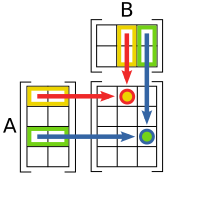

# 线性代数与几何直觉

AI 文章频繁使用向量、矩阵、投影、范数、秩和特征空间，因为模型需要把 token、图像 patch、机器人状态、动作、记忆放进向量空间，再用矩阵旋转、缩放、投影、混合和压缩这些表示。

## 向量是带方向的特征

一个 embedding 向量可以写成：

\[
x=(x_1,x_2,\dots,x_d)\in\mathbb{R}^d
\]

这里 \(d\) 是维度。不要把它只理解成一排数字；更有用的读法是：这个对象在 \(d\) 个隐含特征方向上各有多强。两个向量相近，通常表示模型在当前表示空间里认为它们有相似语义、视觉形状或动作含义。

常见名词可以这样读：

| 名词 | 直觉 | 后面会在哪里用 |
| --- | --- | --- |
| 向量 | 一个对象在多个特征方向上的坐标 | embedding、hidden state、latent state |
| 基 | 描述空间的一组参考方向 | PCA、低秩分解、特征空间 |
| 范数 | 向量有多大 | 梯度裁剪、归一化、正则化 |
| 内积 | 两个方向有多对齐 | attention score、相似度检索 |
| 余弦相似度 | 忽略长度，只看方向接近程度 | embedding 检索、RAG、聚类 |

## 矩阵是空间里的变换

线性层常写成：

\[
y=xW+b
\]

这里 \(x\) 是输入向量，\(W\) 是权重矩阵，\(b\) 是偏置，\(y\) 是输出向量。几何上，\(W\) 把输入空间里的点搬到另一个空间：有些方向被放大，有些方向被压缩，有些方向被混合。

把公式拆开读：

| 符号 | 在说什么 | 在代码里常见形状 |
| --- | --- | --- |
| \(x\) | 一个样本或 token 的输入特征 | `[D_in]` 或 `[B, L, D_in]` |
| \(W\) | 可学习的特征混合规则 | `[D_in, D_out]` |
| \(b\) | 每个输出维度的平移量 | `[D_out]` |
| \(y\) | 变换后的新特征 | `[D_out]` 或 `[B, L, D_out]` |

例如一个 token 的 hidden size 是 4096，MLP 第一层把它升到 11008 维，那么 \(W\) 的形状就是 \(4096\times11008\)。这行公式在后面的 [线性层、MLP 与 GEMM](../foundations/linear-layers-mlp-and-gemm.md) 里会变成参数量、FLOPs 和显存账本。

{ width="620" }

<small>图源：[Wikimedia Commons: Matrix multiplication diagram](https://commons.wikimedia.org/wiki/File:Matrix_multiplication_diagram.svg)。原图展示矩阵乘法中行与列如何配对相乘并求和。对线性层和 GEMM 来说，核心是把输入特征按权重列重新组合成新特征。</small>

在 Transformer 里，一个 `[B,L,D]` hidden state 进入 Linear 时，通常是每个 token 的 \(D\) 维向量乘同一个 \(W\)：

\[
(B,L,D_{\text{in}})\times(D_{\text{in}},D_{\text{out}})
\rightarrow
(B,L,D_{\text{out}})
\]

系统文章常关心 \(M,N,K\)、GEMM、Tensor Core 和 layout：模型概念里的“特征变换”，落到硬件上常常就是大规模矩阵乘法。

读这组 shape 时，前两个轴 \(B,L\) 不参与权重维度匹配，它们只是告诉系统“有多少个 token 要并行做同一个线性变换”；最后一维 \(D_{\text{in}}\) 必须和 \(W\) 的第一维对上。很多 shape bug 就发生在把 token 轴和特征轴混掉。

## 投影是在问“沿这个方向有多少”

如果 \(u\) 是单位方向，向量 \(x\) 在 \(u\) 上的投影长度是：

\[
\langle x,u\rangle
\]

attention 的 query-key 点积也可以先这样理解：query 在问“我想找某种信息”，key 在声明“我这里有某种信息”，点积越大，说明两个方向越对齐。

如果 \(x=(1,2)\)，\(u=(0,1)\)，那么 \(\langle x,u\rangle=2\)。它表示 \(x\) 在第二个方向上的分量是 2。换到 embedding 空间里，方向不再叫“横轴/纵轴”，而可能对应语法、实体、颜色、动作意图等模型自己学出来的隐含因素。

Scaled dot-product attention 写成：

\[
\mathrm{Attention}(Q,K,V)
=
\mathrm{softmax}\left(\frac{QK^\top}{\sqrt{d_k}}\right)V
\]

这里 \(QK^\top\) 是所有 query 和 key 的两两内积，\(\sqrt{d_k}\) 用来控制分数尺度，softmax 把相似度变成权重，最后对 \(V\) 做加权求和。

1. \(Q\) 是 query，表示每个位置想找什么信息。
2. \(K\) 是 key，表示每个位置能被什么查询匹配上。
3. \(QK^\top\) 得到一个 `[query_length, key_length]` 分数矩阵。
4. 除以 \(\sqrt{d_k}\) 是为了避免维度越大，点积分数尺度越大，softmax 过早变得很尖。
5. softmax 后每一行变成“这个 query 应该读哪些 key”的概率权重。
6. 乘 \(V\) 是把被选中的 value 信息加权汇总回来。

后面读 FlashAttention 或 KV cache 时，也是在拆这行公式：prefill 阶段一次算完整 \(QK^\top\)，decode 阶段每个新 token 只带一个新 query 去读历史 K/V。

## 秩和低秩是在说信息压缩

矩阵的秩可以理解为：这个线性变换真正用到了多少个独立方向。如果一个大矩阵可以近似分解成两个小矩阵：

\[
W\approx AB,\quad
A\in\mathbb{R}^{d_{\text{in}}\times r},
\quad
B\in\mathbb{R}^{r\times d_{\text{out}}}
\]

且 \(r\) 很小，就说明它的主要变化集中在少数方向上。LoRA、低秩适配、PCA、SVD、某些压缩方法都在利用这个思想。

低秩有代价。压缩掉的方向如果正好承载长尾知识、风险状态或动作敏感信息，指标可能在平均样本上还行，在关键场景里失败。

## 常见误读

| 误读 | 更稳的理解 |
| --- | --- |
| 维度越高越聪明 | 维度更高只是容量更大，也更贵、更难训练 |
| 内积大就是语义真相 | 内积只是当前表示空间里的相似度，受训练目标和数据分布影响 |
| 低秩一定不损质量 | 低秩保留主方向，可能牺牲长尾方向 |
| 矩阵乘只是数学细节 | 它通常是训练和推理的主要计算成本 |

## 读完以后怎么判断

看到向量、矩阵或 embedding 时，先问三件事：这个向量表示什么对象，矩阵在把哪些方向混合，变换后的空间服务什么任务。能回答这三点，后面的 attention、MLP、GEMM、LoRA、量化和视觉 token 压缩就都有了共同底座。

## 外部材料

- [Dive into Deep Learning: Linear Algebra](https://d2l.ai/chapter_preliminaries/linear-algebra.html)。
