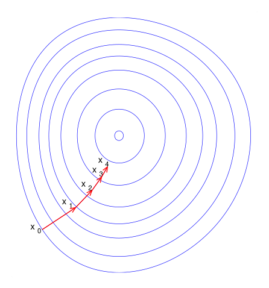

# 优化、梯度与约束

在 \(L(x,y)=x^2/2+5y^2\) 上，两个参数方向的曲率相差十倍。从(1,1)出发，同一学习率为什么能让一个方向慢慢下降，却让另一个方向来回震荡？这个二次函数能精确算出答案。

先看固定步长，再加入随机批次、历史动量和自适应缩放。最后把目标改成带约束的问题，区分“偏好某种解”和“必须满足条件”。

## 在二次曲面上算出安全步长

最基本的更新是：

\[
\theta_{t+1}
=
\theta_t-\eta\nabla_\theta\mathcal{L}(\theta_t)
\]

这里 \(\eta\) 是学习率。学习率太大可能越过谷底甚至发散，太小会训练很慢。

逐项读：

| 符号 | 含义 |
| --- | --- |
| \(\theta_t\) | 第 \(t\) 步的当前参数 |
| \(\nabla_\theta\mathcal{L}(\theta_t)\) | 当前参数处 loss 上升最快的方向 |
| \(-\nabla_\theta\mathcal{L}\) | loss 下降的局部方向 |
| \(\eta\) | 一步走多远 |
| \(\theta_{t+1}\) | 更新后的参数 |

用一个二维二次函数可以精确看出步长为什么会出问题。设

\[
L(x,y)=\tfrac12x^2+5y^2,\qquad \nabla L=(x,10y).
\]

从 \((1,1)\) 出发，初始损失为5.5。学习率0.1得到 \((0.9,0)\)，损失0.405；再走一步得到 \((0.81,0)\)，损失0.32805。第二个方向曲率为10，它比第一个方向变化快。

若学习率改成0.3，第一步得到 \((0.7,-2)\)，损失20.245。虽然方向是负梯度，有限步长仍让损失上升。一般地，每个特征方向更新都乘上 \(1-\eta\lambda\)，其中 \(\lambda\) 是对应曲率。要让本例所有方向收缩，必须满足 \(0<\eta<2/10=0.2\)。这个结论针对固定步长的正定二次问题；神经网络的曲率会变化，不能直接当作全局学习率保证。

{ width="620" }

<small>图源：[Wikimedia Commons: Gradient descent](https://commons.wikimedia.org/wiki/File:Gradient_descent.svg)。原图展示参数沿目标函数表面逐步下降。这里的重点是：优化器只能根据局部信息走路，loss landscape 的曲率、噪声和尺度都会影响路径。</small>

## SGD：用 mini-batch 估计真实梯度

真实目标常是数据分布上的期望：

\[
\mathcal{L}(\theta)
=
\mathbb{E}_{(x,y)\sim\mathcal{D}}
\left[
\ell(f_\theta(x),y)
\right]
\]

但训练时只能抽 mini-batch：

\[
\hat{g}
=
\frac{1}{B}\sum_{i=1}^{B}
\nabla_\theta \ell(f_\theta(x_i),y_i)
\]

若采样分布、样本权重和损失定义一致，并允许梯度与期望交换，这个平均是总体梯度的无偏估计。若每个样本梯度独立、方差有限，平均梯度的方差随 \(1/B\) 缩小。重复同一张图的增强样本往往相关，不能直接按独立样本计算收益。

还要区分按样本平均与按token平均。两条序列分别有2个和8个有效token，若先各自求平均再取平均，它们权重各为一半；若目标是所有token等权，权重应为0.2和0.8。这种目标差异不会由优化器自动修正。

这里 \(B\) 是 batch size，\(\ell\) 是单样本损失，\(\hat{g}\) 是用这个 batch 估计出来的梯度。batch 越小，估计越抖；batch 越大，估计更稳但通信、显存和吞吐压力更大。后面的分布式训练文章会把这个公式变成 global batch、gradient accumulation 和 all-reduce 问题。

## 动量：不要每一步都完全听当前 batch

动量更新可以写成：

\[
v_t=\beta v_{t-1}+g_t,\qquad
\theta_{t+1}=\theta_t-\eta v_t
\]

这里采用未乘 \((1-\beta)\) 的累积约定。取 \(\beta=0.9,v_0=0\)，连续梯度为2、-1，则 \(v_1=2,v_2=0.8\)。第二次当前梯度已经反向，但历史累积仍让更新沿原方向走。动量可以平滑噪声，也可能在转弯或高曲率处造成过冲。

有些实现写成 \(v_t=\beta v_{t-1}+(1-\beta)g_t\)，这是指数移动平均。两种约定的尺度不同，比较公式时要同时看学习率。

## Adam：按一阶矩和二阶矩自适应缩放

Adam 维护梯度的一阶矩和二阶矩：

\[
m_t=\beta_1 m_{t-1}+(1-\beta_1)g_t
\]

\[
v_t=\beta_2 v_{t-1}+(1-\beta_2)g_t^2
\]

从 \(m_0=v_0=0\) 开始，最初的平均会被零初值压小。Adam用偏差修正

\[
\hat m_t=\frac{m_t}{1-\beta_1^t},\qquad
\hat v_t=\frac{v_t}{1-\beta_2^t},\qquad
\theta_{t+1}=\theta_t-\eta\frac{\hat m_t}{\sqrt{\hat v_t}+\epsilon}.
\]

除法、平方与开方都是逐坐标操作。取首个梯度 \(g_1=2\)、\(\beta_1=0.9,\beta_2=0.999\)，得到 \(m_1=0.2,v_1=0.004\)，修正后为2和4。忽略很小的 \(\epsilon\)，更新大小为 \(\eta\)，而直接使用未修正值会得到约 \(3.162\eta\)。这就是偏差修正不能从算法定义中省掉的原因。

\(v_t\) 是梯度平方的滑动平均，没有减去均值平方，因此不能直接称作梯度方差。Adam也没有求解完整Hessian，它只是按坐标历史尺度调整更新。

公式里 \(m_t\) 像“近期平均方向”，\(v_t\) 像“近期平方梯度尺度”。如果某个参数方向的梯度长期很大，Adam 会用较大的 \(\sqrt{v_t}\) 把步幅压下来；如果某个方向梯度很小，步幅会相对放大。代价是每个参数通常要额外存 \(m_t\) 和 \(v_t\)，这就是 optimizer state 显存来源之一。

## 回到同一个起点比较第一步

对起点梯度(1,10)，普通SGD取学习率0.1，更新为(-0.1,-1)，到达(0.9,0)。Adam从零状态开始，完成偏差修正并忽略epsilon后，两个分量都近似取梯度符号，因此更新约为(-0.1,-0.1)，到达(0.9,0.9)。

第二个结果的损失为4.455，高于这一步SGD的0.405。这个构造不证明SGD普遍更好，只表明Adam的坐标缩放改变了路径，不能把它描述为“同样方向走得更聪明”。后续历史、梯度噪声和学习率都会影响比较。

## 把曲率解释推广到多参数

如果 loss 在某个方向很陡，在另一个方向很平，同一个学习率会有不同效果。Hessian 描述二阶曲率：

\[
H=\nabla^2_\theta\mathcal{L}
\]

大模型很少直接算完整 Hessian，但曲率直觉会出现在学习率调度、warmup、二阶优化、Muon、梯度裁剪和稳定性分析里。

## 约束优化：不是所有参数更新都允许

有时目标不是单纯最小化 loss，还要满足约束：

\[
\min_x f(x)\quad \text{s.t.}\quad g(x)=0
\]

拉格朗日函数写成：

\[
\mathcal{L}(x,\lambda)=f(x)+\lambda g(x)
\]

\(\lambda\) 是需要与 \(x\) 一起确定的乘子。以 \(x+y=1\) 下最小化 \(x^2+y^2\) 为例，拉格朗日函数是

\[
\mathcal L(x,y,\lambda)=x^2+y^2+\lambda(x+y-1).
\]

对三个变量写驻点条件，得到 \(2x+\lambda=0\)、\(2y+\lambda=0\)、\(x+y=1\)，解为 \(x=y=0.5,\lambda=-1\)。约束在解处精确成立。对一般非凸问题，驻点条件只给候选点，还需检查约束资格和局部或全局最优性。

若换成固定平方惩罚 \(x^2+y^2+\rho(x+y-1)^2\)，解为 \(x=y=\rho/(1+2\rho)\)。取 \(\rho=1\)，得到各1/3，和为2/3，违反原约束。固定惩罚允许在任务与违约之间折中，不能声称与精确约束相同。

对不等式 \(g(x)\le0\)，常见KKT条件还包含 \(\lambda\ge0\) 和互补松弛 \(\lambda g(x)=0\)。约束未激活时乘子为零；这些条件与优化一个固定权重的综合损失仍有区别。

RLHF的固定KL惩罚会改变优化偏好，PPO的clip会截断某些样本继续改善代理目标的激励。二者都不能直接保证更新后的KL或概率比落在硬阈值内。只有明确的可行集、投影或满足条件的约束求解，才能讨论相应硬约束保证。

例如模型压缩可以想成：

\[
\min_{\text{model}} \text{latency}
\quad
\text{s.t.}\quad
\text{quality drop}\le \epsilon
\]

也就是想让延迟最小，但质量下降不能超过阈值。实际工程里常把约束改写成带权重的综合目标：延迟、显存、精度、稳定性同时进入评分。这时权重不是装饰，它决定系统到底偏向速度还是质量。

## 正则化：限制模型别只记训练集

常见 L2 正则写成：

\[
\mathcal{L}_{\text{total}}
=
\mathcal{L}_{\text{task}}
+\lambda\|\theta\|_2^2
\]

这个定义给梯度增加 \(2\lambda\theta\)。若使用普通SGD，更新可写成 \((1-2\eta\lambda)\theta-\eta g\)，等价于相应系数的权重衰减。对Adam，正则梯度还会进入一阶、二阶矩历史，经过自适应缩放，因此一般不等价于独立缩小权重。

AdamW采用解耦的形式，例如 \(\theta_{t+1}=(1-\eta\lambda_w)\theta_t-\eta\hat m_t/(\sqrt{\hat v_t}+\epsilon)\)。这里 \(\lambda_w\) 的约定不必等于前式的 \(\lambda\)。正则可以改变拟合倾向，但较小参数范数不自动意味着更好的泛化，仍需与实际任务对应的验证数据。

\(\lambda\) 是正则强度。太小，正则几乎不起作用；太大，模型可能为了让参数小而牺牲任务能力。RLHF 的 KL 系数、量化校准里的误差权重、扩散蒸馏里的多项 loss 权重，都有类似的“拉哪一边”的作用。

## 外部材料

- [CS231n: Optimization](https://cs231n.github.io/optimization-1/)。

- [PyTorch 优化循环](https://github.com/pytorch/tutorials/blob/5672cd98a7671eda4d9122b10f8eec580f74d03e/beginner_source/basics/optimization_tutorial.py)，确认梯度估计、状态更新和参数更新各发生在哪一步。
