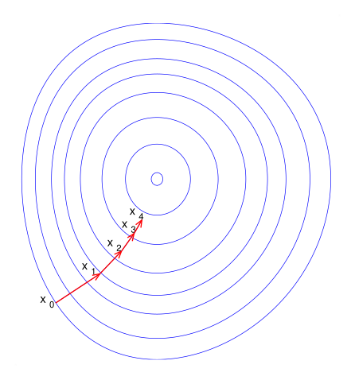

# 优化、梯度与约束

这篇回答一个问题：loss、梯度下降、学习率、动量、Adam、约束优化和拉格朗日乘子，怎样连成训练算法。

模型训练可以先看成一个最小化问题：

\[
\min_\theta \mathcal{L}(\theta)
\]

其中 \(\theta\) 是参数，\(\mathcal{L}\) 是目标函数。训练不是“模型自己学会”，而是不断估计一个更新方向，再把参数往更低 loss 的地方推。

这里 \(\min_\theta\) 的意思是“在所有可能参数里找一组让 loss 小的参数”。真实大模型当然不会穷举所有 \(\theta\)，优化器只是从当前参数出发，一步步沿局部信息移动。

## 梯度下降：沿局部下降方向走

最基本的更新是：

\[
\theta_{t+1}
=
\theta_t-\eta\nabla_\theta\mathcal{L}(\theta_t)
\]

这里 \(\eta\) 是学习率。学习率太大可能越过谷底甚至发散，太小会训练很慢。

逐项读：

| 符号 | 含义 |
| --- | --- |
| \(\theta_t\) | 第 \(t\) 步的当前参数 |
| \(\nabla_\theta\mathcal{L}(\theta_t)\) | 当前参数处 loss 上升最快的方向 |
| \(-\nabla_\theta\mathcal{L}\) | loss 下降的局部方向 |
| \(\eta\) | 一步走多远 |
| \(\theta_{t+1}\) | 更新后的参数 |

后面读训练曲线时，如果 loss 忽然爆掉，常见怀疑对象就是这行公式里的步长、梯度尺度或数值精度出了问题。

{ width="620" }

<small>图源：[Wikimedia Commons: Gradient descent](https://commons.wikimedia.org/wiki/File:Gradient_descent.svg)。原图展示参数沿目标函数表面逐步下降。本站用它说明：优化器只能根据局部信息走路，loss landscape 的曲率、噪声和尺度都会影响路径。</small>

## SGD：用 mini-batch 估计真实梯度

真实目标常是数据分布上的期望：

\[
\mathcal{L}(\theta)
=
\mathbb{E}_{(x,y)\sim\mathcal{D}}
\left[
\ell(f_\theta(x),y)
\right]
\]

但训练时只能抽 mini-batch：

\[
\hat{g}
=
\frac{1}{B}\sum_{i=1}^{B}
\nabla_\theta \ell(f_\theta(x_i),y_i)
\]

这就是 stochastic gradient。它有噪声，但便宜；噪声有时还能帮助逃离坏的局部区域。

这里 \(B\) 是 batch size，\(\ell\) 是单样本损失，\(\hat{g}\) 是用这个 batch 估计出来的梯度。batch 越小，估计越抖；batch 越大，估计更稳但通信、显存和吞吐压力更大。后面的分布式训练文章会把这个公式变成 global batch、gradient accumulation 和 all-reduce 问题。

## 动量：不要每一步都完全听当前 batch

动量更新可以写成：

\[
v_t=\beta v_{t-1}+g_t,\qquad
\theta_{t+1}=\theta_t-\eta v_t
\]

它把过去梯度方向累积起来，减少每个 mini-batch 噪声带来的抖动。直觉上，动量像给参数更新加了惯性。

## Adam：按一阶矩和二阶矩自适应缩放

Adam 维护梯度的一阶矩和二阶矩：

\[
m_t=\beta_1 m_{t-1}+(1-\beta_1)g_t
\]

\[
v_t=\beta_2 v_{t-1}+(1-\beta_2)g_t^2
\]

然后用 \(m_t/\sqrt{v_t}\) 调整每个参数方向的步幅。它常用于大模型训练，但也会引入 optimizer state 显存成本。

公式里 \(m_t\) 像“近期平均方向”，\(v_t\) 像“近期平方梯度尺度”。如果某个参数方向的梯度长期很大，Adam 会用较大的 \(\sqrt{v_t}\) 把步幅压下来；如果某个方向梯度很小，步幅会相对放大。代价是每个参数通常要额外存 \(m_t\) 和 \(v_t\)，这就是 optimizer state 显存来源之一。

## 曲率：同样的学习率在不同方向上不一样安全

如果 loss 在某个方向很陡，在另一个方向很平，同一个学习率会有不同效果。Hessian 描述二阶曲率：

\[
H=\nabla^2_\theta\mathcal{L}
\]

大模型很少直接算完整 Hessian，但曲率直觉会出现在学习率调度、warmup、二阶优化、Muon、梯度裁剪和稳定性分析里。

## 约束优化：不是所有参数更新都允许

有时目标不是单纯最小化 loss，还要满足约束：

\[
\min_x f(x)\quad \text{s.t.}\quad g(x)=0
\]

拉格朗日函数写成：

\[
\mathcal{L}(x,\lambda)=f(x)+\lambda g(x)
\]

其中 \(\lambda\) 是拉格朗日乘子。直觉是：把约束违反程度以惩罚项形式放进目标里。

RLHF 里的 KL penalty、PPO 的 clip、量化里的误差约束、模型压缩里的 latency/accuracy tradeoff，都可以从“带约束的优化”角度理解。

例如模型压缩可以想成：

\[
\min_{\text{model}} \text{latency}
\quad
\text{s.t.}\quad
\text{quality drop}\le \epsilon
\]

也就是想让延迟最小，但质量下降不能超过阈值。实际工程里常把约束改写成带权重的综合目标：延迟、显存、精度、稳定性同时进入评分。这时权重不是装饰，它决定系统到底偏向速度还是质量。

## 正则化：限制模型别只记训练集

常见 L2 正则写成：

\[
\mathcal{L}_{\text{total}}
=
\mathcal{L}_{\text{task}}
+\lambda\|\theta\|_2^2
\]

它不只是数学洁癖，而是在告诉模型：除了拟合训练数据，也要避免参数过大或函数过复杂。weight decay、dropout、data augmentation、KL regularization 都是在不同层面控制泛化和行为边界。

\(\lambda\) 是正则强度。太小，正则几乎不起作用；太大，模型可能为了让参数小而牺牲任务能力。RLHF 的 KL 系数、量化校准里的误差权重、扩散蒸馏里的多项 loss 权重，都有类似的“拉哪一边”的作用。

## 常见误读

| 误读 | 更稳的理解 |
| --- | --- |
| loss 降低就一定更好 | loss 只对应训练目标，不保证下游能力、安全或闭环表现 |
| Adam 总比 SGD 好 | 优化器选择依赖模型、数据、批量、硬件和泛化目标 |
| 学习率只是超参数 | 它决定优化路径，影响稳定性和最终能力 |
| 正则化就是防过拟合 | 它也可以约束行为、分布偏移和系统风险 |

## 读完以后怎么判断

看到一个训练公式时，先问：目标函数是什么，梯度怎么估计，更新受哪些约束，优化器多存了哪些状态，指标是否真的对应最终任务。这个问题链会贯穿预训练、微调、对齐、量化训练和世界模型训练。

## 相关阅读与下一步

- 站内下一步：[优化与训练入门](../foundations/optimization-and-training-basics.md)。
- 站内下一步：[目标函数、优化器与 LR 日程](../training/objectives-optimizers-and-schedules.md)。
- 外部材料：[CS231n: Optimization](https://cs231n.github.io/optimization-1/)。
